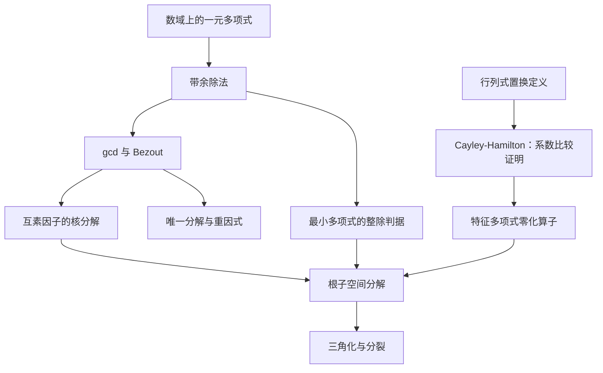

> **归档标注（DSH 侧 · 2026-10-12）**：本件**已归档**于 `lectures/math/approved/05A_补_多项式与最小多项式.md`；**已经 DSH 独立审稿通过**（报告 `lectures/math/review_reports/review_20261012_05A_多项式与最小多项式.md`；通过信号 `signals/review_approved/math/20261012_05A_补_多项式与最小多项式_v0.1.signal`）。**正文＝CDX 原件逐字节未改**（md5 `93b5440e94efc66d6a2246d7f37a9b95`／25305 B）；含落位栏的送审位存 `.harness/superseded/05A_送审位含DSH落位栏.bak-20261012.md`。**A2（YAML 头折叠）／A3（末尾缺换行）待 CDX 侧直接改**。
> **说明**：本件内文自述"作者自校稿，**未经 DSH 独立审稿**"系**送审前**字样；审稿已于 2026-10-12 通过，**以本标注为准**。

# 05A 补丁：多项式与最小多项式

> **作者与状态**：Codex 侧数学教授分身（CDX），依据 DSH 的 `20261011_math_高代补丁P2_多项式与最小多项式_大纲_DSH.md` 撰写。沿用同学已确认的“当前会话直接编写并审校”，不宣称另有 Astra 会话参与。**作者自校稿，未经 DSH 独立审稿**。DSH 按件负责落位、独立审稿、归档与 R7、R9 登记联动；本稿不自行销号，不代表同学已学完。

## §0 结构图景与前置

**为什么补这一课？** 第三课使用特征多项式，第五课 §1.3–§1.4 使用多项式互素构造；第五课 §4.3 定理 2 的现有 Cayley–Hamilton 证明依赖根子空间分解。本讲补一条独立路线：先从行列式证明 **R7：Cayley–Hamilton**，再由互素分解证明 **R9：根子空间分解**。不把 R9 偷放进 R7 的前提。

**范围与目标**：能执行欧几里得算法并回代；能区别根、重根和不可约因式；能构造核分解；能逐行解释 R7、R9 的依赖。仅补这条闭环所需内容，不进入模论、有理标准形或不变因子。

**前置**：第二课 §4.1 的有限维基与扩基、§5.2 的矩阵表示；第五课 §5.1 定义 1 及引理 1（行列式置换定义与性质）、§5.2 定理 1（乘性）、§5.3 定理 2（可逆判据）。不预设 Laplace 或伴随矩阵，本讲 §5 补出所需部分，也不依赖尚待审稿的 P1。代数基本定理仍按登记表 **R6** 作为已声明输入，不在本讲证明。

**统一设定**：$F$ 是数域，即 $\mathbb C$ 的子域；特别包括 $\mathbb Q,\mathbb R,\mathbb C$。所以特征为零。$V$ 是 $n\ge1$ 维 $F$ 向量空间，$T:V\to V$ 线性，$I$ 为恒等算子。零维情形单独约定 $m_T=\chi_T=1$，各分解为空直和，结论仍成立。

**大纲校正**：§4 的 $V=\bigoplus\ker f_i(T)$ 必须假设 $f(T)=0$，否则一般错误。最小多项式在 §4 用有限维性先证明存在，避免在定义前调用 §5；§5 再给出更强次数上界。无需限制整个空间为循环子空间。

## §1 多项式、带余除法与整除

### 1.1 对象与运算

**多项式环** $F[x]$ 是有限形式和 $f(x)=\sum_{i=0}^{d}a_ix^i$ 的集合；相等指对应系数相等。加法逐项相加；乘法按分配律并用 $x^ix^j=x^{i+j}$。常数 $a$ 视为常数多项式。非零多项式的**次数**是最大非零系数的下标，最高次系数称首项系数；它等于 $1$ 时称**首一**。约定 $\deg0=-\infty$。

非零 $f,g$ 的首项相乘不会消失，因为域中两个非零数的积非零，所以 $\deg(fg)=\deg f+\deg g$。特别地，两个非零多项式相乘不为零；这允许约去非零多项式。

### 1.2 带余除法的存在唯一性

**定理 1**：对 $f,g\in F[x]$、$g\ne0$，存在唯一的 $q,r$ 使 $f=qg+r$，且 $r=0$ 或 $\deg r<\deg g$。

**存在性**：若 $f=0$ 或 $\deg f<\deg g$，取 $q=0,r=f$。否则设 $f,g$ 的首项为 $ax^m,bx^d$，其中 $m\ge d$、$b\ne0$。令 $f_1=f-(a/b)x^{m-d}g$，最高次项抵消，故 $f_1=0$ 或 $\deg f_1<m$。重复此操作，每次非零余项次数严格下降，不可能无限进行；累加减去的倍数得到 $q$，最后余项为 $r$。

**唯一性**：若另有 $f=q'g+r'$，则 $(q-q')g=r'-r$。若 $q-q'\ne0$，左边次数至少 $\deg g$，右边若非零则次数小于 $\deg g$，若为零也不可能等于非零左边。矛盾，故 $q=q'$，再得 $r=r'$。

**示例**：$x^3-2x+1=x(x^2-1)+(-x+1)$，余式次数 $1<2$。逐项展开右边可核对。

### 1.3 整除与因式定理

定义 $g\mid f$ 为存在 $h\in F[x]$ 使 $f=gh$。除以 $x-a$ 得 $f=(x-a)q+c$，代入 $a$ 得 $c=f(a)$，故 **因式定理**：$f(a)=0\iff(x-a)\mid f$。

**本节回看**：域保证可除首项系数；严格降次保证算法停止。这就是 $F[x]$ 的欧几里得性质，下一节用它找最大公因式。

## §2 gcd、Bézout 与两个核的分解

### 2.1 算法与存在唯一性

对不同时为零的 $f,g$，**首一最大公因式** $d=\gcd(f,g)$ 满足：$d\mid f,d\mid g$，并且任意共同因式都整除 $d$。“最大”是整除关系，不是系数大小。

**定理 2**：这样的 $d$ 存在唯一，且存在 $u,v\in F[x]$ 使 $d=uf+vg$。

**构造与证明**：若其中一项为零，将另一项首一化即可。否则令 $r_0=f,r_1=g$，逐次除法

$r_{j-1}=q_jr_j+r_{j+1},\qquad j=1,\ldots,s,$

直到 $r_s\ne0,r_{s+1}=0$。第一次后余式次数严格下降，故必停止。每一步 $(r_{j-1},r_j)$ 与 $(r_j,r_{j+1})$ 的共同因式相同：一个方向用减法 $r_{j+1}=r_{j-1}-q_jr_j$，反方向用加法还原。因此共同因式恰是 $r_s$ 的因式，首一化 $r_s$ 得所求 $d$。

同时维护 $r_j=u_jf+v_jg$：初值 $(u_0,v_0)=(1,0)$、$(u_1,v_1)=(0,1)$；递推 $u_{j+1}=u_{j-1}-q_ju_j$、$v_{j+1}=v_{j-1}-q_jv_j$。把最后的 $u_s,v_s,r_s$ 同除首项系数即得 Bézout 等式。若 $d,e$ 都满足定义，则互相整除，次数相等，且均首一，只能相等。

**互素**定义为 $\gcd(f,g)=1$。于是 $f,g$ 互素当且仅当存在 $u,v$ 使 $uf+vg=1$：正向由定理，反向因任一公因式都整除 $1$。

**示例**：$f=x^2-1,g=x^2-x$。有 $f-g=x-1$，而 $g=x(x-1)$，故 $d=x-1=f-g$。若 $f=x,g=x-1$，则 $f-g=1$，两者互素。

### 2.2 将多项式代入算子

定义 $f(T)=\sum_{i=0}^{d}a_iT^i$，其中 $T^0=I$。由 $T^iT^j=T^{i+j}$ 与分配律，$(fg)(T)=f(T)g(T)$、$(f+g)(T)=f(T)+g(T)$；而且 $f(T)g(T)=g(T)f(T)$。这是同一个算子的多项式可以交换，**不表示任意两个矩阵可以交换**。

### 2.3 两个互素因子的核直和

**引理 1**：若 $f,g$ 互素，则 $\ker(fg)(T)=\ker f(T)\oplus\ker g(T)$。

**证明**：取 $uf+vg=1$。若 $z\in\ker(fg)(T)$，则

$z=v(T)g(T)z+u(T)f(T)z.$

第一项被 $f(T)$ 杀掉，因为各因子可交换且 $f(T)g(T)z=0$；第二项同理被 $g(T)$ 杀掉。反向包含：若 $a\in\ker f(T)$、$b\in\ker g(T)$，则 $(fg)(T)(a+b)=0$。若 $z$ 在两个核的交中，则 $z=u(T)f(T)z+v(T)g(T)z=0$，故和为直和。所有方向都已证明。

**小例子**：$T=\operatorname{diag}(0,1)$，取 $f=x,g=x-1$，便得到两个坐标轴的直和。这里 $fg(T)=0$，所以分解的是整个空间；一般情况下，引理只分解 $\ker(fg)(T)$。

**本节回看**：Bézout 提供“把向量拆成两部分”的具体公式，不只是存在性口号。

## §3 因式分解、重因式与 Eisenstein

### 3.1 唯一因式分解

非恒定多项式 $p$ 称**不可约**，若不能写成两个正次数多项式的积。

**引理 2（不可约因式的整除性质）**：若不可约 $p\mid ab$，则 $p\mid a$ 或 $p\mid b$。若 $p\nmid a$，则不可约性给 $\gcd(p,a)=1$；由 §2 定理 2 有 $up+va=1$，乘 $b$ 后右侧两项都被 $p$ 整除，故 $p\mid b$。

**定理 3**：每个非零非常数 $f$ 唯一写成 $f=c\prod_{i=1}^{s}p_i^{e_i}$，其中 $c\ne0$，$p_i$ 两两不同、首一不可约，$e_i\ge1$；唯一性允许重排。

**证明**：存在性按次数归纳：不可约时结束；可约时拆成两个次数更小的因式，对二者归纳。每次次数下降，必终止。唯一性用引理 2：第一种分解中的任一不可约因式必整除第二种分解某个不可约因式，两者首一，故相等；约去一个，重复直到所有因式约完。常数由首项系数确定。

### 3.2 重因式判据（特征零）

形式导数定义为 $f'=\sum_{i=1}^{d}i a_ix^{i-1}$；直接逐项展开可验证 $(gh)'=g'h+gh'$。

**定理 4**：在定理 3 的记号下，首一的 $\gcd(f,f')=\prod_{i=1}^{s}p_i^{e_i-1}$。因此 $f$ 无重复不可约因式当且仅当 $\gcd(f,f')=1$。

**证明**：固定一个因式，写 $f=p^eh$，$p\nmid h$。则 $f'=p^{e-1}(ep'h+ph')$。由于特征零，$e\ne0$；$p'$ 非零且次数比 $p$ 小，所以不可约性给 $p\nmid p'$。由引理 2，$p\nmid ep'h$，故 $p\nmid(ep'h+ph')$。因此 $p$ 在 $f'$ 中的指数恰为 $e-1$。对每个 $p_i$ 作此论证，公因式指数为两边较小者，即 $e_i-1$。常数非零多项式的 gcd 为 $1$，结论单独成立；零多项式不在该判据中。

**例**：$f=(x-1)^3(x+2)^2$，则 $\gcd(f,f')=(x-1)^2(x+2)$。在复数上不可约因式都是一次，因此这也是重根判据。

### 3.3 Eisenstein：只在这里需要的有理数方向

先补一个整系数工具，避免把“在整数中不可约”直接当作“在有理数中不可约”。整数多项式的系数最大公约数为 $1$ 时称**本原**。

**引理 3（本原乘积与清分母）**：两个本原整数多项式的积仍本原。否则某素数 $p$ 整除积的所有系数，将系数按 $p$ 取余得到零多项式；两个因子各有系数不被 $p$ 整除，故取余后均非零。余数构成域 $\mathbb F_p$（非零余数的逆由整数 Bézout 等式得到），域上两个非零多项式的首项之积非零，矛盾。

进一步，若本原 $f\in\mathbb Z[x]$ 在 $\mathbb Q[x]$ 中分解，清分母并从各因子提出系数 gcd，得 $f=(a/b)GH$，其中 $G,H$ 本原、$a,b$ 互素整数、$b>0$。由 $bf=aGH$，$b$ 整除 $GH$ 的每个系数（用 $a,b$ 互素），本原性迫使 $b=1$；再由 $f$ 本原得 $|a|=1$。吸收符号，$f$ 就有整数系数的同次数分解。所用整数 gcd、素数整除与整数 Bézout 为初等整数运算，不涉及抽象环论。

**定理 5（Eisenstein）**：设 $f=\sum_{i=0}^{d}a_ix^i\in\mathbb Z[x]$、$d\ge1$。若素数 $p$ 满足 $p\nmid a_d$、$p\mid a_i$ 对 $0\le i<d$ 成立，且 $p^2\nmid a_0$，则 $f$ 在 $\mathbb Q[x]$ 不可约。

**证明**：先提出系数 gcd；它不被 $p$ 整除（因 $p\nmid a_d$），故除去它后上述条件仍成立。若本原部分可约，引理 3 给正次数整数因子 $G,H$。因首项乘积不被 $p$ 整除，取余后两个因子保持正次数；而它们的积是 $\overline{a_d}x^d$。由域 $\mathbb F_p$ 上的唯一分解（§3.1 的证明仅用域性质，同样适用），二者只能分别为非零常数乘 $x^r,x^{d-r}$，其中 $1\le r<d$。所以二者常数项均被 $p$ 整除，$f$ 的常数项被 $p^2$ 整除，矛盾。

**真算核验一**：$h=x^4+2x+2$，素数 $2$ 整除非首项全部系数，$4\nmid2$，所以在 $\mathbb Q[x]$ 不可约。另算 $g=(x-1)^2(x+2)=x^3-3x+2$，$g'=3x^2-3$。有 $g-(x/3)g'=-2x+2$，而 $g'=3(x-1)(x+1)$，故首一 gcd 恰为 $x-1$，与重复因式吻合。

### 3.4 复数与实数的标准分解

调用已登记而本讲不证明的 **R6（代数基本定理）**：复数上每个正次数多项式有根。反复使用因式定理并降次，得复系数多项式完全分解为一次因式。

实系数多项式的非实根成共轭对：因 $f(\overline z)=\overline{f(z)}$，且共轭保持因式重数。将 $a+bi,a-bi$ 配对，得到实二次因式 $x^2-2ax+a^2+b^2$，其中 $b\ne0$，它没有实根，故不可约。因此实数上不可约因式只可能为一次或无实根的二次。

**本节回看**：不可约依赖底域；重因式判据依赖特征零；Eisenstein 只给充分条件，不能反向使用。

## §4 中国剩余型核分解与最小多项式

### 4.1 多个互素因子的分解

**定理 6**：设 $f_1,\ldots,f_k$ 为两两互素的非恒定多项式，$f=\prod_{i=1}^{k}f_i$。若 **$f(T)=0$**，则

$V=\bigoplus_{i=1}^{k}\ker f_i(T).$

**证明并给出投影公式**：令 $F_i=\prod_{1\le j\le k,\,j\ne i}f_j$（这里是有限乘积，$k=1$ 时为 $1$）。由 §3 引理 2，$F_i$ 与 $f_i$ 互素，所以取 $a_iF_i+b_if_i=1$，令 $e_i=a_iF_i$。则 $e_i$ 除以 $f_i$ 的余式为 $1$，除以其他 $f_j$ 的余式为 $0$。因此 $\sum_{i=1}^{k}e_i-1$ 被每个 $f_j$ 整除；两两互素及唯一分解说明它被乘积 $f$ 整除。代入 $T$ 得 $\sum_{i=1}^{k}e_i(T)=I$。

对任何 $z$，令 $z_i=e_i(T)z$。因 $f_ie_i=a_if$，有 $f_i(T)z_i=0$，故 $z=\sum_{i=1}^{k}z_i$ 是所需分解。若 $w_j\in\ker f_j(T)$，则 $e_i(T)w_j=0$ 对 $i\ne j$ 成立，且 $e_i(T)w_i=w_i$。所以对 $\sum_{j=1}^{k}w_j=0$ 作用 $e_i(T)$ 得 $w_i=0$，证明直和与唯一性。各核对 $T$ 不变，因为 $f_i(T)T=Tf_i(T)$。

**为什么叫“中国剩余型”？** $e_i$ 对第 $i$ 个因子余 $1$，对其他因子余 $0$，像坐标选择器。本讲只用这些余式与投影，不要求先学商环。

**缺少假设的反例**：取非零空间上的 $T=2I$、$f_1=x,f_2=x-1$。二者互素，但两个核都是零，不可能分解整个 $V$；原因正是 $f(T)=2I\ne0$。

### 4.2 最小多项式：先存在，再定义

固定基，算子矩阵有 $n^2$ 个坐标，矩阵单位 $E_{ij}$（仅第 $i,j$ 个元素为 $1$）构成 $n^2$ 维矩阵空间的基。因此 $I,T,\ldots,T^{n^2}$ 必线性相关，存在非零多项式 $p$ 使 $p(T)=0$。这也复现第五课 §4.1 引理 1 的有限维论证，不依赖 C-H。

在所有非零零化多项式中选次数最小者并首一化，称为**最小多项式**（也称极小多项式）$m_T$。

**定理 7**：$m_T$ 唯一，且 $p(T)=0\iff m_T\mid p$。

**证明**：除法 $p=qm_T+r$ 给 $p(T)=r(T)$。若 $p(T)=0$ 而 $r\ne0$，则将 $r$ 首一化得到更低次零化多项式，矛盾，故 $r=0$。反向由乘法相容立即成立。若有两个候选，则互相整除；它们首一，故相等。

若 $m_T=\prod_{i=1}^{k}f_i$ 是互素分解，定理 6 立刻适用，因为定义保证 $m_T(T)=0$。

**小例子**：$T=\operatorname{diag}(0,1)$，任何零化多项式在 $0,1$ 取值为零，故被 $x(x-1)$ 整除；该多项式确实零化 $T$，所以它就是 $m_T$，分解给出两个特征子空间。

**本节回看**：最小多项式刻画全部零化多项式的整除关系；核分解依赖零化条件而非只依赖互素。

## §5 Cayley–Hamilton：不依赖根子空间的证明

### 5.1 为伴随矩阵补齐行列式依据

取 $T$ 的矩阵 $A$，定义 $\chi_T(x)=\det(xI_n-A)$。由第五课 §5.2 定理 1，换基时行列式不变，所以这一定义不依赖所选基。置换展开说明它首一且次数为 $n$。

对方阵 $H=(h_{ij})$，删除第 $i$ 行、第 $j$ 列的小行列式记为 $\det H_{\widehat i,\widehat j}$；余子式 $C_{ij}=(-1)^{i+j}\det H_{\widehat i,\widehat j}$。按行展开为 $\det H=\sum_{j=1}^{n}h_{ij}C_{ij}$。

**为什么成立？** 在置换定义中按第 $i$ 行选中的列 $j$ 分组。把该行、列分别搬到第一个位置，需要 $i-1,j-1$ 次交换，符号为 $(-1)^{i+j-2}=(-1)^{i+j}$；剩余行列的所有置换正好给删除后的行列式。按列展开同理。这段论证仅用有限和与乘法，在交换系数环 $F[x]$ 上也成立。

定义**伴随矩阵** $\operatorname{adj}H=(C_{ji})$，注意转置位置。则

$H\operatorname{adj}H=(\det H)I_n,\qquad (\operatorname{adj}H)H=(\det H)I_n.$

第一式第 $i,j$ 个元素是 $\sum_{k=1}^{n}h_{ik}C_{jk}$：$i=j$ 时是第 $j$ 行展开；$i\ne j$ 时是把第 $j$ 行换为第 $i$ 行后的展开，余子式因删除了被换的行而不变，所得矩阵有重复行，行列式为零。第二式按列同证。$n=1$ 时空余子式取 $1$，公式仍成立。

### 5.2 R7 的完整证明：比较系数后望远镜相消

**定理 8（Cayley–Hamilton，R7）**：$\chi_T(T)=0$。

**证明**：写 $\chi_T(x)=\sum_{j=0}^{n}c_jx^j$，$c_n=1$。伴随矩阵的每个元素次数至多 $n-1$，故可写

$B(x)=\operatorname{adj}(xI_n-A)=\sum_{j=0}^{n-1}B_jx^j.$

由 §5.1，$B(x)(xI_n-A)=\chi_T(x)I_n$。比较常数项、各中间系数和最高次项：

$-B_0A=c_0I_n,$

$B_{j-1}-B_jA=c_jI_n\quad(1\le j\le n-1),$

$B_{n-1}=I_n.$

将第 $j$ 个中间等式**右乘** $A^j$；将首式保持原样，将末式右乘 $A^n$。相加得到

$\sum_{j=0}^{n}c_jA^j=-B_0A+\sum_{j=1}^{n-1}(B_{j-1}A^j-B_jA^{j+1})+B_{n-1}A^n=0.$

相邻项逐个抵消，证明 $\chi_T(A)=0$，即 $\chi_T(T)=0$。$n=1$ 时中间和为空，首末两项直接抵消。

**这里不能跳过的细节**：没有把 $x=A$ 直接代入一个系数本身是矩阵的多项式乘积。我们先比较系数，再统一右乘，所以不需要假设 $B_j$ 与 $A$ 可交换，更没有使用 R9、Jordan 形或三角化。

### 5.3 整除与根集

由 §4 定理 7 与定理 8，$m_T\mid\chi_T$，从而 $\deg m_T\le n$。

二者在 $\mathbb C$ 中的根集相同。一个方向由整除得出。另一个方向：若 $\chi_T(\lambda)=0$，则复矩阵 $\lambda I_n-A$ 不可逆，由第五课 §5.3 定理 2 及核判据，存在复非零列向量 $v$ 使 $Av=\lambda v$。因此 $0=m_T(A)v=m_T(\lambda)v$，故 $m_T(\lambda)=0$。此处允许把数域中的矩阵视作复矩阵；不需要把“扩域后的最小多项式相同”当作未经证明的前提。

### 5.4 真算核验二：四阶矩阵

取 $A=\begin{pmatrix}1&1&0&0\\0&1&0&0\\0&0&2&0\\0&0&0&2\end{pmatrix}$。置换展开中只有恒等置换可能非零，故

$\chi_A(x)=(x-1)^2(x-2)^2=x^4-6x^3+13x^2-12x+4.$

令 $N=A-I_4$。直接乘得 $N^2=\operatorname{diag}(0,0,1,1)$，于是 $N^2(A-2I_4)=0$。因此 $p=(x-1)^2(x-2)$ 零化 $A$。

为什么次数不能更小？左上二阶块为 $J=I_2+K$，其中 $K^2=0,K\ne0$。由二项式展开，$q(J)=q(1)I_2+q'(1)K$；若它为零，读对角元和右上元得 $q(1)=q'(1)=0$，即 $(x-1)^2\mid q$（可用带余除法或 §3 的重根判据）。右下块又要求 $q(2)=0$，故 $(x-2)\mid q$。两因子互素，所以每个零化多项式都被 $p$ 整除，$m_A=p=x^3-4x^2+5x-2$。

独立矩阵复算为 $A^3-4A^2+5A-2I_4=0$，以及 $A^4-6A^3+13A^2-12A+4I_4=0$。这既核验 $m_A$ 又核验 $\chi_A$，但最小性来自前段论证，不能仅靠一次代入证明。

**本节回看**：C-H 给出次数为 $n$ 的零化多项式；最小多项式只需记录真正必要的因子次数。

## §6 根子空间分解与三角化

### 6.1 R9 的完整证明

假设特征多项式在 $F$ 中完全分解：$\chi_T=\prod_{i=1}^{s}(x-\lambda_i)^{a_i}$，其中 $\lambda_i$ 互异、$a_i\ge1$、$\sum_{i=1}^{s}a_i=n$。定义**广义特征子空间** $V_{\lambda_i}=\ker(T-\lambda_i I)^n$；用 $(\lambda_i I-T)^n$ 定义同一个核。

**定理 9（根子空间分解，R9）**：$V=\bigoplus_{i=1}^{s}V_{\lambda_i}$。

**证明，第 1 步**：由 C-H，$\chi_T(T)=0$；不同一次因子的幂两两互素。§4 定理 6 给

$V=\bigoplus_{i=1}^{s}W_i,\qquad W_i=\ker(T-\lambda_i I)^{a_i}.$

**第 2 步：核的指数为什么可统一成 $n$？** 因 $a_i\le n$，有 $W_i\subseteq V_{\lambda_i}$。反过来，设 $z\in V_{\lambda_i}$，按上式唯一写 $z=\sum_{j=1}^{s}z_j$、$z_j\in W_j$。各 $W_j$ 对 $T$ 不变，所以 $0=(T-\lambda_i I)^nz$ 的各直和分量分别为零。

当 $j\ne i$ 时，$(x-\lambda_i)^n$ 与 $(x-\lambda_j)^{a_j}$ 互素，Bézout 等式代入后作用在 $z_j$ 上，两个多项式都杀掉它，便得 $z_j=0$。因此 $z=z_i\in W_i$，得 $W_i=V_{\lambda_i}$，完成证明。

**小情况**：§5.4 的矩阵有 $V_1=\operatorname{span}(e_1,e_2)$、$V_2=\operatorname{span}(e_3,e_4)$。普通特征空间 $\ker(A-I)$ 只有 $e_1$ 方向；广义空间还包含被 $(A-I)^2$ 杀掉的 $e_2$，所以能补齐全部维数。

### 6.2 三角化当且仅当特征多项式分裂：正式证明

**定理 10**：$T$ 在 $F$ 上可表示为上三角矩阵，当且仅当 $\chi_T$ 在 $F$ 上完全分解。

**正向**：上三角矩阵的行列式置换展开仅恒等置换可能非零（最后一行只能选最后一列，向上递推），所以 $\chi_T$ 是各 $x-a_{ii}$ 的乘积。

**反向，按维数归纳**：$n=1$ 显然。$n>1$ 时取特征多项式的根 $\lambda\in F$，可逆判据给非零特征向量 $v$。扩为基 $v,v_2,\ldots,v_n$，矩阵为 $\begin{pmatrix}\lambda&b\\0&D\end{pmatrix}$。对 $xI-A$ 按第一列展开（§5.1 已证），得 $\chi_T=(x-\lambda)\det(xI_{n-1}-D)$。故 $D$ 的特征多项式也分裂，归纳假设给可逆 $Q$ 使 $Q^{-1}DQ$ 上三角。用块对角换基 $\operatorname{diag}(1,Q)$，全矩阵变成 $\begin{pmatrix}\lambda&bQ\\0&Q^{-1}DQ\end{pmatrix}$，仍上三角。证毕。

复数情形由 R6 保证分裂，故恒可三角化。实数情形不一定，例如 $\begin{pmatrix}0&-1\\1&0\end{pmatrix}$ 的特征多项式 $x^2+1$ 在实数中不分裂。

**本节回看**：R9 由 C-H 和互素核分解得到；三角化另有直接归纳证明。两者都没有作为 C-H 的前提，依赖方向闭合。

## §7 练习、核验与答案

### 7.1 引导练习

**G1**：用欧几里得算法求 $f=x^3-1,g=x^2-1$ 的首一 gcd 并写 Bézout 等式。骨架：先算 $f-xg$；再看它能否整除 $g$。

**G2**：设 $(T-I)(T-3I)=0$。写出每个 $z$ 在两个特征子空间中的唯一分解。骨架：为 $x-1,x-3$ 构造余式分别为 $1,0$ 的两个一次多项式。

### 7.2 独立习题

**独立题 1**：对 $A=\begin{pmatrix}2&1&0\\0&2&0\\0&0&-1\end{pmatrix}$，求特征多项式、最小多项式和全部广义特征子空间，并证明最小性。

**独立题 2**：判定 $h=x^3+6x+3$ 在 $\mathbb Q[x]$ 中是否不可约，是否有复重根；再求 $g=(x^2+1)^2(x-2)$ 与 $g'$ 的首一 gcd。

### 7.3 分层自测

**T1（必做）**：互素 $f,g$ 是否必推出 $V=\ker f(T)\oplus\ker g(T)$？写出正确命题，并给缺条件时的反例。

**T2（必做）**：设非零空间上的 $T^2=0$。列出所有可能的 $m_T$，分别给出成立条件；解释为什么仅验证 $T^2=0$ 不能断定 $m_T=x^2$。

**T3（选做）**：证明 $T$ 在 $F$ 上可对角化，当且仅当 $m_T$ 在 $F$ 上分解为互异一次因子的乘积。不得引用 Jordan 标准形。

### 7.4 答案与判定要点

**G1**：$f-xg=x-1$，$g=(x+1)(x-1)$，故 gcd 为 $x-1$，Bézout 系数为 $u=1,v=-x$。展开 $f-xg$ 核验。要点：gcd 首一化，不能只给一个公因式。

**G2**：$e_1=(3-x)/2,e_3=(x-1)/2$，和为 $1$。故 $z_1=(3I-T)z/2,z_3=(T-I)z/2$，$z=z_1+z_3$；直接乘 $(T-I)$ 或 $(T-3I)$ 分别为零，交为零由 Bézout 得出。要点：分量指标与被哪个算子杀掉要配对。

**独立题 1**：$\chi_A=(x-2)^2(x+1)=x^3-3x^2+4$，$m_A=\chi_A$。上二阶块迫使零化多项式满足 $q(2)=q'(2)=0$，最后坐标迫使 $q(-1)=0$，所以三个次数都不可省。$V_2=\operatorname{span}(e_1,e_2)$，$V_{-1}=\operatorname{span}(e_3)$；用 $(A-2I)^3$ 与 $(A+I)^3$ 分别求核核验。要点：不是所有三阶矩阵都有 $m_A=\chi_A$，这里须证明重根指数。

**独立题 2**：$h$ 满足素数 $3$ 的 Eisenstein 条件（常数 $3$ 不被 $9$ 整除），在有理数上不可约。因 $h'=3x^2+6\ne0$ 且次数较低，不可约性给 gcd 为 $1$；由 §3 定理 4 无复重根。对 $g$，$x^2+1$ 在有理数上不可约（若二次可约便有有理根，但平方不可能为 $-1$），且与 $x-2$ 互素，故 gcd 为 $x^2+1$。展开 $g=x^5-2x^4+2x^3-4x^2+x-2$，$g'=5x^4-8x^3+6x^2-8x+1$ 可独立作欧几里得核验。

**T1**：不必。始终成立的是 §2 引理 1：$\ker(fg)(T)=\ker f(T)\oplus\ker g(T)$。要换成整个 $V$，还需 $(fg)(T)=0$。反例为 $T=2I,f=x,g=x-1$，两核均零。

**T2**：若 $T=0$，$m_T=x$；若 $T\ne0$ 而 $T^2=0$，$m_T=x^2$。由整除判据 $m_T\mid x^2$，首一候选仅 $1,x,x^2$；$1(T)=I\ne0$ 排除常数，$x(T)=T$ 决定后两者。要点：零化不等于最小。

**T3**：若 $m_T=\prod_{i=1}^{s}(x-\lambda_i)$、各根互异，由 §4 定理 6 得 $V=\bigoplus_{i=1}^{s}\ker(T-\lambda_i I)$，在各特征空间取基并合并就是特征向量基。反向若有特征向量基，列出互异特征值 $\lambda_1,\ldots,\lambda_s$，多项式 $p=\prod_{i=1}^{s}(x-\lambda_i)$ 在每个基向量上作用为零，故 $m_T\mid p$；又任何零化多项式必须在每个特征值处为零，因式定理与互素性给 $p\mid m_T$，两者首一，故相等。

### 7.5 术语与交付边界

| 术语 | 含义 | 本讲位置 |
|---|---|---|
| 首一 gcd | 公因式中被所有公因式整除的首一者 | §2.1 |
| Bézout 等式 | gcd 表为两个多项式的多项式线性组合 | §2.1 |
| 不可约 | 不能拆为两个正次数因子的多项式 | §3.1 |
| 重因式 | 不可约因式的指数大于一 | §3.2 |
| 最小多项式 | 次数最小的首一零化多项式 | §4.2 |
| 广义特征子空间 | 被特征值对应算子差的足够高次幂杀掉的向量空间 | §6.1 |

**后续由 DSH 处理**：审稿通过后将 R7 对应到 §5 定理 8，R9 对应到 §6 定理 9，并更新第三／五课引用；R6 仍保留原登记。数值代入仅验证例题，R7、R9 的普遍有效性由正文证明负责。最终权威路径由 DSH 按本件约定及 approved 管理口径落位。