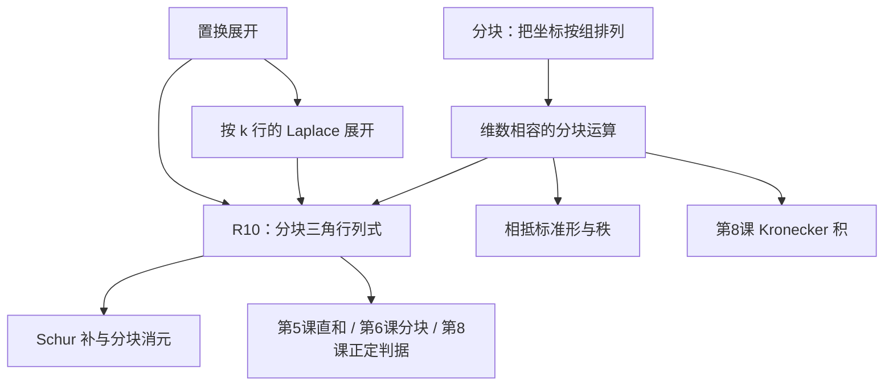

# 05B 补丁：分块矩阵与分块行列式

> **来源与状态**：据 DSH 侧 `20261011_math_高代补丁P1_分块矩阵_大纲_DSH.md` 撰写。同学于 2026-10-12 确认改由当前 Codex 会话直接执笔并自校；不宣称另有 Astra 会话或独立审稿员参与。本稿作者为 **Codex 侧数学教授分身（CDX）**，**未经 DSH 独立审稿**。DSH 负责落位、送审、归档与引用联动。本稿给出 R10 的完整证明，登记表销号仍待 DSH 核准。

## §0 结构图景与学习约定

**问题从哪里来？** 第五课 §3 已把算子按不变子空间写成块；第六课 §3.4 使用分块图景；第八课 §2.5 把 Kronecker 积写成一排矩阵块。分块并没有制造新的运算，而是在原有矩阵中画分界线，保留坐标组的结构。本补丁尤其补齐第八课 §1.6 定理 7 的 $(c)\Rightarrow(a)$ 所调用的 **R10：分块三角矩阵的行列式等于对角块行列式之积**。

**学完要能做到**：检查每次分块乘法的维数；不加可逆假设证明 R10；用 Schur 补算行列式和秩；解释相抵标准形为什么恰有 $r$ 个主元。

**前置与依赖**：全篇矩阵取实数或复数，记数域为 $\mathbb F$。已学依据是第二课 §2.0 矩阵乘法、§4.2–§4.3 秩-零化度定理；第五课 §5.1 定义 1 和引理 1（置换定义及行列式性质）、§5.2 定理 1（乘性）、§5.3 定理 2（可逆判据）。不预设 Laplace 展开，本讲 §4 才证明它。正定与 Binet–Cauchy 只作预告，不用于证明和必做题。

**阅读方式**：先看 §1–§3；§4 是证明工具补全；§5 从分块理解秩；§6 用两道引导题、两道独立题和分层自测核验。课堂口头追问仍至多三道，不要求一次做完所有书面题。

## §1 分块运算：先检查尺寸，再运算

### 1.1 定义与乘法

设行分成 $p$ 组，大小分别为 $m_1,\ldots,m_p$；列分成 $q$ 组，大小为 $n_1,\ldots,n_q$。**分块矩阵** $A=(A_{ij})$ 就是同一矩阵的这种划分，其中 $A_{ij}$ 是 $m_i\times n_j$ 矩阵，$1\le i\le p$、$1\le j\le q$。总尺寸为 $m\times n$，其中 $m=\sum_{i=1}^{p}m_i$、$n=\sum_{j=1}^{q}n_j$。

加法必须使用相同分界线：$(A+B)_{ij}=A_{ij}+B_{ij}$；数乘为 $(cA)_{ij}=cA_{ij}$。

若 $B=(B_{j\ell})$ 的行分组大小恰为 $n_1,\ldots,n_q$，列分组大小为 $r_1,\ldots,r_s$，则 $B_{j\ell}$ 为 $n_j\times r_\ell$，且

$(AB)_{i\ell}=\sum_{j=1}^{q}A_{ij}B_{j\ell},\qquad 1\le i\le p,\quad 1\le\ell\le s.$

每个乘积都是 $m_i\times r_\ell$，所以才能相加。**证明**：取该结果块内第 $a$ 行、第 $b$ 列；普通矩阵乘法的中间坐标按第 $j$ 组拆开后，该元素就是 $\sum_{j=1}^{q}\sum_{t=1}^{n_j}(A_{ij})_{at}(B_{j\ell})_{tb}$，内层和恰是块乘积的对应元素。这里 $1\le a\le m_i$、$1\le b\le r_\ell$。

例如 $A_{11}$ 为 $2\times3$、$A_{12}$ 为 $2\times1$，而 $B_{11}$ 为 $3\times2$、$B_{21}$ 为 $1\times2$，则第一块是 $A_{11}B_{11}+A_{12}B_{21}$，两个加数均为 $2\times2$。仅知道两边“都是两块”是不够的。

**转置**既交换块位置，又转置每个块：$(A^{\mathsf T})_{ji}=A_{ij}^{\mathsf T}$。如 $\begin{pmatrix}A&B\\C&D\end{pmatrix}^{\mathsf T}=\begin{pmatrix}A^{\mathsf T}&C^{\mathsf T}\\B^{\mathsf T}&D^{\mathsf T}\end{pmatrix}$。

### 1.2 块行、块列操作

令 $M=\begin{pmatrix}A&B\\C&D\end{pmatrix}$，四块尺寸依次为 $a\times b$、$a\times c$、$d\times b$、$d\times c$。对任意 $d\times a$ 矩阵 $X$，

$\begin{pmatrix}I_a&0\\X&I_d\end{pmatrix}M=\begin{pmatrix}A&B\\XA+C&XB+D\end{pmatrix}.$

这就是“第二块行加上第一块行的 $X$ 倍”。左乘矩阵的逆由把 $X$ 改为 $-X$ 得到，乘回可验。操作也可拆成普通初等行变换：对 $1\le i\le d$，第 $a+i$ 行逐次加 $X_{ij}$ 倍第 $j$ 行（$j=1,\ldots,a$）；上面的 $a$ 行始终未改，所以操作可逐项进行。

对任意 $b\times c$ 矩阵 $Y$，

$M\begin{pmatrix}I_b&Y\\0&I_c\end{pmatrix}=\begin{pmatrix}A&AY+B\\C&CY+D\end{pmatrix}.$

这是第二块列加第一块列的线性组合。**顺序不可颠倒**：行操作中是 $XA$，列操作中是 $AY$。块内乘可逆矩阵和交换块行、块列也可逆；交换大小为 $a,d$ 的相邻块行，相当于 $ad$ 次普通行交换，行列式乘 $(-1)^{ad}$，不一定只变一次号。

### 1.3 常见结构

**分块上三角**要求行、列按同样的大小 $n_1,\ldots,n_t$ 划分，且 $A_{ij}=0$ 对所有 $i>j$ 成立；对角块必须方阵。下三角同理。只保留对角块就是**分块对角**矩阵。

方阵 $A,D$ 的**直和矩阵**记为 $A\oplus D=\begin{pmatrix}A&0\\0&D\end{pmatrix}$。对列向量 $x,y$，它把 $\binom{x}{y}$ 送到 $\binom{Ax}{Dy}$，对应第五课 §3 的两个空间分别作用。

**本节回看**：分块是坐标组织方式；乘法成立的理由仍是普通矩阵乘法。下一节研究何时行列式也能拆开。

## §2 R10：分块三角行列式的完整证明

### 2.1 定理与证明

**定理 1（R10）**。设 $A\in\mathbb F^{a\times a}$、$D\in\mathbb F^{d\times d}$、$B\in\mathbb F^{a\times d}$，其中 $a,d\ge1$。则

$\det\begin{pmatrix}A&B\\0&D\end{pmatrix}=\det A\det D.$

**不要求 $A,D$ 可逆。** 若允许零维块，则约定空行列式为 $1$，结论也成立。

**证明，第 1 步：哪些项可能非零？** 记 $N=a+d$、$M=(m_{ij})$。将 $S_N$ 的全部置换列为 $\sigma_1,\ldots,\sigma_{N!}$。第五课 §5.1 定义 1 给出

$\det M=\sum_{h=1}^{N!}\operatorname{sgn}(\sigma_h)\prod_{i=1}^{N}m_{i,\sigma_h(i)}.$

若某个下面的行号 $i>a$ 被配到左侧列号 $\sigma_h(i)\le a$，其对应元素就在左下零块，整项为零。因此可能非零的项必须把下面 $d$ 行都配到右边 $d$ 列。置换是单射，而这两组大小相同，所以右边 $d$ 列全部被用完；上面 $a$ 行只能配到左边 $a$ 列。

注意逻辑：满足这一条件的项仍可能因 $A,D$ 自身含零而为零，但所有不满足条件的项都已为零，删掉它们不会改变总和。

**第 2 步：剩余置换恰等价于一对小置换。** 它必唯一写成

$\sigma(i)=\alpha(i)\ (1\le i\le a),\qquad \sigma(a+j)=a+\beta(j)\ (1\le j\le d),$

其中 $\alpha\in S_a$、$\beta\in S_d$。反过来，每一对这样的 $\alpha,\beta$ 都定义一个允许的置换，故没有遗漏或重复。

**第 3 步：符号也拆开。** 置换符号是 $(-1)^{\text{逆序数}}$。当 $i\le a<a+j$ 时，必有 $\sigma(i)\le a<\sigma(a+j)$，跨两块没有逆序。因此总逆序数等于两个内部逆序数之和，得到 $\operatorname{sgn}(\sigma)=\operatorname{sgn}(\alpha)\operatorname{sgn}(\beta)$。

**第 4 步：把有限和相乘。** 将两个小置换群依次列为 $\alpha_1,\ldots,\alpha_{a!}$ 和 $\beta_1,\ldots,\beta_{d!}$，并写 $A=(a_{ij})$、$D=(d_{ij})$。于是

$\det M=\sum_{u=1}^{a!}\sum_{v=1}^{d!}\operatorname{sgn}(\alpha_u)\operatorname{sgn}(\beta_v)\left(\prod_{i=1}^{a}a_{i,\alpha_u(i)}\right)\left(\prod_{j=1}^{d}d_{j,\beta_v(j)}\right)$

$=\left(\sum_{u=1}^{a!}\operatorname{sgn}(\alpha_u)\prod_{i=1}^{a}a_{i,\alpha_u(i)}\right)\left(\sum_{v=1}^{d!}\operatorname{sgn}(\beta_v)\prod_{j=1}^{d}d_{j,\beta_v(j)}\right)=\det A\det D.$

没有做除法，所以奇异块也包括在内。证毕。

**二维对应**：$\det\begin{pmatrix}a&b\\0&d\end{pmatrix}=ad-b\cdot0=ad$；一般证明只是说明“大零块也迫使所有跨块取项消失”。

**推论 1**。分块下三角同样成立：转置后用定理 1，再用第五课 §5.1 引理 1 的转置不变性。对 $t$ 块的上三角矩阵，把前 $t-1$ 块合成一个大块，归纳得到 $\det M=\prod_{i=1}^{t}\det A_{ii}$。分块对角是特例，故 $\det(A\oplus D)=\det A\det D$。

### 2.2 真算核验一：四阶而非四个标量

取

$M=\begin{pmatrix}1&2&3&4\\3&4&5&6\\0&0&2&1\\0&0&1&3\end{pmatrix},\quad A=\begin{pmatrix}1&2\\3&4\end{pmatrix},\quad D=\begin{pmatrix}2&1\\1&3\end{pmatrix}.$

块公式给出 $\det A=-2$、$\det D=5$，所以 $\det M=-10$。

**独立复算（普通行变换）**：先令第 2 行减去第 1 行的 $3$ 倍，成为 $(0,-2,-4,-6)$；再令第 4 行减去第 3 行的 $1/2$ 倍，成为 $(0,0,0,5/2)$。结果为普通上三角矩阵，置换展开只有恒等置换可能留下非零项，故行列式为 $1\cdot(-2)\cdot2\cdot(5/2)=-10$。加一行的倍数不改行列式，由第五课 §5.1 引理 1 的多线性和交错性直接得到。

### 2.3 为什么不能照搬二阶标量公式？

即使四块都同阶，通常也没有 $\det M=\det A\det D-\det B\det C$。取 $A=D=I_2$、$B=C=2I_2$。普通消元把下面两行分别减去上面对应行的 $2$ 倍，得到对角块 $I_2,-3I_2$，所以 $\det M=9$；错误公式却给 $1-4\cdot4=-15$。

这也提醒：四块全方阵并不使它们变成四个数。更一般的分块中 $B,C$ 甚至不是方阵，$\det B,\det C$ 根本没有定义。

## §3 Schur 补：消去一块以后留下什么

### 3.1 定义、消元与 LDU 分解

设 $M=\begin{pmatrix}A&B\\C&D\end{pmatrix}$，其中 $A$ 为 $a\times a$ 可逆矩阵，$D$ 为 $d\times d$ 矩阵，$B,C$ 尺寸分别为 $a\times d,d\times a$。定义 **$A$ 的 Schur 补**为 $S=D-CA^{-1}B$，它是 $d\times d$ 矩阵。

选 $X=-CA^{-1}$，§1 的块行操作给出

$LM=\begin{pmatrix}A&B\\0&S\end{pmatrix},\quad L=\begin{pmatrix}I_a&0\\-CA^{-1}&I_d\end{pmatrix}.$

再右乘 $R=\begin{pmatrix}I_a&-A^{-1}B\\0&I_d\end{pmatrix}$，得 $LMR=\begin{pmatrix}A&0\\0&S\end{pmatrix}$。两步逐块相乘就能验证。反解即 **LDU 分解**：

$M=\begin{pmatrix}I_a&0\\CA^{-1}&I_d\end{pmatrix}\begin{pmatrix}A&0\\0&S\end{pmatrix}\begin{pmatrix}I_a&A^{-1}B\\0&I_d\end{pmatrix}.$

字母 L、D、U 分别提示下三角、对角、上三角的结构；中间的 D 表示结构，并不是原矩阵右下块的名称。

**定理 2**。在上述假设下，$\det M=\det A\det S$，且 $\operatorname{rank}M=a+\operatorname{rank}S$。因此 $M$ 可逆当且仅当 $S$ 可逆。

**证明**：由 §2 定理 1 及推论，$\det L=\det R=1$；由第五课 §5.2 定理 1 的乘性，$\det(LMR)=\det M$，再对块对角使用 R10 即得行列式公式。

秩定义为列空间（像）的维数。右乘可逆 $R$ 不改变像：$R$ 的输入跑遍整个定义域；左乘可逆 $L$ 将原像双射到新像，维数不变。块对角矩阵的像为 $\operatorname{im}A\oplus\operatorname{im}S$，这两部分位于不同坐标组，维数相加；$A$ 可逆，故秩为 $a+\operatorname{rank}S$。最后用第五课 §5.3 定理 2 及 $\det A\ne0$ 得可逆判据。

**一维对应**：$a\ne0$ 时，$ad-bc=a(d-ca^{-1}b)$。一般矩阵必须保持 $CA^{-1}B$ 的乘法顺序。

**边界**：若 $A$ 奇异，本定义不能使用。可在 $D$ 可逆时改用 $A-BD^{-1}C$，或者先做普通行列交换寻找主元，不能把不存在的 $A^{-1}$ 写进公式。

### 3.2 真算核验二：四个二阶块

取

$A=\begin{pmatrix}1&1\\0&1\end{pmatrix},\quad B=I_2,\quad C=\begin{pmatrix}2&0\\1&1\end{pmatrix},\quad D=\begin{pmatrix}3&1\\2&4\end{pmatrix}.$

依次算得

$A^{-1}=\begin{pmatrix}1&-1\\0&1\end{pmatrix},\quad CA^{-1}B=\begin{pmatrix}2&-2\\1&0\end{pmatrix},\quad S=\begin{pmatrix}1&3\\1&4\end{pmatrix}.$

因此 $\det M=1\cdot(4-3)=1$，$\operatorname{rank}M=4$。

**独立复算**：把完整矩阵 $\begin{pmatrix}1&1&1&0\\0&1&0&1\\2&0&3&1\\1&1&2&4\end{pmatrix}$ 的第 3 行减去第 1 行的 $2$ 倍，得 $(0,-2,1,1)$；第 4 行减第 1 行得 $(0,0,1,4)$；再第 3 行加第 2 行的 $2$ 倍，得 $(0,0,1,3)$；最后第 4 行减第 3 行得 $(0,0,0,1)$。四个普通对角元都是 $1$，故行列式为 $1$，核验一致。

### 3.3 正定性只作预告

若 $M=\begin{pmatrix}A&B\\B^{\mathsf T}&D\end{pmatrix}$ 是实对称矩阵，将在二次型语言下得到：$M$ 正定当且仅当 $A$ 正定且 $D-B^{\mathsf T}A^{-1}B$ 正定。正定是对所有非零列向量 $z$ 都有 $z^{\mathsf T}Mz>0$。这里先看见分块消元与配方的联系，不把这条预告作为本讲已证工具；第八课 §1.6 定理 7 是正定判据的既有学习入口。

**本节回看**：Schur 补是消元后的右下块；R10 才是行列式公式的依据，可逆前提不能遗漏。

## §4 按多行的 Laplace 展开

### 4.1 记号与定理

本节把“固定几行，按它们选到的列分类”写成公式。设 $H$ 是 $n\times n$ 矩阵，固定行号集合 $I=\{i_1<\cdots<i_k\}$，其中 $1\le k\le n$。记 $I^c$ 为剩余行号，按递增排列。对递增列号集合 $J=\{j_1<\cdots<j_k\}$，记 $H[I,J]$ 为保留这些行列所得子矩阵；$J^c$ 是剩余列号。空子矩阵行列式约定为 $1$。

把所有大小为 $k$ 的列号集合不重不漏列为 $J_1,\ldots,J_b$，其中 $b=\binom nk$。对集合 $K$ 定义 $s(K)$ 为其元素之和；例如 $s(I)=\sum_{t=1}^{k}i_t$。

**定理 3（按 $k$ 行的 Laplace 展开）**：

$\det H=\sum_{h=1}^{b}(-1)^{s(I)+s(J_h)}\det H[I,J_h]\det H[I^c,J_h^c].$

### 4.2 证明：分组、计符号、还原两个小行列式

每个置换唯一决定选中行 $I$ 配到的列集合 $J$。按 $J$ 将置换展开的项分组，所有项恰好出现一次。

固定一组 $J$。把行次序改为“$I$ 递增排列，再接 $I^c$ 递增排列”，要交换 $\sum_{t=1}^{k}(i_t-t)$ 次：把第一个选中行搬到第 1 位，需 $i_1-1$ 次；第二个搬到第 2 位，需 $i_2-2$ 次，依此类推。列同理需 $\sum_{t=1}^{k}(j_t-t)$ 次。因此行列重排合计的符号是

$(-1)^{\sum_{t=1}^{k}(i_t-t)+\sum_{t=1}^{k}(j_t-t)}=(-1)^{s(I)+s(J)-k(k+1)}=(-1)^{s(I)+s(J)},$

因为 $k(k+1)$ 为偶数。

在重排后的坐标中，本组的置换恰好让前 $k$ 行配前 $k$ 列，后面各行配后面的列。因此一个置换恰对应两个内部置换，且它们之间没有跨块逆序，符号分解与 §2 定理 1 的第 2、3 步相同。将两个内部置换分别列为 $\alpha_1,\ldots,\alpha_{k!}$、$\beta_1,\ldots,\beta_{(n-k)!}$，记 $U=H[I,J]$、$W=H[I^c,J^c]$，本组去掉行列重排符号后的总和为

$\left(\sum_{u=1}^{k!}\operatorname{sgn}(\alpha_u)\prod_{t=1}^{k}U_{t,\alpha_u(t)}\right)\left(\sum_{v=1}^{(n-k)!}\operatorname{sgn}(\beta_v)\prod_{t=1}^{n-k}W_{t,\beta_v(t)}\right)=\det U\det W.$

乘回重排符号，再对 $b$ 个列集合求和，得到定理。$k=n$ 时只一组，空乘积和空行列式均为 $1$，仍成立。

**小情况**：$k=1$，固定第 $i$ 行，就得到 $\det H=\sum_{j=1}^{n}(-1)^{i+j}h_{ij}\det H[\{i\}^c,\{j\}^c]$。例如三阶矩阵按第 2 行展开，三个符号依次为负、正、负。

**R10 的第二条路线**：取 $I=\{a+1,\ldots,a+d\}$。若选出的 $d$ 列含左边列，则下面行的子矩阵有零列，行列式为零；唯一剩下 $J=I$，符号 $(-1)^{2s(I)}=1$，结果为 $\det D\det A$。此时没有循环：本节 Laplace 是从置换定义证明的，并未用 R10 作为前提。

### 4.3 Binet–Cauchy：选学预告

若 $U$ 为 $m\times n$、$V$ 为 $n\times m$ 且 $m\le n$，Binet–Cauchy 公式把 $\det(UV)$ 写成“从 $U$ 选 $m$ 列与从 $V$ 选相同编号的 $m$ 行”的小行列式乘积之和。它将行列式乘性推广到中间维数不同的乘积。本讲**不证明、不使用、不设题、不列为欠账**，随后续路径再学。

**本节回看**：Laplace 的符号来自搬动行、列的次数；两小行列式来自两组内部置换。

## §5 相抵标准形：把有效输入与无效输入分开

### 5.1 相抵的定义与完整消元证明

对 $m\times n$ 矩阵 $A$，若存在可逆 $m\times m$ 矩阵 $P$ 和可逆 $n\times n$ 矩阵 $Q$ 使 $B=PAQ$，称 $A,B$ **相抵**。它允许输入、输出两边分别换坐标；不是要求同一个换基矩阵的相似变换。

**定理 4**。存在上述 $P,Q$，使

$PAQ=\begin{pmatrix}I_r&0_{r\times(n-r)}\\0_{(m-r)\times r}&0_{(m-r)\times(n-r)}\end{pmatrix},\qquad r=\operatorname{rank}A.$

**证明，第 1 步：找到一个主元。** 若 $A=0$，取两个单位矩阵，结论成立，$r=0$。否则选一个非零元素，用行交换、列交换移到左上角，再把第一行乘其倒数，得到 $\begin{pmatrix}1&b\\c&D\end{pmatrix}$，其中 $b$ 为一行、$c$ 为一列。

**第 2 步：清空第一列和第一行。** 左乘 $\begin{pmatrix}1&0\\-c&I_{m-1}\end{pmatrix}$，再右乘 $\begin{pmatrix}1&-b\\0&I_{n-1}\end{pmatrix}$，结果为 $\begin{pmatrix}1&0\\0&D-cb\end{pmatrix}$。这里只求标量主元的倒数；矩阵 $D$ 无需可逆。

**第 3 步：递归做同一件事。** 对右下残块重复；后续变换用块对角方式扩展到整个矩阵，不破坏已得到的单位块。每次残块的行数、列数都减一，至多 $\min(m,n)$ 次后停止。若残块为零就停止；若某边已无行或列，也停止。所有操作可逆，它们的有限乘积给出 $P,Q$。最终形状为 $\operatorname{diag}(I_t,0)$（可能长方形）。

**第 4 步：为什么 $t=r$？** §3 定理 2 的秩不变论证对长方形矩阵也适用：右乘只是把输入重新遍历，左乘把像双射到新像。因此 $\operatorname{rank}A=\operatorname{rank}(PAQ)$。最终矩阵的像恰由前 $t$ 个标准坐标向量张成，秩为 $t$，所以 $t=r$。

### 5.2 小例子与秩-零化度

$A=\begin{pmatrix}1&2&3\\2&4&6\end{pmatrix}$。第 2 行减第 1 行的 $2$ 倍，再第 2、3 列分别减第 1 列的 $2,3$ 倍，得到 $\begin{pmatrix}1&0&0\\0&0&0\end{pmatrix}$。

可明确取 $P=\begin{pmatrix}1&0\\-2&1\end{pmatrix}$、$Q=\begin{pmatrix}1&-2&-3\\0&1&0\\0&0&1\end{pmatrix}$，相乘验证如上。因此秩为 $1$，输入有两个自由方向被送到零。一般标准形的核维数为 $n-r$；由第二课 §4.2–§4.3 秩-零化度定理，正好是 $n=(n-r)+r$。

**本节回看**：标准形中的 $1$ 是消元选择的规范数值；$1$ 的个数则是矩阵本身的秩。$P,Q$ 通常不唯一，标准形的尺寸和 $r$ 一旦固定就确定。

## §6 练习与答案核对

### 6.1 引导练习（两题，有骨架）

**G1：奇异对角块。** 算 $\det M$，其中 $M=\begin{pmatrix}1&2&5\\2&4&6\\0&0&3\end{pmatrix}$。骨架：按 $2+1$ 分块；先检查 R10 是否要求左上块可逆；再作普通行变换复算。

**G2：Schur 消元。** $M=\begin{pmatrix}2&1&0\\1&2&1\\0&1&2\end{pmatrix}$。按 $1+2$ 分块求 $S$、$\det M$ 和秩。骨架：写出 $A,B,C,D$ 的尺寸；计算 $CA^{-1}B$；再用 §3 定理 2。

### 6.2 独立习题（两题，不给骨架）

**独立题 1。** 对 $M_t=\begin{pmatrix}I_2&tI_2\\I_2&I_2\end{pmatrix}$，求行列式与秩，按实参数 $t$ 分类。

**独立题 2。** 将 $A=\begin{pmatrix}1&2&1\\2&4&0\end{pmatrix}$ 化为相抵标准形，写出一对可逆 $P,Q$，并求核的一组基。

### 6.3 分层自测

**T1（必做，概念）**：在 §3 的尺寸约定下，写出 $CA^{-1}B$ 的尺寸；说明一般能否改写为 $BA^{-1}C$；说明 R10 是否允许 $A$ 奇异。

**T2（必做，迁移）**：求 $H=\begin{pmatrix}1&2&0\\3&4&5\\0&6&7\end{pmatrix}$ 的行列式，分别用第 2 行 Laplace 展开和普通消元核验。

**T3（选做，证明）**：利用 §5 定理 4，证明两个同尺寸矩阵相抵当且仅当它们秩相同。

### 6.4 答案与判定要点

**G1**：$\det M=(4-4)\cdot3=0$。第 2 行减第 1 行的 $2$ 倍变成 $(0,0,-4)$，与第 3 行成比例，行列式为零。要点：奇异 $A$ 不妨碍 R10，不能为使用不存在的逆矩阵而卡住。

**G2**：$A=(2)$、$B=(1,0)$、$C=(1,0)^{\mathsf T}$、$D=\begin{pmatrix}2&1\\1&2\end{pmatrix}$，故 $S=\begin{pmatrix}3/2&1\\1&2\end{pmatrix}$，$\det S=2$，$\det M=4$，秩为 $3$。独立按第一行展开给 $2(4-1)-1(2-0)=4$。要点：$CA^{-1}B$ 是二阶矩阵，并非标量内积。

**独立题 1**：$S=(1-t)I_2$，所以 $\det M_t=(1-t)^2$；$t\ne1$ 时秩为 $4$，$t=1$ 时秩为 $2$。普通消元将下两行分别减去上两行，直接得到对角块 $I_2,(1-t)I_2$，再次核验。

**独立题 2**：可取 $P=\begin{pmatrix}1&0\\1&-1/2\end{pmatrix}$、$Q=\begin{pmatrix}1&-1&-2\\0&0&1\\0&1&0\end{pmatrix}$。先有 $PA=\begin{pmatrix}1&2&1\\0&0&1\end{pmatrix}$，再乘 $Q$ 得 $\begin{pmatrix}1&0&0\\0&1&0\end{pmatrix}$；$\det P=-1/2$、$\det Q=-1$，均可逆。秩为 $2$。方程 $Ax=0$ 给 $x_3=0,x_1=-2x_2$，故核的基为 $\{(-2,1,0)^{\mathsf T}\}$；直接代入两行均为零。要点：核中的向量要用原坐标给出，不能直接抄标准形核中的 $e_3$，须经 $Q$ 送回。

**T1**：依次为 $(d\times a)(a\times a)(a\times d)$，结果 $d\times d$。$BA^{-1}C$ 当 $a\ne d$ 时通常连尺寸都不相容；即便 $a=d$ 也不能任意交换乘法顺序。R10 允许奇异 $A$，Schur 补公式需要可逆 $A$。

**T2**：按第 2 行，$\det H=-3\det\begin{pmatrix}2&0\\6&7\end{pmatrix}+4\det\begin{pmatrix}1&0\\0&7\end{pmatrix}-5\det\begin{pmatrix}1&2\\0&6\end{pmatrix}=-42+28-30=-44$。消元：第 2 行减第 1 行的 $3$ 倍成为 $(0,-2,5)$，第 3 行再加新第 2 行的 $3$ 倍成为 $(0,0,22)$，对角元相乘为 $-44$。要点：中间一行的符号是负、正、负。

**T3**：相抵必保持秩，已在 §3 证明。反之若 $A,B$ 同尺寸同秩，则 §5 定理 4 给 $PAQ=J_r$ 和 $UBV=J_r$，其中四个变换矩阵均可逆，$J_r$ 为相应尺寸的标准形。因此 $B=U^{-1}PAQV^{-1}$，两侧因子 $U^{-1}P$ 与 $QV^{-1}$ 均可逆，故相抵。要点：写出复合变换，不能只说“它们都能化简”。

## §7 术语速查与交付边界

| 术语 | 本讲含义 | 位置 |
|---|---|---|
| 分块 | 按坐标组为同一矩阵划分子矩阵 | §1.1 |
| 分块三角 | 对角块方阵，下侧或上侧块为零 | §1.3 |
| 直和矩阵 | 两个矩阵放入块对角 | §1.3 |
| Schur 补 | 消去可逆块后留下的残块 | §3.1 |
| Laplace 展开 | 按选中行所占列集合整理置换和 | §4 |
| 相抵 | 左右分别乘可逆矩阵 | §5.1 |

**依赖核对**：R10 主证仅用已讲的行列式置换定义；Schur 行列式公式用 R10 和第五课 §5.2 定理 1；Laplace 从置换定义独立证明；相抵标准形用可逆行列操作和像的维数。不使用预告的正定分块判据或 Binet–Cauchy。

**后续落地由 DSH 负责**：独立审稿通过后按本件约定落位，统一 approved 路径口径；再将登记表 R10 对应到本讲 §2 定理 1，并更新第五课 §3、第六课 §3.4、第八课 §2.5 与 §1.6 定理 7 的引用。本稿完成不表示学生已学习该补丁，也不表示 R10 已获审稿销号。
