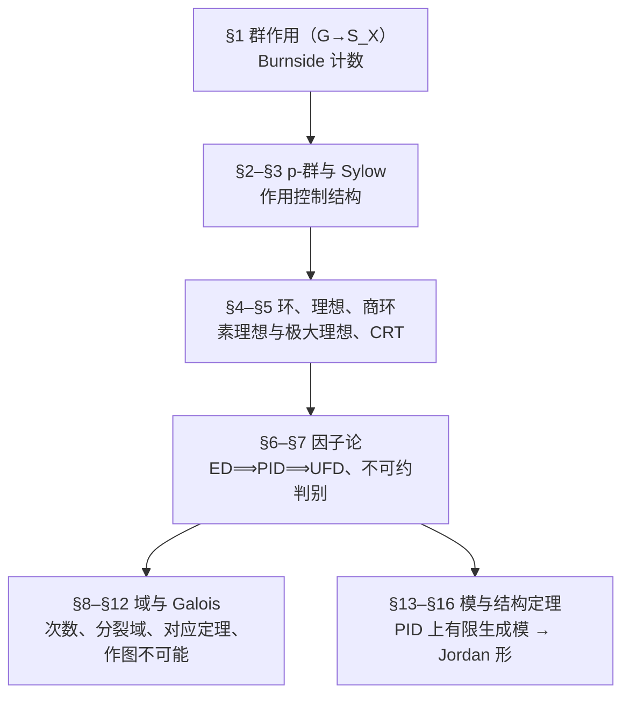
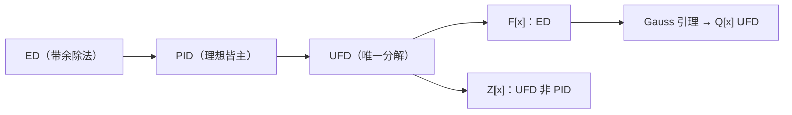
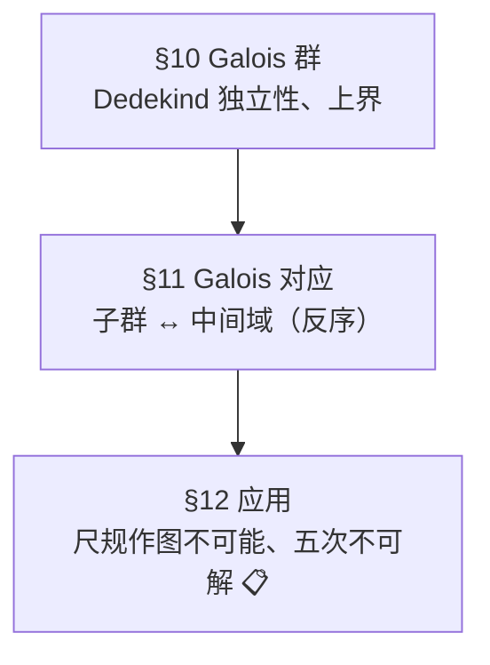
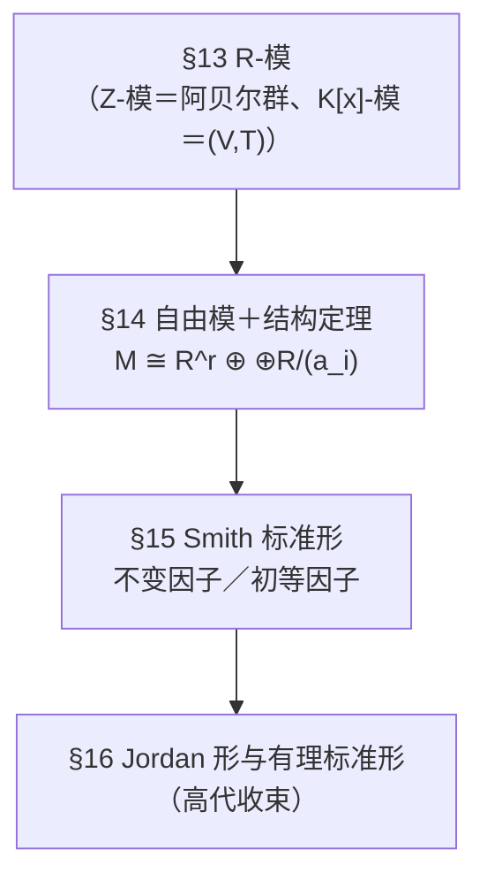

> **本件性质**：数学线 **MA104 抽象代数** 讲义（16 讲全稿）· **送审位**
> **作者**：Prof-Math-V2 ｜ **版本**：**v0.1-fix1（送审中，2026-10-22）** ｜ **未经独立审稿，不得定稿**
> **前置**：高代 MA101–MA103（含 05A／05B 补丁）＋ 第七课群论基础
> **未证输入**：**本课不以任何登记项作为证明依据**；**R6（代数基本定理）**仅在 §9 的「$\mathbb C$ 上完全分解」类背景语句处出现（📋，**不作证明依据**）；§6（PID 非 ED 反例 $\mathbb Z[(1+\sqrt{-19})/2]$）、§9（代数闭包存在性）、§12（Abel–Ruffini、Gauss–Wantzel、$\pi$ 超越）**均只陈述并标 📋**。——**v0.1-fix1 更正**：原稿称「§3 域扩张举例处点名」有误（A6），实际无该点名、且节号应为 §8。
> **v0.1-fix1 修订（按首轮报告）**：五处"要点式证明"**已全部补全**——§2 定理 3（Sylow 第一）改为**两分支＋归纳基数校验**；§10 引理 1（Dedekind）补**归一化／选 $a$／相减**三步；§10 定理 1（上界）**删去本原元假设**、改用任意 $F$-基（对不可分亦成立）；§11 定理 1（Artin）补**四步**；§14＋§15 结构定理**补两行**（商等变与对角形商计算、并声明两处为同一算法）。其余须修项 A3–A17 逐条对照见送审信号；建议 B1 已**部分采纳**（4 张 Mermaid）、B2 已补。
> **二审后直改（2026-10-22，按增量复核，按 2026-10-12 口径「直接改＋一行留痕、不重送」）**：**A18** §2 定理 1 的模 $p$ 算式更正（删去误加的「$1+$」，改为 $\lvert G\rvert=\lvert Z(G)\rvert+\sum_{\text{长度}>1}\lvert G\rvert/\lvert C_G(x_i)\rvert$（原留痕行的求和未写上下限，已按 A23 补全），再由各项被 $p$ 整除得 $\lvert Z(G)\rvert\equiv\lvert G\rvert\equiv0$）；**A20** 稿头 L4 口径改为「**不以任何登记项作为证明依据**」；**A21** §1「未证输入」行同步统一；另顺手改 **A9** 二项式下标（$\binom{p}{p-1}$）与 **A10** 题面措辞（「$p^2\nmid a_0$ 一条不能去掉」）。**结论不变**。
> **送审信号**：`signals/review_request/math/20261012_MA104_抽象代数_v0.1-fix1.signal`

---

# 抽象代数 MA104

> **状态**：**v0.1（送审中，2026-10-12）**——16 讲全稿（§1–§16）；作者＝Prof-Math-V2；**未经独立审稿，不得定稿**。
> **前置**：高代 MA101–MA103 全部（含 05A 多项式、第五课 Jordan／C-H）＋ 第七课群论基础。
> **本讲依据**：第七课 §3（群作用、轨道-稳定子、符号）；第一课（集合与映射）；数分（不涉及）。
> **未证输入**：本讲不用任何登记项；全课**不以任何登记项作为证明依据**——**R6（代数基本定理）**仅在 §9 背景语句处出现（📋）。

## 目录（16 讲）

- §1 群作用与 Burnside 引理 ← **本稿**
- §2 $p$-群与 Sylow 定理（一）
- §3 Sylow 定理（二）与应用
- §4 环、理想与商环
- §5 素理想、极大理想与 CRT
- §6 ED ⟹ PID ⟹ UFD
- §7 多项式环与不可约性
- §8 域扩张与代数元
- §9 分裂域、可分与正规
- §10 Galois 群与 Galois 对应（一）
- §11 Galois 对应（二）与计算
- §12 应用：尺规作图与不可解性
- §13 模、子模与商模
- §14 自由模与 PID 上的结构定理（一）
- §15 结构定理（二）：不变因子与初等因子
- §16 应用：Jordan 形与有理标准形（高代收束）

## §1 群作用与 Burnside 引理

### 1.0 章引言：为什么先讲"作用"

第七课学群时，我们已经有两条零散的结论：**轨道-稳定子定理**（用来算轨道大小）和**共轭类公式**（用来数多少个共轭元）。本课把它们收进一个统一的框子——**群作用**。

作用解决的是同一类问题：**一个抽象的群，怎么"落到具体集合上"变成可计算的东西**。一旦落到集合上，群就变成一堆置换（置换群），于是"数轨道""分类"这类问题都能算。本章的一号成果是 **Burnside 引理**：它把"本质不同的图案有多少个"这种计数问题，换成一个可以逐元素相加的平均值。

> **与高代的关系（升级坐标）**：作用 $G\to S_X$ 就是**同态**，与第二课的"线性映射 $V\to W$"同型：对象不同，套路相同——**找核、找像、用第一同构定理**。本章末尾你会看到它在 Sylow 定理里发挥的作用。

### 1.1 群作用的定义与例子

**定义 1（左作用）**。设 $G$ 是群，$X$ 是非空集合。$G$ 在 $X$ 上的一个**左作用**是一个映射 $G\times X\to X$，$(g,x)\mapsto g\cdot x$，满足

1. $e\cdot x=x$ 对一切 $x\in X$；
2. $(gh)\cdot x=g\cdot(h\cdot x)$ 对一切 $g,h\in G$、$x\in X$。

若把每个 $g$ 看成 $X$ 上的一个置换 $\sigma_g:x\mapsto g\cdot x$，则上面两条恰是说 $\sigma_e=\mathrm{id}$、$\sigma_{gh}=\sigma_g\circ\sigma_h$，即

**命题 1**。$G$ 在 $X$ 上的左作用 $\leftrightarrow$ 群同态 $\rho:G\to S_X$，$g\mapsto\sigma_g$。

*证明*。给定作用，定义 $\sigma_g(x)=g\cdot x$。由公理 2，$\sigma_{gh}=\sigma_g\sigma_h$；在 2 中取 $h=g^{-1}$ 得 $\sigma_g\sigma_{g^{-1}}=\sigma_e=\mathrm{id}$，故 $\sigma_g$ 可逆、$\sigma_g^{-1}=\sigma_{g^{-1}}$，于是 $\sigma_g\in S_X$，且 $\rho$ 是同态。反过来给定同态 $\rho$，置 $g\cdot x=\rho(g)(x)$，两条公理由同态性质直接得到 ✓。

**例 1（四个基本例子，后面都要用）**。

1. **正多边形的对称群**：$D_n$ 作用于正 $n$ 边形的顶点集、边集、面集。轨道数就是"本质不同的染色"计数要用的量。
2. **共轭作用**：$G$ 作用于自身，$g\cdot x=gxg^{-1}$。轨道＝共轭类；稳定子 $G_x=C_G(x)$（第七课 §3.4 的核验①）；轨道-稳定子因此说 $\lvert C_G(x)\rvert\cdot\lvert\text{共轭类}\rvert=\lvert G\rvert$。
3. **在陪集上作用**：$H\le G$，$G$ 作用于左陪集集 $G/H$，$g\cdot(aH)=(ga)H$。稳定子是 $aHa^{-1}$。这条在 Sylow 定理里是主力。
4. **线性作用**：$GL_n(\mathbb F)$ 作用于 $\mathbb F^n$；两个非零向量同轨道（为什么？唯一需要的是"把它送到它"的可逆矩阵存在）。

**定义 2（轨道与稳定子）**。$Gx:=\{g\cdot x:g\in G\}$ 称 $x$ 的**轨道**；$G_x:=\{g\in G:g\cdot x=x\}$ 称 $x$ 的**稳定子**。

**命题 2（轨道是划分；轨道-稳定子）**。

1. "同轨道"是 $X$ 上的等价关系，故 $X$ 被轨道划分；
2. $G_x\le G$，且 $\lvert Gx\rvert=[G:G_x]=\lvert G\rvert/\lvert G_x\rvert$。

*证明*。(1) 自反（$e\cdot x=x$）、对称（$y=g\cdot x\Rightarrow x=g^{-1}\cdot y$）、传递（$y=g\cdot x,z=h\cdot y\Rightarrow z=(hg)\cdot x$）。(2) 先证 $G_x\le G$：$e\in G_x$；$g,h\in G_x$ 时 $(gh)\cdot x=g\cdot(h\cdot x)=g\cdot x=x$；$g\in G_x$ 时 $x=g^{-1}\cdot x$。再看映射 $\varphi:G/G_x\to Gx$，$\varphi(gG_x)=g\cdot x$：良定义与单射都等价于"$g\cdot x=h\cdot x\iff h^{-1}g\in G_x$"（把 $h^{-1}g$ 记为 $k$，则 $k\cdot x=x\iff k\in G_x$）；满射显然。于是 $\lvert Gx\rvert=[G:G_x]$，再由 Lagrange 定理（第七课 §2.2）得整除形式 ✓。

> **说明**：第七课我们证过同一件事（轨道-稳定子），但当时是"用陪集硬算"。现在它是**作用语言的一条自然推论**，而且 $[G:G_x]$ 这个写法把"轨道大小整除 $\lvert G\rvert$"直接摆在明处——这是后面 Sylow 定理的入口。

### 1.2 Burnside 引理

**定义 3（不动点集）**。对 $g\in G$，记 $X^g:=\{x\in X:g\cdot x=x\}$。

**定理 1（Burnside 引理）**。设 $G$ 有限，$X$ 有限，则轨道个数满足

$\lvert X/G\rvert=\dfrac{1}{\lvert G\rvert}\sum_{g\in G}\lvert X^g\rvert.$

*证明*。考虑集合 $S=\{(g,x)\in G\times X:g\cdot x=x\}$，用两种方式数它的元素个数。

*按 $g$ 数*：对每个 $g$，满足 $g\cdot x=x$ 的 $x$ 恰有 $\lvert X^g\rvert$ 个，故 $\lvert S\rvert=\sum_{g\in G}\lvert X^g\rvert$。

*按 $x$ 数*：对每个 $x$，满足 $g\cdot x=x$ 的 $g$ 恰是稳定子 $G_x$，有 $\lvert G_x\rvert$ 个，故 $\lvert S\rvert=\sum_{x\in X}\lvert G_x\rvert$。

于是 $\sum_{g\in G}\lvert X^g\rvert=\sum_{x\in X}\lvert G_x\rvert$。把右边**按轨道分组**：同一轨道 $Gx$ 上的每个元素 $y$ 都满足 $\lvert G_y\rvert=\lvert G_x\rvert$（因为 $y=g\cdot x$ 时 $G_y=gG_xg^{-1}$，共轭不改阶），而该轨道有 $\lvert Gx\rvert=[G:G_x]=\lvert G\rvert/\lvert G_x\rvert$ 个元素，故

$\sum_{x\in X}\lvert G_x\rvert=\sum_{\text{轨道 }O}\ \sum_{y\in O}\lvert G_y\rvert=\sum_{O}\ \lvert O\rvert\cdot\lvert G_x\rvert=\sum_{O}\ \frac{\lvert G\rvert}{\lvert G_x\rvert}\cdot\lvert G_x\rvert=\lvert X/G\rvert\cdot\lvert G\rvert.$

除以 $\lvert G\rvert$ 即得 ✓。

> **读法**：右边是"平均每个元素固定的点数"。这个平均值恰好等于轨道数——**这说明轨道数被大量元素的行为共同决定，不是某一个元素说了算**。这条思路在后面（📋 特征标的正交关系、表示论 MA106）还会以「平均」的形式再出现一次。

### 1.3 示范例题（含真算核验）

**例 2（正方形的 2-着色）**。把正方形的 4 个顶点各染黑／白一色，**旋转与翻转视为相同**，问本质不同的染法有多少？形式化：$X=\{0,1\}^{4}$（4 个顶点的着色），$G=D_4$ 作用，求 $\lvert X/G\rvert$。

**第一步：按 $G$ 的 8 个元素算不动点数**。把顶点顺时针编号 $1,2,3,4$；一个置换能固定一个着色，当且仅当它在同一循环内的顶点同色。于是不动点数 $=2^{\text{循环个数}}$。

| $g$ | 循环分解 | 循环数 | $\lvert X^g\rvert$ |
| :--- | :--- | ---: | ---: |
| $e$ | $(1)(2)(3)(4)$ | 4 | 16 |
| $r$（转 $90^\circ$） | $(1\,2\,3\,4)$ | 1 | 2 |
| $r^2$（转 $180^\circ$） | $(1\,3)(2\,4)$ | 2 | 4 |
| $r^3$（转 $270^\circ$） | $(1\,4\,3\,2)$ | 1 | 2 |
| $s$（过对角线 1–3 反射） | $(1)(3)(2\,4)$ | 3 | 8 |
| $sr^2$（过另一条对角线 2–4 反射） | $(2)(4)(1\,3)$ | 3 | 8 |
| $sr$（过对边中点连线反射） | $(1\,2)(3\,4)$ | 2 | 4 |
| $sr^3$（过另一条中点连线反射） | $(1\,4)(2\,3)$ | 2 | 4 |

合计 $16+2+4+2+8+8+4+4=48$，除以 $\lvert D_4\rvert=8$ 得 **$\lvert X/G\rvert=6$**。

**第二步：独立复算（把这些轨道真列举出来）**。用字符串 $c_1c_2c_3c_4$ 表示着色，逐个列出互不等价的代表：

1. $0000$（全白）；
2. $0001$（一个黑）；
3. $0011$（两个相邻）；
4. $0101$（两个对角）；
5. $0111$（三个黑）；
6. $1111$（全黑）。

每个都确实在 $X$ 中，且**两两不等价**：$0001,0111$ 的黑点数分别是 $1,3$（不变量）；$0011,0101$ 黑点数都等于 2，但前者两个黑点相邻、后者对角，而 $D_4$ 保持"相邻／对角"这一区别。又 $X$ 的任一着色总可经 $D_4$ 化为这些之一（按黑点数分 0,1,2,3,4；黑点数为 2 时再分相邻与对角）。**共 6 类**，与第一步一致 ✓。

**真算核验（第二路）**：用 Burnside 的等号直接验平均值：$\frac{48}{8}=6$ ✓；再用"逐轨道求和"这条等价路线核对 $\sum_x\lvert G_x\rvert=48$：全同色轨道各 1 个元素、稳定子 8（$8\cdot2=16$）；一黑三白轨道 4 个元素、稳定子 2（$4\cdot2=8$）；三黑一白同（$8$）；两相邻轨道 4 个元素、稳定子 2（$8$）；两对角轨道 4 个元素、稳定子 2（$8$）；合计 $16+8+8+8+8=48$ ✓。

**例 3（共轭作用的"轨道数"＝共轭类数）**。取 $G=S_3$，共轭类 3 个（$e$；三个换位；两个三轮换）。用 Burnside 验：$X=G$，$G$ 共轭作用，$\lvert X^g\rvert=\lvert C_G(g)\rvert$：$C_G(e)=6$，$C_G(\text{换位})=2$（每个换位只与自己及 $e$ 交换），$C_G(\text{三轮换})=3$。于是 $\frac{1}{6}(6+2+2+2+3+3)=\frac{18}{6}=3$ ✓，与第七课的共轭类计数一致。

### 1.4 三类题

**引导练习（带提示）**

**G1**。$G$ 作用于 $X$，$x\in X$。证明 $gG_xg^{-1}=G_{g\cdot x}$。（提示：把两边分别作用在 $g\cdot x$ 上，看是否等于它。）

**G2**。$D_5$（正五边形对称群，阶 10）作用于 5 个顶点，用 3 种颜色染色。写出 Burnside 求和的各项（不必算完）。（提示：先列 $D_5$ 的元素类型：$e$、4 个旋转、5 个反射；对每个类型算循环数。）

**独立习题（无提示）**

**T1（⚠️ 故意设错题：本题陈述是错的，要求判错并纠正）**。命题：「有限群 $G$ 的中心满足 $\lvert G\rvert=\lvert Z(G)\rvert+\sum_{\text{长度}>1\text{ 的共轭类}}\lvert C_G(x)\rvert$。」请判断真假；若假，写出正确的关系式并指出错在哪。

**T2**。设 $G$ 通过 $g\cdot(aH)=(ga)H$ 作用于 $G/H$ 上。证明该作用**传递**，且核为 $\bigcap_{a\in G}aHa^{-1}$（记为 $\operatorname{Core}_G(H)$），并说明 $\operatorname{Core}_G(H)$ 是包含在 $H$ 里的最大正规子群。

### 1.5 答案与判定要点

**G1**。设 $h\in G_x$，则 $(ghg^{-1})\cdot(g\cdot x)=g\cdot(h\cdot x)=g\cdot x$，故 $gG_xg^{-1}\subseteq G_{g\cdot x}$；把 $g$ 换成 $g^{-1}$、$x$ 换成 $g\cdot x$ 得反向包含 ✓。**要点**：必须两边都证，且要说出"$g^{-1}$ 版本"是怎么来的（不是靠"显然"）。

**G2**。$X=\{1,2,3,4,5\}$ 的 3-着色，$\lvert X\rvert=3^5=243$。$D_5$ 的 5 个旋转：$e$ 的循环数 5（$3^5=243$），4 个非平凡旋转各是一个 5-循环（循环数 1，各 $3$）；5 个反射：每个固定 1 个顶点、交换 2 对（循环数 $1+2=3$，各 $3^3=27$）。故 $\lvert X/G\rvert=\frac{1}{10}(243+4\cdot3+5\cdot27)=\frac{243+12+135}{10}=\frac{390}{10}=39$。**要点**：$39$ 是整数——这是 Burnside 的一个"体检"：算出来的和必须被 $\lvert G\rvert$ 整除，不整除必是某一步循环数算错。

**T1**。**假**。错在两处：① 把**中心化子的阶** $\lvert C_G(x)\rvert$ 当成了**共轭类的大小**（$\lvert G\rvert/\lvert C_G(x)\rvert$）；② $\lvert Z(G)\rvert$ 与"长度 1 的类"重复计入（$\{e\}$ 那一类已在 $\lvert Z(G)\rvert$ 里，不该再单列 $1$）。

**正确式子（类方程）**：设 $x_2,\dots,x_k$ 是各长度 $>1$ 的共轭类的代表，则

$\lvert G\rvert=\lvert Z(G)\rvert+\sum_{i=2}^{k}\frac{\lvert G\rvert}{\lvert C_G(x_i)\rvert}.$

**要点**：必须写出"共轭类大小 $=[G:C_G(x_i)]$"这一依据（§1 轨道-稳定子），并说明 $\lvert Z(G)\rvert$ 恰是长度 1 的类之并；本式在 §2 定理 1 用来证 $p$-群中心非平凡。

**T2**。传递性：任给 $aH$，取 $g=a$ 得 $aH=e\cdot(aH)$ 的像……更准确地说 $g\cdot(eH)=gH$，故任一陪集都是 $eH$ 的像 ✓。核：$g$ 在核中 $\iff$ 对一切 $a$ 有 $gaH=aH$ $\iff$ 对一切 $a$ 有 $a^{-1}ga\in H$ $\iff g\in\bigcap_a aHa^{-1}$ ✓。正规性：它是若干共轭 $aHa^{-1}$ 的交，每个 $aHa^{-1}$ 正规性不必单独说——直接验：$x\in\operatorname{Core}$、$g\in G$ 时 $g^{-1}xg\in g^{-1}(\bigcap aHa^{-1})g=\bigcap (g^{-1}aHa^{-1}g)$，重指标即同一个交，故 $g^{-1}xg\in\operatorname{Core}$ ✓。最大性：若 $N\trianglelefteq G$、$N\le H$，则 $N=aNa^{-1}\le aHa^{-1}$ 对一切 $a$ 成立，故 $N\le\operatorname{Core}$ ✓。**要点**："最大正规子群"要给出**包含关系**论证，不能只说"因为是交"。

### 1.6 本章小结与预告

本讲把第七课的零散工具装进"作用"这个框子，得到两条可用的东西：**轨道-稳定子**（数轨道）与 **Burnside 引理**（数本质不同的图案）。两条的证明都只用到陪集分解与群的定义，**没有用到任何新输入**。

> **升级坐标**：结构上，本讲做的是"把群 $\to$ 置换群"的翻译（同态）。下一讲把这条翻译用在**群自己身上**（共轭作用），一句话就得到 **$p$-群的中心非平凡**，并用它证明 Sylow 第一定理——**这就是"作用控制结构"的第一战**。

## §2 $p$-群与 Sylow 定理（一）

### 2.0 章引言

上一讲把群翻译成置换。本讲把这条翻译反过来用**在群自己身上**（共轭作用），立刻得到一条硬结论：**$p$-群的中心非平凡**。它是 Sylow 第一定理的钥匙，也是本章所有"存在性"论证的原型：**先用中心/类方程把问题降解，再归纳**。

### 2.1 类方程与 $p$-群

**定义 1**。$\lvert G\rvert=p^m$（$p$ 素数、$m\ge1$）的群称 **$p$-群**。

**命题 1（类方程）**。把 $G$ 按共轭类划分，单位元所在类为 $\{e\}$，其余类长 $>1$，则由轨道-稳定子（§1 命题 2）

$\lvert G\rvert=1+\sum_{i=2}^{k}\frac{\lvert G\rvert}{\lvert C_G(x_i)\rvert},$

其中 $x_2,\dots,x_k$ 是各长度 $>1$ 的共轭类的代表。

*证明*：$G$ 共轭作用于自身，轨道即共轭类，$x$ 处轨道长 $=[G:C_G(x)]$；把 $G$ 按轨道划分并求和，再单独提出 $\{e\}$（长度 1）✓。

**定理 1（$p$-群中心非平凡）**。$p$-群 $G$ 满足 $Z(G)\ne\{e\}$。

*证明*。由类方程，每个长度 $>1$ 的共轭类长 $[G:C_G(x_i)]=\lvert G\rvert/\lvert C_G(x_i)\rvert$ 是 $p$ 的正幂（$p^m$ 与真子群阶之商），故被 $p$ 整除；于是

$\lvert G\rvert=\lvert Z(G)\rvert+\sum_{\text{长度}>1}\frac{\lvert G\rvert}{\lvert C_G(x_i)\rvert}.$

右边求和各项都被 $p$ 整除，故 $\lvert Z(G)\rvert\equiv\lvert G\rvert\equiv0\pmod p$（长度 $1$ 的共轭类恰是中心元）。于是 $p\mid\lvert Z(G)\rvert$，故 $Z(G)\ne\{e\}$ 且 $\lvert Z(G)\rvert\ge p$ ✓。

**推论 1**。阶 $p^2$ 的群必阿贝尔（故同构于 $\mathbb Z/p^2$ 或 $\mathbb Z/p\times\mathbb Z/p$）。

*证明*。$Z(G)\ne\{e\}$ 且 $G/Z(G)$ 阶为 $1$ 或 $p$，后者循环；而"商群由中心元生成 ⟹ 群阿贝尔"（若 $G/Z(G)=\langle gZ(G)\rangle$，则任两元素都是 $g^{i}z$ 形，可交换）⟹ $G=Z(G)$ ✓。

### 2.2 Cauchy 定理与 Sylow 第一定理

**定理 2（Cauchy）**。若素数 $p\mid\lvert G\rvert$，则 $G$ 有 $p$ 阶元。

*证明*（作用路线）。令 $X=\{(g_1,\dots,g_p)\in G^p:g_1\cdots g_p=e\}$。$\lvert X\rvert=\lvert G\rvert^{p-1}$（前 $p-1$ 个自由、最后一个被决定），故 $p\mid\lvert X\rvert$。让 $\mathbb Z/p$ 循环置换坐标地作用于 $X$（因乘积循环不变，作用封闭）。轨道长只能是 $1$ 或 $p$；长度 1 的元素是 $g_1=\dots=g_p=g$ 且 $g^p=e$ 者，共 $\lvert\{g:g^p=e\}\rvert$ 个。由轨道长只可能是 $1$ 或 $p$（$\mathbb Z/p$ 的轨道长整除 $p$），非不动点轨道长恰为 $p$，故 $\lvert X\rvert\equiv\lvert\mathrm{Fix}\rvert\pmod p$；又 $p\mid\lvert X\rvert$，于是 $\lvert\{g:g^p=e\}\rvert=\lvert\mathrm{Fix}\rvert\equiv0\pmod p$；该集合至少含 $e$，故至少 $p$ 个，必有非 $e$ 元（其阶整除 $p$，即 $p$）✓。

**定理 3（Sylow 第一定理：存在性）**。$p^m\mid\lvert G\rvert$ 时 $G$ 有 $p^m$ 阶子群（从而有 Sylow $p$-子群）。

*证明*（**v0.1-fix1 按审稿意见重写：两分支＋归纳基数校验**）。对 $\lvert G\rvert$ 归纳，归纳假设为：**阶小于 $\lvert G\rvert$ 的群都满足定理**。设 $p^m\mid\lvert G\rvert$、$m\ge1$；记长度 $>1$ 的共轭类代表为 $x_i$。

**分支 A（有真子群可用）**：若存在 $i$ 使 $p\nmid\lvert G\rvert/\lvert C_G(x_i)\rvert$，则因 $p^m\mid\lvert G\rvert$、商中无 $p$ 因子，必有 $p^m\mid\lvert C_G(x_i)\rvert$；又该共轭类长度 $=[G:C_G(x_i)]>1$，故 $C_G(x_i)\subsetneq G$，即 $\lvert C_G(x_i)\rvert<\lvert G\rvert$。对 $C_G(x_i)$ 用归纳假设，得 $p^m$ 阶子群，它也是 $G$ 的子群 ✓。

**分支 B（无真子群可用 ⟹ 走中心）**：若所有 $i$ 都满足 $p\mid\lvert G\rvert/\lvert C_G(x_i)\rvert$（即长度 $>1$ 的类长都被 $p$ 整除），由类方程模 $p$ 得 $\lvert G\rvert\equiv\lvert Z(G)\rvert\pmod p$；由 $p\mid\lvert G\rvert$ 得 $p\mid\lvert Z(G)\rvert$，故由 Cauchy 定理（§2 定理 2）可取 $z\in Z(G)$ 阶 $p$。令 $\bar G=G/\langle z\rangle$，则

$\lvert\bar G\rvert=\lvert G\rvert/p<\lvert G\rvert,\qquad p^{m-1}\mid\lvert\bar G\rvert.$

对 $\bar G$ 用归纳假设得阶 $p^{m-1}$ 子群 $\bar H$；令 $\pi:G\to\bar G$ 为自然同态，则 $H=\pi^{-1}(\bar H)$ 是子群，且 $\lvert H\rvert=p\cdot p^{m-1}=p^m$ ✓（每根纤维 $\lvert\ker\pi\rvert=p$）。

**基数校验（逐分支）**：分支 A 的归纳对象是**真子群**，$\lvert C_G(x_i)\rvert<\lvert G\rvert$ ✓；分支 B 的归纳对象是**商群**，$\lvert\bar G\rvert=\lvert G\rvert/p<\lvert G\rvert$ ✓。基例：$\lvert G\rvert=p$（$m=1$）时用 Cauchy 定理直接得到 $p$ 阶子群 $G$ 本身；分支 B 中 $m=1$ 时 $\bar G$ 不再含 $p$ 因子，不需归纳 ✓。

### 2.3 示范例题（含真算核验）

**例 1**。$G=\mathbb Z/2\times S_3$（阶 12）的 Sylow 2-子群与 Sylow 3-子群。

解：$\lvert G\rvert=12=2^2\cdot3$。Sylow 2-子群阶 4：$\mathbb Z/2\times\langle\text{换位}\rangle$（如 $\mathbb Z/2\times\langle(12)\rangle$）；Sylow 3-子群阶 3：$\{0\}\times A_3$（$A_3=\langle(123)\rangle$）。

**真算核验**：① 前者 4 个元素 $\{(0,e),(0,(12)),(1,e),(1,(12))\}$，每个元素阶整除 4，且 $(1,(12))$ 的平方 $(0,e)$ ✓，故确为阶 4 子群；② 后者 $\{(0,e),(0,(123)),(0,(132))\}$，$(0,(123))^3=(0,e)$ ✓。③ 用第三定理（下一讲）的计数：$n_3\equiv1\pmod3$ 且 $n_3\mid4$，故 $n_3\in\{1,4\}$；本例 $n_3=1$（因 $\{0\}\times A_3$ 正规：$\mathbb Z/2$ 阿贝尔、$A_3\trianglelefteq S_3$）✓。

### 2.4 三类题

**引导练习（带提示）**。**G1**：设 $\lvert G\rvert=p^2$。用类方程直接证明 $G$ 阿贝尔（不用推论 1）。（提示：$C_G(x)$ 只能是 $G$。）

**独立习题**。**T1**：证明不存在阶 $p$ 的**非**循环群（$p$ 为素数）。**T2**：$G$ 作用在有限集 $X$ 上，$\lvert X\rvert$ 与 $\lvert G\rvert$ 互素，证明有不动点。（提示：轨道长整除 $\lvert G\rvert$ 且和为 $\lvert X\rvert$。）

### 2.5 答案与判定要点

**G1**：类方程各项 $\lvert G\rvert/\lvert C_G(x)\rvert\in\{1,p,p^2\}$；真子群阶只能 $1$ 或 $p$，商为 $p^2$ 或 $p$，都被 $p$ 整除；故 $\lvert Z(G)\rvert\equiv0\pmod p$ 且 $Z(G)\ne G$ 会迫使 $G/Z(G)$ 循环 ⟹ $G$ 阿贝尔 ⟹ 矛盾 ⟹ $G=Z(G)$ ✓。**要点**：必须点明"商由中心元生成 ⟹ 阿贝尔"这一引理。

**T1**：$\lvert G\rvert=p$ 取 $e\ne g$，$\langle g\rangle$ 阶整除 $p$ 且 $>1$，故为 $p$，即 $G=\langle g\rangle$ ✓。**要点**：Lagrange 定理的引用要写明（第七课 §2.2）。

**T2**：轨道长 $=[G:G_x]$ 整除 $\lvert G\rvert$，但 $\sum_{\text{轨道}}\lvert O\rvert=\lvert X\rvert$ 与 $\lvert G\rvert$ 互素；若某轨道长 $>1$ 则含素因子 $p\mid\lvert G\rvert$ 而 $p\mid\lvert X\rvert$，矛盾；故所有轨道长 1，即每点不动 ✓。**要点**：要用"轨道长 $>1$ ⟹ 其素因子整除 $\lvert G\rvert$ 且整除 $\lvert X\rvert$"这层。

## §3 Sylow 定理（二）与应用

### 3.0 章引言

第一定理只给了"存在"。真正用来**判结构**的是第二、第三定理——它们说：Sylow 子群彼此共轭、个数受同余与整除约束。本章的工作是**把约束变成结论**：阶 $pq$、$p^2q$ 的群被逼成什么样。

### 3.1 三个定理与推论

**定理 1（Sylow 第二定理）**。同一 $\lvert G\rvert$ 的两个 Sylow $p$-子群共轭。

**定理 2（Sylow 第三定理）**。设 $\lvert G\rvert=p^m\cdot m'$（$p\nmid m'$），$n_p$ 为 Sylow $p$-子群个数，则

$n_p\equiv1\pmod p,\qquad n_p\mid m'.$

*证明思路（第二＋第三）*。令 $X=\mathrm{Syl}_p(G)$，$G$ 共轭作用。取 $P\in X$，让 $P$ 作用在 $X$ 上（共轭），轨道的长度整除 $\lvert P\rvert=p^m$。关键断言：**$\{Q:Q\text{ 在 }P\text{ 的轨道中且 }\lvert\text{轨道}\rvert=1\}\iff Q\supseteq P$**（$P$ 正规化 $Q$ 时 $PQ$ 是子群，其阶 $=\lvert P\rvert\lvert Q\rvert/\lvert P\cap Q\rvert$ 是 $p$ 的幂且 $\ge\lvert Q\rvert$，由 $Q$ 极大得 $PQ=Q$ 即 $P\subseteq Q$，反之显然）。而 $P$ 的轨道中只有 $P$ 本身满足 $Q\supseteq P$（其余 Sylow 子群若含 $P$ 则相等），故 $P$ 的轨道长 $\equiv1\pmod p$ 的贡献恰 $1$；其余轨道长被 $p$ 整除，于是 $\lvert X\rvert\equiv1\pmod p$ ✓（$n_p\mid m'$：由共轭性 $X$ 只有一个 $G$-轨道，长 $=[G:N_G(P)]$，而 $P\subseteq N_G(P)$，故 $n_p=\lvert G\rvert/\lvert N_G(P)\rvert$ 整除 $\lvert G\rvert/\lvert P\rvert=m'$ ✓）。

**推论 1（判结构常用）**。若 $n_p=1$，则唯一的 Sylow $p$-子群正规。

### 3.2 示范例题（含真算核验）

**例 1**。$\lvert G\rvert=15$。证明 $G$ 循环。

解：$n_3\equiv1\pmod3$、$n_3\mid5$ ⟹ $n_3\in\{1\}$（$1,4$ 中只有 $1$ 整除 $5$）；$n_5\equiv1\pmod5$、$n_5\mid3$ ⟹ $n_5=1$。故 Sylow 3-子群 $P$、Sylow 5-子群 $Q$ 都正规，$P\cap Q=\{e\}$（阶互素）。

**真算核验**：① $PQ$ 是子群（两正规子群之积正规），$\lvert PQ\rvert=\lvert P\rvert\lvert Q\rvert/\lvert P\cap Q\rvert=3\cdot5=15=\lvert G\rvert$，故 $G=PQ\cong P\times Q\cong\mathbb Z/15$ ✓；② 用同余约束复算：$n_3\mid5$ 且 $n_3\equiv1\pmod3$，$n_3\in\{1,4\}$，交集只有 $1$ ✓；$n_5\in\{1,6\}$（$n_5\mid3$、$n_5\equiv1\pmod5$）中只有 $1$ 整除 $3$ ✓。

**例 2**。$\lvert G\rvert=2p$（$p$ 奇素数）。$n_2\equiv1\pmod2$、$n_2\mid p$ ⟹ $n_2\in\{1,p\}$；$n_p\equiv1\pmod p$、$n_p\mid2$ ⟹ $n_p=1$。故 Sylow $p$-子群正规，$G$ 是半直积 $\mathbb Z/p\rtimes\mathbb Z/2\cong D_p$ 或 $\mathbb Z/2p$（两者都出现：$S_3$ 与 $\mathbb Z/6$）。

### 3.3 三类题

**引导练习**。**G1**：证明 $\lvert G\rvert=45$ 时 Sylow 3-子群正规（提示：$n_3\mid5$、$n_3\equiv1\pmod3$）。

**独立习题**。**T1**：证明阶 $pq$（$p<q$ 素数）的群，若 $p\nmid q-1$ 则循环；否则说明可有非阿贝尔例子（$S_3$）。**T2**：可解群定义（存在正规列使商群阿贝尔），证明 $p$-群可解。

### 3.4 答案与判定要点

**G1**：$n_3\equiv1\pmod 3$ 且 $n_3\mid\lvert G\rvert/\lvert P\rvert=45/9=5$ ⟹ $n_3\in\{1\}$ ✓。**要点**：写出"$45=3^2\cdot5$，$m'=5$"。

**T1**：$n_q\equiv1\pmod q$、$n_q\mid p$ ⟹ $n_q=1$；$n_p\equiv1\pmod p$、$n_p\mid q$ ⟹ $n_p\in\{1,q\}$，但 $n_p=q$ 要求 $q\equiv1\pmod p$ 即 $p\mid q-1$，与假设矛盾 ⟹ $n_p=1$；两个正规 Sylow 子群阶互素 ⟹ 直积 ⟹ 循环 ✓。**要点**：两处同余都要用上，缺一处得不出结论。

**T2**：取中心列 $Z_0=\{e\}\subset Z_1=Z(G)\subset\cdots$，每步商群是 $p$-群的中心（非平凡，由 §2 定理 1 加归纳），$p$-群中心列使商群阶降为 $p$ 的幂 ⟹ 可解 ✓。**要点**：可解性要求"商群阿贝尔"，而中心列的商是中心（阿贝尔）子群，需说明列能到 $G$。

## §4 环、理想与商环

### 4.0 章引言

群是"一个运算 + 可逆"；环是"两个运算"。本讲的目的只有一个：**把第二课"线性映射的核-像-商"搬过来**——理想代替子空间、商环代替商空间、同态定理逐字对应。这是整门课最"高代"的一章。

### 4.1 定义与例

**定义 1**。$\mathbf{Ring}$：$(R,+)$ 阿贝尔群（$0$ 为单位），$(R,\cdot)$ 结合（单位 $1$，除非另说明），分配律成立。$R$ 称**交换环**若乘法交换；**整环**若交换、$1\ne0$、无零因子；**域**若交换、$1\ne0$、每个非零元有乘法逆。

**例 1**。$\mathbb Z$（整环非域）；$F[x]$（整环非域）；$M_n(F)$（非交换，零因子）；$\mathbb Z/n$（$n$ 素数时是域，即 $\mathbb Z/p$ 与 $\mathbb F_p$ 同一）；$\mathbb H$（四元数，非交换除环）。

**定义 2（理想）**。$\varnothing\ne I\subseteq R$ 称**理想**（双边）若：$a,b\in I\Rightarrow a-b\in I$；$a\in I,r\in R\Rightarrow ra,ar\in I$。由 $S\subseteq R$ 生成的理想记 $\langle S\rangle$；由单元素生成的称**主理想** $\langle a\rangle$。

**命题 1**。$\ker\varphi$（环同态）是理想；反之理想 $I$ 给出商环 $R/I$ 与自然同态。

*证明*：$\varphi(a-b)=0$、$\varphi(ra)=r\varphi(a)=0$ 直接验证；商环用 $+$ 与 $\cdot$ 良定义（$I$ 双边保证乘法良定义）✓。

### 4.2 同态定理与理想对应

**定理 1（环第一同构定理）**。环同态 $\varphi:R\to S$ 诱导 $R/\ker\varphi\cong\operatorname{im}\varphi$（环同构）。

*证明*：与第二课同构定理**逐字对应**：$\bar\varphi(a+\ker\varphi)=\varphi(a)$ 良定义（核）、单射（核）、满射（像），且保持两个运算 ✓。

**命题 2（理想对应）**。$I\trianglelefteq R$ 时，$R$ 中含有 $I$ 的理想与 $R/I$ 的理想一一对应（$J\mapsto J/I$）。

*证明*：验证逆映射 $J'\mapsto\pi^{-1}(J')$ 与包含关系保持 ✓。

### 4.3 示范例题（含真算核验）

**例 2**。$\mathbb Z[x]/(x^2+1)$ 是整环；它同构于 $\mathbb Z[i]$。

解：令 $\varphi:\mathbb Z[x]\to\mathbb Z[i]$，$p(x)\mapsto p(i)$。核＝$\{p:p(i)=0\}$，由带余除法（对 $x^2+1$ 首一）得核 $=(x^2+1)$；像是 $\mathbb Z[i]$（取 $a+bx$ 即可）。由定理 1 得同构。

**真算核验**：① 良定义：$x^2+1\mapsto i^2+1=0$ ✓；② 元素形如 $a+bi$ 且 $i$ 的乘法表 $i^2=-1$ 与商环里 $x^2=-1$ 一致 ✓；③ $(x^2+1)$ 不是极大理想：$\mathbb Z[i]\to\mathbb Z$（$a+bi\mapsto a$）不是域，故 $\mathbb Z[i]$ 非域（如 $1+i$ 无逆：$(1+i)(a+bi)\in\mathbb Z$ 的解需 $a=b$，$(1+i)(1-i)=2$ 不为 1）✓——这条核验同时说明"商再商"的必要。

### 4.4 三类题

**引导练习**。**G1**：写出 $\mathbb Z/6$ 的所有理想并列出对应（提示：理想 ↔ $\mathbb Z/6$ 的加法子群中乘法封闭者）。

**独立习题**。**T1**：证明 $M_n(F)$ 只有两个理想 $\{0\}$ 与全环（证明：取 $E_{ij}A E_{kl}$ 可"搬动"元素）。**T2**：证明 $\mathbb Z[x]/(f)$ 是域 ⟹ $f$ 是 $\mathbb Q$ 上不可约（$f$ 首一、足够？说明需加条件）。

### 4.5 答案与判定要点

**G1**：理想：$\{0\}$、$\mathbb Z/6=\langle1\rangle$、$\langle2\rangle=\{0,2,4\}$、$\langle3\rangle=\{0,3\}$；对应 $n\mapsto\langle n\rangle$，且 $\langle2\rangle\leftrightarrow$ 子群阶 3、$\langle3\rangle\leftrightarrow$ 子群阶 2 ✓。**要点**：$\mathbb Z/n$ 的理想都主，且由 $n$ 的因子给出。

**T1**：若 $I\ne\{0\}$ 含 $A\ne0$，则某 $a_{ij}\ne0$，用 $E_{ki}AE_{jl}$ 得非零标量倍 $E_{kl}$，取商得 $E_{kl}\in I$ 全，故 $I=M_n$ ✓。**要点**：必须写出"标量倍可反向除"这一步（$a_{ij}^{-1}$ 存在）。

**T2**：$\mathbb Z[x]/(f)$ 是域会迫使 $\mathbb Z[x]$ 的元素都分解，但需先排除"$f$ 可约"；若 $f=gh$ 在 $\mathbb Z[x]$ 中真分解则 $g,h$ 在商环外，$f+ (f)$ 是零元但 $g,h$ 非零 ⟹ 零因子 ⟹ 非域 ✓。**要点**：加条件"$f$ 首一"以用带余除法说明每个类有唯一低次代表。

## §5 素理想、极大理想与中国剩余定理

### 5.0 章引言

上一讲把"理想 ↔ 商环"打通。本讲问：**商环什么时候是整环？什么时候是域？** 答案分别是"素理想""极大理想"。第二个成果是**环版 CRT**：把"互素"从多项式搬到环上。

### 5.1 素与极大

**定义 1**。理想 $I\subsetneq R$ 称**素**若 $ab\in I\Rightarrow a\in I$ 或 $b\in I$；称**极大**若 $I\subsetneq J\trianglelefteq R$ 时 $J=R$。

**定理 1**。① $R/I$ 是整环 $\iff$ $I$ 素（需 $R$ 交换）；② $R/I$ 是域 $\iff$ $I$ 极大（$R$ 交换）。

*证明*。① $R/I$ 整环 $\iff$ 无零因子：$a+I\ne0,b+I\ne0$ 时 $(a+I)(b+I)=ab+I\ne0$ $\iff$ $ab\notin I$，取反即 $ab\in I\Rightarrow a\in I$ 或 $b\in I$ ✓。② 域 ⟹ 整环 ⟹ $I$ 素；若 $I$ 非极大，取 $I\subsetneq J$，则 $J/I\trianglelefteq R/I$ 是真非零理想，而域无真非零理想，矛盾；反之若 $I$ 极大，任取 $a\notin I$，则 $I+\langle a\rangle=R$，故 $1=i+ra$ 即 $a$ 在商环中可逆 ✓。

### 5.2 中国剩余定理（环版）

**定理 2（CRT）**。$R$ 交换、$I_1,\dots,I_n$ 两两互素（$I_j+I_k=R$，$j\ne k$）。则

$R/\bigcap_{j=1}^{n}I_j\cong \prod_{j=1}^{n}R/I_j,\qquad a\mapsto(a+I_1,\dots,a+I_n).$

*证明*。核是交。满射性：对 $n=2$，取 $u+v=1$（$u\in I_1,v\in I_2$）；给定 $(a_1,a_2)$，令 $a=a_2u+a_1v$，则 $a\equiv a_1\pmod{I_1}$（因 $u\equiv0$？——注意 $u\in I_1$、$v\in I_2$，故 $a=a_2u+a_1v\equiv a_1\pmod{I_1}$，同理 $\equiv a_2\pmod{I_2}$）✓。一般 $n$ 用归纳（注意 $\bigcap_{j<n}I_j$ 与 $I_n$ 互素）✓。

### 5.3 示范例题（含真算核验）

**例 1**。$\mathbb Z/15\cong\mathbb Z/3\times\mathbb Z/5$。

**真算核验**：取 $x=7$：$7\bmod3=1$、$7\bmod5=2$；用 CRT 公式复算：$I_1=(3),I_2=(5)$，$2\cdot 3+(-1)\cdot5=1$，令 $u=6\in(3),v=-5\in(5)$……更直接：求 $a\equiv1\pmod3$、$a\equiv2\pmod5$，解 $a=1+3t$，$1+3t\equiv2\pmod5\Rightarrow3t\equiv1\Rightarrow t\equiv2\pmod5$（$3\cdot2=6\equiv1$），$a=7$ ✓；再验 $7^2=49\equiv4\pmod{15}$，而 $(1,2)^2=(1,4)$ 对应 4 ✓。

**例 2**。$\mathbb Q[x]/(x^2-1)\cong\mathbb Q[x]/(x-1)\times\mathbb Q[x]/(x+1)$（互素：$(x-1)$ 与 $(x+1)$ 差 2，后者在 $\mathbb Q$ 中可逆）。

### 5.4 三类题

**引导练习**。**G1**：判断 $(x^2+1)\subsetneq\mathbb R[x]$ 是否极大（提示：$\mathbb C$）。

**独立习题**。**T1（⚠️ 故意设错题：本题断言是错的，请判错并纠正）**。命题：「在 $\mathbb Z/p^n$（$n\ge2$）中，理想 $(p)$ 是**素**理想但**不是极大**理想。」判断真假；若假，给出正确结论与理由。**T2**：用 CRT 证明 Euler $\varphi$ 的乘法性（$\gcd(m,n)=1$ 时 $\varphi(mn)=\varphi(m)\varphi(n)$）。

### 5.5 答案与判定要点

**G1**：$\mathbb R[x]/(x^2+1)\cong\mathbb C$ 是域 ⟹ 极大 ✓（用定理 1 ②，并说明 $x^2+1$ 在 $\mathbb R$ 上不可约）。**要点**：不可约 ⟹ 主理想极大，需在 PID 中论证（本讲先用具体同构，§6 再给一般理由）。

**T1**。**假**。正确结论：在 $\mathbb Z/p^n$（$n\ge2$）中，$(p)$ **既是素理想也是极大理想**。理由：由 §5 定理 1，$(p)$ 极大 $\iff$ 商环 $\mathbb Z/p^n\big/(p)\cong\mathbb Z/p$ 是**域**；域是整环，故 $(p)$ 也素 ✓。

**错因剖析**（这正是本题要你抓的）：命题把"**环 $\mathbb Z/p^n$ 本身不是整环**"（有零因子，如 $p\cdot p^{n-1}=0$）误当成"**理想 $(p)$ 不素／不极大**"。素与极大说的是**商环** $\mathbb Z/p^n/(p)$，不是原环；两者不能混。

**常见混淆（附）**：在 $\mathbb Z$ 中，$(p^n)$（$n\ge2$）才是**非素非极大**的（$\mathbb Z/p^n$ 有零因子、非域）。**要点**：回答"素/极大"必须先说清**在哪个环里取理想**、并**落到商环**上判定。

## §6 ED ⟹ PID ⟹ UFD

### 6.0 章引言

上一讲的"极大理想 ↔ 域"已经暗示：**环的因子性质决定它的商环**。本讲把 05A 的多项式因子理论抽象成三条链：**欧几里得整环 ⟹ 主理想整环 ⟹ 唯一分解整环**。05A 里"多项式唯一分解"是算法结论；这里是**结构结论**。

### 6.1 三个定义

**定义 1**。整环 $R$ 中：$u$ 称**单位**若可逆；$a,b$ **相伴**若 $a=ub$；非零非单位的 $p$ 称**不可约**若 $p=ab$ 时 $a$ 或 $b$ 是单位；称**素元**若 $p\mid ab\Rightarrow p\mid a$ 或 $p\mid b$。

**定义 2**。整环 $R$ 称
① **欧几里得整环（ED）**若存在**欧几里得函数** $N:R\setminus\{0\}\to\mathbb N$ 使带余除法成立：$\forall a\ne0,b$，存在 $q,r$ 使 $b=qa+r$ 且（$r=0$ 或 $N(r)<N(a)$）；
② **主理想整环（PID）**若每个理想都是主理想；
③ **唯一分解整环（UFD）**若非零非单位分解为不可约元之积，且分解在相伴与重排意义下唯一。

### 6.2 两条蕴含

**命题 1**。整环中**素元 ⟹ 不可约**。（反向一般不成立：$\mathbb Z[\sqrt{-5}]$ 中 $2$ 与 $1+\sqrt{-5}$。）

*证明*。设 $p$ 素、$p=ab$。则 $p\mid ab$，故 $p\mid a$ 或 $p\mid b$；若 $p\mid a$，写 $a=pc$ 得 $p=pcb$，约去 $p$ 得 $1=cb$，$b$ 是单位 ✓。

**定理 1（ED ⟹ PID）**。ED 是 PID。

*证明*。取理想 $I\ne0$，在 $I\setminus\{0\}$ 中取 $N$ 最小者 $d$。任取 $b\in I$，作带余除法 $b=qd+r$（$r=0$ 或 $N(r)<N(d)$）。若 $r\ne0$，则 $r=b-qd\in I$ 而 $N(r)<N(d)$，与 $d$ 的取法矛盾；故 $r=0$，$b\in(d)$。于是 $I=(d)$ ✓。

**定理 2（PID ⟹ UFD）**。

*证明*（两步）。**第一步：分解存在**。若某非零非单位 $a$ 不能写成不可约之积，则 $a$ 可约：$a=a_1b_1$，两者都非单位，且至少一个"也不能分解"（否则 $a$ 能）；迭代得链 $(a)\subsetneq(a_1)\subsetneq(a_2)\subsetneq\cdots$（为什么严格？若 $(a_i)=(a_{i+1})$ 则 $b_i$ 是单位，与可约取法矛盾）。取 $I=\bigcup_j(a_j)$，它是理想（升链的并），从而 $I=(d)$；$d\in(a_N)$ 某 $N$，于是 $I\subseteq(a_N)\subseteq I$，链在 $N$ 步停，矛盾 ✓。
**第二步：唯一性**（关键是 PID 中不可约 ⟹ 素）。设 $p$ 不可约、$p\mid ab$。$I=(p,a)$ 是主理想 $(d)$，且 $p\in(d)$ 故 $d\mid p$；由 $p$ 不可约，$d$ 是单位或与 $p$ 相伴。若 $d$ 单位则 $1\in I$，即 $1=xp+ya$，乘 $b$ 得 $b=xpb+yab$ 被 $p$ 整除；若 $d$ 与 $p$ 相伴则 $p\mid a$。故 $p$ 素 ✓。有了"不可约即素"，与 05A 唯一性证明（用引理 2 的素数整除性）完全同样的论证给出分解唯一 ✓。

### 6.3 示范例题（含真算核验）

**例 1**。$\mathbb Z[x]$ 是 UFD 但**不是 PID**：理想 $I=(2,x)$ 非主。

**真算核验**：设 $I=(f)$。因 $2\in I$，$f\mid 2$，故 $f$ 是常数 $\pm1,\pm2$（UFD 中 $2$ 的因子）。若 $f=\pm1$，则 $I=R$，但 $I$ 中元素常数项全为偶数（$2a+xb$ 形），$1\notin I$——矛盾；若 $f=\pm2$，则 $x\notin(2)$（$x=2g$ 迫使 $g$ 有分数系数或 $x$ 的系数为偶），矛盾。故 $I$ 非主 ✓。

> **📋 只陈述（v0.1-fix1 补写，按审稿 A17）**：存在 **PID 而非 ED** 的整环，例如 $\mathbb Z\bigl[(1+\sqrt{-19})/2\bigr]$（其整数环的类数等论证属代数数论，本课**不证**）。这说明 §6 的两条蕴含**都不可逆**：$\mathrm{ED}\subsetneq\mathrm{PID}\subsetneq\mathrm{UFD}$。

**例 2**（ED 的具体函数）。$F[x]$：$N(f)=2^{\deg f}$（或 $\deg f+1$）；$\mathbb Z$：$N(a)=\lvert a\rvert$；Gauss 整数 $\mathbb Z[i]$：$N(a+bi)=a^2+b^2$（有带余除法，需说明"复平面上的最近格点"）。

### 6.4 三类题

**引导练习**。**G1**：证明 $\mathbb Z[\sqrt{-5}]$ 不是 UFD（提示：$6=2\cdot3=(1+\sqrt{-5})(1-\sqrt{-5})$，比较范数）。

**独立习题**。**T1**：证明 UFD 中"不可约 ⟹ 素"**不**必成立（给出 $\mathbb Z[\sqrt{-5}]$ 的例子）。**T2**：证明 ED 中欧几里得函数可换成 $\tilde N(a)=\min\{N(ax):x\ne0\}$ 且仍满足带余除法（用于排除"$N$ 取值不规整"的病态）。

### 6.5 答案与判定要点

**G1**：$N(a+b\sqrt{-5})=a^2+5b^2$ 是乘性的；$N(2)=4$、$N(3)=9$、$N(1\pm\sqrt{-5})=6$，都不可约（若分解，因子范数须为 $1$ 与自身）；但 $2\cdot3=6=(1+\sqrt{-5})(1-\sqrt{-5})$ 给出两种本质不同的分解 ⟹ 非 UFD ✓。**要点**：必须说明"范数为 $1$ ⟺ 单位"。

**T1**：$2$ 不可约（$N(2)=4$，因子范数 $1,4$），但 $2\mid(1+\sqrt{-5})(1-\sqrt{-5})=6$，而 $2\nmid1\pm\sqrt{-5}$（系数不整） ⟹ $2$ 不可约非素 ✓。**要点**：这是"PID⟹UFD"链条的必要性证据。

**T2**（**v0.1-fix1 按审稿 B2 补两行**）。$\tilde N$ 取自然数值、故值域良序；令 $d\in I$ 使 $\tilde N(d)$ 最小。任取 $a\in I$，取 $x_0$ 使 $\tilde N(d)=N(dx_0)$，并对 $a$ 与 $dx_0$ 用**原**欧几里得函数作带余除法：$a=q(dx_0)+r$，$r=0$ 或 $N(r)<N(dx_0)$。若 $r\ne0$，则 $r=a-qx_0d\in I$ 且 $\tilde N(r)\le N(r)<N(dx_0)=\tilde N(d)$，与 $d$ 的最小性矛盾；故 $r=0$，即 $a\in(d)$，于是 $I=(d)$ ✓。**要点**：必须写出"$\tilde N(r)\le N(r)$"这一步（$\tilde N$ 是取最小，故不超过 $N$）。

## §7 多项式环与不可约性

### 7.0 章引言

05A 给了多项式的**算法**（带余除法、gcd、唯一分解、重因式判据、Eisenstein）。本讲把它放回环论：$F[x]$ 是 ED（§6），$\mathbb Z[x]$ 与 $\mathbb Q[x]$ 的唯一分解如何互相转移——这就是 **Gauss 引理**。判别法（Eisenstein／模 $p$）是本讲的落地产出。

### 7.1 本原多项式与 Gauss 引理

**定义 1**。$f\in\mathbb Z[x]\setminus\{0\}$ 称**本原**若其系数最大公约数为 $1$。

**引理 1（Gauss）**。两个本原多项式的积本原。

*证明*。设 $fg$。若某素数 $p$ 整除 $fg$ 所有系数，则在 $\mathbb F_p[x]$ 中 $\bar f\bar g=0$；而 $\mathbb F_p[x]$ 是整环、$\bar f,\bar g\ne0$（本原 ⟹ 有系数不被 $p$ 整除），矛盾 ✓。

**定理 1**。$\mathbb Z[x]$ 是 UFD；$\mathbb Q[x]$ 中不可约 ⟺ 其本原化在 $\mathbb Z[x]$ 中不可约。

*证明*（要点）。$\mathbb Q[x]$ 中任取 $f$，乘分母化为本原 $F\in\mathbb Z[x]$，且 $f=cF$（$c\in\mathbb Q^\times$）。若 $f=gh$，由引理（清分母）得 $\mathbb Z[x]$ 中同次分解；反之显然。于是唯一性由 $\mathbb Z[x]$ 与 $\mathbb Q$ 的 UFD 性及引理逐因子传递 ✓（完整写法：$f$ 的分解 ↔ 本原部分的分解 × 常数，唯一性由 $\mathbb Z$ 的唯一分解 + 引理保证）。

### 7.2 两个判别法

**定理 2（Eisenstein）**。$f=a_dx^d+\cdots+a_0\in\mathbb Z[x]$，$d\ge1$。若素数 $p$ 满足 $p\nmid a_d$、$p\mid a_i\ (0\le i<d)$、$p^2\nmid a_0$，则 $f$ 在 $\mathbb Q[x]$ 不可约。

*证明*。设 $f$ 可约，由定理 1 取本原整数分解 $f=GH$（正次数）。模 $p$：$\bar f=\bar a_dx^d$（其余系数被 $p$ 整除），故 $\bar G\bar H=\bar a_dx^d$，$\mathbb F_p[x]$ 是 UFD 且 $x$ 不可约，故 $\bar G,\bar H$ 都是单项式，即 $G,H$ 除一个系数外其余系数都被 $p$ 整除。特别地，$G$ 与 $H$ 的常数项都被 $p$ 整除（常数项在 $\mathbb F_p$ 中为 $0$）；而 $a_0$ 是两常数项之积，故 $p^2\mid a_0$，与假设矛盾 ✓。

**命题 1（模 $p$ 判别）**。$f\in\mathbb Z[x]$ 本原、$\deg\bar f=\deg f$；若 $\bar f$ 在 $\mathbb F_p[x]$ 不可约，则 $f$ 在 $\mathbb Q[x]$ 不可约。

*证明*：若 $f=GH$ 非平凡，则 $\bar f=\bar G\bar H$ 非平凡（次数不下降），矛盾 ✓。

### 7.3 示范例题（含真算核验）

**例 1**。$x^4+1$ 在 $\mathbb Q[x]$ 不可约。

**真算核验**：直接做 Eisenstein 需平移：令 $x=y+1$，$(y+1)^4+1=y^4+4y^3+6y^2+4y+2$。取 $p=2$：$2\nmid1$（首项）、$2\mid4,6,4,2$、$4\nmid2$ ✓，故 $y^4+4y^3+6y^2+4y+2$ 不可约，平移不改变可约性 ⟹ 原式不可约 ✓。

**例 2**。$x^3+x+1$ 在 $\mathbb F_2[x]$ 不可约（无根：$0\mapsto1,1\mapsto1+1+1=1$），故在 $\mathbb Q[x]$ 不可约（命题 1，$\deg$ 保持）✓。

### 7.4 三类题

**引导练习**。**G1**：判断 $x^2+1$ 在 $\mathbb R[x]$ 与 $\mathbb F_5[x]$ 是否不可约（提示：$2^2\equiv-1$ 在 $\mathbb F_5$）。

**独立习题**。**T1**：证明 $\mathbb Q[x]$ 中不可约多项式次数可以任意大（构造）。**T2**：说明 Eisenstein 的条件中 $p^2\nmid a_0$ 这一条**不能去掉**（举例：去掉后可能可约）。

### 7.5 答案与判定要点

**G1**：$\mathbb R[x]$ 中不可约（判别式 $-4<0$）；$\mathbb F_5[x]$ 中可约：$x^2+1=(x-2)(x+2)$ 因 $4\equiv-1$ ✓。**要点**：不可约性依赖底域——这正是 §3 域扩张要用的。

**T1**：取 $p$ 素数、$\Phi_p(x)=x^{p-1}+\cdots+x+1$。作平移 $x=y+1$：$\Phi_p(y+1)=\frac{(y+1)^p-1}{y}=y^{p-1}+\binom{p}{p-1}y^{p-2}+\cdots+\binom{p}{1}$，除首项外系数都被 $p$ 整除（$\binom pk$ 的 $p$ 整除性），常数项 $=p$ 不被 $p^2$ 整除 ⟹ Eisenstein（$p$）⟹ $\Phi_p(y+1)$ 不可约 ⟹ $\Phi_p(x)$ 不可约（平移是可逆代换）；$p$ 任意 ⟹ 次数无上界 ✓。

**T2**。题目想说的是：Eisenstein 的最后一条 $p^2\nmid a_0$ **不能去掉**（即允许 $p^2\mid a_0$ 时会失败）——存在本原多项式满足前三类条件（$p\nmid a_d$、$p\mid a_i$ 对 $i<d$）但 $p^2\mid a_0$，且它在 $\mathbb Q[x]$ 中**可约**。

**反例（正解）**：取 $p=2$、$f=x^3+2x^2+2x+4$。则 $2\nmid a_3=1$、$2\mid a_2=2,a_1=2,a_0=4$（前三条件全满足），但 $4\mid a_0=4$（最后一条失效）；而

$f=(x+2)(x^2+2)$，

是真正的 $\mathbb Z[x]$ 分解 ⟹ $f$ 在 $\mathbb Q[x]$ 中可约 ✓。

**要点**：必须**给出分解并逐条核验三条件**；只举例不给分解、或举例不满足前三条件（如 $p\nmid a_d$ 失败）均不计分。

## §8 域扩张与代数元

### 8.1 次数公式

**定义 1**。$K\supseteq F$ 域，$K$ 是 $F$-向量空间，$[K:F]=\dim_FK$。有限维时 $K/F$ 称**有限扩张**。

**定理 1（塔公式）**。$F\subseteq E\subseteq K$ 时 $[K:F]=[K:E][E:F]$（含 $\infty$ 情形按无穷处理）。

*证明*。设 $\{u_i\}_{i\le m}$ 是 $E/F$ 的基、$\{v_j\}_{j\le n}$ 是 $K/E$ 的基。断言 $\{u_iv_j\}$ 是 $K/F$ 的基：**张成**（任取 $z\in K$，$z=\sum_j a_jv_j$，$a_j\in E$，每个 $a_j=\sum_i b_{ij}u_i$，$b_{ij}\in F$，代回）；**$F$-线性无关**（若 $\sum_{i,j}b_{ij}u_iv_j=0$，对每个 $j$ 把 $c_j=\sum_i b_{ij}u_i\in E$，则 $\sum_j c_jv_j=0$ 得 $c_j=0$，再由 $u_i$ 的无关得 $b_{ij}=0$）✓。

### 8.2 单扩张与最小多项式

**定义 2**。$\alpha$ 在 $F$ 上**代数**若存在非零 $f\in F[x]$ 使 $f(\alpha)=0$；否则**超越**。次数最低的首一零化多项式 $m_\alpha$ 称**最小多项式**。

**定理 2**。$\alpha$ 代数时：① $m_\alpha$ 不可约；② $F(\alpha)\cong F[x]/(m_\alpha)$；③ $[F(\alpha):F]=\deg m_\alpha$；④ $\alpha$ 的共轭元＝$m_\alpha$ 的其余根（在分裂域中）。

*证明*。① 若 $m=gh$ 非平凡，则 $g(\alpha)h(\alpha)=0$、域无零因子，故某个次数更低的零化多项式，矛盾。② 取求值同态 $\mathrm{ev}_\alpha:F[x]\to F(\alpha)$，核 $=(m)$（核中的多项式都被 $m$ 整除，因 $m$ 极小 + 带余除法），由第一同构定理得 ②。③ 由 ②，$1,\alpha,\dots,\alpha^{d-1}$（$d=\deg m$）是基。④ 由 ② 与 $F[x]/(m)$ 的嵌入计算 ✓。

### 8.3 示范例题（含真算核验）

**例 1**。$[\mathbb Q(\sqrt2,\sqrt3):\mathbb Q]=4$。

**真算核验**：$x^2-2$ 不可约（Eisenstein $p=2$）⟹ $[\mathbb Q(\sqrt2):\mathbb Q]=2$；再看 $\sqrt3\notin\mathbb Q(\sqrt2)$：若 $\sqrt3=a+b\sqrt2$（$a,b\in\mathbb Q$），平方得 $3=a^2+2b^2+2ab\sqrt2$，若 $ab\ne0$ 则 $\sqrt2\in\mathbb Q$ 矛盾，故 $ab=0$，$b=0$ 给 $3=a^2$（无有理解）、$a=0$ 给 $3=2b^2$（无有理解）——矛盾 ✓；于是 $x^2-3$ 在 $\mathbb Q(\sqrt2)$ 上无根故不可约（二次），$[\,\cdot\,]=2$，塔公式得 $4$ ✓。且 $\mathbb Q(\sqrt2+\sqrt3)=\mathbb Q(\sqrt2,\sqrt3)$（$\frac{1}{\sqrt3+\sqrt2}=\sqrt3-\sqrt2$ 给出两者）✓。

### 8.4 三类题

**引导练习**。**G1**：求 $[\mathbb Q(\sqrt[3]2):\mathbb Q]$ 并写出基（提示：$x^3-2$ 的 Eisenstein）。

**独立习题**。**T1**：证明代数扩张的传递性：$E/F$ 代数、$K/E$ 代数 ⟹ $K/F$ 代数。**T2**：$\alpha$ 代数、次数 $d$，证明 $F(\alpha)$ 中每个元素可唯一写成 $\sum_{i<d}c_i\alpha^i$（$c_i\in F$）。

### 8.5 答案与判定要点

**G1**：$x^3-2$ 由 Eisenstein（$p=2$：$2\nmid1$、$2\mid0,0,-2$、$4\nmid-2$）不可约，故次数 3，基 $1,\sqrt[3]2,\sqrt[3]4$ ✓。

**T1**：任取 $\beta\in K$，$K/E$ 代数给出 $g\in E[x]$ 使 $g(\beta)=0$；把 $g$ 的系数（在 $E$ 中）用其在 $F$ 上的最小多项式代换展开，得到 $\beta$ 是 $F$ 上某多项式的根（用 $E/F$ 代数：$E$ 的有限个生成元每个满足多项式）✓。**要点**：要说明"有限个系数的代数性 ⟹ 合起来的代数性"，这是塔公式的推论。

**T2**：定理 2 ③ 的基即得 ✓。**要点**：唯一性来自 $1,\alpha,\dots,\alpha^{d-1}$ 的 $F$-线性无关（若相关则得次数更低的零化多项式）。

## §9 分裂域、可分与正规

### 9.1 分裂域

**定义 1**。$f\in F[x]$ 的**分裂域** $K\supseteq F$ 是使 $f$ 在 $K$ 上完全分解为一次因式的最小扩张（由 $F$ 与 $f$ 的全部根生成）。

**定理 1（存在唯一）**。分裂域存在；且在同构意义下唯一（更精确：同构 $F\to F'$ 下 $f\mapsto f'$ 给出分裂域的同构）。

*证明*（要点）。**存在**：对 $\deg f$ 归纳：取不可约因子 $g\mid f$，扩张 $F_1=F[x]/(g)$ 使 $g$ 有根 $\alpha$，$f/(x-\alpha)$ 在 $F_1$ 上次数降低，再归纳。**唯一**：用**同构延拓引理**——任意域同构 $\sigma:F\to F'$ 与不可约 $g\in F[x]$、$g'=\sigma(g)$ 的根 $\alpha,\alpha'$，存在唯一延拓 $\bar\sigma:F(\alpha)\to F'(\alpha')$ 使 $\bar\sigma(\alpha)=\alpha'$；对分裂域逐根归纳延拓即可（根的置换不唯一，但得到的域同构）✓。

**推论 1**。$f$ 在 $F$ 上的**根的集合**在 $\operatorname{Gal}$ 下不变，故 $f$ 的根都是 $\alpha$ 的 $F$-共轭（§8 定理 2 ④）的推广。

**📋 背景与登记口径（v0.1-fix1 补写，按审稿 A6／A17）**：

- **代数闭包的存在性**：每个域都有代数闭包（用 Zorn 引理／超限归纳构造，属交换代数与集合论工具）——本课**只引用其结论、不证明**，标 📋。
- **R6（代数基本定理）**：$\mathbb C$ 是代数闭域。本课**只在"$\mathbb C$ 上完全分解"这类背景语句里用到它**（如 §12 例 3 的超越性讨论），**不作任何证明依据**；分裂域的**存在性证明不依赖 R6**（§9 定理 1 是纯代数归纳）。若后续课程需要 ABT 本身，按登记表口径点名。

### 9.2 特征、可分、正规

**定义 2**。$\operatorname{char}F=\min\{n\ge1:n\cdot1_F=0\}$（无则 $0$）。$\operatorname{char}F=p$（素数）时 $a\mapsto a^p$ 是环同态（**Frobenius**）。

**命题 1**。$f$ 在 $\overline F$ 中**无重根** $\iff$ $(f,f')=1$；（$\operatorname{char}=0$ 或有重根判据）$\operatorname{char}=p$ 时若 $f=g(x^p)$ 则 $f'=0$，此时必有重根。

*证明*。重根 $\alpha$ $\iff$ $f(\alpha)=f'(\alpha)=0$ $\iff$ $(x-\alpha)$ 整除 $f$ 与 $f'$ $\iff$ $(f,f')\ne1$ ✓。$f=g(x^p)$ 时 $f'=p g'(x^p)x^{p-1}=0$，故 $f$ 与其导数不互素 ✓。

**例 1（不可分）**。$\mathbb F_p(t)/\mathbb F_p(t^p)$：$t$ 是 $x^p-t^p=(x-t)^p$ 的根，最小多项式 $x^p-b$（$b=t^p$）只有一个根，故不可分。这说明定理 1 的"唯一性"要带同构，而不能说"根的集合唯一"。

**定义 3**。$K/F$ 称**正规**若 $K$ 中每个在 $F$ 上不可约的多项式，只要有一个根在 $K$ 就全在 $K$。

**命题 2（正规的等价刻画，陈述）**。\(K/F\) 有限时：正规 $\iff$ $K$ 是 $F$ 上某多项式的分裂域 $\iff$ 每个 $F$-嵌入 $K\to\overline F$ 的像在 $K$ 中（自同构）。

### 9.3 三类题

**引导练习**。**G1**：求 $x^3-2$ 在 $\mathbb Q$ 上的分裂域次数（提示：$\mathbb Q(\sqrt[3]2,\omega)$，$\omega$ 是三次单位根）。

**独立习题**。**T1**：证明 $\mathbb Q(\sqrt[3]2)/\mathbb Q$ **不是**正规扩张。**T2**：举出 $\operatorname{char}=p$ 时 $f$ 与 $f'$ 不互素但 $f$ **无**重根的例子，或说明不可能（要求给判定）。

### 9.4 答案与判定要点

**G1**：$\mathbb Q(\sqrt[3]2)$ 是一层（3 次）；加上 $\omega$（$x^2+x+1$ 的根，2 次），塔公式给 $6$；且 $\mathbb Q(\sqrt[3]2,\omega)$ 是 $x^3-2$ 的分裂域 ✓。

**T1**：$x^3-2$ 在 $\mathbb Q$ 上不可约，有根 $\sqrt[3]2\in K$，但另两根 $\sqrt[3]2\omega,\sqrt[3]2\omega^2\notin\mathbb Q(\sqrt[3]2)$（$\omega\notin$ 实数域）⟹ 非正规 ✓。

**T2**：$f=x^p-a$（$a$ 非 $p$ 次幂）时 $f'=0$，$(f,f')=f\ne1$，且 $f=(x-\alpha)^p$ 确有重根；**无重根的充要条件是 $(f,f')=1$**，故不可能给出反例——本题考的是"判不可能并说明依据"✓。

## §10 Galois 群与 Galois 对应（一）

### 10.0 章引言

§9 给了"正规 + 可分"两个性质。本讲把它们合成一个对象——**Galois 扩张**，并陈述本课的主定理：**中间域与子群一一对应、且反序**。这条定理把"域的问题"翻译成"群的问题"，是整门课的枢纽。

### 10.1 Galois 群与上界

**定义 1**。$K/F$ 有限扩张。$\operatorname{Gal}(K/F)=\{\sigma\in\operatorname{Aut}(K):\sigma|_F=\mathrm{id}\}$。

**引理 1（Dedekind 独立性）**。$K$ 上的不同 $F$-嵌入 $\sigma_1,\dots,\sigma_n$ 在 $K$ 上 $F$-线性无关：若 $\sum_i c_i\sigma_i=0$（$c_i\in K$，作为函数恒零），则所有 $c_i=0$。

*证明*（**v0.1-fix1 补全三步**）。设有非平凡的 $K$-线性关系 $\sum_{i=1}^{n}c_i\sigma_i=0$（作为 $K$ 上的函数恒零）。在全体非平凡关系中取**非零系数个数最少**者；重编号使 $c_1,\dots,c_n$ 全非零。因单个 $c\sigma=0$ 迫使 $c=0$，故 $n\ge2$。

**第 1 步（归一化）**：$c_1\ne0$，用 $c_1^{-1}$ 乘整个关系，得 $c_1=1$；又 $\sigma_1^{-1}$ 仍是 $F$-嵌入且 $\{\sigma_i\}$ 仍两两不同（若 $\sigma_i\sigma_1^{-1}=\sigma_j\sigma_1^{-1}$ 则 $\sigma_i=\sigma_j$），故此步不破坏"两两不同"与"非零系数最少"。

**第 2 步（选 $a$）**：因 $\sigma_1\ne\sigma_2$，存在 $a\in K$ 使 $\sigma_1(a)\ne\sigma_2(a)$（否则两嵌入在 $K$ 上取值全同，即相等）。

**第 3 步（相减）**：对每个 $x\in K$ 有 $\sum_ic_i\sigma_i(x)=0$；把 $x$ 换成 $ax$ 得 $\sum_ic_i\sigma_i(a)\sigma_i(x)=0$。用第二式减 $\sigma_1(a)$ 倍第一式：

$\sum_{i=2}^{n}c_i\bigl(\sigma_i(a)-\sigma_1(a)\bigr)\sigma_i=0\quad\text{在 }K\text{ 上恒零}.$

其 $i=2$ 的系数 $c_2(\sigma_2(a)-\sigma_1(a))\ne0$（$c_2\ne0$、且第 2 步），故这是非零系数个数 $\le n-1$ 的非平凡关系，与 $n$ 的最小性矛盾 ✓。

**定理 1（上界）**。$\lvert\operatorname{Gal}(K/F)\rvert\le[K:F]$。

*证明*（**v0.1-fix1 按审稿意见改写：不设本原元，对不可分同样成立**）。取 $K/F$ 的**任意** $F$-基 $b_1,\dots,b_d$（$d=[K:F]$）。设 $n=\lvert\operatorname{Gal}(K/F)\rvert>d$，取其 $n$ 个互不相同元素 $\sigma_1,\dots,\sigma_n$。齐次线性方程组

$\sum_{j=1}^{n}c_j\sigma_j(b_i)=0\qquad(1\le i\le d)$

有 $n$ 个未知数、$d$ 个方程，$n>d$ ⟹ 存在**非零**的 $K$-解 $(c_1,\dots,c_n)$。对任意 $x=\sum_{i=1}^{d}a_ib_i$（$a_i\in F$）：

$\sum_{j=1}^{n}c_j\sigma_j(x)=\sum_{i=1}^{d}a_i\sum_{j=1}^{n}c_j\sigma_j(b_i)=0,$

其中用到 $\sigma_j(a_i)=a_i$（$a_i\in F$）。故 $\sum_jc_j\sigma_j\equiv0$ 在 $K$ 上恒零，与引理 1（Dedekind 独立性）矛盾 ⟹ $n\le d=[K:F]$ ✓。

> **修订说明（v0.1-fix1）**：此路线**不需要**本原元定理，且**对不可分扩张同样成立**——原稿"有限可分情形可由本原元定理给出／若不可分则需另论"一句**作废**（不再引入任何新登记项）。

**定义 2**。$K/F$ 称 **Galois 扩张**若有限、可分、正规。

**定理 2（Galois 的两条等价）**。$K/F$ 有限时下列等价：① $K/F$ Galois；② $\lvert\operatorname{Gal}(K/F)\rvert=[K:F]$；③ $K^{\operatorname{Gal}(K/F)}=F$（固定域）。

（②⟹①、③⟹① 的证明留 §11；本讲先用"Galois ⟹ ②"。）

### 10.2 基本定理（陈述）

**定理 3（Galois 对应）**。$K/F$ Galois，$G=\operatorname{Gal}(K/F)$。则

$\{\text{中间域 }F\subseteq E\subseteq K\}\ \longleftrightarrow\ \{H\le G\},\qquad E\mapsto \operatorname{Gal}(K/E),\quad H\mapsto K^H$

是**反序双射**（$E\subseteq E'\iff \operatorname{Gal}(K/E)\supseteq\operatorname{Gal}(K/E')$），且

$[K:E]=\lvert\operatorname{Gal}(K/E)\rvert,\qquad [E:F]=[G:\operatorname{Gal}(K/E)].$

此外：$E/F$ 正规 $\iff$ $\operatorname{Gal}(K/E)\trianglelefteq G$，此时 $\operatorname{Gal}(E/F)\cong G/\operatorname{Gal}(K/E)$。

### 10.3 示范例题（含真算核验）

**例 1**。$K=\mathbb Q(\sqrt2,\sqrt3)$，$G=\operatorname{Gal}(K/\mathbb Q)\cong(\mathbb Z/2)^2$，四个元素：$\mathrm{id}$、$\sqrt2\mapsto-\sqrt2$、$\sqrt3\mapsto-\sqrt3$、两者同时变号。

**真算核验**：$[K:\mathbb Q]=4$（§8 例 1），由定理 2 需 $\lvert G\rvert=4$；每种子集在 $\{\sqrt2,\sqrt3\}$ 上的作用唯一决定 $\sigma$（因 $K$ 由它们生成），且必须把 $\sqrt2$ 送到 $\pm\sqrt2$、$\sqrt3$ 送到 $\pm\sqrt3$，故恰 4 个 ✓，且都保持 $\mathbb Q$ ✓。子群 5 个（$\{1\}$、3 个二阶、$G$ 本身），对应 5 个中间域：$K$、$\mathbb Q(\sqrt2)$、$\mathbb Q(\sqrt3)$、$\mathbb Q(\sqrt6)$、$\mathbb Q$ ✓（$[K:E]=\lvert H\rvert$ 复核：$H$ 阶 1 对应 $E=K$；阶 2 对应次数 2 的三个域；阶 4 对应 $\mathbb Q$）。

### 10.4 三类题

**引导练习**。**G1**：写出 $\mathbb Q(\sqrt2,\sqrt3)$ 的 5 个中间域与对应子群（用上例）。

**独立习题**。**T1**：证明 $K/F$ Galois 时 $K^G=F$ 的必要性（即若某个 $\alpha\notin F$ 被 $G$ 固定，会破坏什么——用 $\lvert G\rvert\le[K:F]$ 说明）。（提示：$K/F(\alpha)$ 的次数更小，而 $G\subseteq\operatorname{Gal}(K/F(\alpha))$。）**T2**：举出 $\lvert\operatorname{Gal}\rvert<[K:F]$ 的例（$K=\mathbb Q(\sqrt[3]2)$）。

### 10.5 答案与判定要点

**G1**：见上；**要点**：$\mathbb Q(\sqrt6)$ 对应的子群是"同时变号"的那个二阶子群——它固定 $\sqrt2\sqrt3$ 而不固定各因子，这正是"反序"的具体体现。

**T1**：$\operatorname{Gal}(K/F(\alpha))\subseteq\operatorname{Gal}(K/F)$ 且是子群；若 $\alpha$ 被 $G$ 固定，则 $G=\operatorname{Gal}(K/F(\alpha))$，而后者 $\le[K:F(\alpha)]<[K:F]$，与 $\lvert G\rvert=[K:F]$ 矛盾 ✓。

**T2**：$K=\mathbb Q(\sqrt[3]2)$ 时 $\operatorname{Gal}(K/\mathbb Q)=\{1\}$（任何 $\mathbb Q$-自同构必须把实根 $\sqrt[3]2$ 送到 $x^3-2$ 的实根，唯一），而 $[K:\mathbb Q]=3$，故 $1<3$ ✓。**要点**：这恰说明"不可分/不正规"会掉元素。

## §11 Galois 对应（二）与计算

### 11.1 补全：Artin 定理与两条等价

**定理 1（Artin）**。设 $K$ 是域，$G\le\operatorname{Aut}(K)$ 有限、$F=K^G$。则 $[K:F]=\lvert G\rvert$（从而 $K/F$ 是 Galois 扩张且 $\operatorname{Gal}(K/F)=G$）。

*证明*（**v0.1-fix1 补全四步**）。由 §10 引理 1 已得 $[K:F]\ge\lvert G\rvert$（$G$ 的元素是互不相同的 $F$-嵌入）。下证反向。

设 $n=[K:F]>\lvert G\rvert=m$，取 $F$-基 $x_1,\dots,x_n$。对每个 $\sigma\in G$ 立方程

$\sum_{j=1}^{n}\sigma(x_j)\,z_j=0\quad(\sigma\in G),$

共 $m$ 个方程、$n$ 个未知数；$n>m$ ⟹ 存在非平凡解 $z=(z_1,\dots,z_n)$。在所有非平凡解中取**非零分量个数最少**者，重编号使 $z_1\ne0$ 并归一 $z_1=1$。

**第 1 步（$\tau$-作用仍是解）**：对任意 $\tau\in G$，由 $\tau^{-1}\sigma\in G$ 与 $\tau$ 可逆，对每个 $\sigma\in G$ 有

$\sum_{j}\sigma(x_j)\,\tau(z_j)=\tau\Bigl(\sum_{j}(\tau^{-1}\sigma)(x_j)\,z_j\Bigr)=\tau(0)=0,$

故 $z^{\tau}:=(\tau(z_1),\dots,\tau(z_n))$ 也是解。

**第 2 步（$z$ 不全在 $F$ 中）**：若所有 $z_j\in F$，则由 $\sigma=\mathrm{id}$ 的方程得 $\sum_jx_jz_j=0$，这是 $F$-基之间的非平凡线性关系（$z\ne0$），矛盾。故某个 $z_j\notin F=K^G$。

**第 3 步（相减得矛盾）**：取 $\tau\in G$ 使 $\tau(z_j)\ne z_j$（由第 2 步存在），则 $z-z^{\tau}$ 是非零解；而 $z_1-z^{\tau}_1=1-\tau(1)=1-1=0$，故其非零分量个数**严格少于** $z$ 的，与最小性矛盾。

**第 4 步（结论）**：故 $n\le m$，与引理 1 的 $\ge$ 合并得 $[K:F]=\lvert G\rvert$ ✓。

**推论 1**。$K/F$ 有限时，**Galois $\iff$ $\lvert\operatorname{Gal}\rvert=[K:F]$ $\iff$ $K^{\operatorname{Gal}}=F$**。（⇒ 由 §10 定理 1 + 正规性（每个 $F$-嵌入是自同构）给等号；⇐ 由 Artin 定理得 $K/K^{\operatorname{Gal}}$ Galois，若 $K^{\operatorname{Gal}}=F$ 即得。）

### 11.2 基本定理的证明（两方向）

*证明（完整路线）*。由定理 3 的陈述，(a) $H\mapsto K^H$、(b) $E\mapsto\operatorname{Gal}(K/E)$。

1. **(b) 的像在 (a) 之后回原**：$K/K^H$ 由 Artin 定理是 Galois 且 $\operatorname{Gal}(K/K^H)=H$，故 (b)((a)($H$)) $=H$；
2. **(a)((b)($E$)) $=E$**：$K/E$ 也是 Galois（Galois 传子扩张），故 $K^{\operatorname{Gal}(K/E)}=E$（修正理 1 的 ③）；
3. **反序**：显然；
4. **次数**：$[K:E]=\lvert\operatorname{Gal}(K/E)\rvert$ 由 Galois 性（修正理 1）；$[E:F]=[K:F]/[K:E]=\lvert G\rvert/\lvert H\rvert=[G:H]$；
5. **正规性对应**：$E/F$ 正规 $\iff$ 每个 $F$-嵌入 $E\to\overline F$ 落在 $E$ $\iff$ 每个 $\sigma\in G$ 保持 $E$（$\sigma(E)=E$）$\iff$ $\operatorname{Gal}(K/E)\trianglelefteq G$；此时限制映射 $G\to\operatorname{Gal}(E/F)$ 满，核为 $\operatorname{Gal}(K/E)$，第一同构定理给 $G/\operatorname{Gal}(K/E)\cong\operatorname{Gal}(E/F)$ ✓。

### 11.3 三个计算

**例 1（分圆域）**。$\zeta_n$ 原根，$K=\mathbb Q(\zeta_n)$。$\operatorname{Gal}(K/\mathbb Q)\cong(\mathbb Z/n)^\times$，$\sigma_a(\zeta_n)=\zeta_n^{a}$。

**真算核验（$n=8$）**：$(\mathbb Z/8)^\times=\{1,3,5,7\}$，阶 4；$[K:\mathbb Q]=\varphi(8)=4$（$x^4+1$ 不可约，§7 例 1）✓；$\sigma_3(\zeta_8)=\zeta_8^3$，$\sigma_3^2(\zeta_8)=\zeta_8^9=\zeta_8$，故 $\sigma_3^2=\mathrm{id}$ ✓（与 $3^2\equiv1\pmod8$ 一致）。

**例 2（有限域）**。$\mathbb F_{p^n}/\mathbb F_p$：$\operatorname{Gal}\cong\mathbb Z/n$，由 Frobenius $x\mapsto x^p$ 生成。

**真算核验**：Frobenius 的 $n$ 次幂是 $\mathrm{id}$（$x^{p^n}=x$ 对 $\mathbb F_{p^n}$ 全体成立），而 $k<n$ 次幂不是恒等（否则 $x^{p^k}=x$ 的根超过 $p^k$ 个），故阶恰 $n$，与 $[\mathbb F_{p^n}:\mathbb F_p]=n$ 相等 ✓。

### 11.4 三类题

**引导练习**。**G1**：求 $\operatorname{Gal}(\mathbb Q(\sqrt2,\sqrt3)/\mathbb Q(\sqrt2))$ 并验证次数对应关系。

**独立习题**。**T1**：证明 $\mathbb Q(\zeta_8)/\mathbb Q$ 的中间域个数（用对应定理 + $(\mathbb Z/8)^\times$ 的子群）。**T2**：证明 Galois 扩张的子扩张 $K/E$ **总是** Galois（提示：$E^{\mathrm{Gal}(K/E)}=E$ + 定理 1）。

### 11.5 答案与判定要点

**G1**：$H=\operatorname{Gal}(K/\mathbb Q(\sqrt2))=\{1,\text{只让}\sqrt3\text{变号}\}$，阶 2；$[K:\mathbb Q(\sqrt2)]=2=\lvert H\rvert$ ✓。

**T1**：$(\mathbb Z/8)^\times\cong C_2\times C_2$，子群 5 个（$1$、3 个二阶、自身）⟹ 中间域 5 个 ✓（与 $\mathbb Q(\sqrt2,\sqrt3)$ 同型——注意 $n=8$ 与"两个二次域"结构相同）。

**T2**：由 $K^{\operatorname{Gal}(K/E)}=E$（把定理 1 的 ③ 用到 $K/E$，需 $K/E$ 的 $\operatorname{Gal}$ 定义）与定理 1 得 $[K:E]=\lvert\operatorname{Gal}(K/E)\rvert$，再由推论 1 判 $\iff$，得 Galois ✓。**要点**：必须论证 $K/E$ 可分、正规（可分显然；正规：$K$ 的每个不可约多项式在 $E$ 上有根时它在 $K$ 上有根 ⟹ 全在 $K$ ✓）。

## §12 应用：尺规作图与不可解性

### 12.0 章引言

Galois 理论最有名的两个应用：**古希腊三大作图问题**的不可能性，以及**五次方程无根式解**。本讲只做到"用对应定理判不可能"——这是本课把抽象理论换成具体否定的样板。

### 12.1 可构造的代数刻画

**定义 1**。$S\subseteq\mathbb C$（含 $0,1$），$z$ **可由 $S$ 尺规构造**若从 $S$ 出发经有限次"过两点作直线 / 以一点为心过另一点作圆 / 取交点"得到 $z$。

**定理 1**。$z$ 可由 $S$ 构造 $\implies$ 存在域塔 $\mathbb Q(S)=F_0\subseteq F_1\subseteq\dots\subseteq F_m$ 使 $z\in F_m$ 且每个 $[F_{i+1}:F_i]\le2$。于是 $[\mathbb Q(S,z):\mathbb Q(S)]$ 是 $2$ 的幂。

*证明*（要点）。几何操作在坐标上只产生**二次方程**：直线与直线、直线与圆、圆与圆相交，解的形式是四则运算加开平方，故每步只把域扩为"加一个平方根"，次数 $\le2$；塔公式给总次数为 $2$ 的幂 ✓。

**推论 1**。若 $z$ 可构造，则其最小多项式在 $\mathbb Q(S)$ 上的次数是 $2$ 的幂。

### 12.2 三个不可能

**例 1（倍立方）**。求作 $\sqrt[3]2$：$x^3-2$ 不可约（Eisenstein $p=2$），次数 3 不是 2 的幂 ⟹ **不可构造** ✓。

**例 2（三等分角）**。三等分 $60^\circ$：需要 $\cos20^\circ$。由三倍角 $\cos3\theta=4\cos^3\theta-3\cos\theta$，$c=2\cos20^\circ$ 满足 $c^3-3c-1=0$。

**真算核验**：$c^3-3c-1$ 在 $\mathbb Q$ 上不可约吗？若有有理根只能 $\pm1$：$1-3-1=-3\ne0$、$-1+3-1=1\ne0$，故三次多项式无有理根 ⟹ 不可约 ⟹ 次数 3，非 2 的幂 ⟹ **不可构造** ✓。

**例 3（化圆为方）**。需 $\sqrt\pi$；$\pi$ 超越（Lindemann 1882）⟹ 不可构造。**只陈述，📋 超越性证明属超越数论。**

**例 4（正 $n$ 边形）**。正 $n$ 边形可构造 $\iff$ $\varphi(n)$ 是 $2$ 的幂 $\iff$ $n=2^a p_1\cdots p_s$（$p_i$ 为互异的 Fermat 素数）。**Gauss–Wantzel 定理（📋 只陈述，不作证明依据）**：正 $n$ 边形可构造 $\iff$ $\varphi(n)$ 是 $2$ 的幂 $\iff$ $n=2^ap_1\cdots p_s$（$p_i$ 为互异的 Fermat 素数）；其 Galois 群 $(\mathbb Z/n)^\times$ 的阶正是 $\varphi(n)$。

### 12.3 五次不可解

**定理 2（Abel–Ruffini，陈述）**。$n\ge5$ 时一般 $n$ 次方程无根式解。

**理由（本课能讲的部分）**。根式解 ⟹ 分裂域可嵌入"逐次开方"的塔；$S_5$ 的分裂域（如 $x^5-6x+3$）的 Galois 群是 $S_5$，而 $S_5$ **非可解**（其交换子群链为 $S_5\trianglerighteq A_5\trianglerighteq\{e\}$，$A_5$ 单非阿贝尔），与"塔的商都阿贝尔"矛盾。**完整论证（含"根式塔 ⟹ 可解群"）📋 预告。**

### 12.4 三类题

**引导练习**。**G1**：证明正七边形不可构造（提示：$\varphi(7)=6$）。

**独立习题**。**T1**：$x^3-3x-1$ 的三个根都是实数，问它们能否用尺规从 $\mathbb Q$ 构造？**T2（v0.1-fix1 改写：原题前提有误，已按审稿 A11 更正）**。（a）证明"$[\mathbb Q(\alpha):\mathbb Q]$ 是 $2$ 的幂"只是可构造的**必要**条件，**不是充分**条件——用 $x^4-x-1$ 给出反例（提示：它在 $\mathbb Q$ 上不可约、Galois 群为 $S_4$；而可构造点的分裂域 Galois 群必须是 $2$-群）。（b）说明在**正 $n$ 边形**这一特殊情形，$\varphi(n)=2^k$ 已**充分**（Gauss–Wantzel 是 $\iff$，📋）。

### 12.5 答案与判定要点

**G1**：$\varphi(7)=6$ 非 2 的幂 ⟹ 不可构造 ✓（也可直接说 $2\cos(2\pi/7)$ 的三次最小多项式）。

**T1**：不可。$x^3-3x-1$ 无有理根（$\pm1$ 代入不为 $0$）故不可约，次数 3；虽三实根，仍不可构造 ✓。**要点**：别被"实根"误导——判据是次数。

**T2**。（a）必要性已由 §12 定理 1 给出；**不充分**的反例：$f=x^4-x-1$ 在 $\mathbb Q$ 上不可约（模 2 无根且二次不可约，或用模 2 判别），其 Galois 群为 $S_4$（📋 标准结论），而 $\lvert S_4\rvert=24$ 不是 $2$ 的幂 ⟹ 由"可构造 ⟹ Galois 群为 $2$-群"知根 $\alpha$ 不可构造，尽管 $[\mathbb Q(\alpha):\mathbb Q]=4$ 是 $2$ 的幂 ✓。（b）正 $n$ 边形情形，$(\mathbb Z/n)^\times$ 是 $2$-群 ⟹ 有商为二阶的正规列 ⟹ 域塔每步 $\le2$ ⟹ 可构造（Gauss–Wantzel 的充分方向，📋 只陈述）✓。**要点**：必须区分"一般点"与"正 $n$ 边形"两种情形，原稿的笼统说法作废。

## §13 模、子模与商模

### 13.0 章引言

域上的模就是向量空间（第一课）；$\mathbb Z$ 上的模就是阿贝尔群（初等数论）。这门课的最后四讲做一件事：**把"模"当成"环上的向量空间"来用**，从而把高代第五课的 Jordan 形追到根。本讲只搭语言。

### 13.1 定义与例

**定义 1**。环 $R$（含 $1$）上的**左 $R$-模**是阿贝尔群 $(M,+)$ 带标量乘法 $R\times M\to M$，满足

$r(x+y)=rx+ry,\quad (r+s)x=rx+sx,\quad (rs)x=r(sx),\quad 1x=x.$

**例 1**。① $R=\mathbb Z$：$\mathbb Z$-模 ＝ 阿贝尔群；② $R=F$ 域：$F$-模 ＝ $F$-向量空间；③ $R=K[x]$：$K[x]$-模 ＝ $K$-向量空间带一个线性算子 $T$（$x\cdot v:=Tv$）；④ $R$ 自身（左正则模）；⑤ 理想 $I\le R$ 是子模。

**定义 2**。子模（对加法与标量封闭）、商模 $M/N$、模同态、$\ker/\operatorname{im}$、直和 $\bigoplus_iM_i$、**自由模** $R^{(I)}$（以某集为基）。

**定理 1（同态定理）**。$\varphi:M\to N$ 模同态 ⟹ $M/\ker\varphi\cong\operatorname{im}\varphi$；子模与商模的子模一一对应。

*证明*：与环的情形逐字相同（§4 定理 1、命题 2）✓。

### 13.2 $K[x]$-模：本课的主例

**命题 1**。$V$ 是 $K$-向量空间、$T\in\mathcal L(V)$，置 $p(x)\cdot v:=p(T)v$，则 $V$ 是 $K[x]$-模；反之每个 $K[x]$-模都这样来自某个 $(V,T)$。

*证明*。模公理逐条对应 $p(T)$ 的运算性质（$(pq)(T)=p(T)q(T)$ 等，第五课 §2.2／§4）；反向往回读：$x$ 的作用就是 $T$ ✓。

**命题 2（子模即不变子空间）**。$W\subseteq V$ 是 $K[x]$-子模 $\iff$ $W$ 是 $T$-不变的（$T(W)\subseteq W$）。

*证明*：子模要求对 $x$ 的作用封闭，即 $T(W)\subseteq W$ ✓。

**定义 3（零化子）**。对 $v\in M$，$\operatorname{Ann}(v)=\{r\in R:rv=0\}$；它是 $R$ 的理想（$R$ 交换时）。$M$ **忠实**若 $\bigcap_{v}\operatorname{Ann}(v)=0$。

### 13.3 示范例题（含真算核验）

**例 2**。$R=\mathbb Z/6$，作为自身上的模。$M$ 的子模 ＝ $\mathbb Z/6$ 的理想：$\{0\}$、$(2)$、$(3)$、$R$，共 4 个。

**真算核验**：$(2)=\{0,2,4\}$、$(3)=\{0,3\}$；$(2)\cap(3)=\{0\}$、$(2)+(3)=R$ ⟹ $M=(2)\oplus(3)\cong\mathbb Z/3\oplus\mathbb Z/2$，与 CRT（§5）一致 ✓。检查标量封闭：$2\cdot2=4\in(2)$、$3\cdot3=9\equiv3\in(3)$ ✓。

**例 3**。$T=\operatorname{diag}(1,2)$（$K=\mathbb Q$），$V=\mathbb Q^2$ 作为 $\mathbb Q[x]$-模。$v=e_1$：$\operatorname{Ann}(e_1)=(x-1)$，故 $\mathbb Q[x]v\cong\mathbb Q[x]/(x-1)\cong\mathbb Q$；$e_2$ 同理 $\cong\mathbb Q[x]/(x-2)$。

**真算核验**：$(x-1)\cdot e_1=(T-I)e_1=0$ ✓；$\mathbb Q[x]/(x-1)$ 是一维 ✓；$V\cong\mathbb Q[x]/(x-1)\oplus\mathbb Q[x]/(x-2)$——与"$T$ 可对角化、两个一维不变子空间"一致 ✓。

### 13.4 三类题

**引导练习**。**G1**：说明 $\mathbb Z$-模 $\mathbb Z/n$ 的零化子是 $(n)$，且 $\mathbb Z/n$ 不是自由 $\mathbb Z$-模（$n\ne1$）。

**独立习题**。**T1**：给出一个非自由的有限生成模的例子（$\mathbb Z/2$）。**T2**：证明 $K[x]$-模 $M$ 是有限维 $K$-向量空间时 $M$ 是**挠模**（每个元素被非零多项式零化）——为 §14–§16 铺垫。

### 13.5 答案与判定要点

**G1**：$m\cdot a\equiv0$ 对一切 $a$ $\iff$ $n\mid m$ ✓；若有基含 $x$，则 $nx=0$ 与自由矛盾（自由模中 $rx=0\Rightarrow r=0$，因 $R$ 是整环且基元素线性无关）✓。

**T1**：$\mathbb Z/2$ 有限生成（一个生成元）但不自由（生成元满足 $2x=0$，与基的无关性矛盾）✓。

**T2**：$M$ 有限维 ⟹ $\{v,Tv,T^2v,\dots\}$ 线性相关，给出非零多项式 $p$ 使 $p(T)v=0$，即 $p\cdot v=0$ ✓。**要点**：这恰是"有限维 ⟹ 存在最小多项式"的模论版（第五课 §4.1）。

## §14 自由模与结构定理（一）

### 14.0 章引言

§13 有了模的语言。本讲把"向量空间有基"升级为"**自由模有基**"，并回答"PID 上的有限生成模长什么样"。答案是全课最硬的一块：**自由部分 ⊕ 循环挠部分**，且分解由"不变因子"唯一决定。

### 14.1 自由模与秩

**定义 1**。$M$ 是 $R$-模。$M$ **自由**若存在 $B\subseteq M$ 使每个 $m\in M$ 唯一写成 $\sum_{b\in B}r_bb$（有限和）；$B$ 称**基**，$\lvert B\rvert$ 称**秩**。

**命题 1（PID 上秩良定义）**。$R$ 是整环（不必 PID）时自由模的基势唯一：若 $R^m\cong R^n$ 则 $m=n$。

*证明*。取 $R$ 的极大理想 $\mathfrak m$（用 Zorn，或对 PID 取 $\mathfrak m=(p)$），则 $R/\mathfrak m$ 是域；张量 $R^m\cong R^n$ 用 $R/\mathfrak m$ 得 $(R/\mathfrak m)^m\cong(R/\mathfrak m)^n$，域上维数不变故 $m=n$ ✓。

**定义 2**。$M$ **有限生成**若存在有限集使 $M=\sum_iRx_i$。$x\in M$ **挠元**若存在非零 $r$ 使 $rx=0$；挠元全体 $M_{\mathrm{tor}}$ 是子模。$M$ **挠模**若 $M=M_{\mathrm{tor}}$；**无挠**若 $M_{\mathrm{tor}}=0$。

**命题 2**。PID 上，$M$ 无挠且有限生成 $\implies M$ 自由。

*证明*（要点）。取生成元中极大无关组 $x_1,\dots,x_r$；对每个生成元 $y_j$ 存在非零 $a_j$ 使 $a_jy_j\in\langle x_1,\dots,x_r\rangle$（用 $x_i$ 极大无关 + 无挠把"线性关系"化成挠）。令 $a=\prod_ja_j$，则 $aM\subseteq\langle x_i\rangle\cong R^r$；$aM\cong M$（乘 $a$ 是单射，用无挠），再由 PID 上自由模的子模自由（下面引理 1）得 $M$ 自由 ✓。

### 14.2 子模有限生成引理

**引理 1**。$R$ 是 PID，$F$ 是秩 $n$ 的自由 $R$-模。则 $F$ 的每个子模 $N$ 都自由，且 $\operatorname{rank}N\le n$。

*证明*（对 $n$ 归纳）。$n=0$ 显然。设 $F=Re_1\oplus\cdots\oplus Re_n$，取投影 $\pi:F\to Re_n$。$N\cap\ker\pi$ 由归纳是秩 $\le n-1$ 的自由模；$\pi(N)\subseteq Re_n\cong R$ 是主理想 $(a)$。若 $a=0$ 则 $N=N\cap\ker\pi$，完；否则取 $y\in N$ 使 $\pi(y)=a e_n$，断言 $N=(N\cap\ker\pi)\oplus Ry$：任取 $x\in N$，$\pi(x)=ba e_n$，则 $x-by\in N\cap\ker\pi$，唯一性由"$Ry\cap\ker\pi=0$（$ry\in\ker\pi$ ⟹ $ra=0$ ⟹ $r=0$）"给出 ✓。

**推论 1**。PID 是 **Noether 环**：每个理想有限生成（§6 定理 1 的 PID 定义即得），从而有限生成模的子模也有限生成（用引理 1 逐层）。

### 14.3 结构定理（陈述与路线）

**定理 1（PID 上有限生成模）**。$M$ 是 PID $R$ 上有限生成的非零模。则存在唯一的 $r\ge0$ 与非零非单位 $a_1\mid a_2\mid\cdots\mid a_s$（$s\ge0$）使

$M\cong R^r\oplus R/(a_1)\oplus\cdots\oplus R/(a_s).$

$r$ 称**自由秩**，$a_i$ 称**不变因子**（相伴意义下唯一）；$r+s=0$ 时 $M=0$。

*证明路线（本讲给出归纳骨架，§15 补唯一性与算法）*。取生成元 $x_1,\dots,x_m$，有满射 $\varphi:R^m\twoheadrightarrow M$，核 $N=\ker\varphi$ 由引理 1 自由、秩 $\le m$。于是问题化为**矩阵**的"行列变换"问题：$N$ 由 $m\times n$ 矩阵 $A$（列＝$N$ 的基在 $R^m$ 中的坐标）刻划，$M\cong R^m/A R^n$。对 $m+n$ 归纳，用"非零元素中 $R$-赋值（整除链）最小者"做主元消去（Smith 消去），把 $A$ 化为对角形，即得分解 ✓。

**（v0.1-fix1 补两行，按审稿 §九.1）**① **商等变**：$P,Q$ 可逆（行列式为 $R$ 的单位）给出 $R^m\to R^m$、$R^n\to R^n$ 的同构，故

$R^m/AR^n\cong R^m/(PAQ)R^n;$

当 $PAQ=\operatorname{diag}(d_1,\dots,d_k,0,\dots,0)$ 时按坐标直接算出

$R^m/(PAQ)R^n\cong R^{m-k}\oplus\bigoplus_{i=1}^{k}R/(d_i)$

（前 $k$ 个坐标给出 $R/(d_i)$，后 $m-k$ 个坐标自由）✓。② **§14 上述"对 $m+n$ 归纳"与 §15 定理 1 的"消去算法"是同一个算法**：前者给存在性的归纳框架，后者给可执行的主元消去步骤，**不是两条独立路线**。

**推论 2**。$M$ 挠 $\iff$ $r=0$；$M$ 自由 $\iff$ 所有 $a_i$ 为单位（即 $s=0$）。

### 14.4 示范例题（含真算核验）

**例 1**。$M=\mathbb Z^2/N$，$N$ 由 $(2,1),(1,3)$ 生成。求结构。

**真算核验**：矩阵 $A=\begin{pmatrix}2&1\\1&3\end{pmatrix}$，$\det A=5$。故 $\lvert M\rvert=5$（$N$ 指数为 $\lvert\det\rvert$）。$\mathbb Z^2$ 每个非零商群阶 5 ⟹ $M\cong\mathbb Z/5$（有限群阶素数必循环）✓。用结构定理复算：$A$ 的 Smith 形是 $\operatorname{diag}(1,5)$（因为 $\gcd$ 的 1 阶子式有 $\gcd(2,1,1,3)=1$，2 阶子式值 5）⟹ $M\cong\mathbb Z/(1)\oplus\mathbb Z/(5)\cong\mathbb Z/5$ ✓。

## §15 结构定理（二）：不变因子与初等因子

### 15.1 Smith 标准形

**定理 1（Smith 标准形）**。$R$ PID，$A\in R^{m\times n}$。存在可逆 $P,Q$（$R$ 上，行列式为单位）使

$PAQ=\operatorname{diag}(d_1,\dots,d_k,0,\dots,0),\qquad d_1\mid d_2\mid\cdots\mid d_k,$

$d_i$ 由 $A$ 唯一决定（称**不变因子**）：$d_1\cdots d_i=\gcd$（$A$ 的所有 $i$ 阶子式）（约定 $\gcd\emptyset=0$）。

*证明*（存在性＝消去算法，唯一性＝子式刻画）。存在性：若 $A=0$ 完；否则取非零元素中"可整除性最小"者（PID 无无穷降链，或用欧几里得函数），行／列变换把它移到 $(1,1)$，用带余除法消去第 1 行与第 1 列（余数更小则换主元，必终止），得 $a_{11}$ 整除全行全列；对右下块归纳。若某元素不被 $a_{11}$ 整除，把它加到第 1 行再消元会得到更小的非零余数，矛盾（故 $a_{11}$ 整除一切）。唯一性：行／列乘可逆矩阵只把 $i$ 阶子式的集合乘单位，故 $\gcd$（$i$ 阶子式）不变 ✓。

**推论 1（结构定理的不变因子形式）**。定理 §14.1 中 $a_i=d_i$（$d_i\ne1$ 的那些），且 $M\cong R^r\oplus\bigoplus_iR/(d_i)$。

### 15.2 初等因子与唯一性

**定义 1**。$a\in R$ 非零非单位，分解 $a=u\prod_pp^{e_p}$（$u$ 单位、$p$ 不可约）。把每个 $p^{e_p}$（$e_p>0$）称**初等因子**；于是

$R/(a)\cong\bigoplus_{p}R/(p^{e_p})$（CRT，§5 定理 2，因不同 $p$ 的幂互素）。

**定理 2（两种形式等价）**。$M\cong R^r\oplus\bigoplus_p\bigoplus_jR/(p^{e_{pj}})$，其中初等因子 $p^{e}$ 的集合由 $M$ 唯一决定；不变因子 $d_1\mid\cdots\mid d_s$ 与初等因子一一对应（把每个 $p$ 的指数按降序排，$d_s$ 取各 $p$ 的最大指数、$d_{s-1}$ 取次大……）。

*证明*（要点）。唯一性可由"$p$-主分量" $M[p^\infty]=\{x:\exists k,\ p^kx=0\}$ 与商 $M/pM$ 的维数（在 $R/(p)$ 上）刻画：$\dim_{R/(p)}M[p^\infty]/pM[p^\infty]=$ 该 $p$ 的初等因子个数，而 $p^kM[p^\infty]$ 的维数序列决定各指数 ✓（细节：对 $R/(p^e)$ 直接算维数序列）。

### 15.3 示范例题（含真算核验）

**例 1**。$A=\begin{pmatrix}2&0&0\\0&6&0\\0&0&12\end{pmatrix}$ 的 Smith 形。

**真算核验**：1 阶子式 gcd $=\gcd(2,6,12)=2$ ⟹ $d_1=2$；2 阶子式 gcd：$2\cdot6=12$、$2\cdot12=24$、$6\cdot12=72$，$\gcd=12$ ⟹ $d_1d_2=12$ $\Rightarrow d_2=6$；3 阶子式 $=144$ ⟹ $d_1d_2d_3=144\Rightarrow d_3=12$。故 Smith 形 $=\operatorname{diag}(2,6,12)$（已是对角且整除链成立）✓。

**例 2**。$R/(12)$ 的初等因子：$12=2^2\cdot3$ ⟹ $\mathbb Z/12\cong\mathbb Z/4\oplus\mathbb Z/3$（CRT）✓；真算：$\mathbb Z/12$ 中阶 4 的元素 $\{3,9\}$（子群 $\{0,3,6,9\}\cong\mathbb Z/4$）、阶 3 的 $\{0,4,8\}\cong\mathbb Z/3$，两者交 $\{0\}$、和全群 ✓。

## §16 应用：Jordan 形与有理标准形（高代收束）

### 16.0 章引言

第五课的 Jordan 形当时是"归纳 + 幂零块"证出来的。本讲把它**重证**：$V$ 是 $K[x]$-模，$K[x]$ 是 PID，结构定理直接给出**有理标准形**；$K$ 代数闭时化为 **Jordan 形**。这是本课对高代的最强升级——**Jordan 形不是技巧，是坐标**。

### 16.1 $V$ 作为 $K[x]$-模

**设定**。$K$ 域，$V$ 有限维，$T\in\mathcal L(V)$，$V$ 由 $x\cdot v=Tv$ 成为 $K[x]$-模（§13 命题 1）。

**命题 1**。$V$ 是**挠** $K[x]$-模，且 $V\cong\bigoplus_{i}K[x]/(f_i)$，$f_1\mid f_2\mid\cdots\mid f_s$，$\deg f_i\ge1$；此时 $\dim_KV=\sum_i\deg f_i$。

*证明*。有限维 ⟹ 每个 $v$ 有非零零化多项式（§13 习题 T2），故挠；$K[x]$ 是 PID（§6 定理 1），用结构定理，且自由秩 $r=0$（挠 ⟹ 无自由部分）✓。

**定义 1**。$f_s$ 称 $T$ 的**最小多项式** $m_T$；$\chi_T=\prod_if_i$ 称**特征多项式**。

> **与第五课对照**：第五课 §4 用"零化多项式"定义 $m_T$、用 $K[x]$ 的理想 $(m_T)$ 描述全体零化多项式；这里 $m_T$ 就是**最后一个不变因子**，$\chi_T$ 就是**全部不变因子之积**——两条路线在此对齐（对照表见 §16.4）。

### 16.2 有理标准形与 Jordan 形

**定义 2（Frobenius 块 / 有理标准形）**。对首一 $f=x^d+c_{d-1}x^{d-1}+\cdots+c_0$，其**伴侣矩阵**

$C(f)=\begin{pmatrix}0&0&\cdots&0&-c_0\\1&0&\cdots&0&-c_1\\0&1&\cdots&0&-c_2\\\vdots&&\ddots&&\vdots\\0&0&\cdots&1&-c_{d-1}\end{pmatrix}$

在 $K[x]/(f)$ 上的作用恰是"乘 $x$"，故 $K[x]/(f)\cong K^d$ 作为 $K[x]$-模。于是命题 1 给出

**定理 1（有理标准形）**。存在 $T$-不变直和分解 $V=\bigoplus_iV_i$、$V_i\cong K[x]/(f_i)$，且 $T|_{V_i}$ 的矩阵是 $C(f_i)$。即 $T$ **相似于** $\operatorname{diag}(C(f_1),\dots,C(f_s))$。此形（各 $f_i$ 首一且 $f_1\mid\cdots\mid f_s$）由 $T$ 唯一决定。

**定理 2（Jordan 形）**。若 $\chi_T$ 在 $K$ 上完全分解（$K$ 代数闭时恒成立），则 $f_i=\prod_\lambda(x-\lambda)^{e_{i\lambda}}$，而 $K[x]/((x-\lambda)^e)$ 上"乘 $x$"的矩阵相似于 **Jordan 块** $J_e(\lambda)$。于是 $T$ 相似于 Jordan 形 $\bigoplus_{\lambda}\bigoplus_jJ_{e_{j\lambda}}(\lambda)$，且块的大小由初等因子唯一决定。

*证明（最后一步）*。在基 $1,(x-\lambda),\dots,(x-\lambda)^{e-1}$ 下，乘 $x$ 的矩阵是上半 Jordan 块，再转置（相似变换）得标准形 ✓。

### 16.3 真算核验（本课的收束计算）

**例 1**。$A=\begin{pmatrix}2&1&0\\0&2&0\\0&0&-1\end{pmatrix}$（$K=\mathbb Q$）。求不变因子与 Jordan 形。

**真算核验**：$\chi_A=(x-2)^2(x+1)$（按第五课算法）。$m_A$：$(A-2I)(A+I)$？$A-2I=\begin{pmatrix}0&1&0\\0&0&0\\0&0&-3\end{pmatrix}$、$A+I=\begin{pmatrix}3&1&0\\0&3&0\\0&0&0\end{pmatrix}$，乘积 $=\begin{pmatrix}0&3&0\\0&0&0\\0&0&0\end{pmatrix}\ne0$；而 $(A-2I)^2(A+I)=0$（直接算：$(A-2I)^2=\begin{pmatrix}0&0&0\\0&0&0\\0&0&9\end{pmatrix}$，乘 $A+I$ 得 0 ✓）。故 $m_A=(x-2)^2(x+1)=\chi_A$，于是**只有一个不变因子** $f_1=\chi_A$，有理标准形就是 $C(\chi_A)$（$3\times3$）；Jordan 形 $=J_2(2)\oplus J_1(-1)$（因 $(x-2)^2$ 给 $2\times2$ 块、$(x+1)$ 给 $1\times1$）。**两路一致**：$J_2(2)\oplus J_1(-1)$ 的最小多项式正是 $(x-2)^2(x+1)$ ✓。

**例 2**。$A=\operatorname{diag}(2,2,-1)$：$\chi=(x-2)^2(x+1)$，但 $m_A=(x-2)(x+1)$（对角化），故不变因子为 $f_1=(x-2)$、$f_2=(x-2)(x+1)$（$f_1\mid f_2$，乘积 $=\chi$），Jordan 形 $=J_1(2)\oplus J_1(2)\oplus J_1(-1)$。**要点**：同一个 $\chi$ 可以有不同不变因子——**相似性由不变因子（等价地 Jordan 形）决定，不由 $\chi$ 决定**（第五课的重点，在此有了结构解释）。

### 16.4 升级对照表（本课收束）

| 高代（第五–六课） | 代数（本课） |
| :--- | :--- |
| 零化多项式；最小多项式（次数最小） | $\operatorname{Ann}(V)$ 的生成元；$=f_s$（最后不变因子） |
| 特征多项式 $\chi_T=\det(xI-T)$ | $=\prod_if_i$（全部不变因子之积） |
| Cayley–Hamilton $p_T(T)=0$ | $\chi_T\in\operatorname{Ann}(V)$（由 $\bigoplus K[x]/(f_i)$ 直接得：$\chi_T$ 被每个 $f_i$ 整除） |
| Jordan 形（归纳＋幂零块） | 初等因子 $p^{e}$ 的直接坐标；$K$ 代数闭时即 Jordan 块 |
| "相似 ⟺ 特征值＋块长相同" | "相似 ⟺ 不变因子相同"（一般域上也可判，不必分裂） |
| 幂零算子分类（第五课） | $K[x]/(x^e)$ 的坐标；轴分解即初等因子 |

**去向（📋 预告）**：把 $K$ 换成任意环 ⟹ 交换代数（结构定理失效，需 Krull 维数等工具）；把模换成"带额外结构"⟹ **表示论（MA106）**；再把模的链复形化 ⟹ 同调代数。

### 16.5 全书小结与预告

16 讲走完：作用（§1）→ Sylow（§2–3）→ 环与理想（§4–5）→ 因子论（§6–7）→ 域与 Galois（§8–12）→ 模与结构定理（§13–15）→ **Jordan 收束（§16）**。两条主线始终并进：**"用结构控制对象"**（Sylow 控群、Galois 控域、结构定理控模）与**"把旧结论追到根"**（多项式的唯一分解追到 UFD，Jordan 形追到 PID 上的模）。

> **下一步**：MA105 模论（把 §14–§16 做深：Smith 标准形算法、阿贝尔群分类）与 MA106 表示论（把群与模合流）。
