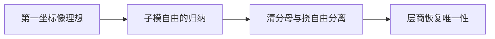

# MA105 模论与结构定理｜正式归档说明

2026-10-31；本课共 **8 讲**，属于四门共 56 讲编写批次。数学学科审稿通过；本课为数学内部结构内容，无须另行综合审稿。正文、例题与习题答案齐备，原设计中明确只陈述或预告的高级理论仍保留其证明边界。

下方完整保留被审核的作者稿。其中“待独立审稿”“未经独立审稿”“待复审”“尚未批准”等标签及作者自校区的阶段状态是写作历史，当前审核状态以本说明和对应报告为准。学习验收与 PDF 编译未因此完成；不自动改变学生掌握记录或共享未证结论登记。

审核记录：

- [审核记录 1](../../../lectures/math/review_reports/review_20261031_MA105_MA106_full_DSH.md)
- [审核记录 2](../../../lectures/math/review_reports/review_20261031_MA105_MA106_round2_DSH.md)
- [审核记录 3](../../../lectures/math/review_reports/review_20261031_MA105_MA106_final_DSH.md)
- [审核记录 4](../../../lectures/math/review_reports/review_20261031_MA105_MA106_archive_metadata_DSH.md)

被审作者稿 SHA256（教务长实测）：`4d2d598ec4ec3c81a3bfdc79bc566b1e07422b9a885c425d9c078c7088211095`；字节数：70000。归档文件在其前面增加本说明，正文逐字节不变。完整文件的独立 SHA256、字节数和正文起始偏移记录在[归档核验清单](../../../projects/semester_01/handout_completion_20261031/archive_manifest.json)；完整文件哈希置于外部清单，避免自引用。

---

<!-- REVIEWED_AUTHOR_BYTES_BEGIN -->
---
title: MA105 模论与结构定理（八讲合订作者稿）
author: Codex 数学教授 CDX
date: 2026-10-31
version: 0.2-author-draft
status: 八讲正文及题解齐备，待独立审稿，不表示学生已学完
---

# MA105 模论与结构定理

本合订本沿2026-10-12八讲设计及用户2026-10-30/31写作授权完成。阅读顺序：模语言→自由模与关系→结构定理目标→子模与唯一性→Smith存在性→算子分类→阿贝尔群→零化理想与Cayley–Hamilton。各讲习题的提示与答案集中于后部；教学验收需实际作答。

前置：有限维线性代数及PID的环论基础（Bézout、素元、因子分解）；前置要求不代表用户已掌握。一般PID上的算法在理论上有限终止，实际计算还需有效的环运算接口。交换代数、同调代数为后续方向，不冒充本课程已完成。

历史分篇保留作为来源；本件是统一阅读入口。早期章节的“后证”描述阅读依赖，其对应证明已在后文。作者计算核验不是一般数学证明，也不等于DSH独立审稿。

## 第一讲 模、子模与商模

### 1.0 结构图景：把标量换掉，哪些线性结构还在？

在向量空间里，非零标量可以除。整数却不能随意除：方程 $2x=1$ 在整数中无解；在 $\mathbb Z/6\mathbb Z$ 中，$2\cdot\overline3=\overline0$。这些现象不妨碍加法、整数倍和保持加法的映射存在。

本讲的对象是“带有环作用的阿贝尔群”，目标是统一三类熟悉对象：向量空间、阿贝尔群、装有一个指定线性算子的向量空间。构造工具仍是生成、取核、取商；验证时尤其要检查更换代表元后结果是否改变。

**本讲目标**：能辨认三类模，验证商运算良定义，写出第一同构定理的具体映射，并区分普通线性同构与保持指定算子的同构。

### 1.1 环与左模的定义

本讲的环 $R$ 含乘法单位元 $1_R$；其加法为阿贝尔群，乘法满足结合律及左右分配律，乘法暂不要求交换。域是非零交换环且每个非零元可逆。左理想是加法子群且对左乘任意环元封闭；交换环中就称理想。

**左 $R$-模**是阿贝尔群 $(M,+)$ 与作用 $R\times M\to M$，记作 $(r,m)\mapsto rm$，满足

$r(m+n)=rm+rn,\quad (r+s)m=rm+sm,\quad (rs)m=r(sm),\quad 1_Rm=m.$

这里 $r,s\in R$，$m,n\in M$。环内的乘法 $rs$ 和环对模的作用 $rm$ 类型不同，不能把它们混成一个未说明的乘法。

由 $0_Rm=(0_R+0_R)m$ 并消去一项得 $0_Rm=0_M$；同理 $r0_M=0_M$，且 $(-r)m=-(rm)$。这些是推论，不需额外公理。

**例 1：域上的模。** 当 $R=K$ 为域时，上面就是向量空间公理。此时非零 $a\in K$ 满足 $am=0\Rightarrow m=a^{-1}(am)=0$。换成一般环后，这一步可能无从进行。

**例 2：整数上的模。** 对任意阿贝尔群 $A$，定义 $na$ 为重复相加，负整数则取加法逆元，得到 $\mathbb Z$-模。反过来，任何含幺的 $\mathbb Z$-模都必须如此，因为 $na=(1+\cdots+1)a$。所以阿贝尔群和 $\mathbb Z$-模给出同一结构语言。

**例 3：一个算子就是一种多项式作用。** 设 $T:V\to V$ 是 $K$-线性算子。对 $p(x)=\sum_{j=0}^{d}a_jx^j$ 定义

$p\cdot v=p(T)v=\sum_{j=0}^{d}a_jT^jv.$

由于 $T^iT^j=T^{i+j}$，逐项相乘得到 $(pq)(T)=p(T)q(T)$；加法、分配律和单位元性质也由有限和验证。于是 $V$ 成为 $K[x]$-模，记 $V_T$。

反向地，给定一个 $K[x]$-模，先限制常数多项式的作用得到 $K$-向量空间，再令 $T(v)=xv$。作用公理保证 $T$ 线性，并且全部多项式作用被这一个 $T$ 确定。

### 1.2 子模：封闭性必须包括新的标量

**子模** $N\subseteq M$ 是加法子群，且 $rN\subseteq N$ 对每个 $r\in R$ 成立。等价判据是 $0\in N$，且 $u-v\in N$、$ru\in N$ 对 $u,v\in N,r\in R$ 成立。

在 $\mathbb Z$-模中，子模就是子群。在 $V_T$ 中，子模恰是满足 $T(W)\subseteq W$ 的 $K$-子空间：从 $K[x]$-子模到不变子空间，只需取常数多项式及 $x$；反向由 $T$-不变性逐次得 $T^jW\subseteq W$，再作有限线性组合。

例如令 $V=K^2$，$T(e_1)=0,T(e_2)=e_1$。则 $Ke_1$ 是子模，$Ke_2$ 不是，因为 $T(e_2)=e_1\notin Ke_2$。它们作为普通向量子空间地位相同，但在指定算子后地位不同。

### 1.3 商模：保留相容于标量的等价关系

给定子模 $N$，令 $m\sim m'$ 当且仅当 $m-m'\in N$。加法子群性质保证这是等价关系。等价类记 $m+N$，类的集合记 **商模** $M/N$，运算拟定为

$(m+N)+(m'+N)=(m+m')+N,\qquad r(m+N)=rm+N.$

**良定义的验证。** 若 $m-\widetilde m\in N$、$m'-\widetilde m'\in N$，则

$(m+m')-(\widetilde m+\widetilde m')\in N,\qquad rm-r\widetilde m=r(m-\widetilde m)\in N.$

所以换代表元只会改变一个属于 $N$ 的误差，商里的结果不变。模公理再由 $M$ 中的公理逐项下降。这正是“先把误差放进将被忽略的子对象，再取商”的通用做法。

注意：这是模的商。若还要在 $R/I$ 上定义环乘法，一般非交换环需要双边理想；只做左模商 $R/I$ 则左理想足够。

### 1.4 同态、核与第一同构定理

**模同态** $f:M\to L$ 满足 $f(m+n)=f(m)+f(n)$ 与 $f(rm)=rf(m)$。若还是双射，称模同构。核 $\ker f=\{m:f(m)=0\}$ 与像 $\operatorname{im}f$ 都是子模，例如 $f(ru)=rf(u)=0$ 验证核的标量封闭性。

**第一同构定理。** 映射

$\overline f:M/\ker f\longrightarrow\operatorname{im}f,\qquad m+\ker f\longmapsto f(m)$

是 $R$-模同构。

证明分四步。第一，若代表元相差 $k\in\ker f$，则 $f(m+k)=f(m)$，所以良定义。第二，代入商运算可见它保持加法和标量。第三，若 $f(m)=f(m')$，则 $m-m'\in\ker f$，两者属于同一个商类，所以单射。第四，每个像中元素本来就形如 $f(m)$，所以满射。这里不能只写“有自然对应”就略过单射与满射。

在 $V_T\to W_S$ 的情形，模同态正是满足 $fT=Sf$ 的 $K$-线性映射。必要性取标量 $x$；充分性先归纳 $fT^j=S^jf$，再对多项式有限求和。若 $f$ 可逆，则 $S=fTf^{-1}$：**矩阵相似正是这类模的同构问题**。

### 1.5 示范例题：一个二阶算子的循环生成元

仍取 $T(e_1)=0,T(e_2)=e_1$。定义

$\Phi:K[x]\to V_T,\qquad p\mapsto p(T)e_2.$

证明并计算 $V_T\cong K[x]/(x^2)$。

**解。** $\Phi$ 是模同态，因为 $\Phi(qp)=q(T)\Phi(p)$。若 $p(x)=a_0+a_1x+x^2q(x)$，则 $T^2=0$ 给出

$\Phi(p)=a_0e_2+a_1e_1.$

于是像包含 $e_2=\Phi(1)$ 与 $e_1=\Phi(x)$，故满射；$\Phi(p)=0$ 当且仅当 $a_0=a_1=0$，故核为 $(x^2)$。第一同构定理得结论。它在 $K$ 上有两个基向量，在 $K[x]$ 上却由一个元素生成；**生成元个数必须带着标量环一起说**。

### 1.6 直和：组合对象与内部拆分

两个模的**外直和** $M\oplus L$ 是有序对集合，运算逐分量定义。若 $A,B$ 是同一模 $M$ 的子模，满足 $A+B=M$ 且 $A\cap B=\{0\}$，则每个 $m$ 唯一表示为 $a+b$，称内部直和 $M=A\oplus B$。

唯一性的理由是：$a+b=a'+b'$ 导致 $a-a'=b'-b\in A\cap B$，因此两边均为零。外直和到内部直和的映射 $(a,b)\mapsto a+b$ 随即是模同构。

不必先选“坐标”，也不必存在内积。直和描述唯一分解；正交直和是在这之上多了内积条件。

### 1.7 练习与验证终点

- **G1.1（引导练习）**：在 $\mathbb Z$-模 $\mathbb Z/12\mathbb Z$ 中，求由 $\overline4$ 生成的子模 $N$，并确定商模。验证终点：写出满同态及其核。提示置于附录。
- **I1.1（独立习题）**：证明 $f:V_T\to W_S$ 是模同态当且仅当它 $K$-线性且 $fT=Sf$。说明仅有普通线性同构为何不够。
- **I1.2（独立习题）**：证明 $6\mathbb Z$ 是 $\mathbb Z$ 的子模，但不存在子模 $B$ 使 $\mathbb Z=6\mathbb Z\oplus B$。

### 1.8 小结、本质与覆盖图

| 旧概念 | 新对象中的位置 | 保持什么 |
|---|---|---|
| 向量空间 | 域上的模 | 加法与所有标量作用 |
| 阿贝尔群 | 整数上的模 | 加法已决定全部整数作用 |
| 不变子空间 | $K[x]$-模的子模 | 由一个算子生成的多项式作用 |
| 相似 | $K[x]$-模同构 | 指定算子随同构被搬运 |
| 商空间／商群 | 商模的特化 | 更换代表元只产生可忽略误差 |

核心改变是“结构也包含标量怎样作用”。下一讲问：有了生成元，是否总能像向量空间一样挑出一组基？答案一般是否定的。

本讲自测入口：T1.2，题面见本讲练习或全课分层自测，答案统一在附录B。

## 第二讲 自由模、秩与有限生成

### 2.0 结构图景：有限坐标与有限关系是两件事

向量空间中，有限生成通常引向一组基；但 $\mathbb Z/6\mathbb Z$ 由一个元素生成，却有不可消去的关系 $6\overline1=0$。本讲把“用几个元素表示所有元素”和“表示是否唯一”分开。

本讲涉及秩不变性时，明确假定 $R$ 是**非零交换含幺环**。前一讲一般左模的定义不因此改变。整环是非零交换环且非零元之积非零；PID 是每个理想主生成的整环，后续结构定理在该条件下展开。

### 2.1 生成元、基与自由模

给定 $m_1,\ldots,m_n\in M$，它们生成的子模是

$Rm_1+\cdots+Rm_n=\left\{\sum_{i=1}^{n}r_im_i:r_i\in R\right\}.$

若等于 $M$，称 $M$ **有限生成**。若每个元素还能唯一表示为上式，则 $(m_1,\ldots,m_n)$ 是一组**基**，$M$ 是有限秩**自由模**。

“唯一”也可写作：$\sum_{i=1}^{n}r_im_i=0$ 只可能发生在全部 $r_i=0$ 时。证明与高代相同，把两个表示相减即可。一般自由模也可以有无限基，但每个元素仍只允许有限支撑的线性组合，本课主要研究有限生成情形。

**三个辨析。** $R^n$ 由标准单位向量组成一组基；$2\mathbb Z$ 作为 $\mathbb Z$-模以 $2$ 为基，因此虽然不含整数 $1$ 仍是自由模；$\mathbb Z/6\mathbb Z$ 有生成元 $\overline1$，却不是非零自由 $\mathbb Z$-模，因为每个元素都被整数 $6$ 杀掉，而 $\mathbb Z$-自由模中非零向量不可能如此。

### 2.2 生成元对应满射，关系对应核

一组选定生成元给出模同态

$\pi:R^n\to M,\qquad (r_1,\ldots,r_n)\mapsto\sum_{i=1}^{n}r_im_i.$

它满射恰好等价于这些元素生成 $M$；它是同构恰好等价于这些元素构成基。一般情形，由第一同构定理

$M\cong R^n/\ker\pi.$

因此有限生成模可以读作“有限个自由坐标，再施加一些线性关系”。这里**没有说关系只需有限条**。若关系子模也有限生成，则称这个模**有限呈示**；这是比有限生成更强的要求。

例如 $\mathbb Z/6\mathbb Z\cong\mathbb Z/(6)$，只有一个坐标和一条关系。后续 Smith 形要把一组关系改写成最容易辨认的样子。

### 2.3 示范例题：用明确映射识别一个商

令 $L=\mathbb Z(2,4)\subseteq\mathbb Z^2$。求 $\mathbb Z^2/L$ 的具体描述，暂不使用结构定理。

**解。** 定义

$F:\mathbb Z^2\to(\mathbb Z/2\mathbb Z)\oplus\mathbb Z,\qquad F(a,b)=(\overline a,b-2a).$

它保持加法和整数作用。任取 $(\overline r,c)$，选择整数代表 $r$，则 $F(r,c+2r)=(\overline r,c)$，故满射。若 $F(a,b)=0$，则 $a=2k,b=2a=4k$，所以核恰为 $L$。于是

$\mathbb Z^2/\mathbb Z(2,4)\cong(\mathbb Z/2\mathbb Z)\oplus\mathbb Z.$

商中 $(1,2)+L$ 是非零的二阶元；$L$ 中第一坐标为偶数，所以它非零，而其二倍属于 $L$。这个商因此不自由。二维自由对象的一条关系不仅减少自由方向，还可能留下有限阶部分。

### 2.4 自由模的有限秩为什么良定义？

**命题。** 若 $R$ 是非零交换含幺环，且 $R^n\cong R^m$，其中 $m,n$ 有限，则 $m=n$。这个共同整数称有限自由模的**秩**。

不能只套用域上的维数定理，因为 $R$ 可能不是域。下面给出只用行列式的证明，不预先引用极大理想存在性或张量积。

同构及其逆对应矩阵 $A\in R^{n\times m}$、$B\in R^{m\times n}$，满足 $AB=I_n,BA=I_m$。在多项式环 $R[t]$ 中考虑分块矩阵

$C(t)=\begin{pmatrix}I_n&tA\\B&I_m\end{pmatrix}.$

左乘 $\begin{pmatrix}I_n&0\\-B&I_m\end{pmatrix}$，得到块上三角矩阵，故 $\det C(t)=\det(I_m-tBA)$。改为左乘 $\begin{pmatrix}I_n&-tA\\0&I_m\end{pmatrix}$，得到块下三角矩阵，故 $\det C(t)=\det(I_n-tAB)$。两次左乘矩阵的行列式都是 $1$。这些行列式恒等式由有限置换求和定义在任意交换环上仍成立，不需要除法。

于是 $(1-t)^m=(1-t)^n$。因为 $1_R\ne0_R$，两个多项式的最高次项系数分别为 $(-1)^m$、$(-1)^n$，均非零，次数必相同。因此 $m=n$。零阶矩阵按行列式为 $1$ 处理，结论也包括零模。

**边界。** 零环被排除是必要的：在零环上所有 $R^n$ 都只有一个元素，不能用该论证区分 $n$。本文也没有宣称一般非交换环上的基数不变性。

### 2.5 挠与“不能相除”的障碍

以下 $R$ 是整环。若存在非零 $r\in R$ 使 $rm=0$，称 $m$ 是**挠元**。所有挠元构成 $M_{\mathrm{tor}}$。它是子模：若 $ru=0,sv=0$ 且 $r,s\ne0$，则 $rs\ne0$，并有 $rs(u-v)=0$；若 $a\in R$，则 $r(au)=a(ru)=0$。

仅有零挠元的模叫**无挠模**。整环上的自由模一定无挠：若 $rm=0$，将 $m$ 在基上展开，则每个系数 $c_i$ 满足 $rc_i=0$；整环性质给出全部系数零。

反向却不能随意用：$\mathbb Q$ 作为 $\mathbb Z$-模无挠，但不有限生成。若由有限个分数生成，取分母公倍数 $D>0$，所有整数线性组合都在 $D^{-1}\mathbb Z$ 中，而 $1/(2D)$ 不在其中。也不能有无限基：任意两个非零有理数都整数线性相关，所以线性无关集合至多一个元素；一个元素又不能生成 $\mathbb Q$。

后续在“PID＋有限生成”条件下会证明无挠模自由；本讲没有使用这一后续结论。

### 2.6 有限生成能否传给子模？

在向量空间里，有限维空间的子空间有限维。一般环上的相应结论会失效。

令 $R=K[x_1,x_2,\ldots]$，即每个多项式实际只含有限多个变量的多项式环，取理想 $I=(x_1,x_2,\ldots)$。$R$ 作为自己的模由 $1$ 生成，但 $I$ 不能有限生成。

若 $I=(f_1,\ldots,f_s)$，这有限个多项式共涉及有限多个变量，记索引集合 $J$。取 $k\notin J$。把 $J$ 中全部变量代成零：因为每个 $f_i\in I$ 没有常数项，它们全变成零。于是任意 $\sum_{i=1}^{s}g_if_i$ 都变成零；但 $x_k$ 不变。这与 $x_k\in I$ 矛盾。

**Noether 模**指每个子模都有限生成的模；环在作为自身模时满足该性质则称 Noether 环（本课采用交换环语境）。这里先把问题命名，不使用 Hilbert 基定理，也不证明一般 Noether 理论。第 4 讲将单独证明本课真正需要的 PID 上有限自由模子模定理。

### 2.7 练习与验证终点

- **G2.1（引导练习）**：把例题中 $(2,4)$ 改成 $(3,6)$，构造同态证明商模同构于 $(\mathbb Z/3\mathbb Z)\oplus\mathbb Z$。提示置于附录。
- **I2.1（独立习题）**：证明 $M$ 有 $n$ 个生成元，当且仅当存在满同态 $R^n\to M$；再说明何时这组生成元为基。
- **I2.2（独立习题）**：在 $\mathbb Z$-模 $M=\mathbb Z\oplus\mathbb Z/4\mathbb Z$ 中，求挠子模并证明 $M$ 不自由。
- **I2.3（独立习题）**：找出本讲证明“自由模无挠”中实际使用整环的那一步；解释不能从“一个生成元”直接得“秩为一”。

### 2.8 小结、本质与覆盖图

| 高代经验 | 模论中的准确替代 | 本讲边界 |
|---|---|---|
| 有限张成 | 存在满同态 $R^n\to M$ | 不保证核有限生成 |
| 基与坐标 | $R^n\cong M$ | 有限生成不保证有基 |
| 维数不依赖基 | 非零交换环上有限自由模秩不变 | 已给行列式证明 |
| 标量非零可消去 | 整环上的无挠性质 | 不等于可除，也不自动自由 |
| 子空间仍有限维 | 子模是否有限生成 | 一般失效，PID 情形后证 |

第 3 讲将提出结构定理的完整目标，分别追问“存在什么分解”和“哪些信息不依赖选择”。不能把具体补子模的非唯一误写成秩或不变因子不唯一。

本讲自测入口：T1.1，题面见本讲练习或全课分层自测，答案统一在附录B。

## 第三讲 结构定理：分类目标与证明路线

### 3.0 结构图景：哪些变化只是改写，哪些改变对象？

把整数矩阵换一组行列坐标，关系的外观变了，商模未必变。分类要找的是不随这种改写改变的信息。高代的 Jordan 块、整数群的循环因子看似两种问题，背后都是 PID 上“有限生成元加线性关系”的分类。

本讲先明确要证明的结论，辨认两种分类格式，并把完整证明拆成可独立核查的任务。这里的定理陈述是后续目标；本讲例题用显式同构核验，不以尚未完成的分类定理作黑箱。

### 3.1 结构定理的准确陈述

对有限生成 $R$-模 $M$，目标是证明存在

$M\cong R^r\oplus\bigoplus_{i=1}^{s}R/(a_i),\qquad a_1\mid a_2\mid\cdots\mid a_s,$

其中 $r,s\ge0$，每个 $a_i$ 非零且不是单位。$r$ 唯一，$a_i$ 在乘单位意义下唯一，称为**不变因子**。约定无循环项时直和为零；零模对应 $r=s=0$。

为何排除 $a_i=0$ 或单位？$R/(0)=R$ 已算入自由部分；单位 $u$ 生成全环，$R/(u)=0$，加入任意多个零项会破坏列表长度的唯一性。所谓“相差单位”指 $(a_i)$ 相同；在整数中可选正数，在域上多项式环中可选首一多项式。

另一种格式为

$M\cong R^r\oplus\bigoplus_{p}\bigoplus_{j=1}^{s_p}R/(p^{e_{p,j}}),\qquad e_{p,j}\ge1.$

这里 $p$ 遍历选定的素元代表，只有有限多个 $s_p$ 非零。各素元下指数的多重集唯一，称**初等因子**数据。此式的求和实际有限；不涉及无限直和或收敛。

### 3.2 两种格式之间：先拆互素部分，再对齐指数

先就地证明所需中国剩余同构。若 $(a)+(b)=R$，选 $u,v$ 使 $ua+vb=1$。映射

$R/(ab)\to R/(a)\oplus R/(b),\quad \overline z\mapsto(z+(a),z+(b))$

良定义。若 $z\in(a)\cap(b)$，写 $z=ac$，而 $b\mid ac$；把 Bézout 等式乘 $c$ 得 $c=uac+vbc$，所以 $b\mid c$，于是 $ab\mid z$，核为零。给定剩余类 $(\overline x,\overline y)$，取 $z=vb x+ua y$，模 $a$ 为 $x$、模 $b$ 为 $y$，故满射。这给出显式同构，而不是只比较元素数目。

把 $a_i$ 按素元分解，再重复该论证，可拆成初等因子。反向要把各素元的指数由小到大排列，**在左端补零到同样长度**，逐列相乘；指数零表示该素元不出现在该因子中。这样每列的指数不减，恰好保证整除链。

示范 E3.1：给定

$M=\mathbb Z/4\mathbb Z\oplus\mathbb Z/8\mathbb Z\oplus\mathbb Z/3\mathbb Z\oplus\mathbb Z/9\mathbb Z\oplus\mathbb Z/25\mathbb Z.$

指数表为

| 素数 | 左列 | 右列 |
|---|---:|---:|
| 2 | 2 | 3 |
| 3 | 1 | 2 |
| 5 | 0 | 2 |

所以同构于 $\mathbb Z/12\mathbb Z\oplus\mathbb Z/1800\mathbb Z$。这次计算仅用互素合并：$4$ 与 $3$ 合成 $12$，$8,9,25$ 合成 $1800$。核验 $12\mid1800$，总阶均为 $21600$；总阶相同只是必要复查，真正依据是刚才的同构。

### 3.3 分类信息不止总阶

$\mathbb Z/4\mathbb Z$ 与 $(\mathbb Z/2\mathbb Z)^2$ 都有4个元素，却不同构：前者有4阶元素，后者所有元素都被2消去。同构必须保存标量作用，因而保存每个元素的零化关系。

定义**零化理想** $\operatorname{Ann}_R(M)=\{a\in R:aM=0\}$。它是理想：差和任意标量倍仍消去所有元素。若已有上述不变因子分解且 $r=0,s>0$，则零化理想为 $(a_s)$：消去全部循环项等价于被每个 $a_i$ 整除，整除链把条件缩为 $a_s\mid a$。若 $r>0$，因整环上的非零自由向量没有挠，零化理想为零。若 $M=0$（$r=s=0$），则所有标量都消去全模，故零化理想为 $R$。

注意零化理想也不完整：$\mathbb Z/4\mathbb Z$ 和 $(\mathbb Z/4\mathbb Z)^2$ 的零化理想相同，模却不同构。分类需要足够多的不变量，而非随便选一个不变量。

### 3.4 证明任务图

| 任务 | 目的 | 状态与位置 |
|---|---|---|
| 子模 $N\subseteq R^n$ 自由且有限生成 | 把关系也写成有限矩阵 | 第4讲完整证明 |
| 有限生成无挠模自由 | 识别商掉挠后的结构 | 第4讲完整证明 |
| 挠部分与自由部分分离 | 把分类集中到有限关系 | 第4讲完整证明 |
| 关系矩阵化成整除链对角形 | 证明循环项分解存在 | 第5讲证明，阅读至此尚未作输入使用 |
| 用内在数据恢复因子 | 排除不同规范列表 | 第4讲给恢复论证；配合第5讲存在性闭环 |

“存在某个分解”与“规范列表唯一”是两个问题。具体嵌在 $M$ 里的自由补子模可以不唯一，不代表自由秩或挠子模不唯一。

### 3.5 练习、小结与覆盖图

- G3.1（引导）：把 $\mathbb Z/8\mathbb Z\oplus\mathbb Z/9\mathbb Z\oplus\mathbb Z/3\mathbb Z$ 改写成整除链格式。提示在答案册。
- I3.1（独立）：构造 $\mathbb Z/6\mathbb Z\oplus\mathbb Z/10\mathbb Z\cong\mathbb Z/2\mathbb Z\oplus\mathbb Z/30\mathbb Z$ 的分拆与重组路线，不能只比较总阶。
- I3.2（独立）：求 $\operatorname{Ann}_{\mathbb Z}(\mathbb Z\oplus\mathbb Z/6\mathbb Z)$，并解释“零化理想为零”为何不能判断模是否有挠元。

| 旧信息 | 本讲升级 |
|---|---|
| 元素个数 | 只保留分类数据的乘积，丢失许多结构 |
| 元素周期 | 循环模的零化关系 |
| 互素同余 | 循环模的直和分解 |
| 换坐标 | 保持同构类型的表达变换 |

本质：规范形式不是漂亮排版，而是把同构类型压缩为可恢复的数据。下一讲先证明有限关系确实可以被抓住。

本讲自测入口：T1.3，题面见本讲练习或全课分层自测，答案统一在附录B。

## 第四讲 子模定理、挠部分与唯一性的骨架

### 4.0 结构图景：取一个坐标，把困难降一维

高代通过主元消元降维。PID 上虽然不能任意相除，但一个坐标的像是理想，理想可以由一个元素生成。这给出另一种“主元”：不是规定它等于1，而是选一个能生成该坐标全部可能值的元素。

### 4.1 子模定理及完整归纳证明

**定理。** 若 $N\subseteq R^n$ 是子模，则 $N$ 为自由模，存在基的个数 $r\le n$。特别地，它有限生成。

当 $n=0$ 显然。设定理对 $n-1$ 成立，令 $\pi:R^n\to R$ 为第一坐标。$\pi(N)$ 是理想。若为零，则 $N\subseteq\{0\}\oplus R^{n-1}$，应用归纳假设。

若 $\pi(N)=(a)$ 且 $a\ne0$，选 $v\in N$ 使 $\pi(v)=a$。对任意 $u\in N$，有 $\pi(u)=ca$，于是 $u-cv\in N\cap\ker\pi$。故

$N=Rv+(N\cap\ker\pi).$

若 $cv\in\ker\pi$，则 $ca=0$；整环且 $a\ne0$ 给出 $c=0$。所以该和为直和，且 $Rv\cong R$。另一项嵌在 $R^{n-1}$ 中，由归纳得到至多 $n-1$ 个基向量。与 $v$ 合并即得 $N$ 的基，证明完成。

这里没有说 $N$ 是 $R^n$ 的直和因子。例 $2\mathbb Z\subset\mathbb Z$ 自由，却没有整数模补子模。归纳中找到的是 $N$ 自己内部的分解。

示范 E4.1：令 $N=\{(a,b)\in\mathbb Z^2:a+b\text{ 为偶数}\}$。第一坐标像为 $\mathbb Z$，可选 $v=(1,1)$；核中的向量为 $(0,2k)$。故基为 $(1,1),(0,2)$。任意 $(a,b)\in N$ 的唯一表达是 $a(1,1)+(b-a)(0,2)/2$，系数确为整数。基矩阵行列式为2，说明它不是整个 $\mathbb Z^2$ 的整数基。

### 4.2 有限生成无挠模为何自由：先进入分式域，再清分母

设 $M$ 有限生成且无挠。构造分式向量空间：符号 $m/s$ 中 $m\in M,0\ne s\in R$，定义

$m/s=m'/s'\quad\Longleftrightarrow\quad s'm=sm'.$

这是等价关系。传递性中由 $s'm=sm'$ 与 $s''m'=s'm''$ 得 $s'(s''m-sm'')=0$，用无挠性消去 $s'$。定义加法为 $(s'm+sm')/(ss')$，其中 $K$ 是 $R$ 的分式域。对 $a,b\in R,b\ne0$，定义新的标量作用 $(a/b)\cdot(m/s):=(am)/(bs)$，右边分子中的 $am$ 仍是原来的 $R$-模作用。若 $ab'=a' b$ 且 $s' m=sm'$，则 $(b' s')(am)=(bs)(a' m')$，故代表元的更换不改变结果。取 $b=1$ 时与原来的 $R$-作用一致。更换分子分母时，交叉相乘验证结果相同；分配律等由模公理逐项得到，所以这确实是 $K$-向量空间 $V$。

映射 $M\to V,m\mapsto m/1$ 单射，因此可把 $M$ 看作 $V$ 的子模。若 $M$ 由 $m_1,\ldots,m_q$ 生成，则它们也在 $K$ 上张成 $V$；从这有限组中挑出 $K$-基 $e_1,\ldots,e_r$，其中 $e_i\in M$。把所有 $m_j$ 在该基上展开，只有有限多个分母，取它们的非零乘积 $d$，便有

$dM\subseteq Re_1\oplus\cdots\oplus Re_r\cong R^r.$

第4.1节给出 $dM$ 自由；$M\to dM,m\mapsto dm$ 满射且由无挠性单射，因此 $M$ 自由。它的秩为 $r$：任何 $R$-基在清分母后也是 $V$ 的 $K$-基，有限维维数不变性给出相同个数。

这条证明没有使用结构定理，反而是之后证明结构定理的准备。$\mathbb Q$ 作为整数模不满足有限生成，所以不与此定理冲突。

### 4.3 分离挠部分：补空间可以选，但不自然唯一

记 $T=M_{\mathrm{tor}}$，其子模性质已在第2讲证明。$M/T$ 无挠：若 $a(m+T)=0$ 且 $a\ne0$，则 $am\in T$，存在非零 $b$ 使 $bam=0$；因 $ba\ne0$，有 $m\in T$，所以该类为零。商仍有限生成，因此由第4.2节自由。

选择 $M/T$ 的基 $\overline v_1,\ldots,\overline v_r$，并在 $M$ 中各取提升 $v_i$。令 $F=\sum_{i=1}^{r}Rv_i$。任意 $m$ 的商类可在该基上展开，所以 $m-\sum_{i=1}^{r}c_iv_i\in T$，即 $M=T+F$。若 $\sum_{i=1}^{r}c_iv_i\in T$，取商得到 $\sum_{i=1}^{r}c_i\overline v_i=0$，故所有系数零。于是

$M=T\oplus F,\qquad F\cong R^r.$

$T$ 也有限生成：明确取投影 $\pi_T:M=T\oplus F\to T$，$t+f\mapsto t$。若 $m_1,\ldots,m_q$ 生成 $M$，将任意 $t\in T$ 的生成式施以 $\pi_T$，可见 $t_i=\pi_T(m_i)$ 生成 $T$。各 $t_i\in T$，故存在 $a_i\ne0$ 使 $a_it_i=0$。令 $a=\prod_{i=1}^{q}a_i$，整环性质给 $a\ne0$，且 $at_i=0$ 对每个 $i$ 成立，故 $aT=0$。空生成组取空积1。

示范 E4.2：在 $M=\mathbb Z\oplus\mathbb Z/2\mathbb Z$ 中，$T=0\oplus\mathbb Z/2\mathbb Z$ 唯一确定，但 $F_0=\mathbb Z(1,\overline0)$ 和 $F_1=\mathbb Z(1,\overline1)$ 都是它的补子模，且是不同子集。二者均同构于 $\mathbb Z$，自由秩仍为1。

### 4.4 唯一性的可恢复数据

本节证明：**如果**第3讲所列分解存在，那么规范列表由模唯一决定。存在性在第5讲完成。

首先 $T$ 由“某非零标量能否消去”内在定义；任何同构都保持它。因此自由秩可由 $M/T$ 的秩恢复，或由其分式向量空间的维数恢复。

对每个素元 $p$ 和整数 $j\ge1$，定义

$b_{p,j}=\dim_{R/(p)}\bigl(p^{j-1}T/p^jT\bigr).$

该商被 $p$ 消去，所以确实是 $R/(p)$-向量空间；这里可就地验证 $R/(p)$ 是域：若 $p\nmid a$，则 $\gcd(p,a)=1$，Bézout 给 $up+va=1$，所以 $\overline v\overline a=1$；每个非零剩余类都有逆。只要给定一个有限循环分解，其维数有限，下面即可计算。

若一个循环块是 $R/(q^e)$ 且 $q$ 与 $p$ 不相伴，则 Bézout 给出 $p$ 在该商中可逆，因此它对上式的贡献为零。若块为 $R/(p^e)$，当 $j\le e$ 时映射 $R/(p)\to p^{j-1}(R/(p^e))/p^j(R/(p^e))$，$\overline r\mapsto\overline{rp^{j-1}}$，满射且核零：在整环中约去 $p^{j-1}$，可知零像当且仅当 $p\mid r$。当 $j>e$ 时该商为零。因此

$b_{p,j}=\#\{\text{初等因子中 }p^e\text{ 的块}:e\ge j\}.$

所以指数恰为 $j$ 的块数是 $b_{p,j}-b_{p,j+1}$。每个指数及其重数被恢复；再按第3.2节的左补零规则恢复整除链，得到不变因子在相伴意义下的唯一性。这比“看起来没有别的分法”多了一个实际恢复算法。

示范 E4.3：$T=\mathbb Z/2\mathbb Z\oplus\mathbb Z/4\mathbb Z\oplus\mathbb Z/8\mathbb Z$。依次有 $b_{2,1}=3,b_{2,2}=2,b_{2,3}=1,b_{2,4}=0$，差分均为1，恢复出指数 $1,2,3$ 各一次。

### 4.5 从有限生成到有限关系：给第5讲准备输入

由选定的生成元有满同态 $R^n\twoheadrightarrow M$。核 $N$ 是 $R^n$ 的子模，由第4.1节有有限基 $w_1,\ldots,w_k$，$k\le n$。把这些向量作为矩阵 $A$ 的列，得到

$M\cong R^n/\operatorname{im}A.$

改变 $R^n$ 的基等于对 $A$ 左乘可逆矩阵，改变关系生成组的基等于右乘可逆矩阵。这些操作不改变商的同构类型。Smith 定理要证明可以化成 $d_1\mid\cdots\mid d_k$ 的对角关系；我们尚未证明能做到，因此**此处停在准确的证明接口**，不把目标当理由。

### 4.6 练习、小结与覆盖图

- G4.1（引导）：给 $N=\{(a,b)\in\mathbb Z^2:a+2b\equiv0\pmod3\}$ 找整数基，并核对每个系数为整数。
- I4.1（独立）：证明 $\mathbb Z/2\mathbb Z$ 不能作为子模嵌入任何 $\mathbb Z^n$，却可以成为其商。
- I4.2（独立）：某有限2-初等因子模有 $b_{2,1}=4,b_{2,2}=2,b_{2,3}=2,b_{2,4}=0$。在已知存在循环分解的前提下恢复初等因子，计算元素总数。
- I4.3（独立）：将 E4.2 的 $\mathbb Z/2\mathbb Z$ 改成 $\mathbb Z/5\mathbb Z$，写出五个不同自由补子模，并验证它们与挠子模的交均为零。

| 旧概念 | 本讲中的统一位置 |
|---|---|
| 消元选主元 | 一个坐标像理想的生成元 |
| 基与维数 | 进入分式域后再用高代，最后清分母返回环 |
| 选补空间 | 提升商模的自由基，补子模可随选择变化 |
| 块大小 | 层商维数的差分恢复 |

本讲把“有限生成”升级成“有限呈示”，并分清了存在性、选择与不变量。下一讲才完成关系矩阵的规范化，闭合结构定理的存在性。

本讲自测入口：T2.1、T3.2，题面见本讲练习或全课分层自测，答案统一在附录B。

## 第五讲 Smith 标准形：把全部关系变成整除链

### 5.0 结构图景

第4讲已把有限生成模写成 $R^n/\operatorname{im}A$，其中关系矩阵 $A$ 有有限列。本讲不是只宣告有规范形式，而是证明允许的改写能够终止，且最终数据与改写路线无关。始终假定 $R$ 为 PID；整数环与域上的一元多项式环是主要可计算例子。

对象是矩形矩阵，目标是找到可逆矩阵 $P,Q$ 使

$PAQ=\operatorname{diag}(d_1,\ldots,d_r,0),\qquad d_1\mid\cdots\mid d_r,\quad d_i\ne0.$

对矩形对角阵，超过对角线长度的行列全为零。此处允许 $d_i$ 为单位；转为模分类时再删去对应零商。左乘改变关系所在自由模的坐标，右乘改变关系生成组；**等价**不是相似，左右矩阵不必互逆。

### 5.1 合法操作与 Bézout 主元

交换两行、给某行乘单位、某行加另一行的倍数都可逆；列操作同样如此。一般 PID 不一定带有 Euclidean 除法算法，所以不能把“不断取余数”当作全部 PID 的证明。

若 $a,b$ 不同时为零，令 $d$ 为 gcd，选 $u,v$ 使 $ua+vb=d$。那么

$E=\begin{pmatrix}u&v\\-b/d&a/d\end{pmatrix},\qquad \det E=(ua+vb)/d=1,$

而 $E(a,b)^T=(d,0)^T$。这些商在 $R$ 中，因为 $d$ 整除 $a,b$。直接计算 $E^{-1}=\begin{pmatrix}a/d&-v\\b/d&u\end{pmatrix}$，左右相乘皆为单位矩阵，且条目仍在 $R$ 中，故操作可逆；无需引用一般伴随矩阵恒等式。对行向量则使用转置版本作为列操作。这个二元块是“不能直接除以主元时”的替代工具。

### 5.2 为什么主元改善只能发生有限次？

PID 的任意递增理想链都最终稳定。证明：$I_1\subseteq I_2\subseteq\cdots$ 的并是理想（两元素属于某个共同后项），所以等于 $(c)$。$c$ 属于某个 $I_N$，于是 $(c)\subseteq I_N$，反向显然，故以后全等。若并为零，链本来全零。

当当前非零主元为 $a$，而发现某个条目 $b$ 不被 $a$ 整除时，用 gcd 替换主元会把理想 $(a)$ **严格扩大**为 $(a,b)=(d)$。若相等，则 $b\in(a)$，与发现的情况矛盾。因此不可能无限次进行这种严格改善。

这里控制的是理想的包含关系，不是未经定义的“数值大小”。在一般 PID 中，此论证给出有限终止的存在性过程；若还要计算机实现，需要该环提供有效 gcd、Bézout 与整除判定。整数环和 $K[x]$ 可以用 Euclidean 算法实现，不把所有抽象 PID 都称为已有数值算法。

### 5.3 Smith 存在性：逐步构造并证明终止

设矩阵大小为 $m\times n$，对非负整数 $\ell=\min(m,n)$ 归纳。若 $\ell=0$，矩阵无条目，结论成立；若矩阵全零，取 $P=I_m,Q=I_n$ 即可。其余情形至少有一个非零条目，无论原第一行或第一列是否全零，都可交换行列把它移到左上角，记为 $a$。

**第一步：清理第一列与第一行。** 若第一列某项不被 $a$ 整除，使用5.1节二元行变换把主元替换为 gcd；对第一行使用相应列变换。如果某项被主元整除，则加减主元行或列的倍数把该项清零。这可能在另一方向重新出现条目，所以要重新检查。

循环不会无穷进行：不整除步骤每次使主元理想严格扩大，5.2节保证这种步骤只有有限次。两次严格扩大之间，所有可整除条目的清零只需有限步；先清第一列，再清第一行时，后者只用第一列向其他列加倍数，第一列下方已经为零，故不会重新弄脏第一列。于是有限步后得到

$\begin{pmatrix}a&0\\0&B\end{pmatrix}.$

**第二步：主元必须整除整个剩余块。** 若 $B$ 有条目 $b$ 不被 $a$ 整除，把它所在行加到第一行。第一列的主元仍为 $a$，第一行出现 $b$；再使用列 gcd 操作，主元理想严格扩大。返回第一步。由于严格扩大总次数有限，这一过程最终给出左上角主元 $d_1$ 整除全部剩余块条目。

**第三步：对剩余块归纳。** 保持第一行第一列不动，对 $B$ 用归纳假设得到 $d_2\mid\cdots\mid d_r$。块内所有可逆行列操作仍只把条目作 $R$-线性组合，所以原本都被 $d_1$ 整除的性质始终保留；因此 $d_1\mid d_2$。所有操作复合得到所需 $P,Q$。此处 $B$ 的大小恰为 $(m-1)\times(n-1)$，其归纳指标为 $\ell-1$。当 $m=1$ 或 $n=1$ 时 $B$ 无条目，已直接完成；宽矩阵多出的列和高矩阵多出的行都保留在这个矩形归纳对象中，最终作为零列或零行。要区分两种终止理由：前两步返回清理时并不降低 $\ell$，而依靠主元理想升链终止；只有第三步递归才降低 $\ell$。例如 $\begin{pmatrix}0&0&3\\0&0&0\end{pmatrix}$ 先交换第一、第三列，剩余的 $1\times2$ 块为零，直接落入零矩阵分支。

### 5.4 示范 E5.1：不是停在任意对角阵

取整数矩阵

$A=\begin{pmatrix}4&6&0\\2&8&0\\0&0&12\end{pmatrix}.$

交换前两行，第二行减去第一行的2倍，再使第二列减去第一列的4倍，第二行变号，得到 $\operatorname{diag}(2,10,12)$。但 $10\nmid12$，所以还不是 Smith 形。

在右下 $2\times2$ 块上，依次作下列操作：第一行加第二行；第二列减第一列；交换两列；第二行减第一行的6倍；第二列减第一列的5倍；第二行变号。各步为

$\begin{pmatrix}10&0\\0&12\end{pmatrix}\to\begin{pmatrix}10&12\\0&12\end{pmatrix}\to\begin{pmatrix}10&2\\0&12\end{pmatrix}\to\begin{pmatrix}2&10\\12&0\end{pmatrix}\to\begin{pmatrix}2&10\\0&-60\end{pmatrix}\to\begin{pmatrix}2&0\\0&-60\end{pmatrix}\to\begin{pmatrix}2&0\\0&60\end{pmatrix}.$

最终 Smith 形为 $\operatorname{diag}(2,2,60)$。所有行列操作都在整数上可逆，不能用“除第二行为2”这种非单位除法冒充等价变换。

### 5.5 行列式理想：独立验证不变量

定义 $I_k(A)$ 为全部 $k\times k$ 子式生成的理想，并规定 $I_0(A)=R$。若没有相应大小的子式或它们全零，则该理想为零。可逆左右乘不会改变它。

理由：矩阵乘积的每个 $k$ 阶子式都能展开成原矩阵 $k$ 阶子式的线性组合。直接按各列展开行列式：重复中间指标的项因交错性消失，其余指标按大小重排后收集，正好得到相应中间子式的乘积之和。写全此有限恒等式：若 $U$ 为 $k\times q$、$V$ 为 $q\times k$ 矩阵，则 $\det(UV)=\sum_{1\le j_1<\cdots<j_k\le q}\det(U_{:,J})\det(V_{J,:})$，其中 $J=(j_1,\ldots,j_k)$；当 $q<k$ 时右侧为空和0。上述多线性展开、重复列消失和置换符号收集逐一给出各项系数，未使用除法，因此这一 Cauchy–Binet 公式在任意交换环成立。因此 $I_k(PA)\subseteq I_k(A)$；再用 $P^{-1}$ 得反包含。右乘同理。

对 Smith 对角阵，$1\le k\le r$ 时所有非零子式都是 $k$ 个不同对角元的乘积。若所选索引 $i_1<\cdots<i_k$，则 $i_j\ge j$，由整除链得 $d_j\mid d_{i_j}$，所以 $d_1\cdots d_k$ 整除该子式；它自身又是左上角子式。因此

$I_k(A)=(d_1\cdots d_k).$

$k>r$ 时理想为零。故非零对角元个数由非零子式的最高阶恢复，每个 $d_k$ 从相邻乘积的商恢复到相伴意义。至此 Smith 形的存在、终止和唯一性均已证明。

E5.1独立核验：所有条目的 gcd 为2；非零二阶子式包括 $20,48,72,24,96$，其 gcd 为4；行列式绝对值为240。所以不变因子依次为 $2,4/2=2,240/4=60$，与操作路线一致。这种核验可以发现“对角化了却未排序”的错误。

### 5.6 结构定理的存在性与唯一性闭环

第4讲给出 $M\cong R^n/\operatorname{im}A$。左乘 $P$ 给环境自由模同构，右乘 $Q$ 不改像子模。设 Smith 非零对角元有 $r$ 个，则

$M\cong\bigoplus_{i=1}^{r}R/(d_i)\oplus R^{n-r}.$

因为对角关系只要求第 $i$ 个坐标按 $d_i$ 取商，剩余坐标不受约束。具体映射将向量送到各剩余类与自由坐标，核正是对角关系的像，第一同构定理完成验证。删去单位 $d_i$ 对应的零项，就得到第3讲约定的不变因子格式；用 CRT 得到初等因子格式。

第4.4节已在分解存在的条件下从内在层商恢复初等因子，并从 $M/M_{\rm tor}$ 恢复自由秩；现在存在性已证，条件已经满足。因此两种格式的存在与唯一性完整闭环。**矩阵的Smith不变量与模的不变因子还要区分单位项**：给同一模增加冗余关系或生成元可能增加单位块，但不会改变删去零商后的模分类数据。

E5.1的商因此为 $(\mathbb Z/2\mathbb Z)^2\oplus\mathbb Z/60\mathbb Z$，总元素数 $240$，零化理想为 $(60)$。这次才可以合法使用刚刚证完的结构定理。

### 5.7 非 PID 边界：有挠与无挠不是唯一障碍

在 $R=\mathbb Z[x]$ 中考虑理想 $J=(2,x)$。它是由两个元素生成的无挠模，因为它嵌在整环 $R$ 中。但它不自由。

若它自由，则进入分式域后维数为1（包含非零2，且嵌在一维分式域内），所以只能自由秩1，即为主理想 $(f)$。$f$ 同时整除 $2$ 和 $x$。由多项式次数，$f$ 必为常数；它整除 $x$ 的系数1，故 $f=\pm1$。这会使 $J=R$，矛盾：任何 $2a(x)+xb(x)$ 的常数项为偶数，不能等于1。因此 $J$ 非自由。

这解释 PID 假设的作用：有限生成无挠模自由在一般整环上失败。没有把非 PID 情形一概说成“没有任何结构”，只是指出本课程定理不能原样推广。

### 5.8 三类训练、小结与覆盖图

- G5.1（引导）：求 $\operatorname{diag}(6,10)$ 的整数 Smith 形及其商模。验证终点包括条目 gcd、行列式和整除链。
- I5.1（独立）：求 $\begin{pmatrix}2&4&6\\0&6&12\end{pmatrix}$ 的 Smith 形，分别确定它作为 $\mathbb Z^3\to\mathbb Z^2$ 的像商和核的秩。
- I5.2（独立）：在 $\mathbb Q[x]$ 上求 $\operatorname{diag}(x,x+1)$ 的 Smith 形；解释对应商为什么循环生成。
- I5.3（独立）：指出“把某行除以非单位”会改变哪个对象；以 $[2]$ 改成 $[1]$ 为例展示商模不同。

| 旧概念 | 本讲统一解释 |
|---|---|
| 整数gcd | 坐标条目生成理想的主生成元 |
| 主元消元 | Bézout可逆二元操作 |
| 对角化 | 还需整除链才成为规范形式 |
| 有限生成元与关系 | Smith对角关系逐坐标产生循环商 |
| 检查行列式 | 检查所有阶的行列式理想才能恢复全部因子 |

本讲的本质是用可逆操作简化表达，同时用理想追踪不变量。第6讲把环取为 $K[x]$，同一结构定理将变成 Jordan 形与有理标准形。

本讲自测入口：T2.2、T3.1，题面见本讲练习或全课分层自测，答案统一在附录B。

## 第六讲 Jordan形与有理标准形

### 6.0 结构图景

现在把标量环从整数换成 $K[x]$。我们不引用高代已见的Jordan定理来证明自身，而从第5讲已经闭环的PID模结构定理重新推出它。$K$ 为任意域，$V$ 是有限维 $K$-空间，$T:V\to V$ 线性，按 $p\cdot v=p(T)v$ 看成 $K[x]$-模。

### 6.1 为何它有限生成且为挠模？

任意一组 $K$-基也生成整个 $K[x]$-模，因为常数多项式已经够用。若 $n=\dim_KV>0$，空间 $\operatorname{End}_K(V)$ 维数为 $n^2$，所以 $I,T,\ldots,T^{n^2}$ 线性相关，存在非零多项式 $p$ 使 $p(T)=0$。于是每个向量被同一非零标量消去。这一步没有使用Cayley–Hamilton。

结构定理因此给

$V_T\cong\bigoplus_{i=1}^{s}K[x]/(a_i),\qquad a_1\mid\cdots\mid a_s,$

其中 $a_i$ 取首一、次数正，没有自由部分：非零自由 $K[x]$-模不能整体被非零多项式消去。零空间另取空和。

### 6.2 循环块就是伴随矩阵

设 $a(x)=x^d+c_{d-1}x^{d-1}+\cdots+c_0$。多项式除法说明 $K[x]/(a)$ 以 $1,x,\ldots,x^{d-1}$ 的剩余类为 $K$-基：余式给张成，次数小于 $d$ 的非零多项式不能被 $a$ 整除给独立性。在此基上，乘 $x$ 的矩阵为

$C(a)=\begin{pmatrix}0&0&\cdots&-c_0\\1&0&\cdots&-c_1\\0&1&\cdots&-c_2\\\vdots&\vdots&\ddots&\vdots\\0&0&\cdots&-c_{d-1}\end{pmatrix},$

其中第一条次对角线为1，除最后一列外其余条目为零；$d=1$ 时就是 $(-c_0)$。因此在适当基下

$[T]=\operatorname{diag}(C(a_1),\ldots,C(a_s)).$

这叫**有理标准形**；名称不要求底域等于有理数。存在性来自模分解和各块选基，唯一性来自不变因子唯一。两矩阵相似当且仅当相应多项式模同构（第1讲已证），所以这是一般域上真正的相似分类。

### 6.3 分裂情形：循环块变成Jordan块

当所有 $a_i$ 都在 $K$ 中分裂，用CRT分成 $K[x]/((x-\lambda)^e)$。令 $y=x-\lambda$，选倒序基 $y^{e-1},y^{e-2},\ldots,1$。乘 $x=\lambda+y$ 时，第一个基向量送到自身的 $\lambda$ 倍，其余第 $j$ 个基向量送到 $\lambda$ 倍自身加第 $j-1$ 个基向量。因此矩阵为

$J_e(\lambda)=\begin{pmatrix}\lambda&1&&0\\&\lambda&\ddots&\\&&\ddots&1\\0&&&\lambda\end{pmatrix}.$

所有块直和即Jordan形。各 $\lambda$ 的块长由初等因子唯一性决定；只是同长度块的排列可变。条件是多项式在底域分裂，代数闭域保证它；一般实矩阵不能无条件取实Jordan形。

内在恢复方法：令 $n_j=\dim\ker(T-\lambda I)^j$，$n_0=0$。在一个 $\lambda$-块长 $e$ 上，核维数为 $\min(j,e)$；其他特征值块上 $T-\lambda I$ 可逆，贡献0。因此 $n_j-n_{j-1}$ 是长度至少 $j$ 的块数，$2n_j-n_{j-1}-n_{j+1}$ 是长度恰为 $j$ 的块数。这也是第4讲层商维数方法在高代中的影子。

### 6.4 示范与训练

E6（本例取 $K=\mathbb C$）：设模的不变因子为 $a_1=(x-1)^2$、$a_2=(x-1)^3(x+2)$。有理标准形是这两多项式的伴随矩阵直和。分裂后Jordan块是 $J_2(1),J_3(1),J_1(-2)$，总维数6。$\ker(T-I)^j$ 在 $j=1,2,3$ 时维数分别2、4、5；差分2、2、1恢复长度2、3，核不包括 $-2$ 块。

- G6.1：对实矩阵 $\begin{pmatrix}0&-1\\1&0\end{pmatrix}$，求实有理标准形并说明为什么无实Jordan形；提示在答案册。
- I6.1：幂零算子有核维数序列 $n_1=3,n_2=5,n_3=6,n_4=6$，恢复块长。
- I6.2：设 $n=\dim_KV>0$，证明存在向量 $v$ 使 $v,Tv,\ldots,T^{n-1}v$ 为基，当且仅当模只有一个不变因子。

| 高代对象 | 模论来源 |
|---|---|
| 伴随矩阵 | 循环模在幂基上的乘x作用 |
| Jordan链 | 素元x−λ的幂次循环模 |
| 相似分类 | 保持多项式作用的模同构 |
| 核增长 | 初等因子长度的累积计数 |

本讲统一的是算子和其所有多项式的作用；下一讲回到整数标量，完全相同的定理将分类有限生成阿贝尔群。

本讲自测入口：T2.3，题面见本讲练习或全课分层自测，答案统一在附录B。

## 第七讲 有限生成阿贝尔群分类

### 7.0 结构图景

阿贝尔群就是整数模。无限循环群对应自由方向，有限循环群对应非零整数关系。群“有多少元素”只看总大小，分类还必须区分各素数方向上有多少个循环块、每个块多长。

### 7.1 定理与证明

对有限生成阿贝尔群 $G$，第5讲取 $R=\mathbb Z$ 直接得到

$G\cong\mathbb Z^r\oplus\mathbb Z/d_1\mathbb Z\oplus\cdots\oplus\mathbb Z/d_s\mathbb Z,\qquad 2\le d_1\mid\cdots\mid d_s.$

正整数选择去除了相伴的符号不确定性。$r$ 和整个整数列表唯一，元素总数有限恰好等价于 $r=0$：有自由项就含无限多不同整数倍，没有自由项就是有限个有限集合的直积。有限时阶为 $\prod_{i=1}^s d_i$，空积为1；平凡群由空列表表示。

初等因子版把每个 $d_i$ 分成素数幂。对有限阿贝尔 $p$-群阶 $p^m$，循环项为 $\mathbb Z/p^{e_1},\ldots,\mathbb Z/p^{e_k}$，其中正整数指数之和为 $m$。不同无序整数分拆给不同同构类型，因为初等因子唯一；每个分拆又确实给一个所需群。因此这种分类数量等于整数 $m$ 的分拆数，而不是整数 $p^m$ 的分拆数。

### 7.2 示范 E7：360阶阿贝尔群的全部类型

$360=2^3\cdot3^2\cdot5$。2部分的指数分拆为 $(3),(2,1),(1,1,1)$；3部分为 $(2),(1,1)$；5部分只有 $(1)$。独立组合得到六种类型。按左补零规则转成不变因子：

| 2部分 | 3部分 | 不变因子格式（每项指对应循环群） |
|---|---|---|
| 8 | 9 | 360 |
| 8 | 3、3 | 3、120 |
| 2、4 | 9 | 2、180 |
| 2、4 | 3、3 | 6、60 |
| 2、2、2 | 9 | 2、2、90 |
| 2、2、2 | 3、3 | 2、6、30 |

每行乘积为360且满足整除链。完整性来自全部分拆已经枚举，无重复来自初等因子唯一，不是仅凭六行看起来不同。

### 7.3 用不变量避免错误合并

有限阿贝尔群循环当且仅当不变因子列表长度至多一。若有至少两个项，最大元素阶至多 $d_s$，而总阶严格大于它，所以不能循环。反之单项当然循环。最大元素阶恰为 $d_s$，取最后一项的生成元达到上界。

更精细地，若 $p$-部分块长为 $e_i$，则被 $p^j$ 消去的元素数为 $p^{\sum_i\min(j,e_i)}$：每个循环项解 $p^j a=0\pmod {p^{e_i}}$ 恰有 $p^{\min(j,e_i)}$ 个，直积中独立选择。这给出可以用实际群运算检验的分类签名。

有限生成假设不可省。$\mathbb Q$ 是无挠阿贝尔群，但第2讲已经证明它不自由也不有限生成；它不能被上述有限列表分类。非阿贝尔群也不在定理范围，群乘法不能直接当整数模加法。

### 7.4 训练与覆盖图

- G7.1：列出阶72的全部阿贝尔群不变因子列表，并说明完整性。提示另置。
- I7.1：在 $\mathbb Z/4\oplus\mathbb Z/8$ 中，分别数出被2和4消去的元素。
- I7.2：证明任意有限阿贝尔群都有阶等于其最大不变因子的元素；比较 $\mathbb Z/2\oplus\mathbb Z/6$ 与 $\mathbb Z/12$。

| 原问题 | 新结构回答 |
|---|---|
| 群的阶 | 因子大小的乘积，信息不足以分类 |
| 元素的最大周期 | 最大不变因子 |
| p方向的周期分层 | p幂循环块指数 |
| 枚举同构类型 | 对每个素数枚举指数分拆，再组合 |

下一讲将同一“哪个标量消去对象”的问题放回算子，辨认最小多项式和特征多项式的不同任务。

本讲自测入口：G7.1、I7.1、I7.2，题面见本讲练习或全课分层自测，答案统一在附录B。

## 第八讲 零化理想、最小多项式与Cayley–Hamilton

### 8.0 结构图景

最小多项式是所有“作用后为零”的多项式组成理想的生成元；特征多项式记录全部循环块的尺寸和重数。它们不必相等，但前者整除后者。我们将从循环块证明这一事实，并由此证明Cayley–Hamilton，避免循环调用高代结论。

### 8.1 单个向量与整个空间的零化理想

对 $v\in V_T$ 定义 $\operatorname{Ann}(v)=\{p:p(T)v=0\}$，对整个空间定义 $\operatorname{Ann}(V)=\{p:p(T)=0\}$。两者为 $K[x]$ 的理想；第6讲保证后者非零，所以各有唯一首一生成元，分别记 $m_v,m_T$。零向量取 $m_0=1$；零空间约定 $m_T=1$。

映射 $K[x]\to K[x]v,p\mapsto p(T)v$ 的核为 $(m_v)$，故循环子模同构于 $K[x]/(m_v)$，其 $K$-维数为 $\deg m_v$。因此向量的循环长度由其零化多项式的次数测量。

若 $v_1,\ldots,v_n$ 是一组向量基，则一个算子消去所有基向量恰好消去全空间，故 $(m_T)=\bigcap_{i=1}^n(m_{v_i})$。在PID中这交理想由首一最小公倍式生成：既被每个 $m_{v_i}$ 整除，恰好等价于被其素因子最大指数乘积整除。

### 8.2 从循环分解读出两个多项式

若 $V_T\cong\bigoplus_{i=1}^sK[x]/(a_i)$ 为不变因子分解，则每块的零化理想为 $(a_i)$，因其生成元1只能被 $a_i$ 的倍数消去。故 $m_T=\operatorname{lcm}(a_1,\ldots,a_s)=a_s$，空和情形另取1。

伴随块 $C(a)$ 的特征多项式恰为 $a$。可直接展开 $\det(tI-C(a))$ 的最后一列：条目 $c_i$（$0\le i<d-1$）的余子式与符号相乘为 $t^i$，最后条目 $t+c_{d-1}$ 的贡献为 $(t+c_{d-1})t^{d-1}$。前者来自下双对角其余列：左段唯一非零选取为次对角的 $-1$，右段为对角的 $t$，余子式符号相抵。因此总和为 $t^d+\sum_{i=0}^{d-1}c_it^i=a(t)$，$d=1$ 单独直接成立。

块对角行列式是各块行列式之积，于是

$\chi_T(t)=\prod_{i=1}^s a_i(t),\qquad m_T(t)=a_s(t).$

从整除链得 $m_T\mid\chi_T$。写 $\chi_T=m_Tq$，代入算子有 $\chi_T(T)=m_T(T)q(T)=0$。这就是**Cayley–Hamilton定理**。先前的模挠性证明只使用 $\operatorname{End}(V)$ 有限维，未引用本定理，所以整个证明无循环。

### 8.3 结构判据和计算

本节设 $n=\dim_KV>0$。循环向量存在当且仅当 $\deg m_T=n$：循环向量的零化多项式必须消去全空间，次数等于基长；反之不变因子总次数为 $n$、最大项次数亦为 $n$，迫使只有一个非平凡循环项。这等价于 $m_T=\chi_T$，但不意味着有 $n$ 个不同特征值。

当 $m_T$ 在 $K$ 中分裂时，$T$ 可对角化当且仅当 $m_T$ 无重复因子。证明：Jordan块指数的最大值恰为对应素元在 $m_T$ 中的指数；无重复意味着全部块长为1，反之对角矩阵被不同特征值的一次因子乘积消去。在不分裂域上仅有“平方自由”不够，例如实平面旋转的 $m_T=x^2+1$ 无重复根但无实特征向量。

E8（本例取 $K=\mathbb C$）：对 $T=J_2(1)\oplus[1]\oplus[-1]$，有 $\chi_T=(x-1)^3(x+1)$、$m_T=(x-1)^2(x+1)$。最大块长2说明不可对角化；$\deg m_T=3<4$ 说明无循环向量。可取 $J_2(1)$ 中链顶向量与 $-1$ 分量非零的向量之和，其零化多项式为 $(x-1)^2(x+1)$，达到最大循环长度3。

### 8.4 三类题与下一层接口

- G8.1：对 $T=\operatorname{diag}(2,2,3)$，求两多项式及最大循环子空间维数。
- I8.1：解释“特征多项式相同”为什么不能判定相似，以 $I_2$ 与 $J_2(1)$ 为例逐项比较。
- I8.2：对 $J_3(0)$ 的标准Jordan基 $e_1,e_2,e_3$，计算每个基向量的零化多项式及 $e_2+e_3$ 的零化多项式。

| 旧概念 | 本课统一来源 |
|---|---|
| 最小多项式 | 整个算子模的零化理想生成元 |
| 特征多项式 | 不变因子的乘积 |
| C-H | 最大因子整除全部因子的乘积 |
| Jordan／有理标准形 | 同一PID模分类的两种坐标 |
| 有限阿贝尔群分类 | 同一定理在整数标量下的特化 |

📋 后续接口：表示论把一个算子作用换成整个群代数的作用；交换代数研究非PID环上有限关系和局部性质；同调代数研究关系之间的关系。这些课程有新的障碍，本课没有把非PID自由性或一般分裂性当作已证。读者应能说明每个已证结论中的PID、有限生成与底域分裂条件各承担什么职责。

本讲自测入口：T3.3，题面见本讲练习或全课分层自测，答案统一在附录B。

# 全课分层自测

九题请先独立作答，再看附录B。

T1.1：解释有限生成与自由的区别，并给整数模例子。

T1.2：为商模写出换代表元良定义的两条等式。

T1.3：精确陈述PID有限生成模结构定理，解释为何要排除单位与值为零的参数项。

T2.1：脱稿证明 $N\subseteq R^n$ 自由且秩不增，点名PID与整环各在哪里使用。

T2.2：对 $\operatorname{diag}(4,6,9)$ 求Smith形、商群及最大元素阶。

T2.3：一个6维幂零算子的 $\dim\ker T=2,\dim\ker T^2=4,\dim\ker T^3=5,\dim\ker T^4=6$。求Jordan形及最小多项式。

T3.1：证明 $\mathbb Z[x]$ 的理想 $(2,x)$ 是有限生成无挠但非自由的模，解释它否定了哪一个去掉PID条件的错误推广。

T3.2：给出一个模拥有两个不同的自由补子模，但自由秩仍唯一的例子，并显式写分解。

T3.3（结构类比题）：若把动力系统 $v\mapsto Tv$ 的坐标改变，你如何判断自己只是换了表达，还是改变了算子结构？用 $K[x]$-模同构写出验证终点。这是结构类比，不作任何神经科学实证断言。

# 附录 A 记号、前置与升级对照

| 记号 | 含义及适用条件 |
|---|---|
| $R$、$K$ | $R$ 是含幺环；结构定理中限定PID；$K$ 为底域或明示的分式域 |
| $R^r$ | 有限秩自由模；$r=0$ 时是零模 |
| $R/(a)$ | 商去主理想 $(a)$；$a$ 为单位时是零模，$a=0$ 时是自由模 $R$ |
| $M_{\rm tor}$ | 整环上被某个非零标量消去的元素组成的挠子模 |
| $\operatorname{Ann}_R(M)$ | 消去整个 $M$ 的标量理想；零模的零化理想为 $R$ |
| $d_1\mid\cdots\mid d_s$ | 按整除链排列的不变因子；模分类删去单位块，矩阵Smith形保留 |
| $p^{j-1}T/p^jT$ | 剩余域 $R/(p)$ 上的层商；维数差分恢复块长 |
| $V_T$ | 定义 $xv=Tv$ 后的 $K[x]$-模 |
| $m_T,\chi_T$ | 首一最小多项式、特征多项式；零维时均取1 |
| $C(a),J_e(\lambda)$ | 首一多项式伴随矩阵、超对角线为1的Jordan块 |

| 高代现象 | 本课统一机制 | 条件与依据 |
|---|---|---|
| 对两个基分别改变矩阵 | 左右等价与关系矩阵 | 第5讲Smith不变量 |
| 同一算子更换基 | $K[x]$-模同构与相似 | 第1讲同态条件、第6讲 |
| Jordan链长 | 素元 $(x-\lambda)$ 的幂次 | 第6讲，须多项式在底域分裂 |
| 有理标准形 | 循环商 $K[x]/(a)$ | 任意底域，第6讲 |
| 有限阿贝尔群 | 整数PID上的挠模 | 第7讲 |
| 最小多项式整除特征多项式 | 最大不变因子整除全部因子之积 | 第8讲，不借C-H先证挠性 |

**前置与未证输入边界。** 这里只记录作者稿的证明依赖，不变更学生状态或公共登记表。

| 输入 | 本册处理 | 定位 |
|---|---|---|
| PID的Bézout、素因子分解、分式域与有限维线性代数 | 明示环论/高代前置；不暗示用户已掌握 | 第3—5讲 |
| PID中 $R/(p)$ 为域 | 已就地用Bézout证明，不新增未证号 | 第4.4节 |
| PID理想升链条件、交换环上的Cauchy–Binet | 已给证明，不作为未证黑箱 | 第5.2、5.5节 |
| 复数代数闭性 | 若把第6讲结论推广到所有复矩阵，要用代数基本定理（未证，登记 R6） | 第6讲；本册具体数值例已显式分解，不需用R6找根 |
| 交换代数、一般局部化、Ext/Tor、代数几何 | 只列后续方向，未陈述或调用其一般定理 | 本册不覆盖 |

**资料压缩与结构信息。** 用少量不变因子描述同构类型，是保留特定等价关系下的全部分类信息；它不一定减少某个数值算法的存储或运行时间。例如两个矩阵特征多项式相同仍可能不同构，因此这种较短摘要可能丢失块长；完整不变因子列表才是本课程的充分分类数据。

# 附录 B 按讲次排列的提示与答案

## 第1—2讲题解

本附录用于练习后核对，不构成学生已经通过测验的记录。示范例题的完整解答已在正文。

**G1.1 提示。** 考虑把模 $12$ 的剩余类进一步映到模 $4$ 的剩余类。

**G1.1 解。** $N=\{\overline0,\overline4,\overline8\}$。映射 $\overline a\pmod {12}\mapsto\overline a\pmod4$ 良定义且满射，核正是 $N$，故商为 $\mathbb Z/4\mathbb Z$。核验：三个核元素与四个像元素相乘得到总数 $12$；元素个数只是复查，不能取代同构构造。

**I1.1 解。** 必要性分别用常数多项式与 $x$；充分性由 $fT^j=S^jf$ 对非负整数 $j$ 归纳，再对任意多项式作有限线性组合。反例：同一非零 $K$-空间上取 $T=0,S=I$，普通恒等映射可逆，却不满足 $fT=Sf$；事实上满足该式只能 $f=0$。

**I1.2 解。** $6\mathbb Z$ 显然对减法与整数倍封闭。如果补子模 $B$ 含非零整数 $b$，则非零 $6b$ 同时属于 $6\mathbb Z$ 和 $B$，矛盾。因此 $B=0$，又不能与 $6\mathbb Z$ 相加得到 $\mathbb Z$。证明未借用全部整数子群的分类。

**G2.1 提示。** 仍使用第二坐标减去第一坐标的二倍。

**G2.1 解。** $F(a,b)=(\overline a\pmod3,b-2a)$。给定 $(\overline r,c)$，$(r,c+2r)$ 为原像；零像等价于 $a=3k,b=6k$，故核是 $\mathbb Z(3,6)$。第一同构定理完成证明。

**I2.1 解。** 向前定义 $\pi((r_i))=\sum_{i=1}^{n}r_im_i$；向后取标准单位向量的像为生成元。生成元成基当且仅当 $\ker\pi=0$：核中的元素正是表达零的系数向量，非零核会产生两种不同表达。

**I2.2 解。** 若非零整数 $r$ 消去 $(a,\overline b)$，则 $ra=0$ 在整数中推出 $a=0$。反向所有 $(0,\overline b)$ 都被 $4$ 消去。因此 $M_{\mathrm{tor}}=\{0\}\oplus\mathbb Z/4\mathbb Z$。它有非零挠元，所以 $M$ 不可能是自由 $\mathbb Z$-模。

**I2.3 解。** 整环条件用在 $r\ne0,rc_i=0\Rightarrow c_i=0$；一个生成元只给出 $R\twoheadrightarrow M$，没有保证核为零。例 $\mathbb Z\twoheadrightarrow\mathbb Z/6\mathbb Z$。本文“秩”仅已定义于有限自由模，不用这个词掩盖未建立的更一般定义。

**核验范围。** 上述核、像、逆像构造以及整数商例均已逐式核对；附带可复跑脚本对整数有限窗口与有理系数二阶算子实例作精确运算复查。一般证明的效力来自正文论证，有限计算不是一般证明。独立审稿尚未进行。

## 第3—4讲题解

2026-10-31；作者自校，不等于独立审稿或学生验收。

### 提示

G3.1：先把3的两项指数从小到大排列，再给2的指数左补零。

G4.1：第一坐标可以为任意整数，找第一坐标等于1的向量，再求第一坐标零的核。

### 题解

- G3.1：结果 $\mathbb Z/3\mathbb Z\oplus\mathbb Z/72\mathbb Z$。互素合并 $8$ 与 $9$，剩下 $3$；$3\mid72$，总阶 $216$。
- I3.1：CRT 给 $\mathbb Z/6\cong\mathbb Z/2\oplus\mathbb Z/3$ 及 $\mathbb Z/10\cong\mathbb Z/2\oplus\mathbb Z/5$；保留一个2项，将另一个2项与3、5合并成30。每步映射均为正文CRT同构及直和坐标置换，故组合为同构。
- I3.2：自由分量中的 $(1,\overline0)$ 不能被非零整数消去，故全模零化理想为零；但 $(0,\overline1)$ 是非零挠元。零化全模与零化某个元素是不同量词。
- G4.1：选 $v=(1,1)$，核基为 $(0,3)$。任意合法 $(a,b)$ 表为 $a(1,1)+(b-a)(0,3)/3$，因 $a+2b\equiv0$ 等价于 $b-a\equiv0$，第二系数为整数；独立性由第一坐标再第二坐标检查。
- I4.1：若单射把非零类送至 $v$，则 $2v=0$；整数坐标无挠迫使 $v=0$，矛盾。而 $\mathbb Z\to\mathbb Z/2$ 是所需满射。
- I4.2：指数1、2、3的重数分别为 $4-2=2,2-2=0,2-0=2$，故 $(\mathbb Z/2)^2\oplus(\mathbb Z/8)^2$，总阶 $2^8=256$。回算各层维数为4、2、2，吻合。
- I4.3：$F_c=\mathbb Z(1,\overline c)$，$c=0,1,2,3,4$。任意 $(a,\overline b)$ 等于 $a(1,\overline c)+(0,\overline{b-ac})$。交零由第一坐标得出；若两个补子模相同，则第一坐标等于1的唯一向量相同，故 $c$ 相同。

### 示范例题复查

E3.1：$4\cdot8\cdot3\cdot9\cdot25=21600=12\cdot1800$；按素元重组都互素。E4.1基的唯一表达已逐坐标代回，行列式2。E4.2两个生成向量第二坐标不同，第一坐标参数相同保证交零和覆盖。E4.3层维数以每个循环块逐项计数，得到3、2、1、0。

### 证明审查与边界

子模归纳的分裂在子模自身内部，非声称在环境自由模中有补。分式构造明确依赖无挠性；清分母只清有限个生成元坐标，随后对全部模元素成立。挠部分分离未使用Smith形；唯一性仅在分解已存在条件下证明，存在性仍待第5讲。未借用尚未写出的定理，因此没有用结论证明自身。

本稿引用的PID因子分解、Bézout与素元性质属于明确列出的MA104环论前置；不把其存在于前置课程等同于学生已通过学习验收。

### 协作复核修订

Astra ma106_start只读复核指出零模的零化理想边界：已补 Ann(0)=R，并将最大不变因子公式限于非零挠模。其他分式构造、层商恢复与全部题解复核未发现实质错误；此为同批协作复核，不是DSH审稿。

## 第5讲题解

2026-10-31。作者自校，非独立审稿。

G5.1提示：两个不变因子的乘积与原行列式相伴，第一个是全部条目gcd。

G5.1答案：$d_1=2,d_2=30$；商为 $\mathbb Z/2\oplus\mathbb Z/30$。互素分拆 $6=2\cdot3,10=2\cdot5$ 再重组也得相同结果，总阶60。

I5.1：条目gcd为2；三个二阶子式是12、24、12，gcd为12。因此非零对角元2、6，Smith矩阵为 $\begin{pmatrix}2&0&0\\0&6&0\end{pmatrix}$。像商为 $\mathbb Z/2\oplus\mathbb Z/6$。两条对角关系说明核自由秩为1；也可直接解：$6y+12z=0$ 给 $y=-2z$，$2x+4y+6z=0$ 给 $x=z$，核由 $(1,-2,1)$ 生成。

I5.2：$x$ 与 $x+1$ 互素，gcd为1，乘积为 $x(x+1)$，故Smith形为 $\operatorname{diag}(1,x(x+1))$。删掉零商得到 $\mathbb Q[x]/(x(x+1))$，由1的剩余类生成；CRT显式给出与原两循环项的同构。

I5.3：非单位除法通常不是原环上可逆的坐标操作。$\mathbb Z/2\mathbb Z$ 有两个元素，而 $\mathbb Z/\mathbb Z$ 为零模，所以不能用这种操作保持商的同构类型。

E5.1：操作逐步复算得到 $\operatorname{diag}(2,2,60)$；行列式240、二阶子式gcd4、条目gcd2。三种独立核验一致。有限整数脚本验证操作与全部子式，但一般PID证明依赖正文理想链论证，不依赖抽样。

证明检查重点：非零主元的理想严格扩大次数有限；可整除时的有限清零不会造成无限无进展循环；剩余块被首主元整除的性质在块内操作中保持；矩形与零秩情形包括在归纳中；单位块在从矩阵到模时删掉。非PID反例用常数项奇偶性排除 $(2,x)=R$，无超前调用交换代数。

## 第6—8讲题解

2026-10-31，作者自校稿，未经独立审稿。所有提示置于答案区，先自行作答再查阅。

### 引导题提示与答案

G6.1提示：先找一个向量及其像组成的基。答案：$e_1,Te_1=e_2$ 为基，$T^2=-I$，零化多项式 $x^2+1$，所以原矩阵就是伴随形。该多项式在实数中不分裂，故没有实Jordan形；复数上两个一阶块为 $i,-i$。

G7.1提示：$72=2^3\cdot3^2$，分别枚举分拆。六种列表为 $(72),(3,24),(2,36),(6,12),(2,2,18),(2,6,6)$。每行乘积72并满足整除链；2方向3种、3方向2种，唯一性排除重复。

G8.1提示：直接看哪些一次因子必须出现。答案：$\chi=(x-2)^2(x-3)$，$m=(x-2)(x-3)$，最大循环维数2。例如 $e_1+e_3$ 与其像独立；不存在循环三维基。

### 独立题完整解答

I6.1：相邻差为3、2、1、0，表示至少长1、2、3的块数。再差分得到长度1、2、3各一块，即 $J_1(0)\oplus J_2(0)\oplus J_3(0)$，总维数6。

I6.2：若循环基存在，$K[x]\to V,p\mapsto p(T)v$ 满射，其核为非零主理想，故为单循环商；规范不变因子唯一使列表只有一个非平凡项。若只有一个项 $(a)$，将1的剩余类搬回 $V$，其幂次直到 $\deg a-1=n-1$ 正好给基。

I7.1：被2消去的元素数为 $2^{1+1}=4$，被4消去的为 $2^{2+2}=16$。直接解第一分量模4与第二分量模8的同余得到相同计数。

I7.2：任意元素的阶整除最大因子 $d_s$，最后一项取生成元达到它。$\mathbb Z/2\oplus\mathbb Z/6$ 的最大阶6，$\mathbb Z/12$ 的最大阶12，所以不同构，尽管总阶均12。

I8.1：两个特征多项式均为 $(x-1)^2$；最小多项式分别是 $x-1$ 和 $(x-1)^2$，相似保持所有多项式零化关系，故不相似。也可比较 $\ker(T-I)$ 的维数2与1。

I8.2：按上三角Jordan约定，$Te_1=0,Te_2=e_1,Te_3=e_2$。三个向量的零化多项式分别 $x,x^2,x^3$。对 $v=e_2+e_3$，$Tv=e_1+e_2,T^2v=e_1,T^3v=0$，故 $m_v=x^3$；前三向量独立也可由三角坐标验证。

### 自测参考解与逐项核验

T1.1：$\mathbb Z/6$ 由一元生成但有非零整数6消去它，不自由；$2\mathbb Z$ 以2为基，自由。T1.2：若 $m-m',n-n'\in N$，则 $(m+n)-(m'+n')\in N$、$r(m-m')\in N$，故和与标量作用与代表元无关。T1.3：陈述见3.1；单位产生零商、值为零的参数项 $a_i=0$ 产生应分离计入的自由项，此处“值为零的参数项”仅指值为零的参数，PID本身没有非零零因子。

T2.1：第一坐标像为主理想 $(a)$；若为零降维，非零时提升其生成元为 $v$，分解 $N=Rv\oplus(N\cap\ker\pi)$。PID保证像主生成，整环保证 $ca=0\Rightarrow c=0$，对核归纳。T2.2：条目gcd为1，二阶非零子式24、36、54的gcd为6，行列式216，故Smith为 $(1,6,36)$，商为 $\mathbb Z/6\oplus\mathbb Z/36$，最大元素阶36。T2.3：核增量2、2、1、1、0，故长度2和4各一块，最小多项式 $x^4$，总维数 $2+4=6$。

T3.1：无挠因嵌在整环中；如果自由，分式域维数1迫使主生成，生成元同时整除2和x只能为单位，但理想内常数项均偶数，不能包含1。T3.2：取 $\mathbb Z\oplus\mathbb Z/2$，补子模分别由 $(1,0)$、$(1,1)$ 生成；$(a,b)=a(1,c)+(0,b-ac)$ 对 $c=0,1$ 都成立且交零，自由秩均1。T3.3：验证存在可逆线性映射 $P$ 使 $PT=SP$，等价于 $Pp(T)=p(S)P$ 对所有多项式成立。仅有相同特征多项式或总维数不足以证明同构。验证终点为构造可逆P并核对等变关系，或完整比较规范不变因子。

自测仅供学习者实际作答后验收，未把参考答案存在当作学习完成。示范E6核维数、E7六类型完整性、E8两个多项式均在正文直接计算；所有题解按假设和零空间/分裂边界复核。一般定理有效性来自已给证明，不依赖数值样本。
