# MA106 有限群表示论｜正式归档说明

2026-10-31；本课共 **12 讲**，属于四门共 56 讲编写批次。数学学科审稿通过；跨学科综合审稿通过。正文、例题与习题答案齐备，原设计中明确只陈述或预告的高级理论仍保留其证明边界。

下方完整保留被审核的作者稿。其中“待独立审稿”“未经独立审稿”“待复审”“尚未批准”等标签及作者自校区的阶段状态是写作历史，当前审核状态以本说明和对应报告为准。学习验收与 PDF 编译未因此完成；不自动改变学生掌握记录或共享未证结论登记。

综合审稿非阻断措辞建议 S1/S2 未采纳。审稿报告旁注的错误以追加勘误为准，不涉及本讲义正文。

审核记录：

- [审核记录 1](../../../lectures/math/review_reports/review_20261031_MA105_MA106_full_DSH.md)
- [审核记录 2](../../../lectures/math/review_reports/review_20261031_MA105_MA106_round2_DSH.md)
- [审核记录 3](../../../lectures/math/review_reports/review_20261031_MA105_MA106_final_DSH.md)
- [审核记录 4](../../../lectures/math/review_reports/review_20261031_MA105_MA106_archive_metadata_DSH.md)
- [审核记录 5](../../../lectures/math/review_reports/cross_20261031_MA106_corrected_DSH.md)
- [审核记录 6](../../../lectures/math/review_reports/cross_20261031_MA106_errata2_DSH.md)

被审作者稿 SHA256（教务长实测）：`5a027295c3943c48c73f5ba2e2d0558e996eda5f712e446aa20fcaf61f9e7590`；字节数：77636。归档文件在其前面增加本说明，正文逐字节不变。完整文件的独立 SHA256、字节数和正文起始偏移记录在[归档核验清单](../../../projects/semester_01/handout_completion_20261031/archive_manifest.json)；完整文件哈希置于外部清单，避免自引用。

---

<!-- REVIEWED_AUTHOR_BYTES_BEGIN -->
# MA106 有限群表示论：12讲合订修订作者稿

2026-10-31，修订v0.2。真实DSH初审结论为需修改；本稿按意见修订，等待增量复核，尚未批准归档。学生学习状态未评估。

# 第1讲 表示、模与例子

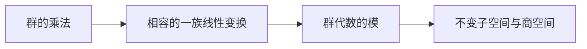

## 0 结构图景与学习目标

同学，高代研究一个线性变换，表示论研究一族必须遵守群乘法的变换。问题不再只是某个矩阵能否对角化，而是能否找到对所有群元素同时有意义的子空间。学完本讲应能把群作用、矩阵、模这三种语言逐项互译，并检验商作用是否良定义。默认群有限、向量空间有限维；本讲允许任意域 $k$，课程主线取 $k=\mathbb C$。这里只假设读者会群乘法、基、子空间、线性映射；模语言在本讲重新定义，不以设计文件中的“已学”代替学习验收。

## 1. 从交换两个坐标出发

令 $C_2=\{1,s\}$，在 $k^2$ 上令 $s(x,y)=(y,x)$。做两次交换回到原处，恰好对应 $s^2=1$。矩阵 $S=\begin{pmatrix}0&1\\1&0\end{pmatrix}$ 满足 $S^2=I$，因此群关系被保留。若随便把 $s$ 指定为 $2I$，在 $\mathbb C$ 上就失败，因为 $(2I)^2\ne I$。表示并非任意给每个元素贴一张矩阵。

**表示**是群同态 $\rho:G\to GL_k(V)$，即 $\rho(gh)=\rho(g)\rho(h)$、$\rho(1)=I$。乘法顺序表示先作用 $h$ 再作用 $g$。维数是 $\dim_kV$。**等变映射** $T:V\to W$ 是线性映射且满足 $T\rho_V(g)=\rho_W(g)T$。若 $T$ 可逆，两表示称**同构（等价）**。换基只改变矩阵表达，不改变表示同构类。

检查点：交换表示的矩阵为何必须可逆？两个表示维数相等是否就同构？请先口述，再看答案册。

## 2. 三种基本例子

**一维表示**是同态 $G\to k^\times$。所有元素都作用为 $1$ 的是平凡表示。对 $C_2$，一维表示由标量 $a$ 决定，条件为 $a^2=1$。在复数上只有 $a=1,-1$；在特征二中二者合并。

若 $G$ 作用在有限集合 $X$ 上，取形式基 $\{e_x:x\in X\}$，定义 $\rho(g)e_x=e_{gx}$，称**置换表示**。检验只需在基上做：$\rho(g)\rho(h)e_x=e_{g(hx)}=e_{(gh)x}$；逆映射是 $\rho(g^{-1})$。取 $X=G$，以左乘作用，得到**左正则表示**，维数为 $|G|$。它不是“一维”，因为每个群元素是一根不同的基向量。

示范例题 D1：把复数上的交换表示分解为两个不变直线。

解：令 $u=(1,1)$、$v=(1,-1)$，则 $Su=u$、$Sv=-v$。两向量构成基，因为基矩阵行列式为 $-2\ne0$。故 $\mathbb C^2=\mathbb Cu\oplus\mathbb Cv$，两条直线上分别是平凡表示和符号表示。核验不仅是找到特征向量，还要检验它们张成整个空间；特征二时该行列式为零，不能照搬。

## 3. 群代数：把相容性写成一个乘法

**群代数** $k[G]$ 是以符号 $g\in G$ 为基的向量空间。元素写成 $a=\sum_{g\in G} a_gg$，乘法按双线性扩张：$ab=\sum_{(g,h)\in G\times G}a_gb_h(gh)$。同一个群元素的系数须合并。结合律来自每个基三元组满足 $(gh)t=g(ht)$，再用三线性展开；单位是群单位对应的基元素。注意 $g+h$ 是形式线性组合，不是群内运算。

一个**含幺左模**是向量空间 $V$ 连同双线性作用 $k[G]\times V\to V$，满足 $(ab)v=a(bv)$ 和 $1v=v$。

定理：$G$ 的表示与含幺 $k[G]$ 左模一一对应，而且等变映射恰好是模同态。

证明（对象—目标—构造—验证）：给定表示，定义 $av=\sum_{g\in G}a_g\rho(g)v$。双线性显然；乘法相容性为

$(ab)v=\sum_{(g,h)\in G\times G}a_gb_h\rho(gh)v=\sum_{(g,h)\in G\times G}a_gb_h\rho(g)\rho(h)v=a(bv)$。

单位条件由 $\rho(1)=I$ 得到。反过来，给定模，设 $\rho(g)v=gv$。它是线性的，且 $g^{-1}$ 的作用是其逆，故值在 $GL(V)$；模结合律给出群同态条件。这两个构造互逆：在每根基 $g$ 上原作用不变，双线性决定所有线性组合。最后，若 $T$ 与每个 $g$ 的作用交换，则 $T(av)=\sum_{g\in G}a_gT(gv)=aT(v)$；反向只需取 $a=g$。证毕。我们没有调用一般范畴论；“等价”在此已被具体构造验证。

## 4. 子表示与商表示

**子表示**是满足 $\rho(g)U\subseteq U$ 的线性子空间 $U$；由于逆元素也在群中，其实为等号。商空间 $V/U$ 上定义 $g(v+U)=gv+U$。若 $v-v'\in U$，则 $gv-gv'\in U$，因此定义与代表元无关；群关系从 $V$ 下降。商映射 $V\to V/U$ 等变。反例：交换表示中 $U=k(1,0)$ 不稳定；零陪集可由 $0$ 或 $(1,0)$ 表示，交换后得到不同陪集，因此不能定义该商表示。

模子空间与子表示相同：对每个基元素 $g$ 稳定等价于对它们的所有线性组合稳定。若 $T$ 等变，则 $v\in\ker T$ 蕴含 $T(gv)=gT(v)=0$；$w=T(v)$ 蕴含 $gw=T(gv)$。所以核与像均为子表示。

检查点：商空间存在与商表示存在差在哪里？核稳定的证明中哪一步用到了等变性？

## 5. 练习与输出窗口

引导题 G1（T1）：在 $k[C_2]$ 中展开 $(a+bs)(c+ds)$，并写出它在交换表示上的作用矩阵。需要提示时才打开答案册。

独立题 I1（T2）：证明一维表示把每个交换子 $ghg^{-1}h^{-1}$ 映到 $1$。

独立题 I2（T3）：设 $G=S_3$ 置换 $\mathbb C^3$ 的坐标。证明坐标和为零的平面稳定，并给出其与平凡子表示的直和分解。不得使用特征标。

课堂口述：向教授解释“群元素是群代数的基”与“群元素在表示中是线性算子”有什么区别。记录清楚／较清楚／模糊／不会；本稿不记录任何虚构学习表现。

## 覆盖图、本质与预告

| 旧对象 | 本讲中的位置 |
|---|---|
| 一个满足 $A^n=I$ 的算子 | 循环群 $C_n$ 的表示 |
| 同时保持的子空间 | 子表示／群代数子模 |
| 换基 | 表示同构的特例 |
| 商空间 | 仅在子空间稳定时升级为商表示 |

本质是把一族线性条件压缩为一个代数作用。第2讲追问：任意子表示是否总能补出一个同样稳定的补空间？一般线性补空间存在并不回答这个问题。

# 第2讲 Maschke 定理：让补空间尊重群作用

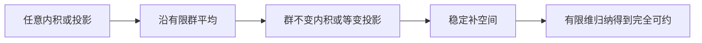

## 0 结构图景

本讲把高代的“选补空间”升级为“选一个对全部群元素稳定的补空间”。默认复表示，随后给出任意域的精确条件。目标是完整复述平均内积、平均投影两条证明，并用正特征反例指出每个条件在哪里发挥作用。

## 1. 为什么原来的正交补可能失效

在 $\mathbb R^2$ 上令 $s$ 的矩阵为 $A=\begin{pmatrix}1&1\\0&-1\end{pmatrix}$。直接相乘 $A^2=I$，因此给出 $C_2$ 表示。直线 $U=\mathbb Re_1$ 稳定，但标准内积下的正交补 $\mathbb Re_2$ 不稳定，因为 $Ae_2=e_1-e_2$。失败的是内积选择，不是稳定补空间本身：$\mathbb R(1,-2)$ 恰好是特征值 $-1$ 的稳定直线。

非零表示若只有零空间与自身两个子表示，称**不可约**；能写成有限个不可约子表示的直和，称**完全可约**。零表示按空直和视为完全可约。完全可约不意味着所有不可约块都一维，更不意味着非交换群的所有矩阵可以同时对角化。

## 2. 复数上的平均内积证明

定理（Maschke，复数情形）：有限群的每个有限维复表示完全可约。

对象：表示 $V$ 与子表示 $U$。目标：构造稳定的补空间。先任取正定 Hermitian 内积 $\langle\ ,\ \rangle_0$，约定第一变量线性。构造

$\langle v,w\rangle_G=\frac1{|G|}\sum_{g\in G}\langle\rho(g)v,\rho(g)w\rangle_0$。

验证：共轭对称、第一变量线性都逐项成立；若 $v\ne0$，每个 $\rho(g)v\ne0$，故每项平方长度为正，平均仍为正。对 $h\in G$，右乘换元 $g\mapsto gh$ 是群的置换，因此 $\langle hv,hw\rangle_G=\langle v,w\rangle_G$。

取该内积的正交补 $U^\perp$。若 $v\in U^\perp$、$u\in U$，则

$\langle hv,u\rangle_G=\langle v,h^{-1}u\rangle_G=0$，

最后一步用 $h^{-1}u\in U$。所以 $U^\perp$ 稳定。有限维内积空间的正交分解（已证前置：第四课《内积空间》§4.2 定理2；复数情形也可直接按正交规范基构造 $v-\sum_{i=1}^{m}\langle v,u_i\rangle u_i$ 验证其与 $U$ 正交）给出 $V=U\oplus U^\perp$。

还差从“任何子表示有补”到“分成不可约块”。对维数归纳：零维为空直和；非零时，在非零子表示中选维数最小者 $W$，它不可约，否则有更小的非零子表示。上述构造给出 $V=W\oplus W^\perp$；补空间维数严格下降，用归纳假设分解。归纳必终止，故定理成立。

检查点：为什么直接用原内积不够？证明哪一步要求群有限？完全可约性结论哪里要求空间有限维？

## 3. 任意域上的平均投影证明

设域 $k$ 满足 $|G|\cdot1_k\ne0$，即特征为零，或正特征不整除 $|G|$。域中非零元素可逆，所以可以除以 $|G|$。不使用正定内积也能证明同样结论。

给定稳定子空间 $U\subset V$，由第二课《线性映射与秩-零化度定理》§4.1 引理2（基扩张），延伸 $U$ 的一组基为 $V$ 的基，得到线性投影 $P:V\to U$，满足 $P|_U=I$。它不必等变。定义

$Q=\frac1{|G|}\sum_{g\in G}\rho(g)P\rho(g)^{-1}$。

每一项像都在 $U$；对 $u\in U$，每一项作用给出 $u$，故 $Q|_U=I$，从而 $Q^2=Q$。对 $h\in G$ 共轭并作换元 $g\mapsto hg$ 得 $\rho(h)Q\rho(h)^{-1}=Q$，即等变。于是 $\ker Q$ 稳定，而且每个 $v$ 写成 $Qv+(v-Qv)$，第一项在 $U$，第二项在核。交集为零，因为 $u\in U\cap\ker Q$ 时 $u=Qu=0$。这就构造了稳定补空间。维数归纳与上一节相同，得完全可约。

两证明的共同机制不是“取平均就一定正确”，而是平均后仍保有所需约束：内积保持正定，投影的平均因共同固定 $U$ 且像落在 $U$ 才仍为投影。任意两个投影的平均未必是投影。

## 4. 正特征反例：补空间真的不存在

令 $k=\mathbb F_p$、$G=C_p$，生成元作用为 $J=I+N$，其中 $N=\begin{pmatrix}0&1\\0&0\end{pmatrix}$。由于 $N^2=0$，归纳有 $J^m=I+mN$，故 $J^p=I$，确实定义表示。$U=ke_1$ 稳定。

若存在稳定补直线 $L=kv$，取非零生成向量 $v=ae_1+be_2$。补空间要求 $L\cap U=0$；若 $b=0$，则 $v\in U$，与非零向量同时属于二者矛盾。因此 $b\ne0$。稳定意味着 $Jv=\lambda v$。比较第二坐标得 $b=\lambda b$，所以 $\lambda=1$；比较第一坐标却得到 $a+b=a$，矛盾。故没有稳定补空间。更直接地，上述坐标比较说明任何稳定直线都只能是 $U$；本表示本身可约，若完全可约则在二维中必须分为两条不同的稳定直线，这不可能。因此表示不完全可约。这里是二维 Jordan 型表示，不能在一般 $p$ 下称为维数为 $p$ 的正则表示。这里群和空间仍然有限，失效点是 $p$ 无法在域中求逆。此例只证明坏特征下定理不能一般使用，不表示坏特征下每个表示都不完全可约。

## 5. 三类题与费曼环节

示范题 D2：求复交换表示的平凡分量投影。

解：$R=(I+S)/2$，所以 $R(x,y)=((x+y)/2,(x+y)/2)$。计算 $R^2=(I+2S+S^2)/4=R$；像为 $\mathbb C(1,1)$，核为 $\mathbb C(1,-1)$，并且 $RS=SR$。这同时核验像、核、幂等与等变四个终点。

引导题 G2（T1）：对有限群复表示证明 $R=|G|^{-1}\sum_{g\in G}\rho(g)$ 的像恰为固定向量空间 $V^G=\{v:gv=v\text{ 对所有 }g\}$。提示另置答案册。

独立题 I3（T2）：对第1节矩阵 $A$ 及标准内积，算出平均内积的 Gram 矩阵，并求 $U$ 的新正交补。

独立题 I4（T3）：在特征不整除群阶时，给定等变满射 $f:V\to W$，证明存在等变映射 $s:W\to V$ 满足 $fs=I_W$。说明有限维条件在你的证明中如何使用。

课堂口述证明：只用“先选任意投影，再平均”解释补空间为何稳定。请同时提出一个能破坏结论的假设变化；自评不作为已经通过的测评。

## 覆盖图、本质与预告

| 旧知识 | 本讲升级 | 边界 |
|---|---|---|
| 正交投影 | 不变内积的投影与群作用交换 | 原内积未必不变 |
| 线性补空间 | 稳定补空间 | 坏特征可失败 |
| 分块矩阵 | 不可约块的直和 | 不保证块均为一维 |
| 循环群算子的对角化 | 复数上有限阶算子的表示分解 | 非交换群不可套用同时对角化 |

本质是利用对称性修正一个本来不尊重对称的选择。第3讲将用 Schur 引理研究不可约块之间的等变映射；本讲未提前使用该引理。特征标到第4讲才定义。模表示论及 Frobenius–Schur 指标只是后续方向，本稿不调用其结论。

本节承接第1—2讲。正文完成不代表学生学完。

# 第3讲 不可约表示与 Schur 引理

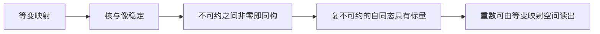

## 0 结构图景：块之间能传递什么？

第2讲把复表示拆成不可约块，本讲研究块之间允许的线性联系。普通向量空间间总有很多线性映射，要求与全部群作用相容后，可能一个非零映射也没有。对象是等变映射空间，目标是计算它；构造策略是先看核与像，再看特征值。本讲默认有限群、有限维；基础 Schur 引理允许任意域，标量结论才要求代数闭域。

## 1 从两条直线之间的映射开始

对 $C_2$，复平凡表示 $V_+$ 上生成元作用为 $1$，符号表示 $V_-$ 上作用为 $-1$。线性映射 $T:V_+\to V_-$ 是乘一个数 $a$。等变条件要求 $a=-a$，故 $a=0$。反之 $V_+\to V_+$ 的每个线性映射都等变。

定义 $\operatorname{Hom}_G(V,W)$ 为所有等变线性映射组成的空间；逐项验证加法及标量乘法保持等变条件，所以它是向量空间。自同态空间记 $\operatorname{End}_G(V)$，还可按复合相乘。

这里不可约必须是**非零**表示。零空间不会出现在“非零映射必为同构”的证明终点中充当不可约块。

检查点：两个表示维数相同为何仍可能没有非零等变映射？请用上例说明。

## 2 Schur 引理：不需要代数闭域的部分

定理：设 $V,W$ 是域 $k$ 上的不可约表示。若 $T\in\operatorname{Hom}_G(V,W)$ 非零，则 $T$ 是表示同构。

证明：由第1讲，$\ker T$ 与 $\operatorname{im}T$ 分别是子表示。$T\ne0$ 意味着核不是全空间、像不是零空间。不可约性迫使 $\ker T=0$、$\operatorname{im}T=W$，故 $T$ 双射。还须核验逆映射等变：从 $T\rho_V(g)=\rho_W(g)T$ 左右乘逆得 $T^{-1}\rho_W(g)=\rho_V(g)T^{-1}$。证毕。

推论：$\operatorname{End}_G(V)$ 中每个非零元素都可逆，称为**除环**。除环的乘法不预设交换；至此不能直接断言它等于 $k$。

## 3 代数闭域让自同态缩成标量

定理：若 $k$ 代数闭、$V$ 有限维不可约，则每个 $A\in\operatorname{End}_G(V)$ 形如 $\lambda I$。

证明：$V\ne0$，特征多项式次数正；代数闭性保证有根 $\lambda\in k$。当本课取 $k=\mathbb C$ 时，所用代数闭性来自未证输入 R6：代数基本定理，见 `lectures/math/unproven_registry.md`；本课不证明或销号 R6。所以 $A-\lambda I$ 有非零核。它仍然等变。若它非零，上一节 Schur 引理迫使它为同构，故核应为零；但特征值的定义给出非零核，即它非单射，矛盾。因此 $A-\lambda I=0$。反过来标量映射当然等变，故 $\operatorname{End}_G(V)=kI$。

有限维与代数闭性用来产生特征值，并未使用 Maschke；因此本定理本身也适用于代数闭的正特征域上的不可约表示。

反例说明实数边界：令 $C_4$ 在 $\mathbb R^2$ 上由 $J=\begin{pmatrix}0&-1\\1&0\end{pmatrix}$ 作用。$J^4=I$，但 $J$ 无实特征值，所以无稳定实直线，表示不可约。$J$ 与群作用交换却不是实标量。直接求解 $AJ=JA$ 得 $A=\begin{pmatrix}a&-b\\b&a\end{pmatrix}$；非零时行列式 $a^2+b^2>0$，符合除环结论，却否定“实不可约自同态只有实标量”。

检查点：代数闭性具体在哪一句使用？实反例是否推翻上一节的非零即同构结论？

## 4 映射空间与不可约判据

对代数闭域上的有限维不可约 $V,W$，

$\dim_k\operatorname{Hom}_G(V,W)=\begin{cases}1,&V\cong W,\\0,&V\not\cong W.\end{cases}$

证明：不同构时非零映射会违反 Schur 引理，故空间为零；同构时固定一个同构 $S:V\to W$，任意 $T$ 满足 $S^{-1}T=\lambda I$，于是 $T=\lambda S$。$S\ne0$，所以恰为一维。

在**有限群复表示**中，还有反向判据：非零 $V$ 不可约当且仅当 $\dim_{\mathbb C}\operatorname{End}_G(V)=1$。正向已证。反向若 $V$ 可约，Maschke 给出 $V=U\oplus W$，两者都非零。沿 $W$ 投影到 $U$ 的映射 $P$ 等变，且不可能是标量：它在 $U$ 上为恒等、在 $W$ 上为零。因此 $I,P$ 线性无关，维数至少二。此反向证明依赖完全可约，不能不加条件搬到任意模上。

示范题 D3：设 $U,W$ 为不同构复不可约表示，$V=U\oplus U\oplus W$，求 $\dim\operatorname{End}_G(V)$。

解：把自同态按三个直和分量写成 $3\times3$ 块矩阵。每块是从源分量到目标分量的等变映射，因为包含与投影均等变；反过来任意这样的块组成等变映射。两个 $U$ 之间四个块各一维，$W$ 到自身一维，不同类型之间四个块为零，总维数为五。也就是一个 $2\times2$ 标量矩阵块加一个标量块。这里没有用特征标或正交关系。

## 5 三类题与口述窗口

G3（引导，T1）：求 $C_2$ 交换表示在 $\mathbb C^2$ 上的全部等变自同态矩阵，并判断是否不可约。提示仅在分离答案中，先自行生成。

I5（独立，T2）：证明有限阿贝尔群的每个复不可约表示都一维。

I6（独立，T3）：若复表示已经分解为 $V=\bigoplus_{i=1}^{r}U_i^{\oplus m_i}$，其中 $U_i$ 两两不同构且不可约，证明 $\dim\operatorname{Hom}_G(U_j,V)=m_j$。解释该数为何不依赖所选直和分解。

口述证明：只说“核、像、特征值”三个节点，完整讲清 Schur 引理两阶段，并指出各自条件。自评清楚／较清楚／模糊／不会，不以读过代替掌握。

## 6 覆盖图、本质与预告

| 旧概念 | 本讲覆盖 | 不能过度推论 |
|---|---|---|
| 线性映射核与像 | 等变映射的稳定核与像 | 任意线性映射不一定等变 |
| 特征值 | 排除不可约自同态的非标量部分 | 实数上可能无特征值 |
| 分块矩阵 | 不可约之间的等变块 | 同构类型重复会产生矩阵块 |
| 维数 | 等变映射空间维数检测重数 | 尚未建立特征标内积公式 |

本质是不可约性把“允许的联系”压缩到最少。第4讲将从整张矩阵抽出迹；第5讲才证明迹的内积如何恢复本讲的映射空间维数。

# 第4讲 特征标：哪些信息能从迹读出？

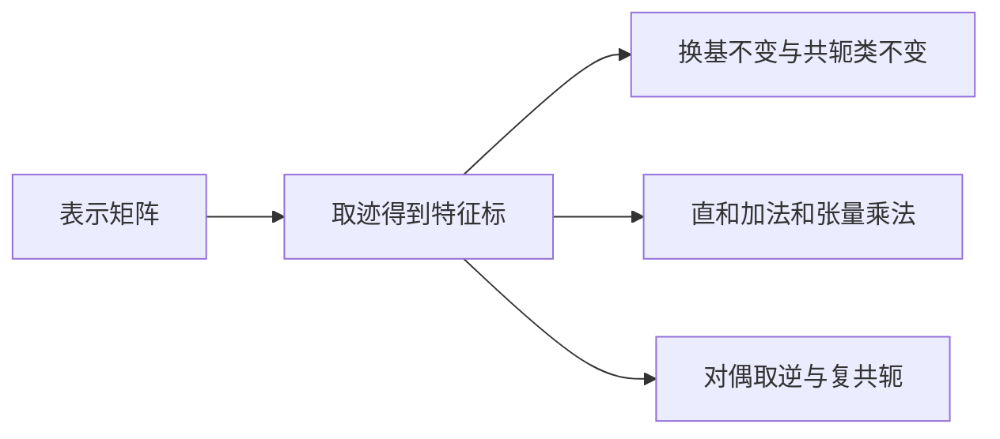

## 0 结构图景

矩阵依赖基，迹不依赖基。对每个群元素记录一个迹，就得到一个较小的数据表。我们先证明它保留哪些运算，不预先宣称这份数据足以分类；分类要等第5—7讲。本讲默认有限群的有限维复表示，明确指出哪些结论其实适用于任意域。

## 1 定义、换基与共轭类

**特征标**定义为 $\chi_V(g)=\operatorname{tr}(\rho_V(g))$。例如平凡表示恒为一；交换表示在 $C_2$ 的两个元素上取值 $2,0$。

先验证迹恒等式。若 $A,B$ 为同阶矩阵，$\operatorname{tr}(AB)=\sum_{i=1}^{n}\sum_{j=1}^{n}a_{ij}b_{ji}=\operatorname{tr}(BA)$，因为标量交换且可以互换有限求和指标。因此 $\operatorname{tr}(PAP^{-1})=\operatorname{tr}(A)$。换基不改变特征标，同构表示也有同一特征标。

由 $\rho(hgh^{-1})=\rho(h)\rho(g)\rho(h)^{-1}$ 得 $\chi_V(hgh^{-1})=\chi_V(g)$。在共轭类上常值的函数称**类函数**。又 $\chi_V(1)=\dim V$；在正特征域应把右边解释为整数维数在域内的像，可能丢失维数信息，本课此后取复数避免该歧义。

反例：类函数不必是某个表示的特征标。恒等于 $1/2$ 的复函数是类函数，但其单位元取值不可能是向量空间维数。也不是所有表示特征标都实值：$C_3=\langle a\rangle$ 的一维表示 $\rho(a)=\omega=e^{2\pi i/3}$ 合法，因为 $\omega^3=1$，其 $\chi(a)=\omega$ 非实。

检查点：特征标在哪个输入必为非负整数？共轭类不变与复共轭是同一种“共轭”吗？

## 2 置换与正则表示的特征标

置换表示中每根基向量 $e_x$ 被送到 $e_{gx}$。矩阵对角元在 $gx=x$ 时为一，否则为零，因此

$\chi_{\mathbb C[X]}(g)=|\{x\in X:gx=x\}|$。

对左正则表示 $X=G$，$gx=x$ 等价于 $g=1$，所以单位元的特征标为 $|G|$，其他元素处为零。这是逐个对角元的计算，未使用任何分解定理。

## 3 直和与张量：先定义作用再取迹

直和表示按分量作用，矩阵块对角，所以 $\chi_{V\oplus W}(g)=\chi_V(g)+\chi_W(g)$。其证明是两块对角线的和，没有任何不可约假设。

为避免超前引用，有限维张量积先以基构造：给定基 $e_1,\ldots,e_n$ 与 $f_1,\ldots,f_m$，取符号 $e_i\otimes f_j$ 为新空间的基，定义 $v\otimes w$ 按双线性展开。定义 $g(v\otimes w)=gv\otimes gw$ 并线性扩张。若 $v=\sum_{i=1}^{n} v_ie_i,w=\sum_{j=1}^{m}w_jf_j$，双线性展开给出唯一向量；变换基所得空间通过发送纯张量到同名纯张量自然同构，因为两次基变换互逆。因此这是与基选择无关的表示构造。

基向量上直接验证 $g(h(e_i\otimes f_j))=(gh)(e_i\otimes f_j)$；逆元素给出逆算子。若 $\rho_V(g)=A,\rho_W(g)=B$，新矩阵对应基 $e_i\otimes f_j$ 的对角项为 $a_{ii}b_{jj}$，所以

$\chi_{V\otimes W}(g)=\sum_{i=1}^{n}\sum_{j=1}^{m}a_{ii}b_{jj}=\chi_V(g)\chi_W(g)$。

此处只建了基本张量表示和迹乘法；对称幂、外幂留待第8讲，不在此偷用其公式。

## 4 对偶与复共轭：逆元不可省

令 $V^*=\operatorname{Hom}_{\mathbb C}(V,\mathbb C)$。**对偶表示**定义为 $(g\varphi)(v)=\varphi(g^{-1}v)$。必须用逆元：

$(g(h\varphi))(v)=(h\varphi)(g^{-1}v)=\varphi(h^{-1}g^{-1}v)=((gh)\varphi)(v)$。

若无逆元，复合顺序会反过来，一般不是左表示。对偶基上的矩阵为 $\rho_V(g^{-1})^T$，故 $\chi_{V^*}(g)=\chi_V(g^{-1})$，此等式在任意域上成立。

在复数有限群情形，用第2讲平均内积选取正交规范基，使每个 $\rho(g)$ 为酉矩阵 $U$。酉性即 $U^{-1}=U^*$，所以 $\operatorname{tr}(U^{-1})=\overline{\operatorname{tr}(U)}$。于是

$\chi_{V^*}(g)=\chi_V(g^{-1})=\overline{\chi_V(g)}$。

这一步依赖复数内积，不能无说明推广到任意域。上述 $C_3$ 例中对偶在 $a$ 上取 $\omega^{-1}=\omega^2=\overline\omega$，并不等于 $\omega$，所以表示不必与其对偶同构。

## 5 示范计算：S3 的标准平面

示范题 D4：$S_3$ 置换 $\mathbb C^3$，设 $H=\{(x_1,x_2,x_3):x_1+x_2+x_3=0\}$。计算 $H$ 与 $H\otimes H$ 的特征标，不使用正交关系。

解：第1讲已构造 $\mathbb C^3=\mathbb C(1,1,1)\oplus H$，第一分量平凡。置换表示在恒等、换位、三循环处分别固定 $3,1,0$ 个点，故减去平凡特征标得 $\chi_H=(2,0,-1)$；张量公式给出 $\chi_{H\otimes H}=(4,0,1)$。单位元处分别为二、四，核验维数乘法正确。此计算没有证明 $H$ 不可约，也没有给出张量积的不可约分解，不能把该表当成完整特征标表。

## 6 三类题与口述窗口

G4（引导，T1）：计算 $C_3$ 一维表示 $L$（生成元作用为 $\omega$）的 $L^*$、$L\otimes L$ 在三个元素上的特征标，并判断二者是否同构。

I7（独立，T2）：对群 $G$ 的有限集合 $X,Y$，证明 $\mathbb C[X\times Y]\cong\mathbb C[X]\otimes\mathbb C[Y]$（左边取对角作用），并分别用固定点计数与迹计算验证同一特征标公式。

I8（独立，T3）：设 $g$ 的阶为二。证明复表示中 $\chi_V(g)$ 是整数，且与 $\dim V$ 同奇偶。构造二维例子展示可能取值，并说明不能推广到所有有限阶元素。

口述：向教授解释“对偶为什么用逆元”，再把张量迹乘法从基上的对角项讲一遍。检查点与练习的提示和答案均在分离答案册。

## 7 覆盖图、本质与预告

| 高代对象 | 表示论升级 |
|---|---|
| 相似不变的迹 | 表示的特征标 |
| 对角元计数 | 置换作用的固定点数 |
| 块对角矩阵 | 直和对应特征标加法 |
| 张量基的双指标 | 张量对应特征标乘法 |
| 逆转置 | 对偶表示的矩阵 |

本质是先确认数据在换基下不变，再验证其运算规律。第5讲将证明特征标内积与等变映射空间维数相等；在此之前，不能用尚未证明的正交关系判不可约或分解张量积。

# 第5讲 从平均投影到特征标正交

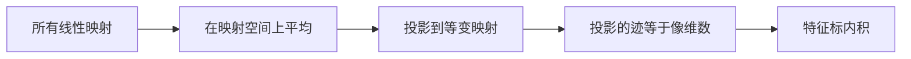

## 结构图景与动机

本讲始终取有限群及有限维复表示。第3讲用结构判断哪些块能相互映射，第4讲只保存每个群元素的迹。两种数据怎样连接？关键是把“等变映射”看作一个更大表示中的固定向量，再用第2讲平均投影。学习终点是能不背公式地重建正交关系，并指出共轭来自逆元。

## 1 在映射上定义群作用

在 $L=\operatorname{Hom}_{\mathbb C}(V,W)$ 上定义 $g\cdot T=\rho_W(g)T\rho_V(g)^{-1}$。先检查乘法：$g\cdot(h\cdot T)=\rho_W(gh)T\rho_V(gh)^{-1}$，因为右侧逆元顺序反转。单位作用恒等，所以这是表示。固定向量恰满足 $\rho_W(g)T=T\rho_V(g)$，即 $L^G=\operatorname{Hom}_G(V,W)$。

具体看矩阵单位 $E_{ab}$（把第 $b$ 根源基送到第 $a$ 根目标基）。若左乘矩阵为 $A$、右乘为 $B$，则 $E_{ab}$ 在自身位置的系数为 $A_{aa}B_{bb}$。因此算子 $T\mapsto ATB$ 的迹为 $\operatorname{tr}(A)\operatorname{tr}(B)$，所有指标分别取目标、源基的完整范围。这给出

$\chi_L(g)=\chi_W(g)\chi_V(g^{-1})=\chi_W(g)\overline{\chi_V(g)}$。

检查点：为何不能定义作用为 $T\mapsto\rho_W(g)T\rho_V(g)$？指出乘法顺序失败处。

## 2 投影之迹为何是维数

设 $P=|G|^{-1}\sum_{g\in G}(g\cdot -)$。左乘置换求和指标，所以 $P(T)$ 固定；若 $T$ 已固定则 $P(T)=T$。于是 $P^2=P$ 且像为 $L^G$。每个向量分解为 $P(T)+(T-P(T))$，给出 $L=\operatorname{im}P\oplus\ker P$；适应该分解的基中矩阵为 $\operatorname{diag}(I,0)$，故 $\operatorname{tr}P=\dim L^G$。

定义类函数的内积，约定**第一变量共轭线性**：

$\langle f,h\rangle_G=\frac1{|G|}\sum_{g\in G}\overline{f(g)}h(g)$。

它正定，因为 $\langle f,f\rangle$ 是非负平方模之和，仅零函数取零。注意这是本讲函数内积约定；第2讲向量内积曾取第一变量线性，不可混淆。由迹的线性性及上式，得到完整公式

$\langle\chi_V,\chi_W\rangle_G=\dim\operatorname{Hom}_G(V,W)$。

它不是先假设正交再证明的恒等式，而是投影的迹计算。

## 3 第一正交关系及分解判据

若 $U_i,U_j$ 不可约，第3讲 Schur 给出右侧为 $\delta_{ij}$（指标按不同同构类型取），所以不可约特征标标准正交。若 $V=\bigoplus_{i=1}^{r}U_i^{\oplus m_i}$，则内积线性给出 $\langle\chi_{U_i},\chi_V\rangle=m_i$；这是真正的非负整数，而不是任意复数。

同理 $\langle\chi_V,\chi_V\rangle=\sum_{i=1}^{r} m_i^2$。对非零表示，该值等于一当且仅当恰有一个不可约块且重数一。注意前提是已经知道输入函数是某个表示的特征标；任意范数为一的类函数不必为不可约特征标。例如平凡特征标的负值常函数 $-1$ 范数一，但单位元取值为负数，不是表示特征标。

示范 D5：$S_3$ 在三个点上的置换表示特征标按单位、换位、三循环为 $(3,1,0)$，类大小为 $(1,3,2)$。其范数平方为 $(9+3)/6=2$，故可约。坐标和零平面 $H$ 的特征标为 $(2,0,-1)$，范数为 $(4+2)/6=1$，故不可约。这补上第4讲刻意未作的判断。

## 4 三类题与本质

G5（T1，引导）：求上述置换表示中平凡表示的重数。提示在答案册。

I9（T2，独立）：证明两个复表示同构当且仅当其特征标相同。不得只写“迹是完全不变量”，须用已证重数公式。

I10（T3，独立）：若表示的特征标范数平方为二，证明其分解为两个不同构不可约表示，且各出现一次。

口述窗口：从映射空间作用开始讲出第一正交关系，说明有限性、复数域、不可约性各用在哪一步。

| 旧概念 | 本讲升级 |
|---|---|
| 平均投影 | 在映射空间筛出等变映射 |
| 投影秩 | 投影的迹 |
| Schur引理 | 不可约特征标正交 |
| 基坐标 | 特征标内积给不可约重数 |

本质是用一个可计算的平均替代逐元素求解等变方程。第6讲还需证明不可约特征标是否填满全部类函数；只有正交性尚不足以断言它们是一组基。

# 第6讲 为什么每个共轭类恰好需要一行数据？

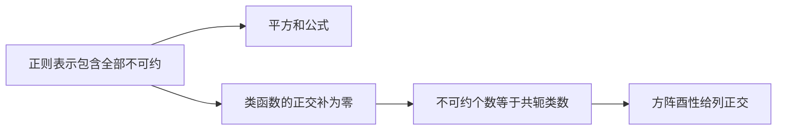

## 0 结构图景

有限群、复数域、有限维是全讲条件。第5讲得到一组标准正交类函数，但一组正交向量可能遗漏方向。本讲目标是证明没有遗漏，再把行正交转成列正交。不能用尚未证明的“特征标表是方阵”作为输入。

## 1 全部不可约只有有限多种

给不可约 $U$ 选非零 $u$，定义 $F:\mathbb C[G]\to U$，$\sum_{g\in G}a_gg\mapsto\sum_{g\in G}a_g gu$。它是群代数模同态，像为非零子表示，所以满射。Maschke 使核有稳定补，限制到补上即为同构。因此每个不可约都在正则表示中出现。正则表示有限维，已可分成有限个不可约块，故不同同构类型有限，记为 $U_1,\ldots,U_r$，维数 $d_i$。

正则特征标 $\chi_{\rm reg}$ 在单位元为 $|G|$、其余为零。因此第5讲重数公式给

$m_i=\langle\chi_i,\chi_{\rm reg}\rangle=\overline{\chi_i(1)}=d_i$。

取维数得到 $|G|=\sum_{i=1}^{r}d_i^2$。此式既约束可能的块大小，也检验已经找到的不可约是否穷尽。

## 2 类函数没有遗漏方向

设类函数 $f$ 与所有 $\chi_i$ 正交，即 $\langle\chi_i,f\rangle=0$。构造群代数元素 $z=\sum_{g\in G}f(g)g^{-1}$。共轭 $hzh^{-1}$ 并以 $g\mapsto hgh^{-1}$ 换元，利用类函数性质得 $hzh^{-1}=z$，所以 $z$ 中心。

在不可约 $U_i$ 上，$\rho_i(z)$ 与全部群作用交换，故 Schur 给 $\rho_i(z)=\lambda_i I$。取迹：

$d_i\lambda_i=\sum_{g\in G}f(g)\chi_i(g^{-1})=|G|\langle\chi_i,f\rangle=0$。

复数域中 $d_i\ne0$，于是 $\lambda_i=0$。正则表示分解为这些不可约的副本，故 $z$ 的左乘作用在正则表示上为零。把左乘作用施于群代数单位，得 $z=0$。群元素线性独立，所以每个 $f(g)=0$。

有限维内积空间中，一组标准正交向量若不张成空间，其张成空间的正交补非零（可由正交投影构造）；刚才排除了这种可能。所以 $\chi_1,\ldots,\chi_r$ 是全部类函数空间的一组标准正交基。若共轭类为 $C_1,\ldots,C_c$，各类指示函数显然是一组基，故维数为 $c$。得到 $r=c$。

检查点：为何“$z$ 在所有不可约上为零”能推出 $z=0$？必须说出正则表示与单位元这两个环节。

## 3 第二正交关系

取代表元 $g_j\in C_j$，记 $n_j=|C_j|$。矩阵 $A_{ij}=\sqrt{n_j/|G|}\chi_i(g_j)$ 是方阵。第一正交关系说明各行标准正交，故 $AA^*=I$；方阵有右逆即有逆，所以 $A^*A=I$。因此

$\sum_{i=1}^{r}\overline{\chi_i(g_j)}\chi_i(g_k)=\begin{cases}|G|/n_j,&j=k,\\0,&j\ne k.\end{cases}$

轨道—稳定子定理对共轭作用给 $n_j=|G|/|C_G(g_j)|$，其中 $C_G(g)=\{h:hg=gh\}$，所以相同列的平方模和为中心化子阶。任意两元素共轭时列相同，不共轭时正交。注意行的加权内积与列的不加权内积不同，不能漏掉类大小。

示范 D6：$S_3$ 已有平凡、符号、标准平面，维数 $1,1,2$ 的平方和为六，所以全部不可约已经找到。换位列为 $(1,-1,0)$，平方和为二，恰为换位中心化子阶；三循环列 $(1,1,-1)$ 平方和为三。

## 4 练习与覆盖图

G6（T1，引导）：用列正交核验 $S_3$ 换位列与三循环列正交。

I11（T2，独立）：证明有限群所有复不可约表示都一维，当且仅当群阿贝尔。

I12（T3，独立）：若某有限群恰有两个共轭类，证明它同构于 $C_2$，不得凭小群列表猜测。

口述：解释第一正交关系为何不能单独推出列正交，以及本讲哪个论证填上了缺口。

| 旧概念 | 升级 |
|---|---|
| 正则作用 | 包含全部不可约的统一对象 |
| 正交组 | 用中心群代数元素证明完备 |
| 共轭类指示函数 | 类函数空间的另一组基 |
| 酉方阵 | 从行正交转到列正交 |

本质是从两个坐标系统比较同一个空间。第7讲把这些定理变成可逐项审计的造表与分解算法。

# 第7讲 造表不能只靠凑数

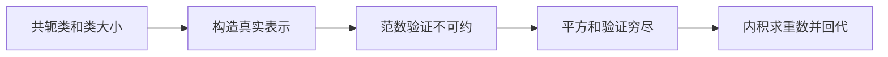

## 结构图景

仍在有限群复表示范围。表的一行必须来自真实表示；正交的数表本身不保证是特征标表。工作目标是构造、验证、穷尽、分解四步闭环。类大小既参与内积，也是常见错误来源。

## 1 完整构造 S3 表

$S_3$ 的共轭类按循环型为单位、三个换位、两个三循环。这可直接由共轭把循环中的字母重命名看出。同态符号由置换矩阵行列式给出，乘法保持因为行列式乘法成立。于是平凡与符号两行是 $(1,1,1)$、$(1,-1,1)$。

第三行来自坐标和零平面，已算为 $(2,0,-1)$。它的范数一已在第5讲证明，故不可约。三个表示两两不同构，因为特征标不同。维数平方和 $1+1+4=6$，由第6讲没有剩余类型。

| 类 | 单位 | 换位 | 三循环 |
|---|---:|---:|---:|
| 大小 | 1 | 3 | 2 |
| 平凡 1 | 1 | 1 | 1 |
| 符号 ε | 1 | -1 | 1 |
| 标准 H | 2 | 0 | -1 |

行内积的分子：前三行自乘为6、6、6；交叉为 $1-3+2=0$、$2-2=0$、$2-2=0$。列平方和为6、2、3，列间内积为0。这同时核验两条正交关系。不要把“标准表示维数二”误写为“群的所有表示维数至多二”；任意多份直和仍是表示。

## 2 分解算法与完整示范

设共轭类共 $c$ 个，不可约同构类型共 $r$ 个（第6讲已证 $r=c$）。已知表示 $V$ 的特征标后，对每行 $i=1,\ldots,r$ 算 $m_i=|G|^{-1}\sum_{j=1}^{c} n_j\overline{\chi_i(g_j)}\chi_V(g_j)$。先检验非负整数，再回代整行及单位元维数。若出现负数、分数，至少有输入表、类大小或算术错误；也可能输入根本不是真实表示。

示范 D7：第4讲 $H\otimes H$ 的特征标为 $(4,0,1)$。三重数分别为 $(4+2)/6=1$、$(4+2)/6=1$、$(8-2)/6=1$。所以 $H\otimes H\cong1\oplus\varepsilon\oplus H$。回代三列得 $(1,1,1)+(1,-1,1)+(2,0,-1)=(4,0,1)$；维数 $1+1+2=4$。这是用特征标确定同构类型，不是声称已经构造具体嵌入矩阵。

## 3 从实际作用取得输入：S4 四点置换

不用全造 $S_4$ 表也能分解一个具体表示。循环型依次为 $1,(12),(12)(34),(123),(1234)$，类大小 $1,6,3,8,6$：换位选两点，双换位有三种配对，三循环先选三点再选两方向，四循环数为 $3!=6$。固定点数给置换特征标 $(4,2,0,1,0)$。去掉常数直线得到标准三维空间，特征标 $(3,1,-1,0,-1)$。其范数平方为 $(9+6+3+6)/24=1$，故不可约，置换表示恰为平凡加标准。这仅分解该表示，不假装已给 $S_4$ 完整表。

## 4 练习、覆盖与预告

G7（T1，引导）：求 $\varepsilon\otimes H$ 的分解。

I13（T2，独立）：分解 $S_3$ 在有序不同点对 $\{(i,j):1\le i,j\le3,i\ne j\}$ 上的置换表示。

I14（T3，独立）：类函数 $(1,1,-1)$ 的范数平方为一。证明它不是 $S_3$ 表示的特征标，并解释范数判据为何不能用在它身上。

口述：给同学一张数表，你需要哪些证据才会承认它是完整特征标表？

| 旧计算 | 新结构 |
|---|---|
| 固定点计数 | 置换特征标输入 |
| 正交投影坐标 | 不可约重数 |
| 维数检查 | 单位元列的回代 |
| 整数性检查 | 发现输入或计算错误的必要条件 |

本质是先有对象，再算不变量。第8讲继续研究张量积里的对称与反对称部分，给出更细的可计算运算。

# 第8讲 交换张量因子以后，哪些方向不变？

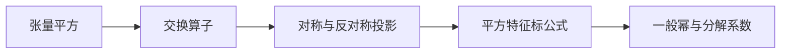

## 0 结构图景

本讲在复数域上进行，除以二合法。张量积维数迅速增长，但交换因子的对称性能先拆出稳定部分。目标是证明对称平方与外平方特征标公式，并从特征值解释一般幂；不把任意张量积自动当成不可约。

## 1 两个投影直接构造子表示

在 $V\otimes V$ 上令 $\tau(v\otimes w)=w\otimes v$，线性扩张，满足 $\tau^2=I$ 且与群作用交换。定义 $P_+=(I+\tau)/2,P_-=(I-\tau)/2$。计算得 $P_\pm^2=P_\pm,P_+P_-=0,P_++P_-=I$。故像给出稳定直和

$V\otimes V=\operatorname{Sym}^2V\oplus\Lambda^2V$，

这里两空间分别定义为 $\tau$ 的正、负一特征空间。若 $e_1,\ldots,e_d$ 是基，对称空间的基可取 $e_i\otimes e_i$ 与 $e_i\otimes e_j+e_j\otimes e_i$（$i<j$），外平方基取 $e_i\otimes e_j-e_j\otimes e_i$（$i<j$）。独立与张成由每对坐标分别比较得到，维数为 $d(d+1)/2,d(d-1)/2$。

## 2 特征标公式及完整证明

令 $A=\rho(g)$。在张量平方上作用为 $A\otimes A$。因为它与投影交换，在像与核的适应基中 $\operatorname{tr}((A\otimes A)P_+)$ 等于对称空间上迹，负号同理。

我们已知 $\operatorname{tr}(A\otimes A)=(\operatorname{tr}A)^2$。对 $e_i\otimes e_j$，先交换再施 $A\otimes A$，原坐标的系数为 $a_{ij}a_{ji}$。求和得 $\operatorname{tr}((A\otimes A)\tau)=\sum_{i,j=1}^{d}a_{ij}a_{ji}=\operatorname{tr}(A^2)$。因此

$\chi_{\operatorname{Sym}^2V}(g)=\tfrac12(\chi_V(g)^2+\chi_V(g^2))$，

$\chi_{\Lambda^2V}(g)=\tfrac12(\chi_V(g)^2-\chi_V(g^2))$。

注意第二项是先将群元素平方再取特征标，绝非把数值平方重复一次。在特征二中投影不存在，这份证明不能原样搬用。

示范 D8：对 $S_3$ 的 $H$，平方映射将换位送到单位，将三循环送到同类三循环。所以 $\chi_H(g^2)=(2,2,-1)$，而 $\chi_H(g)^2=(4,0,1)$。对称平方为 $(3,1,0)=1+H$；外平方为 $(1,-1,1)=\varepsilon$。维数三加一等于四，与第7讲张量分解吻合。

## 3 一般幂的定义与可算公式

为说明第2节并非孤例，令 $S_n$ 在 $V^{\otimes n}$ 上置换因子，定义对称幂为平均算子 $n!^{-1}\sum_{\sigma\in S_n}\sigma$ 的像，外幂为 $n!^{-1}\sum_{\sigma\in S_n}\operatorname{sgn}(\sigma)\sigma$ 的像。群对每个因子同时作用，故与这些置换交换，像是子表示。两个平均算子幂等：双重求和中给定乘积置换有 $n!$ 次出现，符号按乘法相乘。

给定 $g$，其有限阶矩阵满足 $A^m=I$。由未证输入 R6（代数基本定理；登记状态未证）知 $x^m-1$ 在复数上分裂。多项式 $x^m-1$ 在复数上无重根，因为其导数 $mx^{m-1}$ 与它无共同根。线性代数的无重根最小多项式判据遂给特征基，特征值记 $\lambda_1,\ldots,\lambda_d$。也可用Lagrange插值投影 $\prod_{\mu\ne\lambda}(A-\mu I)/(\lambda-\mu)$ 直接构造各特征空间分解。

对称张量按每种基向量出现次数分类，得到基由 $a_1+\cdots+a_d=n$ 的非负整数元组索引；特征值为 $\prod_{i=1}^{d}\lambda_i^{a_i}$。外幂中重复指标因交换产生负号而为零，不重复递增指标 $i_1<\cdots<i_n$ 给基，特征值为 $\lambda_{i_1}\cdots\lambda_{i_n}$。故在形式幂级数意义下

$\sum_{n\ge0}\chi_{\operatorname{Sym}^nV}(g)t^n=\prod_{i=1}^{d}(1-\lambda_it)^{-1}$，

$\sum_{n=0}^{d}\chi_{\Lambda^nV}(g)t^n=\prod_{i=1}^{d}(1+\lambda_it)$。

第一式只是几何级数系数计数，无解析收敛要求。约定零次幂为平凡表示；外幂超过维数为零。顶外幂一维，作用为行列式。这些结论由上述基直接证明，没有调用未证一般公式。

## 4 分解系数、练习与覆盖

有限群版本的 Clebsch–Gordan 问题就是求 $U\otimes W$ 的不可约重数 $\langle\chi_i,\chi_U\chi_W\rangle$；本课不把它等同于李群的具体系数公式。

G8（T1，引导）：若一维表示为 $L$，求 $\Lambda^2L$ 与 $\operatorname{Sym}^2L$。

I15（T2，独立）：求 $S_3$ 标准表示 $H$ 的 $\operatorname{Sym}^3H$ 特征标及分解。

I16（T3，独立）：证明任意 $d$ 维表示的 $\Lambda^dV$ 特征标为 $\det\rho(g)$，并用 $H$ 核验。

口述：为何平方公式出现 $g^2$？请从交换算子的对角项解释。

| 旧对象 | 本讲统一 |
|---|---|
| 对称矩阵式坐标 | 对称张量子空间 |
| 面积与行列式 | 顶外幂一维表示 |
| 本征值的对称多项式 | 各种幂的特征标 |
| 乘积展开 | 张量分解系数 |

本质是让两种对称性同时作用，再利用它们可交换。第9讲换一种方向：从子群的表示构造整个群的表示。

# 第9讲 从子群向全群搬运一个表示

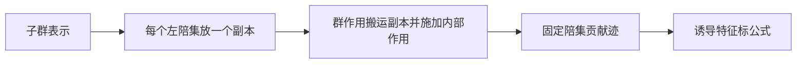

## 0 结构图景

本讲仍为有限群复表示。把 $G$ 表示限制到 $H\le G$ 很容易，但反方向不能任意给群外元素指定矩阵。例如子群的一维表示未必能扩张为全群的一维表示。诱导允许增加维数，并以一个可验证的构造解决此问题。

## 1 陪集模型：对象、构造、验证

给 $H$ 表示 $W$，选左陪集代表集 $T$，每个 $g\in G$ 唯一写作 $th$（$t\in T,h\in H$）。取直和 $\bigoplus_{t\in T}t\otimes W$；符号 $t\otimes w$ 此处表示第 $t$ 副本中的向量，不要求先懂环上的张量积。定义 $g(t\otimes w)=t'\otimes hw$，其中 $gt=t'h$ 为唯一分解。

单位显然保持向量。若 $g_2t=t'h_2$、$g_1t'=t''h_1$，则 $g_1g_2t=t''h_1h_2$，所以先后作用给 $t''\otimes h_1h_2w$，与乘积作用一致。这就是诱导表示 $\operatorname{Ind}_H^GW$，维数为 $[G:H]\dim W$。

代表选择不影响同构类型：若另一代表为 $\widetilde t=th_t$，把 $\widetilde t\otimes w$ 映到 $t\otimes h_tw$。它是各副本间的可逆映射，按 $g\widetilde t=(gt)h_t$ 比较唯一分解可验证等变。故代表仅是坐标选择。

若 $W$ 平凡一维，内部 $h$ 作用为一，所得就是 $G$ 在 $G/H$ 上的置换表示。若 $H=\{1\}$，所得为正则表示。反例提醒：诱导不是把原空间维数保持不变的“扩张”。

## 2 特征标公式的完整推导

记 $\psi=\chi_W$。元素 $g$ 把第 $t$ 副本送到第 $t'$ 副本；若不同副本，它在整个块矩阵中没有对角贡献。仅当 $gtH=tH$，即 $t^{-1}gt\in H$ 时贡献一个内部矩阵，迹为 $\psi(t^{-1}gt)$。于是

$\chi_{\operatorname{Ind}W}(g)=\sum_{\substack{t\in T\\t^{-1}gt\in H}}\psi(t^{-1}gt)$。

为了消除代表选择，令 $x=th$。条件 $x^{-1}gx\in H$ 与 $t$ 的条件相同；满足时 $\psi(x^{-1}gx)=\psi(h^{-1}t^{-1}gth)=\psi(t^{-1}gt)$，因为 $\psi$ 在 $H$ 共轭类上常值。每个陪集有 $|H|$ 个元素，故

$\chi_{\operatorname{Ind}W}(g)=\frac1{|H|}\sum_{\substack{x\in G\\x^{-1}gx\in H}}\psi(x^{-1}gx)$。

该证明没有使用 Frobenius 互反。检查点：为什么不是对所有副本都取内部迹？哪些副本根本没有映回自身？

## 3 两个 S3 示范

D9a：$H=\langle(12)\rangle$，诱导平凡表示就是三陪集置换表示。也可由公式计算：单位有三固定陪集；换位有一个；三循环没有。特征标 $(3,1,0)=1+H_{\rm std}$。此处用 $H_{\rm std}$ 表示标准平面，避免与子群 $H$ 混淆。

D9b：$H=A_3=\langle a\rangle$，取 $\psi(a)=\omega$。两个陪集代表可取 $1,s$，其中换位满足 $sas^{-1}=a^{-1}$。单位迹为二；换位交换两个副本，迹零；$a$ 固定两个副本，贡献 $\omega+\omega^{-1}=-1$。所以诱导特征标 $(2,0,-1)$，正是标准不可约表示。它不能由原一维空间上的 $S_3$ 表示扩张得到：一维作用交换会使 $a$ 与 $a^{-1}$ 的像相同，但 $\omega\ne\omega^{-1}$。

## 4 练习与覆盖图

G9（T1，引导）：求 $\operatorname{Ind}_{A_3}^{S_3}1$ 的特征标及分解。

I17（T2，独立）：从子群 $\langle(12)\rangle\cong C_2$ 诱导其非平凡一维表示（符号表示），求特征标及分解。

I18（T3，独立）：证明诱导保持直和，并据此说明诱导可约表示不可能得到非零不可约表示。

口述：不背定义，描述群元素如何把一个陪集副本里的向量送到另一个副本。

| 旧对象 | 本讲覆盖 |
|---|---|
| 陪集置换 | 诱导平凡表示 |
| 正则表示 | 从平凡子群诱导 |
| 分块矩阵取迹 | 只有固定陪集有贡献 |
| 换代表元 | 诱导模型的等变换坐标 |

本质是同时保留内部作用和外部搬运。第10讲解释为何这个构造与限制操作互相配对，并完整证明互反。

# 第10讲 从一个副本决定全部等变映射

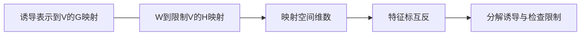

## 0 结构图景

诱导增加维数，限制保留维数，它们不是互逆。正确关系发生在映射空间：诱导对象上的全群等变映射，由起始副本上的子群等变映射完全决定。本讲证明这个具体一一对应，不把“伴随”一词当证明。

## 1 Frobenius互反的映射版本

设 $W$ 是 $H$ 表示，$V$ 是 $G$ 表示，陪集代表含 $1$。给 $F:\operatorname{Ind}_H^GW\to V$ 为 $G$ 等变，定义 $f(w)=F(1\otimes w)$。因 $h(1\otimes w)=1\otimes hw$，有 $f(hw)=F(h(1\otimes w))=hf(w)$，故 $f$ 是到 $\operatorname{Res}_H^GV$ 的 $H$ 等变映射。

反向，给这样的 $f$，定义 $F(t\otimes w)=tf(w)$，在直和上线性扩张。若 $gt=t'h$，则

$F(g(t\otimes w))=F(t'\otimes hw)=t'f(hw)=t'hf(w)=gtf(w)=gF(t\otimes w)$，

故等变。这两个构造互逆：回到起始副本恢复 $f$；对原 $F$，等变性给 $F(t\otimes w)=tF(1\otimes w)$，所以恢复所有副本。构造还保持线性。因此得到线性同构

$\operatorname{Hom}_G(\operatorname{Ind}_H^GW,V)\cong\operatorname{Hom}_H(W,\operatorname{Res}_H^GV)$。

这就是本课所需的 Frobenius 互反完整证明。

## 2 特征标版本与第二种核验

由第5讲映射空间维数公式，立得

$\langle\chi_{\operatorname{Ind}W},\chi_V\rangle_G=\langle\chi_W,\chi_{\operatorname{Res}V}\rangle_H$。

为复查共轭方向，先把诱导公式代入内积，左边为

$\frac1{|G||H|}\sum_{g\in G}\sum_{\substack{x\in G\\x^{-1}gx\in H}}\overline{\psi(x^{-1}gx)}\chi_V(g)$。

这是有限求和，可以交换先后顺序。固定 $x$ 后，映射 $h\mapsto g=xhx^{-1}$ 是 $H$ 到满足 $x^{-1}gx\in H$ 的那些 $g$ 的双射；逆映射就是 $g\mapsto x^{-1}gx$。因此内层可逐项换元为同一个 $h$，得到

$\frac1{|G||H|}\sum_{x\in G}\sum_{h\in H}\overline{\psi(h)}\chi_V(xhx^{-1})$。

换元 $g=xhx^{-1}$ 对每个 $x$ 正好枚举满足条件的 $g$，而类函数性质消去 $x$，外层有 $|G|$ 项，剩下右侧。两条推导一致。这里内积第一变量共轭线性，诱导落在第一槽；重数也可通过共轭对称取反向，因为真实表示之间内积为非负整数。

示范 D10：取 $H=\langle s\rangle\cong C_2$ 的符号表示 $\eta$。$S_3$ 三个不可约限制到 $H$ 后特征标分别为 $(1,1),(1,-1),(2,0)$。与 $\eta=(1,-1)$ 取内积，得到0、1、1。所以 $\operatorname{Ind}\eta=\varepsilon\oplus H_{\rm std}$。维数 $[S_3:H]=3$ 与 $1+2$ 一致，特征标 $(3,-1,0)$ 与第9讲直接计算一致。

## 3 限制可能分裂，诱导也可能分裂

标准平面限制到 $A_3$ 的特征标为 $(2,-1,-1)$，等于两个非平凡一维表示 $\psi+\psi^2$，所以不可约表示限制后可能可约。从 $A_3$ 诱导平凡表示又得到 $1\oplus\varepsilon$，所以诱导不可约也未必不可约。不能把某一个D9b的成功例子推广成一般定理。

还有一个有用的组合规律。若 $K\le H\le G$，选 $G/H$ 代表 $T$、$H/K$ 代表 $S$，则 $\{ts:t\in T,s\in S\}$ 是 $G/K$ 代表：存在性逐层分解，唯一性先比较 $H$ 陪集再比较 $K$ 陪集。定义 $t\otimes(s\otimes w)\mapsto ts\otimes w$，它是副本之间的线性同构。群作用逐层分解与一次分解给相同的最终 $K$ 因子，所以等变。故诱导具有传递性。无需调用 Mackey 公式，后者不在本课证明范围内。

## 4 练习、覆盖与收口

G10（T1，引导）：用互反求平凡表示在 $\operatorname{Ind}_H^GW$ 中的重数，并解释为 $W$ 的固定向量维数。

I19（T2，独立）：从 $C_3=A_3$ 诱导其正则表示到 $S_3$，求分解，并用诱导传递性独立核验。

I20（T3，独立）：对 $S_3$ 标准表示先限制到 $A_3$ 再诱导回来，求结果；据此反驳“限制与诱导互逆”。

口述：互反证明中哪一步保证了从起始副本扩张出来的映射等变？把陪集内部的 $h$ 因子明确说出来。

| 旧结构 | 升级 |
|---|---|
| 等变映射由生成元确定 | 诱导映射由起始副本确定 |
| 重数计数 | 在较小子群上计算 |
| 陪集逐层分解 | 诱导传递性 |
| 逆操作 | 应改为映射空间的互反关系 |

本质是把全群上的问题拉回一个副本，但没有丢掉子群相容条件。第11讲用具体非阿贝尔群检验整套理论。

# 第11讲 三张表：同一套检验，不同的群结构

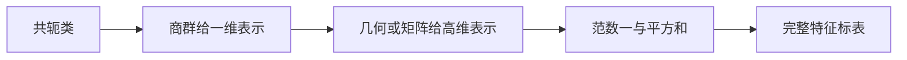

## 0 结构图景

本讲全为复表示。我们从真实作用构造行，以范数一证明不可约，以平方和证明穷尽。$D_4$ 约定为八阶正方形对称群，有些教材写作 $D_8$，不可混用。三个例子也说明特征标表不是群同构的完全不变量。

## 1 D4：四条一维与一个平面

表示为 $\langle r,s:r^4=s^2=1,srs=r^{-1}\rangle$。每个元素为 $r^a$ 或 $r^as$（$0\le a<4$）。由关系直接共轭得到五类：$1$、$r^2$、$\{r,r^3\}$、$\{s,r^2s\}$、$\{rs,r^3s\}$，大小 $1,1,2,2,2$。例如以 $r$ 共轭 $r^as$ 使指数增加二；反射共轭旋转使指数取负。这枚举了所有类。

一维表示令 $r\mapsto a,s\mapsto b$。交换性迫使 $a=a^{-1}$，故 $a,b\in\{1,-1\}$，反之四种选择都满足关系。其行按上列顺序为 $(1,1,a,b,ab)$。

二维表示令 $r\mapsto\begin{pmatrix}0&-1\\1&0\end{pmatrix}$，$s\mapsto\operatorname{diag}(1,-1)$，直接乘法验证全部关系。其迹为 $(2,-2,0,0,0)$，范数平方 $(4+4)/8=1$，所以不可约。四条一维加一个二维的平方和为8，穷尽。

| 行 | 1 | r² | r,r³ | s,r²s | rs,r³s |
|---|---:|---:|---:|---:|---:|
| 大小 | 1 | 1 | 2 | 2 | 2 |
| a=1,b=1 | 1 | 1 | 1 | 1 | 1 |
| a=1,b=-1 | 1 | 1 | 1 | -1 | -1 |
| a=-1,b=1 | 1 | 1 | -1 | 1 | -1 |
| a=-1,b=-1 | 1 | 1 | -1 | -1 | 1 |
| 平面E | 2 | -2 | 0 | 0 | 0 |

## 2 A4：共轭类分裂产生非实一维行

$A_4$ 由单位、三双换位、八三循环组成。三双换位与单位构成正规四元子群 $K$，由共轭保留循环型可见正规。商群阶三，故为 $C_3$。三双换位在 $A_4$ 中互相共轭（用三循环重标号即可），给大小三的类。

三循环 $a=(123)$ 的中心化子在 $S_4$ 中只有 $1,a,a^2$：交换者必须保持其唯一固定点4，在另外三点上由一个点的像决定，恰是三个幂。因此在 $A_4$ 中中心化子也阶三，共轭类大小四。非平凡两个 $K$ 陪集各有四个元素，且共轭不能改变阿贝尔商群中的像，故恰是两类，记 $C_+,C_-$，互为逆类。

从商群拉回三条一维表示，按 $1,K\setminus\{1\},C_+,C_-$ 取值分别 $1$、$\omega$、$\omega^2$ 的幂。四点置换表示去掉常数直线，给三维表示 $V$：固定点计数减一得 $(3,-1,0,0)$，范数 $(9+3)/12=1$。平方和 $1+1+1+9=12$，穷尽。

| 行 | 1 | 三双换位 | C+ | C- |
|---|---:|---:|---:|---:|
| 大小 | 1 | 3 | 4 | 4 |
| 1 | 1 | 1 | 1 | 1 |
| λ | 1 | 1 | ω | ω² |
| λ² | 1 | 1 | ω² | ω |
| V | 3 | -1 | 0 | 0 |

取 $\omega=e^{2\pi i/3}$，$1+\omega+\omega^2=0$。两条复值一维表示互为对偶，不等同于实一维表示。

## 3 Q8：同表不意味着同群

$Q_8=\{\pm1,\pm i,\pm j,\pm k\}$，$i^2=j^2=k^2=-1,ij=k=-ji$。单位和负单位中心，其余共轭类为 $\{\pm i\},\{\pm j\},\{\pm k\}$：用另外的生成元共轭会变号，模中心商交换，不会跳到别的对。大小仍为 $1,1,2,2,2$。

一维表示中交换子必须作用为一，而 $iji^{-1}j^{-1}=-1$，所以负单位作用为一。任取 $i\mapsto a,j\mapsto b$，$a,b\in\{1,-1\}$，则 $k\mapsto ab$；这四个表示经 $Q_8/\{\pm1\}\cong C_2\times C_2$ 构造，行均为 $(1,1,a,b,ab)$。

二维表示取

$\rho(i)=\operatorname{diag}(\mathrm i,-\mathrm i),\quad\rho(j)=\begin{pmatrix}0&1\\-1&0\end{pmatrix},\quad\rho(k)=\rho(i)\rho(j)$。

这里 $\mathrm i$ 是复数单位，区别于群元素 $i$。两生成矩阵平方均为 $-I$ 且反交换，故符合四元数乘法，给真实表示。迹为 $(2,-2,0,0,0)$，范数一，平方和穷尽。因此 Q8 的完整表恰为上面 D4 表的同一数阵，列对应依次为 $1\leftrightarrow1$、$r^2\leftrightarrow-1$、$\{r,r^3\}\leftrightarrow\{\pm i\}$、$\{s,r^2s\}\leftrightarrow\{\pm j\}$、$\{rs,r^3s\}\leftrightarrow\{\pm k\}$。一维行标签对应 $(a,b)=(1,1),(1,-1),(-1,1),(-1,-1)$ 与 $++,+-,-+,--$；二维行对应 $E,U$。这仅是表格数据对应，不是群同构。

为了把表本身留在本节，明确写出：

| 行 | 1 | -1 | ±i | ±j | ±k |
|---|---:|---:|---:|---:|---:|
| 大小 | 1 | 1 | 2 | 2 | 2 |
| ++ | 1 | 1 | 1 | 1 | 1 |
| +- | 1 | 1 | 1 | -1 | -1 |
| -+ | 1 | 1 | -1 | 1 | -1 |
| -- | 1 | 1 | -1 | -1 | 1 |
| U | 2 | -2 | 0 | 0 | 0 |

两个群不同构：Q8只有一个二阶元素负单位，D4有 $r^2$ 及四个反射共五个。相同数表没有保留全部群乘法及元素幂映射。

## 4 示范、三类题与核验终点

D11：A4 的 $V\otimes V$ 特征标为 $(9,1,0,0)$。与每个一维行的内积均 $(9+3)/12=1$，与 $V$ 的内积为 $(27-3)/12=2$。所以 $V\otimes V=1\oplus\lambda\oplus\lambda^2\oplus2V$。维数 $1+1+1+6=9$，非单位三列也回代成立。

G11（T1，引导）：分解 D4 的 $E\otimes E$。

I21（T2，独立）：分解 A4 的 $\operatorname{Sym}^2V$ 和 $\Lambda^2V$。

I22（T3，独立）：计算 D4 的 $\Lambda^2E$ 与 Q8 的 $\Lambda^2U$，解释为何同一数表仍可得到不同结果。

口述：本讲每条高维行为什么一定来自表示？只满足正交的数列还缺什么？

| 旧结构 | 本讲落点 |
|---|---|
| 商群同态 | 构造一维行 |
| 几何置换／平面作用 | 构造高维行 |
| 正交与平方和 | 证明不可约及穷尽 |
| 元素阶与幂映射 | 特征标数阵未独自记录的信息 |

第12讲将把有限阿贝尔群的表解释为 Fourier 变换，并把 Schur 引理转成等变线性层的参数结构。

# 第12讲 用结构减少必须处理的自由度

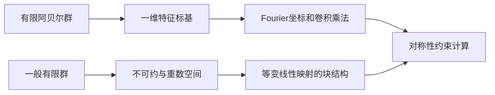

## 0 结构图景与范围

本讲给两个严格有限维接口：有限 Fourier 变换、等变线性映射。它们说明前面抽象定理如何减少坐标耦合；不直接声称能解释脑的跳跃思维，也不把线性等变自动延伸为任意神经网络的完整理论。无限群、李群、模表示和几何表示只列为后续方向。

## 1 Fourier变换就是换到特征标基

设 $A$ 为有限阿贝尔群。第3、6讲说明所有不可约一维且恰有 $|A|$ 个；所有函数都是类函数，所以这些同态 $\chi:A\to\mathbb C^\times$ 构成函数空间的标准正交基。记其集合为 $\widehat A$。定义

$\widehat f(\chi)=\frac1{|A|}\sum_{a\in A}\overline{\chi(a)}f(a)$。

标准正交展开立即给出反演 $f(a)=\sum_{\chi\in\widehat A}\widehat f(\chi)\chi(a)$。证明不只是引用名字：右边与每个基向量的内积均等于 $\widehat f(\chi)$，差与全基正交所以为零。Parseval 为 $|A|^{-1}\sum_{a\in A}|f(a)|^2=\sum_{\chi\in\widehat A}|\widehat f(\chi)|^2$，由展开后交叉项的正交性消去得到。

对 $A=C_n$ 采用加法记号 $a\in\{0,\ldots,n-1\}$，特征标 $\chi_k(a)=e^{2\pi ika/n}$。它们是真同态且不同，共 $n$ 个，已穷尽；正交也可独立核验为有限几何级数。示范 D12：$C_3$ 上 $f=(1,0,0)$ 的三个 Fourier 系数均为 $1/3$。反演在零点给一，其余两点由 $1+\omega+\omega^2=0$ 给零；Parseval 两边都是 $1/3$。

## 2 卷积为什么变成乘法

定义归一化卷积 $(f*h)(x)=|A|^{-1}\sum_{a\in A}f(a)h(a^{-1}x)$。在 Fourier 系数中代入并换元 $b=a^{-1}x$，则 $x=ab$，利用 $\overline{\chi(ab)}=\overline{\chi(a)}\overline{\chi(b)}$，得

$\widehat{f*h}(\chi)=|A|^{-2}\sum_{a,b\in A}f(a)h(b)\overline{\chi(a)}\overline{\chi(b)}=\widehat f(\chi)\widehat h(\chi)$。

因我们选择归一化卷积，单位函数是 $|A|\delta_1$，不是 $\delta_1$；其各 Fourier 系数均为一。不同归一化会改变常数，不能混用。

平移 $L_af(x)=f(a^{-1}x)$ 对特征标作用为 $L_a\chi=\chi(a)^{-1}\chi$。这是函数坐标上出现逆元的原因；不要把这个平移特征值误写成 $\chi(a)$ 而仍保持同一平移定义。

## 3 等变线性映射的块结构

设 $V=\bigoplus_iU_i^{\oplus m_i}$、$W=\bigoplus_iU_i^{\oplus n_i}$，其中 $i=1,\ldots,r$，$U_i$ 不同构复不可约，允许某些重数零。写作 $U_i\otimes\mathbb C^{m_i}$ 时，群只在 $U_i$ 上作用，第二因子是副本标签空间，称重数空间。

逐块考察等变映射：不同 $i$ 之间由Schur为零，相同类型的每个副本间由Schur为标量恒等（先固定各副本与 $U_i$ 的同构）。因此全部等变映射恰为

$T=\bigoplus_i(I_{U_i}\otimes B_i),\quad B_i\in\operatorname{Mat}_{n_i\times m_i}(\mathbb C)$。

反向每个这样的块显然与群作用交换，故条件既必要又充分。参数维数为 $\sum_{i=1}^{r} n_im_i$，而不是所有线性映射的 $(\dim W)(\dim V)$。结构仍允许任意混合相同不可约类型的副本，不能误说每个不可约副本都必须单独保持。

例如 $V=1^{\oplus2}\oplus H_{\rm std}$、$W=1\oplus H_{\rm std}^{\oplus3}$ 为 $S_3$ 表示。一般线性映射有 $7\times4=28$ 个复参数，等变映射只有 $1\times2+3\times1=5$ 个。该数字是线性参数空间维数，不是未经测量的运行加速倍数。

## 4 应用边界与反例

若线性层使用上面的块结构，它严格等变。非线性层还必须自己满足 $\sigma(gv)=g\sigma(v)$。以符号表示 $g:x\mapsto-x$（即 $gv=-v$）为例，逐坐标 ReLU 不等变：$\operatorname{ReLU}(-1)=0$ 而 $-\operatorname{ReLU}(1)=-1$。所以不能把任意激活函数接上后仍声称整体等变。对置换作用，逐坐标同一标量函数与坐标置换交换，这个特例可直接逐坐标证明。

## 5 三类题与全课自测

G12（T1，引导）：$C_2$ 上 $f=(a,b)$，求两个 Fourier 系数并反演。

I23（T2，独立）：证明有限阿贝尔群上与所有左平移交换的线性算子，在特征标基中对角，并能写成某个归一化卷积算子。

I24（T3，独立）：对 $V=1^{\oplus2}\oplus H_{\rm std}$ 求自同态空间维数；求其中可逆等变映射的条件。

全课验收题（另见分离答案）：T1，解释表示与群代数模互译，给出 $S_3$ 表及加权内积；T2，从平均投影证明Maschke与第一正交，并解释个数定理的中心元素步骤；T3，从 $A_3$ 非平凡一维表示诱导到 $S_3$，再对其对称平方作分解，全部回代维数与特征标。这里是待作答清单，不是已通过的学情记录。

## 6 覆盖总表与后续路径

| 高代或群论对象 | 本课统一位置 | 已证明依据 |
|---|---|---|
| 单算子与不变子空间 | 循环群表示、子表示 | 讲1 |
| 补空间与正交投影 | Maschke稳定补空间 | 讲2 |
| 核像与特征值 | Schur引理 | 讲3 |
| 迹 | 特征标及运算 | 讲4、8 |
| 标准正交基 | 不可约特征标基 | 讲5–6 |
| 数表分解 | 不可约重数 | 讲7、11 |
| 陪集 | 诱导表示 | 讲9 |
| 映射由生成副本决定 | Frobenius互反 | 讲10 |
| 离散频率与卷积 | 阿贝尔群特征标 | 讲12 |
| 分块线性层 | 重数空间自由参数 | 讲12 |

主线12讲至此完成作者稿。后续待学方向：坏特征模表示（Maschke失效后如何替代）、紧群与李群表示（离散平均如何推广）、几何表示论（用几何构造表示）。Frobenius–Schur指标没有在本课陈述或调用其定理，仍属于待学方向；Mackey公式也未证明。不能把这些方向的列出当成已经覆盖。课程完稿、独立审稿、学生掌握是三个独立状态。

# 附录A 记号与输入边界

| 记号 | 含义与条件 |
|---|---|
| $\rho_V:G\to GL(V)$ | 有限群在有限维复空间上的表示，另标任意域时以局部条件为准 |
| $\mathbb C[G]$ | 群代数，群元素是形式基 |
| $\chi_V(g)$ | $\operatorname{tr}\rho_V(g)$ |
| $\operatorname{Ind}_H^G W$ | 从子群诱导，维数为指数乘原维数 |
| $\operatorname{Res}_H^G V$ | 限制到子群，维数不变 |
| $\langle v,w\rangle$，讲2向量内积 | 第一变量线性，第二变量共轭线性 |
| $\langle f,h\rangle_G$，讲5起类函数内积 | 第一变量共轭线性，第二变量线性；群平均归一化 |
| $\widehat f(\chi)$ | 有限阿贝尔群 Fourier 系数，等于类函数内积 $\langle\chi,f\rangle$ |
| $C_G(g)$ | 元素的中心化子，不是共轭类 |

## 未证输入与已证前置小表

| 输入 | 使用处 | 真实状态与来源 |
|---|---|---|
| R6 代数基本定理 | 讲3复数Schur标量结论、讲8有限阶算子的复特征基 | `lectures/math/unproven_registry.md` R6仍未证；只引用不销号 |
| 基扩张 | 讲2任意线性投影 | `lectures/math/approved/02_线性映射与秩-零化度定理.md` §4.1 引理2 |
| 正交基扩充、正交分解 | 讲2平均内积后的稳定补空间 | `lectures/math/approved/04_内积空间.md` §3.3 定理2、§4.2 定理2；复数投影计算在讲2补写 |
| 一般有限维张量积 | 讲4、8 | 本课用基直接构造并验证，不把范畴论普遍性质作为输入 |
| Frobenius–Schur指标、Mackey公式 | 后续方向 | 本课不调用，未宣称证明 |

已证前置不等于学生已通过验收。上述输入表不修改任何共享登记状态。升级对照总表见第12讲§6。

# 答案与作者核验（先独立作答，再打开）

- D1：基矩阵行列式为 $-2$，且 $Su=u,Sv=-v$；已代入复数域核验。
- G1 最小提示：先展开再用群关系。答案为 $(ac+bd)+(ad+bc)s$，矩阵为 $\begin{pmatrix}ac+bd&ad+bc\\ad+bc&ac+bd\end{pmatrix}$。核验：分别将 $aI+bS$ 与 $cI+dS$ 相乘，因 $S^2=I$ 得同式。
- I1：设一维表示为 $\lambda$，则交换子像为 $\lambda(g)\lambda(h)\lambda(g)^{-1}\lambda(h)^{-1}=1$，因为域的非零标量交换。核验：四项合法非零且可约去。
- I2：置换不改变坐标和，所以 $H=\{x:x_1+x_2+x_3=0\}$ 稳定。令 $t=(1,1,1)$，对任意 $x$ 取 $c=(x_1+x_2+x_3)/3$，则 $x=ct+(x-ct)$ 且第二项在 $H$。若 $ct\in H$，则 $3c=0$，复数上 $c=0$。这同时核验张成与交零；此处不宣称 $H$ 的不可约性。
- 第1讲检查点：$S^{-1}=S$；同维数不保证同构，例如 $C_2$ 的复平凡与符号表示，其等变同构会要求 $T=-T$，故不可能非零。商空间只需线性子空间，商表示还需稳定。核稳定用 $T(gv)=gT(v)$。
- D2：正文已核验 $R^2=R$、$RS=SR$、像与核；两条直线维数和为二且交为零。
- G2 最小提示：查看左乘如何置换求和指标。对每个 $h$，$hRv=|G|^{-1}\sum_{g\in G} hgv=Rv$，所以像包含于固定空间；固定向量 $w$ 满足 $Rw=w$，给出反包含，且 $R^2=R$。核验不要求 $G$ 交换。
- I3：$A^TA=\begin{pmatrix}1&1\\1&2\end{pmatrix}$，故 Gram 矩阵 $B=(I+A^TA)/2=\begin{pmatrix}1&1/2\\1/2&3/2\end{pmatrix}$。$\langle(x,y),e_1\rangle_B=x+y/2$，正交补为 $k(1,-2)$（本题 $k=\mathbb C$）。核验：$A(1,-2)=-(1,-2)$；$\det B=5/4>0$ 且首主子式为正；直接相乘 $A^TBA=B$。
- I4：$\ker f$ 稳定，Maschke 给出 $V=\ker f\oplus L$。限制 $f|_L$ 单射；若 $w=f(v)$，分解 $v=u+l$ 则 $w=f(l)$，所以满射。设 $s=(f|_L)^{-1}$ 并包含进 $V$。对 $g,w$，$f(gs(w))=gw=f(s(gw))$，两向量均在 $L$，用单射得等变；$fs=I$ 由定义。有限维让本讲已证 Maschke 可直接应用；不宣称无限维情形失败。
- 第2讲检查点：原内积下正交补可能不稳定，正文矩阵 $A$ 即反例；有限性让归一化求和有意义；有限维用于最小维数与归纳终止、以及有限维正交分解。

# 第3—4讲分离答案与作者自校

先自行作答，再查看对应题目。本次未发生学生测评。

## 逐题答案和真算核验

D3：四个 $U$ 到 $U$ 块与一个 $W$ 到 $W$ 块各一维，合计五。不同类型块由Schur为零。以四个矩阵单位和 $W$ 上恒等给出五个独立自同态，既证明上界也证明可达到。

G3最小提示：写出 $TS=ST$。令 $T=\begin{pmatrix}a&b\\c&d\end{pmatrix}$、$S=\begin{pmatrix}0&1\\1&0\end{pmatrix}$，两边分别为 $\begin{pmatrix}b&a\\d&c\end{pmatrix}$、$\begin{pmatrix}c&d\\a&b\end{pmatrix}$，故 $b=c,a=d$。全部自同态为 $aI+bS$，维数二，复表示可约；独立复查：直线 $(1,1)$ 和 $(1,-1)$ 都稳定。

I5：阿贝尔性给出每个 $\rho(g)$ 都属于 $\operatorname{End}_G(V)$，Schur标量结论使每个群元素都作用为标量。任意直线因此稳定；取非零向量张成的直线，不可约性迫使其为全空间，故维数一。注意证明没有用“所有可对角化矩阵同时可对角化”。

I6：包含、投影使 $\operatorname{Hom}_G(U_j,V)$ 与 $\bigoplus_{i=1}^{r}\operatorname{Hom}_G(U_j,U_i)^{\oplus m_i}$ 同构：映射取各分量，逆映射把分量合成。由Schur，各项只有 $i=j$ 时一维，故总维数 $m_j$。左边仅依赖表示 $V$ 和同构类型 $U_j$，不依赖所选分解，因而每种类型的重数不变。此结论是对已经存在的分解而言，存在性由第2讲提供。

第3讲检查点：同维的平凡与符号表示没有非零等变映射。代数闭性用于特征多项式有根；实反例不推翻非零即同构，因为每个非零矩阵 $aI+bJ$ 仍有逆，行列式为 $a^2+b^2$。

D4：固定点数为 $3,1,0$，减一得 $2,0,-1$，逐项平方得 $4,0,1$。单位元维数分别为二、四，对偶特征标仍为 $2,0,-1$（因这些值为实数）；此项不用于判定不可约。

G4最小提示：先列表再比较生成元作用。$L$ 在 $1,a,a^2$ 上取 $1,\omega,\omega^2$。$L^*$ 与 $L\otimes L$ 都取 $1,\omega^2,\omega$。验证：$\omega^4=\omega$，$\overline\omega=\omega^2$。同构不仅由同特征标猜测：选 $L$ 的非零基 $e$、对偶基 $e^*$，定义 $e\otimes e\mapsto e^*$，它在生成元作用下两边都乘 $\omega^2$，故是等变同构。

I7：基映射 $e_{(x,y)}\mapsto e_x\otimes e_y$ 是双射基映射，故线性同构。群作用两边都送到 $e_{gx}\otimes e_{gy}$，所以等变。固定点集合为 $X^g\times Y^g$，其大小为 $|X^g||Y^g|$；张量迹公式也给 $\chi_{\mathbb C[X]}(g)\chi_{\mathbb C[Y]}(g)$。两种计算独立落在同一整数上。

I8：写 $A=\rho(g)$，有 $A^2=I$。对每个 $v$，令 $v_+=(v+Av)/2,v_-=(v-Av)/2$，则 $Av_+=v_+,Av_-=-v_-$ 且 $v=v_++v_-$。两特征空间交零，因此若维数为 $n_+,n_-$，则迹为 $n_+-n_-$、总维数为 $n_++n_-$，相差 $2n_-$。二维 $C_2$ 表示的生成元分别取 $I,\operatorname{diag}(1,-1),-I$，迹为 $2,0,-2$，均验证平方为单位。三阶一维例取 $\omega$，迹不为整数，否定任意有限阶推广。这里不要求表示忠实，所以群元素阶二并不排除它在表示中作用为单位。

第4讲检查点：单位元处为非负整数维数；群元素的共轭 $hgh^{-1}$ 与数值复共轭 $\overline z$ 是不同操作。

# 第5—12讲分离答案与核验

提示只在相应题目作答后查看。

## 第5讲

G5提示：与常函数一取内积。答案 $(3+3)/6=1$；第1讲固定直线给出独立核验。I9：同构推出迹相同已证；反向逐个与不可约特征标取内积，所有重数相同，Maschke分解给同构。I10：非负整数平方和等于二只有两个1，故为两个不同类型各一次。D5的加权平方和分别为2与1，类大小和为6。

## 第6讲

G6：$1\cdot1+(-1)\cdot1+0\cdot(-1)=0$。I11：正向由平方和得不可约个数为群阶，个数定理得每个共轭类大小一，所以群交换；反向第3讲已用Schur证明。I12：记群阶 $n>1$，非单位元为唯一类，类大小 $n-1$ 整除 $n$，所以整除 $n-(n-1)=1$，得 $n=2$，两元素群必为循环群。D6的两列平方和分别2、3，与中心化子阶吻合。

## 第7讲

G7提示：逐列相乘。结果 $(2,0,-1)$，故同构于 $H$。I13：单位固定全部6个有序对，非单位不可能同时固定两个不同点，故特征标 $(6,0,0)$，重数为1、1、2，即正则表示分解；该作用确为自由传递，可独立识别为正则作用。I14：与平凡取内积为 $(1+3-2)/6=1/3$，不可能为表示重数，虽范数为 $(1+3+2)/6=1$ 也无效。D7回代三列与维数全部吻合；S4标准行范数 $(9+6+3+6)/24=1$。

## 第8讲

G8提示：写一维基张量。外平方零，对称平方等于 $L\otimes L$，特征标为 $\chi_L^2$。I15：单位处维数四；换位特征值1、负1，三次齐次单项式特征值为1、负1、1、负1，和零；三循环特征值 $\omega,\omega^2$，四项为1、$\omega$、$\omega^2$、1，和一。故特征标 $(4,0,1)$，分解为 $1+\varepsilon+H$。I16：唯一递增顶指标的外张量被矩阵作用乘行列式（多线性展开中重指标消去，剩余排列带符号），所以顶外幂特征标为行列式。对 $H$ 即 $(1,-1,1)$，与D8一致。D8两幂相加逐列恢复 $(4,0,1)$。

## 第9讲

G9提示：A3正规，两个陪集被换位互换。特征标 $(2,0,2)=1+\varepsilon$。I17：单位维数3，换位只有一个固定陪集贡献负一，三循环无固定陪集，故 $(3,-1,0)=\varepsilon+H_{\rm std}$；逐列和核对。I18：在每个陪集把 $W_1\oplus W_2$ 分开，群作用保持两类副本，给诱导的直和同构；两个非零子表示诱导后的维数都正，所以可约。D9b三循环迹为 $\omega+\omega^2=-1$，范数 $(4+2)/6=1$。

## 第10讲

G10提示：在互反的V取平凡表示。重数为 $\dim\operatorname{Hom}_H(W,1)$，由Maschke分解等于平凡块重数，也等于 $\dim W^H$；不能未经说明把一般线性对偶直接当固定向量本身。I19：C3正则为 $1+\psi+\psi^2$，诱导为 $1+\varepsilon+2H_{\rm std}$；传递性把从平凡子群先诱导到C3再到S3等同直接诱导，故为S3正则，维数六。I20：限制为 $\psi+\psi^2$，两者分别诱导为 $H_{\rm std}$，所以为两份标准表示，维数四，不同于原二维表示。D10的三个内积依次 $(1-1)/2=0,(1+1)/2=1,(2-0)/2=1$。

## 第11讲

G11提示：把二维行逐列平方。结果 $(4,4,0,0,0)$，与四个一维行内积均为一，故为四个一维表示各一次；回代末三列符号两两抵消。I21：A4平方映射在三双换位处到单位、两个三循环类互换，而V在两类均零。因此 $\chi_V(g^2)=(3,3,0,0)$，对称平方 $(6,2,0,0)=1+\lambda+\lambda^2+V$，外平方 $(3,-1,0,0)=V$。维数6、3加为9。I22：D4平面行列式在旋转为一、反射负一，所以外平方是a=1,b=-1行；Q8所列两个生成矩阵行列式都为一，顶外幂平凡。同一数表未指定不同列元素的平方落在哪一列，平方公式因此可以不同。D11加权内积1、1、1、2已复算，非单位双换位列回代 $1+1+1-2=1$，三循环列回代为零。

## 第12讲

G12提示：两个字符为 $(1,1),(1,-1)$。系数 $(a+b)/2,(a-b)/2$；相加恢复a，相减恢复b。I23：每个字符张成不同一维平移表示，因为字符互异其逆也互异；Schur使与平移交换的算子在这些线上为标量 $c_\chi$。取函数k的Fourier系数为 $c_\chi$（反演给存在唯一），卷积公式使 $k*f$ 在每个Fourier坐标乘同一标量，故该算子就是归一化卷积。I24：维数 $2^2+1^2=5$；形式为 $B\oplus cI_H$，其中B为二阶矩阵，可逆条件为 $\det B\ne0,c\ne0$。D12的三个系数平方模和为 $3/9=1/3$。

## 全课验收参考终点

T1：互译必须验证单位、乘法、逆元以及映射等价；S3表为三行 $(1,1,1),(1,-1,1),(2,0,-1)$，加权为 $(1,3,2)/6$。T2：Maschke平均投影必须共同固定原子空间，第一正交在Hom空间投影；个数定理把正交补函数构造成中心z，使其在所有不可约上作用零，再在正则表示上施于单位得z零。T3：诱导特征标 $(2,0,-1)$，对称平方 $(3,1,0)=1+H$，维数2再到3，原诱导维数 $[S3:A3]=2$。完整证明分别见讲1、2、5、6、9、8，不以答案关键词代替学生证明。

# 作者自校记录（非审稿，不构成通过依据）

### 答案与自校.md

正文的两条核心证明均完整落稿：表示—模互译含单位、逆元、乘法和映射；Maschke 含稳定补与维数归纳。正特征反例逐坐标检验，无循环使用完全可约。无需代码测试代替符号证明。

假设：设计所需先修视为读者准备要求，不登记已掌握。内积正交分解与基延拓是高代工具；如读者未掌握，需补学。未证工具候选：后续 Frobenius 互反、对称／外幂公式、Frobenius–Schur 指标均尚未在正文使用；本稿不调用未经证明的 Schur 引理。独立审稿、学习验收、PDF 编译均未执行。

### 讲3-4_答案与自校.md

Schur基础部分核像证明不要求代数闭；标量结论明确有限维、非零、代数闭。不可约反向判据仅在复有限群范围调用Maschke。特征标所有运算直接从基或迹证明，没有调用第5讲正交关系，也没有用“同特征标推出同构”。张量积只补有限维基构造；对称／外幂留待第8讲。复对偶共轭公式通过平均内积酉化证明，任意域只保留取逆公式。

未证工具候选：后续正交关系、Frobenius互反、对称／外幂特征标公式及Frobenius–Schur指标均不作为当前证明依据。引用先修为有限维线性代数、特征多项式及代数闭域定义；复数代数闭依赖代数基本定理（未证，登记 R6），本课未证明或销号。

核验方式：上述矩阵乘法、基映射、逆作用、单位根及迹的有限和均逐式复算。未运行代码；未独立审稿；未作PDF编译。第5—12讲现已补齐；原记录为当时阶段状态。

### 第05至12讲_答案与核验.md

讲5–12各题均以上述代数运算逐式核验；三表构造均先给真实表示、范数判不可约、平方和判穷尽。两正交、个数、平方和、诱导公式、互反、对称与外平方公式均在本稿证明。未作独立审稿，未记录学生通过。后续理论未作本课结论的隐含前提。
