# 概率论 MA301：从事件到随机模型

> **作者**：Codex 侧数学教授分身（CDX）｜**初稿日期**：2026-10-12｜**自校日期**：2026-10-13｜**版本**：v0.1-selfchecked。
> **状态：作者自校完成，待 DSH 数学审稿员独立审稿。** 已复查证明逻辑、边界条件与前置依赖，并另路验算数值题、密度积分和模型例子；自校不等于独立审稿通过。所用而未在本讲证明的输入 U1–U5 仍须明确保留，不自动销号或归档。
> **修订记录（CDX，2026-10-13）**：补分布参数与端点约定；补标准矩的计算细节；细化连续密度求导、条件密度与一般条件期望边界；补 Poisson 构造的几乎处处版本；补最小值与排序的退化情况；明确跨课投影引用和分析学习依赖；附作者自校记录及可复跑验算结果。原始未核验初稿保留为历史版本。
> **设计依据**：DSH 侧 `professors/MATH/handout_MA301_概率论/00-讲义设计.md` 与 `01-章节规划.md`（18 讲）；本轮“根据大纲编写”作为按现有设计进入写作阶段的授权。只写 MA301，不写 MA306。正文为独立组织，不宣称逐页复现任何教材。
> **权威边界**：本文件是 CDX 工作稿，暂不进入 `approved/`，不表示学生已学完，不改动 DSH 设计文件与学习进度。

## 阅读导航与依赖约定

本课沿“事件—分布—期望—极限—随机模型”推进。每讲依次给出问题、定义与证明、示例、引导和独立练习、回看与升级坐标。全课自测 T1、T2 必做，T3 选做；课堂口头追问每讲最多三道，等待自读完毕信号再开始。

讲 1–4 从有限、可数模型起步；讲 5 起引入连续模型，需要定积分、反常积分、换元、分部积分等数分工具。**编写顺序不等于当前开课许可**：积分前置未完成时，暂停对应讲次学习，不调换讲号。讲 7、10、12 的微分、Taylor 展开也列为学习前置；多元密度部分需要二重积分。设计文件中的“全课只在有限／可数样本空间工作”与连续分布内容冲突，本稿修正为“先离散，后在给定经典连续模型上运算；一般测度论构造留给 MA306”。

以下“证明”已由作者自校，**不等于已通过 DSH 独立审稿**。“候选输入 U”表示本稿使用而不在此证明的分析或存在性事实，见附录 B；它们不是已获系统登记的 R 编号。数值解答已另路验算；证明题已逐项复查，具体证据见同目录自检报告。

# 第一部分：概率空间与分布

## 第 1 讲　样本空间、事件与概率公理

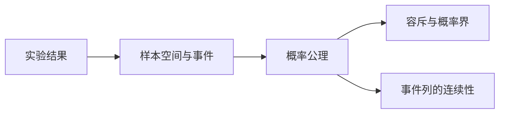

### 1.1 先分清“结果”与“我们问的事情”

掷一次骰子的结果是一个数，问题“是否为偶数”对应结果集合 $\{2,4,6\}$。**样本空间** $\Omega$ 收集所有可能结果，**事件**是允许赋予概率的子集。有限或可数空间可取全部子集作为事件域 $\mathcal F$。一般空间要求 $\mathcal F$ 包含 $\Omega$，对补集和可数并封闭，称为 **$\sigma$-代数**；本课只使用这些封闭性质，不展开测度论。

**概率空间**是 $(\Omega,\mathcal F,P)$，其中 $P:\mathcal F\to[0,1]$ 满足：$P(\Omega)=1$；若 $A_1,A_2,\ldots$ 两两不交，则 $P(\bigcup_{i=1}^{\infty}A_i)=\sum_{i=1}^{\infty}P(A_i)$。非负性、归一性、可数可加性通常合称三公理。

可数不是“数量很多”，而是能排列为有限表或序列。整数、整数对、有理数可数；区间里的实数不可数。可数空间若有点概率 $p_i\ge0$、$\sum_{i=1}^{\infty}p_i=1$，可定义 $P(A)=\sum_{i=1}^{\infty}p_i\mathbf1_{\{\omega_i\in A\}}$。连续模型不能靠给每个点一个正质量来得到。

### 1.2 由公理推出工具

**命题 1.1**：$P(\varnothing)=0$，$P(A^c)=1-P(A)$；若 $A\subseteq B$，则 $P(A)\le P(B)$；且

$P(A\cup B)=P(A)+P(B)-P(A\cap B).$

**证明**：空集可作为任意可数互不交空集列的并，有限可加性亦给 $P(\varnothing)=2P(\varnothing)$；$\Omega=A\sqcup A^c$ 得补集式。$B=A\sqcup(B\setminus A)$ 得单调性。将 $A\cup B$ 拆成 $A\setminus B,A\cap B,B\setminus A$ 三个互不交部分，分别相加得到容斥。

**命题 1.2（次可加性）**：$P(\bigcup_{i=1}^{\infty}A_i)\le\sum_{i=1}^{\infty}P(A_i)$。

令 $B_1=A_1$、$B_i=A_i\setminus\bigcup_{j=1}^{i-1}A_j$。它们互不交、并集不变，且 $B_i\subseteq A_i$，可数可加性和单调性即得。

**命题 1.3（事件列连续性）**：若 $A_n\uparrow A$，则 $P(A_n)\to P(A)$；若 $A_n\downarrow A$，同样成立。

递增情形拆成 $A_1,A_2\setminus A_1,\ldots$，部分和趋向总和；递减情形对补集使用递增结论。这条不是“把极限随意移入概率号”，而是公理的后果。

### 1.3 古典概型与计数

有限等可能模型中 $P(A)=|A|/|\Omega|$。等可能是模型假设，不来自“我不知道哪个会发生”。从 $n$ 个对象取 $k$ 个不计顺序的选择数是 $\binom nk=n!/[k!(n-k)!]$：先计有序选取 $n(n-1)\cdots(n-k+1)$，再除每组内部 $k!$ 种排列。

**示例**：两次独立公平骰子形成 $36$ 个等可能有序对，和为 $7$ 的有 $6$ 个，概率 $1/6$。和为 $2,\ldots,12$ 的十一种数值本身并不等可能。

**引导练习 G1**：从 $5$ 人中随机选 $2$ 人，指定甲乙至少一人入选的概率？提示：先算两人都不入选。

**独立练习 I1**：若 $P(A)=0.6,P(B)=0.5$，求 $P(A\cap B)$ 的可能范围。

**答案（作者自校）**：G1 为 $1-\binom32/\binom52=7/10$。I1 下界 $0.1$、上界 $0.5$；下界来自 $P(A\cup B)\le1$，上界来自交集包含于各事件，端点均可由四个原子事件的非负概率实现。

**回看**：先定义实验单位与事件，再计数。📋 **升级坐标**：一般概率是总质量为 $1$ 的测度，MA306 将处理不可数空间上为何不能把所有子集都当作事件。

## 第 2 讲　条件概率与独立性

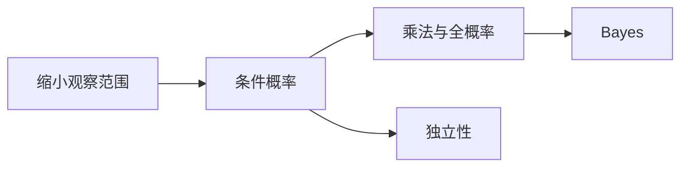

### 2.1 条件概率是一种重新归一化

当 $P(B)>0$，定义 $P(A\mid B)=P(A\cap B)/P(B)$。它把总空间限制为 $B$，再把 $B$ 的概率放大到 $1$。因此 $P(A\cap B)=P(B)P(A\mid B)$。迭代得到有限交事件的乘法公式，条件事件概率为零时不能使用对应商式。

若 $B_1,\ldots,B_m$ 构成互不交且覆盖 $\Omega$ 的划分，各有正概率，则

$P(A)=\sum_{j=1}^{m}P(A\mid B_j)P(B_j).$

这是将 $A$ 拆为互不交的 $A\cap B_j$。再用条件概率定义得到 **Bayes 公式**：

$P(B_i\mid A)=\frac{P(A\mid B_i)P(B_i)}{\sum_{j=1}^{m}P(A\mid B_j)P(B_j)},\quad P(A)>0.$

可数划分同理，但必须保留收敛的非负和。

### 2.2 独立不是互斥

定义 $A,B$ **独立**为 $P(A\cap B)=P(A)P(B)$。这个定义也覆盖零概率事件。若 $P(B)>0$，等价于 $P(A\mid B)=P(A)$。两个正概率互斥事件不独立，因为交概率为零而概率乘积为正。

有限族相互独立要求任意非空子族的交概率均等于概率乘积；仅检查两两交不足。投两枚公平硬币，令 $A$ 为第一枚正面，$B$ 为第二枚正面，$C$ 为两枚相同。三事件两两独立，但 $P(A\cap B\cap C)=1/4\ne1/8$。

### 2.3 先验为什么会改变结果

**示例**：机器来源甲占 $1/10$，乙占 $9/10$；报警概率分别为 $9/10$ 和 $1/10$。观察报警后来自甲的概率是

$\frac{(9/10)(1/10)}{(9/10)(1/10)+(1/10)(9/10)}=1/2.$

报警对甲很敏感，也不能忽略乙数量较多的事实。

**G2**：两箱各以 $1/2$ 概率选中；甲箱红球占 $3/4$，乙箱占 $1/4$。见红后选到甲的概率？提示：画两条产生红球的路径。

**I2**：若 $A,B$ 独立，证明 $A,B^c$ 独立。

**答案（作者自校）**：G2 为 $3/4$。I2 用 $P(A\cap B^c)=P(A)-P(A\cap B)=P(A)(1-P(B))$。

**回看**：Bayes 是同一个交概率的两种分解，不是另加的公理。📋 **升级坐标**：给定随机变量而非单个事件的条件概率见讲 9；对零概率单点不能直接套商式。

## 第 3 讲　随机变量与分布函数

### 3.1 随机变量不是“会变的符号”

**随机变量**是函数 $X:\Omega\to\mathbb R$，要求 $\{X\le x\}\in\mathcal F$ 对每个实数 $x$ 成立。在有限、可数且取全部子集的空间，这个条件自动满足。一次结果 $\omega$ 确定后，$X(\omega)$ 是普通实数。不同随机变量可以观察同一个实验的不同方面。

**分布函数**定义为 $F_X(x)=P(X\le x)$。它描述数值的概率分布，而非原空间的全部信息。两个随机变量可同分布但不相等，更不保证独立。

**随机变量的独立定义（补齐前置）**：$X_1,\ldots,X_m$ 相互独立，指任意数轴 Borel 集 $A_1,\ldots,A_m$ 都满足 $P(\bigcap_{i=1}^{m}\{X_i\in A_i\})=\prod_{i=1}^{m}P(X_i\in A_i)$。Borel 集是由开区间经可数并、补等运算生成的集合；离散变量只需验证所有单点取值组合的概率分解，再求和即可推广。讲 2 的事件独立是本定义的基础，讲 8 展开联合分布版本。
### 3.2 分布函数三条性质及区间概率

**命题 3.1**：$F_X$ 单调不减、右连续，且当 $x\to-\infty,+\infty$ 时分别趋于 $0,1$。

单调性来自事件包含。若 $x_n\downarrow x$，则 $\{X\le x_n\}\downarrow\{X\le x\}$，用讲 1 命题 1.3 得右连续。$\{X\le n\}\uparrow\Omega$、$\{X\le-n\}\downarrow\varnothing$，再用连续性及单调性得到两端极限。

$P(a<X\le b)=F_X(b)-F_X(a)$。记左极限 $F_X(x-)=\lim_{t\uparrow x}F_X(t)$，则 $P(X=x)=F_X(x)-F_X(x-)$。跳跃高度就是该点质量。**分布函数连续不必有密度**，奇异连续分布留给 MA306，本课不把两者等同。

### 3.3 离散分布与函数变换

若 $X$ 只取有限或可数值 $x_i$，分布律是 $p_i=P(X=x_i)$，且 $F_X(x)=\sum_{i=1}^{\infty}p_i\mathbf1_{\{x_i\le x\}}$。若 $Y=g(X)$，则同一个输出值可能对应多个输入，应将其概率相加。

**示例**：$X$ 在 $-1,0,1$ 上概率为 $1/4,1/2,1/4$。$Y=X^2$ 在 $0,1$ 上概率为 $1/2,1/2$；平方把正负两种结果合并了。

**G3**：上述 $X$ 的 $F_X(0-),F_X(0),F_X(1)$ 各多少？

**I3**：构造同分布但不相等的两个随机变量。

**答案（作者自校）**：G3 为 $1/4,3/4,1$。I3 取公平硬币的指示变量 $X$，令 $Y=1-X$；同为 Bernoulli$(1/2)$，但每个结果上都不同。

**回看**：区分样本点、随机变量与分布这三层。📋 **升级坐标**：分布是由函数将概率推送到数轴所得的测度；本讲给出了它的初等版本。

## 第 4 讲　五类离散分布

### 4.1 每个公式都来自一个模型

| 分布 | 模型与支持 | 概率 |
|---|---|---|
| Bernoulli$(p)$ | 一次成功指示，$k=0,1$ | $P(X=1)=p,P(X=0)=1-p$ |
| Bin$(n,p)$ | $n$ 次独立同成功率试验的成功数 | $P(X=k)=\binom nkp^k(1-p)^{n-k}$，$0\le k\le n$ |
| Geom$(p)$ | 首次成功的试验次数，$k\ge1$ | $P(X=k)=(1-p)^{k-1}p$ |
| Hypergeom$(N,K,n)$ | $N$ 个中有 $K$ 个成功项，无放回抽 $n$ 个 | $P(X=k)=\binom Kk\binom{N-K}{n-k}/\binom Nn$ |
| Pois$(\lambda)$ | 稀少独立事件的计数模型，$k\ge0$ | $P(X=k)=e^{-\lambda}\lambda^k/k!$ |

二项式中每种含 $k$ 次成功的具体序列概率相同，共 $\binom nk$ 种。几何分布要求前 $k-1$ 次失败再成功；超几何分布由成功项与失败项分别选取，支持仅含两个组合数均合法的整数。Poisson 归一化来自 $e^\lambda=\sum_{k=0}^{\infty}\lambda^k/k!$。二项式由二项式定理归一化；超几何的归一化可把所有 $n$ 元子集按成功项数分类。

**参数与端点约定**：Bernoulli 与二项取 $0\le p\le1$，二项试验数 $n$ 为非负整数；几何取 $0<p\le1$，$p=0$ 时没有本讲支持上的概率分布。超几何取整数 $N\ge1,0\le K\le N,0\le n\le N$，支持为 $\max(0,n-N+K)\le k\le\min(n,K)$。Poisson 取 $\lambda\ge0$，$\lambda=0$ 时约定在 $0$ 点取概率 $1$；概率式涉及零的零次幂时按 $1$ 处理。稀事件极限固定 $\lambda>0$ 且从 $n>\lambda$ 起考虑。
### 4.2 等待的无记忆性

几何分布取上述“包含成功那次”的约定，$P(X>m)=(1-p)^m$，所以对非负整数 $m,n$，

$P(X>m+n\mid X>m)=(1-p)^n=P(X>n).$

“已经失败多久”不改变剩余等待分布，依据是每次试验独立且成功率不变。无放回抽样通常不具有此性质。

### 4.3 Poisson 是二项的稀事件极限

令 $X_n\sim\operatorname{Bin}(n,\lambda/n)$，固定 $k$，则

$P(X_n=k)=\frac{\lambda^k}{k!}\left(\prod_{j=0}^{k-1}(1-j/n)\right)(1-\lambda/n)^n(1-\lambda/n)^{-k}\to e^{-\lambda}\lambda^k/k!.$

有限乘积趋于 $1$，指数极限给中间项趋于 $e^{-\lambda}$。这是固定 $k$ 的概率极限；不能据此宣称任意参数都适合 Poisson 近似。

**示例**：从 $5$ 个对象（其中 $2$ 个标记）中无放回选 $2$ 个，恰一个标记的概率为 $\binom21\binom31/\binom52=3/5$。

**G4**：几何分布 $p=1/4$，等待超过 $3$ 次的概率？

**I4**：为什么无放回抽样的成功数一般不能用二项分布？给一个极端例子。

**答案（作者自校）**：G4 为 $(3/4)^3=27/64$。I4 抽完全部 $N$ 个时成功数恒为 $K$，而非退化二项分布仍有波动；抽样指示变量相依。

**回看**：先问计数还是等待、有无放回、是否独立，再选模型。期望与方差统一在讲 6 推导。📋 **升级坐标**：Poisson 近似误差界属于更深入的逼近理论；神经发放不是天然服从 Poisson，讲 18 会列模型假设。

## 第 5 讲　连续分布：用面积表达概率

### 5.1 密度与概率的区别

**学习前置**：定积分、反常积分及基本换元。本讲自此允许不可数样本空间；给定经典连续模型，不在此构造 Lebesgue 测度。

若非负可积函数 $f_X$ 满足 $\int_{-\infty}^{\infty}f_X(t)\,dt=1$，且 $F_X(x)=\int_{-\infty}^{x}f_X(t)\,dt$，称分布具有**密度** $f_X$。于是 $P(a<X\le b)=\int_a^bf_X(t)\,dt$。单点概率为零，密度数值却可大于 $1$；它表示单位长度概率的局部强度。

例如 $U\sim\operatorname{Unif}(0,1/2)$ 的密度在该区间为 $2$。概率为零的事件不一定空，抽中的某个确定实数就属于这种情况。

### 5.2 三个基本模型

**均匀分布**：$U\sim\operatorname{Unif}(a,b)$ 的密度为 $1/(b-a)$（$a<x<b$），区间外为零。概率与落在支持内的区间长度成正比。

**指数分布**：$T\sim\operatorname{Exp}(\lambda)$，$\lambda>0$，密度为 $\lambda e^{-\lambda t}$（$t\ge0$），分布函数为 $1-e^{-\lambda t}$。积分给总质量为 $1$，且 $P(T>s+t\mid T>s)=e^{-\lambda t}$，是几何等待的连续对应。

**标准正态**：$\varphi(x)=(2\pi)^{-1/2}e^{-x^2/2}$，$\Phi(x)=\int_{-\infty}^{x}\varphi(t)\,dt$。归一化使用高斯积分 $\int_{-\infty}^{\infty}e^{-x^2/2}\,dx=\sqrt{2\pi}$，其二重积分证明列为分析输入 U2。$X=\mu+\sigma Z$（$\sigma>0$）称 $N(\mu,\sigma^2)$，换元给密度 $\sigma^{-1}\varphi((x-\mu)/\sigma)$。

### 5.3 分布函数法比背变换公式更可靠

若 $U\sim\operatorname{Unif}(0,1)$，令 $Y=U^2$。对 $0\le y\le1$，$P(Y\le y)=P(U\le\sqrt y)=\sqrt y$，故区间内密度为 $1/(2\sqrt y)$。虽然在零附近无界，积分仍为 $1$；端点单点的密度取值不改变分布。

**G5**：$T\sim\operatorname{Exp}(2)$，求 $P(T>3\mid T>1)$。

**I5**：设 $f(x)=cx$（$0<x<2$），其他处为零，求 $c$ 与 $P(X\le1)$。

**答案（作者自校）**：G5 为 $e^{-4}$。I5 由 $\int_0^2cx\,dx=2c=1$ 得 $c=1/2$，概率 $1/4$。

**回看**：分布函数对应累计质量，密度对应积分中的权重，二者不是同一个对象。📋 **升级坐标**：密度是相对于长度测度的导数；混合分布和奇异分布将在 MA306 统一处理。

## 第 6 讲　期望、方差与矩

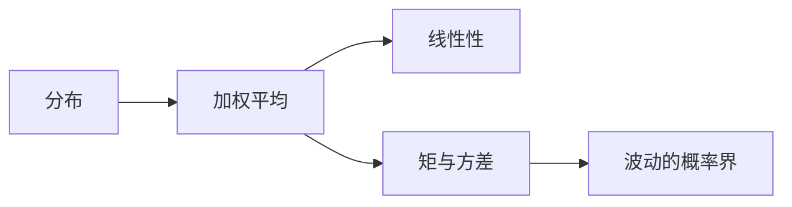

### 6.1 先交代存在性

有限离散型定义 $\mathbb EX=\sum_{i=1}^{m}x_ip_i$；可数型要求 $\sum_{i=1}^{\infty}|x_i|p_i<\infty$ 才称期望有限。非负变量允许期望为 $+\infty$。若正负两部分都是无穷，不能用抵消赋值。密度型对应 $\mathbb EX=\int_{-\infty}^{\infty}xf_X(x)\,dx$，有限性要求绝对可积。

**LOTUS（按分布计算函数期望）**：离散情况下 $\mathbb Eg(X)=\sum_{i=1}^{\infty}g(x_i)p_i$，非负或绝对可和时成立。证明只需将相同 $g(x_i)$ 的项归并，非负／绝对可和换序依据见附录 B。密度型对应积分公式，其一般适用性列为分析输入 U3。

若 $X,Y$ 可积，则 $\mathbb E(aX+bY)=a\mathbb EX+b\mathbb EY$，**不要求独立**。在有限样本空间上直接对每个样本点展开即可；可数绝对可和情形由合法换序推广。连续型一般线性性依赖 U3。

### 6.2 方差与独立和

有限二阶矩时，定义 $\operatorname{Var}X=\mathbb E(X-\mathbb EX)^2=\mathbb EX^2-(\mathbb EX)^2$，由展开和线性性得到第二式。$\operatorname{Var}(aX+b)=a^2\operatorname{Var}X$。若 $X,Y$ 独立且二阶矩有限，则 $\mathbb E(XY)=\mathbb EX\mathbb EY$（联合分布乘积分解），因此 $\operatorname{Var}(X+Y)=\operatorname{Var}X+\operatorname{Var}Y$；相依时另有交叉项，讲 9 详述。

$k$ 阶原点矩为 $\mathbb EX^k$，需相应可积性。**矩母函数** $M_X(t)=\mathbb Ee^{tX}$ 只在期望有限的 $t$ 上定义；若零附近存在，可用于求矩，细节在讲 10。

### 6.3 标准分布的均值与方差

Bernoulli 变量 $B$ 满足 $B^2=B$，故均值 $p$、方差 $p(1-p)$。二项是独立 Bernoulli 和，均值 $np$、方差 $np(1-p)$。

几何变量设 $q=1-p$。尾和公式 $\mathbb EX=\sum_{k=0}^{\infty}P(X>k)$ 来自 $X=\sum_{k=0}^{\infty}\mathbf1_{\{X>k\}}$；非负求和得 $1/p$。用 $X^2=\sum_{k=0}^{X-1}(2k+1)$ 得 $\mathbb EX^2=\sum_{k=0}^{\infty}(2k+1)q^k=(2-p)/p^2$，方差 $q/p^2$；所用幂级数求导是分析前置。

Poisson 的移位求和给 $\mathbb EX=\lambda$、$\mathbb E[X(X-1)]=\lambda^2$，故方差 $\lambda$。超几何写成 $n$ 个抽取位置的指示变量：单个成功率 $p=K/N$，不同位置同时成功率 $K(K-1)/(N(N-1))$。展开平方得均值 $np$、方差 $np(1-p)(N-n)/(N-1)$（$N>1$）；退化情形另直接计算。

连续分布由积分得到：$\operatorname{Unif}(a,b)$ 均值 $(a+b)/2$、方差 $(b-a)^2/12$；$\operatorname{Exp}(\lambda)$ 均值 $1/\lambda$、方差 $1/\lambda^2$。标准正态均值因对称为零；用 $\varphi'(x)=-x\varphi(x)$ 分部积分得二阶矩 $1$，故 $N(\mu,\sigma^2)$ 的均值和方差正是 $\mu,\sigma^2$。

**补算细节（便于逐行核验）**：对 Poisson，$\mathbb EX=e^{-\lambda}\sum_{k=1}^{\infty}k\lambda^k/k!=\lambda e^{-\lambda}\sum_{j=0}^{\infty}\lambda^j/j!=\lambda$；同理 $\mathbb E[X(X-1)]=\lambda^2$，所以二阶矩为 $\lambda^2+\lambda$，方差为 $\lambda$。$\lambda=0$ 的退化情形直接成立。

超几何中不同抽取位置指示变量的协方差为 $K(K-1)/[N(N-1)]-(K/N)^2=-p(1-p)/(N-1)$。因此方差为 $np(1-p)+n(n-1)(-p(1-p)/(N-1))=np(1-p)(N-n)/(N-1)$。$N=1$ 时合法抽样计数确定，方差为零，不能在原公式中直接除以 $N-1$。

均匀型由 $\mathbb EU=(a+b)/2$ 与 $\mathbb EU^2=(a^2+ab+b^2)/3$ 相减得方差。指数型换元 $u=\lambda t$ 给 $\mathbb ET=\lambda^{-1}\int_0^{\infty}ue^{-u}\,du=1/\lambda$，$\mathbb ET^2=\lambda^{-2}\int_0^{\infty}u^2e^{-u}\,du=2/\lambda^2$；两积分分别一次、两次分部积分得到，边界项因指数衰减为零。
### 6.4 一个相依例子与一个不存在的期望

**示例**：$B\sim\operatorname{Bernoulli}(1/2)$，$X=B,Y=1-B$。它们相依，但 $\mathbb E(X+Y)=1=\mathbb EX+\mathbb EY$。另一方面方差和为 $1/2$，而和的方差为零，不能省略相依带来的交叉项。

Cauchy 密度 $1/[\pi(1+x^2)]$ 的绝对一阶矩发散，正负部分均无穷，故期望不存在。对称截断积分为零只是主值，不是期望。

**G6**：$X$ 在 $0,1,2$ 上概率为 $1/4,1/2,1/4$，求均值、方差。

**I6**：$X\sim\operatorname{Pois}(3)$，求 $\mathbb E(X+1)^2$。

**答案（作者自校）**：G6 均值 $1$，二阶矩 $3/2$，方差 $1/2$。I6 为 $\operatorname{Var}X+(\mathbb EX)^2+2\mathbb EX+1=19$。

**回看**：线性性是期望的结构，独立性用于因子分解；不要把二者绑在一起。📋 **升级坐标**：MA306 用积分统一离散与连续的期望，并严格处理换序与极限。
# 第二部分：期望、多元结构与集中现象

## 第 7 讲　概率不等式与集中不等式

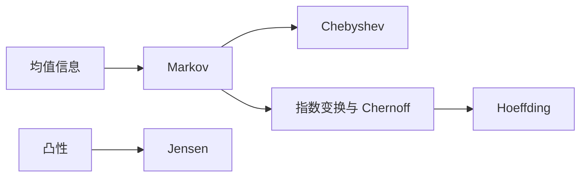

### 7.1 不知道完整分布，仍能控制偏差

**Markov 不等式**：$X\ge0$、$a>0$ 时，$P(X\ge a)\le\mathbb EX/a$。因为逐点有 $X\ge a\mathbf1_{\{X\ge a\}}$，取期望即得。它对负变量不能原样使用。

令 $X$ 换成 $(Y-\mathbb EY)^2$，得到 **Chebyshev 不等式**：有限方差时

$P(|Y-\mathbb EY|\ge t)\le\frac{\operatorname{Var}Y}{t^2},\qquad t>0.$

这只用了方差，不需要正态或独立假设。若右边超过 $1$，仍可与概率上界 $1$ 取较小者。

### 7.2 Chernoff 方法：把偏差放进指数

对 $t>0$，Markov 给 $P(X\ge a)\le e^{-ta}\mathbb Ee^{tX}$，前提是指数期望有限。对所有合法 $t$ 取下确界得到更紧的界。若 $X=\sum_{i=1}^{n}X_i$ 且各项独立，则 $\mathbb Ee^{tX}=\prod_{i=1}^{n}\mathbb Ee^{tX_i}$，乘积易于取对数和优化。

**Hoeffding 引理**：若 $a\le X\le b$，则 $\mathbb Ee^{t(X-\mathbb EX)}\le\exp(t^2(b-a)^2/8)$，$t\in\mathbb R$。

**证明**：若 $a=b$ 则两边直接成立。否则令 $h(t)=\log\mathbb Ee^{tX}$；有界性保证可以逐项微分指数级数，零到任意有限区间上一致绝对收敛。令倾斜期望 $\mathbb E_tg(X)=\mathbb E[g(X)e^{tX}]/\mathbb Ee^{tX}$，求导得 $h''(t)=\operatorname{Var}_tX$。对任意支持于 $[a,b]$ 的变量 $W$，由 $(W-a)(b-W)\ge0$ 得 $\mathbb EW^2\le(a+b)\mathbb EW-ab$，故 $\operatorname{Var}W\le(\mathbb EW-a)(b-\mathbb EW)\le(b-a)^2/4$。于是 $h''(t)\le(b-a)^2/4$；从 $h(0)=0,h'(0)=\mathbb EX$ 作二阶积分余项估计，得 $h(t)-t\mathbb EX\le t^2(b-a)^2/8$。指数化即得。这里微积分与一致收敛属于本讲分析前置，不能只凭会指数函数就略过。

**定理 7.1（Hoeffding）**：独立 $X_i\in[a_i,b_i]$，记 $S=\sum_{i=1}^{n}(X_i-\mathbb EX_i)$、$D=\sum_{i=1}^{n}(b_i-a_i)^2>0$，则

$P(S\ge u)\le e^{-2u^2/D},\qquad P(|S|\ge u)\le2e^{-2u^2/D},\quad u>0.$

证明：指数期望由独立性和引理上界为 $e^{t^2D/8}$，Chernoff 得 $e^{-tu+t^2D/8}$，选 $t=4u/D$；对 $-S$ 同做后加起来。$D=0$ 时 $S=0$，无需除法。

### 7.3 Jensen 与次序统计量的初步界

函数 $g$ **凸**指 $g(\theta x+(1-\theta)y)\le\theta g(x)+(1-\theta)g(y)$，$0\le\theta\le1$。**Jensen 不等式**是 $g(\mathbb EX)\le\mathbb Eg(X)$，假设 $X$ 可积、均值在定义区间中，右侧有意义。

有限分布时反复应用二点凸性即可证明。一般情形，凸函数在区间内部每一点 $m$ 有支撑斜率 $c$，满足 $g(x)\ge g(m)+c(x-m)$：取所有左割线斜率的上确界与右割线斜率的下确界之间的数，凸性保证前者不大于后者。令 $m=\mathbb EX$ 并取期望得到结论；若均值是支持区间端点，则变量几乎处处等于该端点。例 $g(x)=x^2$ 给 $(\mathbb EX)^2\le\mathbb EX^2$。

对最大值 $M=\max_{1\le i\le n}X_i$，并集界给 $P(M\ge t)\le\sum_{i=1}^{n}P(X_i\ge t)$，不要求独立。更一般，“第 $k$ 大至少 $t$”等价于 $N_t=\sum_{i=1}^{n}\mathbf1_{\{X_i\ge t\}}\ge k$，Markov 给上界 $\mathbb EN_t/k$。精确次序分布在讲 16。

**示例**：$n$ 个独立 Bernoulli 的平均数 $\bar X$ 满足 $P(|\bar X-p|\ge\varepsilon)\le2e^{-2n\varepsilon^2}$；Chebyshev 则给 $p(1-p)/(n\varepsilon^2)$。有界性与独立性换来了指数衰减，但较小样本时仍应比较两个数值上界。

**G7**：独立 $[0,1]$ 变量的平均偏差界要求不超过 $\delta$，给 Hoeffding 的充分样本数。

**I7**：若只知道 $X\ge0$、$\mathbb EX=2$，求 $P(X\ge10)$ 的通用上界，并构造取等模型。

**答案（作者自校）**：G7 为 $n\ge\log(2/\delta)/(2\varepsilon^2)$，取整数上取整。I7 上界 $1/5$，取 $X=10$ 的概率 $1/5$、$X=0$ 的概率 $4/5$。

**回看**：每种界都以假设换强度，不能把独立有界的结论用于任意相依序列。📋 **升级坐标**：集中不等式控制学习中的抽样误差；次高斯变量与大偏差在后续课程严格化。

## 第 8 讲　联合分布、边缘与卷积

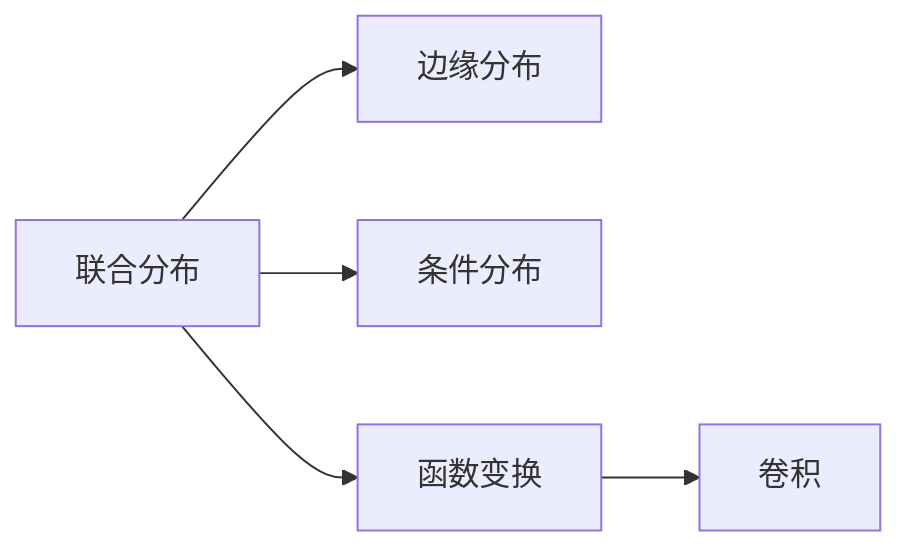

### 8.1 联合分布保存依赖信息

离散型 $p_{ij}=P(X=x_i,Y=y_j)$，所有元素非负且总和为 $1$。边缘分布 $p_X(x_i)=\sum_{j=1}^{\infty}p_{ij}$，$p_Y(y_j)=\sum_{i=1}^{\infty}p_{ij}$。给定两个边缘不能恢复联合分布：它们没有说两个变量如何共同出现。

若 $p_Y(y_j)>0$，$P(X=x_i\mid Y=y_j)=p_{ij}/p_Y(y_j)$。离散随机变量独立当且仅当所有 $p_{ij}=p_X(x_i)p_Y(y_j)$：正向是定义对单点事件的应用；反向把任意取值集合上的联合概率相加，即得乘积。

连续型联合密度 $f_{X,Y}$ 积分为 $1$，边缘为 $f_X(x)=\int_{-\infty}^{\infty}f_{X,Y}(x,y)\,dy$。若 $f_Y(y)>0$，条件密度取 $f_{X\mid Y}(x\mid y)=f_{X,Y}(x,y)/f_Y(y)$。这不是将 $P(Y=y)=0$ 放入条件概率商式，而是密度分解；一般存在性与零密度处的版本问题留给 MA306。二重积分与换序依据列 U3。

### 8.2 和的分布为什么是卷积

对独立整数值变量，事件 $\{X+Y=k\}$ 可按 $X=j$ 划分，所以

$P(X+Y=k)=\sum_{j=-\infty}^{\infty}P(X=j)P(Y=k-j).$

右侧称卷积。不独立时须保留联合概率，不能分成乘积。连续独立变量的和有密度 $f_{X+Y}(z)=\int_{-\infty}^{\infty}f_X(x)f_Y(z-x)\,dx$：从 $P(X+Y\le z)$ 的平面区域积分出发，对 $y$ 积分再对 $z$ 求导，得到该式；要求积分换序、微分的合法条件，见 U3。

**示例**：两个独立 Unif$(0,1)$ 的和，密度在 $0<z<1$ 为 $z$，在 $1\le z<2$ 为 $2-z$，其他处为零。因为积分计算的是区间 $(0,1)\cap(z-1,z)$ 的长度。它不是 Unif$(0,2)$。

### 8.3 二元期望

对于非负或绝对可积函数 $g$，$\mathbb Eg(X,Y)=\sum_{i=1}^{\infty}\sum_{j=1}^{\infty}g(x_i,y_j)p_{ij}$。取 $g=x+y$ 仍得线性性，不需独立；取 $g=xy$，只有联合分解后才通常可拆成两均值相乘。

**G8**：$X,Y$ 独立且各为 Bernoulli$(1/2)$，求 $X+Y$ 分布。

**I8**：给二元表 $p_{00}=p_{11}=3/8,p_{01}=p_{10}=1/8$，求边缘和 $P(X=1\mid Y=1)$，判独立。

**答案（作者自校）**：G8 概率为 $1/4,1/2,1/4$。I8 两边缘都为 Bernoulli$(1/2)$，条件概率 $3/4$，不独立。

**回看**：边缘是压缩，联合才包含耦合关系；卷积需要独立。📋 **升级坐标**：联合分布是乘积空间上的测度，独立对应乘积测度。

## 第 9 讲　协方差、相关与条件期望

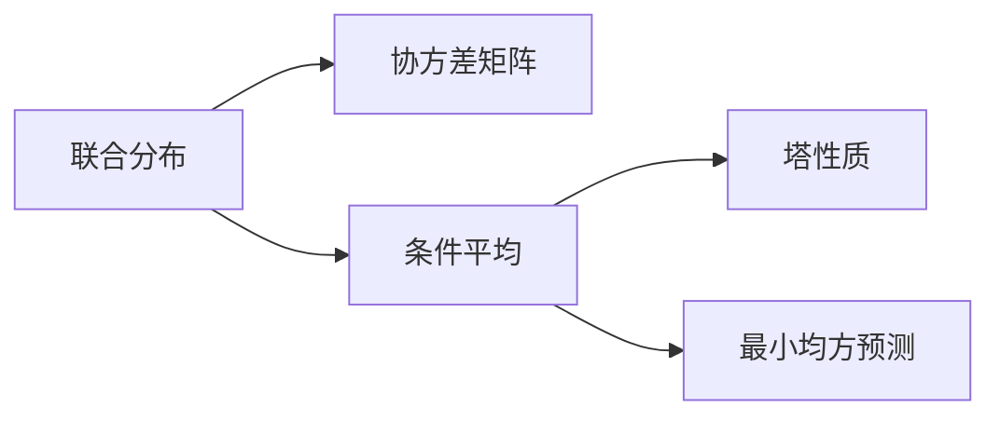

### 9.1 相关是二阶摘要

有限二阶矩下，$\operatorname{Cov}(X,Y)=\mathbb E[(X-\mathbb EX)(Y-\mathbb EY)]=\mathbb E(XY)-\mathbb EX\mathbb EY$。方差展开给

$\operatorname{Var}(X+Y)=\operatorname{Var}X+\operatorname{Var}Y+2\operatorname{Cov}(X,Y).$

两方差均正时，相关系数 $\rho=\operatorname{Cov}(X,Y)/(\sqrt{\operatorname{Var}X}\sqrt{\operatorname{Var}Y})$。由 $\mathbb E(U-tW)^2\ge0$ 对所有实数 $t$ 成立，判别式不正，得到 $(\mathbb EUW)^2\le\mathbb EU^2\mathbb EW^2$，所以 $|\rho|\le1$。零方差时不能继续使用这个商定义。

独立推出不相关，反之不然。例：$X$ 在 $-1,0,1$ 上均匀，$Y=X^2$。$\mathbb EX=\mathbb EX^3=0$，故协方差零；但 $Y$ 由 $X$ 完全确定，且 $P(Y=0\mid X=0)=1\ne1/3$。

### 9.2 协方差矩阵与高代接口

对列随机向量 $Z=(Z_1,\ldots,Z_d)^{\mathsf T}$，定义 $\Sigma_{ij}=\operatorname{Cov}(Z_i,Z_j)$。它对称，且对任意确定列向量 $a$，

$a^{\mathsf T}\Sigma a=\operatorname{Var}\left(\sum_{i=1}^{d}a_iZ_i\right)\ge0.$

因此半正定。若存在非零 $a$ 使相应线性组合恒定，则 $\Sigma$ 可能奇异；对称半正定并不保证正定。这里直接通过二次型定义证明，无需超前调用 PCA。线性变换 $W=BZ+c$ 给 $\Sigma_W=B\Sigma_ZB^{\mathsf T}$，逐元素用协方差双线性性可得。

### 9.3 条件期望本身是随机变量

离散 $Y$ 的正概率取值 $y$ 上，令 $g(y)=\sum_{i=1}^{\infty}x_iP(X=x_i\mid Y=y)$，并定义 $\mathbb E[X\mid Y]=g(Y)$。零概率取值上的定义可任意指定，不影响几乎处处意义的结论。对一般、非离散的 $X$ 而离散 $Y$，同样用 $g(y)=\mathbb E[X\mathbf1_{\{Y=y\}}]/P(Y=y)$ 定义；连续 $Y$ 的密度型条件平均需相应条件密度及 U3，其一般信息域版本留给 MA306。可积性由 $|g(Y)|\le\mathbb E[|X|\mid Y]$ 的逐点求和界保证。

**塔性质的基本形式**：$\mathbb E[\mathbb E(X\mid Y)]=\mathbb EX$。证明为

$\sum_{j=1}^{\infty}p_Y(y_j)\sum_{i=1}^{\infty}x_i\frac{p_{ij}}{p_Y(y_j)}=\sum_{j=1}^{\infty}\sum_{i=1}^{\infty}x_ip_{ij}=\mathbb EX,$

其中只对正概率 $y_j$ 求和，绝对可积确保换序。进一步若 $Z=h(Y)$，按同一 $Z$ 值归并各 $Y$ 组，得 $\mathbb E[\mathbb E(X\mid Y)\mid Z]=\mathbb E(X\mid Z)$。一般不嵌套的信息不能随意互换条件次序。

### 9.4 条件平均是最优预测

设 $X$ 二阶可积，$m(Y)=\mathbb E[X\mid Y]$。对任何二阶可积 $h(Y)$，条件求和给 $\mathbb E[(X-m(Y))h(Y)]=0$。展开平方得到

$\mathbb E(X-h(Y))^2=\mathbb E(X-m(Y))^2+\mathbb E(m(Y)-h(Y))^2.$

交叉项为零，所以条件平均最小化均方误差，且最优者几乎处处唯一。与第四课《内积空间》§4.3 定义 2（正交投影）及 §5.1 定理 1（最近点定理）呼应；上述均方分解已经就地证明，不默认可将有限维结论直接用于无限维。有限支持时，这就是内积 $\langle U,W\rangle=\mathbb E(UW)$ 下向“只依赖 $Y$ 的变量空间”的正交投影；零概率上的变量需识别为同一个元素才真是内积。一般 $L^2$ 理论在 MA306／泛函分析展开。

**示例**：使用讲 8 的二元表，$m(0)=1/4,m(1)=3/4$。塔性质给平均 $1/2$；预测值随观察到的 $Y$ 改变，而非一个常数。

**G9**：用该表求 $\operatorname{Cov}(X,Y)$ 与 $\rho$。

**I9**：从 $X-\mathbb EX=(X-m(Y))+(m(Y)-\mathbb EX)$ 推出全方差公式。

**答案（作者自校）**：G9 协方差 $3/8-1/4=1/8$，相关系数 $1/2$。I9 利用交叉项正交得 $\operatorname{Var}X=\mathbb E[\operatorname{Var}(X\mid Y)]+\operatorname{Var}(\mathbb E[X\mid Y])$。

**回看**：条件期望把数据压缩成最优平方损失预测；不等于完整条件分布。📋 **升级坐标**：一般条件期望按信息 $\sigma$-代数定义；PCA、贝叶斯预测与 Fisher 信息分别进入相应后续课程，不在此暗中完成。

# 第三部分：母函数与极限定理

## 第 10 讲　母函数、随机和与特征函数

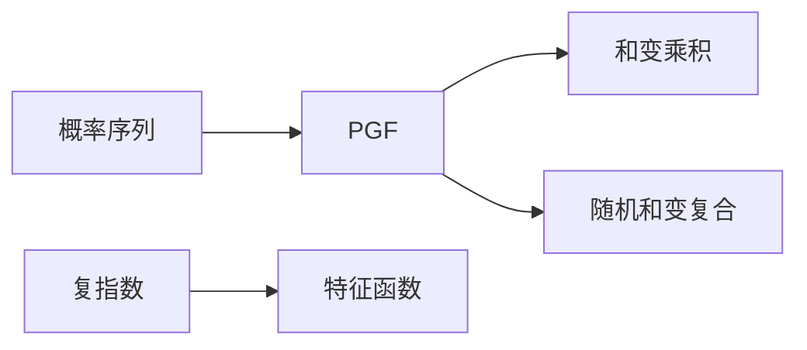

### 10.1 概率生成函数

对非负整数值 $X$，定义 **PGF** $G_X(s)=\mathbb Es^X=\sum_{k=0}^{\infty}P(X=k)s^k$，至少在 $|s|\le1$ 有意义，$s=0$ 时约定 $0^0=1$。它把整个概率序列编码为幂级数，系数唯一性使 PGF 决定分布。

有限期望时 $G_X'(1-)=\mathbb EX$；有限二阶矩时 $G_X''(1-)=\mathbb E[X(X-1)]$，故 $\operatorname{Var}X=G_X''(1-)+G_X'(1-)-G_X'(1-)^2$。在 $|s|<1$ 内逐项求导合法，趋于 $1$ 用非负项极限；无限矩时相应左导数允许无穷，不得硬当有限数。

Bernoulli 的 PGF 为 $1-p+ps$；二项为 $(1-p+ps)^n$；Poisson 为 $e^{\lambda(s-1)}$；几何（支持 $1,2,\ldots$）为 $ps/[1-(1-p)s]$。

### 10.2 独立和与随机和

独立非负整数值 $X,Y$ 满足 $G_{X+Y}=G_XG_Y$，证明是 $s^{X+Y}=s^Xs^Y$ 再用独立性。于是独立 Poisson$(\lambda),$ Poisson$(\mu)$ 的和是 Poisson$(\lambda+\mu)$。

设 $N$ 非负整数值，$X_i$ 独立同分布且整个序列独立于 $N$，$S=\sum_{i=1}^{N}X_i$，$N=0$ 时取零。给定 $N=n$，PGF 为 $G_X(s)^n$，所以 $G_S(s)=G_N(G_X(s))$。如各变量二阶矩有限且 $N$ 二阶矩有限，则由塔性质及全方差公式得

$\mathbb ES=\mathbb EN\,\mathbb EX_1,$

$\operatorname{Var}S=\mathbb EN\operatorname{Var}X_1+\operatorname{Var}N(\mathbb EX_1)^2.$

这不能直接推广到由 $X_i$ 决定的停时，因为 $N$ 与样本独立的条件已失效。

### 10.3 MGF 与特征函数

MGF 为 $M_X(t)=\mathbb Ee^{tX}$，可因尾部太重而在任何非零邻域都不存在。**特征函数** $\varphi_X(t)=\mathbb Ee^{itX}$ 总存在，因为被积函数模为 $1$；实部、虚部分别取期望。独立和仍对应乘积。

Bernoulli 特征函数为 $1-p+pe^{it}$；Poisson 为 $\exp(\lambda(e^{it}-1))$。标准正态为 $e^{-t^2/2}$：在高斯密度下可求导并分部积分，得到 $\varphi'(t)=-t\varphi(t)$，配合 $\varphi(0)=1$ 解出；求导移入积分由可积的 $|x|\varphi(x)$ 控制，属于 U3 的分析依据。

**示例**：若 $N\sim\operatorname{Pois}(\lambda)$，每个事件独立以概率 $p$ 保留，保留数 PGF 是 $e^{\lambda((1-p+ps)-1)}=e^{\lambda p(s-1)}$，所以为 Poisson$(\lambda p)$。

**G10**：$N\sim\operatorname{Pois}(2)$，每项 $X_i\equiv3$，求 $G_S$、均值和方差。

**I10**：独立 $X\sim\operatorname{Bin}(m,p),Y\sim\operatorname{Bin}(n,p)$ 的和是什么分布？成功率不同还成立吗？

**答案（作者自校）**：G10 为 $e^{2(s^3-1)}$，均值 $6$、方差 $18$。I10 同成功率时为 Bin$(m+n,p)$；不同成功率一般不是二项，其 PGF 是两种线性因子的乘积。

**回看**：母函数是把卷积换成乘法的工具，但存在域与求导条件不能省略。📋 **升级坐标**：特征函数唯一性及 Lévy 连续性定理在 MA306；本课不通过未证的收敛定理推导 CLT。

## 第 11 讲　大数定律与 Borel–Cantelli

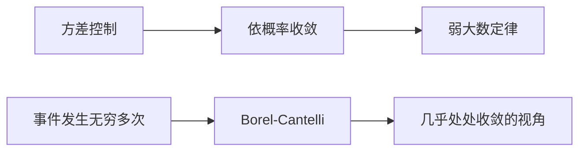

### 11.1 两种收敛问的是不同问题

$X_n\xrightarrow{P}X$ 指每个 $\varepsilon>0$ 都有 $P(|X_n-X|>\varepsilon)\to0$。$X_n\to X$ **几乎处处**（a.s.）指满足逐样本点收敛的结果集合概率为 $1$。

a.s. 收敛推出依概率收敛：固定 $\varepsilon$，尾事件 $B_m=\bigcup_{n=m}^{\infty}\{|X_n-X|>\varepsilon\}$ 递减，其交概率为零，因此 $P(B_m)\to0$；对 $n\ge m$ 的偏离概率不超过 $P(B_m)$。

### 11.2 弱大数定律的 Chebyshev 证明

**定理 11.1**：独立同分布 $X_i$，均值 $\mu$、有限方差 $\sigma^2$，则 $\bar X_n=n^{-1}\sum_{i=1}^{n}X_i\xrightarrow{P}\mu$。

证明：线性性给均值 $\mu$，独立性给方差 $\sigma^2/n$。因此 $P(|\bar X_n-\mu|\ge\varepsilon)\le\sigma^2/(n\varepsilon^2)\to0$。实际上两两不相关、同均值且方差一致有界也足够；本证明并没有用到更强的联合独立。

这不说有限样本平均必接近均值，也不说个别观测的波动消失。若所有 $X_i$ 都等于同一个非退化 Bernoulli 变量 $B$，则 $\bar X_n=B$ 永不集中，说明依赖条件重要。

### 11.3 Borel–Cantelli 两部分

记 $\limsup A_n=\bigcap_{m=1}^{\infty}\bigcup_{n=m}^{\infty}A_n$，即“发生无穷多次”。

**引理 11.2（第一部分）**：若 $\sum_{n=1}^{\infty}P(A_n)<\infty$，则 $P(\limsup A_n)=0$。证明：尾并事件概率不超过级数尾和，尾和趋零，再用递减连续性。不要求独立。

**引理 11.3（第二部分，独立版本）**：若 $A_n$ 相互独立，且 $\sum_{n=1}^{\infty}P(A_n)=\infty$，则 $P(\limsup A_n)=1$。

证明：固定 $m$，$P(\bigcap_{n=m}^{N}A_n^c)=\prod_{n=m}^{N}(1-P(A_n))\le\exp(-\sum_{n=m}^{N}P(A_n))\to0$。因此从某个 $m$ 起永不发生的事件概率为零；对所有正整数 $m$ 作可数并仍为零，其补集就是发生无穷多次。

**区别示例**：若独立 $B_n$ 的成功率为 $1/n$（从 $n=2$ 起），则 $B_n\xrightarrow{P}0$，但由第二部分成功发生无穷多次，故不 a.s. 收敛到零。该例用给定无限独立序列模型；构造问题见 U4。

### 11.4 强大数定律只陈述

**陈述（证明后置 MA306）**：若 $X_i$ 独立同分布且 $\mathbb E|X_1|<\infty$，则 $\bar X_n\to\mathbb EX_1$ a.s.。它比本讲有限方差弱大数定律的结论强、矩条件弱，不能声称已经由上面的 Chebyshev 一行证明得到。

**G11**：若 $\operatorname{Var}X_1=4$，希望平均误差至少 $0.1$ 的概率不超过 $0.05$，Chebyshev 给多少样本的充分条件？

**I11**：若 $P(A_n)=1/n^2$，是否能在没有独立性的情况下断定只发生有限多次？

**答案（作者自校）**：G11 为 $n\ge8000$。I11 可以，由第一部分；其结论允许任意有限次数，不表示一次也不发生。

**回看**：弱大数定律控制每个时刻的偏离概率；几乎处处结论控制整条无限路径。📋 **升级坐标**：强大数定律的截断、最大不等式及一般依赖序列在 MA306／随机过程继续。

## 第 12 讲　中心极限定理与二项正态近似

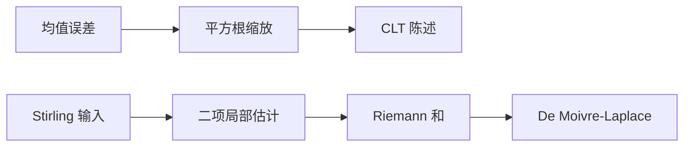

### 12.1 大数定律以后，还想知道什么

大数定律说平均误差趋零；CLT 描述误差乘 $\sqrt n$ 后的形状。**一般 i.i.d. CLT（本讲陈述，完整证明后置 MA306）**：若均值 $\mu$、方差 $0<\sigma^2<\infty$，则

$P\left(\frac{\sum_{i=1}^{n}X_i-n\mu}{\sigma\sqrt n}\le x\right)\to\Phi(x),\qquad x\in\mathbb R.$

这称分布收敛。它不是随机变量逐样本点接近某个固定正态变量，也不保证密度逐点收敛（离散变量甚至没有密度）。

### 12.2 De Moivre–Laplace：给出特殊情形的证明

**定理 12.1**：固定 $0<p<1$，令 $q=1-p$、$S_n\sim\operatorname{Bin}(n,p)$，则 $Z_n=(S_n-np)/\sqrt{npq}$ 的分布函数趋于 $\Phi$。

**本证明的外部输入 U1**：Stirling 公式 $n!=\sqrt{2\pi n}(n/e)^n(1+O(1/n))$；这是需由数分补证的工具，本讲不冒称证明了它。还需 Taylor 定理、Riemann 和收敛及 U2 高斯归一化。以下给出这些前提下完整的概率推导。

**第一步：局部概率估计。** 固定有限 $M$，只考虑 $z_k=(k-np)/\sqrt{npq}$ 满足 $|z_k|\le M$ 的整数 $k$。此时 $u=k/n=p+O(n^{-1/2})$，$k,n-k$ 均与 $n$ 同阶。对 $n!,k!,(n-k)!$ 用 Stirling 并约去因子，得到一致估计

$P(S_n=k)=\frac{1+O(1/n)}{\sqrt{2\pi n u(1-u)}}\exp\{-nD(u\Vert p)\},$

其中 $D(u\Vert p)=u\log(u/p)+(1-u)\log((1-u)/q)$，这里用自然对数，仅把它作为一个显式函数，不依赖信息论定理。

**第二步：展开指数。** 直接求导可得 $D(p\Vert p)=D'(p\Vert p)=0$、$D''(p\Vert p)=1/(pq)$；在 $p$ 附近一个不碰端点的闭区间上三阶导数有界。Taylor 余项因此一致满足

$nD(u\Vert p)=\frac{n(u-p)^2}{2pq}+O(n|u-p|^3)=z_k^2/2+O(n^{-1/2}).$

同时 $u(1-u)=pq+O(n^{-1/2})$。于是对该有界 $z_k$ 区间一致有

$P(S_n=k)=\frac{1}{\sqrt{npq}}\varphi(z_k)(1+o(1)).$

**第三步：把概率和变为积分。** 令格距 $\Delta_n=1/\sqrt{npq}$。对有限区间 $[a,b]$，令 $k_- =\lceil np+a\sqrt{npq}\rceil$、$k_+=\lfloor np+b\sqrt{npq}\rfloor$，则

$P(a\le Z_n\le b)=\sum_{k=k_-}^{k_+}\Delta_n\varphi(z_k)(1+o(1))\to\int_a^b\varphi(t)\,dt.$

一致误差可从有限和中统一界住，主和是连续函数的 Riemann 和。边界取整只移动至多一个网格，贡献趋零。

**第四步：从有限区间到分布函数。** 因 $\mathbb EZ_n=0,\operatorname{Var}Z_n=1$，Chebyshev 给 $P(Z_n<-M)\le1/M^2$。固定 $x$，先对 $[-M,x]$ 用第三步，再令 $M\to\infty$，高斯左尾积分趋零。因此 $P(Z_n\le x)\to\Phi(x)$。证毕。该证明不用 Lévy 连续性定理，也未将一般 CLT 作为前提。

### 12.3 实际近似和边界

对整数阈值 $k$，常用连续性校正 $P(S_n\le k)\approx\Phi((k+1/2-np)/\sqrt{npq})$。这是有限样本近似，不是上界或恒等式。$p$ 很接近端点、关注极远尾部时，要比较精确二项概率或 Poisson 近似；“$n$ 大”不是单一万能条件。

**示例**：$S\sim\operatorname{Bin}(100,1/2)$，$P(45\le S\le55)$ 的校正近似为 $\Phi(1.1)-\Phi(-1.1)$。本轮不查表、不计算数值误差。

**G12**：$X_i$ 均值 $2$、方差 $9$，写出 $n$ 个观测平均的标准化变量。

**I12**：若把 CLT 分母误写成 $n\sigma$，在有限方差独立同分布条件下极限是什么？

**答案（作者自校）**：G12 为 $\sqrt n(\bar X_n-2)/3$。I12 变为 $(\bar X_n-\mu)/\sigma$，依概率趋于 $0$，对应退化分布，不是标准正态。

**回看**：尺度 $\sqrt n$ 来自方差相加；正态形状在二项情形来自指数的二阶展开。📋 **升级坐标**：一般 CLT、Lindeberg 条件、特征函数收敛与误差估计在 MA306，当前证明范围不得扩大。
# 第四部分：随机过程的初步模型

## 第 13 讲　随机游走与首达时间

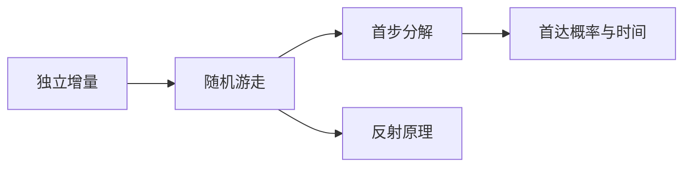

### 13.1 从随机变量升级到随机序列

令 $\xi_i$ 独立同分布，取 $+1$ 的概率 $p$、取 $-1$ 的概率 $q=1-p$，$0<p<1$。从整数 $i$ 出发，$S_n=i+\sum_{j=1}^{n}\xi_j$，$S_0=i$，称简单随机游走。均值为 $i+n(p-q)$，方差为 $4npq$。

对目标集合 $A$，**首达时间** $\tau_A=\inf\{n\ge0:S_n\in A\}$，若永不达到则取 $+\infty$。它是路径的函数，不是一个预先固定的样本数量；因此不能未经论证把固定时刻结论中的 $n$ 换成 $\tau_A$。

### 13.2 赌徒破产：边界条件决定答案

在整数区间 $\{0,1,\ldots,N\}$ 内，$h_i$ 表示从 $i$ 出发先到 $N$ 而非 $0$ 的概率。第一步后未来增量仍有同一独立分布，故

$h_i=ph_{i+1}+qh_{i-1},\quad 1\le i\le N-1;\qquad h_0=0,h_N=1.$

若 $p=q=1/2$，差分 $h_{i+1}-h_i=h_i-h_{i-1}$ 恒定，边界给 $h_i=i/N$。若 $p\ne q$，令 $r=q/p$，差分满足 $h_{i+1}-h_i=r(h_i-h_{i-1})$，几何求和给

$h_i=\frac{1-r^i}{1-r^N}.$

为什么方程没有额外虚假解？两解之差边界为零，若内部取得正最大值，凸组合方程迫使邻点也取该最大值，递推到边界矛盾；负最小值同理，所以唯一。吸收以概率一发生：每个长为 $N$ 的时间块，从任意内部位置连续向同一方向走至边界的概率至少为 $\min(p,q)^N>0$，未吸收概率有几何上界。

对公平游走，$e_i=\mathbb E_i\tau_{\{0,N\}}$ 有限（上述几何尾界保证）。首步分解得 $e_i=1+(e_{i-1}+e_{i+1})/2$，边界为零。代入二次函数得 $e_i=i(N-i)$，唯一性同上。

### 13.3 反射原理初步

公平游走从零出发，令 $M_n=\max_{0\le j\le n}S_j$。对正整数 $a$ 和整数 $b<a$，满足可达的奇偶条件时，

$P(M_n\ge a,S_n=b)=P(S_n=2a-b).$

**路径双射证明**：把左侧每条路径首次到达 $a$ 之后的每一步反号，终点从 $b$ 变为 $2a-b$。反向从终点高于 $a$ 的路径寻找首次到达 $a$，再反射恢复原路径。每条长为 $n$ 的公平路径概率均为 $2^{-n}$，故双射保持概率。偏置游走中不同路径权重会变，不能原样使用该等式。

### 13.4 常返不等于平均返回时间有限

公平游走从 $1$ 出发，在到 $0$ 前先到 $N$ 的概率为 $1/N$。有限区间必吸收，因此 $P_1(\tau_0<\infty)\ge1-1/N$ 对所有 $N$ 成立，令 $N\to\infty$ 得概率为 $1$。从零先走一步后同理会返回零，这叫常返。

但 $\mathbb E_1\tau_0\ge\mathbb E_1\tau_{\{0,N\}}=N-1$ 对任意 $N$ 成立，所以期望为无穷。**几乎必然发生并不意味着平均等待有限。** 高维常返／暂留分类只作后续坐标，本课不在未证明时列全套结论。

**示例**：公平游走在 $0,5$ 吸收，从 $2$ 出发先到 $5$ 的概率 $2/5$，平均吸收时间 $6$。

**G13**：将该例起点改为 $4$，求两项量。

**I13**：说明为什么首达时刻取值依赖增量，不能直接用讲 10 的独立随机和均值公式。

**答案（作者自校）**：G13 概率 $4/5$、平均时间 $4$。I13 停止时刻正由已观察步子是否到达边界决定，不独立于步子；本讲使用首步递推而非偷用独立随机和公式。

**回看**：首步分析把路径问题化成带边界的差分方程。📋 **升级坐标**：有限 Markov 链归 MA303；鞅和可选停止在 MA306，不在这里作为隐含工具。

## 第 14 讲　Poisson 过程：从格点计数到随机到达

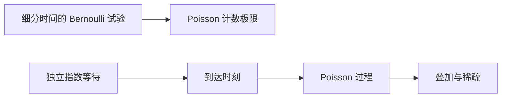

### 14.1 先有离散时间模型

把长度为 $t$ 的窗口分为 $m$ 段，各段独立以概率 $\lambda t/m$ 产生一次事件，计数为 Bin$(m,\lambda t/m)$；讲 4 给固定窗口计数趋于 Pois$(\lambda t)$。这建立模型动机，**单个窗口的分布极限本身不是整个连续时间过程存在性的证明**。

**Poisson 过程** $N(t)$（速率 $\lambda>0$）是从零开始、计数路径右连续的随机过程，具有独立增量，且 $N(t)-N(s)\sim\operatorname{Pois}(\lambda(t-s))$，$0\le s<t$。独立增量是指互不重叠时间区间中的增量相互独立；分布只依赖区间长度称平稳增量。

### 14.2 从指数等待给出构造路线

给定独立同分布 $E_i\sim\operatorname{Exp}(\lambda)$，令 $T_n=\sum_{i=1}^{n}E_i$，$N(t)=\#\{n\ge1:T_n\le t\}$。无限独立序列的存在作为 U4 输入。

先说明有限时刻不会有无穷多次到达：固定 $c>0$，$P(E_i\ge c)=e^{-\lambda c}>0$，由讲 11 的独立 Borel–Cantelli，几乎处处有无穷多个 $E_i\ge c$，故 $T_n\to\infty$。对可数个等待为零的事件取并仍为零，因此几乎处处所有等待均正，且到达时刻严格递增。取这与非爆炸结论共同成立的满概率事件定义计数；在其补集上可将整条路径指定为零，以得到处处定义的版本，不改变任何有限维分布。

再验证计数与增量。给定 $0<t_1<\cdots<t_r=T$，令区间长度 $\ell_j=t_j-t_{j-1}$、$t_0=0$，各段要求 $k_j$ 次到达，总数 $k=\sum_{j=1}^{r}k_j$。前 $k$ 个有序到达时刻 $0<s_1<\cdots<s_k<T$ 的联合密度乘上之后直到 $T$ 没有新到达的概率，为

$\lambda^k e^{-\lambda s_k}e^{-\lambda(T-s_k)}=\lambda^ke^{-\lambda T}.$

这里从等待时间到累加时间的三角换元 Jacobian 为 $1$；多元积分基础见 U3。每段内 $k_j$ 个有序位置的区域体积为 $\ell_j^{k_j}/k_j!$，因为立方体除去重合坐标的零体积部分后由 $k_j!$ 个等体积顺序区组成。积分得到

$P\bigl(N(t_j)-N(t_{j-1})=k_j,\ 1\le j\le r\bigr)=\prod_{j=1}^{r}e^{-\lambda\ell_j}\frac{(\lambda\ell_j)^{k_j}}{k_j!}.$

因此增量相互独立，且每个增量为指定 Poisson 分布，构造符合定义。$k=0$ 时式子直接由 $P(E_1>T)=e^{-\lambda T}$ 得到。

### 14.3 等待、叠加与稀疏

$P(T_1>t)=P(N(t)=0)=e^{-\lambda t}$，第一等待为指数分布。构造中后续等待独立同分布；从任意确定时刻向后等待也为指数，由独立平稳增量给出。

两个相互独立、速率为 $\lambda,\mu$ 的 Poisson 过程之和，增量仍独立，且 Poisson 和的 PGF 给速率 $\lambda+\mu$，称**叠加**。

对每次到达独立标记为红的概率 $p$、蓝的概率 $1-p$，标记独立于原过程。在长为 $t$ 的窗口中，红蓝计数 $R,B$ 的联合 PGF 为

$\mathbb E(s^Ru^B)=\exp\{\lambda t(ps+(1-p)u-1)\}=e^{\lambda pt(s-1)}e^{\lambda(1-p)t(u-1)}.$

幂级数系数分解表明两个计数独立，分别为 Pois$(\lambda pt)$ 和 Pois$(\lambda(1-p)t)$。跨不交窗口再用原增量与标记的独立性，得到两个独立 Poisson 过程。只知道每个计数边缘为 Poisson 还不足以推出它们独立。

**示例**：速率 $2$ 每秒的模型，两秒内无事件的概率 $e^{-4}$；若每次事件以 $1/4$ 概率保留，则保留过程速率为 $1/2$ 每秒。

**G14**：速率 $3$ 每秒，第一次到达在两秒之后的概率、平均等待各多少？

**I14**：总计数 $N\sim\operatorname{Pois}(\lambda)$，独立稀疏后保留数和丢弃数独立；但给定 $N=n$ 后是否仍独立？解释。

**答案（作者自校）**：G14 为 $e^{-6}$ 与 $1/3$ 秒。I14 一般不独立，因为两者之和固定为 $n$；当 $n>0$ 且 $0<p<1$ 时，一个变大必使另一个变小。无条件与条件独立是不同命题。

**回看**：计数与等待是同一个过程的两个视角。📋 **升级坐标**：非齐次强度、更新过程、条件强度和点过程见 MA303；真实神经数据是否满足独立增量要另行检验。

## 第 15 讲　分支过程：平均增长与灭绝

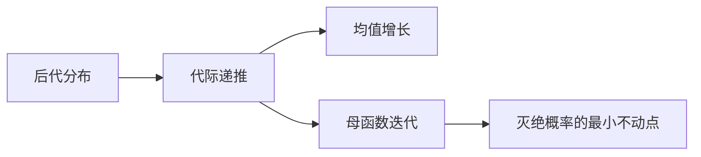

### 15.1 Galton–Watson 模型

从一个个体 $Z_0=1$ 开始，每个个体独立产生非负整数个后代，所有个体各代的后代数同分布为 $K$。$Z_n$ 表示第 $n$ 代数量，$0$ 为吸收状态。给定 $Z_n=z$，$Z_{n+1}$ 是 $z$ 个独立 $K$ 的和；这些新后代数独立于此前历史。

记 $m=\mathbb EK<\infty$。由条件期望，$\mathbb E[Z_{n+1}\mid Z_n]=mZ_n$，所以 $\mathbb EZ_n=m^n$。**平均数量增长并不保证每条家系存活**，平均可能由少数巨大存活家系支撑。

### 15.2 灭绝概率是哪个不动点

令后代 PGF 为 $f(s)=\mathbb Es^K$，第 $n$ 代 PGF 为 $G_n$。按每个第一代个体的独立子家系分解，$G_{n+1}(s)=f(G_n(s))$，$G_0(s)=s$，即 $n$ 次复合。也可由条件于 $Z_n$ 得 $G_{n+1}=G_n\circ f$，在迭代情形二者一致。

记 $q_n=P(Z_n=0)$，则 $q_0=0,q_{n+1}=f(q_n)$。灭绝事件为递增事件 $\{Z_n=0\}$ 的并，所以灭绝概率 $q=\lim q_n$。$f$ 在 $[0,1]$ 连续（非负系数总和为 $1$），取极限得 $q=f(q)$。

若 $r\in[0,1]$ 也满足 $f(r)=r$，由 $q_0\le r$ 及 $f$ 单调，归纳得所有 $q_n\le r$，所以 $q\le r$。因此 $q$ 是 **$[0,1]$ 中最小不动点**，不能仅解方程后随意选根。

### 15.3 临界划分及例外

$f$ 凸，$f(1)=1$、$f'(1-)=m$。若 $P(K=1)=1$，则每代永远一人，$q=0$，这是临界的退化例外。

除此之外，若 $m\le1$，有 $f(s)>s$ 对 $0\le s<1$ 成立，故唯一不动点为 $1$。说明：若有 $K\ge2$ 的正概率，凸性严格，曲线在 $1$ 的切线 $1+m(s-1)$ 之上，而该切线在 $m\le1,s<1$ 时不低于 $s$；若仅有 $0,1$ 后代，则非退化条件意味着 $P(K=0)>0$，直接算 $f(s)-s=P(K=0)(1-s)>0$。

若 $m>1$，$s$ 从左趋近 $1$ 时 $f(s)-s<0$。若 $f(0)>0$，连续性给一个小于 $1$ 的根；若 $f(0)=0$，零本身为根。所以 $q<1$。这说明超临界有正存活概率，不能推出必存活。

**示例**：$P(K=0)=1/4,P(K=2)=3/4$，$f(s)=1/4+3s^2/4$，均值 $3/2$。方程 $f(s)=s$ 的根为 $1/3,1$，灭绝概率取 $1/3$。

**G15**：把上例两个概率改为 $1/2,1/2$，求均值和灭绝概率。

**I15**：$K\equiv2$ 时均值大于一，灭绝概率多少？这与“超临界可能灭绝”矛盾吗？

**答案（作者自校）**：G15 均值 $1$，方程 $(s-1)^2=0$，灭绝概率 $1$。I15 为 $0$；“可能灭绝”不是所有超临界分布都必须有正灭绝概率，缺少零后代的模型不会灭绝。

**回看**：均值决定临界位置，完整后代分布决定具体灭绝概率。📋 **升级坐标**：归一化种群的鞅、随机环境分支过程留给后续；类比神经级联时必须另加建模假设。

## 第 16 讲　次序统计量与极值

### 16.1 排序后的变量一般不再独立

对 $X_1,\ldots,X_n$ 排序得 $X_{(1)}\le\cdots\le X_{(n)}$，称**次序统计量**。下面假设样本独立同分布，分布函数为 $F$；求密度时额外假设有密度 $f$。

$P(X_{(n)}\le x)=F(x)^n$，因为全部样本都不大于 $x$；$P(X_{(1)}>x)=(1-F(x))^n$。这两式不要求密度。最大值与最小值明显受同一批样本限制，不能假定独立。

一般 $X_{(k)}\le x$ 当且仅当至少 $k$ 个样本不大于 $x$，阈值指示变量的和是 Bin$(n,F(x))$，所以

$P(X_{(k)}\le x)=\sum_{j=k}^{n}\binom njF(x)^j(1-F(x))^{n-j}.$

### 16.2 密度公式从计数得到

在 $F$ 可微且 $F'=f$ 的点对上式求导（对一般密度版本公式按几乎处处理解）。使用 $j\binom nj=n\binom{n-1}{j-1}$ 和 $(n-j)\binom nj=n\binom{n-1}{j}$，相邻项相消，只剩边界项，得到

$f_{X_{(k)}}(x)=\frac{n!}{(k-1)!(n-k)!}F(x)^{k-1}(1-F(x))^{n-k}f(x).$

直觉是选一个样本落在 $x$ 附近，其余中 $k-1$ 个在左、$n-k$ 个在右；上面的求导提供了无需操纵“无穷小概率”的论证。

若原样本 Unif$(0,1)$，密度为常数乘 $x^{k-1}(1-x)^{n-k}$，称 Beta$(k,n+1-k)$ 分布。为计算均值，可由分部积分递推

$\int_0^1x^a(1-x)^b\,dx=\frac{a!b!}{(a+b+1)!},\qquad a,b\text{ 为非负整数},$

得到 $\mathbb EX_{(k)}=k/(n+1)$。该积分从 $b=0$ 的直接积分起，对 $b$ 分部积分即可证明。

### 16.3 一个可证明的极值极限

对独立 Unif$(0,1)$ 样本，令 $M_n=X_{(n)}$。固定 $t\ge0$ 且 $n>t$，

$P(n(1-M_n)>t)=P(M_n<1-t/n)=(1-t/n)^n\to e^{-t}.$

因此 $n(1-M_n)$ 分布趋于 Exp$(1)$。最大值接近上端点的自然尺度是 $1/n$，不同于均值的 $1/\sqrt n$。**一般极值三类型定理不在本讲证明**，这里只得到均匀模型的具体极限。

**示例**：两个独立 Unif$(0,1)$ 的最大值密度为 $2x$，均值 $2/3$；最小值均值 $1/3$。

**G16**：$n$ 个独立 Exp$(\lambda)$ 的最小值是什么分布？

**I16**：三个独立 Unif$(0,1)$ 的中位数密度与均值是什么？

**答案（作者自校）**：G16 生存函数 $e^{-n\lambda t}$，故 Exp$(n\lambda)$。I16 密度 $6x(1-x)$，均值 $1/2$。

**回看**：先把排序事件改写成计数事件，再调用二项分布。📋 **升级坐标**：样本分位数、稳健统计进入 MA305；一般极值理论进入后续概率课程。

# 第五部分：计算、应用与收口

## 第 17 讲　随机模拟与 Monte Carlo

### 17.1 模拟的作用与限制

模拟可以发现公式、实现或假设的错误，可以观察有限样本行为，**不能以有限次运行证明一个普遍定理**。本讲给出算法的数学理由、实验设计与 C 项目接口。2026-10-13 自校以精确枚举和确定性积分复核例题；学生 C 项目的模拟与验收尚未执行。

设 $U\sim\operatorname{Unif}(0,1)$。对任意分布函数 $F$，定义广义逆 $F^{-1}(u)=\inf\{x:F(x)\ge u\}$，$0<u<1$。取 $X=F^{-1}(U)$，则 $X\le x$ 等价于 $U\le F(x)$，故 $P(X\le x)=F(x)$。这一等价利用 $F$ 单调、右连续及两端极限；右连续保证下确界端点不造成漏项。这称**逆变换法**。

连续严格递增时就是普通反函数。例如指数样本可取 $X=-\log U/\lambda$；离散分布则将 $(0,1)$ 按累积概率划成区间，用 $U$ 落在哪段决定结果。

### 17.2 接受—拒绝法的正确性

目标密度 $f$，易抽样提议密度 $g$，假设已知有限常数 $M$ 使 $f(x)\le Mg(x)$，且目标正密度处 $g>0$。独立抽 $Y\sim g,U\sim\operatorname{Unif}(0,1)$，当 $U\le f(Y)/(Mg(Y))$ 时接受，否则重试。

对集合 $A$，被接受且 $Y\in A$ 的概率为 $\int_Ag(y)f(y)/(Mg(y))\,dy=(1/M)\int_Af(y)\,dy$。整体接受概率为 $1/M$，条件归一化得到接受样本密度恰为 $f$。独立重试给平均尝试次数 $M$。包络不成立时算法会有偏，不能把超过 $1$ 的接受概率随便截断来修补。

**示例**：目标 $f(x)=2x$，$0<x<1$，提议均匀密度 $g=1$，可取 $M=2$，接受条件 $U\le Y$；接受率为 $1/2$。同一目标也可逆变换取 $X=\sqrt U$。

### 17.3 Monte Carlo 的估计量与误差

目标 $\theta=\mathbb Eh(X)$。独立同分布样本下，$\widehat\theta_n=n^{-1}\sum_{i=1}^{n}h(X_i)$ 无偏；若 $\operatorname{Var}h(X)=v<\infty$，方差为 $v/n$，标准差为 $\sqrt{v/n}$。误差缩小十倍通常需要约百倍样本。

若 $h$ 是指示变量，估计的是事件概率。一般 CLT 可作为已标后置证明的陈述给大样本误差近似；要求有限方差且样本独立。样本方差替代未知 $v$ 所涉及的统计推断进入 MA305；本课不把近似区间宣称为有限样本精确保证。有界 $h$ 时可直接用讲 7 Hoeffding 给非渐近概率界。

**重要性抽样**：对密度 $f$ 下的期望，选择提议 $g$，满足在 $h(x)f(x)\ne0$ 的区域 $g(x)>0$，则

$\theta=\mathbb E_g\left[h(Y)\frac{f(Y)}{g(Y)}\right].$

这是积分中的乘除同一 $g$。方差由 $\int h(x)^2f(x)^2/g(x)\,dx-\theta^2$ 决定，选错提议可能增大甚至使方差无穷；不是每种加权都自动更好。

**对偶变量**：若 $U$ 均匀，$1-U$ 也均匀，将两次观测配成 $(h(U)+h(1-U))/2$ 仍无偏；若两项协方差为负，较两次独立观测的平均更低方差。例如 $h(u)=u$ 时每一对恰等于 $1/2$。**控制变量**则用已知均值的 $C$ 构造 $H-a(C-\mathbb EC)$，仍无偏；$\operatorname{Var}C>0$ 时最优 $a=\operatorname{Cov}(H,C)/\operatorname{Var}C$，由关于 $a$ 的二次函数取最小得到。

### 17.4 C 实现接口与实验记录

伪随机数发生器是确定算法，数学上的独立均匀假设是建模理想，不能称固定种子输出真正独立。项目应记录发生器、种子、样本数、编译命令与输出文件；检查端点约定，生成指数变量时不能让 $\log0$ 出现。离散均匀采样要避免不整除情况下简单取模引入偏差。具体发生器选择与实现测试留待项目阶段，本轮不写未验证可执行程序。

建议流程：先写出目标量与精确／理论比较式，再写采样方法，分多个样本规模记录估计误差及波动。多次重复实验用于检视误差分布，不用挑选“看上去符合理论”的一次运行。

**G17**：用 Unif$(0,1)$ 样本估计 $\int_0^1x^2\,dx$，写估计量、均值和方差。

**I17**：目标 $f(x)=2x$ 的拒绝采样，为什么平均提议次数是 $2$，而不是每次固定两次就必有样本？

**答案（作者自校）**：G17 为平均 $U_i^2$，均值 $1/3$，方差 $(1/5-1/9)/n=4/(45n)$。I17 尝试数是成功率 $1/2$ 的几何变量，均值 $2$，但可以出现任意长的失败串。

**回看**：先证明估计量针对正确目标，再讨论运行速度和方差。📋 **升级坐标**：MCMC、Bootstrap、EM 与数值稳定性进入 MA308／MA305；此处不以独立样本结论代替 Markov 链理论。

## 第 18 讲　神经科学接口与全课收口

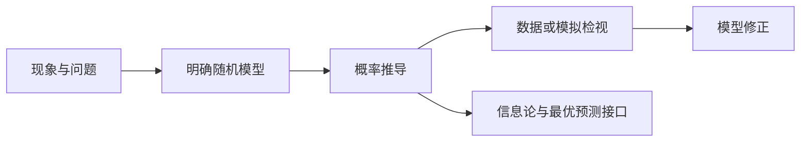

### 18.1 区分模型、推论与经验判断

本讲的神经科学内容是**建模接口与教学构造**，不提供未经检索和数据支持的普遍生物学断言。首先明确观测单位：一个固定时间窗内的计数、两次事件间隔、刺激类别或响应类别。再问独立性、平稳性、尾部与隐藏状态是否合理。

若假设固定时间窗内事件计数 $N\sim\operatorname{Pois}(\lambda t)$，模型推论是均值等于方差，$P(N=0)=e^{-\lambda t}$。反过来，观测均值接近方差并不能证明完整过程是 Poisson，还要检查时间相关和增量结构。若强度跨试验随机变化为 $\Lambda$，条件于它计数 Poisson，则讲 9 给

$\mathbb EN=t\mathbb E\Lambda,\qquad \operatorname{Var}N=t\mathbb E\Lambda+t^2\operatorname{Var}\Lambda,$

假设所需矩有限。因此额外波动可能来自混合强度，不能仅凭过度离散推断某一种生物机制。

### 18.2 随机游走到扩散：这里只给坐标

设每一步空间幅度为 $\delta$，时间步长为 $\Delta t$。若增量均值约为 $v\Delta t$，方差约为 $2D\Delta t$，累积位置在宏观上可能呈漂移与扩散。固定时刻的 CLT 只说明单个终点分布的近似，**不等于整条路径收敛到 Brownian 运动**；后者需要函数空间上的极限定理，归 MA306／MA303。漂移扩散用于决策变量是一种模型选择，还需确定边界、初态与噪声假设。

### 18.3 条件平均与信息量回答不同问题

$\mathbb E[X\mid Y]$ 优化平方损失；但若目标是分类错误率，应选择后验概率最大的类别，不能把均值当所有损失的万能最优预测。

对有限刺激 $S$ 与响应 $R$，给定联合概率 $p(s,r)$，定义

$H(S)=-\sum_{i=1}^{m}p(s_i)\log_2p(s_i),$

$H(S\mid R)=-\sum_{j=1}^{\ell}\sum_{i=1}^{m}p(s_i,r_j)\log_2p(s_i\mid r_j),$

$I(S;R)=\sum_{i=1}^{m}\sum_{j=1}^{\ell}p(s_i,r_j)\log_2\frac{p(s_i,r_j)}{p(s_i)p(r_j)}.$

零联合概率项按零处理，零边缘对应整行／整列没有质量，不计算该条件商。展开对数并按边缘求和得 $I(S;R)=H(S)-H(S\mid R)$。这里自给定义与恒等式；非负性、数据处理及更一般结果归信息论讲义，不作为未经点名的本讲前提。

**教学例**：$S$ 为公平二元变量，$R$ 经独立翻转概率 $\varepsilon$ 的通道生成。$R$ 也均匀，$H(S)=1$，$H(S\mid R)=h_2(\varepsilon)$，$I(S;R)=1-h_2(\varepsilon)$，其中 $h_2(p)=-p\log_2p-(1-p)\log_2(1-p)$。这是合成通道例子，不是实际神经响应的实测结论。

### 18.4 两个巩固项目：交付标准，不在本轮执行

**项目一：C 语言 Monte Carlo 三件套**。所有未来代码放入 `projects/semester_01/` 的对应项目目录，交付三个可运行程序和 README。

1. **生日碰撞**：假设 $d$ 个生日等可能且彼此独立，$n\le d$ 时精确无碰撞概率为 $\prod_{j=0}^{n-1}(1-j/d)$。模拟碰撞频率，与精确值及误差界比较；明确模型忽略季节性等因素。$n>d$ 时碰撞概率为 $1$。
2. **二项到正态**：在多个 $n,p$ 下比较精确二项分布与连续性校正近似，报告中央区与尾部误差，不能只给一张“像钟形”的直方图。
3. **相依序列的反例**：比较独立 Bernoulli 序列与所有项共用同一个 Bernoulli 的序列，展示后者样本平均不集中；明确这违反独立条件，并不是推翻大数定律。

项目在学完讲 12 后可启动理论设计，讲 17 后补齐抽样正确性、误差与实现记录。每个程序要给随机数方案、种子、编译运行方式、输入输出样例和理论对照；本轮不生成或运行程序。

**项目二：有限信息量估算报告**。讲 10 后可从给定离散联合表开始；学完本讲后完成收口。报告列 $p(s,r)$、边缘、条件表，计算 $H(S),H(R),H(S\mid R),I(S;R)$，用两种恒等式交叉检查。若表来自有限样本，明确频数估计的有限样本偏差、零频问题与分箱依赖，不能把插件估计当作真实分布已知。真实神经数据的实验解释需对应学科审查，合成数据不得冒充实测。

**G18**：上面的二元翻转通道在 $\varepsilon=0,1/2,1$ 时互信息分别多少？

**I18**：若 $X\mid\Lambda\sim\operatorname{Pois}(\Lambda)$，已知 $\mathbb E\Lambda=2,\operatorname{Var}\Lambda=3$，求 $\mathbb EX,\operatorname{Var}X$，解释方差来源。

**答案（作者自校）**：G18 为 $1,0,1$ bit；完全翻转仍保留全部信息，只需反解标签。I18 均值 $2$、方差 $5$，分别来自条件 Poisson 波动与强度变化。

**回看**：概率推导的确定性来自明确假设，应用结论必须连同假设报告。📋 **升级坐标**：MA305 处理统计推断，MA303 处理随机过程，MA306 提供测度论严格化，MA404 深化信息论，MA308 处理统计计算。

# 附录 A　记号、易混点与全课自测

## A.1 记号表

| 记号 | 含义与适用边界 |
|---|---|
| $\Omega,\mathcal F,P$ | 样本空间、事件域、概率 |
| $\mathbf1_A$ | 事件 $A$ 的指示变量，发生取 $1$，否则取 $0$ |
| $F_X,f_X$ | 分布函数、密度；并非每个分布都有密度 |
| $p_X,p_{X,Y}$ | 离散分布律、联合分布律 |
| $\mathbb EX$ | 期望；有符号变量需说明存在性 |
| $\operatorname{Var},\operatorname{Cov}$ | 方差、协方差，本课通常要求有限二阶矩 |
| $\mathbb E[X\mid Y]$ | 根据 $Y$ 所含信息作条件平均所得随机变量 |
| $G_X,M_X,\varphi_X$ | 概率生成函数、矩母函数、特征函数，存在域不同 |
| $\xrightarrow{P},\xrightarrow{d},\mathrm{a.s.}$ | 依概率、依分布、几乎处处收敛 |
| $\tau_A$ | 首达集合 $A$ 的时间，允许无穷 |
| $X_{(k)}$ | 第 $k$ 小的次序统计量 |

## A.2 六个必须能解释的区别

- 互斥与独立：前者禁止同时发生，后者要求交概率等于概率乘积。
- 密度与概率：概率是积分，单点密度值不是单点质量。
- 期望线性与独立：线性性不需独立，乘积期望分解与方差直接相加通常需要额外条件。
- 不相关与独立：零协方差只消除一种二阶依赖，不能排除非线性关系。
- 矩与完整分布：均值、方差相同的两个变量仍可具有不同分布；模型的某个矩条件符合数据，不等于模型全部假设得到验证。
- 大数定律与 CLT：前者让未缩放误差趋零，后者描述平方根缩放误差的分布；都不是有限样本的必然保证。

## A.3 自测 T1（必做：定义与分布）

1. 公平硬币连投三次，事件 $A$ 为至少两次正面，$B$ 为第一次正面。求 $P(A),P(A\mid B)$，判断独立。
2. 从 $10$ 个对象（$3$ 个标记）无放回取 $2$ 个，选合适分布并给恰一个标记的概率。
3. 密度 $f(x)=3x^2$（$0<x<1$）的分布函数是什么？$P(X=1/2)$ 与 $f(1/2)$ 各多少？

**答案（作者自校）**：1 为 $1/2,3/4$，不独立；2 为超几何，概率 $\binom31\binom71/\binom{10}2=7/15$；3 的分布函数在支持内为 $x^3$，左右延伸为 $0,1$，单点概率零而密度值为 $3/4$。判定要点是模型、条件样本空间与密度含义，不只报数。

## A.4 自测 T2（必做：计算与证明）

1. 重用讲 8 二元表，计算 $\mathbb EX,\operatorname{Var}X,\operatorname{Cov}(X,Y)$ 和 $\mathbb E[X\mid Y]$。
2. 完整复述有限方差弱大数定律证明，逐处指出线性性与独立性的用途。
3. 复述 De Moivre–Laplace 的四步，解释为什么必须有“局部估计在有界标准化区间上一致”，并说出外部输入。

**答案（作者自校）**：1 分别为 $1/2,1/4,1/8$，条件平均在 $Y=0,1$ 时为 $1/4,3/4$。2 先求平均的均值和方差，再使用 Chebyshev，见定理 11.1。3 为 Stirling 局部质量、Taylor 指数展开、Riemann 和、Chebyshev 控尾；一致性用来控制越来越多项的总误差。必须点名 U1–U3，不能说“全部由概率公理直接推出”。

## A.5 自测 T3（选做：综合迁移）

1. 公平游走在 $0,10$ 吸收，从 $3$ 出发求上边界首达概率和平均吸收时间。
2. $K$ 取 $0,2$ 的概率为 $1/3,2/3$，求分支过程灭绝概率。
3. 用均匀样本设计 Exp$(2)$ 的抽样公式，并为估计尾概率 $P(X>1)$ 写 Monte Carlo 估计量及精确方差。

**答案（作者自校）**：1 为 $3/10,21$。2 解 $q=1/3+2q^2/3$ 取小根 $1/2$。3 取 $X_i=-\log U_i/2$，估计量为 $n^{-1}\sum_{i=1}^{n}\mathbf1_{\{X_i>1\}}$，均值 $e^{-2}$、方差 $e^{-2}(1-e^{-2})/n$。本轮未运行对应模拟。

# 附录 B　前置、未证输入与证明范围

## B.1 可数非负和为什么能换序

对非负数阵 $a_{ij}$，定义总和为所有有限指标集合上有限和的上确界。任何有限集合包含在某个有限矩形中，因此矩形部分和的上确界等于总和。另一方面，先对每行取上确界再对有限行数求和，可以任意逼近该有限行数的行和，所以两种迭代求和也都等于同一个总和。由此

$\sum_{i=1}^{\infty}\sum_{j=1}^{\infty}a_{ij}=\sum_{j=1}^{\infty}\sum_{i=1}^{\infty}a_{ij}$

成立，允许结果为无穷。绝对可和实数阵拆为正负部分，两者有限，分别换序再相减即可。这补齐本稿离散期望、尾和、PGF 非负求和的基础；不代替一般连续积分的 Fubini 定理。

## B.2 候选输入清单（尚未登记正式 R 编号）

| 本稿编号 | 输入与使用处 | 处理边界 |
|---|---|---|
| U1 | 带误差项的 Stirling 公式；讲 12 局部二项估计 | 未在本稿证明；需数分来源或后续补证，不能称 R 编号已销 |
| U2 | 高斯积分值及其多元积分依据；讲 5 正态归一化 | 未证明；待数分积分／二重积分衔接 |
| U3 | 经典连续模型的积分规则：LOTUS、绝对可积换序、适当控制下求导换积分、联合密度换元 | 概率形式层的一般定理归 MA306；本课使用处标明，正式审稿需逐处核条件与数分学习位置 |
| U4 | 指定分布的无限独立序列的存在 | 无限样本模型、Borel–Cantelli 反例与过程构造的存在性输入；乘积空间构造归 MA306 |
| U5 | 一般 i.i.d. 强大数定律与 CLT | 本稿只陈述，一般证明归 MA306；讲 12 只证明二项特例 |

Taylor 余项、幂级数内部逐项求导、非负数列极限、基本微分积分规则是相应讲次的分析前置，不因设计写“可开”就推定学生已学。自校确认上述工具是学习前置，尚不能认定同学已学。由于现有进度仅到数分 §1.8.3，需随数分推进再核学习许可；DSH 审稿时应将 U1–U3 的证据与正式登记、单讲学习前置相衔接。

**本稿已给论证的概率主线**：公理推容斥与连续性；Bayes；分布函数性质；二项到 Poisson 的固定值极限；离散期望与标准矩；Markov／Chebyshev／Chernoff／Hoeffding／Jensen；离散条件期望及投影性质；PGF 的独立和与随机和；有限方差弱大数定律；Borel–Cantelli 两部分；在 U1–U3 下的 De Moivre–Laplace；有限区间随机游走；在 U3–U4 下的 Poisson 过程构造；分支灭绝不动点；次序统计量公式；逆变换与拒绝采样、Monte Carlo 的无偏性。此清单是作者写作范围声明，尚非审稿结论。

# 附录 C　作者自校与送审状态（2026-10-13）

**已完成**：18 讲内容与大纲逐项对照；作者复查核心证明、矩条件、独立条件和退化边界；对数值题、概率表、连续积分及模型恒等式作独立计算；修订处见文件头。确定性验算代码和结果保存在 `projects/semester_01/MA301_CDX_selfcheck/`，说明见本稿同目录 `20261013_MA301_自检报告_CDX.md`。

**边界**：数值实验不代替定理证明；U1–U5 未因作者自校而变成已证输入；一般 SLLN／CLT、连续模型的一般测度论基础仍按附录 B 后置。该稿尚未经 DSH 独立审稿，未生成 PDF，未归档，不更新学生学完状态。

**送审**：经 `signals/xside/to_dsh/math/` 交付 DSH，申请 Reviewer_MATH 审查；DSH 负责权威路径落位、真实审稿、候选输入登记及后续归档。因含神经科学建模接口，DSH 还需按系统规定判断综合审稿。