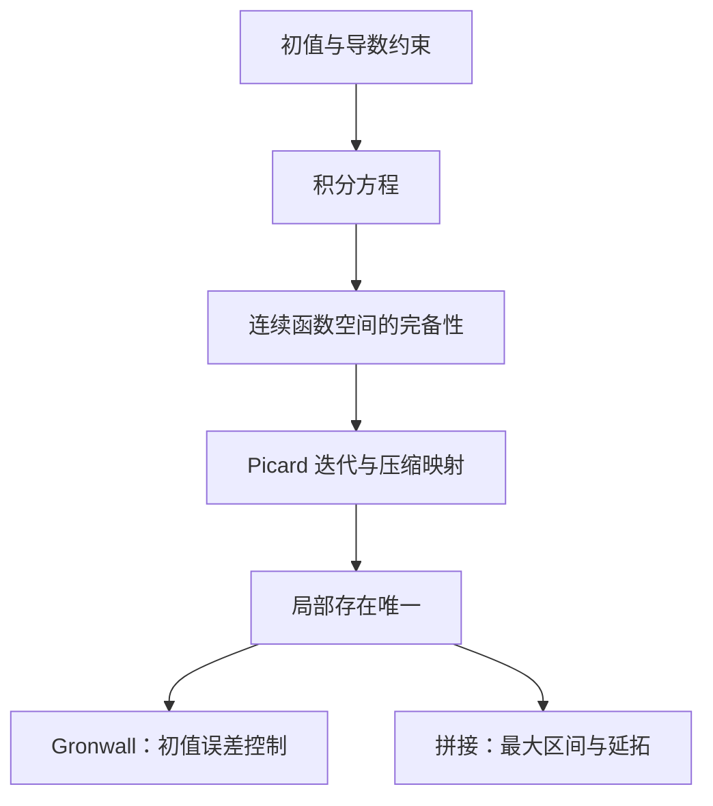
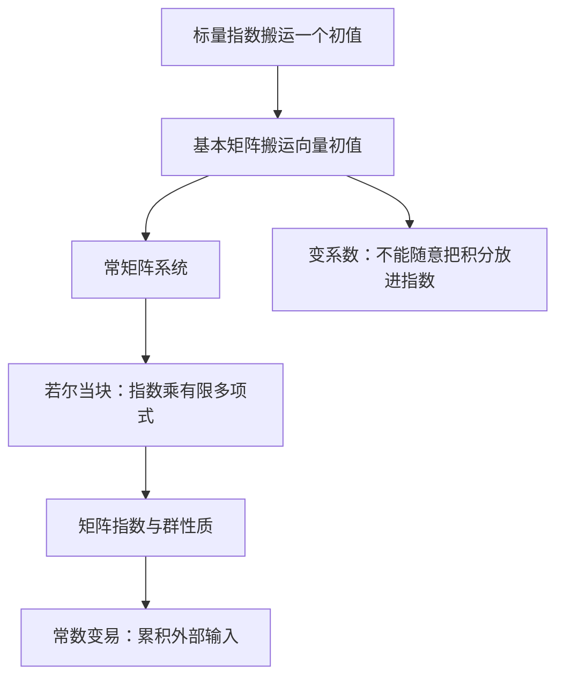
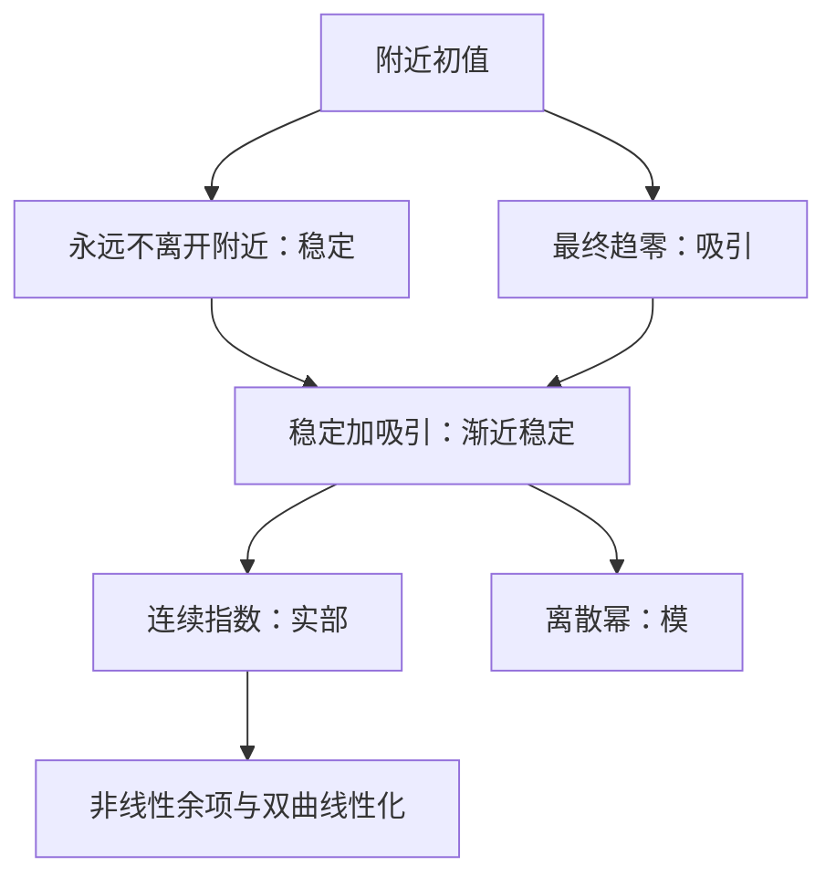
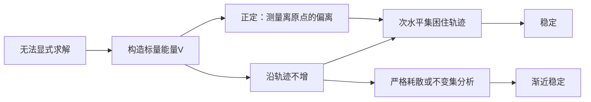
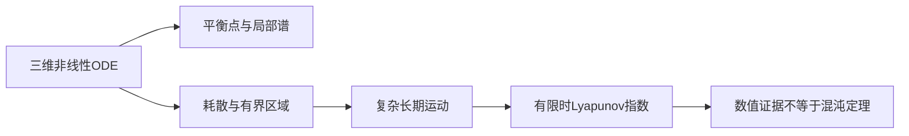
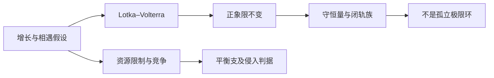
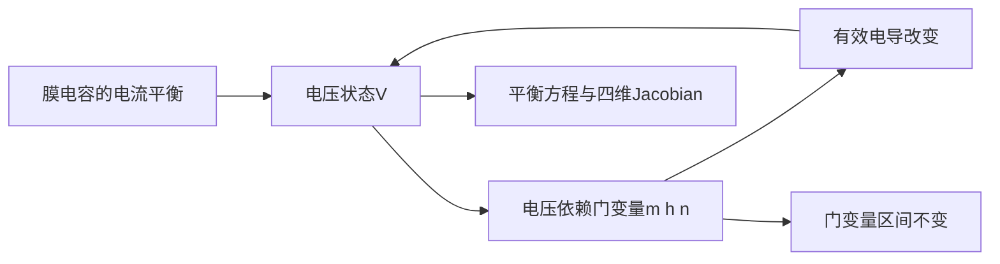
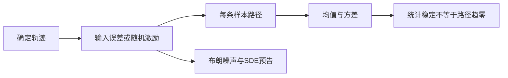
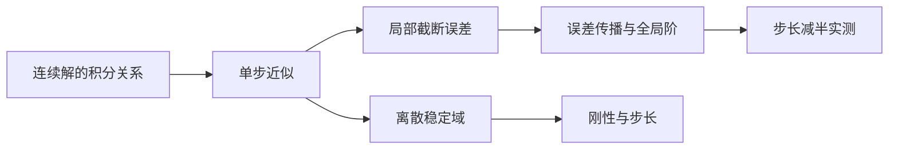
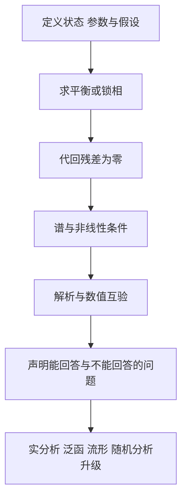

# MA302 常微分方程与动力系统｜正式归档说明

2026-10-31；本课共 **20 讲**，属于四门共 56 讲编写批次。数学学科审稿通过；跨学科综合审稿通过（独立 Astra 审稿；原 DSH 限流失败保留）。正文、例题与习题答案齐备，原设计中明确只陈述或预告的高级理论仍保留其证明边界。

下方完整保留被审核的作者稿。其中“待独立审稿”“未经独立审稿”“待复审”“尚未批准”等标签及作者自校区的阶段状态是写作历史，当前审核状态以本说明和对应报告为准。学习验收与 PDF 编译未因此完成；不自动改变学生掌握记录或共享未证结论登记。

数学二审非阻断建议 S10/S11 未采纳；判定及理由见教务长核验说明。数值验证由独立审稿员实际复跑，与原回执一致；仅支持稿中声明的有限实验范围。

审核记录：

- [审核记录 1](../../../lectures/math/review_reports/review_20261031_MA302_full_DSH.md)
- [审核记录 2](../../../lectures/math/review_reports/review_20261031_MA302_round2_DSH.md)
- [审核记录 3](../../../lectures/math/review_reports/cross_20261031_MA302_Astra.md)

被审作者稿 SHA256（教务长实测）：`56def90b7eb92a3303bee0c59fa971039900c46db5ec111f57122cf895cc8400`；字节数：154427。归档文件在其前面增加本说明，正文逐字节不变。完整文件的独立 SHA256、字节数和正文起始偏移记录在[归档核验清单](../../../projects/semester_01/handout_completion_20261031/archive_manifest.json)；完整文件哈希置于外部清单，避免自引用。

---

<!-- REVIEWED_AUTHOR_BYTES_BEGIN -->
# MA302 常微分方程与动力系统：20讲合订作者修订稿 v0.2

> 2026-10-31。DSH独立首审须修后的作者修订稿，尚未通过复审。20讲正文及答案齐全，学生未验收，R5正式仍open。未证输入编号表与当前术语见附录；逐项回应单列31文件。

# 第1讲 一阶方程：从变化率到整条轨迹

> CDX新编，DSH首审须修后的作者修订稿，尚未通过复审；全书20/20讲正文已完成，学生未验收。

## §0 结构图景

同学，过去求原函数时，变化率已经是时间的已知函数。现在速度会反过来依赖尚未知晓的状态。这就是从求积到演化规律的升级。本讲要完成的判断不是“能写出一个式子”，而是“这个式子在什么区间上满足哪一个初值问题”。

阅读前置是导数、链式法则、乘积求导、连续函数的定积分与微积分基本定理。这里只列知识依赖，不认定同学已掌握。若积分尚未学习，应先补相应工具；本讲不代替其分析证明。第2讲的存在唯一性不在本讲偷用。

## §1 对象、目标和解的含义

一杯热水温度为 $T(t)$，环境恒温 $T_e$。假设温差越大，单位时间散热越快，得到 $T'=-k(T-T_e)$，其中 $k>0$ 的量纲为时间的倒数。这是建模假设，不是由微积分自动推出的物理定律。

**初值问题**是 $x'=f(t,x),\ x(t_0)=x_0$。在包含 $t_0$ 的区间 $I$ 上，一个 **经典解** 是连续可微函数 $x:I\to\mathbb R$，其图像位于 $f$ 的定义域中，并且对每个 $t\in I$ 满足方程和初值。向量版本将实数换成 $\mathbb R^n$。

“通解”不是解存在于全实轴的保证。例如 $x'=x^2,\ x(0)=1$ 的候选 $x(t)=1/(1-t)$ 在 $t=1$ 没有定义。两段 $t<1$ 与 $t>1$ 不能被冒充成包含初值时刻的一条连续轨迹。

检查点：请自行说明，验证一个候选解时为什么仅检查初值不够？答案见核验附件；先不翻。

## §2 可分离方程：不是把微分符号当分数

设 $a$ 在时间区间连续，$b$ 在状态开区间 $J$ 连续且处处不为零。考虑 $x'=a(t)b(x)$ 且轨迹留在 $J$。选 $x_*\in J$，定义

$H(u)=\int_{x_*}^{u}1/b(v)\,dv,\qquad A(t)=\int_{t_0}^{t}a(s)\,ds.$

**分离变量定理。** 此时方程等价于 $H(x(t))=H(x_0)+A(t)$。

证明：链式法则给出 $[H(x(t))]'=x'(t)/b(x(t))=a(t)$，从 $t_0$ 积分即得必要性。反过来，对上述恒等式求导，因 $H'=1/b\ne0$，可乘回 $b(x(t))$ 得原方程。若要从隐式关系构造解，连续且不为零的 $b$ 在区间上符号不变，故 $H$ 严格单调。其逆函数在像区间内部可微，导数为 $1/H'$，从而 $x=H^{-1}(H(x_0)+A)$ 真是解。逆函数导数公式来自差商：$\Delta x/\Delta H=1/(\Delta H/\Delta x)\to1/H'(x)$。只在右端落在 $H(J)$ 内的时间区间使用此式。

遗漏风险在除法：若 $b(c)=0$，则 $x(t)\equiv c$ 是 **平衡解**，必须单列。非平衡解会不会碰到平衡点后重新出发，要由唯一性决定，不能由“除以 $b$”决定。

示范例题 E1：求 $x'=x^2,\ x(0)=1$ 并确定包含零的最大区间。

在 $x>0$ 上，$-1/x=t-1$，故 $x=1/(1-t)$。代回有 $x'=1/(1-t)^2=x^2$，初值为1。它在 $(-\infty,1)$ 上成立，且 $t\uparrow1$ 时无界，不能连续延伸到1；左侧没有有限障碍。这里的“最大”针对这条显式解；第2讲将给出一般定义和定理。

反例：$x'=2\sqrt{|x|},\ x(0)=0$。对任意 $c\ge0$，取 $x_c(t)=0$（$t\le c$），$x_c(t)=(t-c)^2$（$t\ge c$）。拼接点两侧导数都为零，逐段满足方程。因此同一个初值有无穷多条解。方程右端连续并不足以唯一；此处没有声称所有解都已分类。

## §3 线性方程：构造一个可积的乘积

**一阶线性方程**写成 $x'+p(t)x=q(t)$，其中 $p,q$ 在区间 $I$ 连续。寻找非零函数 $\mu$ 使左边乘以它后变成 $(\mu x)'$。乘积法则要求 $\mu'=p\mu$，所以取 **积分因子**

$\mu(t)=\exp(\int_{t_0}^{t}p(s)\,ds)>0.$

由 $\mu(t_0)=1$ 得

$x(t)=\mu(t)^{-1}\left[x_0+\int_{t_0}^{t}\mu(s)q(s)\,ds\right].$

完整验证：括号内导数为 $\mu q$，故 $x'=-\mu^{-2}\mu'[x_0+\int\mu q]+q=-px+q$，在 $t_0$ 处得 $x_0$。任意另一解 $y$ 都满足 $(\mu y)'=\mu q$，积分后必得同一公式。因此在这个连续系数区间上，存在与唯一性已经直接证明，无需借用第2讲。

示范例题 E2：$x'+2x=e^t,\ x(0)=0$。有 $\mu=e^{2t}$，所以 $x=e^{-2t}\int_0^t e^{3s}ds=(e^t-e^{-2t})/3$。导数为 $(e^t+2e^{-2t})/3$，加 $2x$ 得 $e^t$，初值为零；系数在全实轴连续，解也在全实轴。

检查点：齐次情形 $q=0$ 的所有解为什么只有一个自由常数？解释时请点名积分因子恒正。

## §4 建模：增长、冷却与混合

若种群每单位时间净增长比例恒为 $r$，则 $N'=rN$，由线性公式得 $N=N_0e^{rt}$。它忽略资源限制；“计算正确”不保证模型在长期仍适用。

热水模型令 $x=T-T_e$，得 $T=T_e+(T_0-T_e)e^{-kt}$。对 $T_0>T_e$，温度保持在环境温度以上并趋向它；这里直接由显式式子判断，不使用稳定性谱判据 R5。

示范例题 E3：容积固定100升的充分混合水箱，以每分钟2升流入浓度3克/升的盐水，同时等量流出，初始含盐20克。令 $S$ 为盐量，则流入盐率为6克/分，流出盐率为 $(2/100)S$ 克/分，因此 $S'+S/50=6$。解为 $S(t)=300-280e^{-t/50}$，物理时间 $t\ge0$。验证 $S'=5.6e^{-t/50}=6-S/50$，$S(0)=20$。长期浓度为 $300/100=3$ 克/升，与入口相同。验证终点包含守恒、单位和初值，不能只看曲线像不像。

## §5 三类训练与课内输出

示范例题为 E1–E3，完整解答已嵌正文。以下先作答，最小提示与答案分离放在 `05-答案与核验.md`，以免污染主动回忆。

- 引导 G1（T1）：求 $x'=t(1+x^2),\ x(0)=0$，给出包含零的最大存在区间。
- 引导 G2（T1）：求 $x'+x=2,\ x(0)=5$，说明极限及时间尺度。
- 独立 I1（T2）：求 $x'=x(1-x),\ x(0)=1/2$；另列平衡解，并代回验证。
- 独立 I2（T3）：有人把 $x'=2\sqrt{|x|}$ 除以 $\sqrt{|x|}$ 后断言零初值只有 $x=t^2$。指出其逻辑漏洞，并判断 $x=t^2$ 是否在整个实轴满足原方程。

口述窗口：用两分钟解释“分离变量是换状态坐标，积分因子是造乘积”的共同点，并提出一个除法导致漏解的例子。评价终点是条件、方程和区间齐全；未作答不记为已掌握。

## §6 覆盖图、本质与预告

|旧对象|本讲统一位置|边界|
|---|---|---|
|已知速度积分|$b(x)=1$ 的可分离方程|连续速度即可构造|
|指数增长与衰减|常系数齐次线性方程|建模比例假设需另验|
|盐量守恒|非齐次线性方程|体积与充分混合假设不能省略|
|初值代入|轨迹约束的一部分|还须检验微分关系和存在区间|

本质是找到把导数约束变成积分恒等式的结构。下一讲把“某些类型能求出解”升级为“即使没有闭式公式也能保证解存在、唯一并控制误差”。📋 讲4的矩阵指数、讲6的 R5 稳定性判据尚未证明，本讲不据此销号。

---

# 第2讲 存在唯一性与延拓：把求解改写成找不动点

> CDX新编，DSH首审须修后的作者修订稿，尚未通过复审；全书20/20讲正文已完成，学生未验收。

## §0 结构图景

第1讲靠特定代数结构写出了显式解。但 $x'=t+\sin x$ 没有现成分离公式，我们仍然需要知道初值是否决定一条轨迹。本讲的对象从“一个数”升级为“整条连续函数”；迭代的每一步修正整条候选轨迹。

本讲不假定已修一般泛函分析。需要的连续函数空间完备性与压缩映射在下文证明。仍依赖实数完备性、连续函数在紧集上有界、微积分基本定理、连续函数的一致连续性等数分工具；它们是待核前置，不等于同学已通过验收。

## §1 积分方程与条件的准确量词

对连续的 $f$，初值问题 $x'=f(t,x),\ x(t_0)=x_0$ 等价于

$x(t)=x_0+\int_{t_0}^{t}f(s,x(s))\,ds.$

正向由基本定理积分；反向中，只要 $x$ 连续，复合函数 $f(s,x(s))$ 连续，右边就连续可微，求导得原方程，令 $t=t_0$ 得初值。这使我们可以先在连续函数中找解，而不必预先控制导数。

设 $D\subset\mathbb R\times\mathbb R^n$ 为开集，$f:D\to\mathbb R^n$ 连续。以下“对状态局部 Lipschitz”明确指：对每个 $(t_0,x_0)\in D$，可选闭柱体 $Q=[t_0-a,t_0+a]\times\overline B(x_0,b)\subset D$ 与常数 $L\ge0$，使同一时刻任意 $x,y$ 在该球内都满足

$\|f(t,x)-f(t,y)\|\le L\|x-y\|.$

关键是 $L$ 对这段时间一致。$f=x^2$ 在 $[-R,R]$ 上可取 $L=2R$，因为 $|x^2-y^2|\le2R|x-y|$；它在全实轴没有统一 $L$。$f=2\sqrt{|x|}$ 在零附近不满足该条件，因为 $|f(h)-f(0)|/|h|=2/\sqrt h\to\infty$。第1讲的等待出发解说明缺失条件确实可能导致非唯一，但不意味着所有非 Lipschitz 方程都不唯一。

检查点：局部 Lipschitz 能否保证解全局存在？先保留自己的判断，稍后用 $x'=x^2$ 检验。

## §2 构造所需的完备性和压缩原理

令 $I=[t_0-h,t_0+h]$，在连续向量函数上定义距离 $d(u,v)=\sup_{t\in I}\|u(t)-v(t)\|$。**完备**的意思是每个 Cauchy 列都收敛到空间内的元素。

证明此函数空间完备：若 $(u_k)$ 在此距离下 Cauchy，则每个固定 $t$ 上 $(u_k(t))$ 是有限维向量 Cauchy 列，由逐坐标实数完备性有极限 $u(t)$。给定 $\varepsilon>0$，取 $N$ 使 $k,m\ge N$ 时 $\|u_k(t)-u_m(t)\|<\varepsilon/2$ 对所有 $t$ 成立，令 $m\to\infty$ 得 $\|u_k(t)-u(t)\|\le\varepsilon/2$，故一致收敛。为证连续，在任意 $t_*$ 先选 $k$ 使一致误差小于 $\varepsilon/3$，再利用 $u_k$ 连续控制中间差，三角不等式得 $\|u(t)-u(t_*)\|<\varepsilon$。因此极限仍属空间。

**压缩映射原理。** 非空完备度量空间 $X$ 上，若 $T:X\to X$ 满足 $d(Tu,Tv)\le qd(u,v)$，其中 $0\le q<1$，则存在唯一不动点。

证明：选 $u_0$ 并令 $u_{k+1}=Tu_k$。归纳得 $d(u_{k+1},u_k)\le q^k d(u_1,u_0)$。对 $m>k$，三角不等式及几何级数给出 $d(u_m,u_k)\le q^k d(u_1,u_0)/(1-q)$，故收敛于某个 $u$。由 $d(Tu,u)\le qd(u,u_k)+d(u_{k+1},u)\to0$，知 $Tu=u$。若 $Tv=v$，则 $d(u,v)\le qd(u,v)$，从而 $d(u,v)=0$。并得到可核验误差界 $d(u,u_k)\le q^k d(u_1,u_0)/(1-q)$。当 $q=0$ 时一次迭代即达到不动点，单独理解即可。

## §3 Picard–Lindelöf 局部定理及完整证明

在 §1 条件下，每个 $(t_0,x_0)$ 有唯一局部解。更准确地，先取 $Q$，由连续性及紧性取 $M=\max_Q\|f\|$，选择 $h>0$ 使 $h\le a,\ hM\le b,\ hL<1$；零常数不构成限制。

取 $X=\{u\in C(I,\mathbb R^n):\sup_I\|u-x_0\|\le b\}$。它非空，且是一致距离下的闭子集：一致极限保留每点的球约束。故由上一节完备。

定义 **Picard 算子** $(Tu)(t)=x_0+\int_{t_0}^{t}f(s,u(s))ds$。其值连续，而且 $\|Tu(t)-x_0\|\le M|t-t_0|\le Mh\le b$，所以确实映到 $X$。又有 $\|Tu-Tv\|_\infty\le Lh\|u-v\|_\infty$。由压缩原理得唯一不动点，再由 §1 等价性得经典解。

这里先证的是 $X$ 中唯一。任意两个经过初值的局部解，由连续性在更小时间区间都留在球中，缩短区间后同样压缩，故在初值附近相等。若它们定义在相交区间上，取相等时刻的集合：它闭（连续性），且相对开（在每个相等点重用上述局部唯一性）；包含初值，区间的连通性使它等于整个公共区间。连通性在这里仅用到实区间不能分成两个非空相对开集这一实数性质。这就排除了先重合后分叉。

示范 E1：$x'=x,\ x(0)=1$。从 $u_0=1$ 开始，$u_1=1+t,\ u_2=1+t+t^2/2$，归纳得 $u_k=\sum_{j=0}^{k}t^j/j!$。这揭示指数不是猜出的技巧，而是积分迭代的固定轨迹。局部证明选 $a=1,b=1,M=2,L=1,h=1/4$，于是 $q=1/4$，误差界为 $\|u-u_k\|_\infty\le(1/4)^k/3$。指数级数身份若未学，可只把极限称为此初值问题的唯一解；不依赖级数身份完成存在性证明。

## §4 Gronwall：把误差的自我反馈封住

**Gronwall 不等式（常系数积分型）。** 若非负连续函数 $u$ 在 $[t_0,T]$ 上满足 $u(t)\le A+B\int_{t_0}^{t}u(s)ds$，其中 $A,B\ge0$，则 $u(t)\le Ae^{B(t-t_0)}$。

证明：令 $v(t)=A+B\int_{t_0}^{t}u(s)ds$，则 $u\le v,\ v'=Bu\le Bv$。因此 $[e^{-B(t-t_0)}v(t)]'\le0$，由初值 $v(t_0)=A$ 得 $v(t)\le Ae^{B(t-t_0)}$。推导无需除以 $A$ 或 $v$，故 $A=0$ 同样成立。

应用：若两条解留在一个具有统一状态 Lipschitz 常数 $L$ 的区域内，积分方程之差给出 $\|x(t)-y(t)\|\le\|x_0-y_0\|+L\int_{t_0}^{t}\|x(s)-y(s)\|ds$，故误差至多为 $\|x_0-y_0\|e^{L(t-t_0)}$。向后时间用 $\tau=t_0-t$ 换元得到绝对时间差版本。该结论以两条解都存在并留在该区域为前提；没有无条件保证全局轨迹有界。

示范 E2：$x'=2x$ 的初值分别为1与 $1+\delta$，差为 $\delta e^{2t}$，在 $t\ge0$ 恰好达到 $L=2$ 的界。这是误差上界的锋利例子，不是非线性系统稳定性定理。

## §5 最大解与延拓障碍

**延拓**是把一个解扩展到更大的时间区间且在原区间保持一致。由局部唯一性，经过指定初值的所有局部解在公共区间相等；把其定义区间取并、函数逐点拼起来，得到定义在某个开区间 $(\alpha,\beta)$ 上的唯一 **最大解**。并集是包含 $t_0$ 的区间，每个点附近来自某条原解，故拼接函数仍连续可微且满足方程。再有延拓便属于这个并集，矛盾，故最大。

**紧集延拓准则。** 假设 §1 的条件在整个开集 $D$ 成立。如果最大解的右端 $\beta<\infty$，则其尾部图像不可能一直留在某个紧集 $K\subset D$。

证明：若 $t_1\le t<\beta$ 时 $(t,x(t))\in K$，连续性使 $\|f\|\le M_K$，所以积分公式给出 $\|x(t)-x(s)\|\le M_K|t-s|$。当 $t\uparrow\beta$ 时，这说明 $x(t)$ 为 Cauchy，有极限 $x_\beta$。紧集闭性给出 $(\beta,x_\beta)\in K\subset D$。在该点应用局部存在定理构造跨过 $\beta$ 的解。旧解延到端点后仍满足积分方程，故在左侧与新解由唯一性相等；拼接就延长了最大解，矛盾。左端同理。

若 $D=\mathbb R\times\mathbb R^n$，有限端点意味着状态不能在尾部有界（否则时间有界和状态闭球构成紧集）。一般 $D$ 上也可能是碰到定义域边界，并非必然趋向无穷。例如 $x'=1$ 限定在 $D=\mathbb R\times(-1,1)$，$x(0)=0$ 的最大区间是 $(-1,1)$，状态始终有界。

示范 E3：$x'=x^2,\ x(0)=1$ 在整个平面有连续且局部 Lipschitz 的右端，却在 $\beta=1$ 爆破；因此“局部 Lipschitz”与“全局存在”不可混同。反过来，若在整个平面有 $\|f(t,x)\|\le a+b\|x\|$，$a,b\ge0$，则任何有限时间窗口上由积分式和 Gronwall 得状态有界：在 $[t_0,T]$ 上用 $A=\|x_0\|+a(T-t_0)$，得 $\|x(t)\|\le Ae^{b(t-t_0)}$。结合延拓准则排除有限右端；向后同理。这里仍假定局部 Lipschitz 以调用已经证明的定理。

## §6 三类训练与课内输出

- 示范题 E1–E3 已完整演示；核验附件另列检查路径。
- 引导 G1（T1）：对 $x'=1+x,\ x(0)=0$ 写出前三次 Picard 迭代，猜想并验证精确解。
- 引导 G2（T2）：在 $u(t)\le3+2\int_0^t u(s)ds$、$u\ge0$ 连续、$0\le t\le1$ 下求可保证的 $u(1)$ 上界。
- 独立 I1（T2）：证明 $f(x)=|x|$ 全局 Lipschitz；求 $x'=|x|$、$x(0)=-1$ 的全局解，并解释它为什么不会穿过零。
- 独立 I2（T3）：$x'=x^2,\ x(0)=x_0$ 在整个平面上定义。分别对 $x_0>0,=0,<0$ 求最大区间，并解释为何不违背本讲局部定理。

引导题的最小提示独立存于答案文件，卡住才读。请口述：完备性、映到自身、压缩常数小于1，各自在哪一步不可替代？未作答不记录学习完成。

## §7 覆盖图、本质与预告

|旧观点|升级后的包含关系|
|---|---|
|求一个数的不动点|连续轨迹空间上的不动点是 ODE 解|
|几何级数收敛|压缩迭代误差的可计算尾界|
|积分因子|Gronwall 证明中指数权重消去反馈项|
|显式式子分母为零|最大解离开紧集的一种具体机制|

本讲的本质是用局部定量控制换取存在、唯一和可延拓性；三个结论各有自己的量词。📋 下一讲研究二阶线性方程的解空间，讲4把矩阵代数接到演化问题。R5 连续与离散稳定性判据仍待讲6严格处理，本讲的误差估计并不销号 R5。

---

# 第3讲 二阶线性方程：两个初值与二维解空间

> CDX新编，DSH首审须修后的作者修订稿，尚未通过复审；本讲已完成，学生未验收，不代表学习验收。

## §0 结构图景

同学，第1讲一个初值决定一条一阶线性轨迹；弹簧的运动还必须知道起始速度。我们要把“需要两个常数”变成定理，而不是从常见答案中猜测。对象是连通开区间 $I$ 上的正规方程 $y''+p(t)y'+q(t)y=r(t)$，其中 $p,q,r$ 连续。若原方程最高阶系数为 $a(t)$，只有在 $a(t)\ne0$ 的区间才能除以它得到本形式。

前置：第2讲向量局部存在唯一性与延拓、二阶导数，以及线性组合和二维行列式。本讲会解释解空间，不默认已完成所有高代课程。基本求导和积分规则仍是数分前置。

## §1 从运动规律到两个初值

质量为 $m>0$ 的物体受弹簧力 $-ky$、阻力 $-cy'$ 和外力 $F(t)$，理想模型是 $my''+cy'+ky=F(t)$。这是牛顿定律加上线性力的模型假设；真实弹簧超出小形变范围未必适用。设 $v=y'$，便得到 $y'=v,\ v'=r-pv-qy$。反过来，这个系统的解满足 $y''=v'$，恢复原方程，所以两种表述等价。

对给定 $y(t_0)=a,y'(t_0)=b$，第2讲保证局部存在唯一：右端连续，对状态 $(y,v)$ 在任意紧时间区间上有统一 Lipschitz 常数。还可延到整个 $I$。证明：若在 $I$ 内有有限右端 $\beta$，取覆盖 $[t_0,\beta]$ 的紧子区间，系数在其上有界。对 $z=(y,v)$ 取 $1$-范数，在所取紧时间区间上记 $P=\max|p|,Q=\max|q|$，可取 $C=1+P+Q,R=\max|r|$ 使 $\|z'\|\le C\|z\|+R$。积分及第2讲 Gronwall 给任何到达 $\beta$ 以前的状态统一有界，延拓准则便排除该端点。左端同理。注意这不保证跨越 $I$ 的边界。

检查点：$t y''+y'=0$ 为什么不能直接在包含0的区间使用此定理？先指出是哪一个假设失败。

## §2 齐次解空间为何恰有二维

记 $L[y]=y''+py'+qy$。**齐次方程**是 $L[y]=0$。求导线性使齐次解的任意实线性组合仍是解；它们组成向量空间 $S$。考虑初值映射 $E:S\to\mathbb R^2,\ E(y)=(y(t_0),y'(t_0))$。这是线性映射；唯一性说明它单射，任意初值的存在性说明它满射。因此 $S$ 与 $\mathbb R^2$ 线性同构，维数为2。

更具体地，取 $u_1,u_2$ 的初值分别为 $(1,0),(0,1)$，则任意 $y\in S$ 满足 $y=a u_1+b u_2$：两边具有相同初值，唯一性给全区间相等。这里构造出了基，未借用显式公式。

给两个齐次解，定义 **Wronskian（朗斯基行列式）** $W=u_1u_2'-u_1'u_2$。求导并代入方程得

$W'=u_1u_2''-u_1''u_2=-p(u_1u_2'-u_1'u_2)=-pW.$

第1讲齐次线性公式因此给出 **Abel 恒等式**

$W(t)=W(t_0)\exp(-\int_{t_0}^{t}p(s)ds).$

所以 $W$ 要么处处非零，要么处处为零。非零时初值矩阵可逆，任意初值能唯一表示为两列的组合，故这两解构成基。若某点 $W=0$，初值列向量相关，存在不全为零的 $a,b$ 使 $a u_1+b u_2$ 在该点的值和导数都为零；由唯一性它处处为零，故两解相关。这个判据以“两函数解同一正规齐次方程”为条件。

反例：一般光滑函数的 Wronskian 在某一点为零不能推出相关。$u_1=1,u_2=t^2$ 的 $W=2t$ 在零处为零，但二者显然线性无关；它们不是同一正规连续系数二阶齐次方程在零附近的两个解。

## §3 常系数：为什么指数是合适的试探对象

对 $y''+ay'+by=0$，求导使 $e^{\lambda t}$ 只乘以常数，因此代入得 **特征方程** $\lambda^2+a\lambda+b=0$。

不同实根 $\lambda_1,\lambda_2$ 时，两个指数是解，Wronskian 为 $(\lambda_2-\lambda_1)e^{(\lambda_1+\lambda_2)t}\ne0$，由上一节即得全部解，而不是只找到两条例子。

重根 $\lambda=-a/2$ 时，方程为 $(D-\lambda)^2y=0$，$D$ 表示求导。写 $y=e^{\lambda t}z$，直接算得 $(D-\lambda)y=e^{\lambda t}z'$，再作用一次得到 $e^{\lambda t}z''=0$。故 $z=C_1+C_2t$，全部解为 $(C_1+C_2t)e^{\lambda t}$。重根需要多项式因子，不能重复写同一指数冒充两个基向量。

若根为 $\alpha\pm i\beta$，$\beta>0$，则 $a=-2\alpha,b=\alpha^2+\beta^2$。仍令 $y=e^{\alpha t}z$，得到 $z''+\beta^2z=0$。实函数 $\cos\beta t,\sin\beta t$ 直接求导满足方程，其 Wronskian 为 $\beta$；故全部实解为 $e^{\alpha t}(C_1\cos\beta t+C_2\sin\beta t)$。证明不需要先掌握复指数。

示范 E1：$y''-2y'+y=0,y(0)=1,y'(0)=0$。重根1，故 $y=(C_1+C_2t)e^t$。初值给 $C_1=1,C_2=-1$，所以 $y=(1-t)e^t$。求导得 $y'=-te^t,y''=-(1+t)e^t$，代回为0，两个初值均成立。

## §4 非齐次结构与参数变易

若 $y_p$ 是 $L[y]=r$ 的一个特解，则 $L[y-y_p]=0$。反过来，任意齐次解加上 $y_p$ 都解原方程。因此非齐次解集是 **仿射空间** $y_p+S$：它一般不含零函数，不能直接称向量空间。

目标是构造 $y_p$。取齐次基 $u_1,u_2$，将常数换为待定函数，写 $y_p=c_1u_1+c_2u_2$。人为选取辅助约束 $c_1'u_1+c_2'u_2=0$，于是 $y_p'=c_1u_1'+c_2u_2'$，代回给 $L[y_p]=c_1'u_1'+c_2'u_2'$。所以只须求解

$\begin{pmatrix}u_1&u_2\\u_1'&u_2'\end{pmatrix}\begin{pmatrix}c_1'\\c_2'\end{pmatrix}=\begin{pmatrix}0\\r\end{pmatrix}.$

因 $W\ne0$，二阶线性消元给 $c_1'=-u_2r/W,c_2'=u_1r/W$。取积分下限 $t_0$ 并令两积分常数为零，得到

$y_p(t)=-u_1(t)\int_{t_0}^{t}\frac{u_2(s)r(s)}{W(s)}ds+u_2(t)\int_{t_0}^{t}\frac{u_1(s)r(s)}{W(s)}ds.$

连续性保证两积分可微，上面的约束和求导链严格验证此式是特解，且 $y_p(t_0)=y_p'(t_0)=0$。非零初值由齐次部分补足。辅助约束不是对未知真实解额外施加限制；它是构造一个足够可用特解的选择，再靠齐次结构得到所有解。

示范 E2：$y''+y=\sin t$，初值均为零。用 $u_1=\cos t,u_2=\sin t,W=1$，得

$y_p=-\cos t\int_0^t\sin^2s\,ds+\sin t\int_0^t\sin s\cos s\,ds=(\sin t-t\cos t)/2.$

其中两个积分分别为 $t/2-\sin(2t)/4$ 与 $\sin^2t/2$。求导 $y_p'=t\sin t/2$，再求导后与 $y_p$ 相加得到 $\sin t$。这出现增长振幅项；这里只是具体共振计算，尚未引用一般稳定性判据。

## §5 三类题与输出窗口

示范 E1、E2 已给完整解答；以下提示和答案单列于第3–4讲核验附件。

- 引导 G1（T1）：解 $y''+3y'+2y=0,y(0)=0,y'(0)=1$。
- 引导 G2（T2）：若 $p(t)=2t$ 且两解的 $W(0)=3$，求 $W(t)$ 并判断两解是否构成基。
- 独立 I1（T2）：解 $y''-y=e^t,y(0)=y'(0)=0$，用任一种已证方法构造并代回。
- 独立 I2（T3）：证明正规方程的非零齐次解不可能在同一点同时满足 $y=0,y'=0$；解释这并不禁止解有普通零点。

输出窗口：不用公式清单，说明为何“找到两个解”仍须证明独立，及非齐次方程为何不能直接叠加两个任意解。终点是说清结构和条件，不是背出特征根表。

## §6 覆盖图、本质与预告

|旧概念|本讲统一视角|
|---|---|
|两个积分常数|初值映射给出的二维解空间坐标|
|特征根试解|寻找解空间基向量|
|一阶积分因子|Wronskian 满足的一阶方程|
|非齐次解法|平移齐次空间，再构造一个特解|

本质是用存在唯一性把局部初值坐标搬到整条函数上。第4讲将把这两个基函数及其导数排成矩阵，统一为线性演化算子。R5 仍开放；不能从本讲几个例子的增减推断所有连续或离散系统的稳定性。

---

# 第4讲 线性系统与矩阵指数：初值如何被整体搬运

> CDX新编，DSH首审须修后的作者修订稿，尚未通过复审；本讲已完成，学生未验收，不代表学习验收。

## §0 结构图景

本讲把第3讲的“解空间基”排成一张矩阵。人负责确定状态、单位和初值；矩阵运算可以交给工具，但最终必须检验导数、初值以及矩阵乘法次序。

前置：矩阵乘法、逆矩阵、基变换；第2讲线性系统存在唯一性，第3讲二阶方程。一般复矩阵的若尔当标准形存在定理是高代前置工具，本讲明确使用但不重证，也不认定同学已学。所用形式是 $A=PJP^{-1}$，$J$ 为若干 $\lambda I+N$ 块，$N$ 在超对角线上为1且满足 $N^m=0$。具体二阶块将直接展示；不熟悉一般定理仍可完整验证这些例子。

## §1 基本矩阵：把所有初值同时求解

考虑 $x'=A(t)x$，$A(t)$ 在开区间 $I$ 连续。对每个标准基向量 $e_j$，取初值 $x(t_0)=e_j$ 的解 $\phi_j$，把它们作为列组成 $\Phi(t)$。第3讲的线性增长和延拓论证逐字推广到有限维：紧时间区间上矩阵范数有界，Gronwall 控制状态。因此每一列在整个 $I$ 存在。

矩阵逐列求导得到 $\Phi'=A(t)\Phi,\Phi(t_0)=I_n$。对任何初值 $x_0$，$\Phi(t)x_0$ 满足方程与初值，由唯一性它就是全部答案。

为何 $\Phi(t)$ 始终可逆？若在某个 $t_1$ 有 $\Phi(t_1)c=0$，则 $\Phi(t)c$ 是在 $t_1$ 初值为零的解；唯一性使它全程为零，尤其 $c=\Phi(t_0)c=0$。所以核只有零，在有限维方阵情形便可逆。这样的可逆矩阵解称 **基本矩阵**；本处还归一化为初值单位矩阵。任意其他基本矩阵都可写成 $\Phi C$，其中 $C$ 为常可逆矩阵，因为逐列匹配初值即可。

检查点：列是解，为何不能把相同一列重复 $n$ 次后仍称基本矩阵？先对可逆性作判断。

## §2 以若尔当块构造矩阵指数

现在 $A$ 为常矩阵。先对一个 $m$ 阶块 $J=\lambda I+N$ 定义

$E_J(t)=e^{\lambda t}\sum_{k=0}^{m-1}\frac{t^k}{k!}N^k.$

这是有限和，没有换序或无穷级数求导问题。直接求导：多项式部分的导数为 $\sum_{k=1}^{m-1}t^{k-1}N^k/(k-1)!$；而 $N$ 乘原多项式给同样结果，因为最后的 $N^m$ 为零。因此 $E_J'=JE_J$，且 $E_J(0)=I$。若 $J$ 分块，就按相同块位置组成 $E_J$。

给 $A=PJP^{-1}$，定义 **矩阵指数** $e^{tA}=PE_J(t)P^{-1}$。于是 $(e^{tA})'=Ae^{tA}$，$e^{0A}=I$。不同若尔当分解若给出不同构造，两者每一列却满足相同初值问题；第2讲唯一性迫使它们相同。因此定义不依赖所选基。

对于复根，标量 $e^{(\alpha+i\beta)t}$ 在此可定义为 $e^{\alpha t}(\cos\beta t+i\sin\beta t)$，直接求导即有导数 $(\alpha+i\beta)$ 倍原式。复向量系统拆成实部与虚部便是实 $2n$ 维系统，所以唯一性仍可使用。若 $A$ 为实矩阵，构造所得矩阵及其复共轭满足同一初值问题，于是二者相等，结果必为实矩阵。

这个构造不是对每个矩阵元素分别取指数。特别地 $e^{0A}$ 是单位矩阵，不是全1矩阵。

示范 E1：$A=\begin{pmatrix}2&1\\0&2\end{pmatrix}=2I+N$，$N^2=0$，所以 $e^{tA}=e^{2t}\begin{pmatrix}1&t\\0&1\end{pmatrix}$。初值 $(a,b)^T$ 的轨迹为 $e^{2t}(a+bt,b)^T$。第二分量求导为自身2倍；第一分量求导为 $e^{2t}(2a+2bt+b)$，等于 $2x_1+x_2$。这说明非对角化块产生多项式因子，第3讲的 $te^{\lambda t}$ 是它的特例。

示范 E2：$A=\begin{pmatrix}0&-1\\1&0\end{pmatrix}$。候选 $E(t)=\begin{pmatrix}\cos t&-\sin t\\\sin t&\cos t\end{pmatrix}$ 满足 $E'=AE,E(0)=I$，故由唯一性它就是 $e^{tA}$。直接计算两坐标平方和不变。这里验证一个具体守恒量，不调用一般稳定性分类。

## §3 群性质来自唯一性，乘法次序不能省

固定 $s$，矩阵函数 $F(t)=e^{tA}e^{sA}$ 满足 $F'=AF,F(0)=e^{sA}$；$G(t)=e^{(t+s)A}$ 满足同样方程与初值，因此

$e^{(t+s)A}=e^{tA}e^{sA}.$

取 $s=-t$，得逆矩阵 $e^{-tA}$。若尔当构造又说明 $A$ 与 $e^{tA}$ 可交换，因为块上的表达式是 $N$ 的多项式乘标量，而 $J=\lambda I+N$；共轭回去仍交换。因此导数也可写成 $e^{tA}A$。

不同矩阵的指数不能随意拆开。若 $AB=BA$，在若尔当构造或基本矩阵唯一性下可证 $B$ 与 $e^{tA}$ 交换：$Be^{tA}$ 与 $e^{tA}B$ 都解 $Y'=AY,Y(0)=B$。于是乘积求导给 $[e^{tA}e^{tB}]'=(A+B)e^{tA}e^{tB}$，初值为单位矩阵，因此 $e^{t(A+B)}=e^{tA}e^{tB}$。

反例：取 $A=\begin{pmatrix}0&1\\0&0\end{pmatrix}$，$B=\begin{pmatrix}0&0\\1&0\end{pmatrix}$。两者平方为零，故 $e^Ae^B=(I+A)(I+B)=\begin{pmatrix}2&1\\1&1\end{pmatrix}$，而反序是 $\begin{pmatrix}1&1\\1&2\end{pmatrix}$。$A+B$ 的指数为 $\begin{pmatrix}\cosh1&\sinh1\\\sinh1&\cosh1\end{pmatrix}$，其两个对角元相等，显然不等于前两者。此处 $\cosh t=(e^t+e^{-t})/2,\sinh t=(e^t-e^{-t})/2$，求导即可验证该指数。

## §4 常数变易：外力在何时进入系统

考虑 $x'=Ax+g(t),x(t_0)=x_0$，其中 $g$ 连续。构造 $x(t)=e^{(t-t_0)A}c(t)$。求导后齐次项消去，得到 $e^{(t-t_0)A}c'=g$，故

$c(t)=x_0+\int_{t_0}^{t}e^{-(s-t_0)A}g(s)ds.$

用群性质得 **常数变易公式**

$x(t)=e^{(t-t_0)A}x_0+\int_{t_0}^{t}e^{(t-s)A}g(s)ds.$

证明也可反向核验：先对 $c$ 的公式用微积分基本定理求导，再对乘积求导，不必未经说明交换积分和导数。初值在积分上下限相同时恢复。任何解左乘 $e^{-(t-t_0)A}$ 都满足相同的 $c'$ 方程，所以公式给所有解且唯一。

解释每个积分项：外力在时刻 $s$ 注入向量 $g(s)ds$，再由 $e^{(t-s)A}$ 搬运到当前时间。先注入再搬运，矩阵必须乘在输入左边。

示范 E3：$A=\begin{pmatrix}0&1\\0&0\end{pmatrix}$，$g=(0,1)^T$，$x(0)=0$。有 $e^{(t-s)A}g=(t-s,1)^T$，积分得到 $x=(t^2/2,t)^T$。导数 $(t,1)^T$ 等于 $Ax+g$。第一坐标是恒加速度位置，第二坐标是速度，说明二阶积分包含在矩阵公式之内。

## §5 变系数边界：基本矩阵仍有效，简单指数未必有效

若 $A=A(t)$ 连续，§1 的基本矩阵仍给 $x=\Phi(t)x_0$（归一化初值）。非齐次公式是

$x(t)=\Phi(t)\left[x_0+\int_{t_0}^{t}\Phi(s)^{-1}g(s)ds\right].$

由 $x=\Phi c$ 求导，$\Phi'=A\Phi$，得 $c'=\Phi^{-1}g$，于是完整验证公式。基本矩阵的逆连续，因为行列式非零且逆矩阵由余子式除行列式给出，所以积分有意义。

不可无条件写 $\Phi(t)=e^{\int_{t_0}^{t}A(s)ds}$。看连续例子 $A(t)=\begin{pmatrix}0&1\\t&0\end{pmatrix}$，令 $H(t)=\int_0^tA(s)ds=\begin{pmatrix}0&t\\t^2/2&0\end{pmatrix}$。它的 $H(t)^2=(t^3/2)I$；在 $t>0$，由可对角化的两个特征值 $\pm\sqrt{t^3/2}$ 得 $e^{H(t)}$ 的两个对角元相同，均为 $\cosh\sqrt{t^3/2}$。若它解 $E'=A(t)E$，则两个对角元导数也应相同；但右侧对角元分别为 $E_{21}$ 与 $tE_{12}$。由指数的非对角项公式 $e^H=\cosh r\,I+(\sinh r/r)H$（$r=\sqrt{t^3/2}$），两项分别为 $(\sinh r/r)t^2/2$ 与 $(\sinh r/r)t^2$，在 $t>0$ 不相等，矛盾。这是连续系数下的明确反例。

## §6 三类题与输出窗口

示范 E1–E3 已给解答。以下提示、答案、代回核验单列于附件。

- 引导 G1（T1）：$A=\begin{pmatrix}-1&1\\0&-1\end{pmatrix}$，求初值 $(0,1)^T$ 的解。
- 引导 G2（T2）：用 §4 公式解 $x_1'=x_2,x_2'=t$，$x(0)=(1,0)^T$。
- 独立 I1（T2）：对 $N=\begin{pmatrix}0&1&0\\0&0&1\\0&0&0\end{pmatrix}$，求 $e^{tN}$ 并逐项检验导数和初值。
- 独立 I2（T3）：将 $y''+3y'+2y=0$ 写成二维系统；用特征值和特征向量构造一个基本矩阵，再给初值 $(y(0),y'(0))=(0,1)$ 的解，核对第3讲。

口述窗口：解释一个若尔当块为何产生有限多项式，以及常数变易积分中 $t-s$ 的物理意义。判断指数拆分是否合法之前必须先检查矩阵是否交换。

## §7 覆盖图、本质与预告

|旧概念|本讲统一位置|
|---|---|
|标量 $e^{at}$|一维矩阵指数|
|重根产生 $te^{\lambda t}$|二阶幂零若尔当块|
|二阶方程两条基解|状态基本矩阵的两列|
|参数变易|基本矩阵中变化的坐标|
|恒加速度两次积分|幂零系统对恒外力的响应|

本质是分清基、坐标和时间推进：相似变换改变表示，不改变真实初值到状态的映射。下一讲研究平面轨迹与平衡点类型；连续实部判据、离散模判据及非线性线性化的适用边界仍在后续。即使本讲已能算矩阵指数，也不自动完成 R5 的证明或销号。

---

# 第5讲 相平面：把时间曲线放回状态空间

> CDX作者稿，DSH首审须修后的作者修订稿，尚未通过复审。学习验收与正式登记状态不随本稿改变。

## §0 结构图景

同学，单看位置为零无法判断物体静止还是正在高速穿过原点。相平面把完整状态放在一个点上。本讲对象是二维自治系统 $z'=f(z)$，其中自治意为右端不显含时间。假定 $f$ 局部 Lipschitz，使第2讲唯一性适用。解的像称轨道，标有运动方向的一族轨道称相图；时间序列仍保留速度信息，相图只记录走过哪些位置和方向。

## §1 平衡点与轨道不相交的准确意思

**平衡点** $z_*$ 满足 $f(z_*)=0$，常值函数就是解。若一条非平衡轨道在有限时间到达它，唯一性将迫使该轨迹在共同存在区间上恒等于常值，矛盾。因此只能无限接近，不能有限时碰到后停住。

两个自治解若经过同一点，将时间平移使经过时刻对齐，便具有同一初值；唯一性说明其轨道相同。因而不同轨道不能横穿。这不意味着一条轨道不能重复经过同一点：周期运动会如此，并且从重复时刻开始重复整个演化。非自治系统的状态投影可以相交，因为同一点在不同时刻的速度规律不同。

示范 E1：$x'=y,y'=-x$。轨道满足 $d(x^2+y^2)/dt=2xy-2xy=0$，所以在圆上；点 $(1,0)$ 的速度 $(0,-1)$ 决定顺时针方向，不能只画无箭头的圆便声称相图完整。

检查点：轨道与“函数图像 $y=y(x)$”有什么区别？上述圆不能全局写成单值函数图像。

## §2 从实特征方向到结点与鞍点

考虑 $z'=Az$，原点为平衡点。若两实特征值不同，取特征向量作坐标，系统成为 $u'=\lambda_1u,v'=\lambda_2v$。第4讲给解 $u=u_0e^{\lambda_1t},v=v_0e^{\lambda_2t}$。每个坐标轴不变；不在轴上的轨道可消去时间，得到 $|v|=C|u|^{\lambda_2/\lambda_1}$（要求 $\lambda_1\ne0$，符号分别固定）。

若 $\lambda_1\lambda_2<0$，一个方向前进时缩小、另一个方向扩大，称 **鞍点**。只有恰好位于收缩特征线上的轨道趋向原点。若两根同负，所有轨迹趋向原点，称吸引结点；同正则为排斥结点。不同的指数速度决定接近方向：例如 $\lambda_2<\lambda_1<0$ 且 $u_0\ne0$ 时，$v/u=(v_0/u_0)e^{(\lambda_2-\lambda_1)t}\to0$，所以通常沿慢方向接近。仅在快特征线上时例外。

示范 E2：$x'=-x,y'=-2y$，第一象限中消去时间得 $y=(y_0/x_0^2)x^2$，箭头向原点；$x_0=0$ 的轨道另列为纵轴。把所有轨迹都画成直线会丢失不同衰减率。

重实根非零时须分两类：若 $A=\lambda I$，所有轨道沿射线，称星形结点；若仅一个特征方向，若尔当形式给 $(u,v)=e^{\lambda t}(u_0+tv_0,v_0)$，称退化结点。多项式因子改变轨道形状，但在 $\lambda<0$ 时仍趋零，$\lambda>0$ 时非零轨道向外。证明 $t e^{-ct}\to0$ 可由 $e^{ct}\ge (ct)^2/2$ 得 $t e^{-ct}\le2/(c^2t)$，无需新稳定性定理。

## §3 复根给旋转，零实部是边界

若特征值为 $\alpha\pm i\beta$，$\beta\ne0$，在适当实线性坐标中系统为 $u'=\alpha u-\beta v,v'=\beta u+\alpha v$。由乘积求导直接得到 $r'=\alpha r,\theta'=\beta$（$r>0$）。所以 $r=r_0e^{\alpha t}$；$\alpha<0$ 是吸引焦点，$\alpha>0$ 是排斥焦点，$\alpha=0$ 是中心。原坐标经可逆线性变换，圆成为椭圆，螺线也被拉伸。中心的非零轨道是周期闭曲线，不是趋向平衡点。

可用迹 $\tau=\operatorname{tr}A$、行列式 $\Delta=\det A$ 先分类：特征多项式为 $\lambda^2-\tau\lambda+\Delta$，判别式 $d=\tau^2-4\Delta$。$\Delta<0$ 为鞍点；$\Delta>0,d>0$ 为实不同根结点；$\Delta>0,d<0$ 为焦点或中心，实部为 $\tau/2$；$d=0$ 须检查是否标量矩阵；$\Delta=0$ 含零特征值，不能套非退化分类。

反例：$A=\operatorname{diag}(0,-1)$ 有一整条平衡线，$A=\begin{pmatrix}0&1\\0&0\end{pmatrix}$ 则 $x=x_0+ty_0$。两者都有零特征值，但行为不同。仅凭“实部非正”不能判定轨道始终接近原点；下一讲将精确区分稳定与渐近稳定。

## §4 守恒量是轨道的约束，不是时间参数

连续可微函数 $H$ 若满足 $\nabla H\cdot f=0$，沿解链式法则给 $H(z(t))$ 恒定，称 **第一积分**或守恒量。等值线给轨道容器，但其上可能有多个连通分支或平衡点，仍须用向量场确定实际轨道与方向。

示范 E3：$x'=x,y'=-y$ 有 $H=xy$，导数为 $xy-xy=0$。非零等值线是双曲线，每条分支沿 $|x|$ 增大、$|y|$ 减小方向运动；零等值线是两坐标轴的并，不能称“一条轨道”，因为原点平衡且四条半轴各有不同方向。

## §5 三类题与分层输出

示范 E1–E3 已展示完整计算。以下答案及最小提示见本讲核验附件。

- G1/T1：分类 $A=\begin{pmatrix}-2&-3\\3&-2\end{pmatrix}$，写半径与角度随时间的变化。
- G2/T2：对 $x'=2x,y'=-y$ 构造一个多项式守恒量，并说明坐标轴为何必须单列。
- I1/T2：分类 $A=\begin{pmatrix}-1&1\\0&-1\end{pmatrix}$，给初值 $(0,1)$ 的解与趋向原点时的方向。
- I2/T3：用两个具体矩阵说明迹为零不保证中心。

输出窗口：说清轨道、相图、时间曲线的差别；在相图上标初值、方向及不能跨越的轨道。判定终点由学生完成，图形工具只辅助描画。

## §6 覆盖图、本质与预告

|旧对象|本讲升级|
|---|---|
|标量指数|特征方向上的独立伸缩|
|正弦余弦|平面旋转的坐标投影|
|能量恒定|向量场与等值线相切|
|二阶振子|二维状态中的闭轨|

本质是把代数标准形翻译成几何运动。下一讲把“吸引”“不离开附近”写成不同量词，并证明连续与离散判据。本文只是线性平面的显式分类，正式R5状态不变。

---

# 第6讲 稳定性：先分清量词，再看谱

> CDX作者稿，DSH首审须修后的作者修订稿，尚未通过复审。本文提供R5作者证明材料，不修改正式登记状态。

## §0 结构图景

第5讲图形中的“向内”仍不是完整定义。本讲只讨论自治平衡点，平移后置于零。**稳定**指对每个 $\varepsilon>0$，存在 $\delta>0$，使 $\|x_0\|<\delta$ 的解在所有 $t\ge0$ 存在且满足 $\|x(t)\|<\varepsilon$。局部定义中只须检验足够小的 $\varepsilon$；轨迹被困在域内紧球时延拓保证长期存在。**局部吸引**指存在 $\rho>0$，这些初值的解趋零；二者同时成立称 **渐近稳定**。若有 $M,c,\rho>0$ 使 $\|x(t)\|\le Me^{-ct}\|x_0\|$，称局部指数稳定。离散系统把时间换成整数 $k\ge0$。

## §1 连续线性系统的严格判据

定理：有限维实系统 $x'=Ax$ 的原点渐近稳定，当且仅当全部复特征值实部严格为负；此时实际上全局指数稳定。

充分性：第4讲若尔当块给 $e^{tJ}=e^{\lambda t}\sum_{j=0}^{m-1}t^jN^j/j!$。选 $c>0$ 使所有实部都小于 $-2c$。每个有限次多项式乘 $e^{-ct}$ 在 $[0,\infty)$ 有界，故经有限块相加和固定基变换得 $\|e^{tA}\|\le Me^{-ct}$。有界性可直接由指数级数下界控制大时间，再由连续性控制紧时间；这仅用标量指数。于是取 $\delta=\varepsilon/M$ 得稳定，指数衰减给吸引。

必要性：若存在实部非负的特征值，取复特征向量 $v\ne0$，复解为 $e^{\lambda t}v$，其复欧氏范数不趋零。若所有实初值解都趋零，它的实部解和虚部解都会趋零，矛盾。因此存在一个实初值解不趋零；线性缩放可把初值任意缩小，排除局部吸引。必要性不需要对非平凡若尔当块再作假设。

补充边界判据：仅稳定等价于所有实部非正，且实部为零的若尔当块都为一阶。充分性来自指数的有界性；必要性中正实部产生增长，零实部的高阶块在广义特征向量上产生无界多项式。线性系统有任意小初值的无界轨迹就不稳定。边界上可能稳定但不吸引，例如纯旋转。

## §2 离散线性系统：不是把实部换个符号

对 $x_{k+1}=Ax_k$，解是 $A^kx_0$。定理：原点渐近稳定当且仅当所有特征值满足 $|\lambda|<1$，此时存在 $M>0,0<q<1$ 使 $\|A^k\|\le Mq^k$。

证明：若块 $J=\lambda I+N$ 且 $\lambda\ne0$，二项式因可交换而成立，给 $J^k=\sum_{j=0}^{\min(k,m-1)}\binom{k}{j}\lambda^{k-j}N^j$。取 $|\lambda|<q<1$，有限次多项式乘 $(|\lambda|/q)^k$ 有界，得所需估计。若 $\lambda=0$，则块幂在 $k\ge m$ 时为零，有限个早期项并入 $M$。全部块及基变换后仍成立。反向，特征向量的迭代 $\lambda^kv$ 在 $|\lambda|\ge1$ 时不趋零，与实部/虚部分解和缩放同样推出不能局部吸引。

仅稳定的边界条件则是 $|\lambda|\le1$，且单位圆上的若尔当块均为一阶；由相同幂公式及增长论证得证。

示范 E1：标量 $A=-2$。连续解 $x=e^{-2t}x_0$ 衰减，离散解 $x_k=(-2)^kx_0$ 交替放大。$A=1/2$ 则离散衰减而连续增长。差别来自解算子 $e^{tA}$ 与 $A^k$，不是记忆规则的例外。

检查点：$\lambda=i$ 在连续与离散情形都位于边界，能否只凭特征值就断言稳定？还须核查对应若尔当块。

## §3 实部全负推出局部指数稳定：把余项控制写出来

设 $f$ 在原点附近连续可微，$f(0)=0$，写 $f(x)=Ax+r(x)$，$A=Df(0)$，且 $\|r(x)\|/\|x\|\to0$。若 $A$ 全部特征值实部为负，则原点局部指数稳定。这里是充分方向；双曲范围内的反向分类见§4，非双曲边界见§5，不断言所有渐近稳定点都具有严格负实部谱。

完整证明：从§1取 $\|e^{tA}\|\le Me^{-ct}$。选球半径 $R$ 使球在定义域内，且 $\|r(x)\|\le\eta\|x\|$，其中 $M\eta<c/2$。对尚未离开球的解，常数变易给

$\|x(t)\|\le Me^{-ct}\|x_0\|+M\eta\int_0^t e^{-c(t-s)}\|x(s)\|ds.$

乘 $e^{ct}$ 后用Gronwall，得 $\|x(t)\|\le M\|x_0\|e^{-(c-M\eta)t}$。取 $\|x_0\|<R/(2M)$，若有首次触及半径 $R$，此估计却使该点半径小于 $R/2$，矛盾。因此永不离球，且紧球延拓保证全局向前存在，指数界对所有时间有效。

## §4 双曲不稳定方向：完整锥域证明

称平衡点 **双曲**，若 $A$ 没有实部为零的特征值。下面证明：双曲且至少一个正实部特征值时，非线性原点不稳定。一般“有正实部，即使其余有零实部”的更广版本本稿不偷用。

通过实线性基变换，将状态分为 $u'=Bu+r_u,\ v'=Cv+r_v$，$B$ 的谱实部全正，$C$ 的谱实部全负，且 $u$ 至少一维；若无稳定子空间则省去 $v$。基变换仍保留 $r=o(\|(u,v)\|)$。

构造 $P=\int_0^\infty e^{-B^Tt}e^{-Bt}dt$，$Q=\int_0^\infty e^{C^Tt}e^{Ct}dt$。§1保证积分绝对收敛；对任意非零向量，积分核范数平方在0附近严格为正，故 $P,Q$ 正定。积分导数并用无穷端指数衰减，得到 $B^TP+PB=I,C^TQ+QC=-I$。

令 $V=u^TPu-v^TQv$。沿非线性解，$\dot V=\|u\|^2+\|v\|^2+2u^TPr_u-2v^TQr_v$。余项为 $o(\|(u,v)\|^2)$，所以足够小球内 $\dot V\ge\frac12\|(u,v)\|^2$。在锥域 $V>0$ 内又有 $V\le C_0\|(u,v)\|^2$，故 $\dot V\ge V/(2C_0)$。选任意小初值 $(u_0,0)$，$u_0\ne0$，使 $V(0)>0$。如果解一直在该小闭球内，正导数使它不能从 $V=0$ 穿出锥域，而积分不等式给 $V(t)\ge V(0)e^{t/(2C_0)}$，与球内 $V$ 有界矛盾。因此这些任意小初值都会离开一个固定球，不稳定。有限时间存在性由球内有界及延拓保证。实线性坐标变换的范数等价将结论传回原坐标。

§3和§4合起来证明双曲平衡点的吸引/不稳定判据，没有借用下一讲仅陈述的Hartman–Grobman。

## §5 不能由线性项决定的情形

示范 E2：$x'=-x^3$ 与 $x'=x^3$ 在0处导数都为0。第一式非零初值解 $x=x_0/\sqrt{1+2x_0^2t}$，全局向前存在、绝对值不增且趋零，故渐近稳定；第二式 $x=x_0/\sqrt{1-2x_0^2t}$ 在有限时间爆破，任意小非零初值都会离开固定邻域，故不稳定。线性化相同，结论相反。此反例也说明渐近稳定未必指数稳定：第一式衰减为幂次。

## §6 题目与覆盖

- G1/T1：分别判断连续、离散的 $A=\operatorname{diag}(-1/2,1/2)$ 是否渐近稳定。
- G2/T2：$x'=-x+x^2$，直接给出一个球内余项常数，并用§3说明局部结论。
- I1/T2：$A=\begin{pmatrix}1&1\\0&1\end{pmatrix}$ 的离散原点是否稳定？给轨迹证明。
- I2/T3：对 $x'=-x^3$ 证明不存在固定 $M,c>0$ 使所有足够小初值统一满足指数界。

示范题为E1、E2，提示与答案分离。口述：将稳定、吸引、指数稳定的量词各说一遍，说明“严格不等号”与边界若尔当块承担的不同任务。

|旧对象|本讲统一|
|---|---|
|结点焦点的内向图形|连续指数估计|
|递推数列收敛|矩阵幂的谱半径控制|
|一阶近似|线性主项加小余项的bootstrap估计|
|正方向增长|不定二次型锥域中的退出机制|

本质是把近似的误差和时间推进一起估计。下一讲研究吸引域和拓扑线性化的边界。R5作者证明材料已具备，但正式销号须独立审阅，不在此自动执行。

---

# 第7讲 非线性系统：局部结论能走多远

> CDX作者稿，DSH首审须修后的作者修订稿，尚未通过复审。Hartman–Grobman仅陈述，不伪称完整证明。

## §0 结构图景

同学，一个初值在局部吸引区外，不代表一定逃向无穷；它可能落向另一个平衡点。我们要从单个平衡点附近的判断升级到“哪些初值最终去哪里”。对象仍是 $C^1$ 自治向量场，应用第2讲的唯一性与Gronwall估计；本节先补足共同存在区间上的连续依赖。

## §1 正向不变集与吸引域

集合 $S$ 称 **正向不变**，若从 $S$ 出发的解在其向前存在期间始终留在 $S$。这一定义本身不保证全局存在；若 $S$ 是定义域内的紧集，延拓定理才保证所有正时间存在。集合 $S$ 若向前向后均保持，则称不变。

渐近稳定平衡点 $p$ 的 **吸引域** 定义为所有全局向前存在并满足 $x(t)\to p$ 的初值集合 $\mathcal B(p)$。它包含一个邻域，但未必等于全空间。它正向不变：轨道任一后续点的未来只是原轨道尾部，极限仍为 $p$。

先证有限时间连续依赖（C1自治版本）。给定解 $x$ 于 $[0,T]$，其像 $K$ 紧且在开定义域内，取 $r>0$ 使闭r管状邻域仍在域内且紧；该邻域上 $\|Df\|\le L$。附近初值的解y由局部定理存在。只要 $\|y(t)-x(t)\|<r$，两点间线段在管内，中值积分给状态差的Lipschitz界，Gronwall得 $\|y(t)-x(t)\|\le e^{Lt}\|y_0-x_0\|$。取初值差小于 $re^{-LT}/2$，首次到达距离r将与此界矛盾；若y在T前到达最大存在端点，它仍在紧管内，延拓准则同样矛盾。所以y存在到T且上确界误差至多 $e^{LT}\|y_0-x_0\|$，这才完整证明连续依赖，未预先假定附近解都存在至T。

吸引域还是开集。证明：取 $x_0\in\mathcal B(p)$；选 $p$ 的一个小吸引球 $B_r(p)$，再取时刻 $T$ 使原解 $x(T)$ 落在 $B_{r/2}(p)$。应用刚证的有限时间连续依赖，附近初值的解都存在至 $T$，且端点在 $B_r(p)$。这些解随后趋向 $p$，所以 $x_0$ 有一个邻域包含在吸引域中。这里“有限时间连续依赖”不保证无限时间误差一直小；关键是终点进入已知吸引球。

检查点：正向不变与吸引有什么不同？所有实数对 $x'=1$ 正向不变，却没有吸引平衡点。

## §2 一维相线给出完整吸引域

示范 E1：$x'=x-x^3=x(1-x^2)$。平衡点为 $-1,0,1$。在 $(-\infty,-1)$ 右端正，在 $(-1,0)$ 负，在 $(0,1)$ 正，在 $(1,\infty)$ 负。唯一性禁止穿过平衡点；因此正初值轨道朝1移动且被初值与1夹住，负初值轨道朝负1移动且有界。单调有界给极限 $\ell$；若 $f(\ell)\ne0$，由连续性在极限附近导数同号且绝对值有正下界，轨迹不可能收敛，故 $f(\ell)=0$。结合所在区间得正初值趋1、负初值趋负1。

所以 $\mathcal B(1)=(0,\infty)$，$\mathcal B(-1)=(-\infty,0)$；零点是不稳定分界。全局向前存在来自已证有界加延拓，不是相线图自动附赠。由 $f'(\pm1)=-2$ 也可用第6讲证明局部指数稳定，但只有符号论证给出了完整吸引域。

示范 E2：$x'=-x+x^2=x(x-1)$。零点局部稳定，吸引域为 $(-\infty,1)$：负初值单调上升至0，$0<x_0<1$ 单调下降至0；$x_0=1$ 恒定；$x_0>1$ 单调增加且不趋零。对后者，分离得 $x(t)=x_0/[x_0+(1-x_0)e^t]$，分母在 $t=\log(x_0/(x_0-1))$ 变零，有限爆破。局部稳定并不意味着所有初值都有全局未来。

## §3 吸引速度与“稳定但不吸引”

二维系统 $x'=-x,y'=0$ 的每条轨迹趋向 $(0,y_0)$；原点稳定，因为 $\|(x(t),y(t))\|\le\|(x_0,y_0)\|$，但不吸引邻域，因为 $y_0\ne0$ 时不趋原点。整个纵轴是平衡点集合，不能把“靠近某个平衡点”替换成“靠近指定平衡点”。

$x'=-x^3$ 则渐近稳定但非指数稳定。直接解的幂次尾部已说明这一点；局部线性化在零处为0并不能给速度。面对非双曲点，应转向高阶项或下一讲的能量函数，而不是强套特征值分类。

## §4 Hartman–Grobman：允许改变坐标的局部图景

📋 定理陈述 U302-HG：若 $f$ 在平衡点附近 $C^1$ 且其线性化 $A$ 双曲，则在足够小邻域内，非线性流与线性流存在局部拓扑共轭：存在把平衡点送至零的同胚 $h$，对相关轨道仍留在对应邻域内的时间，有 $h(\varphi_t(x))=e^{tA}h(x)$。这里同胚是连续、双射且逆连续的坐标变换；流 $\varphi_t(x)$ 指初值为 $x$ 的解在时刻 $t$ 的值。一般证明涉及函数空间估计，本讲不提供、不用于前面已证稳定性结论。

这个结论保护轨道的局部拓扑结构，不保证 $h$ 可微，更不保证非线性解与线性解在原坐标中相等。双曲条件不能删去：$x'=-x^3$ 的线性化是 $x'=0$，前者非零点移动、后者每一点固定，不可能由同胚把两种流共轭。

具体可验证的坐标变换：在 $x<1$ 且靠近0时令 $u=x/(1-x)$，则对 $x'=-x+x^2$，$u'=x'/(1-x)^2=-x/(1-x)=-u$。逆为 $x=u/(1+u)$。这是本例的光滑共轭，不能据一个例子把一般定理加强为光滑共轭。

## §5 三类题

示范E1、E2已完整解决。提示与答案在分离附件。

- G1/T1：求 $x'=2x(1-x)$ 的平衡点及1的吸引域。
- G2/T2：验证 $u=x/(1-x)$ 把E2变为 $u'=-u$，并指出坐标变换失效的位置。
- I1/T2：判断 $x'=-x,y'=-y^3$ 原点是否稳定、吸引、指数稳定，给依据。
- I2/T3：说明 $x'=x-x^3$ 的两吸引域为什么不能共享同一初值；用解唯一性和极限唯一性分别解释其作用。

口述窗口：请给出“局部渐近稳定却有其他初值爆破”的例子，指出不能把局部量词换成全局量词的那一步。

## §6 覆盖图与预告

|旧概念|新视角|
|---|---|
|相线箭头|正向不变区间与单调收敛证明|
|一个稳定平衡点|吸引域中的局部终点|
|相图相似|拓扑共轭，非数值轨迹相等|
|零特征值|高阶项决定动力学的接口|

本质是局部结构、全局可达范围、收敛速度三个问题必须分开。下一讲用Lyapunov函数在无法求显式解时构造不变邻域。

---

# 第8讲 Lyapunov方法：不求轨迹也能证明稳定

> CDX作者稿，DSH首审须修后的作者修订稿，尚未通过复审。Lyapunov局部定理给完整证明；LaSalle一般定理仅陈述。

## §0 结构图景

对象为 $x'=f(x)$，$f$ 局部 Lipschitz，$f(0)=0$。函数 $V$ 在原点邻域 $C^1$，定义轨道导数 $\dot V(x)=\nabla V(x)\cdot f(x)$。它不是另一个时间变量，而是给定状态处沿运动方向的变化率。**正定**意为 $V(0)=0$ 且 $x\ne0$ 时 $V(x)>0$；这里只对所选邻域声明，不能自动推广全空间。

## §1 稳定性定理与完整证明

若 $V$ 正定且 $\dot V\le0$，则原点稳定。

证明按对象—目标—构造—验证展开。目标是给定小半径 $\varepsilon$ 找初值半径 $\delta$，确保不逃出。取闭球位于定义域内。球面紧且 $V$ 连续正值，故 $m=\min_{\|x\|=\varepsilon}V(x)>0$。由 $V(0)=0$ 和连续性，取 $0<\delta<\varepsilon$ 使 $\|x\|<\delta\Rightarrow V(x)<m$。沿解 $V$ 不增。如果有首次到达球面的时刻，则该时刻 $V\ge m$，与初值及不增性矛盾。因此轨迹一直留在球内。更准确地，它留在闭次水平集 $\{\|x\|\le\varepsilon,V(x)\le V(x_0)\}$，该集不碰球面且是定义域内紧集，所以第2讲保证全局向前延拓。于是满足稳定性全部量词。

反例：对纯旋转，$V=x^2+y^2$ 正定且 $\dot V=0$，但非零轨道不趋零；半负定导数只保证稳定，不能直接得到吸引。

## §2 严格导数给渐近稳定

若上述条件中进一步 $\dot V(x)<0$ 对所有非零 $x$ 成立，则原点渐近稳定。

证明：稳定性已证。取足够小初值使轨迹留在某个小闭球。沿解的 $V(t)$ 非负不增，有极限 $\ell\ge0$。若 $\ell>0$，连续性使原点附近 $V<\ell/2$，故轨迹始终离原点一个正距离。它位于紧环域内；该环域上连续函数 $\dot V$ 严格负，其最大值为 $-c<0$。于是 $V(t)\le V(0)-ct$，最终负值，矛盾。因此 $\ell=0$。任意 $\eta>0$，紧环域 $\eta\le\|x\|\le R$ 上 $V$ 的最小值正；既然 $V(t)\to0$，轨迹最终不能在此环域，只能进入 $\|x\|<\eta$。所以 $x(t)\to0$。这里没有把“$V$ 趋零”未经验证就换成“状态趋零”。

全局版本：若这些条件在全空间成立且 $V(x)\to\infty$ 当 $\|x\|\to\infty$（径向无界），则每个初值的次水平集紧，前述证明适用于所有初值，得全局渐近稳定。径向无界是控制远处状态的充分条件，不是所有稳定系统的必要条件。

示范 E1：$x'=-x+y^3,\ y'=-y-x^3$ 不宜直接选普通平方范数。取 $V=(x^4+y^4)/4$，则 $\dot V=x^3(-x+y^3)+y^3(-y-x^3)=-x^4-y^4=-4V$。$V$ 正定且径向无界，所以全局渐近稳定，实际上 $V(t)=V(0)e^{-4t}$。由 $\|z\|^4/2\le x^4+y^4\le\|z\|^4$ 得 $\|z(t)\|\le2^{1/4}e^{-t}\|z(0)\|$。交叉项恰好抵消是选能量的依据。

## §3 二次型构造与线性理论的闭合

若常矩阵 $A$ 的全部谱实部负，定义 $P=\int_0^\infty e^{A^Tt}e^{At}dt$。第6讲指数界保证收敛，且 $x^TPx=\int_0^\infty\|e^{At}x\|^2dt>0$ 对非零 $x$ 成立。矩阵求导积分给 $A^TP+PA=-I$。所以 $V=x^TPx$ 的导数为 $-\|x\|^2$。正定矩阵在单位球面有正最小值和有限最大值，故它确实等价测量欧氏范数。

这也给非线性吸引判据的另一证明：若 $f(x)=Ax+r(x)$，$r=o(\|x\|)$，则 $\dot V=-\|x\|^2+2x^TPr\le-\frac12\|x\|^2$ 在足够小球内成立，再用§2。没有循环引用一般Lyapunov方程存在定理，积分就是构造。

## §4 半负定时：必须考察零耗散集合

📋 LaSalle不变性原理 U302-LS：设 $K$ 是紧正向不变集，$f$ 在其邻域局部 Lipschitz，$V\in C^1$ 且 $\dot V\le0$ 于 $K$。记 $E=\{x\in K:\dot V=0\}$，$M$ 为 $E$ 中最大不变子集，则从 $K$ 出发的轨道到 $M$ 的距离趋零。本讲只陈述；一般证明留待极限集理论，不用“导数某时刻为零”替代“不变”。

示范 E2：阻尼振子 $x'=y,y'=-x-cy$，$c>0$，取 $V=(x^2+y^2)/2$，$\dot V=-cy^2\le0$。零耗散集为 $y=0$，但在其中 $y'=-x$，除原点外会立刻离开此集；最大不变子集只有原点。紧圆盘正向不变，所以若使用已陈述LaSalle，可得全局趋零。此例还有不依赖LaSalle的核验：特征方程 $\lambda^2+c\lambda+1=0$，两根实部严格负（实根和负、积正，复根实部 $-c/2$），由第6讲已证判据也得趋零。把两种依据分开，不能说一般LaSalle已由这个例子证明。

## §5 三类题与验证终点

- G1/T1：对 $x'=-x^3$ 取 $V=x^2/2$，判断全局稳定性并计算 $\dot V$。
- G2/T2：对 $A=\operatorname{diag}(-1,-2)$ 用积分构造 $P$，验证Lyapunov矩阵等式。
- I1/T2：对 $x'=y,y'=-x$ 解释为什么能量法不能证明渐近稳定，并给不收敛轨道。
- I2/T3：若只有 $V\ge0$、并非正定，$\dot V<0$ 在所有 $V>0$ 点，是否足够使原点渐近稳定？构造反例。

示范E1、E2已算。口述窗口：完整复述球面最小值、初值小于屏障、首次退出矛盾三步；再说明严格导数证明中紧环域的作用。

## §6 覆盖图、本质与预告

|旧工具|统一位置|
|---|---|
|机械能|Lyapunov函数的一个来源|
|线性谱负实部|可构造正定二次能量|
|有界轨道|紧次水平集提供延拓与极限分析|
|瞬时不耗散|零耗散集，仍须最大不变子集判断|

本质是构造不会被轨迹向外跨越的标量屏障。下一讲转向不是平衡点的长期对象——周期轨道与极限环；中心的一族闭轨不能混称极限环。

---

# 第9讲 闭轨不都是极限环

> CDX作者稿，DSH首审须修后的作者修订稿，尚未通过复审。Poincaré–Bendixson给条件完整陈述，完整证明未给，登记为U302-PB。

## §0 结构图景

同学，中心附近每条曲线都闭合，却没有哪一条被周围轨道单独选中。动力系统中的稳定振荡需要区分“闭轨存在”与“孤立闭轨吸引邻居”。周期解满足 $x(t+T)=x(t)$，$T>0$；其像为周期轨道。**极限环**是孤立的非平衡周期轨道，即足够小邻域内没有其他周期轨道。吸引性是额外性质，不包含在孤立的定义里。

## §1 一个完整可解模型

示范E1：考虑

$x'=x(1-x^2-y^2)-y,\qquad y'=y(1-x^2-y^2)+x.$

对 $r>0$，将 $xx'+yy'$ 除以 $r$ 得 $r'=r(1-r^2)$；将 $xy'-yx'$ 除以 $r^2$ 得 $\theta'=1$。$r=1$ 是周期轨道，周期 $2\pi$。$0<r<1$ 时半径增，$r>1$ 时半径减，唯一性禁止越过1；单调有界极限必须满足径向方程，故所有非零初值都趋向该圆。任意其他半径不能给周期轨道，因为半径严格单调，所以该闭轨孤立，是吸引极限环。原点另为排斥平衡点。

令 $\rho=r^2$，有 $\rho'=2\rho(1-\rho)$，直接求解 $\rho(t)=1/[1+(\rho_0^{-1}-1)e^{-2t}]$。这是趋向圆而不是趋向圆上一个固定点：角度一直增加。周期轨道的稳定要按到整个集合的距离表述。

反例：$x'=-y,y'=x$ 的所有非零圆都是周期轨道；任一圆邻近有其他周期圆，所以没有极限环。

## §2 极限集与Poincaré–Bendixson

**ω极限集**是沿时间趋无穷的子列极限点集合：$p\in\omega(x_0)$ 当且仅当存在 $t_n\to\infty$ 使 $x(t_n)\to p$。若轨道留在紧集内，取时间整数列可得至少一个聚点；这只是非空性，不是整个定理。

📋 Poincaré–Bendixson（本课使用版本）：平面开集上 $C^1$ 自治系统的一条正向轨道若留在该域内某紧集，且其ω极限集不含平衡点，则ω极限集是一条周期轨道。完整证明需平面分离及横截面返回结构，此处不提供。定理要求二维、紧性及排除平衡点；它不自动保证得到的周期轨道孤立或唯一。

示范E2：若平面系统在闭环域 $1\le r\le2$ 的内边界严格向外、外边界严格向内，并且环域内无平衡点，则环域正向不变：首次越界时速度必须朝错误的一侧，与边界符号矛盾。紧性保证全局未来；调用本讲仅陈述、未提供完整证明的 U302-PB，推出任意初值的ω极限集为某条周期轨道。若不额外证明孤立性，不能称已证唯一极限环。E1可取任意围住1且内半径正、外半径大于1的环域，径向单调性进一步给唯一性。

## §3 Liouville公式：局部面积如何改变

对 $C^1$ 向量场沿轨迹的变分矩阵 $Y'=Df(x(t))Y,Y(0)=I$，若该变分方程来自流对初值的导数，则 $\det Y$ 给局部面积伸缩。这里流可微依赖定理标为前置候选U302-FD；以下矩阵公式本身直接证明。

对任意连续矩阵 $A(t)$ 的可逆基本矩阵 $Y$，行列式的逐列求导给 $(\det Y)'=\operatorname{tr}(Y^{-1}Y')\det Y$。这来自把导数列写成原列线性组合：只有替换成同一列的系数贡献行列式，其他项有重复列而为零。代入 $Y'=AY$，迹的循环等式给 $(\det Y)'=(\operatorname{tr}A)\det Y$，所以

$\det Y(t)=\det Y(0)\exp\left(\int_0^t\operatorname{tr}A(s)ds\right).$

当 $A=Df$，迹就是散度 $\partial_x f_1+\partial_y f_2$。负散度表示局部面积收缩，不能单独推出所有点趋向一个平衡点：E1在圆附近的散度 $2-4r^2$ 为负，却有周期吸引子。

## §4 两种排除周期轨道的方法

若 $f=-\nabla U$ 为梯度下降系统，则 $dU/dt=-\|\nabla U\|^2$。假若非平衡轨道以周期 $T$ 回到原点，积分得 $0=U(x(T))-U(x(0))=-\int_0^T\|\nabla U\|^2dt$，连续非负被积函数必须恒零，轨道实际平衡，矛盾。因此梯度系统无非平衡周期轨道，证明完整。

Bendixson排除准则：在单连通平面域上 $C^1$ 向量场若散度处处严格同号，则没有周期轨道。证明使用平面Green公式与简单闭曲线Jordan定理（本讲显式未证工具U302-GJ）：先补最小周期与不自交：非平衡轨道上速度不为零，否则唯一性迫使常值；取某坐标在初始时刻导数非零，其在足够小时间段严格单调，故不存在趋零的正周期。所有正周期的下确界因此为正；取周期列趋此下确界，逐时刻用连续性取极限，得下确界本身也是周期，记作T。若 $x(t_1)=x(t_2)$ 且 $0<t_2-t_1<T$，时间平移后的解与原解在一个时刻相同，唯一性使 $t_2-t_1$ 也是周期，矛盾。因此 $[0,T)$ 上不自交，其像为简单闭曲线。由已点名的Jordan及单连通内域性质，其内部仍在定义域中。边界上向量场切向，净法向通量为0；Green公式却等于内部严格同号散度的面积积分，非零，矛盾。缺单连通性或严格符号时不能照搬。这里只陈明证明所依赖工具，未宣称它们本讲已证。

## §5 三类题与覆盖

- G1/T1：求E1初始半径2在时间 $t$ 的半径并验趋向值。
- G2/T2：对 $x'=-x,y'=-2y$ 用梯度势排除周期轨道。
- I1/T2：纯旋转从非零初值出发是否满足PB条件？为何结论不保证极限环？再说明零初值为何不同。
- I2/T3：说明负散度与存在吸引极限环为何不矛盾，计算E1在 $r=1$ 上的散度。

E1/E2为示范，答案分离。口述区分：周期轨道、极限环、ω极限集、吸引性四个对象。

|旧概念|升级|
|---|---|
|中心闭曲线|周期轨道，可能不孤立|
|有界不收敛的时间曲线|ω极限集可能为周期轨道|
|Wronskian指数公式|任意维基本矩阵Liouville公式|
|能量下降|梯度系统排除非平衡周期|

下一讲让参数变化，观察平衡点和周期轨道何时出生、消失；不得由一张数值相图断言分岔定理已证。

---

# 第10讲 分岔：参数改变了哪些结构

> CDX作者稿，DSH首审须修后的作者修订稿，尚未通过复审。具体范式给完整分析；一般Hopf与中心流形仅陈述。

## §0 结构图景

参数 $\mu$ 是实验控制量或模型系数，不是沿轨道运动的状态。本讲的分岔指参数经过临界值时局部动力学结构发生不可由适当坐标变换消除的定性改变。画分岔图时横轴为参数，纵轴为平衡状态或周期振幅；它不是相平面，也不是一条轨迹。

## §1 三类一维范式逐个求解与判稳

**鞍结**范式 $x'=\mu-x^2$：$\mu<0$ 无平衡，$\mu=0$ 有零点，$\mu>0$ 有 $x_\pm=\pm\sqrt\mu$。导数 $-2x$ 说明正支吸引、负支排斥。临界时 $x'=-x^2$，正侧朝零、负侧远离，所以只单侧吸引，原点不是双侧稳定。这是一个平衡对的产生。

**跨临界**范式 $x'=\mu x-x^2=x(\mu-x)$：平衡支为0和 $\mu$，在0处导数 $\mu$，在另一支导数 $-\mu$。两支在零参数相交并交换稳定性，平衡数量在非零参数两侧相同。若物理状态限制 $x\ge0$，负支可能不具有物理意义，但数学相图仍需与物理约束区分。

**超临界叉式** $x'=\mu x-x^3$：总有零平衡，$\mu>0$ 时另有 $\pm\sqrt\mu$；零点导数 $\mu$，非零支导数 $-2\mu<0$。对称性 $f(-x)=-f(x)$ 支持两条对称新支。破坏对称的常数偏置一般会改变图景，不可把叉式当任意一维系统都常见的现象。

反例型补充：$x'=\mu x+x^3$ 为亚临界叉式。非零支在 $\mu<0$ 存在，导数 $-2\mu>0$，是不稳定支；零支在负参数稳定。正负号改变了“新支稳定”的结论，名称不能代替计算。

示范E1：取超临界叉式 $\mu=4$。三个平衡为 $-2,0,2$，外两者吸引，中间排斥；相线给正初值趋2、负初值趋负2，零初值保持。这既是分岔截面，也复用了第7讲吸引域论证。

## §2 Hopf具体范式：从平衡到小周期

考虑实平面系统

$x'=\mu x-\omega y-(x^2+y^2)x,\qquad y'=\omega x+\mu y-(x^2+y^2)y,$

其中 $\omega>0$。直接计算得 $r'=\mu r-r^3,\theta'=\omega$。$\mu<0$ 时所有非零半径下降至0；$\mu=0$ 仍以幂次趋零；$\mu>0$ 时零平衡排斥，唯一正平衡半径 $r=\sqrt\mu$ 给吸引极限环，径向线性导数为 $-2\mu$，周期 $2\pi/\omega$。由于其他正半径严格单调，环孤立。此处每一步由显式径向方程得到，完整分析不需要调用一般Hopf定理。

若三次项改成加号，$r'=\mu r+r^3$，则 $\mu<0$ 有不稳定周期半径 $\sqrt{-\mu}$，零平衡稳定；这是亚临界范式。不能仅看穿过虚轴的一对特征值就判断产生的环稳定与否。

示范E2：$\mu=1/4,\omega=2$ 时，吸引环半径 $1/2$、周期 $\pi$，径向微扰一阶衰减率 $1/2$。沿环状态仍一直转动，径向衰减不等于位置趋向固定点。

## §3 一般定理究竟还缺什么

📋 U302-Hopf：对足够光滑的参数族，在平衡分支处一对简单共轭特征值穿过虚轴，虚部非零、穿越速度非零，且其余特征值实部非零；再要求相应三阶范式系数实部非零，才有局部非退化Hopf分岔。周期支在哪侧、是否吸引取决于该系数及其他方向的稳定性。这里不计算一般第一Lyapunov系数，也不提供完整定理证明；正文只对上面显式范式作已证结论。

📋 U302-CM：中心流形理论将零实部谱附近的非双曲动力学局部压缩到中心方向，再在其上计算高阶项。一般中心流形可能不唯一，光滑度有条件，不能简单令“快变量导数为零”冒充严格定理。其存在证明留待后续课程。

应用边界：生物振荡可用Hopf范式表达局部失稳机制，但某实际神经元是否满足条件需从具体模型和参数验证，不能由术语相似直接推断实验事实。第15–16讲将做模型内计算。

## §4 生成分岔图的可靠步骤

先解 $f(x,\mu)=0$ 或半径方程，列出存在参数范围；再计算状态导数或径向导数标实线吸引支、虚线排斥支；临界点单独分析。仅把求根器找到的点画散点会漏掉不稳定支；仅模拟长期轨道也会漏掉它们。图是已核代数条件的可视化，不替代存在证明。

## §5 三类题与覆盖

- G1/T1：画跨临界范式在参数负、零、正时的两支稳定性表。
- G2/T2：对 $r'=\mu r-2r^3,\theta'=3$ 求非零环存在范围、半径、周期和径向导数。
- I1/T2：$x'=\mu-x^2$ 在 $\mu=0$ 是否稳定？从负初值给反例。
- I2/T3：若只知Jacobian有特征值 $\pm i$，能否断言存在Hopf分岔？用至少一个缺失条件或反例回答。

示范E1/E2已算；答案分离。口述比较：鞍结改变数目、跨临界交换支、叉式依赖对称、Hopf出现周期，这些是不同对象的改变。

|旧概念|升级|
|---|---|
|固定系统平衡点|参数化平衡分支|
|非双曲判据失效|分岔的候选位置，非充分证据|
|稳定圆|Hopf范式中参数控制的周期支|
|一阶近似|高阶系数决定临界行为|

下一讲把时间离散化，学习固定点失稳与倍周期；离散乘子经过负1与连续特征值过虚轴不能混用。

---

# 第11讲 从固定点到倍周期

> CDX作者稿，DSH首审须修后的作者修订稿，尚未通过复审。Feigenbaum普适理论仅预告；具体固定点和二周期给完整代数核验。

## §0 结构图景

本讲研究 $x_{n+1}=f(x_n)$。它可能直接是离散模型，也可能来自连续流穿过横截面的返回映射；两种建模来源不能混为同一个精确离散化。$f^2$ 表示复合 $f\circ f$，不是函数值平方。

## §1 一维固定点判据的证明

若 $f$ 在固定点 $p$ 附近 $C^1$ 且 $|f'(p)|<1$，由连续性选 $q<1$ 和小区间使 $|f'(x)|\le q$。中值定理给 $|f(x)-p|\le q|x-p|$，区间映入自身，归纳得 $|f^n(x)-p|\le q^n|x-p|$，所以局部指数稳定。

若 $|f'(p)|>1$，选 $c>1$ 和小区间使 $|f'(x)|\ge c$ 且符号不变；中值定理给每步距离至少放大 $c$ 倍，只要尚未退出区间。任意非零小扰动若一直不退出，距离将无界，矛盾，故不稳定。等于1时需高阶分析，不能由导数判定。

## §2 logistic映射：先固定点，再二周期

定义 $f_r(x)=rx(1-x)$，取 $0\le r\le4$、$x\in[0,1]$。因为 $0\le x(1-x)\le1/4$，此区间不变。固定点为0和 $p=1-1/r$（后者在 $r\ge1$ 时位于区间，$r=0$ 单列）。乘子分别为 $r$ 和 $2-r$，因此0在 $0\le r<1$ 吸引，非零点在 $1<r<3$ 吸引；边界不由严格判据决定。

直接展开复合并因式分解得到

$f_r^2(x)-x=-x(rx-r+1)[r^2x^2-r(r+1)x+(r+1)].$

前两因子给固定点；其余二次式的根为 $x_\pm=[r+1\pm\sqrt{(r-3)(r+1)}]/(2r)$。当 $r>3$ 时二者不同且互相映射：它们是 $f^2$ 固定点却不是 $f$ 固定点，两个新点只能交换。乘子由链式法则为

$f'(x_+)f'(x_-)=r^2(1-2x_+)(1-2x_-)=-r^2+2r+4.$

用根的和 $(r+1)/r$、积 $(r+1)/r^2$ 即可验证最后等式。其绝对值小于1对应 $3<r<1+\sqrt6$。因此二周期在这一范围局部吸引；到了右端又到负1。此处证明了第一次倍周期及二周期稳定区间，未从两个阶段归纳出无限级联定理。

示范E1：$r=3.2=16/5$，二周期点为 $(21\pm\sqrt{21})/32$，乘子 $-10.24+6.4+4=0.16$。二次迭代收缩并不表示每一步都收缩；两个单步导数的积才控制返回。

## §3 级联、Feigenbaum与数值边界

MIT官方课程把倍周期、缩放与重整化列为专门内容：[Rothman讲25–27](https://ocw.mit.edu/courses/12-006j-nonlinear-dynamics-chaos-fall-2022/mit12_006jf22_lec25-27.pdf)。本讲采用其“研究迭代后再缩放”的结构导航，未复现普适性证明。

📋 U302-FG：在适当光滑、单峰且二次临界点的普适类中，连续倍周期参数间距的比趋向Feigenbaum常数，常见数值约为4.669。这个数不是任意映射的常数；改变临界点阶数会改变普适类。这里仅报告标准理论对象，不把本讲的两个精确临界值当作其证明，也不报未经实算的更多小数。后续严格证明需重整化算子及其谱分析。

画分岔图的实验协议：每个参数先丢弃一段暂态，再记录多次迭代；改变初值、暂态长度与精度复核；周期窗口、临界慢收敛、有限精度周期都可能改变图像。有限样本看似“带状”不构成混沌证明。第19讲给可复算数值项目。

## §4 两种混沌语言

**Li–Yorke混沌**的一种标准定义：存在不可数集合 $S$，任意不同 $x,y\in S$ 满足 $\liminf_{n\to\infty}d(f^nx,f^ny)=0$ 且 $\limsup_{n\to\infty}d(f^nx,f^ny)>0$。它要求轨迹反复靠近又分离，而不只是某次误差变大。

**Devaney混沌**在本课采用三条件定义：指定非空度量空间 $S$ 和连续自映射 $f:S\to S$，要求拓扑传递、周期点稠密及对初值敏感。若 $S$ 是环境空间中的子集，要求 $f(S)\subset S$，使用限制映射与相对度量、相对开集；第13讲具体使用紧度量空间。我们直接核验三条，不调用任何有关条件冗余的定理。拓扑传递指任意非空开集 $U,V$ 存在 $n\ge0$ 使 $f^n(U)\cap V\ne\varnothing$；敏感指存在固定 $\delta>0$，任意点任意邻域内有另一点，某次迭代距离超过 $\delta$。这些定义不在此宣称等价。第13讲会对符号移位逐项证明Devaney条件。

反例：不稳定固定点附近两轨迹分离，不代表整个系统混沌。例如 $f(x)=2x$ 在实线有放大，却没有稠密周期点，只有0周期。

## §5 三类题与覆盖

- G1/T1：判断 $r=2.5$ 的非零固定点和乘子。
- G2/T2：用根的和积复算二周期乘子。
- I1/T2：证明 $r=4$ 的区间不变，但这本身不能证明混沌。
- I2/T3：举导数等于1却一侧或两侧动力学不同的映射，解释严格判据的边界。

示范E1为完整例题；答案分离。口述“迭代两次”与“平方”的差别，以及为什么稳定二周期可以包含一个单步扩张方向。

|旧概念|升级|
|---|---|
|矩阵模判据|一维固定点导数乘子|
|平衡点|迭代的不动点|
|周期轨道|复合映射固定点并排除短周期|
|模拟不规则|须指明混沌定义和证据|

下一讲回到三维ODE：平面PB限制不再适用，但三维也不自动意味着混沌。

---

# 第12讲 Lorenz系统：确定方程与有限预测

> CDX作者稿，DSH首审须修后的作者修订稿，尚未通过复审。平衡点、散度、有界性给证明；奇怪吸引子的严格存在不在本讲证明。

## §0 结构图景

对象是 $x'=\sigma(y-x),y'=\rho x-y-xz,z'=xy-\beta z$，参数 $\sigma,\rho,\beta>0$。Lorenz原论文以低维方程研究确定性非周期运动；本讲只把它当具体数学模型，不把它等同完整天气模型。[原论文](https://journals.ametsoc.org/doi/pdf/10.1175/1520-0469%281963%29020%3C0130%3ADNF%3E2.0.CO%3B2)、[MIT官方讲20–21](https://ocw.mit.edu/courses/12-006j-nonlinear-dynamics-chaos-fall-2022/mit12_006jf22_lec20-21.pdf)为历史与课程来源；以下推导自行核算。

## §1 平衡点和原点判稳

令右端为零，第一式给 $y=x$，第三式给 $z=x^2/\beta$。第二式化为 $x(\rho-1-x^2/\beta)=0$。因此总有原点；$\rho>1$ 时另有 $C_\pm=(\pm\sqrt{\beta(\rho-1)},\pm\sqrt{\beta(\rho-1)},\rho-1)$。$\rho=1$ 时新点与原点合并。

Jacobian为 $J=\begin{pmatrix}-\sigma&\sigma&0\\\rho-z&-1&-x\\y&x&-\beta\end{pmatrix}$。原点处有根 $-\beta$ 及二次式 $\lambda^2+(\sigma+1)\lambda+\sigma(1-\rho)$。若 $0<\rho<1$，两根实部负，故第6讲给局部指数稳定；若 $\rho>1$，二次式常数项负，两个实根异号，原点双曲不稳定。$\rho=1$ 含零根，不能直接套双曲判据。

示范E1：$\sigma=10,\beta=8/3,\rho=28$ 时，$C_\pm=(\pm\sqrt{72},\pm\sqrt{72},27)$。代回第二式为 $28x-x-27x=0$，第三式为 $72-(8/3)27=0$。该代回只是平衡验证，不是吸引子证明。

## §2 散度负并且轨道有界，但不是同一结论

散度恒为 $-(\sigma+1+\beta)<0$。第9讲Liouville说明局部体积指数收缩；但一个方向可能扩张，其他方向更强收缩，所以负散度不排除敏感依赖。

再独立证明全局向前有界性。取 $V=\rho x^2+\sigma y^2+\sigma(z-2\rho)^2$。直接求导，交叉项精确抵消，得到

$\dot V=-2\sigma\{\rho x^2+y^2+\beta(z-\rho)^2-\beta\rho^2\}.$

为给可用上界，利用 $(z-\rho)^2=((z-2\rho)+\rho)^2\ge\frac12(z-2\rho)^2-\rho^2$，取 $c=\min(2\sigma,2,\beta)>0$，得 $\dot V\le-cV+4\sigma\beta\rho^2$。积分因子给

$V(t)\le e^{-ct}V(0)+\frac{4\sigma\beta\rho^2}{c}(1-e^{-ct}).$

因此状态在每条轨道上有统一向前界，延拓保证全局存在；足够大的椭球最终吸收所有轨道。界很粗但可证明。仅凭散度负不能替代这段计算。

## §3 Lyapunov指数：定义、算法与边界

沿轨道取非零微扰 $v'=J(x(t))v$，定义方向有限时增长率 $\lambda_T=(1/T)\log(\|v(T)\|/\|v(0)\|)$。无穷时极限若存在才是该方向Lyapunov指数；最大指数需要选主增长方向或多向量正交化，不能把某一个有限时数值直接命名为极限。

计算时同步积分状态和变分方程，每隔固定时间将微扰归一化，并累加归一化前的对数长度，防止上溢。改变步长、总时间、暂态、初值和归一化周期复核。这个过程是数值估计，不在本讲捏造具体指数值。第19讲给误差控制和项目入口。

示范E2：线性对角系统 $v'=\operatorname{diag}(1,-2,-3)v$，若初始方向为 $(1,0,0)$，任意 $T$ 得 $\lambda_T=1$；方向 $(0,1,0)$ 则为负2。其散度为负4但存在正增长方向。这个精确例子解释为何体积收缩与单方向扩张可并存，却不是说该线性系统有奇怪吸引子。

## §4 分形维数与奇怪吸引子的证据边界

对有界集合 $K$，用边长 $\varepsilon$ 的网格盒覆盖所需数目记 $N(\varepsilon)$。若 $\log N(\varepsilon)/\log(1/\varepsilon)$ 有极限，称盒维数；无极限时分别用上下极限。线段约需 $1/\varepsilon$ 个盒，平面区域约需 $1/\varepsilon^2$ 个，说明维数测量占据空间的缩放规律。有限轨迹在尺度过小时每点单独占盒，斜率会失真；拟合必须报告尺度窗口。

“奇怪吸引子”通常指具有复杂几何和混沌动力学的吸引不变集，具体定义需说明。Lorenz经典参数的严格混沌结论属于更深理论和计算机辅助证明，本讲不证明，也不把蝴蝶形投影当证明。可视化、正有限时指数、盒计数三者都是待解释的证据，不能互相替代。

## §5 三类题与覆盖

- G1/T1：对 $\rho=1/2$ 判断原点局部稳定性，写依据。
- G2/T2：复算 $V$ 的交叉项为何抵消。
- I1/T2：在 $\sigma=10,\beta=8/3,\rho=28$ 下给上述界的 $c$ 与常数项。
- I2/T3：解释两条数值轨道后期分离能否单独证明混沌；给至少两个替代解释。

E1/E2为示范。口述时分别说“已证平衡/有界”“数值待估”“理论未证”，不要把不同证据强度合并。

|旧概念|升级|
|---|---|
|二维相图|三维轨道和投影，投影交叉不违反唯一性|
|矩阵特征值|沿非定常轨道的变分增长|
|负散度|体积收缩，不等于所有方向收缩|
|维数|多尺度覆盖指数|

下一讲以可完全验证的符号模型展示混沌，避免所有讨论都停留在数值图像。

---

# 第13讲 符号移位：一个能完整证明的混沌模型

> CDX作者稿，DSH首审须修后的作者修订稿，尚未通过复审。移位性质完整证明；一般马蹄构造仅预告。

## §0 结构图景

不规则图像不是证明。我们直接造一个空间，使迭代就是删去序列的第一个符号，再按第11讲定义逐项验证。

## §1 空间与距离

令 $\Sigma=\{0,1\}^{\mathbb N_0}$，元素为无限二进制序列 $a=(a_0,a_1,\ldots)$。定义 $d(a,b)=\sum_{j=0}^{\infty}|a_j-b_j|/2^{j+1}$。每项非负且总和不超过1，故收敛；对称及三角不等式逐项成立；距离为0当且仅当所有坐标相同，所以是度量。

指定有限前缀的集合称柱集。相同前 $m$ 个符号时距离至多 $2^{-m}$；反过来距离小于 $2^{-m}$ 时前 $m$ 个符号必相同，因为其中任何一项差异至少贡献 $2^{-m}$。因此柱集构成开集的基本邻域。

此空间紧：任取序列的序列，逐坐标选出第0位恒定、第1位恒定等嵌套无穷子列，再取对角子列；对任何固定前缀最终一致，尾和至多 $2^{-m}$，故对角子列在本度量下收敛。使用度量空间中序列紧等价紧这一基础拓扑工具（U302-MC，前置未证）。下文三个混沌条件的直接证明不依赖紧性等价定理。定义左移 $S(a)_j=a_{j+1}$，它将 $\Sigma$ 映入自身。直接估计 $d(Sa,Sb)\le2d(a,b)$，所以连续。它不是可逆映射：首符号被删去，$0a$ 与 $1a$ 都映到 $a$。需要可逆模型时改用双无限序列 $\{0,1\}^{\mathbb Z}$，本讲的完整证明只针对单边移位。

## §2 Devaney三个条件完整证明

周期点稠密：任取非空开集，取其中一个柱集，前缀为长度 $m$ 的字 $w$。无限重复 $www\cdots$ 是周期整除 $m$ 的点并位于该柱集。所以每个非空开集含周期点。

拓扑传递：任取两个非空开集，选其中柱集前缀分别为 $u,v$。构造序列先写 $u$、接着写 $v$、其后任意。它在第一个柱集中；移动 $|u|$ 次后以 $v$ 起头，落在第二个柱集。因此满足传递定义。更强地，插入任意长填充字可得充分大时间的访问，但这里不需要使用更强术语。

敏感性：取固定敏感尺度 $\delta=1/4$。对任意 $a$ 和任意邻域，找足够长前缀柱集包含在邻域内。取 $b$ 与 $a$ 前 $m$ 位相同，但第 $m$ 位相反，后续任意。则 $b$ 在给定邻域，且移动 $m$ 次后首位不同，距离至少 $1/2>\delta$。三条件均成立，故本模型在第11讲定义下Devaney混沌。注意证明没有宣称每个点都非周期：周期点反而稠密。

示范E1：序列 $a=(01)(01)(01)\cdots$ 移位后为 $b=(10)(10)(10)\cdots$，再移回a，最小周期2；二者每位不同，距离为1。序列 $c=000\cdots$ 是固定点，同样属于这个混沌系统。

## §3 用三进制把符号嵌入实数

定义 $\pi(a)=\sum_{j=0}^{\infty}2a_j/3^{j+1}$，其像是三分Cantor集 $C$。这里把C定义为该像，不预设测度或维数理论。若两个序列首次在第 $k$ 位不同，则该项差 $2/3^{k+1}$，后面所有项差的绝对值之和最多 $1/3^{k+1}$，所以映射单射。共享长前缀使尾和很小，故连续；实数距离足够小也迫使有限前缀相同（用首次差异下界），所以逆在C上连续。

在 $C\cap[0,1/3]$ 定义 $T(x)=3x$，在 $C\cap[2/3,1]$ 定义 $T(x)=3x-2$。两个定义域在C中分离，且均映回C。直接移出三进制首位得 $T\circ\pi=\pi\circ S$。所以这个分段实映射在C上与移位共轭，前述周期和传递性质被坐标变换搬运。注意不能直接写模1而不处理端点1：本定义特意保留 $T(1)=1$。

示范E2：重复01编码的实数为 $\sum_{k=0}^{\infty}2/3^{2k+2}=(2/9)/(1-1/9)=1/4$；重复10为 $3/4$。有 $T(1/4)=3/4,T(3/4)=1/4$，与符号例题一致。

## §4 马蹄的覆盖关系与证明边界

📋 U302-HS：Smale马蹄机制把区域拉长、压缩、折回；在保留所有向前向后迭代的适当不变Cantor型集合上，可以用访问两条带的双无限符号编码，得到与双边移位的共轭。一般几何构造需要证明条带交集唯一、编码连续且可逆；本讲不给完整构造，图像“像马蹄”不保证这些条件。我们的单边例子是可完全验证的模型，不冒充已证明某个具体ODE具有马蹄。

## §5 三类题与覆盖

- G1/T1：给出落在前缀001柱集中的一个周期点，并判断最小周期。
- G2/T2：计算重复001的三进制编码实数。
- I1/T2：证明单边移位非单射，解释为何不能与一个可逆映射共轭。
- I2/T3：混沌系统有周期点是否矛盾？逐条对照定义回答。

E1/E2为示范，答案分离。口述重点是从任意邻域构造见证序列，而不是只给一个敏感例子。

|旧概念|升级|
|---|---|
|二进制记录|无限轨迹的符号状态|
|时间推进|左移操作|
|局部扰动|远端符号被移动到首位|
|分形几何|符号空间的实数嵌入|

下一讲回到生物模型：周期轨道、守恒量、吸引性分别验证，不把所有种群振荡都称稳定极限环。

---

# 第14讲 种群振荡：守恒闭轨与吸引振荡不是一回事

> CDX作者稿，DSH首审须修后的作者修订稿，尚未通过复审。本讲分析理想模型内的数学推论，不宣称已由真实生态数据验证。

## §0 结构图景

令 $x$ 表示被捕食者数量，$y$ 表示捕食者数量。假定前者无捕食时按比例增长、后者无食物时按比例衰减、相遇率与 $xy$ 成正比，得到 $x'=x(a-by),y'=y(cx-d)$，$a,b,c,d>0$。这三个假设构成模型，不是“所有生态系统都遵从”的事实。

## §1 正性、平衡点与第一积分

在解的存在区间上，积分对数方程给 $x(t)=x_0\exp\int_0^t(a-by(s))ds$，对 $y$ 类似，所以正初值保持正；边界轴由唯一性不被穿过。正平衡为 $(x_*,y_*)=(d/c,a/b)$，原点也平衡。

构造 $H=cx-d\log x+by-a\log y$。链式法则给

$\dot H=(c-d/x)x(a-by)+(b-a/y)y(cx-d)=(cx-d)(a-by)+(by-a)(cx-d)=0.$

因此H守恒。Hessian为 $\operatorname{diag}(d/x^2,a/y^2)$，严格正定；唯一临界点是正平衡，亦为严格全局最小。由于线性项在无穷占优、负对数在靠近轴时趋正无穷，H的次水平集在正象限内紧。故正轨道有界且远离轴，延拓给全局存在。

## §2 为什么这些闭轨不是极限环

对任意 $h>H(x_*,y_*)$，等值集无临界点。记最小点为p，对单位方向u只取仍在正象限内的射线段 $p+su$，$s\ge0$。令 $g_u(s)=H(p+su)$，则 $g_u^{\prime}(0)=\nabla H(p)\cdot u=0$，$g_u^{\prime\prime}(s)=u^TD^2H(p+su)u>0$，故对 $s>0$ 有 $g_u^{\prime}(s)>0$。射线在正象限内或延至无穷，或有限时碰轴；两种端点处H都趋无穷。因此每方向与给定较高等值集恰交一次。交点距离 $s(u)>0$ 由隐函数定理U302-IFT及非零径向导数局部连续且光滑；唯一性使各局部解拼为单位圆上的连续函数。映射 $u\mapsto p+s(u)u$ 连续单射，像就是整个等值集；单位圆紧，故它给一条简单闭曲线，并由隐函数定理局部光滑。向量场在其上非零并切向。其连续速度在紧曲线上有正下界，所以沿一周的时间积分有限，轨道周期。这一论证依赖初等曲线弧长参数化；若此前未学，需补该前置，不能据图像替代。

每个相邻h都给另一条周期轨道，故没有孤立极限环。平衡稳定但不吸引：H的正定差值提供Lyapunov函数，且非平衡轨道保持较高H，不可能趋向最小点。原规划中的“守恒量与极限环”在经典模型中须改读为“守恒闭轨及其与极限环的区别”。

示范E1：$a=b=c=d=1$，平衡 $(1,1)$，$H=x-\log x+y-\log y$。在点 $(2,1)$ 有速度 $(0,1)$，即沿等值曲线向上；在 $(1,2)$ 有速度 $(-1,0)$，方向相容。初值 $(2,1)$ 的能量 $3-\log2>2$，所以不趋 $(1,1)$。

## §3 加入资源限制会破坏守恒

考虑 $x'=x(a-kx-by),y'=y(cx-d)$，$k>0$。正平衡仍须 $x_*=d/c$，而 $y_*=(a-kd/c)/b$，存在条件 $a>kd/c$。在正平衡Jacobian为

$J=\begin{pmatrix}-kx_*&-bx_*\\cy_*&0\end{pmatrix}.$

迹负、行列式 $bcx_*y_*>0$，所以正平衡局部渐近稳定。原H的导数多出 $-kx(cx-d)$，不再恒零；不能继续用旧守恒闭轨图。

捕食者消失的边界平衡为 $(a/k,0)$，其特征值是 $-a$ 与 $ca/k-d$。当 $a$ 穿过 $kd/c$，捕食者方向由衰减变增长，正平衡支与边界支相交。在正参数区这是入侵阈值的模型内结论；一般分岔命名仍须核非退化条件。本例没有由此证明极限环；产生振荡吸引子通常还需不同功能反应等机制，超出本例。

## §4 竞争：平衡支先算，生态解释后说

无量纲竞争模型 $x'=x(1-x-\alpha y),y'=y(1-y-\beta x)$，$\alpha,\beta>0$。内点平衡若存在满足 $x+\alpha y=1,\beta x+y=1$，因此 $x_*=(1-\alpha)/(1-\alpha\beta),y_*=(1-\beta)/(1-\alpha\beta)$，分母为零时须另查，不能除零。

内点Jacobian为 $\begin{pmatrix}-x_*&-\alpha x_*\\-\beta y_*&-y_*\end{pmatrix}$，迹负，行列式 $x_*y_*(1-\alpha\beta)$。若两竞争系数均小于1，内点存在且吸引；均大于1时内点仍正但为鞍点。边界 $(1,0)$ 的入侵方向特征值 $1-\beta$，$(0,1)$ 的为 $1-\alpha$，由此理解两者均大于1时两边界均局部吸引。这里仅给局部结论，未证明所有全局分界。

示范E2：$\alpha=\beta=1/2$，内点 $(2/3,2/3)$，Jacobian对角负 $2/3$、非对角负 $1/3$，特征值负1、负 $1/3$，局部稳定。把两系数改为2，内点 $(1/3,1/3)$，特征值负1和正 $1/3$，成为鞍点。参数变化的几何意义由谱算出，而非由竞争一词猜出。

## §5 三类题与覆盖

- G1/T1：经典模型取 $a=2,b=1,c=3,d=6$，求正平衡与H。
- G2/T2：资源限制模型 $a=3,k=1,b=c=d=1$，求正平衡、迹和行列式。
- I1/T2：为什么经典模型正平衡不能是渐近稳定？用H给反证。
- I2/T3：竞争模型 $\alpha=\beta=1$ 的平衡集是什么？解释为何不能套内点分母公式。

E1/E2已完整算，答案分离。口述把建模假设、数学推论和现实验证分别说清。

|旧概念|升级|
|---|---|
|指数增长|加相遇反馈后的耦合增长|
|能量守恒|种群模型的第一积分|
|稳定振荡|须分守恒闭轨族和孤立吸引环|
|参数临界|边界入侵特征值变号|

下一讲把快正反馈与慢恢复耦合成神经元的低维模型；阈值要根据轨道结构解释，不能直接当固定电压常数。

---

# 第15讲 可激发性：快反馈、慢恢复与准阈值

> CDX作者稿，DSH首审须修后的作者修订稿，尚未通过复审。本讲不把“全或无”与固定阈值当作FHN所有参数下的严格性质。

## §0 结构图景

FitzHugh本人共著的[模型说明](https://www.scholarpedia.org/article/FitzHugh-Nagumo)将快自激与慢恢复作为简化结构，并明确讨论部分幅度响应和准阈值；所以本讲修正原规划中未经限定的“全或无”。[UCSB课程](https://sites.me.ucsb.edu/~moehlis/APC591/tutorials/tutorial2/node7.html)展示另一等价风格的快慢参数化。以下选用无量纲模型自行推导，不把不同记号的参数直接互换：

$v'=v-v^3/3-w+I,\qquad w'=\varepsilon(v+a-bw),\quad\varepsilon>0,b>0.$

$v$ 是电压样变量，$w$ 是恢复变量；这里的量纲和数值并非直接等于真实毫伏。$I$ 取常数时系统自治，脉冲 $I(t)$ 时需按非自治方程处理。

## §1 零流线与平衡点

**零流线**是某一坐标导数为零的集合，不是整条轨道。$v$ 零流线为 $w=v-v^3/3+I$；$w$ 零流线为 $w=(v+a)/b$。二者交点才是平衡。平衡电压满足

$(b/3)v^3+(1-b)v+a-bI=0.$

若 $0<b<1$，该多项式导数 $bv^2+1-b>0$，并且在两端趋正负无穷，因此恰有一个实根。唯一平衡不等于一定稳定。

Jacobian为 $J=\begin{pmatrix}1-v_*^2&-1\\\varepsilon&-\varepsilon b\end{pmatrix}$，迹 $\tau=1-v_*^2-\varepsilon b$，行列式 $\Delta=\varepsilon(1-b+bv_*^2)$。当 $0<b<1$ 时行列式正，迹负给局部吸引，迹正给局部排斥；迹零只是Hopf候选，还要验证穿越与非退化系数。

示范E1：取 $a=0,b=1/2,\varepsilon=1/10,I=-5/6$。$v_*=-1/2$ 时平衡多项式为 $-1/48-1/4+5/12=7/48\ne0$，因此这个猜测错误，不能因位置在三次曲线旁就接受。正确做法选可精确核验的 $v_*=-2$ 并倒推 $I=v_*^3/3+(1/b-1)v_*+a/b=-14/3$，得 $w_*=-4$。代回快方程 $-2+8/3+4-14/3=0$，慢方程 $-2+2=0$。迹为 $-61/20$，行列式 $1/4$，故稳定。这一例故意展示先验猜点必须被代回检验；下文均使用倒推后的 $I=-14/3$。

## §2 快慢分解的含义与限制

当 $\varepsilon\ll1$ 且相关状态有界时，单位快时间内w变化通常较小；冻结w，快子系统为 $v'=v-v^3/3-w+I$。其平衡分支的快导数 $1-v^2$ 在 $|v|>1$ 时负，$|v|<1$ 时正，$v=\pm1$ 为折点。

改用慢时间 $s=\varepsilon t$，系统为 $\varepsilon dv/ds=v-v^3/3-w+I,dw/ds=v+a-bw$。形式令 $\varepsilon=0$，得到代数约束加慢方程；这是奇异极限，不是普通把小数项删除的恒等变换。在远离折点的正常双曲吸引分支上，跟踪慢流的严格误差需要几何奇异摄动理论（U302-GSP，未证）；折点附近快导数趋零，简单近似失效。

示范E2：冻结 $w-I=0$，快方程平衡为 $v=0,\pm\sqrt3$。导数在零处为1，在外根为负2，因此外根吸引、零根排斥。这个冻结子系统具有分界点，但全二维系统的w仍会变化，不能把该固定分界直接当全模型永恒电压阈值。

## §3 刺激与准阈值的正确读法

在一个稳定平衡附近，小扰动由第6讲线性化返回；某些有限扰动可把状态带到快变量不同运动区间，使轨道先大幅偏离再缓慢恢复。这种可激发性是轨道路径的性质，必须指定参数、平衡、刺激幅度与持续时间。连续依赖意味着有限时间响应随初值连续变化；看似陡峭的变化可以非常敏锐，却不自动是严格不连续的开关。

单个坐标 $v$ 相同但w不同，快速度相差负的w差，因此状态不能由电压一个数决定。阈值应理解为相空间中的分界或快速响应过渡，而非所有情况下的固定电压。关于canard轨道、全局回归和稳定极限环的存在，本讲不提供普遍定理；具体参数下须另证或数值检验。一般“存在Hopf候选”不等于已证动作电位。

## §4 三类题与覆盖

- G1/T1：$a=I=0,b=1/2,\varepsilon=1/10$ 时求平衡及稳定性。
- G2/T2：证明 $0<b<1$ 时平衡唯一。
- I1/T2：同一v、不同w能否有相反的 $v'$？给具体状态与参数。
- I2/T3：列出从迹为零到一般Hopf结论仍缺的两个条件，解释为什么不能跳过。

示范E1/E2均可代回，提示答案分离。口述：冻结变量是在分析哪个近似系统？它不是原系统的精确轨道。

|旧概念|升级|
|---|---|
|稳定平衡返回|可激发系统的小扰动部分|
|三次范式|快子系统多分支|
|慢变量|恢复与历史状态|
|阈值|需要条件的轨道分界或准阈值|

下一讲恢复电导与门变量，分析HH四维结构；本讲并未证明所有FHN参数都能产生神经元式脉冲。

---

# 第16讲 HH模型：电压与门变量的反馈

> CDX作者稿，DSH首审须修后的作者修订稿，尚未通过复审。本讲证明模型内结构，不推导电生理实验细节，不混用不同版本参数。

## §0 结构图景

[Hodgkin与Huxley原论文](https://onlinelibrary.wiley.com/doi/pdf/10.1113/jphysiol.1952.sp004764)是模型来源；[EPFL作者在线教材§2.2](https://neuronaldynamics.epfl.ch/online/Ch2.S2.html)核实电容电流、三类电导和门变量结构。该网页表2.1明确是皮层锥体细胞拟合参数，不应当作1952鱿鱼参数表。本文不引用该表的数值，而使用符号系数并给明确标注的教学算例。

## §1 四维系统及单位账本

采用外向离子电流为正的约定：

$C V'=I(t)-g_{Na}m^3h(V-E_{Na})-g_Kn^4(V-E_K)-g_L(V-E_L),$

$q'=\alpha_q(V)(1-q)-\beta_q(V)q,\quad q\in\{m,h,n\}.$

这里 $C>0$、各最大电导非负、漏电导 $g_L>0$，反转电位为常数；门速率假定连续可微且严格正。若电压用mV、时间ms、电容密度用 $\mu F/cm^2$，电流密度用 $\mu A/cm^2$，电导密度用 $mS/cm^2$，每一项单位相容。门变量无量纲，速率单位为时间倒数。

有效电导的幂次是模型结构，不由ODE存在定理推出。换电压零点必须同步改变反转电位及速率函数自变量，不能只给V加常数。

## §2 门变量的区间与冻结电压解

定义 $q_\infty(V)=\alpha_q/(\alpha_q+\beta_q)$、$\tau_q(V)=1/(\alpha_q+\beta_q)$，则 $q'=(q_\infty(V)-q)/\tau_q(V)$。严格正速率使 $0<q_\infty<1$、$\tau_q>0$。

证明 $[0,1]$ 正向不变：沿任意给定电压轨迹，设 $a(t)=\alpha_q(V(t))$、$b(t)=\beta_q(V(t))$。积分因子公式给

$q(t)=e^{-\int_0^t(a+b)}q(0)+\int_0^t e^{-\int_s^t(a+b)}a(s)ds\ge0.$

对 $1-q$ 应用同一公式，其源项是b，也非负，故 $q\le1$。此证明比只说边界箭头向内更直接，且对连续变电压成立。在电压固定 $V_0$ 时，$q=q_\infty+(q_0-q_\infty)e^{-t/\tau_q}$，是第1讲一阶线性公式的特例。

示范E1（教学系数，非实验拟合）：固定电压下令 $\alpha=1,\beta=3$ 每毫秒，$q_0=0$，则 $q=(1-e^{-4t})/4$。导数 $e^{-4t}$ 与 $1-4q$ 相同，终值 $1/4$、时间常数 $1/4$ 毫秒。门变量不必趋1。

## §3 电压有界性与全局未来

若输入 $|I(t)|\le I_{max}$，且初始门变量在立方体中，则有效总电导 $G=g_{Na}m^3h+g_Kn^4+g_L$ 满足 $G\ge g_L>0$。写 $CV'=-GV+B$，其中 $|B|\le I_{max}+g_{Na}|E_{Na}|+g_K|E_K|+g_L|E_L|=:B_{max}$。若 $V>B_{max}/g_L$，导数为负；若 $V<-B_{max}/g_L$，导数为正。所以电压被初值和这两个界夹住。

门变量有界、电压有界，速率函数在所得紧电压区间有界，完整状态留在定义域内紧集，故第2讲保证全局向前存在。这里证明的是这一组条件下的模型解，未声称任意不连续输入或奇异速率都可直接套用。脉冲电流若分段连续，可在有限个切换时刻逐段拼接连续状态。

## §4 平衡求解与Jacobian

恒定输入时，平衡必须满足 $q_*=q_\infty(V_*)$。将其代入电流平衡，得到一个标量方程 $I=I_{ion,\infty}(V_*)$。根可能不止一个，不能在未检查单调性时宣布唯一。得到V后再恢复三个门状态，才是四维平衡。

记电压右端为 $F(V,m,h,n)$、门右端为 $G_q$。第一行导数为

$F_V=-[g_{Na}m^3h+g_Kn^4+g_L]/C,$

$F_m=-3g_{Na}m^2h(V-E_{Na})/C,\quad F_h=-g_{Na}m^3(V-E_{Na})/C,\quad F_n=-4g_Kn^3(V-E_K)/C.$

门行只有电压列与自身列非零：$(G_q)_V=\alpha_q'(V)(1-q)-\beta_q'(V)q$，$(G_q)_q=-(\alpha_q+\beta_q)$。在平衡处亦可写 $(G_q)_V=q_\infty'(V_*)/\tau_q(V_*)$。整个四维Jacobian的特征值才决定双曲局部稳定，不能只看负的 $F_V$；门反馈的非对角耦合可能改变谱。

示范E2（冻结门的精确子问题，索引1、2、3依次为Na、K、L）：若把 $m,h,n$ 固定为给定常数，则 $CV'=I-GV+\sum_{j=1}^{3} g_j^{eff}E_j$，解为 $V=V_*+(V_0-V_*)e^{-Gt/C}$，$V_*=(I+\sum_{j=1}^{3} g_j^{eff}E_j)/G$。它说明被动电压松弛，却不等于完整四维模型的动作电位，因为冻结操作删除了反馈。

## §5 快慢与动作电位解释的边界

门时间常数依赖V；在哪个电压区间可把某门视为快变量，必须比较该区间的 $\tau_q$ 与电压时间尺度 $C/G$。若用 $m=m_\infty(V)$ 降维，得到的是准稳态近似，需明确时间尺度分离与误差验证；本讲没有证明一般奇异摄动定理。

动作电位在模型中对应完整状态的大幅暂态远行或周期放电轨道。电压激活、失活与恢复提供反馈解释，但是否发生、临界刺激和周期多少依赖输入与整套参数。本稿不生成未经参数核验的毫伏曲线，也不把FHN无量纲变量直接接到HH速率函数。第20讲给从平衡残差到谱与扰动的完整验证案例。

## §6 三类题与覆盖

- G1/T1：固定电压、$\alpha=2,\beta=1,q_0=1$，求门轨迹与终值。
- G2/T2：冻结门后取 $C=2,G=4,I+\sum_{j=1}^{3} g_j^{eff}E_j=8,V_0=0$，求电压。
- I1/T2：证明变量换成 $W=V-V_{ref}$ 后反转电位与速率应如何变换。
- I2/T3：作为HH完整Jacobian判断的线性代数复习，给一个2×2矩阵，其两个对角元均负但有正特征值，用以反驳“只看对角导数即可判断一般耦合系统稳定”。不要求该矩阵恰为某一生理参数下的HH子块。

示范E1/E2完整可复算，答案分离。口述窗口：为什么 $[0,1]$ 不变是数值仿真必须检查的结构？超过区间可能是步长错误，而不是“模型预测概率大于1”。

|旧概念|升级|
|---|---|
|冷却方程|冻结电压门动力学|
|耦合反馈|四维电压—门闭环|
|快慢两变量|按电压变化的多时间尺度|
|局部线性化|完整Jacobian，非只看电压导数|

下一讲研究周期系统之间如何锁相，不把个体振荡的存在与群体同步混为同一问题。

---

# 第17讲 同步：相位差可以停下来，个体仍在运动

> CDX作者稿，DSH首审须修后的作者修订稿，尚未通过复审。两振子锁相完整证明；一般相位约化和无限群体理论仅预告。

## §0 结构图景

[EPFL作者教材§20.2](https://neuronaldynamics.epfl.ch/online/Ch20.S2.html)将弱耦合周期放电的锁相置于相位模型框架。这里先把相位模型作为指定的数学系统，不宣称任意神经网络都可严格化为正弦耦合。

## §1 相位模型的输入条件

孤立振子若有稳定周期轨道，沿轨道可用 $\theta\in\mathbb R/(2\pi\mathbb Z)$ 表示一周位置，未扰动时 $\theta'=\omega$。轨道附近如何把离轨状态赋予渐近相位，以及弱耦合下如何平均化，需要额外定理（U302-PH，未证）。一般约化可出现非正弦耦合函数；Kuramoto正弦形式是特定简化，不是相位变量的定义所强制。

**锁频**指长期平均频率相同；**锁相**指相位差固定或趋固定；**同相同步**是相位差趋0。锁相不必同相，也不表示电压波形完全重合。

## §2 两振子锁相完整分析

取 $\theta_1'=\omega_1+(K/2)\sin(\theta_2-\theta_1)$，$\theta_2'=\omega_2+(K/2)\sin(\theta_1-\theta_2)$，$K>0$。令 $\phi=\theta_2-\theta_1$、$\Delta=\omega_2-\omega_1$，相减得 $\phi'=\Delta-K\sin\phi$；平均相位 $\psi=(\theta_1+\theta_2)/2$ 满足 $\psi'=(\omega_1+\omega_2)/2$。

若 $|\Delta|<K$，圆上有两个固定相位差。取 $\phi_s=\arcsin(\Delta/K)\in(-\pi/2,\pi/2)$，导数 $-K\cos\phi_s<0$，故稳定；另一点 $\pi-\phi_s$ 模 $2\pi$ 导数正，排斥。相线符号使除排斥点外所有相位差趋向稳定点（在圆上理解）。这时两者以共同频率平均值旋转，但相位差一般非零。

若 $|\Delta|>K$，右端永不为零，同号，故相位不断滑移，不锁相。$|\Delta|=K$ 是非双曲边界，严格判据失效；例如 $\Delta=K$ 在 $\phi=\pi/2$ 处展开给 $\phi'\approx K(\phi-\pi/2)^2/2$，仅单侧吸引。不能把等号并入指数锁相范围。

示范E1：$\omega_1=1,\omega_2=2,K=2$，$\Delta=1$，稳定相差 $\pi/6$，共同频率 $3/2$，线性恢复率 $K\cos(\pi/6)=\sqrt3$。代回两方程分别为 $1+(2/2)(1/2)=3/2$、$2-(2/2)(1/2)=3/2$，锁频确实成立。

## §3 N振子与序参量

定义 $\theta_i'=\omega_i+(K/N)\sum_{j=1}^{N}\sin(\theta_j-\theta_i)$。定义复序参量 $Re^{i\Psi}=N^{-1}\sum_{j=1}^{N}e^{i\theta_j}$，三角不等式给 $0\le R\le1$。取乘积 $e^{-i\theta_i}Re^{i\Psi}$ 的虚部，得耦合项等于 $KR\sin(\Psi-\theta_i)$，这是直接代数恒等式。

$R=1$ 当且仅当各单位向量同向；证明三角不等号取等需所有相位模 $2\pi$ 相同。$R=0$ 不意味着没有结构，例如偶数个振子分两组相差π、各占一半，总和为0却高度成簇。有限N与无限群体临界耦合理论不同，本讲不套未经给定频率分布的临界公式。

同频时在共同转动坐标下同相态为平衡。线性化令 $\theta_i=\omega t+\eta_i$，得 $\eta_i'=K(\bar\eta-\eta_i)$。平均扰动恒定，偏离平均的部分按 $e^{-Kt}$ 衰减。因此横向线性稳定但有整体相位平移的零模；不能把整个相位向量说成指数趋向某个预先指定的绝对相位。一般非线性全局同步证明此处不提供。

示范E2：两个相位 $0,\pi$ 时R=0；两个相位 $0,0$ 时R=1；两个相位相差π/3时 $R=\cos(\pi/6)=\sqrt3/2$。序参量是相位聚集的量，而非总放电量。

## §4 三类题与覆盖

- G1/T1：$\Delta=3,K=2$ 是否锁相？给方程符号依据。
- G2/T2：$\Delta=0,K>0$ 的稳定相位差和不稳定相位差各是什么？
- I1/T2：计算三个等间距相位 $0,2\pi/3,4\pi/3$ 的R。
- I2/T3：为什么同频群体线性化有零特征值却不妨碍相位差衰减？

示范E1/E2完整核验，答案分离。神经同步的功能解释需要观测与模型匹配，不能从R大直接推断“更聪明”或“更健康”。

|旧概念|升级|
|---|---|
|周期轨道|相位圆上的匀速运动|
|稳定平衡|相位差方程的锁相点|
|对称性|整体相位平移的中性模|
|平均量|复向量序参量，不能只平均角度数值|

下一讲引入扰动：噪声改变的不只是一条轨迹，还包括状态分布与统计量。

---

# 第18讲 随机扰动：确定稳定与随机波动如何并存

> CDX作者稿，DSH首审须修后的作者修订稿，尚未通过复审。离散随机递推的矩完整证明；一般随机微分方程理论仅预告，不偷用Itô公式。

## §0 结构图景

本讲前置为独立随机变量、期望和方差；未核概率课掌握前不得直接标已学。对于连续随机输入 $\xi(t,\omega)$，可以对每个固定样本 $\omega$ 求普通ODE $x'=f(x)+\xi(t,\omega)$，只要相应连续性与增长条件满足。白噪声却不能当作普通连续函数的导数使用，必须另建随机积分。

## §1 一个无需随机微积分的精确模型

取递推 $X_{n+1}=aX_n+\sigma\xi_n$，其中 $\xi_n$ 独立、均值0、方差1，并与初值独立。先取初值为确定数 $x_0$。归纳展开得

$X_n=a^nx_0+\sigma\sum_{j=0}^{n-1}a^{n-1-j}\xi_j.$

期望线性给 $E[X_n]=a^nx_0$。中心化后平方展开，独立零均值使交叉项期望为0，故

$\operatorname{Var}(X_n)=\sigma^2\sum_{j=0}^{n-1}a^{2j}.$

若 $|a|<1$，方差趋 $\sigma^2/(1-a^2)$，均值趋0。并且 $E[X_n^2]=a^{2n}x_0^2+\sigma^2(1-a^{2n})/(1-a^2)$。持续噪声使二阶矩一般不趋0；确定系统的吸引不意味着加噪后每条样本路径都趋0。

若噪声为标准高斯，则有限个独立高斯线性组合仍高斯（概率前置候选U302-Gauss），因此 $X_n$ 的分布趋向均值0、上述极限方差的高斯分布。若不假定高斯，矩公式仍成立，但不能据两个矩唯一决定分布。

示范E1：$a=1/2,\sigma=1,x_0=0$，第1步方差1，第2步 $1+1/4=5/4$，第3步 $21/16$，极限 $4/3$。均值一直0不代表变量一直0。

## §2 时间步与噪声尺度

试图用小时间步逼近 $dX=-\lambda Xdt+\sigma dW$ 时，常用形式为 $X_{n+1}=(1-\lambda h)X_n+\sigma\sqrt h\,\xi_n$。$\sqrt h$ 使独立增量方差与时间长度成正比：N步噪声方差尺度为 $N\sigma^2h$，总时间 $Nh$ 固定时保持有限。若误用 $h\xi_n$，总方差为 $N\sigma^2h^2=\sigma^2Th\to0$，得到不同极限。

当 $0<\lambda h<2$，递推二阶稳定，极限方差为 $\sigma^2h/[1-(1-\lambda h)^2]=\sigma^2/(2\lambda-\lambda^2h)$，$h\downarrow0$ 时趋 $\sigma^2/(2\lambda)$。这只是离散矩的极限计算，不是SDE收敛定理。连续Ornstein–Uhlenbeck过程的严格构造需随机积分（U302-SDE，未证）。

示范E2：$\lambda=1,\sigma=2,h=1/2$，递推系数 $a=1/2$、每步噪声系数 $\sqrt2$，极限方差 $2/(1-1/4)=8/3$；小步长极限为2。步长偏差在统计量中可见，不应只比较一条噪声曲线。

## §3 随机稳定性的不同问题

“均值趋零”“二阶矩有界”“分布趋于平稳”“几乎每条路径趋零”是不同命题。本讲的严格证明只覆盖均值与二阶矩；在附加高斯假设下说明分布极限。噪声诱导越过势垒、逃逸时间、随机同步属于后续随机过程与随机分析，不能由一次轨迹越界推断概率律。

反例：$X_n=(-1)^nZ$，Z为均值0方差1的对称随机变量，所有时刻均值0、方差1、分布相同，但当 $Z\ne0$ 时样本序列不停交替，不趋零。统计不变不等于样本停止运动。

实验设计：比较同一模型不同步长时，既报告均值/方差估计的不确定性，也报告离散偏差；单个随机种子可复现，但不能替代多个样本的统计评估。真实神经噪声来源、相关时间和幅度需数据辨识，本讲不指定其经验值。

## §4 三类题与覆盖

- G1/T1：$a=0,\sigma=3$ 时计算 $n\ge1$ 的均值方差。
- G2/T2：若初值随机、独立于噪声且方差 $v_0$，推导方差公式。
- I1/T2：$a=1$ 时方差如何随n变化？是否有有限极限？
- I2/T3：比较 $h\xi_n$ 与 $\sqrt h\xi_n$ 在固定总时间下累计方差，解释二者模型不同。

示范E1/E2逐项可算，答案分离。口述窗口：给“稳定”的回答之前，先指出你研究的是哪一个随机对象和哪一种收敛。

|旧概念|升级|
|---|---|
|线性递推|随机输入的卷积叠加|
|确定谱模判据|均值与二阶矩条件|
|ODE误差|离散偏差加统计误差|
|一条轨迹|随机路径族及其分布|

下一讲回到计算：一个算法如何把连续稳定变成离散不稳定，必须由步长和稳定域解释。

---

# 第19讲 数值解：一致性、误差与稳定域

> CDX作者稿，DSH首审须修后的作者修订稿，尚未通过复审。算法实测代码在projects内；有限测试不替代一般定理。

## §0 结构图景

对象是 $y'=f(t,y)$，固定有限区间 $[0,T]$。网格 $t_n=nh$。解析解存在并不意味着任何步长的离散算法都可靠；必须同时问近似精度和误差传播。

## §1 Euler构造与一阶全局误差

积分式 $y(t+h)=y(t)+\int_t^{t+h}f(s,y(s))ds$，把被积函数用左端值替代，得 $y_{n+1}=y_n+hf(t_n,y_n)$。假设精确解二阶导数有界 $\|y''\|\le M$，则一步缺陷 $\|y(t_{n+1})-y(t_n)-hf(t_n,y(t_n))\|\le Mh^2/2$，由积分余项直接得到。

再假设f对状态Lipschitz常数L在精确与数值轨道所处区域统一有效。误差 $e_n=\|y_n-y(t_n)\|$ 满足 $e_{n+1}\le(1+hL)e_n+Mh^2/2$。从 $e_0=0$ 归纳求几何和得 $e_n\le(Mh/(2L))[(1+hL)^n-1]\le(Mh/(2L))(e^{LT}-1)$；$L=0$ 时直接为 $MTh/2$。故固定T上全局误差为 $O(h)$。局部缺陷 $O(h^2)$ 与全局 $O(h)$ 不矛盾：有约 $T/h$ 次误差累积。

## §2 RK4四次采样与四阶证明

定义 $k_1=f(t_n,y_n)$，$k_2=f(t_n+h/2,y_n+hk_1/2)$，$k_3=f(t_n+h/2,y_n+hk_2/2)$，$k_4=f(t_n+h,y_n+hk_3)$，再取 $y_{n+1}=y_n+h(k_1+2k_2+2k_3+k_4)/6$。这些系数不是任意平均。

为核验阶数，将非自治问题扩成自治 $z' =F(z)=(1,f(t,y))$。自治化的时间分量导数恒为1，所以四个stage的时间评价点依次恰为 $t,t+h/2,t+h/2,t+h$，与原非自治RK4逐项一致。假设F在相关紧邻域足够光滑（可取 $C^4$ 并使所需导数有界），以下局部展开余项统一。记 $A=F'(z)$、$B=F''(z)$、$C=F'''(z)$，B和C为对称多线性映射，$F$ 无参数时均在当前z处评价。逐阶Taylor展开有

$k_2=F+\tfrac h2 AF+\tfrac{h^2}8B(F,F)+\tfrac{h^3}{48}C(F,F,F)+O(h^4),$

$k_3=F+\tfrac h2 AF+h^2[\tfrac14A^2F+\tfrac18B(F,F)]+h^3[\tfrac1{16}AB(F,F)+\tfrac18B(F,AF)+\tfrac1{48}C(F,F,F)]+O(h^4),$

$k_4=F+hAF+h^2[\tfrac12A^2F+\tfrac12B(F,F)]+h^3[\tfrac14A^3F+\tfrac18AB(F,F)+\tfrac12B(F,AF)+\tfrac16C(F,F,F)]+O(h^4).$

例如第三行来自将 $hk_3$ 放入 $F(z+hk_3)=F+A(hk_3)+B(hk_3,hk_3)/2+C(hk_3,hk_3,hk_3)/6+O(h^4)$，其余同理。代入加权和得到

$z+hF+\tfrac{h^2}2AF+\tfrac{h^3}6[B(F,F)+A^2F]+\tfrac{h^4}{24}[C(F,F,F)+3B(F,AF)+AB(F,F)+A^3F]+O(h^5).$

精确解依次求导为 $z'=F,z''=AF,z'''=B(F,F)+A^2F$；再用乘积链式法则得括号中的四阶导，恰好相同。因此RK4一步缺陷为 $O(h^5)$。在f的Lipschitz邻域内，依次估计四个stage的初值差可得单步映射Lipschitz常数 $1+Ch$（h有固定小上界）；与Euler同样的几何和估计给固定T上全局 $O(h^4)$。这些条件只适用于轨道留在该紧邻域的步长，必要时用误差小于邻域余量的首次退出论证封闭假设。

## §3 稳定域与刚性

测试方程 $y'=\lambda y$ 的Euler乘子为 $R(z)=1+z$，$z=h\lambda$；RK4逐stage代入给 $R(z)=1+z+z^2/2+z^3/6+z^4/24$。离散渐近稳定要求 $|R(h\lambda)|<1$。例如 $y'=-10y$，Euler需 $0<h<0.2$；$h=0.3$ 时乘子负2，数值交替放大而真解衰减。不能把连续负实部判据直接用于离散算法。

刚性可粗略理解为某些快速衰减模态迫使显式步长非常小，而关心的慢变化允许更大步长。例 $x'=-x,y'=-1000y$，Euler受快模态限制 $h<0.002$，即使快量已很小也可能因舍入扰动再次被放大。隐式Euler的乘子为 $1/(1-z)$，对负实z任意正h都小于1，但稳定不等于高精度，且非线性隐式步需解方程。

## §4 已执行的复算项目

代码位于 `projects/semester_01/handout_completion_20261031/ma302/verify.c`。在WSL使用 `gcc -std=c11 -O2 -Wall -Wextra -Werror verify.c -lm -o verify` 编译，执行输出 `validation.txt`。这是真实作者实测，不是学生项目验收。

对 $y'=-y,y(0)=1,T=1$：

|步数|Euler绝对误差|RK4绝对误差|
|---:|---:|---:|
|10|0.0192010010714|3.33241056083e-7|
|20|0.0093935187629|1.99760973318e-8|
|40|0.00464700128356|1.22274201875e-9|
|80|0.00231129712432|7.56288365267e-11|

减半步长后Euler误差比趋2，RK4趋16，与已证阶数一致。教学HH特例的精确解误差为 $3.4009\times10^{-14}$；Lorenz从 $(1,1,1)$ 到 $T=1$、步长0.001与0.0005的端点差 $5.40695\times10^{-9}$，只是短时步长一致性，不证明长期混沌统计收敛。

程序还输出logistic参数网格的分岔CSV：201个参数、每个丢弃2000次暂态、保留128次。它是有限网格实验，不是无限倍周期普适性证明。源码只实现指定四维以内RHS和检查，HH算例是教学特例，不声称1952参数复现。

## §5 三类题与覆盖

示范题为测试方程及实测项目，含完整核验路径。

- G1/T1：对 $y'=-4y$ 求Euler稳定步长范围。
- G2/T2：写出一步RK4对 $y'=y,y_0=1$ 的结果，比较指数Taylor多项式。
- I1/T2：为何局部五阶缺陷只产生全局四阶误差？重建误差递推。
- I2/T3：为什么Lorenz长时逐点误差可能扩大，却不能据此宣布所有统计量均不可计算？区分目标量和验证协议。

答案分离。终点是残差、步长比、结构不变量和证据边界，不是图像平滑。

|旧概念|升级|
|---|---|
|积分近似|单步时间推进|
|Gronwall|离散误差传播|
|R5模判据|数值稳定函数的模|
|可复现计算|源码、参数、输出、有限结论|

最后一讲把HH、FHN、同步分别走完“对象—目标—构造—验证”，并列出课程尚未证明的工具。

项目图：projects/semester_01/handout_completion_20261031/ma302/logistic_bifurcation.svg；绘图由plot_svg.py使用标准库从CSV生成，25728点坐标范围及XML结构已核。它是有限采样实验，不是普适性证明。

---

# 第20讲 综合：三个完整模型内案例与升级坐标

> CDX作者稿，DSH首审须修后的作者修订稿，尚未通过复审。20讲写作完成不等于所有预告定理已证明，不等于学生验收或正式R5销号。

## §0 结构图景

这门课的目标不是替所有系统写闭式公式，而是知道在何处能作严格判断。下面三个案例分别检验门动力学、快慢系统和锁相。它们是有意挑选的可核验教学参数，不是生理实验拟合报告。

## §1 案例A：HH结构的可解基准

对象：第16讲形式，取无量纲教学参数 $C=g_{Na}=g_K=g_L=1$，$E_{Na}=1,E_K=-1,E_L=0,I=0$，三个门速率均取常数 $\alpha_q=\beta_q=1$。目标是验证程序保留门区间、正确组装电压电流，并提供精确参照。

构造平衡：门稳态都为 $1/2$。有效钠钾电导各为 $1/16$，电压方程成为 $V'=-(V-1)/16-(V+1)/16-V=-9V/8$，故平衡为 $(0,1/2,1/2,1/2)$。四个残差逐项为0。

完整局部谱：以状态顺序 $(V,m,h,n)$，Jacobian是

$J=\begin{pmatrix}-9/8&3/8&1/8&-1/2\\0&-2&0&0\\0&0&-2&0\\0&0&0&-2\end{pmatrix}.$

它是上三角，特征值为负 $9/8$ 及三个负2，第6讲给局部指数稳定。此结论针对整个四维扰动，不只电压扰动。若初始门恰为 $1/2$，门永恒不变，任意电压初值有精确解 $V(t)=V_0e^{-9t/8}$。对 $V_0=0.2,T=5$，第19讲C程序1000步RK4端点与精确值差 $3.4009\times10^{-14}$，门值保持 $1/2$。

证据边界：常速率删除了电压激活反馈，因此此例不能产生真实动作电位。它是HH结构代码的基准，不是1952模型复现。要声称后者，须明确完整原参数、速率电压约定、温度及刺激协议，再验平衡和脉冲。本课程没有伪造这一实证结果。

## §2 案例B：FHN平衡、谱与零流线

对象：$v'=v-v^3/3-w+I,w'=(v-w/2)/10$，取 $I=-14/3$。目标是找唯一平衡并证明局部回归，不把“FHN”标签当发放脉冲的保证。

构造：慢零流线 $w=2v$，代入快方程得 $v^3/3+v+14/3=0$。因式分解为 $(v+2)(v^2-2v+7)/3$，二次因子判别式负24且始终正，所以唯一实根为 $v=-2$，$w=-4$。

Jacobian为 $\begin{pmatrix}-3&-1\\1/10&-1/20\end{pmatrix}$，迹负 $61/20$、行列式 $1/4$。两个特征值实部负，局部指数稳定。两零流线在此横截：快曲线斜率 $1-v^2=-3$，慢线斜率2，交点非退化。快变量此处的局部恢复系数为负3，但“快慢误差有多小”仍需定量摄动理论或数值比较。

验证终点：代回四则运算为零；平衡唯一由多项式因式分解证，不由求根器只找到一个根推断。谱仅给局部吸引，不给整个吸引域，更没有证明某有限刺激一定激发。若改变I使迹变零，仍须检验Hopf穿越与三阶系数，不能直接沿用本例结论。

## §3 案例C：两个振子的完整锁相轨道

对象：第17讲两振子，$\omega_1=1,\omega_2=2,K=2$。目标是区分公共旋转和相位差稳定。

构造：相位差 $\phi'=1-2\sin\phi$，稳定解 $\phi_* =\pi/6$，另一解 $5\pi/6$ 排斥。取任意 $\psi_0$，令 $\psi(t)=\psi_0+3t/2$，$\theta_1=\psi-\pi/12,\theta_2=\psi+\pi/12$。代回原方程两导数都是 $3/2$，所以这是一族精确锁相轨道。对相差的小扰动，导数负 $\sqrt3$，第6讲一维判据给指数恢复；公共相位偏差不衰减，因为平移对称性。

序参量 $R=|e^{i\theta_1}+e^{i\theta_2}|/2=\cos(\pi/12)$，严格小于1但已经锁相。这反驳“只有R=1才算同步”的含糊说法。若将K降至小于1，相差方程无零点，锁相丢失；这是模型内可严格检验的参数阈值，不是所有真实神经网络的耦合阈值。

## §4 R5作者证明复核与未证工具

连续 $x'=Ax$ 用 $e^{tA}$，严格负实部给指数衰减；离散 $x_{k+1}=Ax_k$ 用 $A^k$，严格单位圆内给几何衰减。边界稳定还要求中性谱上的若尔当块一阶。第6讲已给必要性和充分性，反例 $A=-2$ 证明两判据不可混用。正式登记仍open，需DSH独立审阅后决定销号。

|工具/范围|本书状态|升级去向|
|---|---|---|
|Picard、Gronwall、矩阵指数、谱判据、Lyapunov|完整核心证明；高代若尔当存在作为前置|更一般空间的演化方程|
|HG、一般LaSalle、PB、一般Hopf、中心流形、马蹄|条件陈述或依赖显式的证明骨架；未提供一般证明|动力系统进阶/流形|
|流对初值可微、隐函数、Green/Jordan与弧长|显式前置候选，不冒认学生已学|数分/拓扑|
|Feigenbaum普适性、Lorenz严格混沌、几何奇异摄动|预告，不由数值图证成|泛函/重整化/计算机辅助证明|
|相位约化、无限群体同步、SDE|模型入口与有限例子已算，一般理论未证|随机过程/概率分析/泛函|

实分析强化极限与积分，泛函把有限维压缩映射推广到函数空间；流形提供坐标无关流与不变流形；复分析提供谱与解析工具；辛几何处理保守结构。它们是有目标的扩展路线，不是宣告本课程已包含其全部内容。

## §5 总自测T1–T3

- T1（引导）：用案例A精确轨道检查电压单位变换和初值代入；提示另列。
- T2（独立）：将案例C的 $K=2$ 改为 $K=1/2$，证明不锁相，并解释平均频率是否仍固定。
- T3（独立）：审查一句话：“HH/FHN都能画尖峰，所以本例证明真实神经元都是Hopf振荡器。”指出至少三个逻辑缺口。

示范案例A–C构成三道带完整解答的综合题。讲义的答案核验由作者完成，学生应先关闭答案口述结构判断，再提交最小可验证式子；本文件不记录任何虚构学情。

## §6 覆盖总图、本质与后续

|原本孤立的工具|统一层级|
|---|---|
|求导与积分技巧|轨迹的存在、唯一、演化算子|
|特征值|局部几何与误差传播|
|能量与守恒量|不变集合与长期约束|
|神经/种群模型|具体状态空间中的反馈结构|
|数值曲线|附带精度、范围、失败边界的证据|

本质是保持三条链闭合：模型假设到方程，方程到定理条件，计算到可复核结论。20讲作者稿至此写齐；一般未证理论和独立审稿仍如表保留，不通过“综合”一词消除。

首审后补充：连续依赖的共同存在区间证明见第7讲§1；未证输入编号级清单以本合订本附录29为准，逐项列实际使用处。正式R5仍open。

---

# 答案、最小提示与核验

2026-10-30，作者代回与证明复核，非独立审稿。提示单独存放，卡住再读。

## 最小提示

1-G1：找 $1/(1+x^2)$ 的原函数。1-G2：平移平衡解。2-G1：把上一条函数放入积分。2-G2：对应 Gronwall 的常数。

## 第1讲

E1：导数 $1/(1-t)^2=x^2$，初值1，右端爆破。E2：求导再加 $2x$ 得 $e^t$，初值0。E3：$S'=5.6e^{-t/50}=6-S/50$，初值20克，最终浓度3克/升，盐率单位为克/分。

G1：$x=\tan(t^2/2)$，最大区间 $(-\sqrt\pi,\sqrt\pi)$。导数 $t\sec^2(t^2/2)=t(1+x^2)$，初值0，两端无界。

G2：$x=2+3e^{-t}$；导数加自身为2，初值5，趋于2，时间尺度为一个时间单位。

I1：$x=1/(1+e^{-t})$；导数 $e^{-t}/(1+e^{-t})^2=x(1-x)$，初值 $1/2$，全实轴。另有平衡解0和1，代回两边皆零。

I2：除以根号漏去零解及等待出发解。$t^2$ 在负时间导数 $2t<0$，右端 $2|t|>0$，故不是全实轴解。正文分段解在拼接点左右导数均零，确为连续可微。

检查点：初值不能代替导数约束，例如常值1满足初值 $x(0)=1$，却不解 $x'=x^2$，因为导数0而平方1。齐次线性方程使 $\mu x$ 为常数，恒正积分因子允许相除，所以一个常数决定轨迹。

## 第2讲

E1：逐项积分 $t^j/j!$ 得 $t^{j+1}/(j+1)!$，核验归纳。$Mh=1/2\le1$，$Lh=1/4<1$，初次迭代差为 $1/4$，尾界 $(1/4)^k/3$。E2：差为 $\delta e^{2t}$，恰达到界。E3：局部 Lipschitz 不包含线性增长条件，有限爆破不矛盾。

G1：$u_0=0$，前三次为 $t$、$t+t^2/2$、$t+t^2/2+t^3/6$。精确解 $e^t-1$ 的导数 $e^t=1+x$，初值0。

G2：$u(1)\le3e^2$；$u(t)=3e^{2t}$ 满足原式等号，因为 $3+2\int_0^t3e^{2s}ds=3e^{2t}$，界不能统一改小。

I1：反三角不等式给出 $||x|-|y||\le|x-y|$。解 $-e^{-t}$ 的导数 $e^{-t}=|x|$，初值为负1，全实轴严格为负。唯一性也禁止它与零解相交。

I2：非零初值解 $x_0/(1-x_0t)$，导数等于平方；正初值最大区间 $(-\infty,1/x_0)$，负初值为 $(1/x_0,\infty)$，零初值为全实轴零解。有限端点处绝对值无界。局部定理只保证初值附近。

证明复核：分离变量先限制非零区间，单列平衡解；线性解完成构造和唯一性。Picard 逐项验证完备、闭球、映入自身、严格压缩与可微。Gronwall 没有除以零。延拓先得端点极限和端点在域内，再拼接；不把有界当作远离域边界。

---

# 第3–4讲：分离提示、答案与作者核验

2026-10-31。作者手工代回、初值及证明链核验；不是DSH独立审稿。读题时不提前打开提示。

## 最小提示

3-G1：先检查特征多项式的两个根。3-G2：使用Wronskian满足的一阶方程。4-G1：分出标量部分和平方为零的部分。4-G2：外力是在时刻 $s$ 注入的。

## 第3讲核验

E1：$y'=-te^t,y''=-(1+t)e^t$，因此 $y''-2y'+y=0$；在0处分别为1、0。

E2：$y=(\sin t-t\cos t)/2$，$y'=t\sin t/2$，$y''=(\sin t+t\cos t)/2$，相加为 $\sin t$，两个初值为0。参数变易两个积分分别为 $t/2-\sin(2t)/4$、$\sin^2t/2$，代回化简与所得解一致。

G1：根为负1、负2；$y=e^{-t}-e^{-2t}$。$y'=-e^{-t}+2e^{-2t}$，$y''=e^{-t}-4e^{-2t}$，三项代回两指数系数分别为 $1-3+2=0$、$-4+6-2=0$；初值0和1。

G2：$W(t)=3e^{-t^2}$。求导为 $-2tW$，初值3，处处非零，所以是基。判断适用于同一正规齐次方程的两解。

I1：特解可取 $te^t/2$，其一阶导为 $(1+t)e^t/2$，二阶导为 $(2+t)e^t/2$，相减得 $e^t$。加齐次项后满足零初值的解为 $y=te^t/2-e^t/4+e^{-t}/4$；在0处值0，导数 $1/2-1/4-1/4=0$。两个齐次项代入算子均为0，故核验闭合。

I2：若某点两初值皆零，唯一性迫使与零解相同；因此非零解不能有这种双零。普通零点允许导数非零，例如 $\sin t$ 在0处值0、导数1，满足 $y''+y=0$。

检查点：$ty''+y'=0$ 的最高阶系数在0为零，正规化产生 $1/t$，故不能把定理用到跨0区间。非齐次两个解相加后右端为 $2r$，一般不再解原方程。

## 第4讲核验

E1：$e^{2t}(a+bt,b)^T$ 的导数为 $e^{2t}(2a+2bt+b,2b)^T$，等于矩阵乘状态；初值 $(a,b)^T$。E2：旋转矩阵逐项求导即 $AE$，初值单位矩阵，列正交使平方范数保持。E3：$(t^2/2,t)^T$ 的导数 $(t,1)^T=Ax+g$，初值0。

G1：$x=(te^{-t},e^{-t})^T$。导数 $((1-t)e^{-t},-e^{-t})^T$ 与 $Ax$ 相同；初值 $(0,1)^T$。

G2：齐次初值响应 $(1,0)^T$；输入 $g(s)=(0,s)^T$ 被搬运为 $((t-s)s,s)^T$。积分得到 $x=(1+t^3/6,t^2/2)^T$。求导为 $(t^2/2,t)^T$，正是 $(x_2,t)^T$，初值正确。

I1：$N^2$ 只有 $(1,3)$ 元为1，$N^3=0$，因此 $e^{tN}=I+tN+t^2N^2/2=\begin{pmatrix}1&t&t^2/2\\0&1&t\\0&0&1\end{pmatrix}$。导数为 $N+tN^2$，$Ne^{tN}=N+tN^2$，初值单位矩阵。所有项均为有限多项式。

I2：$A=\begin{pmatrix}0&1\\-2&-3\end{pmatrix}$，特征值负1、负2，对应向量 $(1,-1)^T,(1,-2)^T$。基本矩阵 $\Psi(t)=\begin{pmatrix}e^{-t}&e^{-2t}\\-e^{-t}&-2e^{-2t}\end{pmatrix}$，行列式 $-e^{-3t}\ne0$。初值线性方程给系数 $(1,-1)^T$，故位置 $e^{-t}-e^{-2t}$，速度 $-e^{-t}+2e^{-2t}$，与第3讲一致。注意 $\Psi(0)$ 非单位矩阵，不能不解初值坐标就直接乘 $(0,1)^T$。

反例核验：不交换矩阵指数两种乘积对角元分别 $(2,1)$ 和 $(1,2)$；和矩阵的指数对角元相等，故不等。变系数反例中 $H^2=(t^3/2)I$，对 $t>0$ 两特征值不同，指数确为 $\cosh r I+(\sinh r/r)H$；右侧 $A(t)e^H$ 对角元相差 $(\sinh r/r)t^2/2\ne0$，但 $e^H$ 的两对角元相同，其导数也相同，因此无法满足系统。没有依赖未证的矩阵级数逐项求导。

## 核心证明覆盖审查

第3讲：向量化后局部存在与紧区间延拓、初值同构、Abel公式、基判据、三类特征根、参数变易均已给推导。第4讲：基本矩阵可逆、若尔当块有限和构造、分解无关性、实矩阵结果实值、群性质、可交换拆分和非齐次公式均已证明。一般若尔当形存在定理仍作为显式高代前置，未伪称本讲证明；R5保持开放。

---

# 第5–8讲 分离提示、答案与核验

2026-10-31，作者手工核验，不等于独立审稿。示范题正文已含完整代回，此处检查关键边界。

## 最小提示

5-G1：直接求半径平方导数。5-G2：试单项式。6-G1：分别看实部和模。6-G2：小球内把平方界成常数乘绝对值。7-G1：列相线符号。7-G2：使用商法则。8-G1：链式法则。8-G2：逐对角元积分。

## 第5讲

G1：特征值 $-2\pm3i$，吸引焦点；$r=r_0e^{-2t},\theta=\theta_0+3t$，求导核验与矩阵一致。
G2：$H=xy^2$，$\dot H=2xy^2+2xy(-y)=0$。零等值线包含两轴，原点及不同半轴不是同一轨道。
I1：退化吸引结点，解 $(te^{-t},e^{-t})$；正时间比值 $y/x=1/t\to0$，沿横轴方向接近；初值与导数已核。
I2：$\operatorname{diag}(1,-1)$ 为鞍点，旋转矩阵为中心；二者迹都为0，但行列式符号不同。
E1圆轨道方向由 $(1,0)$ 处向下核验。E2抛物线公式需 $x_0\ne0$，纵轴已单列。E3双曲线守恒逐项抵消，零水平集不是一条轨道。

## 第6讲

G1：连续有正根 $1/2$，不渐近稳定；离散两模皆 $1/2<1$，指数稳定。
G2：$r=x^2$，在 $|x|\le R$ 上 $|r|\le R|x|$。线性部分 $A=-1$ 可取 $M=c=1$，例如 $R=1/4$ 使 $M\eta<1/2$，对足够小初值得局部指数界；并未据此说吸引域只有此球。
I1：$A^k=\begin{pmatrix}1&k\\0&1\end{pmatrix}$，初值 $(0,\delta)$ 产生 $(k\delta,\delta)$，任意小 $\delta>0$ 也离开固定球，不稳定。
I2：固定任意非零小 $x_0$，精确解与初值的比是 $(1+2x_0^2t)^{-1/2}$。若被 $Me^{-ct}$ 控制，则 $e^{ct}/\sqrt{1+2x_0^2t}\le M$，左侧趋无穷，矛盾。不是仅缺少统一常数，而是任意这条非零轨迹也不能被固定指数尾界控制。
E2两个有理根式逐项求导得 $\mp x^3$；正号方程在分母为零前退出任何固定小球。谱证明对零特征值离散块单列幂零情形，避免 $0$ 的负次幂。双曲不稳定锥域证明的积分矩阵等式正负号逐项核过：$B^TP+PB=I$，$C^TQ+QC=-I$。

## 第7讲

G1：平衡0和1，1的吸引域 $(0,\infty)$。正初值在1两侧向1移动且有界；负初值向下，不趋1，零初值恒零。全局性只对正初值由有界延拓推出。
G2：$u'=x'/(1-x)^2=-u$；在 $x=1$ 失效，逆式在 $u=-1$ 失效。局部共轭无需覆盖整条实线。
I1：解 $x=x_0e^{-t},y=y_0/\sqrt{1+2y_0^2t}$，两坐标绝对值不增且趋零，所以全局渐近稳定。沿纵轴的多项式尾部排除指数稳定。
I2：唯一性确保同一初值只有一条解；实数极限唯一性确保这条解不能同时趋1与负1，两个逻辑作用不能混为一句。
E1两吸引域由四区间符号、唯一性不穿越及单调有界极限证明；E2公式求导得 $x(x-1)$，$t=0$ 得初值，爆破时刻分母为零，均核验。

## 第8讲

G1：$\dot V=-x^4$，正定严格耗散且径向无界，故全局渐近稳定；不声称指数稳定。
G2：$P=\operatorname{diag}(1/2,1/4)$，$A^TP+PA=\operatorname{diag}(-1,-1)$，积分与代回相同。
I1：初值 $(1,0)$ 给 $(\cos t,-\sin t)$，范数恒1，不趋零。$\dot V=0$ 只能证明稳定。
I2：取 $x'=-x,y'=0,V=x^2$。$V\ge0$，在 $V>0$ 处导数 $-2x^2<0$，但任意 $(0,y_0\ne0)$ 恒定；原点不吸引。缺的是V对整个状态正定。
E1交叉项 $x^3y^3-y^3x^3$ 抵消，四次范数上下界由 $2(x^4+y^4)-(x^2+y^2)^2=(x^2-y^2)^2\ge0$ 核验。E2半负定导数不能单独推出渐近，正文另用线性谱已证判据独立核验。

## 状态

第5–8讲所有题已作者核验。Hartman–Grobman、一般LaSalle仅陈述，候选U302-HG/U302-LS仍未证。R5作者谱证明完成，不改正式登记状态。没有学生作答或独立审阅事件。

---

# 第9–12讲 分离提示与核验

作者手工核验，2026-10-31，非DSH独立审稿。

## 最小提示

9-G1先平方半径；9-G2积分向量场得到势。10-G1分别代入两个支；10-G2求正半径根。11-G1先求固定点；11-G2展开两个因子乘积。12-G1看原点二次多项式；12-G2按 $xy$、$xyz$ 收集。

## 第9讲

G1：$r(t)=[1-(3/4)e^{-2t}]^{-1/2}$，初值2，趋1；平方的导数符合 $\rho'=2\rho(1-\rho)$。
G2：$U=x^2/2+y^2$，向量场为负梯度，$\dot U=-x^2-4y^2$，非平衡周期不可能。
I1：①非零初值满足：轨道留在半径为初值范数的紧圆上，ω集为同一圆且不含唯一平衡点原点，满足U302-PB条件。②不保证极限环：相邻半径的圆也周期，所以不孤立。③零初值恒定在原点，ω集含平衡点，不满足本讲PB版本的排除条件。
I2：E1散度 $2-4r^2$，在圆上为负2；吸引环附近面积缩小但沿圆仍运动，完全相容。
E1极坐标变换只在 $r>0$ 使用，原点已单列；E2的PB条件只保证周期，正文没有冒称孤立唯一。

## 第10讲

G1：零支在负参数吸引、正参数排斥；$x=\mu$ 支相反；零参数两支重合，方程 $x'=-x^2$ 为单侧吸引。
G2：$\mu>0$ 时半径 $\sqrt{\mu/2}$，周期 $2\pi/3$，径向导数 $\mu-6r^2=-2\mu$，所以吸引；其他参数没有非零正半径环。
I1：负初值解 $x=x_0/(1+x_0t)$，向负无穷爆破，故任意小负初值退出固定邻域，原点不稳定。
I2：单个矩阵信息没有参数穿越速度和非线性非退化系数。例如与参数无关的纯旋转始终有 $\pm i$，却没有参数导致的周期支产生，不能断言Hopf。
E1导数在外支为负8；E2半径 $1/2$、周期 $\pi$、径向导数负 $1/2$，逐项代回。

## 第11讲

G1：$p=3/5$，乘子负 $1/2$，局部指数吸引。
G2：$r^2[1-2(r+1)/r+4(r+1)/r^2]=-r^2+2r+4$，与正文一致。
I1：$0\le4x(1-x)\le1$ 证明不变；例如恒等映射也保区间但不具敏感性，故不变性不足以证明混沌。
I2：$f(x)=x-x^3$ 与 $g(x)=x+x^3$ 在0导数都1。足够小 $0<|x|<1$ 时前者保持符号且绝对值严格缩小，极限只可能0，因此局部吸引且稳定；后者距离增大，不可能在固定小区间无限保持，故不稳定。边界需高阶项。
E1二周期根为 $(21\pm\sqrt{21})/32$，和 $21/16$、积 $105/256$，满足二次方程；乘子 $4/25$。因式分解在 $r=0$ 时亦给 $f^2-x=-x$，根公式则仅对非零r使用。

## 第12讲

G1：常数项 $\sigma/2>0$，一次项 $\sigma+1>0$，二次根实部负，加 $-\beta<0$，局部指数稳定。
G2：$V'/2$ 中三部分分别是 $\rho\sigma xy-\rho\sigma x^2$、$\sigma\rho xy-\sigma y^2-\sigma xyz$、$\sigma xyz-2\sigma\rho xy-\sigma\beta z^2+2\sigma\beta\rho z$；两类交叉项均抵消，剩余即正文配方。
I1：$c=\min(20,2,8/3)=2$，常数项 $4\sigma\beta\rho^2=250880/3$，最终V上界常数为 $125440/3$。这是粗吸收界不是吸引子精确形状。
I2：可能是积分误差累积或不稳定但非混沌轨道；有限时分离未验证指定混沌定义，也未排除步长伪象。
E1各平衡逐项代回0；E2增长率由精确指数解算得，负散度与正最大方向并存但线性轨道无有界奇怪吸引子。

---

# 第13–20讲 分离提示、答案与核验

2026-10-31。作者逐式复算与C程序实测，不等于DSH独立审稿，不等于学生完成。

## 最小提示（卡住时再读）

13-G1重复前缀，13-G2求几何级数。14-G1代入正平衡公式，14-G2先验正平衡存在条件。15-G1两零流线联立，15-G2求三次多项式导数。16-G1用冻结电压指数式，16-G2写成一阶线性方程。17-G1看相差导数能否为零，17-G2找正弦零点。18-G1展开递推，18-G2初值项与噪声独立。19-G1检查Euler乘子模，19-G2逐stage代入。20-T1同一电压坐标下逐项换元。

## 第13讲

G1：重复001序列位于所给柱集，周期3。它非恒定，周期不能为1；因3为素数，最小周期即3。
G2：编码 $\sum_{k=0}^{\infty}2/3^{3k+3}=(2/27)/(1-1/27)=1/13$。其迭代为 $1/13,3/13,9/13,1/13$，逐分支核验。
I1：任意尾序列a有两个前像0a、1a。若与可逆映射共轭，双射坐标变换会把非单射变成单射，矛盾。
I2：Devaney定义直接要求周期点稠密；混沌是整体系统性质，不是每条轨迹非周期。对Li–Yorke定义也只要求存在不可数扰乱集，不排除别处周期点。
E1两互补序列距离为几何和1；E2两点 $1/4,3/4$ 由分段T互换，未误用模1端点规则。

## 第14讲

G1：$(d/c,a/b)=(2,2)$，$H=3x-6\log x+y-2\log y$，代回两方程均零，链式法则交叉项抵消。
G2：$(x_*,y_*)=(1,2)$，迹负1、行列式2，二次根实部负 $1/2$，局部吸引。
I1：若非平衡正初值趋正平衡，连续性迫使H趋最小值；但它从一开始严格大于最小值且恒定，矛盾。
I2：正象限及其边界内 $x+y=1$ 的整条线段都是平衡，另有原点；非负状态条件下这已经列全。内点公式分母 $1-\alpha\beta=0$，线性方程不再独立，不能除零。
E1原点不在正象限H定义域，未对零点取对数；给定速度和能量均核验。E2两参数下谱分别 $(-1,-1/3)$ 与 $(-1,1/3)$，不是将正行列式自动等同稳定而漏掉迹。

## 第15讲

G1：多项式 $v^3/6+v/2=0$ 仅根0，w=0。迹 $19/20>0$，行列式 $1/20>0$，两根实部正，排斥平衡。
G2：多项式导数 $bv^2+1-b>0$，严格单调且两端无界，介值定理给存在、严格单调给唯一。两步不能只写唯一而忘存在。
I1：取 $v=0,I=0$，w=1时 $v'=-1$，w=负1时 $v'=1$；相同电压可相反运动。
I2：须验证谱随参数横截虚轴（穿越速度非零），并验证决定周期支的非线性系数非零；还要确保所用平衡分支和其他谱条件。迹零只是候选。
E1故意检验的猜测点残差 $7/48$，已明确拒绝；最终 $(-2,-4)$ 与I负 $14/3$ 残差均零，迹负 $61/20$，行列式 $1/4$。E2冻结模型三根 $0,\pm\sqrt3$，导数1、负2、负2。冻结与全系统结论未混用。

## 第16讲

G1：$q_\infty=2/3,\tau=1/3$，$q=2/3+e^{-3t}/3$；导数负 $e^{-3t}$，原式 $2-3q$ 同值，初值1，保持区间。
G2：$V'=4-2V$，$V=2(1-e^{-2t})$，初值0，终值2，导数 $4e^{-2t}$ 代回相同。
I1：$V=W+V_{ref}$，$V'=W'$，新反转电位为 $E_j-V_{ref}$，新速率 $\widetilde\alpha_q(W)=\alpha_q(W+V_{ref})$（beta同理）。若只改电压不改速率和反转电位则变了模型。
I2：矩阵 $\begin{pmatrix}-1&2\\2&-1\end{pmatrix}$ 的特征值1、负3，对角皆负仍不稳定。
E1 $q'=e^{-4t}=1-4q$，时间常数1/4；E2冻结门使G为正定常量，线性公式有效；正文未把冻结门当完整HH解。

## 第17讲

G1：$\phi'=3-2\sin\phi\ge1$，相差持续滑移，不锁相。
G2：相差0导数负K，稳定；π导数正K，排斥（模 $2\pi$）。
I1：三个单位复数之和0，故R=0，但这仍是等间距的有序排列。
I2：整体平移不改变相差，平均扰动为零模；相对平均的扰动导数为负K倍自身，指数衰减。因此“轨道相位差稳定”与“绝对相位唯一”不同。
E1两原方程给共同频率3/2，稳定率 $\sqrt3$。E2两个单位向量平均模为半相差余弦的绝对值，所列数值均核。

## 第18讲

G1：对 $n\ge1$，$X_n=3\xi_{n-1}$，均值0、方差9，与初值无关。
G2：$\operatorname{Var}(X_n)=a^{2n}v_0+\sigma^2\sum_{j=0}^{n-1}a^{2j}$；独立性使初值和各噪声交叉协方差为0。若不独立，必须保留交叉项。
I1：方差为 $n\sigma^2$（确定初值）；当 $\sigma\ne0$ 无有限极限，零噪声例外必须说明。
I2：N步总时间T=Nh，第一种累计方差为Th，第二种为T（省略共同噪声幅度平方）；前者随h趋0消失。尺度不是装饰。
E1前三步方差1、5/4、21/16，极限4/3；E2极限方差8/3，小步长极限2，均由几何级数精算。

## 第19讲

G1：$|1-4h|<1$ 等价 $0<h<1/2$，边界h=1/2振幅不衰减，不能并入渐近稳定。
G2：$k_1=1,k_2=1+h/2,k_3=1+h/2+h^2/4,k_4=1+h+h^2/2+h^3/4$。加权一步值 $1+h+h^2/2+h^3/6+h^4/24$，与指数四阶Taylor一致。
I1：$e_{n+1}\le(1+Ch)e_n+Dh^5$，累计约T/h步，几何和给 $e_n\le Dh^4(e^{CT}-1)/C$（C=0取极限DT），故四阶。
I2：逐点轨迹与长期统计是不同目标；敏感性可放大位置误差，但统计量可能有可估稳定性。需独立报告步长、暂态、样本时长和多初值一致性，不能从端点不一致推出所有统计不可算，也不能反向保证它们可靠。
实测：C编译无警告（Werror）、运行failures=0；准确输出保存在项目validation.txt。四阶一般展开中 $AB(F,F)$ 系数1/24，$B(F,AF)$ 系数1/8，与精确四阶导一致，已人工复算。

## 第20讲

T1：案例A门初值1/2使导数0，电压轨迹 $0.2e^{-9t/8}$。若换零点则三反转电位和速率函数应按第16讲I1同步变化；电流残差不变。没有输入单位转换时不得把无量纲0.2称0.2mV。
T2：$\phi'=1-(1/2)\sin\phi\ge1/2$，不锁相；平均相位导数仍 $3/2$，由耦合项相消，与锁相存在无关。
T3：模型能画尖峰不等于参数已匹配真实细胞；尖峰暂态不等于稳定周期振荡；周期产生机制不一定Hopf；一般Hopf条件和系数未核；两个不同模型变量与量纲不能无检验互换。答出至少三项且说明推理缺口即可。
案例A矩阵第一行 $( -9/8,3/8,1/8,-1/2)$ 逐偏导核验；其余门行对角负2、交叉零，谱确为对角。案例B三次分解 $(v+2)(v^2-2v+7)/3$ 展开为 $(v^3+3v+14)/3$；迹行列式已核。案例C相差π/6、相位坐标半差π/12，R为 $\cos(\pi/12)$，与第17讲一般公式一致。

---

# 作者总自校与未证输入表（2026-10-31）

20/20讲正文及分离答案已完成。作者稿已经DSH独立首审，结论须修；当前为待复审修订稿，学习未验收；正式R5仍open，第6讲已提供作者完整谱判据证明材料。旧稿保留，approved与共享表未修改。

## 记号与未证输入

|记号|含义与首次实质使用|
|---|---|
|x,y,z；t；k,n|状态/时间/离散索引；按讲局部定义|
|A,J,P,N|线性矩阵、Jacobian或若尔当矩阵、基变换/正定矩阵、幂零块；上下文明确区分|
|V，H|Lyapunov函数、守恒量；第16/20讲V改为膜电压，已点名|
|Reλ，绝对值λ|连续实部与离散模；第6讲R5作者证明|
|r，θ，μ|极坐标半径、相位、分岔参数；第11讲r为logistic参数，按讲定义|
|ω极限集，Φ|轨道子列极限集、基本矩阵/流记号依上下文|
|m,h,n；αq，βq|HH门变量与转移速率；第16讲|

|未证输入|实际使用处|状态|
|---|---|---|
|实数完备、基本微积分、紧集性质|1–4及全书|数分前置候选，不冒认已掌握|
|一般若尔当形存在|4、6|高代前置；块指数自建|
|HG|7§4|仅陈述，不用于第6讲证明|
|LaSalle|8§4|陈述应用；该线性例另有已证谱法核验|
|PB|9§2|陈述应用，不保证孤立唯一|
|流可微依赖；Green/Jordan|9§3–4|显式条件/证明骨架依赖|
|一般Hopf、中心流形|10§3|仅陈述，具体范式已算|
|Feigenbaum、Lorenz严格混沌|11§3、12§4|预告，数值图不证成|
|马蹄|13§4|预告；单边移位已完整证明|
|隐函数与曲线弧长|14§2|闭轨论证前置候选|
|几何奇异摄动、相位约化|15§2、17§1|未证，不冒充精确降维|
|高斯线性组合；SDE|18§1–2|概率前置/预告；离散矩已证|

## 模型与实验边界

经典LV闭轨不是极限环；FHN使用准阈值而非无条件全或无。HH常速率教学特例不等于1952鱿鱼动作电位复现，未混入EPFL皮层参数。Lorenz只实测T=1步长一致性；logistic图为有限参数网格，不能证明混沌或普适性。

C程序在projects/semester_01/handout_completion_20261031/ma302，GCC C11 -Wall -Wextra -Werror编译成功，验证failures=0。Euler与RK4误差比分别趋2和16；HH教学精确特例误差3.4009e-14；Lorenz短时减半步长差5.40695e-9。SVG含25728数据点，坐标范围和XML解析已验。

WSL和bundled Python均缺matplotlib；WSL venv初始化缺ensurepip而失败，未安装系统包，使用标准库SVG回退。非必要临时venv清理命令被自动审批拒绝，已跳过，未当作成功清理。

## 来源增补

官方MIT 2022 nonlinear dynamics讲20–21、25–27 PDF已联网读取。FitzHugh共著Scholarpedia条目核实准阈值边界；UCSB课程核实不同FHN参数化；EPFL作者教材§2.2核实HH结构且表2.1为皮层拟合，§20.2核实弱耦合相位模型范围。Physiome原页面正文403，不列全文已核。求真/北大详细教材版本仍待核。

具体URL已在第11、12、15、16、17讲就近列出，未虚构页码。最终文件哈希另列。习题G/I/T编号按讲独立，示范E在正文且核验附件复查。

## 2026-10-31 首审后编号级输入清单

|编号|实际使用位置|证明边界|
|---|---|---|
|U302-HG|讲7§4|仅陈述，不用于已证线性化|
|U302-LS|讲8§4|仅陈述应用，例题另有谱法|
|U302-PB|讲9§2 E2|仅陈述应用，非孤立性保证|
|U302-FD|讲9§3|流对初值可微，前置未证|
|U302-GJ|讲9§4|Green与Jordan及单连通内域，前置未证；最小周期及不自交本次自证|
|U302-Hopf|讲10§3|一般非退化Hopf未证，范式自算|
|U302-CM|讲10§3|中心流形未证|
|U302-FG|讲11§3|普适性预告|
|U302-HS|讲13§4|马蹄未证，移位直接证明|
|U302-MC|讲13§1|度量空间序列紧等价紧，前置未证；混沌三条件不依赖它|
|U302-IFT|讲14§2|隐函数前置；径向导数与拼接本次展开|
|U302-GSP|讲15§2|几何奇异摄动未证|
|U302-PH|讲17§1|一般相位约化未证|
|U302-Gauss|讲18§1|独立高斯线性组合，概率前置|
|U302-SDE|讲18§2|随机积分/SDE预告|
|R5|讲6§1–2，讲20复核|作者完整证明，正式登记仍open|

连续依赖已在讲7§1以紧管、Gronwall、首次退出及延拓补证，不另登记未证U302-CD。曲线弧长参数化仍为讲14§2显式前置。一般若尔当存在及微积分前置保留旧表。上述是本册暂定编号，公共登记由管理员处理，本子任务未改公共表。

排版自查说明：美元配对检查不等于中文间距检查；本次额外按配对公式边界逐项检查中文相邻空格。审稿首报M10所列例子并未实际展示公式空格错误，不以不存在的错误计数。

---

# MA302当前术语表与讲次索引

本表是当前学习索引，不混入旧交付状态。全书20讲作者修订稿已写齐，DSH首审须修，尚未通过复审；R5正式状态仍open。

|术语|定义/讲次|
|---|---|
|初值问题、经典解|导数约束及初值；连续可微并在定义域内逐点满足，讲1|
|积分因子|化一阶线性左端为乘积导数的非零权重，讲1|
|局部Lipschitz、Picard迭代|状态差的局部统一界；积分算子迭代，讲2|
|完备、压缩映射|Cauchy列在空间内收敛；距离按统一小于1的比例缩小，讲2|
|最大解、延拓|不能再扩大时间区间的解；保持原轨道的扩展，讲2|
|连续依赖|有限时间共同存在且初值误差控制整段轨迹误差，讲7§1补完整证明|
|Wronskian|两解和导数组成的行列式，同方程条件下判基，讲3|
|基本矩阵、矩阵指数|可逆矩阵解；常矩阵的归一化演化矩阵，讲4|
|相平面、平衡点|二维状态轨道图；向量场为零的点，讲5|
|稳定、渐近稳定、指数稳定|不离开附近；再加趋零；再加统一指数界，讲6–8|
|吸引域、双曲|趋指定对象的初值集合；Jacobian无零实部谱，讲6–7|
|Lyapunov函数|正定且沿轨迹不增的标量，讲8|
|周期轨道、极限环|非平衡周期解像；孤立周期轨道，讲9|
|ω极限集|时间趋无穷的子列极限点，讲9|
|分岔、乘子|参数改变动力学结构；离散/返回导数谱，讲10–11|
|符号移位|删首位的时间推进映射，讲13|
|零流线、准阈值|单坐标速度为零的集合；需条件的快速响应过渡，讲15|
|门变量、反转电位|有效电导状态；电流驱动力为零的电位，讲16|
|锁相、序参量|相差趋固定；单位相位向量平均，讲17|
|局部缺陷、全局误差|一个数值步的精确输入误差；多步累积误差，讲19|

集中记号与未证标签逐项表见29-总自校与未证输入.md。本表和合订本使用同一源文件同步生成。

---

