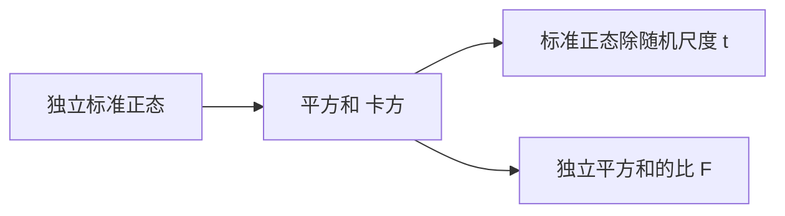
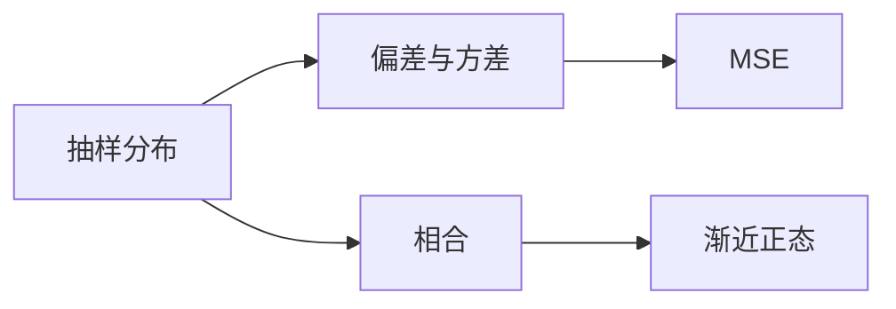
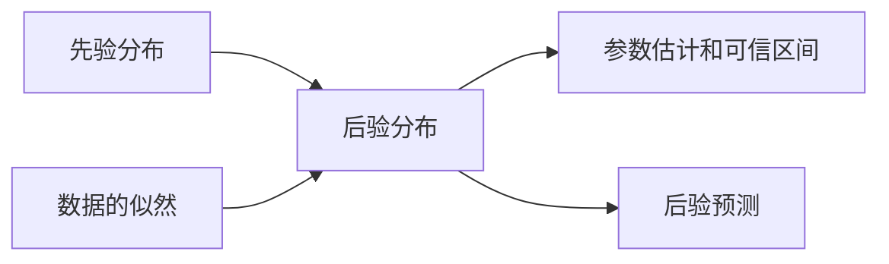
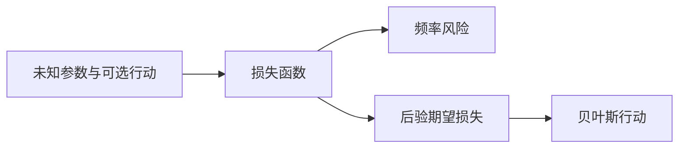
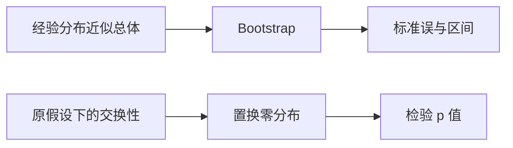
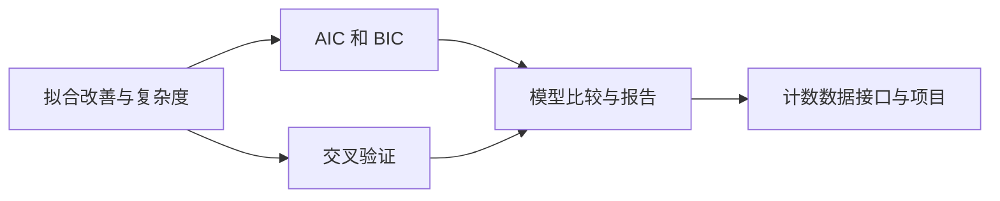

# 数理统计 MA305：从样本到推断

> **作者**：Codex 侧数学教授分身（CDX）｜**日期**：2026-10-13｜**版本**：v0.2-author-selfcheck。
> **状态：CDX 作者自校稿，待 DSH 独立审稿。** 同学已授权自检和送审。本版为 CDX 侧直接修订，未经 DSH 独立审稿；作者逻辑复查及实际验算范围见随附自检报告。原始未核验初稿保留。
> **设计来源**：`professors/MATH/handout_MA305_数理统计/00-讲义设计.md` 与 `01-章节规划.md`，16 讲。设计原有“只列大纲”是先前安排，本轮明确写作授权使本课进入正文阶段；不修改原设计中的历史记录。
> **前置口径**：MA301 概率论、高代的矩阵与正交投影，以及相关微积分是本课的学习要求，不表示同学已完成这些内容。频率派与贝叶斯并列讲解；本工作稿不改学习进度、不进入 approved，也不登记正式未证结论编号。

## 阅读方式与证明边界

统计推断从一个模型开始：数据如何产生、哪些量未知、希望控制什么损失或错误。先把这三件事写清，才选择估计量、区间或检验。

每讲包含结构图、定义与推导、示范、引导题 G、独立题 I、参考解答（作者自校）及升级坐标。全课 T1、T2 必做，T3 选做。课堂提问每讲至多三道，在同学发出自读完成信号后进行。

本稿在有限／可数模型与有明确密度和坐标变换的连续模型中工作。因子分解定理先给离散完整证明，再给常规连续坐标版本的证明，不以未讲的一般条件概率理论填补缺口。正态抽样分布、Cramér–Rao、Neyman–Pearson、Gauss–Markov 给正文证明；一般 MLE 渐近理论、Wilks、Bootstrap 相合性和 AIC／BIC 的理论依据明确列为后置输入。详见附录 B。

符号上，$X_1,\ldots,X_n$ 是尚未观测的样本，$x_1,\ldots,x_n$ 是实际数值；$\theta$ 是参数，$\widehat\theta$ 是样本的函数。本稿取样本量为正整数，使用样本方差时要求 $n\ge2$；正态方差严格为正，显著性水平满足 $0<\alpha<1$。概率和期望写作 $P_\theta,\mathbb E_\theta$，提醒它们随真实参数变化。

# 第一部分　模型与抽样分布

## 第 1 讲　统计模型、样本与统计量

### 1.1 从“已知参数算概率”到“未知参数作推断”

**统计模型**是概率分布族 $\{P_\theta:\theta\in\Theta\}$，$\Theta$ 为参数空间。例如 Bernoulli 模型中 $\Theta=[0,1]$，未知参数是成功概率；正态模型可有未知均值与方差，$\Theta=\mathbb R\times(0,\infty)$。

模型除指定单个观测的分布，还须指定观测间的关系。本课“随机样本”通常指独立同分布（i.i.d.）的 $X_1,\ldots,X_n$；时间序列、重复测量和分层样本不自动满足这个假设。

**统计量** $T(X_1,\ldots,X_n)$ 是不包含未知参数的样本函数。$\bar X=n^{-1}\sum_{i=1}^{n}X_i$ 是统计量，而当 $\mu$ 未知时 $\sum_{i=1}^{n}(X_i-\mu)^2$ 不是。用于估计参数的统计量称**估计量**，代入数据得到的数称**估计值**。

**抽样分布**是统计量在重复抽样下的分布。数据固定后，统计量的数值已经确定，但研究抽样分布仍能回答方法长期表现如何。

### 1.2 经验分布是把样本当作一个新总体

经验分布函数 $F_n(t)=n^{-1}\sum_{i=1}^{n}\mathbf1_{\{X_i\le t\}}$，给每个观测位置质量 $1/n$；重复数值的质量相加。对固定 $t$，$\mathbb E F_n(t)=F(t)$，$\operatorname{Var}F_n(t)=F(t)(1-F(t))/n$。由 Chebyshev，固定 $t$ 上 $F_n(t)$ 依概率趋于 $F(t)$。

这里没有证明对所有 $t$ 一致收敛；后者属于经验过程的进一步结论，不应从逐点结论直接跳出。

### 1.3 正态样本中均值与样本方差为何独立

设 $X_i$ 独立且服从 $N(\mu,\sigma^2)$，$n\ge2$。定义 $S^2=(n-1)^{-1}\sum_{i=1}^{n}(X_i-\bar X)^2$。令 $Z_i=(X_i-\mu)/\sigma$，列向量 $Z$ 的联合密度为 $(2\pi)^{-n/2}\exp(-\|z\|^2/2)$。

取第一行为 $n^{-1/2}(1,\ldots,1)$ 的正交矩阵 $Q$；这可由高代中的标准正交扩基得到。令 $Y=QZ$。正交变换保持平方范数，Jacobian 的绝对值为 $1$，故 $Y$ 的密度仍为 $\prod_{j=1}^{n}(2\pi)^{-1/2}e^{-y_j^2/2}$，各坐标独立标准正态。

第一坐标为 $Y_1=\sqrt n(\bar X-\mu)/\sigma$。由均值方向与残差方向的正交分解，

$\frac{(n-1)S^2}{\sigma^2}=\sum_{i=1}^{n}Z_i^2-Y_1^2=\sum_{j=2}^{n}Y_j^2.$

第一坐标与其余坐标组成的向量独立，因此 $\bar X$ 与 $S^2$ 独立。**关键是正态密度的旋转不变性及因子分解**；普通总体中均值和方差一般不独立。所用多元密度换元是分析前置，非一般测度论的偷渡。

**示例**：样本数值 $1,2,3$ 给 $\bar x=2,s^2=1$，而分母用 $n$ 的残差平方平均为 $2/3$。这些是统计量的实现值，还没有自动说明总体是正态。

**G1**：上述样本的经验分布在 $t=1.5,2,4$ 处各多少？

**提示**：数阈值以下的观测，再除以样本量。

**I1**：若总体均值 $\mu$ 未知，判断 $\bar X$、$\bar X-\mu$、$\max_{1\le i\le n}X_i$ 哪些是统计量。

**参考解答（作者自校）**：G1 为 $1/3,2/3,1$。I1 第一、第三是；第二含未知参数，虽可作为理论研究对象，却不能由样本独立算出。

**回看**：独立性是模型条件，统计量是数据压缩，抽样分布是评价工具。📋 **升级坐标**：统计实验、可测统计量和一般充分性在测度版统计中统一。

## 第 2 讲　三大抽样分布：卡方、t 与 F

### 2.1 Gamma 积分作为归一化工具

定义 $\Gamma(a)=\int_0^{\infty}u^{a-1}e^{-u}\,du$，$a>0$。分部积分给 $\Gamma(a+1)=a\Gamma(a)$，$\Gamma(1)=1$；由高斯积分换元得 $\Gamma(1/2)=\sqrt\pi$。另对 $a,b>0$ 定义 $B(a,b)=\int_0^1t^{a-1}(1-t)^{b-1}\,dt$。

将双重积分 $\Gamma(a)\Gamma(b)$ 中的变量换为 $r=u+v,t=u/(u+v)$，Jacobian 为 $r$，积分分成 $\Gamma(a+b)B(a,b)$，故 $B(a,b)=\Gamma(a)\Gamma(b)/\Gamma(a+b)$。这一步明确需要非负积分换序与多元换元。

### 2.2 卡方分布的构造与密度

独立 $Z_1,\ldots,Z_\nu\sim N(0,1)$ 的平方和 $U=\sum_{i=1}^{\nu}Z_i^2$ 定义为 $\chi^2_\nu$，$\nu$ 为正整数。由正负两支的密度变换，$Z_1^2$ 在 $u>0$ 上有密度 $u^{-1/2}e^{-u/2}/\sqrt{2\pi}$。

若独立变量具有形状参数 $a,b$、公共尺度 $2$ 的 Gamma 密度，卷积为

$\frac{e^{-u/2}}{2^{a+b}\Gamma(a)\Gamma(b)}\int_0^u v^{a-1}(u-v)^{b-1}\,dv=\frac{u^{a+b-1}e^{-u/2}}{2^{a+b}\Gamma(a+b)}.$

使用 $v=ut$ 和 Beta 积分即可得到等式。因此逐个相加给

$f_{\chi^2_\nu}(u)=\frac{u^{\nu/2-1}e^{-u/2}}{2^{\nu/2}\Gamma(\nu/2)},\quad u>0.$

Gamma 递推得均值 $\nu$、方差 $2\nu$。由讲 1，正态样本满足 $(n-1)S^2/\sigma^2\sim\chi^2_{n-1}$，且与均值独立。

### 2.3 t 分布：分母也随机

若 $Z\sim N(0,1)$、$U\sim\chi^2_\nu$ 独立，定义 $T=Z/\sqrt{U/\nu}\sim t_\nu$。变换 $z=t\sqrt{u/\nu}$ 的 Jacobian 为 $\sqrt{u/\nu}$，因此

$f_T(t)=\int_0^{\infty}\varphi(t\sqrt{u/\nu})f_U(u)\sqrt{u/\nu}\,du=\frac{\Gamma((\nu+1)/2)}{\sqrt{\nu\pi}\Gamma(\nu/2)}(1+t^2/\nu)^{-(\nu+1)/2}.$

最后一式将积分中的 $u^{(\nu+1)/2-1}\exp[-u(1+t^2/\nu)/2]$ 换元到 Gamma 积分。密度对称且尾部比正态厚；$\nu=1$ 是 Cauchy。均值在 $\nu>1$ 时为零，方差在 $\nu>2$ 时为 $\nu/(\nu-2)$，不能对所有自由度都声称有方差。

正态样本由前两讲立即得到 $\sqrt n(\bar X-\mu)/S\sim t_{n-1}$，因为分子标准化后与分母的卡方量独立。

### 2.4 F 分布与分位数

独立 $U\sim\chi^2_r,V\sim\chi^2_s$，定义 $W=(U/r)/(V/s)\sim F_{r,s}$。令 $u=(r/s)wv$，Jacobian 为 $(r/s)v$，将联合密度对 $v>0$ 积分，Gamma 积分给

$f_W(w)=\frac{\Gamma((r+s)/2)}{\Gamma(r/2)\Gamma(s/2)}(r/s)^{r/2}w^{r/2-1}(1+rw/s)^{-(r+s)/2},\quad w>0.$

从构造可见 $1/W\sim F_{s,r}$、$T_\nu^2\sim F_{1,\nu}$。后一个事实是以后双侧 t 检验与一自由度 F 检验相同的原因。

本稿分位数统一为**左尾分位数**：$q_D(u)$ 满足 $P(D\le q_D(u))=u$，$0<u<1$，对这些分布在各自支持内部唯一。简写 $z_u,t_{\nu,u},\chi^2_{\nu,u},F_{r,s;u}$。不能把表上的右尾记号直接混用。

**示例**：正态样本 $n=6$ 的样本方差枢轴量自由度为 $5$；标准化均值用 $t_5$，不是 $t_6$。

**G2**：若 $U\sim\chi^2_4$、$V\sim\chi^2_7$ 独立，$7U/(4V)$ 和其倒数各什么分布？

**提示**：对齐平方和及其自由度。

**I2**：为什么把 $\sigma$ 换成 $S$ 以后，标准化均值通常不再精确标准正态？

**参考解答（作者自校）**：G2 为 $F_{4,7}$ 与 $F_{7,4}$。I2 分母新增随机尺度，讲 1 的独立性恰使其成为 t；$S$ 不是未知 $\sigma$ 的确定值。

**回看**：自由度来自正交方向的数量；密度由构造推得。📋 **升级坐标**：一般正态二次型与 Cochran 定理可沿投影分解推广，本课在讲 12 证明实际需要的情形。

# 第二部分　点估计与信息

## 第 3 讲　矩估计与最大似然

### 3.1 矩估计先解方程，再检查参数空间

设 $\theta$ 有 $d$ 个分量。矩估计令理论矩 $\mathbb E_\theta X^j$ 等于样本矩 $n^{-1}\sum_{i=1}^{n}X_i^j$，$1\le j\le d$，解出参数。方程未必有唯一解，也未必落在允许参数空间，必须说明选择规则。

例如 Exp$(\lambda)$ 的均值为 $1/\lambda$，矩估计为 $\widehat\lambda=1/\bar X$（$\bar X>0$）。Unif$(0,\theta)$ 的均值为 $\theta/2$，矩估计为 $2\bar X$。两者都是数据的函数，但表现需另评估。

### 3.2 似然是固定数据后的参数函数

给定样本 $x$，联合质量或密度 $L(\theta;x)$ 视为 $\theta$ 的函数，称**似然**。它不必对 $\theta$ 积分为一，因而不是参数的概率密度。

最大似然估计是 $\widehat\theta\in\operatorname{argmax}_{\theta\in\Theta}L(\theta;x)$，允许多解，也可能没有达到上确界的解。取对数只在正似然部分进行，零似然参数要单独排除；导数为零只是内部候选，还须比较边界和曲率。

Bernoulli 样本总成功数 $s=\sum_{i=1}^{n}x_i$ 时，$\ell(p)=s\log p+(n-s)\log(1-p)$。内部求导为 $s/p-(n-s)/(1-p)$，得到 $\widehat p=s/n$；$s=0,n$ 时最大值在 $0,1$。约定 $0\log0=0$ 仅用于适当极限表达。

Exp$(\lambda)$ 的 $\ell(\lambda)=n\log\lambda-\lambda\sum_{i=1}^{n}x_i$，对正样本和最大点为 $n/\sum_{i=1}^{n}x_i$。Unif$(0,\theta)$ 取密度版本 $\theta^{-1}\mathbf1_{\{0<x\le\theta\}}$，则 $L=\theta^{-n}\mathbf1_{\{\theta\ge x_{(n)}\}}$，MLE 为样本最大值，不能忽略支持依赖参数再“令导数为零”。

### 3.3 正态模型与不变性

正态均值、方差均未知时，

$\ell(\mu,\sigma^2)=-\frac n2\log(2\pi\sigma^2)-\frac{1}{2\sigma^2}\sum_{i=1}^{n}(x_i-\mu)^2.$

利用 $\sum_{i=1}^{n}(x_i-\mu)^2=\sum_{i=1}^{n}(x_i-\bar x)^2+n(\bar x-\mu)^2$，先得 $\widehat\mu=\bar x$，再对正方差优化得 $\widehat\sigma^2_{\rm ML}=n^{-1}\sum_{i=1}^{n}(x_i-\bar x)^2$。需残差平方和为正；若全部观测相同，则在参数空间 $\sigma^2>0$ 中似然可随 $\sigma^2\downarrow0$ 无界增长，没有有限正方差最大点。

**MLE 不变性**：若 $\widehat\theta$ 达到全局最大值，且目标为 $\eta=g(\theta)$，定义剖面似然 $L^*(\eta)=\sup_{\theta:g(\theta)=\eta}L(\theta)$，则 $g(\widehat\theta)$ 达到该剖面的全局最大值。因为任意纤维上的上确界都不超过原全局最大值，而包含 $\widehat\theta$ 的纤维达到它。$g$ 不必单射，但“对多个参数同一目标取上确界”这一步不能省。

数值求解可用 Newton 迭代 $\theta_{k+1}=\theta_k-\ell'(\theta_k)/\ell''(\theta_k)$，但应检查参数约束、初值、边界、局部与全局最大之别。本稿不在未运行算法时宣称数值求解成功。

**示例**：数据 $1,2,3$ 在正态模型下 MLE 为 $(2,2/3)$；在指数模型下速率 MLE 为 $1/2$；模型不同，参数含义不同。

**G3**：Bernoulli 样本 $1,0,1,1,0$ 的 MLE 是多少？

**提示**：先求总成功数。

**I3**：Unif$(0,\theta)$ 样本 $1,2,3$ 的矩估计和 MLE 各多少？为什么不同？

**参考解答（作者自校）**：G3 为 $3/5$。I3 为 $4$ 与 $3$；前者匹配均值，后者在包含所有观测的支持限制下最大化密度。

**回看**：似然最大不自动意味着无偏或风险最小。📋 **升级坐标**：一般 MLE 的相合、渐近正态及非正则情形需要独立理论，讲 4 只证明指定例子。

## 第 4 讲　估计量的评价：无偏、MSE 与相合

### 4.1 目标函数先明确

估计 $g(\theta)$ 的偏差为 $b_\theta=\mathbb E_\theta T-g(\theta)$，全体参数上偏差零称**无偏**。平方损失下风险即均方误差

$\operatorname{MSE}_\theta(T)=\mathbb E_\theta(T-g(\theta))^2=\operatorname{Var}_\theta T+b_\theta^2.$

证明：把误差拆为 $T-\mathbb E_\theta T+b_\theta$，交叉项期望为零。无偏只去掉偏差项，不能单凭它断定总误差最小。

### 4.2 样本方差为何用 n-1

对独立同分布、有限方差 $\sigma^2$ 的样本，恒等式

$\sum_{i=1}^{n}(X_i-\bar X)^2=\sum_{i=1}^{n}(X_i-\mu)^2-n(\bar X-\mu)^2$

取期望给 $n\sigma^2-n(\sigma^2/n)=(n-1)\sigma^2$。因此 $S^2$ 无偏，**这一结论不要求正态**。正态假设用于精确卡方分布及与均值独立。

正态模型的方差 MLE 是 $(n-1)S^2/n$，期望为 $(n-1)\sigma^2/n$，有向下偏差。由讲 2 卡方方差，$\operatorname{Var}S^2=2\sigma^4/(n-1)$。方差 MLE 的 MSE 为 $(2n-1)\sigma^4/n^2$，小于无偏 $S^2$ 的 MSE；这说明允许一些偏差可能降低平方风险，不意味着 MLE 在所有估计类中都最优。

### 4.3 相合不等于无偏

$T_n$ 对 $g(\theta)$ **相合**指对每个参数及 $\varepsilon>0$，$P_\theta(|T_n-g(\theta)|>\varepsilon)\to0$。如果 MSE 趋零，Markov 用于平方误差便推出相合。样本均值有限方差时 MSE 为 $\sigma^2/n$，所以相合。

反例：只使用第一观测 $T_n=X_1$ 估计均值，常常无偏却不相合，因为分布不随 $n$ 集中。另一方面 Unif$(0,\theta)$ 的最大值 $M_n$ 有偏，却满足 $P_\theta(M_n\le\theta-\varepsilon)=(1-\varepsilon/\theta)^n\to0$（$0<\varepsilon<\theta$），所以相合。

### 4.4 渐近正态与 Delta 方法的证明范围

若 $\sqrt n(T_n-\theta)\xrightarrow{d}N(0,v)$，称相应估计量渐近正态。Bernoulli 样本均值在 $0<p<1$ 时由概率论 CLT 得 $\sqrt n(\bar X-p)\xrightarrow{d}N(0,p(1-p))$；这是明确调用 MA301 讲 12 的一般 CLT 陈述，不把一般 CLT 当本课已证。

若 $g$ 在 $\theta$ 可微，$g'(\theta)\ne0$，且 $T_n\to\theta$ 依概率，则 $g(T_n)-g(\theta)=g'(\theta)(T_n-\theta)+o_P(|T_n-\theta|)$。乘 $\sqrt n$，余项为 $o_P(1)$，所以极限方差为 $g'(\theta)^2v$；最后一步使用 Slutsky 引理，作为附录 B 输入 S2。若导数为零，不能照抄这一非退化结论，应研究更高阶尺度。

**示例**：估计指数分布均值 $m=1/\lambda$ 时，$\bar X$ 的 CLT 方差为 $m^2$；对 $g(m)=1/m$，速率估计量 $1/\bar X$ 的渐近方差为 $\lambda^2$，即其有限样本方差量级为 $\lambda^2/n$。这不是有限 $n$ 的精确方差公式。

**G4**：某估计量偏差 $1/5$、方差 $9/100$，MSE 多少？

**提示**：偏差要平方后再与方差相加。

**I4**：若 $X_i\sim\operatorname{Bernoulli}(p)$，说明 $T_n=(\sum_{i=1}^{n}X_i+1)/(n+2)$ 有偏但相合。

**参考解答（作者自校）**：G4 为 $13/100$。I4 期望减 $p$ 为 $(1-2p)/(n+2)$，方差为 $np(1-p)/(n+2)^2$，MSE 趋零；$p=1/2$ 是偏差恰为零的特例。

**回看**：有限样本风险、长期极限与是否无偏是不同评价维度。📋 **升级坐标**：一致相合、局部渐近理论、极小极大风险与超效率留给进阶统计。

## 第 5 讲　充分统计量与因子分解

### 5.1 什么信息可以丢掉

称统计量 $T(X)$ 对参数族**充分**，如果给定 $T$ 后样本 $X$ 的条件分布可以选为不依赖 $\theta$ 的形式。含义是：关于未知参数的分布变化已经由 $T$ 承载，剩余数据在给定 $T$ 后不再提供参数区分。

这不是说 $T$ 必须维数小，也不表示恢复原始数据；恒等统计量 $T(X)=X$ 总是充分，但毫无压缩。充分性相对于整个模型族，换一个模型可能改变答案。

### 5.2 离散因子分解定理：两个方向都证明

**定理 5.1**：有限或可数样本空间上的分布族 $p_\theta(x)$，统计量 $T$ 充分，当且仅当存在非负函数 $g_\theta,h$ 使 $p_\theta(x)=g_\theta(T(x))h(x)$，其中 $h$ 不依赖参数。

**充分方向**：对某个 $t$，记 $H(t)=\sum_{j=1}^{m_t}h(x_{t,j})$，其中 $x_{t,j}$ 枚举纤维 $T^{-1}(t)$，$m_t$ 为有限数或 $\infty$；空纤维取和为零。若 $P_\theta(T=t)>0$，则 $g_\theta(t)>0$ 且 $0<H(t)<\infty$，条件概率为 $h(x)/H(t)$，与参数无关。只有在所有参数下都为零概率的 $t$ 上，条件版本可任意指定。

**必要方向**：若条件质量函数可选为 $q(x\mid t)$ 且不依赖参数，则 $p_\theta(x)=P_\theta(T=T(x))q(x\mid T(x))$。令 $g_\theta(t)=P_\theta(T=t)$、$h(x)=q(x\mid T(x))$，即得。某参数给纤维零质量时左右均零，不需除以零。

某个纤维在特定参数下质量为零时，同一个条件版本在该参数下不受约束；只需在具有正质量的参数下满足上述条件式。

### 5.3 常规连续模型如何使用

连续 $T$ 的事件 $T=t$ 通常概率为零，不能照搬离散商式。以下给出本课使用的**坐标版本**：设样本可作参数无关的一一可微变换 $x\leftrightarrow(t,z)$（必要时分成若干带离散分支标记的区域），其中 $t=T(x)$，Jacobian 非零，变换适用域不依赖参数。若 $f_\theta(x)=g_\theta(T(x))h(x)$，变换后联合密度是 $g_\theta(t)h(x(t,z))|J(t,z)|$。

令 $a(t)=\int h(x(t,z))|J(t,z)|\,dz$（含离散分支时再对分支求和），则在 $0<a(t)<\infty$ 的相关取值上，条件密度为 $h(x(t,z))|J(t,z)|/a(t)$，参数消去，故充分。反向若 $f_{T,Z;\theta}(t,z)=f_{T;\theta}(t)q(z\mid t)$ 且 $q$ 不含参数，变回 $x$ 即得因子分解。所有等式按密度的几乎处处意义理解。

这完整证明了上述连续坐标情形；**任意可测统计量的全一般因子分解定理**需要一般条件分布工具，不在本课宣称已证，附录 B 标 S1。

**示例 1**：Bernoulli 样本的联合质量 $p^s(1-p)^{n-s}$，只通过 $s=\sum_{i=1}^{n}x_i$ 含参数，故总成功数充分；给定总数，所有具有该总数的序列等概率。

**示例 2**：正态未知均值、已知方差，$\sum_{i=1}^{n}x_i$ 充分。可直接用讲 1 的坐标：均值方向之外的正态坐标独立于均值，且分布不含 $\mu$；也可在密度中分出 $\exp(\mu\sum_{i=1}^{n}x_i/\sigma^2-n\mu^2/(2\sigma^2))$。

**示例 3**：正态样本 $n\ge2$、均值方差均未知时，$(\bar X,\sum_{i=1}^{n}(X_i-\bar X)^2)$ 充分。正交变换后，剩余坐标密度只依赖半径；作极坐标，方向在给定半径后与 $\mu,\sigma$ 无关。$n=2$ 时方向退化为两个符号，等概率；更高维为球面方向。半径为零是连续样本的零概率例外。这里用多元极坐标作为分析前置，未暗中使用一般条件分布定理。

### 5.4 最小充分与 Rao–Blackwell 的有限模型版本

充分统计量 $T$ 称**最小充分**，若它是任意其他充分统计量的函数（忽略全模型零概率点）。有限／可数模型中，一个可用判据是：$T(x)=T(y)$ 当且仅当似然向量成正比例，即有不依赖参数的 $c(x,y)>0$ 使对所有 $\theta$ 均有 $p_\theta(x)=c(x,y)p_\theta(y)$。

证明要点也可补齐：每个等价类选代表 $x_t$，令 $g_\theta(t)=p_\theta(x_t)$、$h(x)=c(x,x_t)$，因子分解给充分。任一充分统计量 $S$ 的同一纤维内，由其因子分解可知似然向量成比例，所以 $S(x)=S(y)$ 必推出 $T(x)=T(y)$，即 $T$ 可由 $S$ 决定。删去所有参数下都不可能的点可避免零向量。Bernoulli 内部参数 $0<p<1$ 时，比例含 $(p/(1-p))^{s_x-s_y}$，故总数相同恰是比例不含参数的条件。

若 $U$ 是无偏估计量，$T$ 充分，则 $U^*=\mathbb E[U\mid T]$ 可用与参数无关的条件分布计算。塔性质给无偏，且全方差公式给 $\operatorname{Var}U^*\le\operatorname{Var}U$。这是 **Rao–Blackwell 改进**；本讲有限／可数版本由讲义中的条件求和成立，不宣称已经处理一般条件期望的存在性。

**G5**：Poisson$(\lambda)$ 独立样本，证明总计数充分。

**提示**：把参数依赖集中到计数总和。

**I5**：Bernoulli 样本中用 $X_1$ 估计 $p$，给定总成功数后的 Rao–Blackwell 估计量是什么？

**参考解答（作者自校）**：G5 因联合质量为 $e^{-n\lambda}\lambda^{\sum_{i=1}^{n}x_i}/\prod_{i=1}^{n}x_i!$。I5 为总数除以 $n$，即样本均值，条件对称性给各位置成功概率相同且和等于总数。

**回看**：充分性是关于模型的信息保留性质，最小性另需证明。📋 **升级坐标**：完备性、Lehmann–Scheffé 与一般最小充分理论留给进阶，不将充分直接等同于最优无偏。

## 第 6 讲　Fisher 信息与 Cramér–Rao 下界

### 6.1 得分与正则条件

本讲先考虑实参数位于开区间、联合质量或密度为 $f_\theta(x)$ 的模型。假设公共支持不随 $\theta$ 改变，相关导数存在，微分可移入归一化积分及估计量期望中，得分有有限二阶矩。连续型可用邻域内可积控制函数等充分条件保证交换；不能仅因表达式可求导就认定全部条件成立。

**得分** $U_\theta(X)=\partial_\theta\log f_\theta(X)$；**Fisher 信息** $I(\theta)=\mathbb E_\theta U_\theta^2$。由归一化微分，$\mathbb E_\theta U_\theta=\int\partial_\theta f_\theta(x)\,dx=0$，离散型将积分改为合法求和。

若还可合法二次微分，则 $I(\theta)=-\mathbb E_\theta\partial_\theta^2\log f_\theta(X)$，因为 $\partial_\theta^2f=f[(\partial_\theta\log f)^2+\partial_\theta^2\log f]$，对两边积分为零。两个信息表达式的相等依赖这些条件。对本讲内部参数的 Bernoulli 模型，求和只有两项；对正态和指数模型，在远离零方差或零率的紧参数邻域，导数由可积的多项式乘指数尾控制；Poisson 求和可由邻域内指数矩控制。因此下述常见例子的交换具有模型依据，而 Uniform 支撑边界不能如此处理。

独立同分布样本的得分相加。零均值使交叉期望为零，得到 $I_n(\theta)=nI_1(\theta)$，相依数据不能直接照搬。

### 6.2 Cramér–Rao 完整证明

**定理 6.1**：上述条件下，若统计量 $T$ 无偏估计可微目标 $g(\theta)$、方差有限，且 $0<I_n(\theta)<\infty$，则

$\operatorname{Var}_\theta T\ge\frac{g'(\theta)^2}{I_n(\theta)}.$

**证明**：无偏性给 $\mathbb E_\theta T=g(\theta)$。合法微分后，$g'(\theta)=\mathbb E_\theta[TU_\theta]$。再用得分均值零，得到 $g'(\theta)=\operatorname{Cov}_\theta(T,U_\theta)$。Cauchy–Schwarz 因而给 $g'(\theta)^2\le\operatorname{Var}_\theta T\operatorname{Var}_\theta U_\theta=\operatorname{Var}_\theta T I_n(\theta)$，除以正信息即得。

取等要求中心化估计量与得分几乎处处成比例，$T-g(\theta)=c(\theta)U_\theta$。**下界不保证存在取等估计量**。有偏估计量不能原样套无偏界；若偏差为可微 $b(\theta)$，相同论证把分子换为 $(g'+b')^2$，MSE 还须加 $b^2$。

### 6.3 常见模型的信息

Bernoulli 内部参数 $0<p<1$ 的单个得分为 $(X-p)/(p(1-p))$，故信息 $1/[p(1-p)]$，样本均值方差 $p(1-p)/n$，达到无偏 CR 界。

正态方差已知时，关于均值的得分为 $(X-\mu)/\sigma^2$，单个信息 $1/\sigma^2$，样本均值达到 $\sigma^2/n$ 下界。若方差也未知，需多参数信息矩阵与目标梯度，不能将标量公式随意混用。

Exp$(\lambda)$ 的单个得分 $1/\lambda-X$，信息 $1/\lambda^2$。目标若为 $g(\lambda)=1/\lambda$，CR 界是 $1/(n\lambda^2)$，样本均值达到；目标若为速率本身，MLE 一般有偏，不能仅凭渐近效率声称有限样本取等。

**非正则反例**：一个 Unif$(0,\theta)$ 观测，内部对数导数为 $-1/\theta$，得分均值不为零，支持随参数移动。若误用 $I=1/\theta^2$，无偏估计 $2X$ 方差为 $\theta^2/3$，竟小于虚假的 $\theta^2$ 下界。错误在正则前提，而不是概率定律被推翻。

**G6**：$n$ 个 Poisson$(\lambda)$ 样本，求单个和总信息，并判断样本均值是否达到无偏下界。

**提示**：先求单个得分的二阶矩。

**I6**：为什么“估计量有偏但方差小于 CR 无偏下界”不构成矛盾？

**参考解答（作者自校）**：G6 在 $\lambda>0$ 时信息为 $1/\lambda,n/\lambda$，样本均值方差 $\lambda/n$，达到。I6 无偏界只约束满足无偏条件的估计量；必须比较完整 MSE 或适用的有偏界。

**回看**：信息是得分的二阶量，CR 是协方差恒等式加 Cauchy–Schwarz。📋 **升级坐标**：信息几何及 KL 局部展开归信息论后续；本讲自建 Fisher 信息，不依赖现有六讲信息论中并不存在的“第 11 讲”。

# 第三部分　区间与检验

## 第 7 讲　置信区间：随机的是区间

### 7.1 定义和频率解释

区间程序 $C(X)=[L(X),U(X)]$ 的置信水平至少 $1-\alpha$，指对每个允许参数 $\theta$ 都有 $P_\theta(\theta\in C(X))\ge1-\alpha$。在连续精确构造中常为等号；离散模型可能保守。

频率派把 $\theta$ 看作固定，重复抽样时区间随机。观察区间后，“该方法覆盖率为 $95\%$”不自动等同于“该次参数在此区间的概率为 $95\%$”。后一个概率陈述需要贝叶斯模型等额外结构。

**枢轴量** $Q(X,\theta)$ 的分布不依赖未知参数。若 $P(a\le Q\le b)=1-\alpha$，反解这个事件中的 $\theta$，就得到覆盖事件完全等价的区间。

### 7.2 正态均值和方差的精确区间

正态样本、$\sigma$ 已知时，枢轴量 $\sqrt n(\bar X-\mu)/\sigma\sim N(0,1)$，所以

$\mu\in\left[\bar X-z_{1-\alpha/2}\frac{\sigma}{\sqrt n},\ \bar X+z_{1-\alpha/2}\frac{\sigma}{\sqrt n}\right].$

$\sigma$ 未知且 $n\ge2$ 时，用讲 2 的 t 枢轴量，将 $z$ 换为 $t_{n-1,1-\alpha/2}$，$\sigma$ 换为 $S$，仍精确。它的精确性依赖正态，不是任意小样本都能得到的保证。

方差枢轴量 $W=(n-1)S^2/\sigma^2\sim\chi^2_{n-1}$，反解给

$\sigma^2\in\left[\frac{(n-1)S^2}{\chi^2_{n-1,1-\alpha/2}},\ \frac{(n-1)S^2}{\chi^2_{n-1,\alpha/2}}\right].$

注意两端分位数反向，是因为未知方差在分母。

### 7.3 二项比例：近似区间与保守保证

样本比例 $\widehat p$ 的 **Wald 区间**为 $\widehat p\pm z_{1-\alpha/2}\sqrt{\widehat p(1-\widehat p)/n}$。它只属大样本近似，$\widehat p=0$ 或 $1$ 时退化，不能声称精确覆盖。

反解以候选 $p$ 为方差参数的标准化不等式 $n(\widehat p-p)^2\le z^2p(1-p)$，得 **Wilson 区间**：中心为 $(\widehat p+z^2/(2n))/(1+z^2/n)$，半宽为

$\frac{z}{1+z^2/n}\sqrt{\frac{\widehat p(1-\widehat p)}{n}+\frac{z^2}{4n^2}},\quad z=z_{1-\alpha/2}.$

它避免 Wald 的端点退化，但仍不是所有有限样本下覆盖精确等于名义值的程序。若只求非渐近保证，概率论 Hoeffding 直接给 $[\widehat p-\varepsilon_n,\widehat p+\varepsilon_n]\cap[0,1]$，其中 $\varepsilon_n=\sqrt{\log(2/\alpha)/(2n)}$，覆盖至少 $1-\alpha$，代价是通常较宽。

**示例**：已知正态总体标准差 $2$，$n=16,\bar x=10$，$1-\alpha$ 均值区间为 $10\pm z_{1-\alpha/2}/2$。本例按枢轴量给出分位数表达式，不要求查表；学生覆盖率项目尚未运行。

**G7**：数据 $1,2,3$，假设正态但均值方差都未知，写均值的 $1-\alpha$ 区间。

**提示**：先求均值与分母为 n−1 的方差。

**I7**：同分布模型下样本量扩大四倍，已知方差均值区间的长度如何变化？

**参考解答（作者自校）**：G7 为 $2\pm t_{2,1-\alpha/2}/\sqrt3$。I7 在水平不变时长度减半。

**回看**：置信区间是具有覆盖性质的随机程序，必须说明精确、渐近还是保守。📋 **升级坐标**：同时置信区域、选择后推断和自适应区间在后续课程，不能把单次覆盖自动推广到反复筛选后的区间。

## 第 8 讲　Neyman–Pearson：在错误预算下提高功效

### 8.1 检验不是判定命题真假的算法

检验函数 $\phi(x)\in[0,1]$ 表示观察 $x$ 后拒绝 $H_0$ 的概率。值为 $0,1$ 是非随机化检验，内部值可借助独立均匀随机数实现。

**功效函数** $\beta_\phi(\theta)=\mathbb E_\theta\phi(X)$。第一类错误是在 $H_0$ 真时拒绝，检验水平为 $\sup_{\theta\in\Theta_0}\beta_\phi(\theta)\le\alpha$。第二类错误是在指定备择参数下不拒绝，概率 $1-\beta_\phi(\theta)$；它通常随备择变化，不是只由 $\alpha$ 决定。

“未拒绝”表示数据尚不足以越过设定门槛，不表示证明 $H_0$ 为真。

### 8.2 Neyman–Pearson 引理与完整证明

**定理 8.1**：简单假设 $H_0:f_0$ 对 $H_1:f_1$，两者相对于同一计数或积分基准有质量／密度。若检验 $\phi^*$ 在 $f_1>cf_0$ 时取 $1$，在 $f_1<cf_0$ 时取 $0$，等号处适当随机化，使 $\mathbb E_0\phi^*=\alpha$，其中 $c\ge0$，则它在所有水平不超过 $\alpha$ 的检验中功效最大。

**证明**：任意竞争检验 $\phi$ 满足逐点 $(\phi^*-\phi)(f_1-cf_0)\ge0$。因为第一因子在正似然差处非负、负似然差处非正，而等号处乘积为零。积分（离散则求和）得

$\mathbb E_1\phi^*-\mathbb E_1\phi\ge c(\mathbb E_0\phi^*-\mathbb E_0\phi)\ge0.$

这便是最强力。若 $f_0=0,f_1>0$，该区域拒绝不会花费原假设错误预算；比较 $f_1$ 与 $cf_0$ 的写法自动处理了这种情况，避免除以零。存在阈值和边界随机化可由似然比在原假设下的分位数构造；若在全部有原假设质量处均需接受或拒绝，则按端点情形处理。

### 8.3 从简单备择到单侧 UMP

正态独立样本、方差已知，$H_0:\mu=\mu_0$ 对 $H_1:\mu=\mu_1>\mu_0$，对数似然比为关于 $\sum_{i=1}^{n}X_i$ 的严格递增一次函数。所以 NP 检验拒绝条件为 $\sqrt n(\bar X-\mu_0)/\sigma>z_{1-\alpha}$，阈值不依赖所选 $\mu_1$。其功效函数为 $\beta(\mu)=1-\Phi(z_{1-\alpha}-\sqrt n(\mu-\mu_0)/\sigma)$，其中 $\Phi$ 是标准正态 CDF；这也直接给出单侧原假设下的单调性。

因此同一个检验对每个 $\mu_1>\mu_0$ 都最强力，称**一致最强力 UMP**。若原假设扩为 $\mu\le\mu_0$，拒绝概率随 $\mu$ 增大，最大值仍在边界 $\mu_0$，水平仍不超过 $\alpha$，并继续满足对应 UMP 性质。两侧备择通常没有这样一个同时照顾两方向的全类 UMP，不能直接将单侧结论复制过去。

### 8.4 离散数据中的随机化

**示例**：两次独立 Bernoulli，检验 $p=1/2$ 对 $p=3/4$。似然比随成功数增大。只在两次都成功时拒绝，水平为 $1/4$，功效为 $9/16$。若要求精确水平 $1/10$，在两次成功时以概率 $2/5$ 拒绝，其他结果接受，功效为 $9/40$。不使用随机化时可以选择保守水平，但未必能刚好达到名义值。

**G8**：上述例中，若只要至少一次成功便拒绝，水平与功效各是多少？

**提示**：使用零次成功的补事件。

**I8**：NP 引理中为什么比较同一水平预算下的功效，而不允许任何样本都拒绝？

**参考解答（作者自校）**：G8 为 $3/4$ 与 $15/16$。I8 永远拒绝的功效为一，但第一类错误也为一；没有约束的最优化失去意义。

**回看**：似然比按区分两种模型的证据强弱排序，阈值由错误预算决定。📋 **升级坐标**：复合假设的最优性、单调似然比和无偏检验类在更完整的检验理论中研究。

## 第 9 讲 常见检验：先确认零假设下的分布

本讲把第 2 讲的分布变成可操作的检验。选择检验的第一步是确认数据产生方式、独立性和方差假设，而不是只看变量的名字。

### 9.1 均值、方差与方差比

以下首先假定样本独立且来自正态总体。检验均值 $H_0:\mu=\mu_0$：若 $\sigma$ 已知，使用 $Z=\sqrt n(\bar X-\mu_0)/\sigma\sim N(0,1)$；若未知且 $n\ge2$，使用 $T=\sqrt n(\bar X-\mu_0)/S\sim t_{n-1}$。双侧水平 $\alpha$ 的拒绝域分别为 $|Z|>z_{1-\alpha/2}$ 与 $|T|>t_{n-1,1-\alpha/2}$。这里的分布是原假设成立时的分布。

若总体不是正态，用中心极限定理得到的学生化均值检验通常只是大样本近似，必须有相应矩条件和独立性条件；小样本时不能自动沿用精确 $t$ 分布。

检验 $H_0:\sigma^2=\sigma_0^2$，使用 $U=(n-1)S^2/\sigma_0^2$。双侧等尾拒绝域是 $U<\chi^2_{n-1,\alpha/2}$ 或 $U>\chi^2_{n-1,1-\alpha/2}$。卡方分布不对称，所以两个临界点不能写成某个中心的正负对称形式。

两组相互独立的正态样本，样本量 $n_1,n_2\ge2$，检验 $H_0:\sigma_1^2=\sigma_2^2$ 时，$F=S_1^2/S_2^2\sim F_{n_1-1,n_2-1}$。仍按两个尾部分配错误预算。方差比检验对非正态性敏感，其精确性来自正态平方和的构造。

若两总体还满足共同未知方差，检验 $H_0:\mu_1-\mu_2=\Delta_0$，令

$S_p^2=\dfrac{(n_1-1)S_1^2+(n_2-1)S_2^2}{n_1+n_2-2},\qquad T=\dfrac{\bar X_1-\bar X_2-\Delta_0}{S_p\sqrt{1/n_1+1/n_2}}.$

零假设下 $T\sim t_{n_1+n_2-2}$：分子标准化后为标准正态，分母平方对应两组独立卡方的和，且均值与组内方差独立。方差不等时，这个推导失效。常用 Welch 统计量以 $\sqrt{S_1^2/n_1+S_2^2/n_2}$ 为分母，并用近似自由度

$\nu_W=\dfrac{(S_1^2/n_1+S_2^2/n_2)^2}{(S_1^2/n_1)^2/(n_1-1)+(S_2^2/n_2)^2/(n_2-1)}.$

这是近似方法，不是上述精确 $t$ 构造的直接结论。记 $A=S_1^2/n_1+S_2^2/n_2$，则 $EA=\sigma_1^2/n_1+\sigma_2^2/n_2$、$\operatorname{Var}A=2\sum_{j=1}^{2}(\sigma_j^2/n_j)^2/(n_j-1)$。用缩放卡方匹配这两个矩，再代入样本方差，得到所列自由度。矩匹配不证明尾概率精确。

### 9.2 p 值怎样由检验族得到

**p 值**是使观测结果进入拒绝域的最小显著性水平，前提是拒绝域随水平嵌套。若越大的统计量 $T$ 越反对原假设，简单原假设下可取

$p(x)=P_0\{T(X)\ge T(x)\}.$

右侧概率中的 $X$ 是在原假设模型下重新产生的随机数据，$x$ 是已经观察到的数据。连续零分布下该尾概率在原假设下均匀分布：连续 CDF 的分位数反解给 $F_0(T)$ 均匀分布，尾概率为 $1-F_0(T)$；这不要求 CDF 处处严格递增。有原子时，包含等号的尾概率保守或恰好有效，满足 $P_0\{p(X)\le\alpha\}\le\alpha$。可数情形可按统计量由大到小累计质量：尾概率不超过 $\alpha$ 的取值形成一个总质量不超过 $\alpha$ 的上尾；一般有原子的分布按分位数左右极限处理。

复合原假设可以通过对原假设参数取尾概率上确界构造有效但可能保守的 p 值；不能任意代入未知参数后仍宣称精确。

对于对称的标准正态或 $t$ 零分布，双侧 p 值是 $2P_0\{T\ge |t_{\rm obs}|\}$。对于连续但不对称的零分布，等尾检验对应 $\min\{1,2\min(F_0(t_{\rm obs}),1-F_0(t_{\rm obs}))\}$。不同“双侧极端性”定义可能产生不同的双侧检验，应说明采用哪一种。

p 值不是 $P(H_0\mid x)$，不是效应大小，也不是未来复现实验成功的概率。样本量很大时，极小效应也可能显著；报告时应同时提供效应估计与区间。

### 9.3 Pearson 拟合优度与独立性检验

将独立观测分成 $k$ 个互斥类别，计数 $N_1,\ldots,N_k$，总数为 $n$。检验给定类别概率 $p_{10},\ldots,p_{k0}>0$，使用

$Q=\sum_{j=1}^{k}\dfrac{(N_j-np_{j0})^2}{np_{j0}}.$

📋 **渐近结论 S3**：固定 $k$、原假设概率为正且 $n\to\infty$ 时，$Q\Rightarrow\chi^2_{k-1}$。少一个自由度来自计数总和固定，而不是因为“随便删掉一项”。若概率由同一数据在一个正则的 $d$ 维模型内有效拟合，常见结论是自由度变为 $k-1-d$；这需要可识别性和拟合方式等条件，不能对任意估计程序机械扣除参数数目。本讲引用该渐近结论，不把它当作第 2 讲已经证明的精确分布。

对于 $r\times c$ **列联表**，记第 $i,j$ 格计数为 $N_{ij}$，行总和 $N_{i+}=\sum_{j=1}^{c}N_{ij}$，列总和 $N_{+j}=\sum_{i=1}^{r}N_{ij}$。在独立性假设下拟合期望计数 $E_{ij}=N_{i+}N_{+j}/n$。以下要求拟合期望均正；若观测边际为零，先说明删去空类别或采用其他校准方式，不能直接除以零。统计量为

$Q=\sum_{i=1}^{r}\sum_{j=1}^{c}\dfrac{(N_{ij}-E_{ij})^2}{E_{ij}}.$

在独立同分布分类抽样、真实格概率为正和固定表大小等条件下，零分布渐近为 $\chi^2_{(r-1)(c-1)}$。维数解释是完整概率表有 $rc-1$ 个自由参数，独立模型有 $(r-1)+(c-1)$ 个。稀疏计数时近似可能较差，应考虑合适的精确或模型模拟方法；“期望频数超过某数”是近似经验判断，不是定理的全部条件。

### 9.4 示例与练习

**示例**：四类观测计数为 $(30,20,25,25)$，检验四类等概率。拟合期望均为 $25$，所以 $Q=(25+25)/25=2$；在适用渐近近似时，p 值写作 $P\{\chi^2_3\ge2\}$。这里保留分布尾概率，不假装查过数值表。

**G9**：两组样本量各为 $3$，均值分别为 $2,4$，样本方差都为 $1$。在独立正态、共同方差模型下，写出检验均值相等的统计量和双侧 p 值。

**提示**：先合并方差，再求均值差标准误。

**I9**：进行了 $m$ 个各自有效的检验，计划只要有一个显著便宣称发现。证明每个检验采用水平 $\alpha/m$，可将“至少错误拒绝一个真实原假设”的概率控制在 $\alpha$ 内，无须检验之间独立。

**参考解答（作者自校）**：G9 为 $S_p^2=1$，$T=-2/\sqrt{2/3}=-\sqrt6$，自由度 $4$，p 值为 $2P\{t_4\ge\sqrt6\}$。I9 对真实原假设所对应的错误拒绝事件使用并集概率上界，至多 $m$ 项，每项不超过 $\alpha/m$；这就是 Bonferroni 控制的基本证明。

**回看**：检验公式的可信度取决于零分布的依据。📋 **升级坐标**：多重检验中的 FDR、稳健推断和复杂抽样在后续专题中展开。

## 第 10 讲 广义似然比：限制模型损失了多少拟合能力

第 8 讲比较两个固定参数；本讲让原假设和备择各自在自己的参数范围内选择最佳解释。

### 10.1 定义与 NP 检验的关系

设 $\Theta_0\subseteq\Theta$。当分母有限且正时，**广义似然比**定义为

$\Lambda(x)=\dfrac{\sup_{\theta\in\Theta_0}L(\theta;x)}{\sup_{\theta\in\Theta}L(\theta;x)},\qquad W(x)=-2\log\Lambda(x).$

它满足 $0\le\Lambda\le1$，而 $W\ge0$；分子为零时按扩展值定义 $W=+\infty$；小比值或大 $W$ 反对原假设。这里的 $\log$ 为自然对数。若最大值不实现，仍可用上确界；若完整模型似然无界，必须先处理模型病态，不能对 $\infty/\infty$ 套公式。

若参数空间只有两个简单假设点，在 $f_0>0$ 处 $\Lambda=1/\max(1,f_1/f_0)$，是 NP 比值的非增函数。它把 $f_1/f_0\le1$ 的整段压成并列值一；若需在这段继续分配拒绝概率，必须按原始比值打破并列，才保持 NP 最强力排序。不能仅凭压平后的统计量就宣称所有水平下自动最强力。复合模型也不直接继承 NP 最优性；GLRT 阈值仍需校准。

### 10.2 已知正态方差：特殊情形的完整证明

设 $X_i$ 独立服从 $N(\mu,\sigma^2)$，$\sigma^2$ 已知，检验 $H_0:\mu=\mu_0$。恒等式

$\sum_{i=1}^{n}(X_i-\mu_0)^2=\sum_{i=1}^{n}(X_i-\bar X)^2+n(\bar X-\mu_0)^2$

来自展开平方后交叉项 $2(\bar X-\mu_0)\sum_{i=1}^{n}(X_i-\bar X)=0$。完整模型在 $\bar X$ 取最大值，两似然中的公共常数相消，所以

$W=\dfrac{n(\bar X-\mu_0)^2}{\sigma^2}.$

原假设下 $\sqrt n(\bar X-\mu_0)/\sigma\sim N(0,1)$，因此 $W\sim\chi^2_1$，这是任意样本量下的精确结论。拒绝 $W>\chi^2_{1,1-\alpha}$ 等价于第 9 讲双侧 $z$ 检验。

### 10.3 方差未知时，有限样本分布会改变

保持正态模型，令 $R_1=\sum_{i=1}^{n}(X_i-\bar X)^2$，$R_0=\sum_{i=1}^{n}(X_i-\mu_0)^2$。对方差也最大化后，$\widehat\sigma_1^2=R_1/n$，$\widehat\sigma_0^2=R_0/n$，故在 $R_1>0$ 时

$W=n\log(R_0/R_1)=n\log\left(1+\dfrac{T^2}{n-1}\right),\quad T=\dfrac{\sqrt n(\bar X-\mu_0)}{S}.$

这个变换严格随 $T^2$ 增大，所以用精确零分布校准时，GLRT 等价于双侧 $t$ 检验。但 $W$ 本身在有限样本下通常不服从 $\chi^2_1$；等价的拒绝域不意味着统计量分布相同。

### 10.4 Wilks 定理的适用边界

📋 **Wilks 渐近结论 S4**：在适当正则条件下，完整参数维数为 $d$、原假设为光滑 $d_0$ 维子模型，真实参数在相关模型的正则内部位置，则零假设下 $W\Rightarrow\chi^2_{d-d_0}$。需要独立同分布或相应可替代的渐近理论、固定参数维数、可识别性、足够光滑及非退化 Fisher 信息等条件。此处只陈述；一般证明涉及局部似然的二次近似。

边界会破坏这一结论。仍设正态已知方差，但参数限制 $\mu\ge0$，检验 $\mu=0$。约束 MLE 是 $\max(\bar X,0)$，所以零假设下

$W=\bigl(\max(Z,0)\bigr)^2,\qquad Z\sim N(0,1).$

它以概率 $1/2$ 恰等于零；正值部分对应概率权重 $1/2$ 的 $\chi^2_1$。因此整体分布为 $\frac12\delta_0+\frac12\chi^2_1$，其中 $\delta_0$ 表示全部质量放在零的分布。不能无视边界直接使用普通 Wilks 自由度规则。

### 10.5 示例与练习

**示例**：已知 $\sigma=2$，$n=16$，$\bar X=11$，检验 $\mu=10$。$W=16/4=4$，p 值可写为 $P\{\chi^2_1\ge4\}=2P\{Z\ge2\}$。

**G10**：未知方差时 $n=10,T=2$，写出 $W$，并说明应如何得到精确 p 值。

**提示**：使用 W 与 t 平方的关系。

**I10**：上述边界模型中若观察到 $\bar X<0$，完整模型与原假设的最优似然有什么关系？这为什么使 $W=0$？

**参考解答（作者自校）**：G10 为 $10\log(13/9)$；精确 p 值用 $2P\{t_9\ge2\}$。I10 完整模型在边界 $\mu=0$ 最大化，与原假设相同，所以比值一、对数统计量零。

**回看**：似然比提供排序，精确分布或渐近定理提供阈值。📋 **升级坐标**：局部渐近正态、混合模型和不可识别参数需要更深入理论。

# 第四部分 线性模型：投影与推断

## 第 11 讲 最小二乘、帽子矩阵与 Gauss–Markov 定理

回顾高等代数中的正交投影：离一个子空间最近的点，是沿垂直方向投下去的点。本讲将这个几何事实用于数据拟合，再加入随机误差讨论估计质量。

### 11.1 模型、参数和两种随机性

设响应向量 $Y\in\mathbb R^n$，**设计矩阵** $D\in\mathbb R^{n\times p}$，模型为

$Y=D\beta+\varepsilon.$

本讲把 $D$ 看作已知固定矩阵，假定 $\operatorname{rank}D=p$ 且 $n>p$。$\beta\in\mathbb R^p$ 是未知参数，误差满足 $E\varepsilon=0$、$\operatorname{Cov}(\varepsilon)=\sigma^2I_n$。这包括共同方差与误差之间不相关，此时尚未假定正态，也不必把不相关提升为独立。

例如带截距的一元回归，$D$ 的第 $i$ 行为 $(1,x_i)$，于是 $E Y_i=\beta_0+\beta_1x_i$。若设计随机，需要给定设计后的相应假设，例如 $E(\varepsilon\mid D)=0$；本讲不自动涵盖内生性。

### 11.2 最小二乘解就是正交投影

**最小二乘估计**使 $\|Y-Db\|^2$ 最小。对 $b$ 求导得到**正规方程** $D^{\mathsf T}(Y-D\widehat\beta)=0$。满列秩保证 $D^{\mathsf T}D$ 正定可逆，因此

$\widehat\beta=(D^{\mathsf T}D)^{-1}D^{\mathsf T}Y.$

为什么这不是仅仅一个驻点？令 $e=Y-D\widehat\beta$，则 $e$ 与 $D$ 的每一列垂直。对任意 $b$，

$\|Y-Db\|^2=\|e+D(\widehat\beta-b)\|^2=\|e\|^2+\|D(\widehat\beta-b)\|^2.$

第二项非负，且因满列秩仅在 $b=\widehat\beta$ 时为零。这同时证明最小性和唯一性。

**帽子矩阵** $H=D(D^{\mathsf T}D)^{-1}D^{\mathsf T}$ 把 $Y$ 变成拟合值 $\widehat Y=HY$。直接相乘得 $H^{\mathsf T}=H,H^2=H$，并且 $HD=D$，因此它正是到 $\operatorname{col}(D)$ 的正交投影。残差 $e=(I-H)Y$，$\operatorname{rank}H=\operatorname{tr}H=p$。若含截距列，$\sum_{i=1}^{n}e_i=0$；不含截距时不能要求该等式。

秩不足时，到列空间的投影仍唯一，但不同参数可能给出相同拟合向量；不可逆的是参数识别，而不是最近点存在性。

### 11.3 Gauss–Markov 定理及证明

由模型立刻得到 $E\widehat\beta=\beta$ 和

$\operatorname{Cov}(\widehat\beta)=\sigma^2(D^{\mathsf T}D)^{-1}.$

**定理 11.1**：在 11.1 的假设下，$\widehat\beta$ 是最佳线性无偏估计，简称 BLUE。“最佳”指任何线性无偏估计的协方差减去其协方差均为半正定矩阵，不表示在全部可能估计量中 MSE 最小。

**证明**：写 $A_0=(D^{\mathsf T}D)^{-1}D^{\mathsf T}$。任意形如 $AY$ 的估计要对所有 $\beta$ 无偏，须 $AD=I_p$。令 $C=A-A_0$，则 $CD=0$，从而

$A_0C^{\mathsf T}=(D^{\mathsf T}D)^{-1}(CD)^{\mathsf T}=0.$

展开协方差，交叉项消失：

$\operatorname{Cov}(AY)=\sigma^2(A_0+C)(A_0+C)^{\mathsf T}=\sigma^2(D^{\mathsf T}D)^{-1}+\sigma^2CC^{\mathsf T}.$

对任意 $a\in\mathbb R^p$，$a^{\mathsf T}CC^{\mathsf T}a=\|C^{\mathsf T}a\|^2\ge0$，所以每个线性组合 $a^{\mathsf T}\widehat\beta$ 的方差都不大于竞争者，证毕。

证明没有使用正态性。反过来，若误差协方差不是 $\sigma^2I_n$，上面的最优性证明便不适用；已知一般正定协方差时可通过变换引出广义最小二乘，留作升级。

### 11.4 示例：直线拟合如何化成两个坐标

取 $x=(-1,0,1)^{\mathsf T}$，$Y=(1,2,4)^{\mathsf T}$，带截距。两列正交，$D^{\mathsf T}D=\operatorname{diag}(3,2)$，故

$\widehat\beta_0=7/3,\qquad\widehat\beta_1=3/2.$

拟合值为 $(5/6,7/3,23/6)^{\mathsf T}$，残差为 $(1/6,-1/3,1/6)^{\mathsf T}$。残差与常数列及 $x$ 列都垂直，平方和为 $1/6$。这正是“两个可解释方向加一个残差方向”的分解。

**G11**：仅有截距，$D=\mathbf1_n$。求 $H$、$\widehat\beta$ 及其方差。

**提示**：常数列与自身的内积为 n。

**I11**：为什么 Gauss–Markov 不排除某些有偏估计在某些参数处有更小 MSE？

**参考解答（作者自校）**：G11 为 $H=\mathbf1_n\mathbf1_n^{\mathsf T}/n$，$\widehat\beta=\bar Y$，方差 $\sigma^2/n$。I11 定理比较线性无偏估计的方差；有偏估计不属于竞争类，MSE 还含偏差平方。

**回看**：投影解决拟合，误差协方差决定精度。📋 **升级坐标**：岭回归、广义最小二乘和高维正则化放宽或改变这里的条件。

## 第 12 讲 正态线性模型、残差与单因素方差分析

Gauss–Markov 给出方差比较，但没有精确置信区间。本讲增加正态误差，把第 1–2 讲的独立方向方法提升到任意设计矩阵。

### 12.1 系数与残差的抽样分布

以下要求 $\sigma^2>0$。在第 11 讲模型中进一步设 $\varepsilon\sim N_n(0,\sigma^2I_n)$，即误差分量独立同分布正态。多元正态向量可由独立标准正态向量的仿射变换定义。于是

$\widehat\beta\sim N_p\left(\beta,\sigma^2(D^{\mathsf T}D)^{-1}\right).$

取 $\operatorname{col}(D)$ 的一组标准正交基，再扩成 $\mathbb R^n$ 的标准正交基，构成正交矩阵 $Q$。把 $\varepsilon/\sigma$ 变到这组坐标后仍有 $n$ 个独立标准正态分量。前 $p$ 个决定 $H\varepsilon$ 以及 $\widehat\beta-\beta$，后 $n-p$ 个决定 $(I-H)\varepsilon$。因此

$\operatorname{RSS}/\sigma^2=\|e\|^2/\sigma^2\sim\chi^2_{n-p},\qquad\widehat\beta\perp\operatorname{RSS}.$

这就是第 1 讲样本均值与样本方差独立性的同一几何证明。令 $s^2=\operatorname{RSS}/(n-p)$，得到误差方差的无偏估计。

### 12.2 单个系数、线性组合和联合限制

对非零固定向量 $a\in\mathbb R^p$，

$\dfrac{a^{\mathsf T}\widehat\beta-a^{\mathsf T}\beta}{s\sqrt{a^{\mathsf T}(D^{\mathsf T}D)^{-1}a}}\sim t_{n-p}.$

上述公式先要求 $a\ne0$；若 $d_0=0$，条件均值恒为零，均值区间退化为零而无需作 t 标准化。取 $a$ 为坐标向量便得到每个回归系数的检验和区间；取 $a=d_0$ 则得到指定设计位置的条件均值 $d_0^{\mathsf T}\beta$ 的区间。若预测独立的新观测 $Y_0=d_0^{\mathsf T}\beta+\varepsilon_0$，分子还含新误差，标准误应为 $s\sqrt{1+d_0^{\mathsf T}(D^{\mathsf T}D)^{-1}d_0}$，不能把均值区间当作新观测预测区间。

检验 $q$ 个独立线性限制 $H_0:R\beta=r$，其中 $1\le q\le p$，$R\in\mathbb R^{q\times p}$ 满行秩。记 $V=R(D^{\mathsf T}D)^{-1}R^{\mathsf T}$，则

$F=\dfrac{(R\widehat\beta-r)^{\mathsf T}V^{-1}(R\widehat\beta-r)/q}{s^2}\sim F_{q,n-p}\quad(H_0).$

证明要点可完整落在两步：$V$ 正定，原假设下 $V^{-1/2}(R\widehat\beta-r)/\sigma$ 是 $q$ 维标准正态，故其模平方是 $\chi^2_q$；它只依赖投影方向，与残差平方和独立。两者按自由度相除就是 $F$。

也可以写成 $F=[(\operatorname{RSS}_0-\operatorname{RSS}_1)/q]/[\operatorname{RSS}_1/(n-p)]$。理由是受限最小二乘相对无约束解的额外平方距离恰为上述二次型：最小化 $(b-\widehat\beta)^{\mathsf T}D^{\mathsf T}D(b-\widehat\beta)$ 且 $Rb=r$，拉格朗日方程给出差向量 $(D^{\mathsf T}D)^{-1}R^{\mathsf T}V^{-1}(r-R\widehat\beta)$，代回即得。

### 12.3 单因素 ANOVA：组间变化与组内变化

有 $a\ge2$ 组，第 $j$ 组 $n_j\ge1$ 个独立观测，$N=\sum_{j=1}^{a}n_j>a$，模型 $Y_{ji}=\mu_j+\varepsilon_{ji}$，误差独立 $N(0,\sigma^2)$。记组均值 $\bar Y_j$、总体均值 $\bar Y=N^{-1}\sum_{j=1}^{a}n_j\bar Y_j$。

平方和分解为

$\sum_{j=1}^{a}\sum_{i=1}^{n_j}(Y_{ji}-\bar Y)^2=\underbrace{\sum_{j=1}^{a}\sum_{i=1}^{n_j}(Y_{ji}-\bar Y_j)^2}_{\operatorname{SSW}}+\underbrace{\sum_{j=1}^{a}n_j(\bar Y_j-\bar Y)^2}_{\operatorname{SSB}}.$

逐组展开，交叉项因组内离均差和为零消失。完整模型有 $a$ 个组均值参数；原假设 $\mu_1=\cdots=\mu_a$ 只剩一个。因此

$F=\dfrac{\operatorname{SSB}/(a-1)}{\operatorname{SSW}/(N-a)}\sim F_{a-1,N-a}\quad(H_0).$

显著意味着并非所有均值相等，不能据此断言每一对均值都不同；事后两两比较还涉及多重性。

**示例**：两组为 $(1,3)$、$(3,5)$。组均值 $2,4$，总体均值 $3$，$\operatorname{SSB}=4$，$\operatorname{SSW}=4$，故 $F=(4/1)/(4/2)=2$，零分布自由度为 $(1,2)$。

### 12.4 残差能告诉我们什么

残差不是原始误差。$\operatorname{Cov}(e)=\sigma^2(I-H)$，故 $\operatorname{Var}(e_i)=\sigma^2(1-h_{ii})$，不同残差通常相关。$h_{ii}$ 称**杠杆值**，其总和为 $p$。高杠杆描述设计位置特殊，不等于必然存在大残差或异常响应。

残差对拟合值图的曲线可能提示均值结构遗漏，漏斗形可能提示异方差；按时间排列的残差可能暴露相关性。图形是诊断线索，不是对独立性或正态性的证明。若改变模型或删除观测，应说明理由，避免反复试到显著。

**G12**：只含截距时，12.1 的残差自由度、$s^2$ 和均值检验分别退化为什么？

**提示**：把设计矩阵的秩取为一。

**I12**：解释同一 $d_0$ 处新观测预测区间比条件均值区间宽的原因，并写出两种标准误。

**参考解答（作者自校）**：G12 自由度 $n-1$，$s^2=S^2$，得到单样本 $t$ 检验。I12 新观测还含一份独立误差；标准误分别为 $s\sqrt{d_0^{\mathsf T}(D^{\mathsf T}D)^{-1}d_0}$ 与 $s\sqrt{1+d_0^{\mathsf T}(D^{\mathsf T}D)^{-1}d_0}$。

**回看**：精确回归推断是正交正态坐标与卡方平方和的组合。📋 **升级坐标**：稳健标准误、混合效应模型和广义线性模型需要增加新的模型与推断工具。

# 第五部分 贝叶斯推断与重抽样

## 第 13 讲 先验、后验与共轭更新

频率推断固定参数、考察重复抽样。贝叶斯推断另行指定参数的先验分布，通过条件概率更新不确定性。二者可以使用相同似然，但概率陈述所指的对象不同。

### 13.1 贝叶斯公式也是归一化公式

记**先验密度**为 $\pi(\theta)$，观测数据为 $x$，似然为 $L(\theta;x)$。当积分有限且严格为正时，**后验密度**为

$\pi(\theta\mid x)=\dfrac{L(\theta;x)\pi(\theta)}{\int_{\Theta}L(u;x)\pi(u)\,du}.$

离散参数时把积分换成求和。分母是边际数据密度，也是使后验总概率等于一的常数。书写 $\pi(\theta\mid x)\propto L(\theta;x)\pi(\theta)$ 只省略了与 $\theta$ 无关的因子，不表示归一化可以不检查。

先验应在看见用于本次更新的数据之前确定，或明确说明先验构建额外使用了哪些数据。把同一数据先用于调整先验，再当作全新证据重复更新，会造成信息重复使用。**共轭先验**指更新后仍落在同一分布族的先验；它简化计算，不自动保证建模合理。

### 13.2 Beta–Bernoulli：成功次数如何改变分布

设 $X_i\mid p$ 独立服从 $\operatorname{Bern}(p)$，$s=\sum_{i=1}^{n}X_i$。取先验 $p\sim\operatorname{Beta}(a,b)$，$a,b>0$，密度

$\pi(p)=\dfrac{p^{a-1}(1-p)^{b-1}}{B(a,b)},\qquad0<p<1.$

第 2 讲的 Beta 积分给出 $B(a,b)=\Gamma(a)\Gamma(b)/\Gamma(a+b)$。乘上似然 $p^s(1-p)^{n-s}$ 后，幂次相加，故

$p\mid x\sim\operatorname{Beta}(a+s,b+n-s).$

令 $A=a+s,B=b+n-s$。利用 Beta 积分比值可得后验均值 $A/(A+B)$、方差 $AB/[(A+B)^2(A+B+1)]$。后验均值也可写成

$\dfrac{a+b}{a+b+n}\dfrac{a}{a+b}+\dfrac{n}{a+b+n}\dfrac{s}{n},\quad n>0.$

这显示先验均值与样本比例的权重如何变化；“先验样本量”在此是这个代数表示的解释，不代表真实观察过那些样本。

**MAP** 是使后验密度最大的参数值。当 $A>1,B>1$ 时，对后验对数密度求导得到唯一内部 MAP 为 $(A-1)/(A+B-2)$。若形状参数不满足该条件，最大值可能在边界、仅为边界极限，或者不唯一，不能照抄内部公式。

**示例**：四次试验成功三次，先验 $\operatorname{Beta}(2,2)$。后验为 $\operatorname{Beta}(5,3)$，后验均值 $5/8$，MAP 为 $2/3$，MLE 为 $3/4$。三种答案对应不同的构造原则，不应只按“哪一个更接近样本比例”评判。

### 13.3 Gamma–Poisson 与正态–正态

采用 **Gamma 的形状—率参数化**：$\lambda\sim\operatorname{Gamma}(a,b)$ 的密度为 $b^a\lambda^{a-1}e^{-b\lambda}/\Gamma(a)$，均值为 $a/b$。若 $X_i\mid\lambda$ 独立服从 $\operatorname{Pois}(\lambda)$，则似然中关于参数的部分是 $\lambda^{\sum_{i=1}^{n}x_i}e^{-n\lambda}$，所以

$\lambda\mid x\sim\operatorname{Gamma}\left(a+\sum_{i=1}^{n}x_i,b+n\right).$

若样本为指数分布，且 $\lambda$ 表示率，则似然为 $\lambda^n e^{-\lambda\sum_{i=1}^{n}x_i}$，更新变为 $\operatorname{Gamma}(a+n,b+\sum_{i=1}^{n}x_i)$。同一个先验族不意味着不同似然具有相同更新式。

再设 $X_i\mid\mu$ 独立服从 $N(\mu,\sigma^2)$，$\sigma^2$ 已知，先验 $\mu\sim N(m_0,\tau^2)$，$\tau^2>0$。合并指数中的二次项：

$\dfrac{1}{\sigma^2}\sum_{i=1}^{n}(x_i-\mu)^2+\dfrac{(\mu-m_0)^2}{\tau^2}=\left(\dfrac n{\sigma^2}+\dfrac1{\tau^2}\right)(\mu-m_n)^2+\text{与 }\mu\text{ 无关的项},$

其中

$v_n=\left(\dfrac n{\sigma^2}+\dfrac1{\tau^2}\right)^{-1},\qquad m_n=v_n\left(\dfrac{n\bar x}{\sigma^2}+\dfrac{m_0}{\tau^2}\right).$

因此 $\mu\mid x\sim N(m_n,v_n)$，均值与 MAP 相同。独立未来观测的**后验预测分布**为 $X_{\rm new}\mid x\sim N(m_n,\sigma^2+v_n)$：先从后验抽取均值，再加上独立观测噪声。参数不确定性与新的观测噪声两部分都必须保留。

### 13.4 可信区间与 MAP 的坐标问题

**可信区间** $C(x)$ 满足 $P\{\theta\in C(x)\mid x\}=1-\alpha$，概率依据指定先验和似然的后验。等尾区间由后验的 $\alpha/2$ 与 $1-\alpha/2$ 分位数构成。它不自动满足对每个固定 $\theta$ 都有频率覆盖率 $1-\alpha$；置信区间也不自动具有后验概率解释。

MLE 的一一变换不变性来自对同一似然重新标记参数。MAP 最大化的是密度：若 $\eta=g(\theta)$ 光滑可逆，后验密度变成 $\pi_\theta(g^{-1}(\eta)\mid x)|d g^{-1}(\eta)/d\eta|$，多出的雅可比可改变最大点。因此 MAP 一般不具有相同的不变性；概率分布的变换与密度峰的位置要区分。

**G13**：先验 $\lambda\sim\operatorname{Gamma}(2,3)$，两次独立 Poisson 观测为 $1,4$。写后验及后验均值。

**提示**：注意 Gamma 采用率参数。

**I13**：已知观测方差一，$n=4,\bar x=2$，先验 $N(0,1)$。写后验、等尾 $95\%$ 可信区间及未来一次观测的预测分布。

**参考解答（作者自校）**：G13 后验 $\operatorname{Gamma}(7,5)$，均值 $7/5$。I13 后验 $N(8/5,1/5)$，可信区间 $8/5\pm z_{0.975}/\sqrt5$，预测分布 $N(8/5,6/5)$。

**回看**：后验来自似然乘先验，点估计还要说明选择原则。📋 **升级坐标**：层次先验、MCMC 和后验渐近理论在后续引入；本讲的共轭计算不依赖这些工具。

## 第 14 讲 损失与风险：为什么取后验均值或中位数

一个估计量只报一个数，究竟错多少才算严重？不同损失会产生不同的最优答案，本讲给第 13 讲的点估计补上决策依据。

### 14.1 先说明决策问题

令行动为 $a$，**损失函数** $L(\theta,a)\ge0$ 表示真实参数为 $\theta$、采取行动 $a$ 的代价。估计程序 $\delta$ 将数据映为行动。**频率风险**定义为

$R(\theta,\delta)=E_\theta L(\theta,\delta(X)).$

平方损失下就是 MSE；不对称误判损失下则不是。给定先验后，**贝叶斯风险**为 $r(\pi,\delta)=\int R(\theta,\delta)\pi(\theta)\,d\theta$。通过联合分布先对参数条件化，可写成对数据边际分布求平均的后验期望损失：

$r(\pi,\delta)=E_X\left[E\{L(\theta,\delta(X))\mid X\}\right].$

在这里的离散模型或可交换非负积分的密度模型中，等式直接来自求和或积分次序交换。若对每个数据 $x$ 选择使后验期望损失最小的可测行动，便使整体贝叶斯风险最小。一般可测选择问题不在本课证明范围。

### 14.2 平方损失选择均值：完整推导

假设后验二阶矩有限，记 $m=E(\theta\mid x)$。展开得到

$E[(\theta-a)^2\mid x]=E[(\theta-m)^2\mid x]+(a-m)^2,$

因为交叉项含 $E(\theta-m\mid x)=0$。第一项与行动无关，第二项在且仅在 $a=m$ 时为零。所以平方损失下唯一最优行动是后验均值。这不是说均值在所有损失下都最佳。

例如第 13 讲 $\operatorname{Beta}(5,3)$ 后验，平方损失选择 $5/8$；MAP 为 $2/3$，其后验平方损失比最优值多 $(2/3-5/8)^2=1/576$。

### 14.3 绝对损失选择中位数

假定后验一阶绝对矩有限，令 $g(a)=E(|\theta-a|\mid x)$，后验分布函数为 $F$。函数 $|\theta-a|$ 关于 $a$ 凸，期望仍凸。左右导数为

$g'_-(a)=2F(a-)-1,\qquad g'_+(a)=2F(a)-1.$

理由是对固定 $\theta$，绝对值折线在 $a=\theta$ 左右斜率由负一变正一；差商绝对值不超过一，故可交换极限与期望。凸函数最小值的条件为左导数不大于零、右导数不小于零。因此

$F(a-)\le1/2\le F(a),$

恰好表示 $a$ 是后验**中位数**。若分布恰将一半质量放在一个无质量区间的两侧，中位数可以不唯一，每个中位数都最优；不能将连续严格递增分布的唯一性推广到所有后验。

### 14.4 分类损失、后验概率与 MAP

参数只有 $0,1$ 两种。采取行动 $1$ 而真值为 $0$ 的损失记 $c_{10}>0$；行动 $0$ 而真值为 $1$ 的损失记 $c_{01}>0$；正确判断损失零。记后验 $P(\theta=1\mid x)=p_x$，两行动的后验风险分别为 $c_{10}(1-p_x)$ 与 $c_{01}p_x$。所以当

$p_x>\dfrac{c_{10}}{c_{10}+c_{01}}$

时选择一，小于时选择零，相等时两者并列。等代价时得到最大后验概率分类。

对于有限离散参数，零一损失的最优行动是最大后验概率点。对于连续后验，严格的损失 $\mathbf1\{a\ne\theta\}$ 对每个固定行动几乎必然为一，不能据此证明“连续 MAP 是零一损失最优估计”。连续 MAP 是密度峰；若用小邻域命中奖励解释，还要说明邻域和坐标尺度。

### 14.5 同一数据如何形成两种结论

使用第 13 讲 I13 的数据摘要：已知方差一，$n=4,\bar x=2$。

| 方法 | 点估计与区间 | 概率解释 |
|---|---|---|
| 频率方法 | MLE 为 $2$；区间 $2\pm z_{0.975}/2$ | 固定任意均值，重复产生的区间覆盖率为 $95\%$ |
| 先验 $N(0,1)$ 的贝叶斯方法 | 平方损失估计为 $8/5$；区间 $8/5\pm z_{0.975}/\sqrt5$ | 给定本次数据和先验模型，均值的后验区间概率为 $95\%$ |

贝叶斯区间在此较窄，包含先验信息的贡献；不能将其较窄直接判为对所有固定参数都更可靠。频率方法也不是没有模型假设，它同样依赖这里的正态与已知方差模型。

**G14**：后验仅在 $0,10$ 两点取值，概率为 $3/4,1/4$。平方损失和绝对损失下分别选择什么？

**提示**：分别计算期望与累计概率。

**I14**：假阳性代价为 $9$，假阴性代价为 $1$。后验阳性概率为 $0.8$ 时应采取哪个行动？为什么不能只看它是否超过 $1/2$？

**参考解答（作者自校）**：G14 后验均值 $5/2$；唯一后验中位数为零。I14 阈值 $9/10$，因此选择阴性；两类错误代价不同。阳性行动后验损失 $9\times0.2=1.8$，阴性行动为 $1\times0.8=0.8$。

**回看**：推断分布、选择行动、评价程序是相关但不同的任务。📋 **升级坐标**：可容许性、极小极大决策和因果行动价值属于后续决策理论。

## 第 15 讲 Bootstrap 与置换：重用数据需要什么理由

Bootstrap 尝试近似估计量的抽样变化，置换检验利用原假设下标签可交换的结构。两者都使用数据重排，但依据不同。

### 15.1 经验分布重抽样

给定独立同分布样本 $x_1,\ldots,x_n$，**非参数 Bootstrap** 从经验分布 $\widehat F_n$ 独立有放回抽取 $n$ 次，得到 $X_1^*,\ldots,X_n^*$，重新计算 $\widehat\theta^*=T(X_1^*,\ldots,X_n^*)$。条件于原数据，重复这一过程 $B$ 次，得到 $\widehat\theta^{*(1)},\ldots,\widehat\theta^{*(B)}$。

星号分布首先是“在这份固定数据上重抽”的条件分布。用它近似真实抽样分布，需要统计量与总体满足适当稳定性条件，不是因为重复次数大就自动成立。

对于样本均值，条件计算可以直接完成。令 $v_n=n^{-1}\sum_{i=1}^{n}(x_i-\bar x)^2$，则

$E^*(\bar X^*)=\bar x,\qquad\operatorname{Var}^*(\bar X^*)=v_n/n.$

这里 $E^*,\operatorname{Var}^*$ 指固定原数据后的重抽样期望和方差。样本 $(1,2,3)$ 有 $v_n=2/3$，所以重抽均值条件方差为 $2/9$，而无偏样本方差除以三为 $1/3$；二者在有限样本下并不完全一样。

### 15.2 从重抽结果到区间

重抽均值记为 $\overline\theta^*=B^{-1}\sum_{b=1}^{B}\widehat\theta^{*(b)}$，常用标准误估计是

$\widehat{\operatorname{se}}_{\rm boot}=\left[\dfrac1{B-1}\sum_{b=1}^{B}(\widehat\theta^{*(b)}-\overline\theta^*)^2\right]^{1/2},\quad B\ge2.$

重抽偏差估计为 $\overline\theta^*-\widehat\theta$。设重抽估计量的经验分位数为 $q_u^*$，两种基本区间是：

- **百分位区间**：$[q_{\alpha/2}^*,q_{1-\alpha/2}^*]$。
- **基本 Bootstrap 区间**：$[2\widehat\theta-q_{1-\alpha/2}^*,2\widehat\theta-q_{\alpha/2}^*]$。

第二式来自用 $\widehat\theta^*-\widehat\theta$ 近似 $\widehat\theta-\theta$，再反解不等式。两者一般不相同，也都没有自动的有限样本精确覆盖率。分位数的有限 $B$ 计算约定应记录；增加 $B$ 主要减少重抽数值误差，不能修复原始样本不足或模型失配。

📋 **相合性预告 S5**：在独立同分布、有限正方差等条件下，Bootstrap 对适当中心化缩放的样本均值分布具有一致近似性质。光滑函数、某些分位数等还需相应条件；一般证明留待经验过程和渐近统计。

### 15.3 一个不能忽视的失败例子

若总体为 $U(0,\theta)$，估计端点用样本最大值 $M_n$。真实总体连续，但 Bootstrap 最大值 $M_n^*$ 以概率

$P^*(M_n^*=M_n)=1-(1-1/n)^n\longrightarrow1-e^{-1}$

恰等于原最大值，因为只需至少一次抽到那个最大观测。因而 $n(M_n-M_n^*)$ 在零有不会消失的原子；真实的 $n(\theta-M_n)$ 则趋向连续的指数型分布：对 $t\ge0$，其生存概率趋向 $e^{-t/\theta}$。所以普通 Bootstrap 没有正确再现该端点估计的极限分布。

依赖时间序列不能不加处理地逐点独立重抽；重尾下所需矩可能不存在；边界和不光滑统计量也要另行判断。Bootstrap 是有条件的工具。

### 15.4 置换检验的依据是交换性

两组独立同分布样本在原假设“来自同一分布”下，给定合并数据后，标签分配具有对称性。保持两组样本量，枚举所有标签分配，计算如均值差绝对值的统计量 $T$。若共有 $M$ 个等可能分配，则

$p_{\rm perm}=\dfrac{\#\{\text{分配}:T_{\rm perm}\ge T_{\rm obs}\}}{M}.$

为什么有效？对固定合并数据，真实分配在这些分配中等可能；极端排序中占比不超过 $\alpha$ 的分配，其总概率不超过 $\alpha$。并列时使用包含等号的尾部，会使检验保守；适当随机化可细化水平。

随机试验也可在明确的随机分配机制与相应尖锐原假设下构造随机化检验。仅仅“两个总体均值相等”并不足以保证标签交换性，例如两总体方差与形状可以不同；这时原始均值差置换检验不自动精确。

**示例**：第一组 $(1,2)$，第二组 $(3,4)$，统计量为均值差绝对值，观测值为 $2$。六个等可能第一组选择分别为 $\{1,2\},\{1,3\},\{1,4\},\{2,3\},\{2,4\},\{3,4\}$，统计量为 $2,1,0,0,1,2$。精确置换 p 值为 $2/6=1/3$。

如果使用随机抽取的 $B$ 个置换而非穷举，应采用与抽样方案匹配的 Monte Carlo p 值。在常见的独立均匀随机置换方案下，把原始统计量加入比较，可用 $(1+\#\{T_b\ge T_{\rm obs}\})/(B+1)$；不要以零次超过便报告 p 值为零。

**G15**：某估计值为 $5$，重抽的两个端点分位数为 $3,8$。分别写百分位区间和基本区间。

**提示**：围绕原估计值反射重抽端点。

**I15**：为什么将 Bootstrap 重复次数从一千增加到一百万，也不能解决 15.3 中最大值的失败？

**参考解答（作者自校）**：G15 为 $[3,8]$ 与 $[2,7]$。I15 增加重复次数只会更精确地近似当前经验分布下那个错误的重抽分布，不能消除结构性的原子差异。

**回看**：先问重抽机制模仿了什么，再问计算次数。📋 **升级坐标**：分块 Bootstrap、学生化重抽和置换渐近理论在后续课程处理。

# 第六部分 模型选择与课程收口

## 第 16 讲 模型选择、应用接口与项目说明

拟合越复杂，训练误差通常越小；但训练数据同时参与了参数选择，因此训练表现会乐观。本讲介绍三种比较思路，重点放在目标、条件和报告边界。

### 16.1 自由度与过拟合

固定设计线性回归中，$\widehat Y=HY$，$\operatorname{tr}H=p$ 表示拟合占用的方向数，残差只剩 $n-p$ 个方向。增加自变量扩张列空间，不会增大训练残差平方和；但新增方向也可能主要拟合噪声。

假设模型均值 $m=D\beta$ 正确，训练响应 $Y=m+\varepsilon$，在同一设计点独立产生 $Y'=m+\varepsilon'$。则

$E\|Y-HY\|^2=\sigma^2(n-p),\qquad E\|Y'-HY\|^2=\sigma^2(n+p).$

第一式来自残差投影秩，第二式来自 $Y'-HY=\varepsilon'-H\varepsilon$，两项独立且平方模期望分别为 $n\sigma^2,p\sigma^2$。因此独立新响应误差与训练误差的期望差是 $2p\sigma^2$。这给复杂度惩罚提供一个具体来源，但不是所有模型的 AIC 推导。

### 16.2 AIC、BIC 的定义与不同目标

设在相同数据与可比较的似然约定下，拟合对数似然最大值为 $\widehat\ell$，自由参数数目为 $k$，定义

$\operatorname{AIC}=-2\widehat\ell+2k,\qquad\operatorname{BIC}=-2\widehat\ell+k\log n.$

在这些准则内部，数值较小的模型优先。这里使用自然对数，$k$ 要包含拟合的方差等参数。比如高斯线性模型有 $p$ 个回归系数、共同方差未知，则通常 $k=p+1$，不是只数斜率。

📋 **理论定位 S6**：AIC 在相应正则设定下近似校正拟合对数似然对预测表现的乐观偏差，可与 KL 预测目标联系；BIC 在正则、固定维数、合适先验等条件下来自边际似然的渐近展开。这里给定义与使用边界，不给一般推导。BIC 中样本量的解释依赖抽样模型；相关数据不能机械以数据表行数代替独立信息量。

比较时必须使用相同响应数据、同一密度基准和一致常数约定。不同样本量、不同响应变换而忽略雅可比、只比较残缺似然，都可能让数值失去可比性。两准则可能偏好不同模型，这不构成计算矛盾；它们的目标与惩罚不同。奇异模型、参数在边界或维数随样本增长时不能照搬一般正则解释。

**示例**：模型 A 的 $\widehat\ell=-100,k=2$，模型 B 的 $\widehat\ell=-97,k=5$。AIC 都是 $204$。BIC 之差 B 减 A 为 $-6+3\log n$；当 $n>e^2$，BIC 偏好 A。该例只比较给定数值，不代表已拟合真实数据。

### 16.3 交叉验证必须包含整个训练流程

**K 折交叉验证**把观测索引分为不交叠的验证折 $I_1,\ldots,I_K$。第 $j$ 次仅在其他折上训练整个流程，得到 $\widehat f^{(-j)}$，再计算

$\operatorname{CV}=\dfrac1n\sum_{j=1}^{K}\sum_{h=1}^{n_j}L\bigl(y_{i_{jh}},\widehat f^{(-j)}(x_{i_{jh}})\bigr).$

这里 $I_j=\{i_{j1},\ldots,i_{jn_j}\}$，$n_j$ 为该折大小，内层枚举该折索引；各折大小之和为 $n$。标准化参数、缺失值填补、特征选择与超参数搜索都必须限定在相应训练数据内。若先用全数据挑特征，再做表面上的分折评估，就已经泄漏验证信息。

对同一动物、同一受试者或同一会话的多条记录，应考虑按独立单位分组切分；时间预测应尊重时间方向。切分策略必须匹配希望推广到的新对象。用 CV 选择模型后，对所选模型表现作无偏或较少乐观的评估，通常还需外层评估或保留测试集；不要反复查看测试集并据此调整模型。

### 16.4 神经科学接口：一个最小的计数模型

假设不同观测窗的计数 $K_i$ 相互独立且 $K_i\sim\operatorname{Pois}(\lambda t_i)$，已知时长 $t_i>0$。似然中与 $\lambda$ 有关的部分为

$L(\lambda)\propto\lambda^{\sum_{i=1}^{n}K_i}\exp\left(-\lambda\sum_{i=1}^{n}t_i\right).$

所以总计数与总暴露时间决定率的 MLE：$\widehat\lambda=\sum_{i=1}^{n}K_i/\sum_{i=1}^{n}t_i$。如果允许 $\lambda=0$，零总计数的 MLE 为零；若参数空间规定严格正，则该边界情形只有上确界。Gamma 形状—率先验更新为

$\lambda\mid K\sim\operatorname{Gamma}\left(a+\sum_{i=1}^{n}K_i,b+\sum_{i=1}^{n}t_i\right).$

例如两个窗长为 $1,2$，计数为 $2,4$，估计率为 $2$ 个事件每单位时间。它不是两次计数的简单平均，因为暴露时间不同。

真实神经计数可能存在不应期、过度离散、共同输入与时间相关，Poisson 独立窗口只是需检查的模型。回归系数、条件均值差或预测改善本身也不等于因果效应；因果推断在后续专题建立额外假设。

### 16.5 两个项目：任务书而非已运行结果

**项目一：用 C 观察置信区间覆盖率（第 7 讲后可启动）**。

1. 明确正态模型、固定均值与方差，设定至少两个样本量。对每个场景独立重复 $1000$ 次，每次产生新样本。
2. 每次构造已知方差 $z$ 区间和未知方差 $t$ 区间，记录是否包含真实均值及区间长度。
3. 汇总覆盖频率与平均长度。估计覆盖频率为 $\widehat c$ 时，Monte Carlo 标准误可报告为 $\sqrt{\widehat c(1-\widehat c)/1000}$；偏离名义值的几个千分点不必然说明公式错误。
4. 另设一个明确标注的非正态场景，讨论精确结论失去条件后发生什么。保存种子、随机数生成方法、场景和样本量。
5. 未来代码放在 `projects/semester_01/MA305_coverage/`。提交源代码、复现说明和表格；本项目仍为学生任务，作者自校脚本不代替该项目，也没有学生模拟结果。

**项目二：同一数据的频率与贝叶斯报告（第 14 讲后可启动）**。

选 Bernoulli、Poisson 或已知方差正态模型之一，固定同一数据与同一似然。报告 MLE、合适频率区间和检验；再明确至少两种合理先验，给出后验、所用损失下的估计和可信区间。逐句区分两种区间的概率含义，讨论先验敏感性、小样本与大样本变化。若写代码，放在 `projects/semester_01/MA305_bayes_comparison/`。验收看推断逻辑和可复现性，不预设某一方法必须获胜。

**G16**：两个模型对数似然最大值相同，参数数目相差 $3$，AIC 与 BIC 的差是多少？

**提示**：两式中似然项抵消。

**I16**：研究有十名受试者，每人一百条记录。目标是预测新受试者。随机打散全部一千行做 CV 有什么隐患？应怎样调整？

**参考解答（作者自校）**：G16 参数更多者 AIC 多 $6$，BIC 多 $3\log n$。I16 同一人的相关信息可同时进入训练和验证，夸大对新人的表现；应按受试者分组，且预处理与调参也在训练组内完成。

**回看**：模型选择比较的是明确目标下的程序表现，而不是为“真实模型”颁发保证书。📋 **升级坐标**：MA306／测度概率、渐近统计、经验过程、高维统计、因果推断和一般决策理论共同扩展本课；未在此建立的概念均不作为已经学会的内容。

# 综合自测

> 以下题目及解答已作作者自校，仍待 DSH 数学审稿员独立核验。T1、T2 为必做，T3 为选做。自测结果和项目完成情况只有在学生实际作答或运行后才能记录；本文件不代表学生已经完成 MA305。

## T1（必做）估计、风险与置信区间

**T1.1** 独立样本来自 $U(0,\theta)$，采用密度版本 $f_\theta(x)=\theta^{-1}\mathbf1\{0<x\le\theta\}$，$\theta>0$。求矩估计和 MLE。推导最大值 $M_n$ 的均值与方差，并构造它的无偏倍数。

**T1.2** 独立正态样本，均值与方差均未知。比较 $S^2$ 与 $\widehat\sigma^2=\frac{n-1}{n}S^2$ 的偏差和 MSE。说明 MSE 较小是否意味着该估计在全部估计量中最优。

**T1.3** 四个独立正态观测为 $1,2,3,4$。构造均值的 $1-\alpha$ 置信区间和方差的 $1-\alpha$ 等尾置信区间；只要求分位数表达式，不查表。

**T1.4** 某人看见一个 $95\%$ 置信区间后说：“参数已有 $95\%$ 概率在这个固定区间里；而且再抽一个观测也有 $95\%$ 概率落入这里。”分别解释两句话的问题。

### T1 参考解答（作者自校）

**T1.1** 总体均值 $\theta/2$ 给出矩估计 $2\bar X$；似然在 $\theta\ge M_n$ 上为 $\theta^{-n}$，所以 MLE 为 $M_n$。当 $0<m<\theta$，$P(M_n\le m)=(m/\theta)^n$，密度为 $nm^{n-1}/\theta^n$。对任意正整数 $r$，积分得到

$E(M_n^r)=\int_0^\theta m^r\dfrac{nm^{n-1}}{\theta^n}\,dm=\dfrac n{n+r}\theta^r.$

所以 $EM_n=n\theta/(n+1)$，$\operatorname{Var}(M_n)=n\theta^2/[(n+2)(n+1)^2]$，无偏修正为 $(n+1)M_n/n$。MLE 的偏差为 $-\theta/(n+1)$，MSE 为 $2\theta^2/[(n+1)(n+2)]$。这类参数依赖支撑的模型不适用第 6 讲的常规 CR 证明。

**T1.2** $S^2$ 无偏且 MSE 为 $2\sigma^4/(n-1)$。另一个估计偏差为 $-\sigma^2/n$，方差为 $2(n-1)\sigma^4/n^2$，MSE 为 $(2n-1)\sigma^4/n^2$。当 $n\ge2$ 时，后者小于前者。只比较两种估计量，不能得到全类最优结论。

**T1.3** $\bar x=5/2$，离均差平方和为 $5$，$S^2=5/3$。均值区间为

$\left[\dfrac52-t_{3,1-\alpha/2}\sqrt{\dfrac5{12}},\ \dfrac52+t_{3,1-\alpha/2}\sqrt{\dfrac5{12}}\right].$

方差区间为 $[5/\chi^2_{3,1-\alpha/2},\ 5/\chi^2_{3,\alpha/2}]$。反解方差枢轴量时，上分位数进入下端点。

**T1.4** 频率置信度是随机区间程序对固定参数的覆盖率，并非未经先验建模就得到的后验概率。参数区间也不是新观测预测区间；新观测自身波动需要额外计入。

## T2（必做）充分性、信息与检验

**T2.1** 对独立 $\operatorname{Pois}(\lambda)$ 样本，证明 $S=\sum_{i=1}^{n}X_i$ 充分；进一步在 $\lambda>0$ 的参数空间证明其最小充分性。

**T2.2** 对上述模型求单观测 Fisher 信息，并证明 $\bar X$ 达到估计 $\lambda$ 的无偏 CR 下界。列出应用下界时使用的模型条件。

**T2.3** 两次独立 Bernoulli 试验，检验 $p=1/2$ 对 $p=3/4$，要求水平恰为 $1/2$。写出 NP 随机化检验和功效。

**T2.4** 一个 $2\times2$ 列联表计数为第一行 $(30,20)$、第二行 $(20,30)$。求独立性模型期望计数与 Pearson 统计量，并说明采用什么零分布、该分布是精确还是渐近。

### T2 参考解答（作者自校）

**T2.1** 联合质量函数为 $e^{-n\lambda}\lambda^S/\prod_{i=1}^{n}x_i!$，符合第 5 讲离散因子分解。对两个样本向量 $x,y$，其似然比为常数因子乘以 $\lambda^{S(x)-S(y)}$；在整个 $\lambda>0$ 上与参数无关，当且仅当 $S(x)=S(y)$。由已证明的离散最小充分判据得到结论。

**T2.2** 单观测得分 $U=X/\lambda-1$，均值零，方差 $\operatorname{Var}(X)/\lambda^2=1/\lambda$。独立样本信息为 $n/\lambda$，下界 $\lambda/n$，恰等于样本均值方差。这里使用固定计数支撑、内部参数 $\lambda>0$、可交换微分与求和、有限得分二阶矩及估计量无偏等条件。样本得分为 $U_n=n(\bar X-\lambda)/\lambda$，也直接体现 CR 等号的线性相关条件。

**T2.3** 似然比随成功数 $S$ 增加。$S=2$ 时总拒绝，花费原假设概率 $1/4$；$S=1$ 的原假设概率为 $1/2$，在这里以概率 $1/2$ 拒绝，再花费 $1/4$；$S=0$ 时不拒绝。备择下功效为 $9/16+(1/2)(6/16)=3/4$。

**T2.4** 两个行总和与列总和均为 $50$，总数 $100$，每格期望为 $25$。统计量 $Q=4\times25/25=4$；在第 9 讲的独立分类抽样和正概率条件下使用渐近 $\chi^2_1$，p 值近似为 $P\{\chi^2_1\ge4\}$。固定有限计数时它不是精确的连续卡方分布。

## T3（选做）重抽样、贝叶斯比较与 ANOVA

**T3.1** 设计一个比较均值 $t$ 区间与 Bootstrap 百分位区间覆盖率的实验，明确外层重复与内层重抽的区别。列出应记录的量，不必在阅读阶段运行。

**T3.2** Bernoulli 数据共 $10$ 次成功 $8$ 次。比较先验 $\operatorname{Beta}(1,1)$ 与 $\operatorname{Beta}(5,5)$ 下的后验均值、内部 MAP 以及 MLE，解释差异。

**T3.3** 三组独立同方差正态数据为 $(1,3)$、$(3,5)$、$(5,7)$。写出组间、组内平方和、自由度和单因素 ANOVA 统计量。显著时能否断言任意两组均值均不同？

### T3 参考解答（作者自校）

**T3.1** 固定总体分布、真实均值和样本量，每次外层重复产生全新样本，分别构造两种区间；Bootstrap 区间在该次样本内部独立有放回重抽。外层用于估计真实重复抽样覆盖率，内层近似该份数据的 Bootstrap 分位数。记录覆盖指示、长度、空值或算法失败、外层次数、内层次数、种子和分位数约定。两区间用同一外层样本便于配对比较；覆盖率差的 Monte Carlo 不确定性应按配对覆盖指示差估计。正态与偏态总体可分场景比较。本稿没有运行记录，因此没有可报告的模拟覆盖率。

**T3.2** 第一种后验为 $\operatorname{Beta}(9,3)$，均值 $3/4$、MAP 为 $4/5$；第二种为 $\operatorname{Beta}(13,7)$，均值 $13/20$、MAP 为 $2/3$；MLE 为 $4/5$。更集中于 $1/2$ 的第二先验产生更强收缩；是否合理要看先验依据和风险目标，不能仅据与 MLE 的距离裁定。

**T3.3** 组均值 $2,4,6$，总体均值 $4$。$\operatorname{SSB}=2(4+0+4)=16$，$\operatorname{SSW}=2+2+2=6$。自由度为 $2,3$，$F=(16/2)/(6/3)=4$。拒绝的结论是至少一个组均值与其他不同，不能推出所有两两比较都显著。

# 附录 A 记号与易混概念

| 记号或术语 | 本讲义约定 |
|---|---|
| $\theta,\Theta$ | 参数与参数空间；频率分析中参数固定 |
| $\widehat\theta$ | 由样本构造的估计量；代入观测后才是数值 |
| $\bar X,S^2$ | 样本均值、分母为 $n-1$ 的样本方差 |
| MLE / MAP | 最大似然估计 / 最大后验密度或质量点 |
| 充分统计量 | 给定它后，剩余数据的条件分布不再携带参数依赖 |
| $I_1(\theta),I_n(\theta)$ | 单观测、全样本 Fisher 信息；独立同分布正则模型下后者为前者的 $n$ 倍 |
| CRLB | Cramér–Rao 下界，须说明估计目标与正则条件 |
| $\chi^2_\nu,t_\nu,F_{r,s}$ | 卡方、Student t、F 分布；下标为自由度 |
| $z_u,t_{\nu,u},\chi^2_{\nu,u},F_{r,s;u}$ | 左尾累计概率为 $u$ 的分位数；不是右尾临界概率 |
| $H_0,H_1$ | 原假设与备择假设 |
| $\alpha,\beta(\theta)$ | 显著性水平、功效函数；本稿的 $\beta(\theta)$ 不表示第二类错误概率 |
| p 值 | 按指定拒绝排序定义的原假设尾概率或最小拒绝水平 |
| $D,H,e,\operatorname{RSS}$ | 设计矩阵、帽子矩阵、残差、残差平方和 |
| $p$ | 视局部上下文为成功概率或回归参数个数；每次转换均就地说明 |
| $\pi(\theta),\pi(\theta\mid x)$ | 先验、后验密度或质量函数 |
| $L(\theta;x),L(\theta,a)$ | 前者为似然，后者为损失；分号和第二个自变量类型帮助区分 |
| $E^*,P^*$ | 固定原始数据后的 Bootstrap 条件期望与概率 |
| $\Rightarrow,\xrightarrow{P}$ | 依分布收敛、依概率收敛 |
| $\log$ | 自然对数；本课似然与信息准则均采用它 |
| $\operatorname{Gamma}(a,b)$ | 形状为 $a$、率为 $b$，均值 $a/b$ |

常见易混事项：

- 无偏是有限样本期望性质，相合是样本量趋于无穷的性质，二者互不替代。
- 充分性是相对于给定模型族的信息保留性质，不等于统计量维数尽可能小，也不等于某个估计一定好。
- CR 下界不适用于所有模型；支撑依赖参数、边界参数等必须单独检查。
- 置信区间谈抽样覆盖，可信区间谈给定模型的后验概率，预测区间还涉及新观测噪声。
- 不拒绝不等于接受为真；显著不等于效应大；相关或预测改善不等于因果。
- 不相关一般不推出独立；本课一些独立性结论依赖联合正态或明确的构造。
- 线性无偏最优只在指定比较类成立；增加模型参数可改善训练拟合，却未必改善新数据表现。
- Bootstrap 与置换都有成立条件，重复计算本身不能替代理论依据。

# 附录 B 证明范围、前置接口与待补事项

本附录记录本讲义自身的证明边界，不将陈述过的结论自动记为学生已经掌握，也不代替学习系统的正式定理登记或审稿结论。

## B.1 已在正文展开的证明链

- 第 1 讲：正态样本均值与样本方差独立，依据正交坐标变换。
- 第 2 讲：卡方、t、F 的密度构造，依据变量变换、Gamma/Beta 积分。
- 第 3–4 讲：MLE 的不变性、MSE 分解及样本方差无偏。
- 第 5 讲：有限／可数离散因子分解定理及最小充分判据；连续模型提供规则坐标分解版本，并分别解释本课正态例子。
- 第 6 讲：标量正则模型 CR 下界与等号条件。
- 第 8 讲：简单假设 NP 引理的比较证明。
- 第 10 讲：正态已知方差下似然比的精确卡方结论；未知方差与 t 检验的关系；边界反例。
- 第 11–12 讲：最小二乘投影、Gauss–Markov、正态线性模型抽样分布与线性限制 F 检验。
- 第 13–14 讲：三类共轭更新、平方损失后验均值与绝对损失后验中位数的最优性。
- 第 15–16 讲：置换排序的有效性解释、均值 Bootstrap 的条件矩、线性模型训练误差乐观偏差。

“已展开”说明正文证明范围。作者已复查逻辑与条件；数值验算提供有限证据，**不表示这些证明已通过 DSH 独立审稿或形式化证明**。

## B.2 引用与预告清单

| 编号 | 正文所用结论 | 本稿处理方式与条件 |
|---|---|---|
| S1 | 一般支配模型的因子分解定理及条件分布版本 | 一般形式未证明；不以规则坐标版本冒充一般定理，后续测度概率补足 |
| S2 | 大数定律、CLT、Slutsky 与 Delta 方法的极限工具 | 对应概率课程前置；Delta 方法给局部展开解释，一般极限定理的证明不在此重写；需确认读者实际具备前置 |
| S3 | Pearson 统计量的渐近卡方分布及拟合参数自由度调整 | 第 9 讲明确为条件性渐近结论；完整证明需要多元 CLT、投影及参数拟合渐近理论 |
| S4 | 一般 Wilks 定理 | 第 10 讲陈述并列条件，只证明正态特例；边界例提醒条件不可删除 |
| S5 | Bootstrap 相合性与一般覆盖精度 | 第 15 讲仅作条件性预告，未证明一般结论；明确给端点估计失败例 |
| S6 | AIC 的一般偏差校正与 BIC 的边际似然展开 | 第 16 讲给定义、目标和适用范围；一般推导留待渐近统计 |

**分析输入 A0（未在本课重证）**：高斯积分、非负积分换序／可积情形换序、多元密度换元、受可积控制时的求导或极限换积分（第 2、5、6、14 讲）。这些不是自动免除条件的泛称；作者在所用经典模型逐项确认适用条件，正式前置与登记由 DSH 审稿裁定。

另需前置：一元与必要的多元微积分、积分变量变换、线性代数中的正定矩阵与正交投影、独立性及基本条件概率。文中的有限维正态独立方向论证已就地说明，但不由此声称一般条件期望理论已经建立。MA404 的接口仅作 Fisher 信息与 KL 的概念联系；本稿在第 6 讲自建 Fisher 信息，不依赖未经确认的“MA404 第 11 讲”。

## B.3 作者自校范围与独立审稿待办

同学已授权自检与送审。作者复查了证明、例题、G/I 与 T1–T3 解答，使用可复跑脚本进行有理数计算、有限枚举、矩阵运算、确定性数值积分和格式检查，范围见随附报告。分布尾概率保留符号形式的题目按枢轴量与检验规则复核。S1–S6 的一般证明仍未完成，不能由数值检查替代；请 DSH 独立审稿员裁定条件、证明范围与候选登记。

# 附录 C 阅读资源与成稿状态

## C.1 配套阅读方向

- Casella 与 Berger《Statistical Inference》：估计、充分性与检验理论的系统补充。
- Wasserman《All of Statistics》：将统计推断、渐近方法和计算观点联系起来。
- 陈希孺的数理统计教材：中文论证与习题补充，按手头版本选择相关章节。
- Gelman 等《Bayesian Data Analysis》：在本课共轭模型之后拓展贝叶斯建模。

以上是与设计对应的配套阅读方向，未逐版逐页校对。本稿推导以自足说明为主，不将这些书名当作某个未经核验公式的引用证明。

## C.2 本轮交付状态

- 执笔身份：**Codex 侧数学教授分身（CDX）**。
- 工作内容：依据 DSH 侧 MA305 设计与章节规划编写 16 讲正文、每讲练习与参考解答（作者自校）、综合自测及附录。
- 当前状态：**CDX 作者自校完成，待 DSH 独立审稿**。
- 授权演变：上一轮仅写作并暂停核验；本轮同学明确授权自检与送审，本版据此修订，不改原初稿记录。
- 学习状态：本文是待完善教学资料，未据此更新学生已学进度。
- 下一阶段：通过双轨交换区交付 DSH，安排真实独立数学审稿；综合审稿与归档由 DSH 按实际结论处理，本版不产生审稿通过声明。
