# MA306 概率论II：测度论概率

本稿为DSH首审后修订的16讲完整作者稿，按原设计保留明确的未证明输入，不代表独立审稿通过或学生学习完成。先读输入与去向表；第2讲后紧接附录A/B，作为后续必读证明依赖。全书题目在各讲正文，分离答案统一置于末部，先独立作答再查阅。T1–T3综合自测未填写任何学生成绩。

本书目标是把对象、目标、构造、验证与适用条件连接起来。一般实分析、拓扑和MA301全课不被默认已完成；本稿补建实际所用概念，仍保留明确的分析前置与后续证明边界。

首审提出的量词说明、支撑斜率界、上穿起始持仓与已证工具定位已逐项处理；详细回应独立保存于《首审逐项回应_20261031》。本稿尚未获得复审批准。

# 本书未证明输入与去向

2026-10-31。核对 `lectures/math/unproven_registry.md` 当前编号后编制。本文件只在作者目录追踪，不修改共享登记、不签发新R号、不等于DSH批准或学生已学。

| 本稿标识 | 准确输入及使用点 | 证明状态 | 既有登记对应与去向 |
|---|---|---|---|
| R18／分析输入A0 | 第12讲高斯积分中二维极坐标换元；第14讲高斯极限及第15讲正态增量继承此分析输入 | 高斯积分计算写出，但一般多元换元定理未在本书证明 | 共享R18仍未证；数分补证。A0是合称，不新占R号 |
| U306-4 | Kolmogorov扩张：实值一致有限维律产生柱σ代数概率；第4讲陈述，第15–16讲构造无限过程引用 | 陈述未证；有限乘积测度已证不等于无限扩张已证 | 与R20“无限独立序列存在性”相连但范围更广；不把U别名等同正式R号；后续测度/过程存在性单元 |
| U306-5 | 一般Polish空间Prokhorov；第11讲一般空间接口 | 陈述＋骨架；本书实线胎紧子列定理完整证明 | 暂无核实到的正式R号，候选待审；概率测度的弱拓扑单元 |
| U306-6 | 一般Polish空间Skorokhod表示；第11讲接口 | 一般版陈述；实线分位数表示完整证明 | 暂无正式R号，候选待审；概率耦合单元 |
| U306-7 | Birkhoff遍历定理；第15讲平稳时间平均解释 | 陈述＋证明骨架，最大遍历不等式/闭包步骤未证 | 暂无正式R号，候选待审；遍历论单元 |
| U306-8 | Kolmogorov连续性定理及Brownian连续修改；第15讲 | 矩估计与有限维一致性已算，连续版本工具未证，完整存在性仍依赖U306-4/8 | 暂无正式R号，候选待审；随机过程/Brownian构造单元 |

## 已提供作者证明但不自动销共享项

| 既有项或历史候选 | 本书覆盖 | 未作的扩张与状态说明 |
|---|---|---|
| U306-1/2/3 | 一般预测度扩张、实线Stieltjes构造、σ有限RN，正文2及附录A/B | 作者补证完成；此前留缺口历史保留，未把作者编号当正式批准 |
| R19 连续模型积分规则 | 第3讲收敛、第4讲Tonelli/Fubini、第6讲条件期望 | 共享合称范围未整体核销；一般密度换元仍属分析输入 |
| R21 一般iid SLLN与CLT | 第13讲可积SLLN，第14讲有限方差CLT及LF | 作者稿有完整证明，未完成正式讲授/审稿销号；无方差CLT不在结论内 |
| R23 LLN/CLT/Slutsky/Delta工具 | 第13–14讲及一元一阶Delta | 不声称多元、高阶或具体统计推断全部覆盖；共享状态不改 |
| B1–B4历史后置项 | 13强律；12/14特征函数CLT；8–10鞅停时；6一般条件期望 | 作者覆盖路径已给，状态仍由共享审核/教学流程管理 |

## 仍未承诺覆盖的外部接口

R22的一般因子分解与条件分布版本、R28的正则条件核和互信息有限量化表示，不因第6讲条件期望存在而自动获得。条件期望是随机变量的几乎必然等价类；同时为所有Borel集合选择一致的条件概率核另需理论。R24–R27的Pearson/Wilks/Bootstrap/AIC/BIC不在本书16讲完整证明范围。

基础实数完备性、初等级数、微积分基本定理、分部积分与复指数初等运算是本稿分析入口条件，并非宣称学生已经掌握。紧性、凸支撑线、L2完备性、RN所需单调收敛等本书已经就地补证；阅读时可按依赖导航回读，而不能用未来课程名称顶替证明。

---

# 第1讲 概率空间再访

> 作者工作稿，DSH首审后修订待复审，未获批准；正文完成不代表学生学习完成。

## 0 结构图景与入口

掷骰子之后只报告奇偶，与你直接看到点数，获得的是不同的信息。概率空间把“结果是什么”“能问哪些问题”“问题的概率多少”拆成三个对象。本讲从有限集合进入；不假定已修 MA401 或点集拓扑。需要的集合运算、逆像和可数并都在此说明。学习终点：能算出一个观测的事件族，能证明生成族上的一致性如何传播。

## 1 从问题到 σ-代数

对象是非空集合 $\Omega$。子集 $A$ 表示问题“结果是否属于 $A$”。补集表示否定，并集表示至少一个问题成立。**σ-代数** $\mathcal F$ 是包含 $\Omega$、对补集及可数并封闭的子集族。由 De Morgan 公式，它也对可数交封闭。**概率空间** $(\Omega,\mathcal F,P)$ 中，$P:\mathcal F\to[0,1]$ 满足 $P(\Omega)=1$ 及可列可加性：两两不交的 $A_n$ 满足 $P(\bigcup_{n=1}^{\infty}A_n)=\sum_{n=1}^{\infty}P(A_n)$。

骰子奇偶观测对应 $\{\varnothing,\{1,3,5\},\{2,4,6\},\Omega\}$。它不能回答“点数是否为1”。这并不表示结果1不存在，而是信息没有区分它。

反例：在 $\mathbb N$ 上，有限集及其补集组成的族对有限并、补封闭，却不是 σ-代数：所有偶数单点的可数并既不有限也不余有限。

给定集合族 $\mathcal C$，**生成 σ-代数** $\sigma(\mathcal C)$ 定义为所有包含 $\mathcal C$ 的 σ-代数的交。这个定义有意义，因为幂集是其中一个；交仍含全集，且补集和可数并在每一个被交的族中都存在，故交本身是 σ-代数。它因而是最小的。

【检查点】为何有限并封闭不足以描述无限次试验？你来复述“最小”到底比较什么。

## 2 随机变量不是任意函数

实数中的开集是每个点都含有一个小开区间的集合；**Borel σ-代数** $\mathcal B(\mathbb R)$ 是所有开集生成的 σ-代数。这是本讲唯一需要的拓扑定义。

函数 $X:\Omega\to\mathbb R$ 称为**可测映射**或实随机变量，若每个 Borel 集 $B$ 的逆像 $X^{-1}(B)=\{\omega:X(\omega)\in B\}$ 都在 $\mathcal F$。**$X$ 生成的信息**是 $\sigma(X)=\{X^{-1}(B):B\in\mathcal B(\mathbb R)\}$。逆像保持全集、补集、可数并，所以这确实是 σ-代数。

只需验证 $\{X\le t\}\in\mathcal F$ 对所有实数 $t$ 成立。证明：令 $\mathcal D=\{B:X^{-1}(B)\in\mathcal F\}$，它是 σ-代数；若它含所有左闭射线，则含其生成族。左闭射线生成 Borel 集：$(a,b)=\bigcup_{n=1}^{\infty}((a,b-1/n])$，空区间按空集理解，每个半开区间是两射线之差；每个开集是其中有理端点开区间的可数并。反方向射线是闭集，其补是开集，故属于 Borel 族。

示范 E1：令 $\Omega=\{a,b,c\}$，$X(a)=X(b)=0,X(c)=1$。只有 $X$ 的数值可见，因此 $\sigma(X)=\{\varnothing,\{a,b\},\{c\},\Omega\}$。若 $Y(a)=0,Y(b)=1,Y(c)=1$，则 $Y$ 对这个信息族不可测，因为 $\{Y=0\}=\{a\}$ 不在其中。

【检查点】$\sigma(X)$ 为什么不是数值集合 $\{0,1\}$？向自己解释逆像的方向。

## 3 从生成族传播：单调类定理的集合版本

**代数**是含全集、对补和有限并封闭的族。**单调类**对递增可数并和递减可数交封闭。定理：包含代数 $\mathcal A$ 的最小单调类 $\mathcal M$ 等于 $\sigma(\mathcal A)$。

完整证明。最小单调类由所有包含 $\mathcal A$ 的单调类相交得到；显然 $\mathcal M\subset\sigma(\mathcal A)$。先考虑 $\mathcal N=\{B:B^c\in\mathcal M\}$。它是包含 $\mathcal A$ 的单调类（补集交换递增并与递减交），故 $\mathcal M\subset\mathcal N$，即 $\mathcal M$ 对补封闭。

固定 $A\in\mathcal A$，令 $\mathcal N_A=\{B:A\cap B\in\mathcal M\}$。交集保持单调极限，故它是单调类；代数对交封闭使它包含 $\mathcal A$。于是 $A\cap B\in\mathcal M$ 对全部 $B\in\mathcal M$ 成立。再固定这样的 $B$，令 $\mathcal N^B=\{A:A\cap B\in\mathcal M\}$；上一步说明它包含原代数，同样推得它包含 $\mathcal M$。于是 $\mathcal M$ 对有限交、补、有限并封闭。任意 $B_n\in\mathcal M$ 的并是递增序列 $\bigcup_{k=1}^nB_k$ 的极限，因此仍在 $\mathcal M$。故 $\mathcal M$ 是 σ-代数，得到反向包含，证毕。

应用：两个概率测度在代数 $\mathcal A$ 上相等，则在 $\sigma(\mathcal A)$ 上相等。相等的集合族是单调类，因为概率对单调极限连续：递增情形把集合拆成两两不交的新增部分，用可列可加性；递减情形对补集用递增结论和总质量1。单调类定理遂适用。注意“相等族自动是 σ-代数”不是合法捷径：两个相交集合的并需要交集概率，而相等族未先证明对交封闭。

【检查点】证明中为什么要固定两次？删去“代数”假设，哪一步失去依据？

## 4 练习与输出窗口

引导 G1（T1）：$\Omega=\{1,2,3,4\}$，$X$ 分别取 $0,0,1,2$。列出 $\sigma(X)$。先自行作答；卡住再到答案文件读取最小提示。

独立 I1（T2）：若 $X$ 可测，证明 $X^2$ 可测。不得直接说“显然”。

独立 I2（T3）：证明有限代数中任意两个概率在每个最小非空事件上相等，就处处相等。说明与本讲单调类传播的关系。

口述证明：用两次固定的结构重建单调类定理。每题作答后自评清楚／较清楚／模糊／不会；本稿不记录任何学生验收。

## 5 覆盖图、本质与预告

| 旧对象 | 本讲统一解释 |
|---|---|
| 奇偶观测 | 子 σ-代数，信息可以比结果粗 |
| 离散随机变量 | 可测映射，事件是数值集合的逆像 |
| 列出全部概率 | 在生成代数上指定，再用唯一性传播 |

本质：概率空间同时规定可讨论的问题与其权重。生成族压缩描述，并不免除可列运算的责任。第2讲将区分“唯一”与“存在”：在小族上给权重，能否扩成测度？条件期望是只保留部分信息的预测，留到第6讲，当前不使用其存在定理。

---

# 第2讲 测度、分布与密度

> 作者工作稿，DSH首审后修订待复审，未获批准。2026-10-31已补齐一般RN与Stieltjes存在性证明；必读附录A、B属于本讲内容。

## 0 结构图景

离散分布用单点概率描述，连续分布用密度描述；两者真正共同的是“给事件赋质量”。本讲完整证明外测度的可测集构成测度空间、推前分布的性质以及有限空间的 Radon–Nikodym 定理。一般扩张已在§2.1补证；一般RN的完整证明见附录A，Stieltjes存在性与区间预测度验证见附录B。先读本讲§1–3，再读附录B；读§4后转附录A，再回到练习。MA401 尚不能作为已学依据。

## 1 测度与外测度

**测度** $\mu$ 是 σ-代数到 $[0,\infty]$ 的可列可加函数，且 $\mu(\varnothing)=0$。概率测度额外满足总质量1。**外测度** $m^*$ 定义在全部子集上，满足空集为0、单调性与可数次可加性；暂不要求相加等号。

例如给某个覆盖族中的集合 $C$ 指定非负代价 $w(C)$，令 $m^*(E)=\inf\{\sum_{n=1}^{\infty}w(C_n):E\subset\bigcup_{n=1}^{\infty}C_n\}$。假设空集有零代价并允许重复空集，没有覆盖时下确界为无穷。单调性来自覆盖选择变少；若各 $m^*(E_j)$ 有限，为每个 $j$ 取代价不超过 $m^*(E_j)+\varepsilon2^{-j}$ 的覆盖，把它们合并便得次可加性；若右侧无穷则不等式自动成立。令 $\varepsilon\downarrow0$ 即证。

**Carathéodory 可测**集合 $A$ 是能无损切割任意集合的集合：对一切 $E\subset\Omega$，

$m^*(E)=m^*(E\cap A)+m^*(E\setminus A)$。

“任意 $E$”不可改成只检查 $E=\Omega$。定义是在衡量切割本身与覆盖代价是否相容。

## 2 核心证明：可测集构成 σ-代数

记可测族为 $\mathcal M$。空集属于其中，补集封闭直接来自定义的对称性。若 $A,B\in\mathcal M$，先用 $A$ 切 $E$，再用 $B$ 切 $E\setminus A$，得到三项等式。前两项之和至少是 $m^*(E\cap(A\cup B))$，故得到可测性的“≥”方向；“≤”由次可加性给出。因此有限并封闭，也就对有限交与差封闭。

设 $A_n$ 两两不交且可测，$A=\bigcup_{n=1}^{\infty}A_n$。反复有限切割，利用余项包含 $E\setminus A$，有

$m^*(E)\ge\sum_{n=1}^Nm^*(E\cap A_n)+m^*(E\setminus A)$。

令 $N\to\infty$，再用次可加性 $m^*(E\cap A)\le\sum_{n=1}^{\infty}m^*(E\cap A_n)$，得到可测性的“≥”；另一边仍自动成立。一般可数并先改成互不交的 $A_n\setminus\bigcup_{k=1}^{n-1}A_k$，于是 $\mathcal M$ 是 σ-代数。令 $E=A$，上式给可列可加性的“≥”，次可加性给“≤”，故 $m^*|_{\mathcal M}$ 为测度。整个证明没有作无穷减无穷运算。

进一步，零外测度集合的任意子集 $N$ 可测：$m^*(E\cap N)=0$，而单调性给 $m^*(E)\ge m^*(E\setminus N)$；结合次可加性得到等号。这叫**完备性**。

【检查点】哪一步把“有限并”提升为“可数并”？若集合不互斥，求和公式为什么错？

一般扩张定理（U306-1，证明见§2.1）：代数上的**预测度**是对并仍在代数中的不交可数序列满足可加性的非负函数，空集为0。它可扩张到生成 σ-代数；若原空间可由可数个有限质量的代数集合覆盖（称 σ-有限），扩张唯一。上面的核心证明是此定理的一部分，剩余“原代数可测且外测度恢复原预测度”的论证见§2.1；此处补证是作者核验，不等于共享登记已销项。

### 2.1 补足预测度扩张证明（U306-1作者补证）

设 $\mu_0$ 是代数 $\mathcal A$ 上的预测度，以代数集合的可数覆盖及代价 $\mu_0$ 构造前述外测度。先证明 $m^*(A)=\mu_0(A)$。单个集合覆盖给出“≤”。任取 $A\subset\bigcup_{n=1}^{\infty}A_n$，置 $D_n=A\cap(A_n\setminus\bigcup_{k=1}^{n-1}A_k)$；这些集合在代数中，不交且并为 $A$。预测度可加性和有限可加性导出的单调性给 $\mu_0(A)=\sum_{n=1}^{\infty}\mu_0(D_n)\le\sum_{n=1}^{\infty}\mu_0(A_n)$。取下确界即得另一方向，包括无穷值情形。

其次原代数集合 $A$ 均可测。对任意覆盖 $E\subset\bigcup_n C_n$，有限可加性给 $\mu_0(C_n)=\mu_0(C_n\cap A)+\mu_0(C_n\setminus A)$；两类集合分别覆盖 $E\cap A$ 与 $E\setminus A$，所以覆盖总代价至少为两者外测度之和。对覆盖取下确界得切割的“≥”，次可加性给“≤”。于是原代数包含在可测族中，外测度限制到 $\sigma(\mathcal A)$ 即为扩张，且恢复原预测度。

最后证明 σ-有限情形唯一性。设 $E_n\in\mathcal A$、$\mu_0(E_n)<\infty$ 且覆盖全集；换成有限累积并可设 $E_n$ 递增。若 $\mu,\nu$ 为两个扩张，对固定 $n$ 定义有限测度 $\mu_n(B)=\mu(B\cap E_n)$ 与 $\nu_n(B)=\nu(B\cap E_n)$。它们在原代数相等，且总质量相等。第1讲的单调类唯一性证明原封适用于有限测度：递减连续性仅需有限总质量，并不需要总质量恰为1。因此两者在生成 σ-代数上相等。再令 $n\to\infty$，递增连续性给 $\mu(B)=\nu(B)$。若总质量为0也无需归一化，证明仍成立。

§2.1完成一般预测度扩张；附录B进一步验证分布函数的区间预测度，附录A证明一般RN。

## 3 分布是推前测度

给随机变量 $X$，其**分布** $\mu_X(B)=P(X^{-1}(B))$ 定义在 Borel 族上。逆像保持不交并，故 $\mu_X$ 可列可加且总质量1，这完整证明了它是概率测度。**分布函数** $F(t)=P(X\le t)$ 非减；若 $t_n\downarrow t$，事件递减至 $\{X\le t\}$，由第1讲的有限测度连续性得右连续。又 $F(t)\to0,1$ 分别当 $t\to-\infty,+\infty$。这些极限可先对整数序列证明，再用单调性夹住一般实数。

反过来，任意满足这三个条件的 $F$ 唯一确定 Borel 概率，且 $\mu((a,b])=F(b)-F(a)$。这是 Lebesgue–Stieltjes 构造（U306-2，完整构造见附录B；第1讲给出由生成代数传播唯一性的机制）。它依赖 U306-1 及验证区间权重为预测度，不可把“差分非负”当作全部证明。

示范 E2：$P(X=0)=1/3,P(X=2)=2/3$。则 $F(t)$ 在 $t<0$ 时为0，在 $0\le t<2$ 时为 $1/3$，在 $t\ge2$ 时为1。跳跃量等于单点质量，因为 $\{X<t\}=\bigcup_{n=1}^{\infty}\{X\le t-1/n\}$。所以 $P(X=t)=F(t)-F(t-)$。

【检查点】为什么右连续而不要求左连续？用上例解释端点属于哪一侧。

## 4 密度永远相对于一个参照

称 $\nu$ 对 $\mu$ **绝对连续**，记 $\nu\ll\mu$，若 $\mu(A)=0$ 蕴含 $\nu(A)=0$。非负可测函数的积分先对简单函数定义为各取值乘对应集合质量的和，再对所有位于函数下方的非负简单函数积分取上确界。定义及证明依赖详见附录A1–A2。这解释以下定理的记号；所需单调收敛与非负积分可加性已提前在附录A自建，第3讲将进一步研究其他收敛定理。

一般 Radon–Nikodym 定理（U306-3，完整证明见附录A）：对同一可测空间上的 σ-有限测度 $\mu,\nu$，若 $\nu\ll\mu$，则有非负可测 $f$ 使 $\nu(A)=\int_A f\,d\mu$，且 $f$ 在 $\mu$-几乎处处意义下唯一。**几乎处处**指例外集合被一个零测集包含。本稿允许密度取扩展非负值 $[0,\infty]$；可测性用所有有限阈值的逆像判定。积分约定零质量集合贡献为0，即 $0\cdot\infty=0$。σ-有限情形的RN密度几乎处处有限，但可在可测零测集上取无穷，仍不改变积分或几乎处处唯一性。写 $f=d\nu/d\mu$；附录A采用最大密度构造，证明有限测度的一般情形并以共同分割推广到σ-有限情形，不以有限点版本代替一般证明。

有限版可就地完整证明。设空间由有限个最小非空可测块 $C_i$ 组成，记 $p_i=\mu(C_i),q_i=\nu(C_i)$，质量均有限。绝对连续等价于 $p_i=0\Rightarrow q_i=0$。在 $p_i>0$ 的块上置 $f=q_i/p_i$，零质量块取0。任意可测集都是若干块之并，因此积分为这些块的 $f p_i$ 之和，恰是对应 $q_i$ 之和，等于 $\nu(A)$。可测函数在块上必为常值：否则可用一个阈值把块分成两个非空可测子集，违反最小性。若另一个密度为 $g$，代入每块得 $g p_i=q_i$，所以在正质量块上必须等于 $f$，仅在零质量块上可任意。这证明了存在和几乎处处唯一。

示范 E3：三点参照质量为 $(1/2,1/4,1/4)$，目标质量为 $(1/4,1/4,1/2)$，密度是 $(1/2,1,2)$。加权和 $1/4+1/4+1/2=1$，密度可以大于1。反例：相对实线长度测度，点质量 $\delta_0$ 没有密度，因为长度为0的单点被赋质量1；所以不能把一切分布都写成普通连续密度。

## 5 练习、覆盖与预告

引导 G2（T1）：参照质量 $(1/2,1/2,0)$，目标质量 $(1/4,3/4,0)$，求全部密度。提示与答案分离保存在核验文件。

独立 I3（T2）：把 G2 的目标换成 $(1/4,1/2,1/4)$，证明不存在密度。

独立 I4（T3）：外测度为0的集合的所有子集为什么都属于 Carathéodory 可测族？重建证明，说明使用的两条不等式。

输出窗口：向教授说明“存在密度”“指定参照”“几乎处处唯一”的区别；不以读完代替掌握。

| 旧概念 | 升级后的地位 |
|---|---|
| 离散概率质量函数 | 对计数测度的 RN 密度 |
| 连续概率密度 | 对长度测度的 RN 密度 |
| 分布函数 | 实线概率测度在左射线上的编码 |
| 概率归一化 | 测度总质量为1 |

本质：分布与密度不是同一层对象，密度是选定参照之后的表示。第3讲研究积分及合法换序；第6讲用本讲已证明的RN建立条件期望；本次完成的是测度密度定理，尚未证明一般条件期望的完整性质。B1–B4 均未因本讲完成而消除。

## 修订记录

- 2026-10-30 v0.1：一般RN与Stieltjes构造曾明确留缺口，状态记录保留于自校与执行说明历史段。
- 2026-10-31 v0.2：新增必读附录A、B并补齐两项证明；作者内容完成，独立审稿未完成。

---

# 附录A：从简单函数到一般密度

> 作者工作稿，DSH首审后修订待复审，未获批准。本附录为第2讲的必读证明依赖，不表示第3讲已完成或学生已掌握。

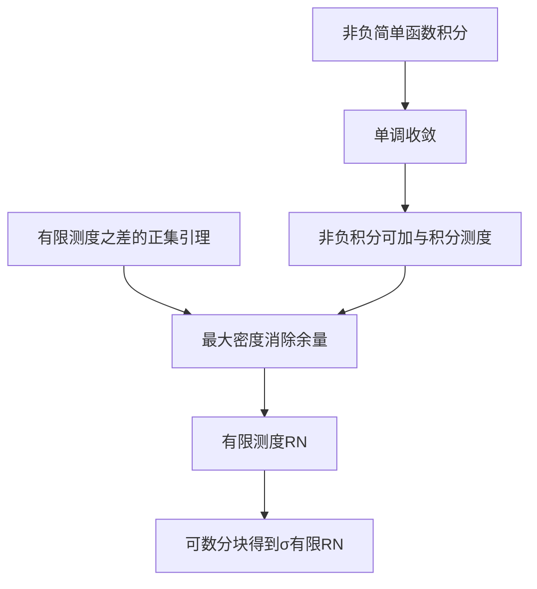

## A1 对象与目标：先让积分有足够的运算能力

一个密度应对每个事件给出正确质量，因此不能只构造一个总积分正确的函数。以下所有函数和集合均对同一 σ-代数可测。这里只用第1讲可列可加性、测度的递增连续性和实数上确界性质；不假定 MA401、Hilbert 空间理论或 Hahn 分解已学。

**非负简单函数**是取有限个非负实值的可测函数。写成不交取值集表示 $s=\sum_{i=1}^{m}a_i1_{A_i}$，定义 $\int s\,d\mu=\sum_{i=1}^{m}a_i\mu(A_i)$，其中 $0\cdot\infty=0$。不同表示可细分到共同的不交块，有限可加性保证积分相同。共同细分也证明简单函数积分的可加性、非负齐次性与单调性；有无限质量块时只出现非负和，不相减。

对非负可测 $f:\Omega\to[0,\infty]$，定义 $\int f\,d\mu=\sup_{0\le s\le f}\int s\,d\mu$，上确界遍历简单函数。于是积分单调。任意这样的 $f$ 有递增简单逼近：取

$s_n(x)=\min\{n,2^{-n}\lfloor 2^nf(x)\rfloor\}$，当 $f(x)=\infty$ 时置 $s_n(x)=n$。

截断水平递增、二进网格细化，所以 $s_n\uparrow f$；有限阈值逆像可测说明每个 $s_n$ 可测。此处尚未断言积分极限，下一节证明它。

## A2 单调收敛定理及其运算后果

**单调收敛定理。** 若 $0\le f_n\uparrow f$，则 $\int f_n\,d\mu\uparrow\int f\,d\mu$。

证明：左侧极限 $L$ 存在且不超过右侧。任取简单函数 $0\le s\le f$ 及 $0<c<1$，令 $E_n=\{f_n\ge cs\}$。这些集合递增并为全集：在 $s>0$ 的点，极限至少为 $s>cs$；在 $s=0$ 的点立即成立。故

$\int f_n\,d\mu\ge c\int_{E_n}s\,d\mu\longrightarrow c\int s\,d\mu$。

最后一个极限仅用有限个取值块上的测度递增连续性。让 $c\uparrow1$，再对 $s$ 取上确界得 $L\ge\int f\,d\mu$。如果简单积分为无穷，上述不等式直接给 $L=\infty$；没有使用无穷减法。

取 $s_n\uparrow f,t_n\uparrow g$ 为简单逼近，则 $s_n+t_n\uparrow f+g$；由简单积分可加性和刚证明的定理，$\int(f+g)\,d\mu=\int f\,d\mu+\int g\,d\mu$。齐次性同理，零倍另按零函数处理。先处理有限部分和再用单调收敛，得到非负级数换序：$\int\sum_{n=1}^{\infty}f_n\,d\mu=\sum_{n=1}^{\infty}\int f_n\,d\mu$。

因而 $\eta(A)=\int_A f\,d\mu$ 是测度：不交事件的指标函数之和等于并的指标函数，代入级数公式即可。若 $\int f\,d\mu=0$，则 $\mu\{f\ge1/n\}=0$ 对每个正整数 $n$ 成立，故 $f=0$ 几乎处处。零测集上的任意非负可测函数积分为0，因为其下方每个简单函数在该集合上的积分都是0。

检查点：为什么上述单调收敛证明不能把 $c$ 直接取成1？你来举出递增但始终不到达其极限的常数序列。

## A3 无需引用 Hahn 定理的正集引理

设 $\lambda=\alpha-\gamma$，其中 $\alpha,\gamma$ 是有限测度。于是 $\lambda$ 对可数不交并可加，且 $|\lambda(A)|\le\alpha(\Omega)+\gamma(\Omega)$；不交序列满足 $\sum_{n=1}^{\infty}|\lambda(A_n)|\le\alpha(\Omega)+\gamma(\Omega)$。称 $P$ 为**正集**，若其每个可测子集 $B$ 都满足 $\lambda(B)\ge0$。

**正集引理。** 若 $\lambda(\Omega)>0$，则存在正集 $P$，且 $\lambda(P)>0$。

证明：令 $R_0=\Omega$。在第 $n$ 步置 $a_n=\inf\{\lambda(B):B\subset R_{n-1},B\text{可测}\}$，它有限且不大于0。若 $a_n=0$，取 $N_n=\varnothing$；否则按下确界定义选 $N_n\subset R_{n-1}$ 使 $\lambda(N_n)<a_n/2<0$。令 $R_n=R_{n-1}\setminus N_n$。这些被移去的 $N_n$ 两两不交，其测度差的绝对值之和有限，因此 $\lambda(N_n)\to0$，从 $0\le-a_n<2|\lambda(N_n)|$（非零步）得到 $a_n\to0$。

取 $P=\Omega\setminus\bigcup_{n=1}^{\infty}N_n$。任意可测 $B\subset P$ 都在每个 $R_{n-1}$ 中，故 $\lambda(B)\ge a_n$ 对全部 $n$ 成立，令 $n\to\infty$ 得非负性。又由可加性及被移去部分的非正性，$\lambda(P)=\lambda(\Omega)-\sum_{n=1}^{\infty}\lambda(N_n)\ge\lambda(\Omega)>0$。证明完成。

这是本次 RN 证明实际需要的弱形式；我们没有将完整 Hahn 分解定理偷偷当作已证，也不需要它。

## A4 有限测度的一般 RN 存在性

对象：任意可测空间上两个有限测度 $\mu,\nu$，满足 $\nu\ll\mu$。目标：找到一个非负可测 $f$，对每个事件 $A$ 同时满足 $\nu(A)=\int_Af\,d\mu$。空间可有不可数多个点，不是有限点空间的替代结论。

构造所有“尚未超支”的候选：

$\mathcal H=\{h\ge0:h\text{可测且对所有 }A,\ \int_Ah\,d\mu\le\nu(A)\}$，$s=\sup_{h\in\mathcal H}\int h\,d\mu$。

零函数在其中，且 $0\le s\le\nu(\Omega)<\infty$。若 $h,k\in\mathcal H$，按 $\{h\ge k\}$ 分割任意事件，得到 $\max(h,k)\in\mathcal H$。选 $h_n\in\mathcal H$ 使其积分趋于 $s$，再置 $g_n=\max(h_1,\ldots,h_n)$；则 $g_n\uparrow f$。A2应用于每个事件给 $f\in\mathcal H$ 且 $\int f\,d\mu=s$，即上确界实际由函数达到。

验证没有残留质量。令 $\rho(A)=\nu(A)-\int_A f\,d\mu$。两项都是有限测度，且差非负；对不交并分别取部分和极限得 $\rho$ 为有限测度。又 $\rho\ll\mu$。若 $\rho(\Omega)>0$，必有 $\mu(\Omega)>0$；选 $\varepsilon>0$ 使 $\rho(\Omega)-\varepsilon\mu(\Omega)>0$。对有限测度之差 $\lambda=\rho-\varepsilon\mu$ 用A3，得到正集 $P$ 且 $\lambda(P)>0$。绝对连续性保证 $\mu(P)>0$，否则 $\rho(P)=0$ 导致矛盾。

正集性质对每个 $A$ 给 $\varepsilon\mu(A\cap P)\le\rho(A\cap P)\le\rho(A)$，所以 $f+\varepsilon1_P\in\mathcal H$。但其积分为 $s+\varepsilon\mu(P)>s$，违背上确界。于是 $\rho(\Omega)=0$，由非负性 $\rho(A)=0$ 对全部 $A$ 成立，完成存在性。

有限情形唯一性：若 $f,g$ 都是密度，考虑 $A_k=\{f\ge g+1/k\}$。在该集合上积分单调性给 $\int_{A_k}f\ge\int_{A_k}g+\mu(A_k)/k$；两积分均等于有限的 $\nu(A_k)$，故 $\mu(A_k)=0$。两函数的无穷值集合也为零测集，因为 $m\mu\{f=\infty\}\le\nu(\Omega)$ 对任意正整数 $m$ 成立。去掉这些集合后，$\{f>g\}=\bigcup_kA_k$，故 $f\le g$ 几乎处处，交换两者得到相等。

## A5 σ-有限测度：用同一个可数分割局部化

若 $\mu,\nu$ 均 σ-有限，分别选可数有限质量覆盖，将两种覆盖交叉后枚举为 $C_1,C_2,\ldots$。每个 $C_i$ 对两测度都有限。置 $D_i=C_i\setminus\bigcup_{j=1}^{i-1}C_j$，得到共同的可数可测分割。

在每个 $D_i$ 的迹 σ-代数上用有限版，得密度 $f_i$。定义 $f=f_i$ 于 $D_i$，可数分块保证可测。对任何事件 $A$，A2的非负级数换序及测度可加性给

$\int_Af\,d\mu=\sum_{i=1}^{\infty}\int_{A\cap D_i}f_i\,d\mu=\sum_{i=1}^{\infty}\nu(A\cap D_i)=\nu(A)$。

若 $g$ 是另一密度，则在每个 $D_i$ 上用有限唯一性，例外集的可数并仍零测，故全空间唯一。每块上密度无穷值集为零测，可数合并证明 $f$ 几乎处处有限。这完成第2讲所述一般 σ-有限 RN 定理全部存在、唯一及有限性结论。

## A6 三类训练与覆盖

示范 E4：在 $\mathbb N$ 上，$\mu$ 为计数测度，$\nu(\{n\})=1/n$。两者都是 σ-有限而总质量无穷。密度为 $f(n)=1/n$，任意事件 $A$ 的积分为 $\sum_{n\in A}1/n=\nu(A)$。一般证明中的共同有限分块可以直接选单点；这说明总质量无穷不妨碍局部化。

引导 G3：在A4中为什么必须允许取最大值，而不能仅让任意选出的 $h_n$ 直接取逐点极限？先作答，卡住才读答案文件的提示。

独立 I5：在 $\Omega=\{a,b\}$ 上取 $\mu(\{a\})=0,\mu(\{b\})=1$，$\nu(\{a\})=0,\nu(\{b\})=2$。给出一个处处有限和一个取无穷值的密度，解释它们的唯一性意义。

独立 I6：在实线全体子集上令 $\mu$ 为计数测度，令 $\nu$ 为一个无原子的概率测度是否总可行？先指出“全体子集上存在这种概率”并非已建立事实，再改在 Borel σ-代数上以第2讲构造的均匀分布证明：缺少参照测度的 σ-有限性时，绝对连续不保证密度存在。

| 旧描述 | 本附录统一结构 |
|---|---|
| 每点概率除以参照质量 | 每个事件上不超支的函数最大化 |
| 有限个块拼起来 | 可数个双有限块拼起来 |
| 分母为0处任意 | 零测集上的可测改动不影响积分 |

本质：存在性来自“若还剩质量，就能在某个正集上加一点”的矛盾，唯一性来自对差异事件逐一检验。第3讲继续处理非单调极限、Fatou、控制收敛与一致可积；本附录只提前完成本次证明确实需要的积分工具。

---

# 附录B：区间差分为什么真的能扩成分布

> 作者工作稿，DSH首审后修订待复审，未获批准。第2讲 §3 的构造证明在此展开。

## B1 对象、目标、代数上的构造

设 $F:\mathbb R\to[0,1]$ 非减、右连续，且 $F(-\infty)=0,F(+\infty)=1$ 表示两端极限。目标是构造概率 $\mu_F$，使每个 $t$ 有 $\mu_F(( -\infty,t])=F(t)$。这不能仅靠“差分非负”完成：真正困难的是可数可加性。

取区间类型 $(a,b]$、$(-\infty,b]$、$(a,\infty)$ 及全实线，端点有限时 $a<b$。其有限不交并，加上空集，构成代数 $\mathcal A$：把有限多个有限端点排序，形成有限个区间单元，并、交、补都只是选取这些单元。定义单个区间的权重为对应的 $F$ 端点之差，射线使用0或1作无限端点值；对不交并求和，记为 $m_0$。

任何两种表示都可由共同端点细分；相邻差分相加望远镜消去中间值，故权重与表示无关，并且有限可加。非减性使权重非负，于是有单调性及有限次可加性，且 $m_0(\mathbb R)=1$。到此还没有使用右连续性，也还没有证明预测度。

## B2 小漏损的紧集内近似

对任意 $A\in\mathcal A$ 和 $\varepsilon>0$，构造闭有界集 $K\subset A$ 和代数集 $E$，使 $A\setminus K\subset E$ 且 $m_0(E)<\varepsilon$。不需要给 $K$ 赋质量，因为 $K$ 未必属于原代数。

先看 $(a,b]$。由右连续性选 $0<\delta<b-a$ 使 $F(a+\delta)-F(a)<\varepsilon$，取 $K=[a+\delta,b]$，漏损包含于 $E=(a,a+\delta]$。左射线 $(-\infty,b]$：取充分负的有限 $L<b$ 使 $F(L)<\varepsilon$，令 $K=[L,b]$、$E=(-\infty,L]$。右射线 $(a,\infty)$：分别取小 $\delta>0$ 和大 $M>a+\delta$ 使 $F(a+\delta)-F(a)<\varepsilon/2$、$1-F(M)<\varepsilon/2$，用 $K=[a+\delta,M]$，漏损被 $(a,a+\delta]\cup(M,\infty)$ 覆盖。全实线同样截去两端尾巴。对有限个区间分别分配误差再取有限并，便得一般 $A$ 的结论。

这里的紧性仅用实数完备性推出的闭有界集有限覆盖性质，补证如下。闭区间若有一个开覆盖没有有限子覆盖，二分后至少有一个半区间仍没有有限子覆盖；反复二分得到长度趋于0的闭区间。由端点上确界得共同点；覆盖该点的开集包含其一个邻域，充分小的二分区间全落在此开集中，矛盾。闭有界集放入一个闭区间，并向其开覆盖加入自身补集，即归约到闭区间情形。因而闭有界集确有有限覆盖性质，称为紧集。紧集中的闭集族若有有限交性质，则全部交非空：否则其补集构成开覆盖，有限子覆盖会违反有限交性质。

检查点：为何左端要向右移动，而不只缩短右端？用含单点原子的分布解释右连续性控制的是哪段质量。

## B3 由空集处连续性得到可数可加性

设 $A_n\in\mathcal A$ 且 $A_n\downarrow\varnothing$。固定 $\varepsilon>0$，逐个按B2选紧集 $K_n\subset A_n$、漏损覆盖 $E_n\in\mathcal A$，且 $m_0(E_n)<\varepsilon2^{-n}$。令 $H_n=\bigcap_{j=1}^nK_j$，这是位于 $K_1$ 中的递减紧集族。因 $\bigcap_nH_n\subset\bigcap_nA_n=\varnothing$，有限交性质推出某个 $H_N$ 已为空（若 $K_1$ 为空，则取 $N=1$）。

于是任意 $x\in A_N$ 必至少不在一个 $K_j$ 中，其中 $j\le N$；但 $A_N\subset A_j$，故 $x\in A_j\setminus K_j\subset E_j$。因此 $A_N\subset\bigcup_{j=1}^NE_j$，由有限次可加性，$m_0(A_N)\le\sum_{j=1}^Nm_0(E_j)<\varepsilon$。结合单调性得 $m_0(A_n)\to0$。

现在设不交的 $B_n\in\mathcal A$ 的并 $B$ 仍属于 $\mathcal A$。余项 $R_N=B\setminus\bigcup_{n=1}^NB_n$ 在代数中且递减至空集，有限可加性给 $m_0(B)=\sum_{n=1}^Nm_0(B_n)+m_0(R_N)$。令 $N\to\infty$，刚证的连续性使余项消失，得到可数可加性。因此 $m_0$ 是预测度。

应用第2讲 §2.1 已证的扩张定理得测度 $\mu_F$；总质量1，故唯一。原代数生成 Borel σ-代数：其所有区间都是 Borel 集；反向每个开区间可写成可数个半开区间之并，每个开集是所含有理端点开区间的可数并。因此扩张的定义域正好包含所需的 Borel 族，而其在 Borel 族上的限制唯一。最终有 $\mu_F((a,b])=F(b)-F(a)$ 以及 $\mu_F(( -\infty,t])=F(t)$，完成存在与唯一性。

## B4 示例、边界与训练

示范 E5：令 $F(t)=0$（$t<0$），$F(t)=t$（$0\le t\le1$），$F(t)=1$（$t>1$）。本构造给 $[0,1]$ 上的均匀分布，区间权重等于与 $[0,1]$ 相交部分的长度，且单点质量全为0。这里均匀测度的存在正由B1–B3建立，不预先调用“长度测度已存在”。例如 $\mu_F((1/4,3/4])=1/2$。

引导 G4：将 $F$ 换成 $G(t)=0$（$t\le0$）、$G(t)=1$（$t>0$）。差分仍非负，但为什么不能是概率分布函数？找一个递减到空集的代数区间列检验权重。提示在分离答案文件。

独立 I7：令 $F$ 是在0处跳跃 $p$、在2处跳跃 $1-p$ 的分布函数，$0\le p\le1$。计算 $(0,2]$、$(-1,0]$、$\{0\}$ 的质量，并逐项核对 $p=0,1$ 边界。

独立 I8：指出B3若漏损误差只取每个 $E_n$ 小于同一个 $\varepsilon$，为什么不足以完成所写证明。请给出正确的误差预算条件。

| 原对象 | 本构造中的地位 |
|---|---|
| 区间概率差分 | 代数上的有限可加权重 |
| 分布函数右连续 | 左端内缩的质量损失可控 |
| 两端极限0、1 | 无穷尾部可截断且总质量归一化 |
| 可列可加公理 | 由紧集与连续性在构造中验证 |

本质：有限的紧性论证把可数覆盖问题压到有限误差预算，再由极限完成预测度验证。与附录A合读，第2讲的“从权重构造测度”和“相对于测度表示权重”两个方向均有完整证明；第3讲才进一步讨论一般积分换序。

---

# 第3讲 积分收敛与一致可积

> DSH首审后修订待复审，未获批准。依赖第2讲附录A的非负积分与单调收敛，不默认MA401已学。

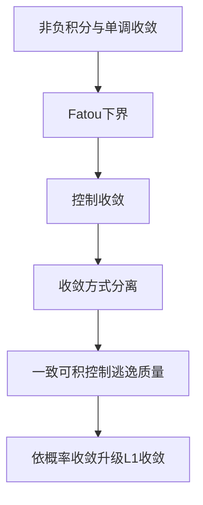

## 0 结构图景

每个固定位置的峰最终消失，是否意味着总面积消失？在均匀概率空间 $(0,1)$ 上，$X_n=n1_{(0,1/n)}$ 逐点趋0，但 $EX_n=1$。问题不在点态极限，而在质量随峰值逃到越来越小的集合。本讲区分什么情况下只有不等式，什么条件才足以交换极限与积分。

## 1 从非负积分到期望

对实可测 $X$，定义 $X^+=\max(X,0)$、$X^-=\max(-X,0)$。若 $E|X|<\infty$，称其**可积**，置 $EX=EX^+-EX^-$。若正负积分不同时无穷，也允许扩展期望；本讲涉及差与条件期望时默认可积。简单积分、非负单调收敛和非负可加性已在附录A完整证明。拆正负部分且各项有限即得可积函数的线性、单调性和 $|EX|\le E|X|$。

基本估计：对非负 $Z$ 和 $a>0$，$Z\ge a1_{\{Z>a\}}$，所以 $P(Z>a)\le EZ/a$，这就是 **Markov不等式**。若 $E|X|^p<\infty$，记 $X\in L^p$；把几乎处处相等的函数视为同一个元素。$L^1$ 距离为 $E|X-Y|$。

## 2 Fatou与控制收敛：完整证明

**Fatou引理。** 非负可测 $f_n$ 满足 $\int\liminf_n f_n\,d\mu\le\liminf_n\int f_n\,d\mu$。构造 $g_n=\inf_{k\ge n}f_k$，其可测性来自可数阈值集合运算，且 $g_n\uparrow\liminf f_n$。对每个 $k\ge n$ 有 $\int g_n\le\int f_k$，故 $\int g_n\le\inf_{k\ge n}\int f_k$；令 $n\to\infty$ 并用单调收敛即证。无支配条件时只能保证这个方向，开场峰列正给严格不等号 $0<1$。

**控制收敛定理。** 若 $f_n\to f$ 几乎处处，且 $|f_n|\le g$ 几乎处处，其中 $g$ 可积，则 $f$ 可积，$\int|f_n-f|\,d\mu\to0$，因而积分收敛。先把可数个例外集并起来统一忽略；有 $|f|\le g$。令 $h_n=|f_n-f|\le2g$。对非负 $2g-h_n$ 用Fatou：$\int2g\le\liminf_n(\int2g-\int h_n)=\int2g-\limsup_n\int h_n$。有限性允许相减，得 $\limsup\int h_n\le0$。最后用积分差的绝对值不超过差的绝对值积分。

示范 E3.1：$X_n(x)=x^n$ 在 $(0,1)$ 上趋0，被1支配，故 $EX_n\to0$。直接积分为 $1/(n+1)$，与定理一致。对 $n1_{(0,1/n)}$，若有共同可积支配，则控制收敛会推出期望趋0，与已算出的1矛盾，所以不存在这样的支配。

检查点：Fatou为什么要求非负或统一可积下界？用 $-n1_{(0,1/n)}$ 核对不加条件时方向会失败。

## 3 三种收敛的量词

**几乎必然收敛**：除一个零概率集外，逐点 $X_n(\omega)\to X(\omega)$。**依概率收敛**：对每个 $\varepsilon>0$，$P(|X_n-X|>\varepsilon)\to0$。**$L^1$收敛**：$E|X_n-X|\to0$。

几乎必然推出依概率：指标函数 $1_{\{|X_n-X|>\varepsilon\}}\to0$ 几乎必然且被1支配。$L^1$推出依概率由Markov给出。两者逆向均不自动成立：开场峰列几乎必然但非 $L^1$；依次枚举 $(0,1)$ 每层全部二进区间 $I_{m,j}=[j2^{-m},(j+1)2^{-m})\cap(0,1)$，指标函数的期望为 $2^{-m}\to0$，却每点每层被击中一次、未击中多次，故不逐点收敛，甚至 $L^1$也不保证原序列几乎必然收敛。

**子列引理。** 依概率收敛的序列有几乎必然收敛子列。选择 $n_k$ 使 $P(|X_{n_k}-X|>2^{-k})\le2^{-k}$。由并集上界，尾部任一坏事件发生的概率不超过 $\sum_{k\ge m}2^{-k}\to0$；故无限次坏事件发生的概率0。这只用可加性，未提前调用第5讲未证结论。于是几乎每条路径最终误差不超过 $2^{-k}$。

## 4 一致可积与Vitali定理

可积随机变量族 $\mathcal H$ 称**一致可积**（UI），若 $\lim_{K\to\infty}\sup_{Y\in\mathcal H}E(|Y|1_{\{|Y|>K\}})=0$。截掉同一个高度后，所有变量留下的尾部面积同时小。每个单独变量可积仅给各自的尾部小，阈值可能随变量变化。

UI推出两个实用结论：第一，$\sup_{Y\in\mathcal H}E|Y|<\infty$，因为固定一个尾部小于1的K后总积分至多K+1。第二，积分对小概率事件**一致绝对连续**：$E(|Y|1_A)\le KP(A)+E(|Y|1_{|Y|>K})$，先选K再选 $P(A)$ 即可。反过来，这两个结论推出UI：用Markov得 $\sup_Y P(|Y|>K)\le C/K$，再应用一致绝对连续性。

**Vitali定理（概率空间）。** $X_n\to X$ 依概率且 $\{X_n\}$ UI，当且仅当 $X_n\to X$ 于 $L^1$（正向同时给出X可积）。

正向证明：子列引理及Fatou给 $E|X|\le\sup_nE|X_n|<\infty$。给定 $\varepsilon>0$，由原族的积分一致绝对连续性，存在与事件 $A$ 无关的 $\delta>0$，使所有 $P(A)<\delta$ 的事件均满足 $\sup_nE(|X_n|1_A)\le\varepsilon$。对每一个这样的事件，同一条几乎必然收敛子列及Fatou给 $E(|X|1_A)\le\liminf_kE(|X_{n_k}|1_A)\le\varepsilon$。由于这个数值界及 $\delta$ 都不依赖 $A$，取所有 $P(A)<\delta$ 的事件的上确界仍不超过 $\varepsilon$，所以 $X$ 与原族一起具有积分一致绝对连续性。这里是对每个事件的积分不等式，不是在不可数个事件上合并几乎必然例外集。令 $A_n=\{|X_n-X|>\eta\}$。则

$E|X_n-X|\le\eta+E(|X_n|1_{A_n})+E(|X|1_{A_n})$。

依概率收敛使 $P(A_n)\to0$，后两项一致趋小，再令 $\eta\downarrow0$。

反向证明：设 $E|X_n-X|\to0$。积分总量显然有界。对任意 $\varepsilon>0$，选N使 $n\ge N$ 时 $E|X_n-X|<\varepsilon/2$；X及有限多个 $X_1,\ldots,X_{N-1}$ 各自积分对小概率集合绝对连续（由截断估计），所以统一取小的 $P(A)$ 后，它们在A上的积分小于 $\varepsilon/2$。对后续项有 $E(|X_n|1_A)\le E|X_n-X|+E(|X|1_A)<\varepsilon$，由前述等价判据得UI；依概率收敛由Markov。

若 $|X_n|\le Y\in L^1$，全族UI由 $E(|X_n|1_{|X_n|>K})\le E(Y1_{Y>K})\to0$。更一般，若某个 $p>1$ 有 $\sup_nE|X_n|^p\le C$，则尾部不超过 $C/K^{p-1}$。这解释了二阶矩界经常用于合法换序。

## 5 训练、覆盖、本质

示范 E3.2：开场峰列对任意K，取整数n>K，尾积分仍为1，故非UI。取 $Y_n=\sqrt n1_{(0,1/n)}$，$EY_n=1/\sqrt n\to0$；当 $\sqrt n>K$ 时尾积分 $1/\sqrt n<1/K$，所以UI。两列均有越来越高的峰，决定因素是尾部面积。

引导 G3.1（T1）：$Z_n=n^21_{(0,n^{-3})}$ 是否UI，是否 $L^1$趋0？

独立 I3.1（T2）：构造几乎必然收敛但期望不收敛的非负变量列，核验其UI条件失败。

独立 I3.2（T3）：若 $X_n\to X$ 依概率且 $|X_n|\le1$，证明 $L^p$收敛对每个有限 $p\ge1$ 成立，不得假设原序列几乎必然。

口述窗口：对一个换序请求，先选“单调、可积支配、UI”中的适用条件，再给反例说明不能省略。最小提示与核验见对应答案文件。

| 旧计算 | 升级判据 |
|---|---|
| 把极限移进期望 | 先识别收敛方式，再检查质量是否逃逸 |
| 非负逐项相加 | 单调收敛，允许总值无穷 |
| 小概率所以忽略 | 还须控制在该事件上的积分 |

本质是同时控制“坏事件概率”和“坏事件上的质量”。下一讲处理另一类换序：沿样本的行、列分别积分何时等于整体积分。

---

# 第4讲 乘积测度与独立性

> DSH首审后修订待复审，未获批准。依赖第1讲单调类、第3讲积分收敛。Kolmogorov扩张按原设计保留为精确陈述及未证候选U306-4，其余本讲核心定理给证明。

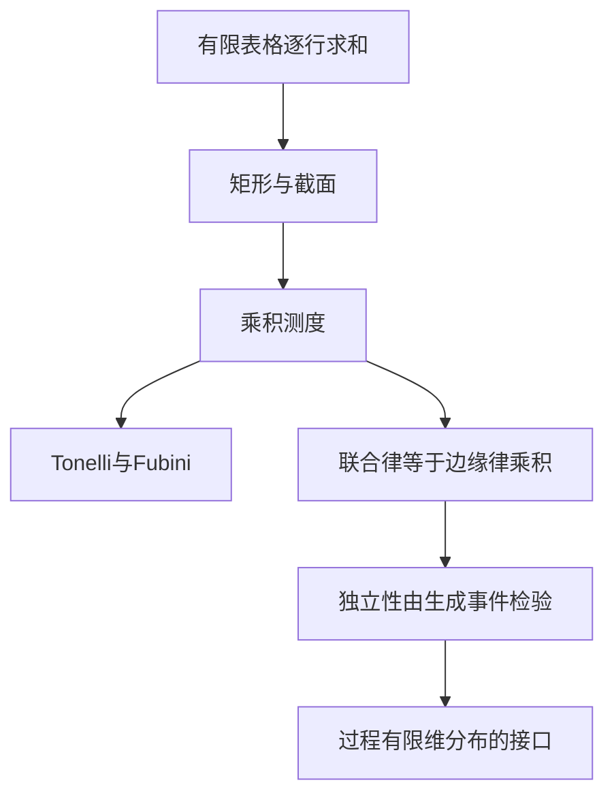

## 0 结构图景

两次掷币的四格表，既可先按第一枚分组，再算第二枚，也可交换顺序。连续情形把行、列变成截面，把求和变成积分。本讲先构造乘积测度，再定义独立性；联合分布始终存在，但只有独立时才等于边缘分布的乘积。

## 1 一个传播工具：π–λ定理

**π族**对有限交封闭。**λ族**含全集，对补封闭并对不交可数并封闭。λ族也对包含关系下的差封闭：若A包含B，两者在族中，则 $A\setminus B=(A^c\cup B)^c$。

定理：含π族 $\mathcal C$ 的λ族包含 $\sigma(\mathcal C)$。可先把全集加到π族而不改变生成族。令 $\mathcal D$ 为包含它的最小λ族。固定 $A\in\mathcal C$，族 $\{B:A\cap B\in\mathcal D\}$ 是λ族：全集条件用A已在D；补集条件用A内的差；不交并用交运算保持不交性。它含C，所以含D。再固定 $B\in\mathcal D$，对A重复此论证，得D对交封闭。于是D既对交、补、有限并封闭，又对不交可数并封闭；把任意可数并不交化便知D为σ代数。故D等于σ(C)。这也说明概率测度在一个生成π族上相等便处处相等：相等族含全集，对补及不交并封闭。

检查点：为何只能声称相等族是λ族，而不能直接声称它对交封闭？

## 2 截面构造乘积测度

给两个可测空间 $(S,\mathcal S)$、$(T,\mathcal T)$，定义 **乘积σ代数** $\mathcal S\otimes\mathcal T=\sigma\{A\times B:A\in\mathcal S,B\in\mathcal T\}$。集合E的行截面为 $E_s=\{t:(s,t)\in E\}$，列截面类似。所有截面可测的E组成σ代数且含矩形，故所有乘积可测集合有可测截面。

先设ν为有限测度。令D为满足 $s\mapsto\nu(E_s)$ 可测的E族。矩形满足，因为函数等于 $\nu(B)1_A$。D是λ族：全集截面质量为常数；补集用有限数 $\nu(T)-\nu(E_s)$；不交并用可数和。π–λ定理给出所有E都满足。对任意测度μ定义

$\eta(E)=\int_S\nu(E_s)\,d\mu(s)$。

不交集合的截面仍不交，单调收敛给η可列可加；在矩形上η等于 $\mu(A)\nu(B)$，约定 $0\cdot\infty=0$。

若ν为σ-有限，选可数不交有限质量块 $T_j$ 覆盖T，对每块按上述定义并将测度相加，仍得同一截面积分公式，因为 $\nu(E_s)=\sum_{j=1}^{\infty}\nu(E_s\cap T_j)$。若μ也σ-有限，则矩形分块给共同有限质量覆盖；两个候选测度在每个有限矩形块上的限制由π–λ唯一，再逐块相加，得整个乘积测度唯一，记 **$\mu\otimes\nu$**。

## 3 Tonelli与Fubini：逐行与逐列

**Tonelli定理。** 对σ-有限μ、ν与非负乘积可测f，两个迭代积分都可定义，等于 $\int f\,d(\mu\otimes\nu)$，允许为无穷。

证明：指标函数的逐行公式就是构造；交换S、T也造出具有相同矩形值的测度，由唯一性两个构造相同，故逐列公式成立。有限线性组合给非负简单函数。对一般f取递增简单逼近，先在每条截面上用单调收敛，再在外层用单调收敛，即得到公式，也同时证明内层积分函数可测。

**Fubini定理。** 若 $\int|f|\,d(\mu\otimes\nu)<\infty$，则几乎每条截面可积，两个迭代积分相等且等于整体积分。证明：Tonelli用于|f|，内层绝对积分必须几乎处处有限，否则其积分不可能有限。分别对 $f^+,f^-$ 用Tonelli，再相减即可。异常截面上的积分可赋任意有限可测版本；结论只在几乎处处意义下成立。

示范 E4.1：在单位正方形上 $f(x,y)=1_{\{0<y<x<1\}}$。行积分为x，整体为 $\int_0^1x\,dx=1/2$；列积分为1-y，同样为1/2。图形“对角线以下的面积”与两种分组完全一致。

反例 E4.2：在正整数的计数乘积空间，取 $a_{ij}=1$（j=i），$a_{ij}=-1$（j=i+1），其余0。每行和为0；第一列和为1，其后每列和为0，故两种迭代和分别0、1。绝对值总和无穷；不是Fubini失败，而是假设不成立。整体有符号积分为无穷减无穷，根本未定义。

## 4 独立是联合分布的结构

σ代数族 $\mathcal F_i$ **独立**指任意有限个不同下标 $i_1,\ldots,i_m$ 及 $A_j\in\mathcal F_{i_j}$ 满足 $P(\bigcap_{j=1}^mA_j)=\prod_{j=1}^mP(A_j)$。随机变量独立指它们生成的σ代数独立。两两独立只检验m=2，通常不够。

对两个实随机变量X、Y，联合映射 $(X,Y)$ 可测，因为矩形的逆像为两个可测逆像的交，生成族传播到全体乘积可测集。因此有联合律。独立等价于联合律为 $\mu_X\otimes\mu_Y$：矩形值等式正是独立的定义，π–λ唯一性将等式推广到整个乘积σ代数。

由此若X、Y独立且 $E|X|,E|Y|<\infty$，Tonelli先给 $E|XY|=E|X|E|Y|<\infty$，Fubini再给 $E(XY)=EX\,EY$。这里先验证乘积可积，再分离有符号期望，不能倒过来。

常用传播事实：若各信息块由含全集的π族生成，且对这些生成事件满足有限独立等式，则其生成σ代数独立。证明：固定其余m-1个事件，把可变事件满足的独立等式视为两个有限测度相等的条件；因全集对应的等式成立，得到λ族，再用π–λ推广。依次对每个坐标重复即得所有事件。对于由不相交下标组组成的信息块，先在每组的有限柱事件上检验独立，再用此法推广。第5讲将用它从有限个变量推广到无限尾部信息。

示范 E4.3：两枚公平独立比特U、V，令W为两者模2之和。三个变量两两独立，因为任意两者的四种配对均各出现一次；但 $P(U=V=W=0)=1/4\ne1/8$，所以不共同独立。

## 5 过程存在性的接口与明确边界

**Kolmogorov扩张定理（U306-4，陈述未证；涉及既有R20，未销项）。** 给任意指标集I，对每个有限子集J指定 $\mathbb R^J$ 上的Borel概率 $\mu_J$，且投影到更小坐标集合所得边缘与已指定概率一致，则在 $\mathbb R^I$ 的柱σ代数（坐标逆像生成的σ代数）上存在唯一概率，其有限维边缘是这些概率。有限子集作为无序坐标集合，已包含通常的置换一致性。状态取实线是重要限制；不声称任意可测状态空间都成立。

本讲只证明了有限乘积构造，不能以反复有限乘积冒充任意指标扩张证明。此项按原设计保留未证登记候选，后续Brownian构造引用时必须点名。实际定义坐标过程 $X_t(\omega)=\omega(t)$ 后，其有限维律即为给定概率。连续路径还需额外论证，扩张定理本身不给连续性。

## 6 训练与覆盖

引导 G4.1（T1）：独立Bernoulli(p)、Bernoulli(q)变量X、Y，写联合表并求E(XY)。

独立 I4.1（T2）：在单位正方形上对 $f(x,y)=xy$ 算两次迭代积分并核验Fubini假设。

独立 I4.2（T3）：用E4.2说明“每条截面均绝对可积”是否足够交换有符号积分。

输出窗口：解释“一个联合律存在”和“联合律是乘积”不同在哪里，列出一次换序前必须核对的条件。

| 旧概念 | 本讲升级 |
|---|---|
| 联合概率表 | 乘积σ代数上的联合律 |
| 按行或列求和 | 截面可测性与Tonelli/Fubini |
| 概率相乘 | 独立的有限交事件等式 |
| 过程的若干时间观测 | 一致有限维分布，存在性另需扩张 |

本质是把坐标分组与信息独立严格分开。下一讲看无限多次事件：局部独立性怎样约束尾部只能发生或不发生。

---

# 第5讲 Borel–Cantelli与零一律

> 作者稿，DSH首审后修订待复审，未获批准。只依赖事件可加性及第4讲独立性传播，不使用大数定律。

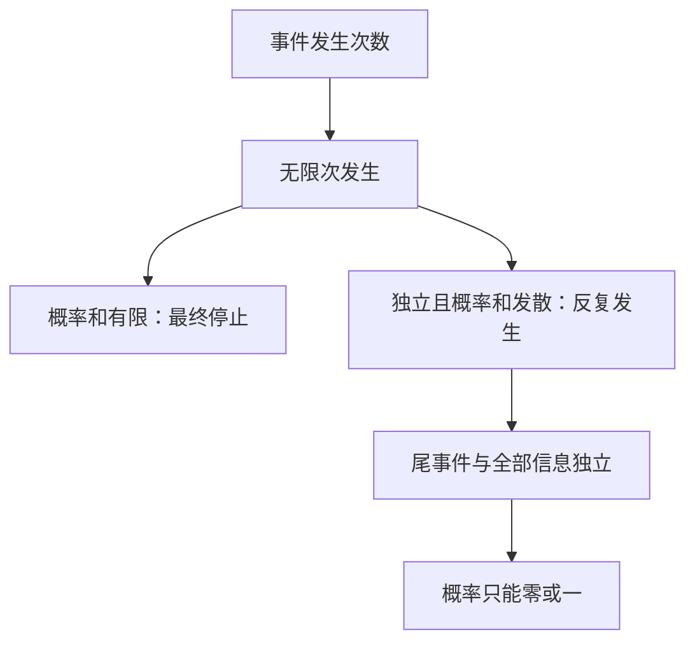

## 0 结构图景：单次罕见与无穷次罕见

第n次试验的失败率趋0，并不意味着失败只发生有限次。对象是事件列 $A_n$；目标是判断随机集合 $\{n:A_n\text{发生}\}$ 是否无穷。

**事件上极限**为 $\limsup_n A_n=\bigcap_{m=1}^{\infty}\bigcup_{n=m}^{\infty}A_n$，也记 $\{A_n\text{ i.o.}\}$，量词是“每个起点m之后还有一次发生”。**事件下极限**为 $\bigcup_m\bigcap_{n\ge m}A_n$，表示从某时起次次发生。无限次不等于最终总是。

## 1 Borel–Cantelli两个方向

**第一引理。** 若 $\sum_{n=1}^{\infty}P(A_n)<\infty$，则 $P(A_n\text{ i.o.})=0$，不要求独立。证明：对每个m，$P(A_n\text{ i.o.})\le P(\bigcup_{n\ge m}A_n)\le\sum_{n\ge m}P(A_n)$；收敛级数尾和趋0。零概率不是逻辑不可能，仍可有例外路径。

**第二引理。** 若事件相互独立，且 $\sum_{n=1}^{\infty}P(A_n)=\infty$，则 $P(A_n\text{ i.o.})=1$。证明：固定m，有限独立性给

$P(\bigcap_{n=m}^NA_n^c)=\prod_{n=m}^N(1-P(A_n))\le\exp(-\sum_{n=m}^NP(A_n))$。

使用 $1-x\le e^{-x}$，可由两边之差在0为0、导数非负验证。尾部级数仍发散，令N趋无穷并用递减连续性，得到“从m起再不发生”的概率0。对m取可数并，得到“只发生有限次”的概率0。

示范 E5.1：给定独立事件列且 $P(A_n)=1/n$，其概率趋0但几乎必然发生无穷次。若 $P(A_n)=1/n^2$，则几乎必然只发生有限次，无论是否独立。若从这些边缘概率新构造无限独立列，须调用U306-4，不以有限乘积冒充构造。

反例 E5.2：令所有 $A_n=A$ 且 $P(A)=1/2$。概率级数发散，而上极限就是A，概率1/2。第二方向不能省略独立假设。

检查点：$P(A_n\text{ i.o.})=0$ 是否反推概率级数收敛？请用嵌套事件检查。

## 2 尾σ代数与Kolmogorov零一律

设实随机变量列 $X_1,X_2,\ldots$ 独立。令 $\mathcal F_n=\sigma(X_1,\ldots,X_n)$、$\mathcal G_n=\sigma(X_{n+1},X_{n+2},\ldots)$。**尾σ代数**是 $\mathcal T=\bigcap_{n=1}^{\infty}\mathcal G_n$。尾事件在删去任意有限前缀后仍能从剩余数据判断。

**Kolmogorov零一律。** 若 $A\in\mathcal T$，则 $P(A)\in\{0,1\}$。

完整证明：第4讲独立性传播给 $\mathcal F_n$ 与 $\mathcal G_n$ 独立，所以A独立于每个有限前缀事件。$\bigcup_n\mathcal F_n$ 是代数，因为任意有限个事件都在某个共同较大的前缀族中；它生成 $\mathcal F_\infty=\sigma(X_1,X_2,\ldots)$。固定A，族 $\{B:P(A\cap B)=P(A)P(B)\}$ 是λ族，含此前缀代数，由π–λ定理含整个 $\mathcal F_\infty$。最后A本身属于 $\mathcal F_\infty$，取B=A得 $P(A)=P(A)^2$。

示范 E5.3：事件“级数 $\sum_{n=1}^{\infty}X_n$ 收敛”为尾事件。对任意前缀长度m，收敛等价于尾部满足Cauchy条件，写成

$\bigcap_{k=1}^{\infty}\bigcup_{N=m+1}^{\infty}\bigcap_{q\ge p\ge N}\{|\sum_{j=p}^qX_j|<1/k\}$。

可数运算只含m以后变量，故在每个尾族中。零一律给概率0或1，但不判断是哪一个。“部分和最终为正”不能仅因涉及长期便叫尾事件：有限初始和可能改变它。必须核对尾部可测性，不能用口号代替量词。

## 3 与收敛方式接合

若对每个正整数k有 $\sum_{n=1}^{\infty}P(|X_n-X|>1/k)<\infty$，第一引理给每个阈值最终不再越界。把这些概率1事件作可数交，得到几乎必然收敛。最终时刻可依赖路径和k，不要求对所有阈值使用同一个时刻。

示范 E5.4：若 $E|X_n-X|^2\le C/n^2$，Markov给固定ε的越界概率不超过 $C/(\varepsilon^2n^2)$，从而几乎必然收敛。误差不需要独立。

## 4 训练、覆盖、本质与预告

引导 G5.1（T1）：在均匀空间(0,1)取 $A_n=(0,1/n)$，求上极限与概率和。

独立 I5.1（T2）：独立事件满足 $P(A_n)=1/(n+1)$，证明最终全不发生的概率0，写清可数并的位置。

独立 I5.2（T3）：证明独立实变量列的事件 $\{X_n\to0\}$ 概率只能0或1，并说明零一律不能单独决定它为1。

口述窗口：第一方向为什么不需要独立？第二方向在哪里使用独立？从前缀到全部信息依赖哪个生成族定理？

|旧描述|升级后的条件|
|---|---|
|单次概率小|概率级数与依赖结构|
|误差依概率趋0|可和性保证几乎必然控制|
|长期行为|可测尾事件与零一结论|

本质是无限事件的量词与可数操作。下一讲给定部分信息，构造保持其上积分不变的预测。

---

# 第6讲 条件期望：只保留可见信息

> DSH首审后修订待复审，未获批准。一般RN已在附录A证明；本讲据此建立条件期望，不预借第7讲的投影理论。

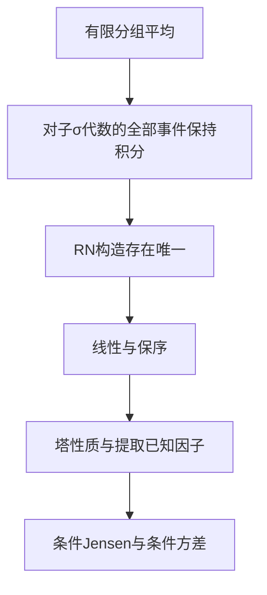

## 0 结构图景

四个等可能结果上X的值为0、2、4、10，而只观察到前两个或后两个这一分组。合理的分组预测是1、1、7、7。它丢掉组内差异，但每组总和保留。一般条件期望把“组”替换成一个子σ代数里所有可见事件；甚至每个观测值概率都为0时，这个积分定义仍有意义。

## 1 定义、存在和唯一

给概率空间、子σ代数 $\mathcal G\subset\mathcal F$ 及 $X\in L^1$，**条件期望** $Y=E[X\mid\mathcal G]$ 是一个 $\mathcal G$-可测可积变量，满足对所有 $A\in\mathcal G$，$\int_A Y\,dP=\int_A X\,dP$。它是随机变量的几乎必然等价类，不是一个数，也不是对零概率事件作除法。

存在性完整证明：先设X非负可积。在 $(\Omega,\mathcal G)$ 上置 $\nu(A)=\int_AX\,dP$，附录A保证它是有限测度，且 $\nu\ll P|_{\mathcal G}$。RN给非负 $\mathcal G$-可测密度Y，积分为EX，故可积。对一般X分别构造 $Y^+,Y^-$ 对应 $X^+,X^-$，取 $Y=Y^+-Y^-$，两项可积，所以差合法且满足定义。

唯一性：若Y、Z都满足定义，取 $A_k=\{Y-Z>1/k\}\in\mathcal G$，则 $0=\int_{A_k}(Y-Z)\,dP\ge P(A_k)/k$。可数并得 $P(Y>Z)=0$，交换Y、Z得几乎必然相等。此处可测性是关键，否则差异事件未必允许代入定义。

示范 E6.1：开场分组给 $E[X|\mathcal G]=1$ 于前组、7于后组；每组概率1/2，积分分别1/2和7/2，与原变量的组积分相等，总期望4。一般正概率分组 $C_i$ 上值为 $E(X1_{C_i})/P(C_i)$，零概率组可任意选择可测版本。

## 2 用定义逐项验证基本性质

以下等式不保证在同一个预先指定零集外同时适用于不可数多个参数；每条陈述均按几乎必然理解。

**线性**由候选的可测性、可积性、事件积分线性和唯一性得到。若X非负，其RN构造可选非负，所以条件期望非负；线性遂给 **保序**：$X\le Z$ 推出 $E[X|\mathcal G]\le E[Z|\mathcal G]$。由 $-|X|\le X\le|X|$，得到 $|E[X|\mathcal G]|\le E[|X||\mathcal G]$，再取A为全集得到 **$L^1$压缩**：$E|E[X|\mathcal G]|\le E|X|$。

若X本身 $\mathcal G$-可测，X直接满足定义，故条件期望等于X。若X与 $\mathcal G$ 独立，则常数EX是条件期望：对非负简单X由独立事件计算，对非负X由单调收敛推广，对可积X拆正负，得 $E(X1_A)=EX\,P(A)$。

**塔性质**：若 $\mathcal H\subset\mathcal G$，则 $E[E[X|\mathcal G]|\mathcal H]=E[X|\mathcal H]$。左边可测可积，对每个 $A\in\mathcal H$ 的积分依次等于 $\int_AE[X|\mathcal G]=\int_AX$，由唯一性成立。另有 $E[E[X|\mathcal H]|\mathcal G]=E[X|\mathcal H]$，因为内层已是G可测。没有包含关系时不得直接“消去中间条件”。

检查点：为什么塔性质要比较σ代数的包含，而非比较两次观测数值的大小？

## 3 提取已知因子与条件极限

若Z是有界G可测变量，则 $E[ZX|\mathcal G]=ZE[X|\mathcal G]$。先对Z为G事件指标直接在每个A上检验；有限线性组合得简单Z；对有界Z取一致有界的简单逼近，由控制收敛对两侧事件积分取极限。候选乘积可积由Z有界保证。

更一般，若Z可测且 $E|ZX|<\infty$，同一结论成立。先对截断 $|Z|\wedge n$ 与 $|X|$ 用有界结论并对全集积分，再用单调收敛，得 $E(|Z|E[|X||G])=E|ZX|<\infty$。因此 $ZE[X|G]$ 可积，截断Z后用控制收敛传递事件积分即可。

若 $0\le X_n\uparrow X$ 且X可积，保序允许在一个共同零集外选取递增版本 $Y_n=E[X_n|G]$。置Y为其极限；对每个G事件A用单调收敛，得 $\int_AY=\int_AX$，且总积分有限，所以Y是 $E[X|G]$。这就是可积终点版本的条件单调收敛。

若 $X_n\to X$ 于L1，则压缩性给 $E[X_n|G]\to E[X|G]$ 于L1。此结论没有无条件升级为原序列几乎必然收敛。

## 4 条件Jensen：先补凸函数所需事实

有限实值函数 $\varphi:\mathbb R\to\mathbb R$ 称 **凸**，若 $\varphi(tx+(1-t)y)\le t\varphi(x)+(1-t)\varphi(y)$ 对 $0\le t\le1$ 成立。凸性移项给割线斜率递增：若 $a<b<c$，则 $[\varphi(b)-\varphi(a)]/(b-a)\le[\varphi(c)-\varphi(a)]/(c-a)\le[\varphi(c)-\varphi(b)]/(c-b)$。

在每个 $q\in\mathbb R$，定义 $L_q=\sup_{x<q}[\varphi(q)-\varphi(x)]/(q-x)$、$R_q=\inf_{y>q}[\varphi(y)-\varphi(q)]/(y-q)$。割线斜率递增给每条左割线斜率不大于每条右割线斜率；特别取固定外点 $q-1,q+1$ 得

$\varphi(q)-\varphi(q-1)\le L_q\le R_q\le\varphi(q+1)-\varphi(q)$。

由于本讲假设 $\varphi$ 在全实线上取有限实值，两端是有限数，所以 $L_q,R_q$ 均有限。取任意 $m_q\in[L_q,R_q]$，对于 $x<q$ 用左割线上界、对于 $x>q$ 用右割线下界，均得 $\ell_q(x)=\varphi(q)+m_q(x-q)\le\varphi(x)$。因此每个内点都有有限斜率的支撑线，无需排除任何有理 $q$。

同样割线界说明 $\varphi$ 在任意紧区间内Lipschitz：用两个更外侧点给所有内侧割线的统一上下界，故连续。对每个有理 $q$ 选上述支撑线；当有理 $q$ 趋 $x$ 时，局部斜率界和连续性给 $\ell_q(x)\to\varphi(x)$。所以 $\varphi(x)=\sup_{q\in\mathbb Q}\ell_q(x)$。可数表示防止不可数个零测例外集的并。

**条件Jensen。** 若X、φ(X)均可积，则 $\varphi(E[X|G])\le E[\varphi(X)|G]$ 几乎必然。证明：每条支撑线满足 $\ell_q(X)\le\varphi(X)$，保序与线性给 $\ell_q(E[X|G])\le E[\varphi(X)|G]$。去掉可数个例外集后对q取上确界。左侧负部被一条可积仿射函数控制，正部被右侧加此负部控制，所以也可积。

示范 E6.2：取φ(x)=x²及 $X\in L^2$，得到 $Y^2\le E[X^2|G]$，所以Y也平方可积。先由 $2|UV|\le U^2+V^2$ 保证平方可积变量的乘积可积；Cauchy–Schwarz再由 $E(U-tV)^2\ge0$ 的二次多项式判别式证明；若 $EV^2=0$，V几乎处处0另行处理。因此XY可积。定义 **条件方差** $\operatorname{Var}(X|G)=E[(X-Y)^2|G]$，展开并用提取已知因子得到

$\operatorname{Var}(X|G)=E[X^2|G]-Y^2\ge0$。

全方差分解：对全集取期望并加减 $(EX)^2$ 得 $\operatorname{Var}(X)=E\operatorname{Var}(X|G)+\operatorname{Var}(E[X|G])$。开场例中组内方差分别1、9，平均5；预测值1、7的方差9，总方差14。直接原样本平方均值30减均值平方16也为14。

## 5 训练与覆盖

引导 G6.1（T1）：四个等概率点上X=(1,3,5,7)，G由前两点与后两点的分组生成。求条件期望及条件方差。

独立 I6.1（T2）：从定义证明若 $E[X1_A]=0$ 对全部 $A\in G$，则 $E[X|G]=0$；说明不能推出X=0。

独立 I6.2（T3）：在四个等概率点上取G的分组{1,2}/{3,4}，H的分组{1,3}/{2,4}，找一个X使 $E[E[X|G]|H]\ne E[X|H]$。

口述：RN提供的密度属于哪个空间、相对于哪个测度？为什么不是简单写P(A|B)就能覆盖连续观测？

| 旧概念 | 本讲统一解释 |
|---|---|
| 分组平均 | 子σ代数上保持全部事件积分 |
| 全期望公式 | 塔性质对平凡σ代数的特例 |
| 凸函数平均不等式 | 支撑直线经保序与线性传播 |
| 组内与组间方差 | 条件方差分解 |

本质：条件期望不保留每个样本值，但保留可见事件上的积分。下一讲将证明它同时是L2误差最小的预测，不仅是一个形式定义。

---

# 第7讲 条件期望的几何

> DSH首审后修订待复审，未获批准。本讲在概率空间上补建所需L2结构，不默认泛函分析或无限维投影定理已学。

## 0 结构图景

若只能观察一个粗分组，为何预测组内平均，而不选中位数？答案取决于损失函数。平方误差对应内积几何，条件期望正是其投影；绝对误差的最优解通常另有对象。本讲只承诺平方误差最优，不把某个损失下最优扩成所有决策问题最优。

## 1 L2空间的地基

实可测函数按几乎处处相等取等价类，$L^2=\{X:EX^2<\infty\}$。定义 $\langle X,Y\rangle=E(XY)$、$\|X\|_2=(EX^2)^{1/2}$。先由 $2|XY|\le X^2+Y^2$ 保证XY可积，再由 $E(X-tY)^2\ge0$ 得 **Cauchy–Schwarz**：$|E(XY)|\le\|X\|_2\|Y\|_2$；若Y范数0，Y几乎处处0单独处理。展开平方并用该不等式即得三角不等式。内积的双线性、对称、正定来自积分和等价类定义。概率总质量1，所以 $E|X|\le\|X\|_2$。

**L2完备性。** 设 $(X_n)$ 是L2 Cauchy列。选子列使 $\|X_{n_{k+1}}-X_{n_k}\|_2\le2^{-k}$。令差为 $D_k$ 。有限和的三角不等式给 $\|\sum_{k=1}^m|D_k|\|_2\le\sum_{k=1}^m2^{-k}\le1$。单调收敛用于平方，得到 $E(\sum_{k=1}^{\infty}|D_k|)^2\le1$，故差级数几乎处处绝对收敛。定义 $X=X_{n_1}+\sum_{k=1}^{\infty}D_k$（例外集上取0）。Fatou与尾和界给 $\|X-X_{n_j}\|_2\le\sum_{k=j}^{\infty}2^{-k}\to0$。最后利用原列Cauchy及三角不等式，整个列趋X。由与某个 $X_{n_j}$ 的差平方可积也知X平方可积，完备性证毕。完备的内积空间称Hilbert空间，这里只建立了所需实例。

## 2 可见信息组成闭子空间

令 $H_G=L^2(\Omega,G,P)$，即具有G可测版本的L2等价类。这是线性子空间。若 $Z_n\in H_G$ 且 $Z_n\to Z$ 于L2，则由Markov选几乎必然收敛子列；其逐点极限（在“不收敛”的G可测集合上置0）是G可测版本且几乎必然等于Z。因此 $H_G$ 闭。即使G未完备，也不应简单说任意修改零集仍G可测；此构造特意保留一个G可测版本。

对 $X\in L^2$，第6讲Jensen给 $Y=E[X|G]\in H_G$，且 $\|Y\|_2\le\|X\|_2$。对任意 $Z\in H_G$，先截断Z为有界 $Z_m$，事件积分定义及简单逼近给 $E[(X-Y)Z_m]=0$；由 $E| (X-Y)(Z-Z_m)|\le\|X-Y\|_2\|Z-Z_m\|_2\to0$ 得

$\langle X-Y,Z\rangle=0$。

这叫残差与全部可见预测 **正交**。其中截断的L2收敛来自控制收敛 $|Z-Z_m|^2\le Z^2$。

## 3 正交投影与最优预测的完整等价

对任意 $Z\in H_G$，写 $X-Z=(X-Y)+(Y-Z)$。两项正交，平方展开得

$E(X-Z)^2=E(X-Y)^2+E(Y-Z)^2$。

因此Y使平方误差最小，且等号当且仅当Z=Y几乎必然。反过来若某个 $Y\in H_G$ 最小化误差，对任意 $W\in H_G$ 和实t，$\|X-(Y+tW)\|_2^2-\|X-Y\|_2^2=-2t\langle X-Y,W\rangle+t^2\|W\|_2^2\ge0$，从正负小t得线性项系数0。取W为G事件指标，就恢复条件期望定义。所以积分定义、残差正交、平方误差最优三者等价，未引用一般投影定理作为黑箱。

**投影算子** $P_G:X\mapsto E[X|G]$ 线性、幂等 $P_G^2=P_G$、收缩且自伴。自伴性由两次正交分解：$\langle P_GX,Z\rangle=\langle P_GX,P_GZ\rangle=\langle X,P_GZ\rangle$。其像为 $H_G$ ，核为与 $H_G$ 正交的变量族。若 $H\subset G$，则 $P_HP_G=P_H=P_GP_H$，即塔性质的算子形式。

示范 E7.1：四点等概率X=(0,2,4,10)，G为两两分组。投影Y=(1,1,7,7)，残差(-1,1,-3,3)。与任意可见变量(a,a,b,b)内积为0。最小误差 $(1+1+9+9)/4=5$。若用Z=(0,0,6,6)，额外误差 $E(Y-Z)^2=1$，总误差6，直接平方也得到 $(0+4+4+16)/4=6$。

反例：三点等概率X=(0,0,9)，只看平凡信息，平方误差最优常数为3；绝对误差取0时平均3，取3时平均4，故条件期望不最小化绝对误差。

## 4 训练与覆盖

引导 G7.1（T1）：对X=(1,3,5,7)及两两分组，求投影、最小平方误差，并验证与组内常数正交。

独立 I7.1（T2）：若 $H\subset G$，证明 $\|X-P_HX\|_2^2=\|X-P_GX\|_2^2+\|P_GX-P_HX\|_2^2$。解释增加信息不会增大最优误差。

独立 I7.2（T3）：证明若X与G独立且平方可积，其投影为常数EX，最小误差为Var(X)。指出“相关系数为0”是否足够替代独立。

输出窗口：用勾股分解解释为什么最优预测唯一只到几乎必然，且 $H_G$ 闭性为什么要关心版本。

| 旧概念 | 高层位置 |
|---|---|
| 有限维正交投影 | L2中的信息子空间投影 |
| 全方差分解 | 投影与残差的勾股分解 |
| 塔性质 | 嵌套子空间投影复合 |

本质是损失函数决定几何。下一讲把信息子空间随时间增大，研究投影不产生可预测偏移的过程：鞅。

---

# 第8讲 鞅与信息流

> DSH首审后修订待复审，未获批准。离散时间n=0,1,2,…；本讲不预用停时定理。

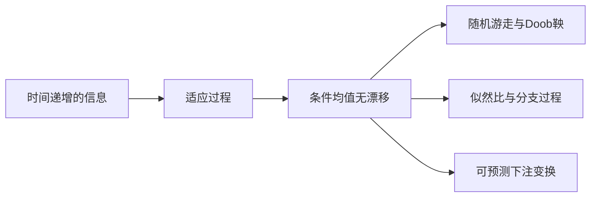

## 0 结构图景

公平并不意味着路径平稳，更不意味着最后一定赢或输。它指在当前全部可见信息下，下一步条件平均等于现在。鞅的对象是“过程与信息流”这一对；同一过程换一套提前泄露未来的信息，可能不再是鞅。

## 1 定义与等价判据

**滤过**是递增σ代数列 $F_0\subset F_1\subset\cdots$。过程X **适应**，指 $X_n$ 对 $F_n$ 可测。若适应、每个 $E|X_n|<\infty$，且 $E[X_{n+1}|F_n]=X_n$，称为 **鞅**；若左边≥右边称 **下鞅**，若≤称 **上鞅**。

利用塔性质反复迭代，一步条件等式等价于所有 $m\le n$ 的 $E[X_n|F_m]=X_m$；不等式版本由塔性质与保序同样推出。令 $D_{n+1}=X_{n+1}-X_n$，鞅等价于 $E[D_{n+1}|F_n]=0$。无条件 $EX_n$ 恒定只是必要条件，不足以验证条件等式。

示范 E8.1：独立可积增量 $\xi_k$ 均值0，令 $S_n=\sum_{k=1}^n\xi_k$、$F_n=\sigma(\xi_1,\ldots,\xi_n)$，$S_0=0$。独立性使 $E[\xi_{n+1}|F_n]=0$，所以S为鞅。若各增量平方可积、方差 $\sigma^2$ ，则 $S_n^2-n\sigma^2$ 也是鞅：展开 $(S_n+\xi_{n+1})^2$，交叉项条件期望0，新增平方条件期望 $\sigma^2$ 。每项可积由有限个平方可积变量之和与Cauchy–Schwarz保证。

反例：取一个对称±1变量ξ，令 $X_0$ =0、 $X_1$ =ξ、 $X_2$ =-ξ，之后不变，配自然信息。每时刻均值0，但 $E[X_2|F_1]=-\xi\ne\xi=X_1$，不是鞅。若把随机游走的未来增量提前放进 $F_0$ ，其下一步不再条件均值0；信息不能省略。

## 2 从终点反向投影：Doob鞅

给任意可积终端变量Z及滤过，置 $M_n=E[Z|F_n]$。可积性由L1压缩，适应由定义，塔性质给 $E[M_{n+1}|F_n]=M_n$。因此每次获得更多信息后的最佳条件均值是一条鞅。它并不意味着每条更新路径无趋势，而是更新在旧信息下平均为0。

示范 E8.2：两枚独立公平比特U、V，终点Z=U+V。初始无信息 $M_0=1$；看见U后 $M_1=U+1/2$；看见V后 $M_2=U+V$。两次更新分别为U-1/2、V-1/2，条件均值均0。

凸变换：若M为鞅、φ凸且各φ( $M_n$ )可积，条件Jensen给 $E[\varphi(M_{n+1})|F_n]\ge\varphi(E[M_{n+1}|F_n])=\varphi(M_n)$，所以φ( $M_n$ )为下鞅。特别地| $M_n$ |总可积，故是下鞅；平方需要平方可积条件，不能遗漏。

## 3 似然比：改变模型的累计证据

考虑在基准概率P下独立同分布观测 $\xi_k$ ，分布μ。另一个候选分布ν满足ν≪μ，密度 $r=d\nu/d\mu\ge0$、$\int r\,d\mu=1$。令 $L_0=1$、$L_n=\prod_{k=1}^nr(\xi_k)$。非负且由独立性及Tonelli，$EL_n=1$，故可积；条件提取已知乘积和独立性给 $E[L_{n+1}|F_n]=L_n$。

它为何是似然比？对有限维矩形事件，积分 $E_P[L_n1_{\{\xi_i\in A_i,1\le i\le n\}}]=\prod_{i=1}^n\nu(A_i)$；π–λ唯一性推广到全部有限维事件。因此 $L_n$ 是候选n维分布对基准n维分布的RN密度。这里不要求r严格为正，零值允许；也不由 $EL_n=1$ 推出极限期望仍为1，后者要第10讲UI条件。

示范 E8.3：基准公平比特、候选成功率p，若前n次成功k次，$L_n=(2p)^k[2(1-p)]^{n-k}$。当p=1/2恒为1；当p=1，观测首次失败后密度归零，但有限n的期望仍为1。

## 4 分支过程与可预测变换

分支过程 $Z_0=1$，每个个体独立产生非负整数子代，均值 $0<m<\infty$。形式上给独立数组 $\xi_{n,j}$，每行与过去独立，$Z_{n+1}=\sum_{j=1}^{Z_n}\xi_{n,j}$。 $F_n$ 包含第n代以前繁殖信息。随机上限写成 $\sum_{j\ge1}1_{\{Z_n\ge j\}}\xi_{n,j}$；用非负单调收敛与独立性对条件期望取极限，得 $E[Z_{n+1}|F_n]=mZ_n$。归纳 $EZ_n=m^n$ 保证可积和有限性。故 $W_n=Z_n/m^n$ 为非负均值1鞅。m=0时每个子代几乎必然0，过程次代灭绝，不能在归一化式中除0。

若M为鞅， $H_k$ 对 $F_{k-1}$ 可测并有界，称H为 **可预测下注系数**。定义 $N_n=N_0+\sum_{k=1}^nH_k(M_k-M_{k-1})$， $N_0$ 可积且 $F_0$ 可测，则N也是鞅：每个有限和可积，条件提取 $H_k$ 后增量均值0。若H允许无界，必须另行验证各项乘积可积，不能只凭可预测性。

这种有限时刻结论不自动保证无限下注或随意停下后期望守恒。下一讲将精确列出什么时候允许停止。

## 5 三类训练与覆盖

引导 G8.1（T1）：对公平±1随机游走，验证 $S_n$ 与 $S_n$ ²-n分别是鞅。

独立 I8.1（T2）：用四个等概率结果列出E8.2的两步条件平均，验证| $M_n$ -1|是下鞅。

独立 I8.2（T3）：似然比E8.3取p=1，算P( $L_n$ =2^n)、P( $L_n$ =0)，检验它几乎必然趋0但每步均值1，说明UI为何失败。

口述窗口：说清适应、可积、条件平均三个条件各自排除什么问题。只说“公平”不足以判定鞅。

| 旧概念 | 本讲升级 |
|---|---|
| 均值为0的随机增量 | 对全部过去信息条件均值0 |
| 贝叶斯前的似然累计 | 基准模型下的非负鞅 |
| 分组最优预测 | 随信息扩展的Doob鞅 |
| 依过去下注 | 可预测鞅变换，仍需可积性 |

本质是逐步保持条件积分，而非承诺路径稳定或无限期限公平。下一讲处理从路径中选择观察时间。

---

# 第9讲 停时与可选停时

> DSH首审后修订待复审，未获批准。离散时间；所有无穷停时的使用均明确另加终止或极限条件。

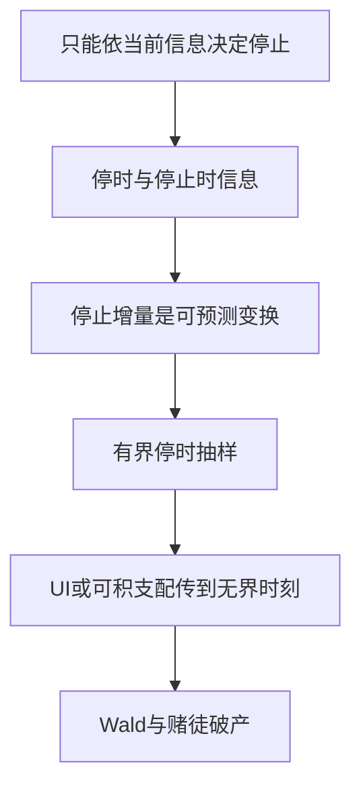

## 0 结构图景与定义

“第一次财富达到目标”可当时决定；“全程最大值发生的最后时刻”通常需窥视未来。**停时** $T:\Omega\to\{0,1,2,\ldots,\infty\}$ 满足 $\{T\le n\}\in F_n$。等价地 $\{T=n\}\in F_n$ 对全部有限n成立，由差集及有限并互推。特别地 $\{T\ge k\}\in F_{k-1}$，这是停止增量可预测的关键。

**停时σ代数** $F_T$ 包含那些A使 $A\cap\{T\le n\}\in F_n$ 对每个n成立；另外A必须属于原F。补和可数并验证其为σ代数。若S≤T，$F_S\subset F_T$，因为 $A\cap\{T\le n\}=(A\cap\{S\le n\})\cap\{T\le n\}$。适应过程的 $X_T$ 在T有限时按分块定义，并对 $F_T$ 可测：在 $\{T\le n\}$ 上其阈值事件为对k≤n的有限并。

示范 E9.1：随机游走首次达到水平b的时刻是停时，因为 $\{T\le n\}=\bigcup_{k=0}^n\{S_k=b\}$。反例：T在“下一步涨”时取0、否则取1；若 $F_0$ 平凡且涨跌都正概率，$\{T\le0\}$ 不在 $F_0$ ，故不是停时。

## 1 有界可选抽样：完整证明

若M为鞅，则 $M_{n\wedge T}=M_0+\sum_{k=1}^n1_{\{T\ge k\}}(M_k-M_{k-1})$ 是鞅，因系数有界且 $F_{k-1}$ 可测。这只证明每个固定n可积、期望为EM_0。

若 $S\le T\le N$ 是有界停时，则 $E[M_T|F_S]=M_S$。首先有限分块保证 $M_T$ 、 $M_S$ 可积。对任意 $A\in F_S$，有

$1_A(M_T-M_S)=\sum_{k=1}^N1_{A\cap\{S<k\}\cap\{T\ge k\}}(M_k-M_{k-1})$。

每个系数 $F_{k-1}$ 可测：A与 $\{S\le k-1\}$ 的交按 $F_S$ 定义可测，另一个事件按停时性质可测。因此每项期望0，有限求和得事件积分相等，完成条件期望证明。对下鞅相同计算给条件不等式≥；上鞅反向。

## 2 无界停时：三个准确版本

版本一即上节的 **有界停时**，无需统一时刻的矩界。

版本二：T几乎必然有限，且 **停止族 $\{M_{T\wedge n}\}$ UI**，则 $M_T$ 可积并且 $EM_T=EM_0$。证明：每条T有限路径最终停止，故 $M_{T\wedge n}\to M_T$ 几乎必然；第3讲Vitali给L1收敛，再由固定n期望等式传极限。充分条件是被同一个可积变量支配，特别是停止过程一致有界。UI必须检查停止族，而非只检查每个成员可积。

版本三：增量 **一致有界** $|M_k-M_{k-1}|\le C$，且 $ET<\infty$，则 $|M_{T\wedge n}|\le|M_0|+CT$，可积支配给版本二。因此期望守恒。条件 $ET<\infty$ 同时保证T几乎必然有限，但反向不成立。

还可得到版本二中的条件抽样：若S≤T均有限且停止族UI，则 $E[M_T|F_S]=M_S$。对固定 $A\in F_S$，置 $A_k=A\cap\{S\le k\}\in F_{S\wedge k}$。对n≥k，有界抽样给 $E[1_{A_k}M_{T\wedge n}]=E[1_{A_k}M_S]$；右侧在 $A_k$ 上是有限分块故可积。令n趋无穷得等式。进一步，用 $A_k$ 分别取S≤k上的 $M_S$ 正负事件，可得 $E(|M_S|1_{S\le k})\le E|M_T|$；令k趋无穷证明 $M_S$ 可积，再对任意A以控制收敛传k极限。这补足了条件版本中 $M_S$ 可积性，未预设它。

## 3 Wald等式：用可积总成本避免循环

设 $\xi_k$ 独立同分布可积，均值m；T为其自然滤过下的停时，$ET<\infty$。则 $E\sum_{k=1}^T\xi_k=mET$。这里不要求增量有界，故不能直接套版本三。

完整证明：由于 $\{T\ge k\}\in F_{k-1}$ 与 $\xi_k$ 独立，Tonelli给

$E\sum_{k=1}^{\infty}|\xi_k|1_{T\ge k}=E|\xi_1|\sum_{k=1}^{\infty}P(T\ge k)=E|\xi_1|ET<\infty$。

最后恒等式由逐点 $T=\sum_{k\ge1}1_{T\ge k}$ 得出。绝对可积后Fubini允许有符号求和，逐项期望为 $mP(T\ge k)$，即得Wald。先验证总绝对成本再交换，是证明的核心。

## 4 赌徒破产与危险反例

公平±1游走从整数x出发，$0<x<N$，令T首次碰到0或N。每N步若全部向上，必在该块内碰到边界；给定尚未退出的过去，该事件概率 $2^{-N}$。因此 $P(T>kN)\le(1-2^{-N})^k$，用尾概率求和得ET有限。停止财富始终在[0,N]，版本二给 $E S_T=x$，所以 $P(S_T=N)=x/N$。

平方鞅 $S_n^2-n$ 停止后，对有限n有 $E(T\wedge n)=E S_{T\wedge n}^2-x^2$。右侧由有界收敛趋 $E S_T^2-x^2=Nx-x^2$，左侧单调收敛，故 $ET=x(N-x)$。此计算也能在已证明T有限后独立给出ET，而不是先假定答案套停时。

反例 E9.2：公平游走从0出发首次碰到1，记τ。先在边界-m和1间退出，命中1概率 $m/(m+1)$；因此 $P(\tau<\infty)\ge m/(m+1)$ 对所有m，故τ几乎必然有限。但 $S_\tau=1$，而每个 $E S_{\tau\wedge n}=0$。停止族不UI；若Eτ有限，Wald会推出 $ES_\tau=0$，矛盾，所以Eτ=∞。这同时说明“几乎必然停下”并不足够。

## 5 训练、覆盖与预告

引导 G9.1（T1）：公平赌徒从2开始，边界0、5，求到5概率与平均退出时间。

独立 I9.1（T2）：证明两个停时的最小值与最大值仍为停时，说明最后一次命中通常不能如此证明。

独立 I9.2（T3）：在E9.2中指出有界停时、UI停止族、可积时间三个版本分别为何不适用于τ。

| 旧直觉 | 精确版本 |
|---|---|
| 看见合适机会就停 | 停时事件不依未来 |
| 公平游戏停下仍公平 | 还需有界、UI或可积支配条件 |
| 随机项数的总和 | Wald先控制绝对总成本 |

本质是把随机选择时间写成可预测增量系数，再辨明极限能否交换。下一讲证明鞅何时存在极限，以及为什么极限可能损失期望。

---

# 第10讲 上穿不等式与鞅收敛

> DSH首审后修订待复审，未获批准。本讲先完整证明有限方差独立同分布SLLN的鞅路线；一般可积同分布版本在第13讲通过截断补齐，不混淆范围。

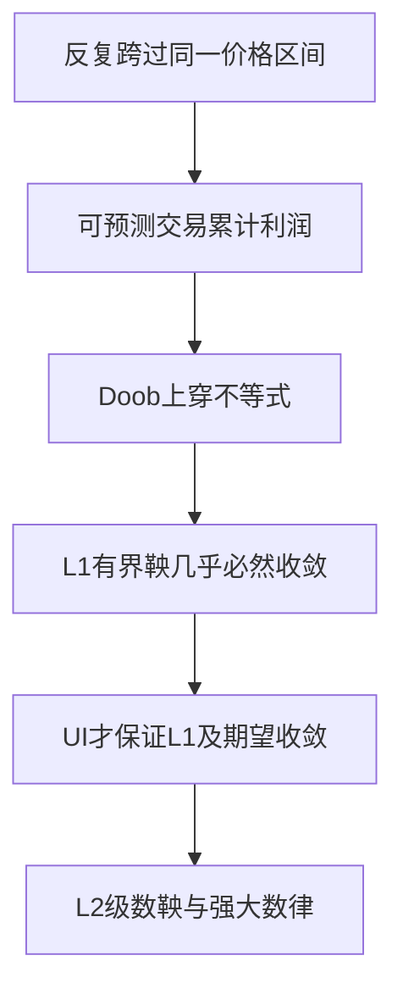

## 0 结构图景：控制振荡，而非猜极限

一个数列不收敛，常因不断从低处跑到高处。若每次从a以下买入、到b以上卖出都可获利b-a，而过程正部分期望始终有界，那么它不能在同一有理区间无限次上穿。鞅收敛证明的目标不是先找出极限公式，而是排除振荡。

## 1 上穿的定义与不等式

给实路径 $x_0,\ldots,x_N$ 和a<b：先找第一个 $x_i\le a$ 的时刻，再找其后的第一个 $x_j\ge b$，算一次完成上穿；随后重新找买入时刻，重复。**上穿次数** $U_N[a,b]$ 是到N为止完成的次数。是否持有取决于截至上一时刻的信息，所以每步持有系数 $H_k$ ∈{0,1}为 $F_{k-1}$ 可测。

设X是下鞅，令 $Y_n=(X_n-a)^+$。第6讲Jensen及正部函数递增给 $E[Y_{n+1}|F_n]\ge(E[X_{n+1}|F_n]-a)^+\ge Y_n$，故Y是非负下鞅。按X的上穿规则交易Y：每次买入时Y=0，卖出时Y≥b-a，未卖出的持仓终值也非负。因此路径上交易收益 $G_N=\sum_{k=1}^NH_k(Y_k-Y_{k-1})\ge(b-a)U_N[a,b]$。

另一方面，补策略1- $H_k$ 也可预测非负，下鞅增量使其期望收益非负。两策略收益相加等于 $Y_N-Y_0$，故 $EG_N\le EY_N-EY_0\le EY_N$。于是得到 **Doob上穿不等式**

$(b-a)E U_N[a,b]\le E(X_N-a)^+$。

所有和均有限， $Y_k$ 可积，所以没有使用可选停时极限。仅当时刻0执行买入时，才有 $X_0\le a$，从而 $Y_0=0$；若 $X_0>a$，初始持仓为0，但 $Y_0$ 可以大于0。两种情况下初始交易成本均为0。上面的期望界只需要 $Y_0\ge0$，即 $EG_N\le EY_N-EY_0\le EY_N$，并未要求一般情形的 $Y_0$ 等于0。

## 2 几乎必然收敛定理

**下鞅收敛定理。** 若 $\sup_nEX_n^+<\infty$，则 $X_n$ 几乎必然收敛到有限可积X_∞。

证明：右侧上穿界不超过 $\sup_nEX_n^++|a|$，单调收敛给无限时上穿次数期望有限，故其几乎必然有限。对可数个有理a<b取共同概率1事件。若某条路径的下极限小于上极限，则能在两者间找到有理a<b，路径必完成无穷次上穿，矛盾。因此路径存在扩展实数极限。

还须排除±∞。下鞅给 $EX_n\ge EX_0$，所以 $E|X_n|=2EX_n^+-EX_n\le2\sup_kEX_k^+-EX_0$ 一致有界。Fatou给 $E|X_\infty|\le\liminf_nE|X_n|<\infty$，于是极限有限可积。对上鞅取负数得到对称结论。特别地，L1有界鞅与非负上鞅几乎必然收敛。

示范 E10.1：第8讲p=1的似然比非负、均值1，所以收敛；实际极限0。但 $E L_\infty=0\ne1=EL_n$。几乎必然收敛不自动保存平均。

## 3 UI、L1收敛与终端表示

对鞅M，下列等价：①族 $\{M_n\}$ UI；②存在可积 $M_\infty$ 且 $M_n$ 于L1收敛到 $M_\infty$ ；③存在可积Z使 $M_n=E[Z|F_n]$。

①→②：UI给L1有界，上一节给几乎必然收敛，第3讲Vitali升级为L1。②→③：固定n，塔性质给 $E[M_k|F_n]=M_n$ 对k≥n；条件期望L1压缩允许k趋∞，得 $M_n=E[M_\infty|F_n]$。

③→①：先 $E|M_n|\le E|Z|$。对任意事件A，条件保序给 $E(|M_n|1_A)\le E(E[|Z||F_n]1_A)$，但A未必 $F_n$ 可测，不能直接移进Z。正确做法先分解Z：$Z=Z1_{|Z|\le K}+Z1_{|Z|>K}$，前一项条件期望绝对值≤K，后一项L1范数≤ $E(|Z|1_{|Z|>K})$。故 $E(|M_n|1_A)\le KP(A)+E(|Z|1_{|Z|>K})$。先K后小概率事件，得到积分一致绝对连续，配合L1有界即UI。

另②→①也直接由第3讲Vitali反向成立。此证明把“终端条件期望族总UI”建立起来，后续可用于停时，但未反过来把该事实当作本节前提。

## 4 L2有界鞅与正交增量

若M平方可积且 $\sup_nEM_n^2<\infty$，则UI由第3讲的高阶矩判据成立。还可得到L2收敛：对m≤n，$E[(M_n-M_m)M_m]=0$，来自条件均值等式及截断提取；因此 $E(M_n-M_m)^2=EM_n^2-EM_m^2$。平方均值递增且有界，所以M是L2 Cauchy列。第7讲完备性给L2极限，而L2推出依概率，故与几乎必然极限相同（两个依概率极限相等，可用三角不等式把差超过ε的事件夹到两项误差事件）。

由此若独立中心化平方可积 $\xi_k$ 满足 $\sum_{k=1}^{\infty}E\xi_k^2<\infty$，部分和鞅的平方均值是方差和，有界，因此级数几乎必然且L2收敛。正交交叉项来自独立与均值0。

## 5 Kronecker引理与SLLN鞅路线

**Kronecker引理（以下版本在本书完整证明，不是未证输入）。** 若实数级数 $\sum_{k=1}^{\infty}a_k/k$ 收敛，则 $n^{-1}\sum_{k=1}^na_k\to0$。令 $s_j=\sum_{k=1}^ja_k/k$、 $s_0=0$，求和分部得到 $\sum_{k=1}^na_k=ns_n-\sum_{k=1}^{n-1}s_k$。除以n；若 $s_n$ 趋s，则Cesàro平均也趋s，后者可由有限头部除n趋0及尾部统一误差小于ε证明。因此差趋0。

若 $\xi_k$ 独立同分布、均值m、有限方差 $\sigma^2$ ，则 $M_n=\sum_{k=1}^n(\xi_k-m)/k$ 是L2有界鞅，因为 $EM_n^2=\sigma^2\sum_{k=1}^n1/k^2\le2\sigma^2$（用积分比较）。上一节给加权级数几乎必然收敛，逐路径应用Kronecker得到 $n^{-1}\sum_{k=1}^n\xi_k\to m$ 几乎必然。这就是有限方差SLLN的完整鞅证明。只有一阶矩时该方差论证不适用，第13讲必须截断，不能删除条件冒充一般版本。

## 6 训练与覆盖

示范 E10.2：公平±1增量满足 $\sigma^2$ =1，故加权级数 $\sum\xi_k/k$ 几乎必然收敛，而普通部分和并不因此收敛；结论是其平均趋0。不同的归一化对应不同目标。

引导 G10.1（T1）：给路径0,2,-1,3,0,4，计算区间[0,2]到终点的上穿次数。

独立 I10.1（T2）：对第8讲似然比说明哪一个UI等价条件失败，为什么其有限时刻均值1不能传到极限。

独立 I10.2（T3）：独立中心化变量满足 $\sum_{n=1}^{\infty}\operatorname{Var}(\xi_n)/n^2<\infty$，证明样本平均趋0几乎必然，不要求同分布。

口述窗口：上穿只排除哪种病态，Fatou又排除哪种病态？为什么两步都不可省？

| 旧现象 | 升级后的机制 |
|---|---|
| 曲线反复振荡 | 有理区间上穿数被期望界控制 |
| 均值不变 | 传到极限仍须UI |
| 平均稳定 | 加权级数鞅收敛加求和分部 |

本质是用可预测交易禁止无限振荡，再单独控制极限质量。下一讲转向分布本身的收敛，不再要求随机变量在同一空间逐点靠近。

---

# 第11讲 弱收敛与胎紧性

> DSH首审后修订待复审，未获批准。实线上的判据与紧性给完整证明；一般Polish空间Prokhorov按原设计保留陈述和骨架，标U306-5。一般空间Skorokhod标U306-6；本讲完整证明实线分位数版本。

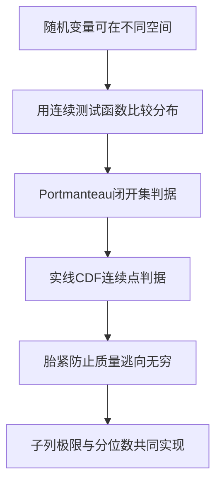

## 0 结构图景与最小拓扑词汇

若 $X_n$ 恒等于1/n，分布趋向0点质量，但事件(0,∞)的概率始终1，极限分布对此事件概率0。因此弱收敛不能要求所有事件概率都收敛；边界带有极限质量的事件必须区别处理。

度量空间(S,d)中，开集指每点有小球包含于该集，闭集是其补；紧集指每个开覆盖有有限子覆盖。一个函数连续指距离很近的输入给很近的输出。Borel族由开集生成。概率 $\mu_n$ **弱收敛**于μ，记 $\mu_n\Rightarrow\mu$，指对每个有界连续实函数f，$\int f\,d\mu_n\to\int f\,d\mu$。随机变量的分布如此收敛也记 $X_n\Rightarrow X$，不要求它们位于同一空间。

## 1 Portmanteau：完整等价证明

以下三项等价：①弱收敛；②每个闭集C满足 $\limsup_n\mu_n(C)\le\mu(C)$；③每个开集G满足 $\liminf_n\mu_n(G)\ge\mu(G)$。并推出每个 **连续集** A（Borel且μ(∂A)=0）的概率收敛，∂A为闭包减内部。

①→②：非空闭集C的距离函数 $d(x,C)=\inf_{y\in C}d(x,y)$ 满足差的绝对值不超过d(x,z)，故连续；闭性保证C外点距离正。取 $f_k(x)=\max(0,1-kd(x,C))$，则 $1_C\le f_k\downarrow1_C$。固定k，$\limsup_n\mu_n(C)\le\int f_k\,d\mu$，再控制收敛令k趋∞。空集直接成立。②与③由补集互推。

③→①：先取连续 $0\le f\le M$。层蛋糕公式 $\int f\,d\nu=\int_0^M\nu(f>t)dt$ 由 $f(x)=\int_0^M1_{t<f(x)}dt$ 及Tonelli得出。{f>t}开，Fatou给 $\liminf_n\int f\,d\mu_n\ge\int f\,d\mu$。对M-f再用同一不等式得反向limsup，故收敛。任意有界连续f加常数归约。连续集结论由 $A^\circ\subset A\subset\overline A$ 及两端μ相等夹住。

检查点：开场A=(0,∞)为什么不是极限点质量的连续集？这正是不能直接代入A的原因。

## 2 实线分布函数判据

若 $\mu_n\Rightarrow\mu$，则其CDF $F_n(x)\to F(x)$ 在F每个连续点成立，因为 $(-\infty,x]$ 的边界仅{x}，单点质量是CDF跳跃。

反向：若连续点处CDF收敛，则弱收敛。先补充：单调CDF不连续点至多可数，因为跳跃大于1/k的点至多k个，对k取并即可。给ε，选F的连续点a<b使 $F(a)<\varepsilon$、$1-F(b)<\varepsilon$。对大n，μ_n在(a,b]外的质量不超过3ε，μ相应尾质量不超过2ε。对有界连续f，其在[a,b]上一致连续：若不然，可选两列相距趋0而函数值差固定，闭有界区间紧性取收敛子列，与连续性矛盾。故可用有限分割、全部端点选为F连续点、每段振幅小于ε，以阶梯函数上下逼近f。每段 $(x_{j-1},x_j]$ 的概率是CDF差，已知收敛。紧区间内误差至多ε，区间外误差至多常数乘ε，令ε趋0即得弱收敛。

## 3 胎紧与实线子列紧性

概率族 **胎紧**（亦称紧性，tightness）指任意ε>0有紧集K使所有族成员给K至少1-ε质量。在实线上等价于对某R有 $\sup_n\mu_n(|x|>R)<\varepsilon$，因为闭有界集紧且每个紧集有界。Markov给 $\sup_n\int|x|^p d\mu_n<\infty$ 是胎紧的充分条件。

**实线Prokhorov方向。** 胎紧序列有弱收敛子列。证明：枚举有理数，用[0,1]中数列有收敛子列的性质反复提取，再取对角子列，使 $F_{n_k}(q)\to G(q)$ 对全部有理q成立。G在有理数上非减。定义 $F(x)=\inf_{q>x,q\in\mathbb Q}G(q)$。它非减且右连续：若 $x_j$ ↓x，对任意q>x最终 $x_j$ <q，故F( $x_j$ )≤G(q)，再取下确界；另一边由单调性。

胎紧保证F两端极限为0、1：在大R外质量统一小，可取有理q<-R或q>R对G作界，再传给F。由第2讲Stieltjes构造得对应概率μ。若x是F连续点，对有理r<x<s，$G(r)\le\liminf_kF_{n_k}(x)\le\limsup_kF_{n_k}(x)\le G(s)$。右侧对s下取确界为F(x)；左侧对r上取确界为F(x-)：一边用G(r)≤F(r)，另一边对y<x选有理r∈(y,x)得F(y)≤G(r)。连续性使两端一致。故CDF判据给弱收敛。

反向，弱收敛序列胎紧：选连续点a<b使极限尾质量小，CDF收敛控制全部充分大n；有限个头部概率各自可用大闭区间截尾，再取最大的区间。由此实线上胎紧等价于每个子列都含弱收敛子列。

一般 **Polish空间**指完备、具有可数稠密子集的度量空间。**Prokhorov定理U306-5**：其概率族胎紧等价于相对弱紧（每个序列有弱收敛子列）。证明骨架为用可数细分及紧集覆盖提取候选积分泛函，再证明其代表概率且无质量逃逸；一般空间的代表与紧性细节本稿未证。本讲实线证明不能冒充该一般定理。

## 4 实线Skorokhod表示：把分布收敛实现为路径收敛

对CDF F定义广义分位数 $Q(u)=\inf\{x:F(x)\ge u\}$，$0<u<1$。两端极限保证有限。右连续性与单调性给 $Q(u)\le x$ 当且仅当 $u\le F(x)$：若Q≤x，选阈值集合中趋近Q的点，右连续传到Q，再用单调性；反向直接由下确界。故Q可测，均匀U下Q(U)的CDF恰为F。

若 $F_n\Rightarrow F$，则 $Q_n(u)\to Q(u)$ 对几乎所有u成立。排除F在某个非退化区间恒为u的水平值；这些值至多可数，因为可给每个平坦区间选一个不同有理数。对余下u及任意ε，能在 $(Q(u)-\varepsilon,Q(u))$ 选F连续点a使F(a)<u，也能在 $(Q(u),Q(u)+\varepsilon)$ 选连续点b使F(b)>u；后者若不可能便出现被排除的平坦水平。CDF收敛给最终 $F_n(a)<u<F_n(b)$，所以 $a\le Q_n(u)\le b$。令ε趋0完成。

因此取同一个均匀U，$\widetilde X_n=Q_n(U)$、$\widetilde X=Q(U)$ 各有正确分布且几乎必然收敛。这不声称原来的 $X_n$ 本身几乎必然收敛，只构造了另一个耦合。一般Polish空间的Skorokhod表示（U306-6）仅陈述：弱收敛概率可在共同概率空间实现为几乎必然收敛变量；一般构造未在此给出。

## 5 训练与覆盖

示范 E11.1：$\delta_{1/n}\Rightarrow\delta_0$，因为每个连续测试函数f(1/n)趋f(0)；但(0,∞)概率不收敛到极限概率。$\delta_n$ 不胎紧，故没有实线概率弱收敛子列，体现质量逃逸。

引导 G11.1（T1）：检验方差≤1、均值0的分布族胎紧，给出R与ε的关系。

独立 I11.1（T2）：若实随机变量 $X_n$ 依概率趋X，证明其分布弱收敛；提示与证明分离。

独立 I11.2（T3）：为什么Skorokhod重构不能证明任何独立Bernoulli(1/2)原序列几乎必然收敛？

| 旧概念 | 本讲升级 |
|---|---|
| 分布函数趋近 | 仅需且只能保证极限连续点 |
| 尾概率控制 | 防止子列极限损失总质量 |
| 同一概率空间路径比较 | 弱收敛本不要求，可另构造耦合 |

本质是区分分布、事件边界与具体实现。下一讲用特征函数压缩分布信息，并证明这种编码如何传递极限。

---

# 第12讲 特征函数与Lévy连续性定理

> DSH首审后修订待复审，未获批准。本讲限实随机变量，完整证明唯一性、反演与Lévy连续性；不调用一般Polish空间Prokhorov。复数积分按实虚部定义。

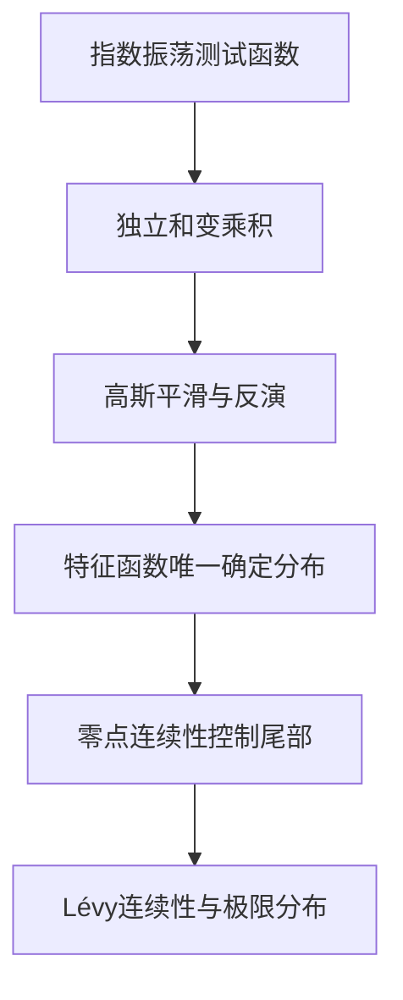

## 0 结构图景

一个分布有无限多个区间概率，直接比较很繁琐。**特征函数** $\varphi_X(t)=E e^{itX}$ 把分布编码成一个函数；$e^{itx}=\cos(tx)+i\sin(tx)$ 始终绝对值1，所以无需任何矩存在。它不是概率密度，可以为负、为复数、也可以为0。

## 1 基本性质与局部展开

直接有φ(0)=1、$|\varphi(t)|\le1$、$\varphi(-t)=\overline{\varphi(t)}$。控制收敛给连续性；更强地 $|\varphi(t+h)-\varphi(t)|\le E|e^{ihX}-1|\to0$，所以一致连续。若X、Y独立，则Fubini与联合乘积律给 $\varphi_{X+Y}(t)=\varphi_X(t)\varphi_Y(t)$。缩放平移给 $\varphi_{aX+b}(t)=e^{itb}\varphi_X(at)$。

若 $E|X|<\infty$，差商由 $|(e^{ihX}-1)/h|\le|X|$ 支配，得 $\varphi'(t)=E(iXe^{itX})$；若 $EX^2<\infty$，同理二阶可导且 $\varphi''(0)=-EX^2$。尤其均值0方差 $\sigma^2$ 时

$\varphi(t)=1-\sigma^2t^2/2+o(t^2)$。

不依赖未证复Taylor定理也可得到此式：两次积分基本定理给 $e^{iu}=1+iu-u^2\int_0^1(1-s)e^{isu}ds$；减去二次项后除以u²的余项趋0且一致有界，取u=tX，用 $X^2$ 支配即可。

示范 E12.1：对称±1变量的特征函数为cos t，在π/2为0。Poisson(λ)特征函数由绝对收敛级数直接求和为 $\exp(\lambda(e^{it}-1))$，所以独立Poisson和仍Poisson，参数相加；唯一性将在下面证明后才允许据特征函数等式识别分布。

## 2 高斯积分工具及平滑密度

记 $g_\varepsilon(x)=(2\pi\varepsilon)^{-1/2}\exp(-x^2/(2\varepsilon))$。为免把Fourier反演当作黑箱，先核验其指数积分。基础积分 $I=\int_{\mathbb R}e^{-x^2/2}dx$ 有限；平方后Tonelli并以二维极坐标换元给 $I^2=\int_0^{2\pi}\int_0^\infty e^{-r^2/2}r\,dr\,d\theta=2\pi$，所以I=√(2π)。这里点名使用未证分析输入 **R18／A0**：数分的极坐标积分换元公式（面积因子r），不是概率极限定理；尚未掌握换元的读者须先核验这一基础工具。

令 $J(t)=\int e^{itx}g_1(x)dx$。用|x| $g_1$ 支配可微，分部积分以及 $g_1'=-xg_1$ 给 $J'(t)=-tJ(t)$，边界项0，J(0)=1。解一阶方程得 $J(t)=e^{-t^2/2}$；缩放得 $\int e^{itx}g_\varepsilon(x)dx=e^{-\varepsilon t^2/2}$。无需引用一般Fourier反演：将刚证的标准高斯指数积分中的变量换名为 $u$，取参数 $-x/\sqrt\varepsilon$，再以 $u=\sqrt\varepsilon\,t$ 换元，直接得到 $\int_{\mathbb R}e^{-itx}e^{-\varepsilon t^2/2}dt=\sqrt{2\pi/\varepsilon}\,e^{-x^2/(2\varepsilon)}$。除以 $2\pi$ 即给

$g_\varepsilon(x)=\frac1{2\pi}\int_{\mathbb R}e^{-itx}e^{-\varepsilon t^2/2}dt$。

对任意概率μ，平滑后的分布μ与 $N(0,\varepsilon)$ 的独立和有密度 $p_\varepsilon(x)=\int g_\varepsilon(x-y)\,\mu(dy)$。这是非负且积分1，由Tonelli验证。代入上式，有高斯因子使绝对积分有限，Fubini得

$p_\varepsilon(x)=\frac1{2\pi}\int_{\mathbb R}e^{-itx}\varphi_\mu(t)e^{-\varepsilon t^2/2}dt$。

## 3 唯一性与反演公式

若μ、ν特征函数相同，则每个ε的平滑密度相同。取独立标准正态Z，$X+\sqrt\varepsilon Z\to X$ 几乎必然；有界连续测试函数的控制收敛给平滑律弱趋原律。故μ、ν对所有有界连续函数积分相同，用第11讲闭集距离逼近得所有闭集质量相同，再由左射线生成实线Borel族得μ=ν。这完整证明 **特征函数唯一性**。

**高斯正则化反演。** 对任意有限a<b，先对 $p_\varepsilon$ 在(a,b)积分并用Fubini：

$\int_a^bp_\varepsilon(x)dx=\frac1{2\pi}\int_{\mathbb R}\frac{e^{-ita}-e^{-itb}}{it}\varphi_\mu(t)e^{-\varepsilon t^2/2}dt$，t=0处取连续值b-a。

当ε↓0，对每个固定y，$P(a<y+\sqrt\varepsilon Z<b)$ 趋 $1_{(a,b)}(y)$，在端点a、b处趋1/2；控制收敛得左边趋 $\mu((a,b))+[\mu\{a\}+\mu\{b\}]/2$。所以该式的ε极限恢复全部连续端点区间概率，并正确处理原子端点。我们没有声称去掉高斯因子后积分总绝对收敛。

若额外 $\int|\varphi(t)|dt<\infty$，则 $p_\varepsilon$ 一致趋连续函数 $p(x)=(2\pi)^{-1}\int e^{-itx}\varphi(t)dt$：差的上界与x无关且由控制收敛趋0。p非负；在任意连续端点区间，积分极限给μ(a,b)=∫a^b p。先用稠密连续端点逼近再单调取极限得所有区间，因而p是μ的密度。尾部扩张到全实线给总积分1。此为通常的可积特征函数密度反演版本。

## 4 Lévy连续性定理：两方向完整证明

正向：若 $\mu_n\Rightarrow\mu$，则实虚两部分是有界连续测试函数，故 $\varphi_n(t)\to\varphi_\mu(t)$ 对每个t。

逆向：若每个t有 $\varphi_n(t)\to\varphi(t)$，且φ在0连续，则存在唯一概率μ使φ为其特征函数，并有 $\mu_n\Rightarrow\mu$。

关键先证明胎紧。对h>0，Fubini给

$\frac1{2h}\int_{-h}^h(1-\operatorname{Re}\varphi_n(t))dt=E[1-\frac{\sin(hX_n)}{hX_n}]$。

零处分式取1。当|hX_n|≥2，$|\sin(hX_n)/(hX_n)|\le1/2$，所以尾概率 $P(|X_n|\ge2/h)$ 至多为左式的2倍。对固定h，控制收敛传n极限；再令h↓0，φ(0)=1且在0连续，使平均积分趋0。因此大n的尾质量统一小；有限个头部再扩大紧区间统一控制，得到胎紧。

第11讲实线子列紧性保证每个子列都能进一步弱收敛到某概率ν；正向结论使ν的特征函数为φ。唯一性定理说明所有这样的ν相同，记μ。若全序列不弱收敛于μ，则存在一个有界连续f、ε>0和子列，其积分与μ差至少ε；胎紧再提取弱收敛子列必趋μ，矛盾。存在、唯一和全序列收敛均已证明。

反例 E12.2：$X_n$ 为方差n²的中心正态，$\varphi_n(t)=e^{-n^2t^2/2}$ 点态极限在0为1、其余为0，不在0连续；分布不胎紧，没有概率弱极限。这展示0点连续性不是装饰条件。

## 5 训练与覆盖

引导 G12.1（T1）：求均匀[-1,1]特征函数并处理t=0。

独立 I12.1（T2）：若独立 $X\sim N(a,\sigma^2)$、$Y\sim N(b,\tau^2)$，用本讲工具识别X+Y分布，并说明识别依据。

独立 I12.2（T3）：φ_n点态趋φ且φ在0连续，为何不能只写“极限就是某分布的特征函数”而跳过胎紧？

| 旧对象 | 统一编码 |
|---|---|
| 独立卷积 | 特征函数乘积 |
| 二阶矩 | 原点二阶展开 |
| 分布唯一性 | 高斯平滑后反演，再去平滑 |
| 中心极限证明入口 | 点态乘积极限加0点连续性 |

本质是先证明编码不丢信息，再证明编码极限确实对应概率。下一讲完成一般可积SLLN，第14讲将用本讲工具严格证明三角阵CLT。

本讲未证明输入：R18／分析输入A0中的一般多元积分换元，用于高斯积分极坐标步骤；本书已证的控制收敛、Tonelli/Fubini不再作为黑箱，但共享合称R19未自动销号。

---

# 第13讲 强大数定律完整证明

> DSH首审后修订待复审，未获批准。本讲给出一般独立同分布可积SLLN的完整截断证明，对应共享R21的一部分；作者补证不自动销共享登记或B1。

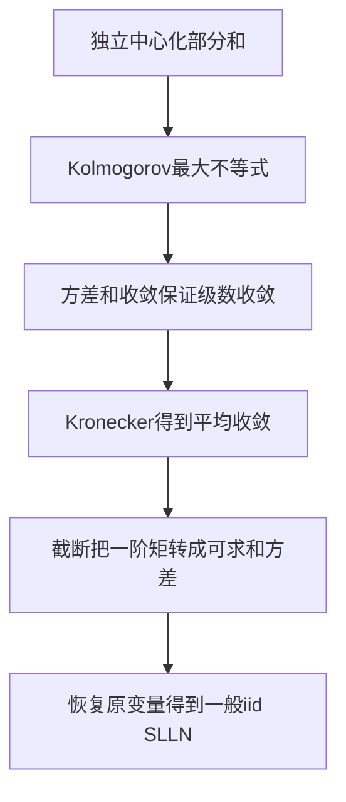

## 0 结构图景

弱大数律控制每个n的错误概率；强大数律控制一条典型无限路径最终的平均。第10讲已经用鞅处理有限方差。一般可积变量可以有无穷方差，例如尾部质量按幂律衰减；不能直接写“同理”。本讲通过随n变化的截断，把不可用的方差条件转换成可用的级数条件。

## 1 Kolmogorov最大不等式

设独立中心化平方可积变量 $\xi_1,\ldots,\xi_N$，$S_k=\sum_{j=1}^k\xi_j$。对λ>0，

$P(\max_{1\le k\le N}|S_k|\ge\lambda)\le\lambda^{-2}\sum_{j=1}^N E\xi_j^2$。

证明：令 $A_k=\{|S_j|<\lambda\ (j<k),\ |S_k|\ge\lambda\}$ 为首次越界事件，它们不交且属前k步信息。未来增量和 $S_N-S_k$ 与 $1_{A_k}S_k$ 独立、均值0，故交叉积分0。因此 $E(S_N^21_{A_k})=E(S_k^21_{A_k})+E((S_N-S_k)^21_{A_k})\ge\lambda^2P(A_k)$。对k求和，左边≤ES_N²；独立中心化给ES_N²等于方差和，证毕。对任意有限尾段同样适用。

**Kolmogorov收敛判据。** 若独立中心化 $\xi_n$ 满足 $\sum_{n=1}^{\infty}E\xi_n^2<\infty$，则 $\sum_{n=1}^{\infty}\xi_n$ 几乎必然收敛。对固定m，最大不等式及事件递增极限给 $P(\sup_{k>m}|S_k-S_m|>\varepsilon)\le\varepsilon^{-2}\sum_{j>m}E\xi_j^2$。若某路径不是Cauchy，则对某个有理ε>0，每个m之后存在两个部分和差大于2ε，因此对每个m至少一个与 $S_m$ 差大于ε。该坏事件概率被每个尾界控制，随m趋0，所以为0。可数ε并集后得几乎必然Cauchy，实数完备性给收敛。

这是独立增量路线；第10讲的L2有界鞅路线对同一结论给另一证明，且鞅路线还能适用于非独立但正交的合适鞅差。

## 2 加权判据与有限方差SLLN

若独立中心化变量满足 $\sum_{n=1}^{\infty}\operatorname{Var}(\xi_n)/n^2<\infty$，对 $\xi_n/n$ 用收敛判据，再用第10讲已证Kronecker，得到 $S_n/n\to0$ 几乎必然。特别地独立同分布有限方差时条件自动满足。这一步并不要求同分布，只要求明确的加权方差可和。

示范 E13.1：独立 $\xi_n$ 取±√n且等概率，则加权方差和为调和级数发散，故本判据不能使用；这不是已经证明强律失败。定理的充分条件不满足与结论为假必须区分。

## 3 一阶矩版本：三步截断完整证明

设 $X_1,X_2,\ldots$ 独立同分布且 $E|X_1|<\infty$，令m=EX_1。定义 $Y_n=X_n1_{\{|X_n|\le n\}}$。它们仍独立，因为分别是独立坐标的可测函数，但不再同分布。

第一步，原列与截断列最终一致。对任意非负实数z，$\sum_{n=1}^{\infty}1_{\{z>n\}}\le z$，所以Tonelli给 $\sum_{n=1}^{\infty}P(X_n\ne Y_n)=\sum_{n=1}^{\infty}P(|X_1|>n)\le E|X_1|<\infty$。第一BC推出几乎必然仅有限次截断改变值。因此 $n^{-1}\sum_{k=1}^n(X_k-Y_k)\to0$，因为每条此类路径上分子最终是固定有限和。

第二步，加权截断方差可和。利用同分布及Tonelli，

$\sum_{n=1}^{\infty}\frac{\operatorname{Var}(Y_n)}{n^2}\le E\left[|X_1|^2\sum_{n\ge\max(1,\lceil|X_1|\rceil)}\frac1{n^2}\right]\le2E|X_1|$。

核对最后点态界：若0≤z≤1，则 $z^2\sum_{n\ge1}n^{-2}\le2z$；若z>1，令r=ceil z≥2，$\sum_{n\ge r}n^{-2}\le1/r^2+1/r\le2/r\le2/z$，故乘z²不超过2z。对所有 $z>0$ 从 $n=\max(1,\lceil z\rceil)$ 起计入；当 $z$ 为正整数时包含 $n=z$，与截断条件 $|X_1|\le n$ 一致。于是上一节对中心化 $Y_n-EY_n$ 给其样本平均几乎必然趋0。

第三步，$EY_n=E[X_11_{|X_1|\le n}]\to EX_1=m$，由| $X_1$ |支配的控制收敛。Cesàro平均也趋m。把三部分相加得

$\frac1n\sum_{k=1}^nX_k\longrightarrow EX_1\quad\text{几乎必然}$。

这完成了一般可积iid强大数律，未假定方差有限，未调用CLT或遍历定理。

## 4 范围与反例

示范 E13.2：正整数变量满足 $P(X=k)=c/k^{5/2}$，其中 $c=(\sum_{k=1}^{\infty}k^{-5/2})^{-1}$。一阶矩为 $c\sum_{k=1}^{\infty}k^{-3/2}<\infty$，二阶矩为 $c\sum_{k=1}^{\infty}k^{-1/2}=\infty$，所以第10讲有限方差证明不适用，而本讲截断SLLN适用。无需知道归一化常数的闭式值。

若独立性删除，取所有 $X_n$ 等于同一个非退化可积变量X，平均始终X，不趋常数EX。若均值根本不存在，本定理不能陈述为“趋向EX”；本讲不以未核验的重尾分布性质额外作论据。本讲已验证的反例只用完全相关变量。

## 5 训练、覆盖与预告

引导 G13.1（T1）：若 $P(X=k)=c/k^3$，判断一阶、二阶矩及两条SLLN路线的适用性。

独立 I13.1（T2）：重建截断方差的Tonelli换序，并分别核查0≤z≤1与z>1。

独立 I13.2（T3）：对于独立但不同分布中心变量，给出一个满足加权方差判据的非同分布例子并写出强律结论。

| 旧结论 | 本讲升级 |
|---|---|
| Chebyshev控制一个时刻 | 最大不等式控制整段路径 |
| 有限方差平均稳定 | 截断把一般一阶矩引入强律 |
| 原列与近似列相近 | 可和异常事件使其最终逐项一致 |

本质是把“少数极端值”分成发生次数控制和截断波动控制两个任务。下一讲研究平均误差的放大尺度与高斯极限，强律不提供其分布形状。

---

# 第14讲 Lindeberg–Feller中心极限定理

> DSH首审后修订待复审，未获批准。使用第12讲已证Lévy连续性与高斯特征函数；高斯积分的数分输入对应共享R18/A0。一般iid CLT对应R21的一部分，不自动销号。

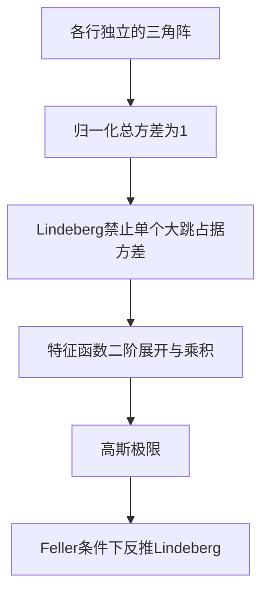

## 0 结构图景与量词

强律说平均趋向均值，CLT说中心化误差乘适当尺度之后的分布趋高斯。不是任何“很多项相加”都会正态；必须排除某一个大跳持续占据总波动。

每行 $X_{n,1},\ldots,X_{n,k_n}$ 独立，具有有限均值和方差，跨行不要求任何独立。令 $s_n^2=\sum_{j=1}^{k_n}\operatorname{Var}(X_{n,j})>0$，$Y_{n,j}=(X_{n,j}-EX_{n,j})/s_n$，$v_{n,j}=EY_{n,j}^2$，则每行中心化且 $\sum_{j=1}^{k_n}v_{n,j}=1$。

**Lindeberg条件**：对每个ε>0，$L_n(\varepsilon)=\sum_{j=1}^{k_n}E[Y_{n,j}^21_{\{|Y_{n,j}|>\varepsilon\}}]\to0$。**Feller条件**：$\max_{1\le j\le k_n}v_{n,j}\to0$。注意前者是总尾方差条件，后者只限制每项总方差。

## 1 Lindeberg充分性完整证明

先由 $v_{n,j}\le\varepsilon^2+L_n(\varepsilon)$ 得Feller：先n趋∞再ε趋0。

固定t。设 $r(u)=e^{iu}-1-iu+u^2/2$。三次积分或Taylor积分余项给 $|r(u)|\le C|u|^3$ 当|u|≤1；当|u|>1由三角不等式得 $|r(u)|\le C u^2$，故统一 $|r(u)|\le C u^2\min(|u|,1)$。对任意小δ>0按 $|Y_{n,j}|\le\delta$ 与其补分开，得到

$\sum_{j=1}^{k_n}|E r(tY_{n,j})|\le C|t|^3\delta\sum_{j=1}^{k_n}v_{n,j}+Ct^2L_n(\delta)$。

其中小区间即使|t|δ>1，右侧仍可作更粗界；取δ小即可。先n趋∞再δ趋0，余项总和趋0。所以若 $z_{n,j}=\varphi_{Y_{n,j}}(t)-1$，则 $\sum_{j=1}^{k_n}z_{n,j}\to-t^2/2$。

还要把和变乘积。由中心化及二次积分余项 $|e^{iu}-1-iu|\le u^2/2$，得 $|z_{n,j}|\le t^2v_{n,j}/2$。因此 $\max_{1\le j\le k_n}|z_{n,j}|\to0$ 且 $\sum_{j=1}^{k_n}|z_{n,j}|\le t^2/2$。当|z|≤1/2，幂级数定义的 $\log(1+z)=z- z^2/2+z^3/3-\cdots$ 满足 $|\log(1+z)-z|\le2|z|^2$，且指数还原1+z（在圆盘内逐项求导并用0处值验证）。所以

$\left|\sum_{j=1}^{k_n}\log(1+z_{n,j})-\sum_{j=1}^{k_n}z_{n,j}\right|\le2\max_{1\le j\le k_n}|z_{n,j}|\sum_{j=1}^{k_n}|z_{n,j}|\to0$。

由每行独立，和的特征函数是这些因子的乘积，故趋 $e^{-t^2/2}$。该函数是标准正态特征函数且0点连续，第12讲Lévy给 $\sum_{j=1}^{k_n}Y_{n,j}\Rightarrow N(0,1)$。没有使用矩母函数存在性。

## 2 Feller条件下的必要性完整证明

现在假定Feller成立且行和弱趋标准正态。给每个Y取独立同分布副本Y'，令 $Z_{n,j}=Y_{n,j}-Y'_{n,j}$，则 $EZ_{n,j}^2=2v_{n,j}$，且其特征函数为 $|\varphi_{Y_{n,j}}(t)|^2$。记 $a_{n,j}=1-|\varphi_{Y_{n,j}}(t)|^2=E(1-\cos(tZ_{n,j}))$，有 $0\le a_{n,j}\le t^2v_{n,j}$，所以最大值趋0、总和≤t²。

行和CLT给 $\prod_{j=1}^{k_n}(1-a_{n,j})\to e^{-t^2}$。对充分大n各a≤1/2，用实对数余项界得 $\sum_{j=1}^{k_n}a_{n,j}\to t^2$。而 $\sum_{j=1}^{k_n}t^2EZ_{n,j}^2/2=t^2$，因此

$\sum_{j=1}^{k_n}E\{t^2Z_{n,j}^2/2-[1-\cos(tZ_{n,j})]\}\to0$。

固定t≠0和δ>0。函数 $1/2-(1-\cos u)/u^2$ 对u≠0严格正（两次积分比较 $\cos u\le1$，非零区间严格），在|u|≥|t|δ上有正下界：有限闭环带用连续性，远处趋1/2。因此上式蕴含 $\sum_{j=1}^{k_n}E[Z_{n,j}^21_{|Z_{n,j}|>\delta}]\to0$。

从对称化返回原变量。若 $|Y|>\varepsilon$ 且 $|Y'|\le\varepsilon/2$，则 $|Z|>\varepsilon/2$ 且 $Y^2\le4Z^2$。独立性给

$E[Y^21_{|Y|>\varepsilon}]P(|Y'|\le\varepsilon/2)\le4E[Z^21_{|Z|>\varepsilon/2}]$。

Markov与Feller使左侧概率因子统一至少 $1-4\max_{1\le j\le k_n}v_{n,j}/\varepsilon^2\to1$。对j求和即可得到Lindeberg。于是完整 **Lindeberg–Feller定理** 为：Lindeberg推出CLT及Feller；在Feller前提下，CLT与Lindeberg等价。

## 3 Lyapunov、iid与二项特例

**Lyapunov条件**：某δ>0使 $\sum_{j=1}^{k_n}E|X_{n,j}-EX_{n,j}|^{2+\delta}/s_n^{2+\delta}\to0$。在 $|Y|>\varepsilon$ 上 $Y^2\le\varepsilon^{-\delta}|Y|^{2+\delta}$，所以它推出Lindeberg，继而CLT。

若 $X_i$ 独立同分布、均值m、方差 $0<\sigma^2<\infty$，取每行前n项，$s_n=\sigma\sqrt n$。Lindeberg和简化为 $\sigma^{-2}E[(X_1-m)^21_{|X_1-m|>\varepsilon\sigma\sqrt n}]\to0$，由二阶矩可积及控制收敛。因此

$\frac{\sum_{j=1}^nX_j-nm}{\sigma\sqrt n}\Rightarrow N(0,1)$。

不要求三阶矩；若 $\sigma^2$ =0，各 $X_i$ 几乎必然等于m，标准化除0无意义，应单列退化情况。Bernoulli(p)在0<p<1时给二项的De Moivre–Laplace特例。这里证明的是分布收敛，不自动给局部概率近似或Berry–Esseen误差率。

示范 E14.1：每行n个独立变量取±1且概率各1/(2n)、取0概率1-1/n。各方差1/n，总方差1且Feller成立；对0<ε<1，Lindeberg和恒为1，故无CLT。直接特征函数为 $[1+(\cos t-1)/n]^n\to e^{\cos t-1}$，在t=2π极限1，不等于标准正态的 $e^{-2\pi^2}$。Feller独自不够。

## 4 常用推论：Slutsky与一元Delta

若 $A_n\Rightarrow A$、$B_n\to b$ 依概率，则 $A_n+B_n\Rightarrow A+b$、$A_nB_n\Rightarrow bA$。不要求两者独立。证明： $A_n$ 弱收敛故胎紧， $B_n$ 趋常数故落在固定有界邻域的概率趋1。在大紧区间上有界连续测试函数一致连续，故 $f(A_n+B_n)-f(A_n+b)$ 的期望绝对值趋0：好事件上用一致连续，坏事件上用2||f||∞乘小概率。乘法同理，先由| $A_n$ |≤R把乘积误差控制为R| $B_n$ -b|。再用 $A_n$ 的弱收敛处理固定连续变换。b≠0时商同理，先排除分母接近0。

若 $\sqrt n(T_n-\theta)\Rightarrow Z$ 且 $g:\mathbb R\to\mathbb R$ 为Borel可测实函数并在θ可微，则 $\sqrt n(g(T_n)-g(\theta))\Rightarrow g'(\theta)Z$。胎紧先给 $T_n$ 趋θ依概率；写 $g(\theta+h)-g(\theta)=g'(\theta)h+h r(h)$、r(h)→0，再用Slutsky使胎紧因子乘依概率趋0的余项趋0。此处只证明一元一阶Delta；R23还有其他范围，不能据此整体销号。

## 5 训练与覆盖

引导 G14.1（T1）：Bernoulli(1/4)样本和的正确中心与标准差尺度是什么？

独立 I14.1（T2）：若行内独立中心变量绝对值≤C且 $s_n\to\infty$，证明Lindeberg条件。

独立 I14.2（T3）：解释E14.1为何满足Feller却不满足Lindeberg，并给出其极限不是正态的一个特征函数检验点。

口述窗口：二阶展开余项为何必须按行求和控制，而非仅逐项说o(1)？必要性证明中的独立副本解决了什么问题？

| 旧结论 | 本讲严格范围 |
|---|---|
| 很多小量相加呈正态 | Lindeberg总尾方差趋0 |
| 最大单项方差小 | Feller，必要但单独不足 |
| 二项正态近似 | iid有限方差CLT的特例 |
| 代入一致估计 | Slutsky需概率极限而非无条件替换 |

本质是方差不能集中到稀有大跳中。下一讲只作更高理论入口，明确区分本书已证核心与遍历、Brownian存在性的未证边界。

---

# 第15讲 Markov、遍历与Brownian入口

> DSH首审后修订待复审，未获批准。按原设计，Birkhoff仅陈述与证明骨架，Brownian仅构造思路，分别标U306-7、U306-8；有限状态例与有限维高斯一致性就地证明。

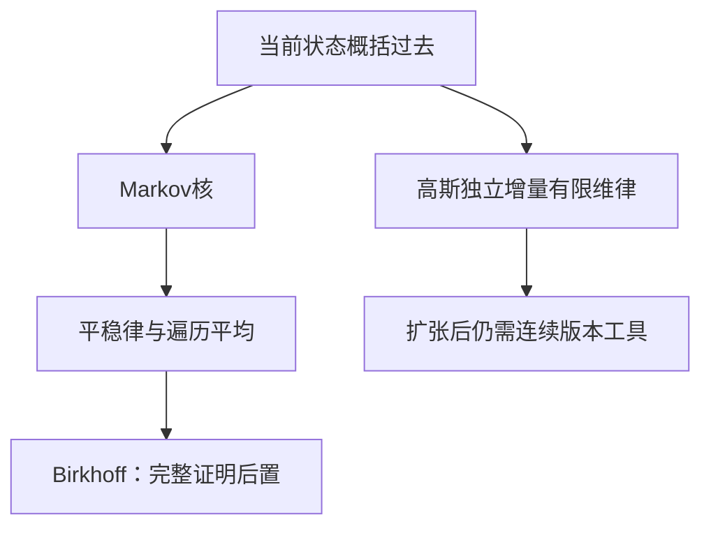

## 0 结构图景

独立序列每次重来；Markov过程允许当前状态影响下一步，但给定当前状态后过去的其他细节不再改善预测。时间平均可推广到有依赖的平稳过程，却需引入不变信息；连续时间还需区别有限维分布与路径正则性。

## 1 转移核与Markov性质

在可测状态空间 $(S,\mathcal S)$ 上，**概率核** $K(x,A)$ 对每个x是A上的概率测度，对每个A是x的可测函数。齐次Markov过程满足 $P(X_{n+1}\in A|F_n)=K(X_n,A)$，其中 $F_n$ 包含过去。条件概率是指标的条件期望，不先假定一般正则条件分布存在。

有限状态S={1,…,d}上，K为非负行和1的矩阵，初始分布为 $\pi_0$ 时，$P(X_0=i_0,\ldots,X_n=i_n)=\pi_0(i_0)\prod_{k=0}^{n-1}K(i_k,i_{k+1})$。对末坐标求和恢复低维律，得到一致有限维分布；无限链存在可用U306-4（与R20相关，未证）。在每个有限过去事件上直接检验积分给Markov性质；全概率迭代给n步转移K^n及 $K^{m+n}=K^mK^n$。

πK=π称 **平稳分布**。以π初始化，平移任意有限时间段后起始边缘仍π、后续转移规则相同，所以联合律不变。平稳既不等于独立，也不自动等于遍历。

示范 E15.1：$K=\begin{pmatrix}1-a&a\\b&1-b\end{pmatrix}$，0<a,b<1。平稳方程给 $\pi=(b/(a+b),a/(a+b))$。若 $p_n=P(X_n=0)$，则 $p_{n+1}=b+(1-a-b)p_n$，解得 $p_n=b/(a+b)+(1-a-b)^n[p_0-b/(a+b)]$。由于|1-a-b|<1，边缘趋π。这只是边缘分布收敛，尚未证明每条路径频率趋π。

## 2 保测与遍历：精确陈述及缺口

可测变换T若 $P(T^{-1}A)=P(A)$，称 **保测**。平稳路径的左移是例子。**不变σ代数** I由 $P(T^{-1}A\triangle A)=0$ 的事件组成；补及可数并验证闭包。若其中所有事件概率0或1，称T **遍历**。

**Birkhoff定理（U306-7，未证）**：T保测、f可积时，$n^{-1}\sum_{k=0}^{n-1}f\circ T^k$ 几乎必然且L1趋 $E[f|I]$。遍历时极限为常数Ef，非遍历时一般不是。

证明骨架：用最大遍历不等式控制部分和越界，再从特殊函数推广到L1；差分 $g-g\circ T$ 的平均望远镜消去，不变函数平均不变；还须证明这些特殊函数的适当闭包足以确定一般极限并识别条件期望。本讲未证明最大遍历不等式与闭包步骤，不把骨架标作完整证明。第13讲SLLN独立成立，不依赖这里的未证结论。

反例 E15.2：T恒等，则平均始终f，每个事件都不变。若f非恒定，就不趋常数Ef。保测不足以推出常数极限。

## 3 Brownian有限维构造与连续性缺口

**标准Brownian运动**满足 $B_0=0$、路径连续、独立增量且 $B_t-B_s\sim N(0,t-s)$，0≤s<t。给 $0=t_0<t_1<\cdots<t_m$，取独立 $Z_j\sim N(0,t_j-t_{j-1})$，置 $B_{t_i}=\sum_{j=1}^iZ_j$。线性组合的特征函数为正态因子乘积，给中心高斯有限维律；共同增量的方差相加给 $E(B_sB_t)=\min(s,t)$。删除一个时刻即合并两个相邻独立正态增量，其方差相加，仍与其他增量独立，故有限维律一致。

用U306-4可得到实数时间索引的坐标过程，但路径连续没有随之得到。标准高斯密度分部积分给 $\int x^{2k}g_1(x)dx=(2k-1)\int x^{2k-2}g_1(x)dx$，边界项为0；k=1,2给二阶矩1、四阶矩3。因此 $E|B_t-B_s|^4=3|t-s|^2$。

**Kolmogorov连续性工具（U306-8，未证）**：若每个有限时间区间上 $E|X_t-X_s|^\alpha\le C|t-s|^{1+\beta}$，α,β>0，则有连续修改。“修改”指每个固定t新旧变量几乎必然相等。把α=4、β=1代入即可从上述过程得到连续版本。证明路线是二进网格增量、Markov与BC，再从稠密时刻扩张；本稿未给全部网格估计，因此Brownian完整存在性仍依赖U306-4与U306-8。

随机游走缩放是另一入口，但路径空间不变性原理比一维CLT强，不能用每个固定时刻趋正态替代路径空间收敛。Itô积分与随机微分方程仅为后续去向，本讲不使用其结论。

## 4 训练与覆盖

引导 G15.1（T1）：E15.1取a=1/4、b=1/2，求平稳分布与边缘误差衰减因子。

独立 I15.1（T2）：在恒等变换下取非恒定Bernoulli变量f，检验“遍历平均总趋Ef”哪里漏条件。

独立 I15.2（T3）：证明有限维构造中 $E(B_1B_3)=1$，说明为何它没证明路径连续。

口述窗口：分别指出边缘趋平稳、时间平均趋常数、连续路径存在所需的证据，不把三者混为一谈。

| 旧理论 | 扩展位置与边界 |
|---|---|
| 独立样本 | Markov允许状态依赖 |
| iid SLLN | Birkhoff处理保测依赖，证明后置 |
| 高斯CLT | 只提供部分有限维直觉 |
| 一致有限维律 | 过程存在与路径正则仍分两步 |

本质是区分分布、依赖结构、时间平均和路径正则。末讲整理全书覆盖及未证明输入的去向。

---

# 第16讲 升级对照与收口

> DSH首审后修订待复审，未获批准。本文整理作者稿覆盖，不声称学生已学会，不修改共享R编号或B1–B4状态。

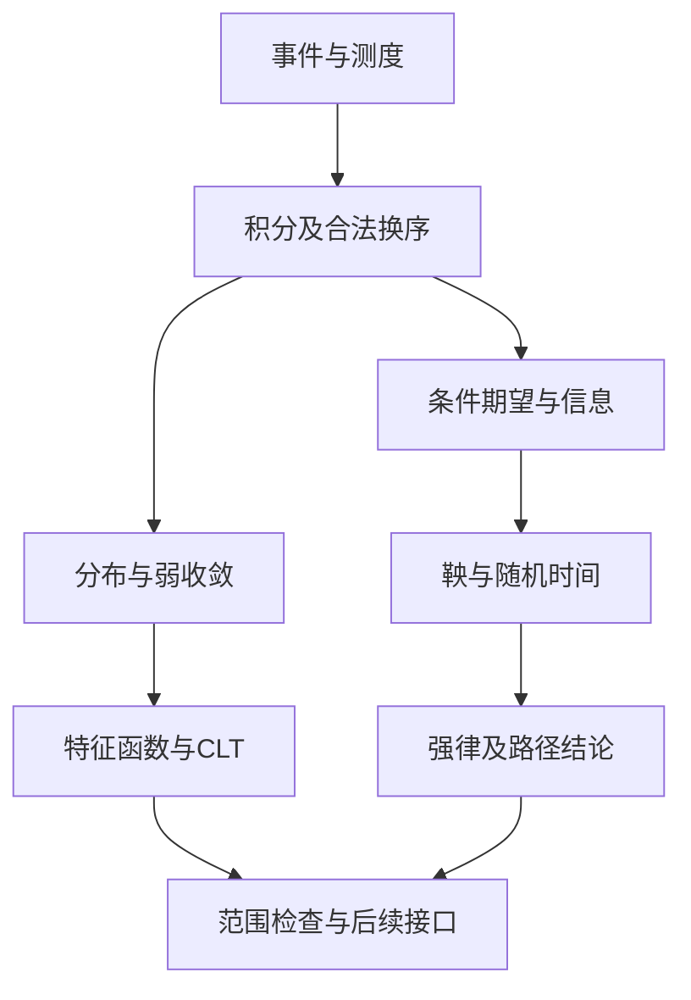

## 0 结构图景：升级不是删除旧模型

离散概率表仍然正确，它是以计数测度为参照的有限模型；连续密度仍然有用，它是相对长度测度的表示。真正的升级是把对象、参照、信息、极限方式与可积条件都写明，从而知道旧公式何时成立、何时根本没有定义。

## 1 同一模型贯穿整书：示范综合题E16.1

给定独立Bernoulli(p)变量 $X_1,X_2,\ldots$，0<p<1，$S_n=\sum_{j=1}^nX_j$，$F_n=\sigma(X_1,\ldots,X_n)$。先区分“给定已有序列”和“从指定边缘构造序列”：后者仍调用R20相关的U306-4，不能把符号写出就当存在已证明。

固定整数N，终点 $Z=S_N$。由独立性与条件期望线性，$M_n=E[S_N|F_n]=S_n+(N-n)p$，0≤n≤N。这是Doob鞅，增量为 $X_n$ -p，有限时间可积；它同时是给定前n次观测后对最终总数的L2最优预测。残差来自未来，条件方差为 $(N-n)p(1-p)$，由独立增量方差相加得到；均值更新不会在旧信息下提供确定盈利。

若T≤N是停时，可选抽样给 $EM_T=EM_0=Np$。但 $M_T=S_T+(N-T)p$，所以 $ES_T=pET$。这是Wald在有界情形的具体核验；不能据此把任意看未来的随机下标都代入。

当n趋无穷，第13讲SLLN给 $S_n/n\to p$ 几乎必然；第14讲CLT给 $(S_n-np)/\sqrt{np(1-p)}\Rightarrow N(0,1)$。两句并不冲突：前者讨论平均误差趋0，后者放大误差到非退化尺度。它们也不意味着标准化误差几乎必然趋某个正态随机变量。第11讲Skorokhod可以另造这样的耦合，但会改变跨n依赖，不能偷换原过程。

最后，因 $0\le S_n/n\le1$，控制收敛还给L1收敛及期望收敛。在一般可积SLLN中，若想从几乎必然结论继续推出L1，必须另验UI；这里有界支配直接完成。模型不同，验证路径也不同。

## 2 MA301到MA306升级对照表

| 旧入口 | 测度论版本及条件 | 本书位置与范围 |
|---|---|---|
| 样本空间与事件 | σ代数指定可讨论事件；概率为总质量1测度 | 1–2完整 |
| 离散质量/连续密度 | RN导数相对于参照；需绝对连续及σ有限假设 | 2及附录A完整 |
| 分布函数 | 右连续、非减、两端0/1产生唯一Borel概率 | 2及附录B完整 |
| 期望换序 | 非负单调、Fatou、可积支配、UI各有不同结论 | 3完整 |
| 二重求和/积分 | 非负Tonelli；绝对可积Fubini；σ有限空间 | 4完整 |
| 独立事件 | 有限交乘积与生成σ代数传播 | 4完整 |
| 无限次事件 | BC两个方向；第二方向需独立 | 5完整 |
| 给定事件的平均 | 子σ代数条件期望，RN存在、a.s.唯一 | 6完整 |
| 最优预测 | L2闭信息子空间正交投影 | 7完整 |
| 公平过程 | 适应、可积、条件均值，无条件均值不够 | 8完整 |
| 随机时间期望 | 有界抽样；UI停止族；有界增量且可积时间 | 9完整 |
| 长期收敛 | 上穿控制振荡，UI保证L1及均值传递 | 10完整 |
| CDF趋近 | 连续点判据、Portmanteau、实线胎紧 | 11完整实线工具 |
| 特征函数识别 | 高斯平滑反演与唯一性，Lévy连续性 | 12完整，数分输入R18/A0仍明示 |
| 大数定律 | 独立同分布可积SLLN；加权方差判据 | 10有限方差、13一般可积 |
| CLT | Lindeberg充分；Feller下必要；Lyapunov充分 | 14完整 |
| 过程与遍历 | 核、平稳分布、有限维一致性；一般存在/遍历后置 | 15按原设计保留边界 |

“完整”是本稿有证明，不是独立审稿通过或学生验收。“实线完整”不能扩大成任意度量空间完整。

### 本书已证辅助工具导航

| 工具 | 完整证明位置 | 使用范围 |
|---|---|---|
| Kronecker引理（权重为正整数的版本） | 第10讲§5，求和分部加Cesàro | 第10、13讲从加权级数得到样本平均；已自证，不占R号 |
| 非负积分单调收敛 | 附录A2 | RN与后续积分换序；并非外借未证工具 |
| 实线闭有界集紧性 | 附录B2 | Stieltjes构造及实线弱收敛 |
| 有限实值凸函数内点支撑线 | 第6讲§4 | 条件Jensen，可数有理支撑线表示 |

## 3 读者必须能做的范围判断

示范反例E16.2：声称“鞅均值不变，故极限均值也不变”。取第8讲p=1似然比，有限n有均值1，几乎必然极限0。错误出在从逐时刻结论传极限时未检查UI。修复不是删除“鞅”定义，而是加UI或可积共同支配。

引导 G16.1（T1）：对E16.1写出预测 $E[S_N|F_n]$，并用可见事件积分或独立性验证。

独立 I16.1（T2）：给出“几乎必然收敛但不L1收敛”的例子，解释为什么不能交换期望；再给出能修复换序的一个充分条件。

独立 I16.2（T3）：从U306-4、U306-5、U306-7、U306-8中指出：哪项用于从一致有限维律造过程，哪项用于一般空间弱紧性，哪项用于依赖时间平均，哪项用于连续版本；不得只回答一个笼统“测度论”。

输出窗口：选择一个本书定理，依次口述对象、目标、构造、验证，再用一个条件失效的例子界定它。综合T1–T3题与分离答案见《综合自测与验收题》《综合自测答案核验》，未作答不标掌握。

## 4 后续去向与未销项说明

MA303随机过程可接第8–10、15讲；MA402泛函分析可接第7讲的具体Hilbert实例；统计渐近工具可接第11–14讲，但一般Wilks、Bootstrap及高维极限没有由本书自动获得。计算神经科学中的证据累积可用似然比鞅作为数学模型，是否符合真实数据还需建模检验。

B1（SLLN）、B2（特征函数CLT）、B3（鞅与停时）、B4（一般条件期望）已有对应作者证明路径，但共享状态仍保持未销项，必须由权威审稿/教学流程确认；一般条件期望不是正则条件分布核，不能以本书第6讲声称覆盖R22或R28的全部内容。

本质是把可用结论与使用条件一起带走。正式“本书未证明输入与去向”见同名文件并收入合订稿；其中局部U编号仅为作者追踪别名，不是DSH签发R号，也不是批准记录。

---

# 术语表

- σ-代数：含全集，对补及可数并封闭的事件族。
- 生成 σ-代数：包含指定族的最小 σ-代数。
- 可测映射：可测集的逆像可测。
- Borel族：由开集生成的 σ-代数。
- 单调类：对递增并、递减交封闭。
- 测度：空集为0的非负可列可加函数。
- 外测度：全体子集上的非负、单调、可数次可加函数，空集为0。
- 预测度：代数上对并仍在代数中的不交可数序列可加的权重。
- 推前分布：数值集合的概率等于其逆像的概率。
- 绝对连续：参照零测集也是目标零测集。
- RN密度：积分恢复目标测度的扩展非负可测函数，允许正无穷；零质量块采用0乘正无穷为0的积分约定；在本书σ-有限RN假设下密度几乎处处有限（附录A5）。
- 几乎处处：例外集被零测集包含。
- σ-有限：可数个有限测度集合覆盖全集。
- 完备性：零测集全部子集可测。

## 2026-10-31 补充

- 非负简单函数：有限取值、非负、可测的函数。
- 单调收敛：非负函数递增极限的积分等于积分的递增极限，完整证明见附录A2。
- 积分测度：以非负可测函数的事件积分定义的测度。
- 正集：对给定有限测度之差，其每个可测子集的测度差都非负。
- 紧集（本讲只用实线）：具有开覆盖有限子覆盖性质的集合；闭有界集满足该性质的证明见附录B2。
- 有限交性质：任取有限多个集合相交非空。
- 共同双有限分割：可数可测分割中每块对两种测度的质量都有限，用于RN的σ-有限归约。

## 第3–16讲术语与记号

| 术语/记号 | 本稿约定 |
|---|---|
| $L^p$ | $E\vert X\vert ^p<\infty$ 的随机变量按几乎必然相等取等价类，$p\ge1$ |
| 一致可积 UI | 族的 $E(\vert X\vert 1_{\vert X\vert >K})$ 随K趋无穷一致趋0 |
| 依概率收敛 | 每个正误差阈值的越界概率趋0 |
| 几乎必然收敛 | 去掉一个零概率集后逐路径收敛 |
| π族/λ族 | 有限交闭包；含全集、补及不交可数并闭包 |
| 乘积测度 | 在可测矩形上等于边缘测度乘积的测度，正文使用σ有限版本 |
| 尾σ代数 | 删除任意有限前缀后仍可见的事件交集 |
| $E[X\mid G]$ | G可测可积、保留G事件积分的随机变量等价类 |
| 条件方差 | $E[(X-E[X\mid G])^2\mid G]$，要求平方可积 |
| 滤过/适应 | 随时间递增的信息σ代数；每时刻变量在当时信息中可测 |
| 鞅/下鞅/上鞅 | 可积适应过程的下一步条件均值等于/不小于/不大于现在 |
| 停时 | 截至时刻n是否已停属于时刻n的信息 |
| 可预测（离散） | 第k步系数在第k-1步已经可测 |
| 上穿次数 | 从不高于a到不低于b完成的依次跨越次数，a<b |
| 弱收敛 $\Rightarrow$ | 全部有界连续测试函数的分布积分收敛 |
| 胎紧 tightness | 对任何误差阈值有共同紧集保留至少一减该误差的概率 |
| Polish空间 | 完备且可分的度量空间 |
| 特征函数 | $\varphi_X(t)=Ee^{itX}$，复积分按实虚部定义 |
| Lindeberg条件 | 标准化三角阵每个固定阈值外的总二阶质量趋0 |
| Feller条件 | 标准化三角阵最大单项方差趋0 |
| Lyapunov条件 | 某个高于二阶的标准化绝对矩总和趋0 |
| 概率核 | 对状态可测、对事件为概率测度的二元映射 |
| 保测/遍历 | 变换保持概率；其不变事件只有零或一概率 |
| 修改 | 每个固定时刻新旧变量几乎必然相等，不等同统一路径事件 |

一般Polish理论、遍历与连续版本的证明状态见专门输入表；出现术语不表示对应定理已经完整证明或学生已学。

---

# MA306 综合T1–T3自测

> 先独立作答再查看分离答案。未执行实际学生测试；作者题目核验不代表学生掌握或正式验收。

## T1 定义、计算与条件识别

1. 六个等概率点上X=(0,0,1,1,2,2)，写出σ(X)的构成方式及元素个数。另给Z=(0,2,4,6,8,10)，计算E[Z|σ(X)]。
2. 均匀空间(0,1)上Y_n=n乘(0,1/n)指标。分别判断几乎必然、依概率、L1收敛与UI，写出每个判断的数值依据。
3. 公平游走从3出发，停在0或7，求命中7的概率与平均停时；列出使用停时定理前验证的条件。

## T2 核心证明复述

4. 不借用有限点公式，从RN构造一般可积变量对子σ代数的条件期望，并证明唯一性。随后推塔性质，指出包含关系。
5. 口述上穿不等式到鞅收敛的两步：排除振荡、排除无穷极限。再给几乎必然收敛但期望不收敛的非负鞅。
6. 重建一般可积iid SLLN的三个截断步骤；必须算出加权截断方差可和的点态界。
7. 对标准化独立三角阵，证明Lindeberg使特征函数余项总和趋0，并把逐项展开变成乘积极限。指出仅逐项余项小为什么不够。

## T3 结构、边界与迁移

8. 在Feller条件下，概述并落实CLT必要性中的对称化尾方差论证，不得以“矩收敛显然”代替。
9. 区分实线胎紧子列证明与一般Polish版Prokhorov；解释为什么分位数耦合不保持原过程的跨时刻联合律。
10. 给出Brownian有限维一致性验证，再精确指出剩余的两个存在性步骤及其未证编号。
11. 设计一个能推翻“平均不变就可任意停时”的反例，并同时说明几乎必然终止、可积终止时间、停止族UI之间的区别。

## 验收口径

T1要求定义与数值均核对；T2要求条件、构造、依据与推理链完整；T3允许报告未知，但须准确定位未证输入。每题自评清楚/较清楚/模糊/不会。此文件没有填写任何学生成绩；正式教学观测留待真实作答。

---

# 分离答案区：独立作答后再读

# 分离答案与作者核验

2026-10-30；作者自校，不等于独立审稿；学生未实测。先作答再读。

- E1：四个纤维并逐一满足闭包，Y的零值逆像不在其中，已核。
- G1提示：先找等值块。答案为空集、{1,2}、{3}、{4}、{1,2,3}、{1,2,4}、{3,4}、全集。三个块各选或不选，共8个，无重复。
- I1：负阈值逆像为空；非负阈值t的逆像为 {-√t≤X≤√t}，其中严格下射线是闭下射线的递增可数并，补得上射线，故可测。已检查t=0边界。
- I2：两个最小非空事件相交时，交集的最小性迫使两者相等；全部最小事件划分全集，每个事件是其中一些的并。有限可加性给结论。
- E2：三区间互斥覆盖实线；0、2的跳跃分别1/3、2/3；右连续，已核。
- E3：逐点相乘恢复(1/4,1/4,1/2)，总和1，已核。
- G2提示：零质量点影响积分吗？答案前两点1/2、3/2，第三点任意扩展非负值（包括正无穷），按积分约定0乘正无穷为0，零质量点积分贡献0。全部事件由单点相加核验。
- I3：第三点参照质量0、目标1/4，零测集上的积分必为0，矛盾。
- I4：单调性给子集外测度0及删去它不增质量；次可加性给原质量不大于删去后的质量加0；两者合为切割等式，无无穷减法。

检查点评价：讲1须区分事件族与数值域，解释两次固定；讲2须说清不交化、跳跃与参照零测集。

## 2026-10-31 新增附录题目核验

以下仅为作者复算与论证核验，非独立审稿或学生验收。

- E4：计数测度下简单积分是有限点加权和，截断到前N个点再用附录A单调收敛得任意事件上的级数。每单点质量为1/n，故与目标测度一致；总质量无穷不影响σ-有限分块。
- G3最小提示：任意候选序列有单调性吗？完整答案：候选仅保证总积分逼近上确界，不保证逐点极限存在。例如对[0,1)上的均匀测度，按层依次枚举每一层全部二进半开小区间E，取h=1减去E的指标函数；区间长度趋0，积分趋1，但每点在每层恰被覆盖一次，函数值反复取0和1。取累积最大值仍不超支且成为递增序列，才能用单调收敛对每个事件传递约束。此处核验的是方法的必要结构，不声称任意不单调序列都不能证明收敛。
- I5：处处有限密度为 f(a)=0、f(b)=2，另一密度为 g(a)=∞、g(b)=2。四个事件逐一积分分别为0、0、2、2；0乘∞依约定为0。差异集{a}为零测集，两者几乎处处相等，且在全幂集上均可测。
- I6：本题不能先假定在实线全幂集上已构造无原子概率。改用Borel族，计数测度的零测集只有空集，故均匀概率对它绝对连续；任何密度在单点上的积分就是该点函数值，而均匀概率每个单点为0，于是密度处处为0，无法在[0,1]上积分得到1。计数测度不是σ-有限：每个有限测度集合只有有限多个点，可数个有限集只能覆盖可数集，不能覆盖实线。反例准确击中参照σ-有限条件，未违反所证定理。
- E5：取F(3/4)-F(1/4)=1/2；F处处连续使各单点质量为0；两端极限与右连续已逐项满足B1假设。
- G4最小提示：用(0,1/n]。完整答案：该列递减到空集，但每个区间权重 G(1/n)-G(0)=1。有限概率测度在递减空集处必须趋0，因此不存在对应测度。G在0不右连续，恰与定理假设不符。
- I7：三个质量依次为1-p、p、p。p=0时全部质量在2；p=1时全部质量在0；区间(0,2]不含0，故端点检查正确。
- I8：有限子覆盖产生的N依赖整个近似过程，不能预先保证Nε小于目标误差。应给可求和预算，如第n项小于ε乘2的负n次方，使任意有限部分和都小于ε。

附录A检查点：取常数函数 f_n=1-1/(n+1)，极限s=1；若c=1，所有E_n为空，不能穷尽全集。附录B检查点：半开区间左端不含a，须控制(a,a+δ]的质量；原子位于右端b时，盲目把b向左缩会损失固定原子质量。

---

# 第3讲分离答案与作者核验

2026-10-31，DSH首审后修订待复审，未获批准。提示仅在卡住后读取。

- G3.1提示：先算峰高乘支集长度。答案：期望为1/n，故L1趋0；若n²>K，则尾积分1/n<1/√K，否则为0。统一尾界趋0，UI。边界n²=K因严格大于而不计尾部。
- I3.1：均匀空间上取n乘(0,1/n)指标。每个正x最终不在支集，故点态趋0；每次积分为1；对任意K取n>K尾积分为1。三个结论均直接代回。
- I3.2：先用依概率子列引理得一个几乎必然子列，从而|X|≤1几乎必然。对任意ε>0，E| $X_n$ -X|^p≤ε^p+2^p P(| $X_n$ -X|>ε)，后项趋0，再令ε趋0。此论证直接作用于原序列，不误用其几乎必然收敛。
- Fatou检查点：负峰列积分恒为-1而逐点极限为0，0≤-1为假；非负性不可无条件删除。
- E3.1直接积分1/(n+1)，E3.2两个峰列的积分及统一尾界逐项核验成立。

证明核验重点：控制收敛仅从有限的2∫g作减法；Vitali先用Fatou建立X可积，未先使用未知可积性；反向UI先控制有限头部再控制L1误差。学生尚未作答，不记录掌握。

---

# 第4讲分离答案与作者核验

2026-10-31，DSH首审后修订待复审，未获批准。

- G4.1提示：从四个矩形事件入手。答案P00=(1-p)(1-q)、P01=(1-p)q、P10=p(1-q)、P11=pq；和为1，行边缘p、列边缘q；XY只在11格为1，故期望pq。端点p或q为0、1仍成立。
- I4.1：f非负且≤1，绝对积分有限；先y后x得到∫x/2 dx=1/4，交换同值。指标空间均是有限测度，满足本讲假设。
- I4.2：不够。每行仅两个非零项，绝对和2；第一列绝对和1，其余列绝对和2，所以每条截面绝对可积，但外层绝对积分仍无穷。逐行和0、逐列和1已直接核验，不可据逐条截面判断整体可积。
- E4.1两个面积积分均1/2。E4.3完整四点样本为000、011、101、110，各概率1/4；任意两列均匀，三列事件000概率1/4，已核。
- 检查点：相等族对补依赖共同有限总质量，对不交并用可加性；相交并还需交集相等，不能预设。

证明核验：有限ν时补截面质量可相减；一般σ有限先分块再积分；乘积唯一性在有限矩形块归约，不对无穷总质量直接用补集；Fubini先做绝对积分再相减。U306-4仍未证，未以本讲内容销项。

---

# 第5讲分离答案与作者核验

2026-10-31，DSH首审后修订待复审，未获批准。

- G5.1提示：固定正x何时不在区间中？答案：上极限是嵌套交，在(0,1)为空；概率级数为调和级数发散，第一引理逆命题错误。
- I5.1：从m起全不发生的概率为乘积极限；有限乘积为m/(N+1)，趋0。最终全不发生是这些事件对m的可数并，概率0。
- I5.2：对每个m，收敛到0写成对k的交、对N≥m+1的并、对n≥N的交之 {| $X_n$ |<1/k}，故尾可测。常值1的独立退化列给概率0，常值0列给1。
- E5.2上极限=A，概率1/2；E5.4每个固定阈值上平方误差Markov与可和级数均合法。

核心复核：上极限先并尾部再交起点；零一律仅针对变量生成的尾族；A在全部变量σ代数中，所以最后取B=A合法。

---

# 第6讲分离答案与作者核验

2026-10-31，DSH首审后修订待复审，未获批准。

- G6.1提示：每组只保留一个值。答案Y=(2,2,6,6)，条件方差处处1。原均值4、方差5；条件期望方差4，平均条件方差1，相加为5。每组积分代回定义成立。
- I6.1：零变量可测可积且事件积分符合假设，由唯一性即得。四点上G分组为{1,2}/{3,4}，X=(1,-1,1,-1)非零却每组和0，反例成立。
- I6.2：取X=(1,0,1,0)，它是H可测；G条件期望恒1/2，进一步给H仍恒1/2，而E[X|H]=X。两变量在每点不同，不能在无包含关系时使用塔式。
- E6.1组积分1/2与7/2、总均值4；E6.2平方均值30，组内方差1与9，组间9，总14，均直接核算。

证明检查：存在性正负分开用有限RN；唯一性差异集G可测；无界已知因子先建立乘积可积；Jensen使用可数支撑线合并零集，不在不可数参数上偷取共同版本。所有结论均有明确可积性条件。

---

# 第7讲分离答案与作者核验

2026-10-31，DSH首审后修订待复审，未获批准。

- G7.1提示：先做每组平均。答案Y=(2,2,6,6)，残差(-1,1,-1,1)，与(a,a,b,b)内积0，平方误差1。
- I7.1：分解X- $P_HX$ =(X- $P_GX$ )+( $P_GX$ - $P_HX$ )，第二项G可测，故与残差正交；展开即得。右侧额外平方非负，解释信息增益。
- I7.2：独立性给每个G事件上的积分等于EX乘事件概率，所以投影为EX；残差平方均值即方差。零相关不够：X在{-1,0,1}等概率，令Y=X²，X与Y协方差0却Y非平凡且由X决定；例如以预测Y、信息σ(X)为对象，投影是Y而非EY，不能用零协方差取代独立。
- E7.1误差5与6逐项平方核对；绝对误差反例两个常数对应3、4正确。

证明核验：先用2|XY|≤X²+Y²保证积可积再用二次多项式；完备性只用已证Fatou/MCT；G不完备时保留G可测版本，不声称所有零集修改可测。

---

# 第8讲分离答案与作者核验

2026-10-31，DSH首审后修订待复审，未获批准。

- G8.1提示：展开下一步平方。增量条件均值0、平方恒1，故E[ $S_{n+1}$ | $F_n$ ]= $S_n$ 、E[ $S_{n+1}$ ²-(n+1)| $F_n$ ]= $S_n$ ²-n；有限时刻| $S_n$ |≤n，所有可积性成立。
- I8.1：路径00、01、10、11上的M1分别1/2、1/2、3/2、3/2，M2分别0、1、1、2。每个U分组平均给M1，M0=1。|M0-1|=0，|M1-1|恒1/2，|M2-1|分别1、0、0、1，组平均1/2，故下鞅条件成立。
- I8.2：全成功概率2^-n，此时 $L_n$ =2^n，否则0；均值1。一直成功的概率lim 2^-n=0，所以几乎必然最终归零。对任意K选2^n>K，其尾期望为1，UI失败，不能交换极限期望。
- E8.3 p=1/2密度恒1；p=1只在全成功轨迹非零。分支过程m=0单列；随机上限用非负求和避免假设 $Z_n$ 预先有界。

复核：Doob鞅只用塔性质；平方变换明示L2条件；似然比只证明有限维密度，不推断无限路径密度；下注先验证每个有限和可积。

---

# 第9讲分离答案与作者核验

2026-10-31，DSH首审后修订待复审，未获批准。

- G9.1提示：边界终值仅0、5。命中概率2/5，平均时间2(5-2)=6。终值均值5乘2/5=2，平方均值25乘2/5=10，减初始平方4得6。
- I9.1：min≤n事件是两事件的并，max≤n是交，均 $F_n$ 可测。最后一次命中需要判断未来是否再命中，通常不由 $F_n$ 决定，不能只用过去有限并交。
- I9.2：τ没有确定上界；若停止族UI，Vitali会强迫终点期望0，与终值1冲突；Eτ无限已由Wald反证。故三种保证均未满足。

核验：有界抽样的系数在 $F_{k-1}$ ；无界条件抽样先局部到S≤k，再用 $M_T$ 控制 $M_S$ 绝对积分；赌徒退出时间用几何块界证明终止，未用未知ET套公式；Wald先绝对求和后有符号换序。

---

# 第10讲分离答案与作者核验

2026-10-31，DSH首审后修订待复审，未获批准。

- G10.1提示：每次卖出后重新找买入。次数3：0→2、-1→3、0→4，三个不重叠的完成上穿。
- I10.1：尾期望对任意K仍可取值1，所以非UI；没有L1趋0，因为L1范数恒1；也不能是一个可积终端变量对该滤过的条件期望族，否则已证③→①推出UI，矛盾。
- I10.2：加权部分和Σ $\xi_k$ /k是L2有界鞅，平方均值为给定收敛方差级数的部分和，故几乎必然收敛。逐路径Kronecker给平均0。每项有二阶矩保证条件期望及正交计算合法。
- E10.1极限0但有限时均值1；E10.2使用Σ1/k²有限，不声称未加权级数收敛。

证明复核：上穿在Y=(X-a)+上买入价0，未完交易非负；补交易策略的期望非负给上界；极限可能无穷的问题由L1界与Fatou排除。③→①使用截断Z，避免把非 $F_n$ 事件直接移进条件期望。

---

# 第11讲分离答案与作者核验

2026-10-31，DSH首审后修订待复审，未获批准。

- G11.1提示：Markov用于平方。尾概率P(|X|>R)≤1/R²；取R>1/√ε，闭区间[-R,R]满足要求。
- I11.1：任取子列，依概率子列引理给进一步几乎必然收敛子列；有界连续f作用后几乎必然收敛并被常数支配，故期望收敛。若原期望不收敛，可选与目标差至少ε的子列，矛盾。于是全部有界连续测试函数满足定义。
- I11.2：分布恒为同一个Bernoulli，所以可用一个共同Bernoulli变量构造恒定版本；这改变联合依赖。原独立列由第二BC可知0、1均无穷次出现，几乎必然不收敛。两种联合律不同，边缘律相同。
- E11.1连续函数验证点质量弱收敛；任意固定有界区间外最终δ_n质量1，确非胎紧。

证明检查：闭集距离截断函数连续；CDF反向判据先控制尾部；有理对角极限需右连续化，不能直接把有理极限当CDF；分位数排除的平坦水平至多可数。一般Polish版U306-5/6未证状态保留。

---

# 第12讲分离答案与作者核验

2026-10-31，DSH首审后修订待复审，未获批准。

- G12.1提示：直接积分指数。答案sin(t)/t（t≠0），t=0为1，连续延拓正确；负t时函数仍实偶，与对称性一致。
- I12.1：两特征函数分别exp(iat- $\sigma^2$ t²/2)、exp(ibt-τ²t²/2)，独立使相乘，所得为N(a+b, $\sigma^2$ +τ²)特征函数；由已证唯一性识别。零方差退化情况仍成立。
- I12.2：未证存在时不能直接将任意函数称为特征函数。正态方差发散反例的点态极限不是任何概率特征函数。胎紧保证可提取真实概率极限，随后唯一性才辨认全序列。
- E12.1 cos在π/2为0；Poisson指数级数绝对收敛允许求和。E12.2对固定非零t极限0，0处恒1，0点不连续。

核验：高斯平滑傅里叶积分有绝对可积因子；反演端点使用1/2权重；Lévy尾界常数来自|u|≥2时1-sin(u)/u≥1/2；固定h先传n，再传h，不无根据交换双极限。数分工具极坐标换元已在正文点名，不声称学生已学。

---

# 第13讲分离答案与作者核验

2026-10-31，DSH首审后修订待复审，未获批准；R21/B1不自动销号。

- G13.1提示：分别乘k与k²。均值为cΣ1/k²有限，二阶矩为cΣ1/k发散；一般可积SLLN适用，有限方差路线不能直接套。
- I13.1：非负项可用Tonelli；点态和从ceil z开始，z≤1时总和≤2且z²≤z，z>1时尾和≤2/ceil z≤2/z，因此乘z²≤2z。整数端点包含，不漏n=z。
- I13.2：取独立±n^(1/4)等概率，均值0、方差√n，除n²后为n^-3/2可和，故部分和除n几乎必然趋0；非同分布明确。
- E13.1判据失效只得“不能据此判断”，不声称强律反例。E13.2两矩级数收敛与发散由幂级数比较核验。

证明检查：最大不等式交叉项以首次越界事件的过去可测性与未来独立性消去；截断级数第一BC不需独立，但中心化加权级数需要独立；三步结论的概率1事件作有限交后统一使用。

---

# 第14讲分离答案与作者核验

2026-10-31，DSH首审后修订待复审，未获批准，R21/B2不自动销号。

- G14.1提示：单次方差p(1-p)。中心n/4，方差3n/16，标准差√(3n)/4，标准化(4 $S_n$ -n)/√(3n)。均值0、方差1逐项核验。
- I14.1：固定ε>0，充分大n有C≤ε $s_n$ ，因此全部大跳指标为0，Lindeberg和最终0；总方差仍须正且趋无穷。无需跨行独立。
- I14.2：各方差1/n，最大趋0；对ε<1，每项尾方差1/n，总和1。t=2π时行和特征函数恒1，标准正态值小于1，排除正态极限。
- 必要性核验：对称化二阶矩2v使总二阶量t²；log乘积误差由max a乘Σa控制；返回原变量时用独立副本概率因子与Feller确保统一趋1，不由CLT误推出矩收敛。
- Lyapunov只作充分条件，不要求它是CLT必要条件。iid有限方差用控制收敛，无需三阶矩。

Slutsky核验：用胎紧限制 $A_n$ 范围，允许 $A_n$ 与 $B_n$ 相关；Delta先得到 $T_n$ 依概率趋θ再使用可微余项，未循环调用Delta本身。

协作复核修订：Delta另要求g为Borel可测实函数，保证g(T_n)是随机变量；仅单点可微不足以推出全域可测。已在正文补入，未把协作复核等同DSH独立审稿。

---

# 第15讲分离答案与作者核验

2026-10-31，DSH首审后修订待复审，未获批准。

- G15.1提示：解πK=π。π=(2/3,1/3)，误差因子1/4；直接乘矩阵仍为π。
- I15.1：恒等T下平均恒f；成功率1/2的Bernoulli不等于常数1/2。不变σ代数为全体信息，正确结论E[f|I]=f成立。
- I15.2：B3=B1+(B3-B1)，后项独立且中心，交叉项0，故EB1B3=EB1²=1。这只有两个时刻的联合律信息，不控制不可数时间路径。
- 高斯第四矩由两次分部积分得3，有限维删除时刻等于合并独立正态增量，一致性核验成立。

边界：未证明Birkhoff、任意时间扩张或连续版本定理，U306-7、4、8分别保留；不据有限维计算声称Brownian存在性完整证明。

---

# 第16讲分离答案与作者核验

2026-10-31，DSH首审后修订待复审，未获批准。

- G16.1提示：把总数分为已知部分与未来部分。条件期望 $S_n$ +(N-n)p；未来每项与 $F_n$ 独立，条件均值p，线性即得。N=n时退化为 $S_n$ ，n=0时为Np，边界正确。
- I16.1：n乘(0,1/n)指标几乎必然趋0、L1范数恒1、非UI；修复可加共同可积支配或UI配合依概率收敛。逐项积分已核。
- I16.2：四项依次对应过程扩张、一般Polish空间Prokhorov、Birkhoff遍历、Kolmogorov连续版本。它们是不同命题，均不因名字相似而替代。
- E16.1条件方差(N-n)p(1-p)非负且在终点0；有界停时等式代入后ES_T=pET成立；SLLN与CLT尺度不同，无矛盾。
- E16.2均值1但极限0的反例已在8、10讲直接验证，不调用未证遍历输入。

---

# 综合自测答案与作者核验

2026-10-31，DSH首审后修订待复审，未获批准。以下是可核验终点，不是虚构学生成绩。

1. 三个纤维{1,2}、{3,4}、{5,6}任意并，共8个事件。条件均值(1,1,5,5,9,9)，各组总积分分别1/3、5/3、3，与Z一致。
2. 每个x>0最终不在支集，几乎必然趋0；固定ε大n时越界概率1/n，依概率趋0；L1范数1，非L1；任意K选n>K尾积分1，非UI。
3. 概率3/7、平均时间3(7-3)=12。停止财富有界，几何块界保证终止；终值平方均值49乘3/7=21，减初值平方9得12。
4. 对正负部分在G上定义有限积分测度，分别RN取密度再相减；差异阈值事件属于G给唯一性。H包含于G时在H事件上两次传积分得到塔式。
5. 有理区间上穿期望有界给路径无无限振荡，L1界及Fatou排除±∞；p=1似然比有限步均值1、极限0且非UI。不能只说“有界所以收敛”，边界是期望界而非路径单调。
6. ΣP(|X|>n)≤E|X|；ΣVar(Y_n)/n²≤E[z²Σ_{n≥max(1,ceil z)}n^-2]≤2E|X|；EY_n趋EX，再Cesàro与有限次截断差恢复原列。
7. 余项总和按|Y|≤δ和>δ分割，上界C|t|³δ+Ct²L_n(δ)；先n后δ。Feller由Lindeberg推出，保证最大特征函数偏差趋0；log误差总和由最大偏差乘偏差总和控制。仅逐项小不能控制行内项数增长。
8. 独立副本Z=Y-Y'，行和CLT给乘积|φ|²趋e^-t²；Feller控制log余项，得到ΣE[t²Z²/2-(1-cos tZ)]趋0；正间隙给对称化尾方差消失；再用事件|Y'|≤ε/2与Feller返回原尾方差。没有用二阶矩从弱收敛自动传递。
9. 实线使用有理CDF对角与右连续化；一般空间无此全序CDF结构，需额外定理U306-5。分位数只保证边缘律相同，未固定跨n依赖，独立Bernoulli原列与恒定耦合即反例。
10. 删除时刻等于合并相邻独立正态增量，方差相加，保持一致；U306-4造全过程，U306-8由四阶矩界造连续修改。二者均未在本稿完整证明。
11. 公平游走从0首次到1：几乎必然有限，用到1先于-m的概率m/(m+1)并令m增大；终值1而每次截停均值0，所以停止族不UI；若平均时间有限则Wald矛盾，故平均时间无穷。

所有数值题已代回；证明题答案逐项对照本讲证明，未新增未注明定理。真正学生验收仍待执行。

