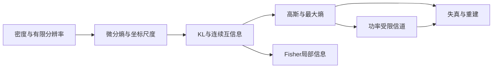

# 信息论：从不确定性到信息处理（离散与连续十二讲）

> **版本**：v0.2-fix1（审稿后文字与行尾修订）｜ **日期**：2026-10-25（连续部分：2026-10-24；原六讲：2026-10-11）｜ **作者**：Codex 侧数学教授分身（CDX）
> **状态**：v0.2 连续增量已通过学科审稿（2026-10-24）及综合审稿（2026-10-25）；本次仅按非阻塞建议修订文字与行尾，数学内容不变。各次批准范围与版本指纹分别保留。

> 作者：**Codex 侧数学教授分身（CDX）**。这是一份供同学自读、质询和重建的数学讲义。刺激—响应数据均为教学构造，不是生物实验结果。本件的写成不代表同学已经学完。

## 阅读约定与全册地图

本册围绕一个问题展开：观察一个响应，平均消除了多少关于刺激的不确定性？当响应被改名、合并或加噪，这些信息会怎样变化？

第一部分（第 1–6 讲）只需有限集合、分数运算和中学对数；第一讲补齐概率对象与条件分布，之后的推导只操作有限和。第二部分（第 7–12 讲）增加密度、积分、协方差与条件期望，前置和外部输入在第二部分导读及附录 H 明示。信息量的对数以 2 为底，单位 bit；Fisher 得分明确使用自然对数，不能把两种底数混用。小数保留六位时使用近似号，精确式优先保留。

讲义中有三种不同承诺：**定义**规定量的含义；**推导**从已引入的规则推出结论；**第一部分待证工具 U1–U4**有准确条件，但本册暂不证明一般情形。它们集中列于附录 C，也在首次使用处点名；第二部分新增外部接口列于附录 H。具体例子由直接计算验证，不能代替一般定理的证明。

每讲有两道完整示范例题 E、两道引导练习 G 和三道独立习题 T。G 的最小提示在附录 A；T1/T2 为基本验收，T3 为选做迁移，解答集中在附录 B。先自读和尝试，卡住再翻提示。口述推导只需讲清关键依据，长求和式可以由讲义承担。课末自评“清楚／较清楚／模糊／不会”，不把 T3 的困难当作前面全没学会。

## 合订目录与阅读次序

| 部分 | 讲次 | 主题 |
| --- | --- | --- |
| 有限离散 | 1–2 | 概率表、自信息与熵 |
| 有限离散 | 3–4 | 条件熵、互信息 |
| 有限离散 | 5–6 | 信息处理、有限信道与模型报告 |
| 原六讲附录 | A–E | 提示、解答、证明账本、术语、历史核验 |
| 连续部分 | 7 | 密度、量化、微分熵与坐标 |
| 连续部分 | 8 | KL、连续／混合互信息、数据处理 |
| 连续部分 | 9 | 高斯最大熵与协方差几何 |
| 连续部分 | 10 | 功率受限高斯信道 |
| 连续部分 | 11 | Fisher 信息、局部 KL 与 CR 界 |
| 连续部分 | 12 | 高斯率失真、重建与综合报告 |
| 新增附录 | F–J | 提示、解答、前置与来源、术语、自校说明 |

按同学要求，新增正文直接接在原文件末尾，旧附录 A–E 保留原位。原六讲中“本册只用有限和”等叙述指第一部分历史范围。此处十二讲是合订版阅读编号，完整 MA404 十六讲规划另含 AEP、操作编码等专题，并未在本次全部完成。讲义写成与同学学完分别记录。

## 第一讲　把问题变成概率表

### 1.0 为什么先建模型

一次观测显示“高响应”，这对刺激提供了什么信息？仅知道“高响应很常见”不够：它可能在所有刺激下都常见，也可能几乎只在某一刺激下出现。需要的对象是刺激与响应如何一起出现，而不是两个各自独立的频率清单。

先把刺激记为 $S$，响应记为 $R$，它们都只取 0、1 两个标签。贯穿本册的模型 A 是：

| $S$ 与 $R$ | $R=0$ | $R=1$ | 行和 |
| :--- | ---: | ---: | ---: |
| $S=0$ | $3/8$ | $1/8$ | $1/2$ |
| $S=1$ | $1/8$ | $3/8$ | $1/2$ |
| 列和 | $1/2$ | $1/2$ | $1$ |

格子 $3/8$ 的意思是“刺激为 0 且响应为 0”的概率，不是“已知刺激为 0 时响应为 0”的概率。后者的分母已经换了。我们从这一区别建立整册的语言。

### 1.1 从实验结果到随机变量

**有限样本空间** $\Omega$ 是模型允许的全部基本结果组成的有限非空集合。给每个基本结果 $\omega$ 一个权重 $p(\omega)\geq0$，要求 $\sum_{\omega\in\Omega}p(\omega)=1$。**事件**是 $\Omega$ 的子集 $A$，其概率为 $P(A)=\sum_{\omega\in A}p(\omega)$。

**随机变量**是从基本结果到标签的函数，例如 $S:\Omega\to\{0,1\}$。在有限信息论里，标签也可以是“左／右”或字母，不必是能相加的数。观察前不知道最终抽中哪个基本结果，所以函数值不确定；“随机”并不意味着这个函数的定义随意变化。

在模型 A 中，可直接取四个有序对作为基本结果。$S$ 读取第一坐标，$R$ 读取第二坐标。以后把所有细节压缩成联合表，就不必每次回到更大的实验空间。

随机变量的有限取值集合称为**字母表**，一般记作 $\mathcal X$。大小写区分对象：$X$ 是变量，$x$ 是取值，$\{X=x\}$ 是事件，$p_X(x)=P(X=x)$ 是这个事件的概率。函数 $p_X$ 称为**概率质量函数**，也称分布。只保留概率大于零的取值组成的集合称为**正概率支持**。

零概率标签可以留在字母表里。比如给响应表添加“2”这一列而整列为零，并没有增加模型真正会产生的结果。稍后计算熵时，这样的标签贡献为零；计算字母表大小的上界时，却必须说明数的是字母表还是支持。

### 1.2 联合与边缘：保留什么，忘掉什么

**联合分布**定义为 $p_{X,Y}(x,y)=P(X=x,Y=y)$。它同时记录两个坐标，所以能回答“这两种取值是否经常一起出现”。只问 $X=x$ 时，不再区分另一个坐标，可将相应格子合并：

$p_X(x)=\sum_{y\in\mathcal Y}p_{X,Y}(x,y),\qquad p_Y(y)=\sum_{x\in\mathcal X}p_{X,Y}(x,y).$

这两个分布叫**边缘分布**。求边缘是把同一事件拆成互不重叠的几块再相加。有限表里，这就是行和与列和。两条边缘通常不能还原联合表：知道两枚硬币各自均匀，并不能确定它们总是相同、总是相反，还是相互独立。

检查一张“联合概率表”，至少要核对格子非负、总和为一、轴标签明确。行和不必各等于一；若每行都是条件分布，行和才分别为一。这两种表的形状可能一样，含义和总和规则却不同。

### 1.3 条件分布与独立性

观察到 $Y=y$ 后，我们把注意力限制在这一列。若 $p_Y(y)>0$，定义**条件分布**：

$p_{X\mid Y}(x\mid y)=\frac{p_{X,Y}(x,y)}{p_Y(y)}.$

分母把选中的一列重新归一化为总概率一。它改变的是参照总体。模型 A 中，已知 $R=0$ 后，$S=0$ 的概率为 $(3/8)/(1/2)=3/4$。原来的概率为 $1/2$；观测让我们的分布发生了变化。

若某列和为零，这个条件在模型里不会发生，不能使用上述除法。本册所有条件平均只遍历正概率条件。你不需要为一个不会出现的条件编造分布来完成计算。

两个变量**独立**，是指对所有 $x\in\mathcal X,y\in\mathcal Y$ 都有 $p_{X,Y}(x,y)=p_X(x)p_Y(y)$。当 $p_Y(y)>0$ 时，这等价于 $p_{X\mid Y}(x\mid y)=p_X(x)$。因此，独立的含义是观察 $Y$ 的取值不改变对 $X$ 的分布；它不是“数值不相等”，也不是“看起来没规律”。零概率列的联合项自动为零，不会破坏等价关系。

**示范 E1.1：读懂模型 A。** 求边缘、两个方向的一列条件分布，并判断独立性。

**解。** 两边的边缘均为 $(1/2,1/2)$。给定 $R=0$，$S$ 的条件分布为 $(3/4,1/4)$；给定 $S=0$，$R$ 的条件分布也为 $(3/4,1/4)$。这里两个方向数值恰好相同是表的对称性造成的，不是条件概率普遍对称。联合项 $p(0,0)=3/8$ 不等于边缘乘积 $1/4$，所以不独立。只需一个不满足的格子即可否定“所有格子都分解”。

### 1.4 期望：让常见情形获得更多权重

对一个实数值变量 $V$，**期望**是 $\mathbb E[V]=\sum_{v\in\mathcal V}p_V(v)v$。若先对标签 $X$ 计算一个数值函数 $g(x)$，则 $\mathbb E[g(X)]=\sum_{x\in\mathcal X}p_X(x)g(x)$。后者尤其重要：标签本身不必有数值意义，但“该标签有多惊讶”可以是一个数。

这是由模型权重定义的平均，不需要先证明“大量实验一定接近它”。关于经验频率为何接近概率，是以后大数定律回答的问题。本册以给定概率模型为出发点。

**示范 E1.2：平均误判损失。** 对模型 A，采用“把响应标签当作刺激预测”的规则。预测错误记损失 1，正确记 0。求平均损失。

**解。** 损失为 1 的两个格子是 $(0,1)$ 与 $(1,0)$，总概率为 $1/8+1/8=1/4$；其余概率 $3/4$ 的损失为 0。故 $\mathbb E[L]=0\times3/4+1\times1/4=1/4$。这个量是某一预测规则的错误率，尚不是信息量。换一个损失定义，数值可能改变；以后互信息的定义不依赖我们选哪种误判罚分。

### 1.5 对数与计算约定

$\log_2 a$ 是满足 $2^t=a$ 的实数 $t$，定义域为 $a>0$。本册使用中学对数性质：它随输入增大而增大，$\log_2(ab)=\log_2a+\log_2b$，$\log_2(a/b)=\log_2a-\log_2b$。例如 $-\log_2(1/2)=1$，$-\log_2(1/8)=3$。

如果计算器只有自然对数键，可用 $\log_2a=\ln a/\ln2$。换底只改变单位的比例，不改变“哪个分布更不确定”的顺序。计算时先保留分数和对数，最后再四舍五入，以免两条本应相等的路线出现人为误差。

$\log_2 0$ 不在实数定义域内。后续所谓“零项为零”，是对整个熵求和项的约定，绝不是给 $\log_2 0$ 赋值为零。最稳妥的做法是只对正概率支持求和。

### 1.6 读表的次序也是建模的次序

看到一张表时，先读坐标轴，再读格子的含义，最后才操作数字。假如行是刺激、列是响应，沿行归一化得到响应给定刺激的规则；沿列归一化得到刺激给定响应的分布。前者适合描述装置怎样产生观测，后者适合描述观测以后怎样更新目标判断。它们都由同一联合表得到，却在回答不同问题。

一个常见误区是把“装置很少在刺激 0 下产生响应 1”直接当作“看到响应 1 时刺激 0 的概率很小”。要从第一句话到第二句话，还需要知道两类刺激的先验频率。某种刺激若极常见，少量误报乘上巨大的原有权重，仍可能占观测中的重要部分。这里无需先记忆一个额外名字：把相应行乘上刺激概率形成联合表，再沿观测列归一化，方向就不会混淆。

另一个误区是把随机变量的数值编码误当作模型内容。用 0、1 只是为表格简洁；如果“刺激 0”换成“刺激左”，概率关系完全相同。只有在你额外定义距离、损失或奖励时，这些标签才获得相应数值意义。因此本册先问“谁与谁一起出现”，后问“这对任务有何意义”，使分布模型与任务目标各自清楚。

还要区分两种“零”：题设模型把某组合概率设为零，是一项模型假设；样本记录里某组合出现零次，是一项观测事实。前者允许在本册计算中直接删除该格；后者是否支持删除真实可能性，需要统计证据。把两者混为一谈，会让条件概率和后续信息量显得过于确定。

本讲最重要的习惯是保留对象的身份。每写一个分数，就说清分子是哪件事、分母是哪一群结果；每写一个平均，就说清在对什么随机结果取平均。这比背诵许多概率口诀更能支持后面的迁移。

### 1.7 练习与覆盖图

**G1.1（引导）**：联合表的两行为 $(1/2,1/4)$、$(1/8,1/8)$。求两边边缘及 $X$ 给定第二列的条件分布。

**G1.2（引导）**：$X$ 分布为 $(1/4,3/4)$，$Y$ 分布为 $(1/2,1/2)$，且二者独立。写联合表，并求数值标签为 0、1 时的 $\mathbb E[X]$。

**T1.1（T1）**：一张表两行为 $(1/2,1/4)$、$(1/4,1/4)$。它能直接作为联合概率表吗？若只能把全部格子乘同一常数，怎样修复？

**T1.2（T2）**：联合表两行为 $(1/2,0)$、$(1/2,0)$。可以定义哪几列的条件分布？两个变量是否独立？说明依据。

**T1.3（T3）**：构造两张具有相同均匀二元边缘的联合表，使第一张独立，第二张由一个变量完全确定另一个变量。说明边缘为什么不足以描述关系。

**本讲覆盖**：单个概率 → 联合表中的事件；按行列合计 → 边缘化；筛选后重算比例 → 条件化；普通平均 → 概率加权平均。向一个刚入门的同学口述：“随机变量、变量取值和取值概率有什么不同？”再说明条件概率的分母来自哪里。下一讲把“惊讶程度”选作数值函数，求它的期望。

## 第二讲　从一次惊讶到平均不确定性

### 2.0 为什么光数选项不够

两台装置都可能发出红灯或蓝灯。第一台两色等可能；第二台几乎总发红灯。它们都有两个标签，却显然不一样难预测。计数忽略了概率分配，我们需要一个能保留“罕见结果更意外”的量。

先讨论一次结果，再讨论整个分布。如果把两者混在一起，会产生看似矛盾的说法：“罕见结果的信息很多，但一个几乎确定的系统信息又很少。”前半句谈单次结果，后半句谈平均；二者可以同时成立。

### 2.1 自信息：用乘法概率构造加法账本

概率为 $p>0$ 的事件发生时，其**自信息**定义为 $j(p)=-\log_2 p$。在变量 $X$ 的正概率取值 $x$ 上，也记 $j_X(x)=-\log_2p_X(x)$。这是一个基于概率模型的数值，不是观测者主观兴奋的心理量。

为什么选对数？独立事件同时发生的概率相乘，而我们希望两件独立消息的惊讶可以相加。若事件 $A,B$ 独立且概率均为正，则

$j(P(A\cap B))=-\log_2(P(A)P(B))=j(P(A))+j(P(B)).$

这个推导说明定义与所需可加性相容，不是自信息定义的唯一性证明。若要从一组公理唯一推出对数，还要完整规定连续性等条件；本册不承担该公理化任务。

确定发生的事件给出 $j(1)=0$；概率每缩小为原来的一半，自信息增加 1 bit。因此 bit 可以先理解为对数刻度的一格。0.01 概率结果的自信息不是它的重要性评分；若模型给错概率，所得“惊讶”也相应改变。

### 2.2 熵：在结果出现之前评价整个分布

**熵**是自信息的期望：

$H(X)=\sum_{x\in\mathcal X:p_X(x)>0}p_X(x)\log_2\frac1{p_X(x)}.$

我们也记一个概率向量的熵为 $H(p_1,\ldots,p_m)$。此时下标只是排列位置，零项仍跳过。熵的每一项都由“发生概率 × 发生时自信息”组成。罕见结果即使非常惊讶，也只以很小权重进入平均。

给标签改名不改变这些权重，所以不改变熵。把数值标签 0、1 换成 0、1000，若概率仍相同，熵也相同。这与方差等依赖数值距离的量有本质差别：熵度量的是分布的不确定性，不是标签在数轴上有多分散。

**示范 E2.1：三种概率的消息。** 一个变量取三种值，概率为 $(1/2,1/4,1/4)$。求每种结果的自信息与熵。

**解。** 自信息依次为 1、2、2 bit。因此 $H=\frac12\times1+\frac14\times2+\frac14\times2=3/2$ bit。三个结果并不等可能，不能用 $\log_2 3$ 直接替代熵。该例同时说明，平均信息可以是非整数，而每次的结果仍是一个具体标签。

为方便写二元例子，定义**二元熵函数** $h(t)=H(t,1-t)$，其中 $0\leq t\leq1$。对 $0<t<1$，

$h(t)=-t\log_2t-(1-t)\log_2(1-t),\qquad h(0)=h(1)=0.$

交换两种标签不影响熵，所以 $h(t)=h(1-t)$。常用数值是 $h(1/2)=1$，$h(1/4)\approx0.811278$，$h(1/10)\approx0.468996$。

### 2.3 从定义能立刻证明什么

因为正概率 $p$ 不超过 1，对数单调性给出 $-\log_2 p\geq0$。每个概率权重非负，因此 $H(X)\geq0$。这是完整证明，不需要额外不等式。

什么时候等于零？有限个非负数之和等于零，意味着每个正概率项的自信息都为零，即相应概率等于 1。归一化又保证至多一个取值的概率为 1。因此，有限离散熵为零，当且仅当正概率支持中只有一个结果。字母表可以很大，只要其余结果都不发生，熵仍为零。

若字母表有 $m$ 个取值且均匀，每项概率为 $1/m$，每次自信息都是 $\log_2m$，平均仍是 $\log_2m$。这是直接代入，不需要极值理论。

> **待证工具 U1（登记表 R13）：有限熵上界。** 在大小为 $m\geq1$ 的固定有限字母表上，$H(X)\leq\log_2m$，等号当且仅当该字母表上均匀。上面已验证均匀分布达到此值；“其他分布都不超过它”是尚未在本册证明的一般结论。证明回补与原始资料定位见附录 C。

加入永不出现的标签不改变熵，却会使以全字母表大小计算的上界变松。因此报告中的“最多几 bit”必须交代允许哪些结果。只数观测样本里见过的标签，又可能漏掉模型允许但这次没抽到的结果。

### 2.4 稀有事件与低熵可以共存

**示范 E2.2：九成把握仍会遇到意外。** 变量取 0、1 的概率分别为 $9/10,1/10$。求两种自信息、熵，并解释它们的差别。

**解。** 结果 0 的自信息为 $\log_2(10/9)\approx0.152003$ bit；结果 1 的自信息为 $\log_2 10\approx3.321928$ bit。熵为 $0.9\log_2(10/9)+0.1\log_2 10\approx0.468996$ bit。大多数时候几乎没有惊讶，少数时候很惊讶；两者按真实权重平均后小于 1 bit。

不能把这个平均解释为“每次只收到 0.468996 bit 的结果”。每次实际结果可能是常见的，也可能是罕见的。期望描述分布整体，而不是替每个样本指定相同数值。类似地，平均误判率与某一次预测是否正确也不同。

这里还藏着一条建模选择：如果发送者与接收者使用不同概率模型，他们可能给同一消息不同自信息。本册默认讨论同一指定模型；“使用错误模型时平均多付出多少”会通向后面的 KL 接口，但暂时不把它混入熵的定义。

### 2.5 熵与二进制编码长度之间还差一座桥

“以 bit 为单位”不等于“已经构造出恰好这么长的码”。一个二进制码字的长度是非负整数，概率 $3/4$ 对应的自信息却约为 0.415037。如何让可变长码或成组编码的平均长度接近某个极限，需要规定可解码性、编码方案和误差条件。

本册只建立信息量账本。后续信源编码理论才回答这本账与实际存储成本怎样连接。提前承认这个缺口，可以防止从“定义了一个数”跳到“某个设备一定能达到它”。本册的容量章节也会遇到同一种区分：数学优化值和可操作通信速率之间，需要独立的定理。

### 2.6 熵比较必须固定问题

熵是分布的一个数值摘要，摘要必然会舍弃细节。两个分布熵相同，并不能据此恢复原来的概率表，更不能说两种实验在所有方面等价。我们在本册用它比较“不确定性有多少”，而要判断“观测什么有帮助”，仍必须回到联合关系。因此只知道目标熵和响应熵，通常不能求出它们的互信息。

比较两个系统的熵时，先检查是否测量同一种对象。例如把一个连续测量分成粗细不同的标签后，得到的是不同离散变量；它们的熵可以不同，变化的一部分来自分辨率的选择。此时不能仅用较大熵宣称系统更复杂或性能更好。即使本册不讲连续变量，这个离散建模边界也已经存在：变量是什么，决定概率表是什么。

“均匀最不确定”同样有范围：它针对固定的有限字母表，允许所有概率分配，不额外限制平均能量、成本等条件。若某些分布被约束排除，最大熵问题就换了可行范围。本册不使用拉格朗日乘子求受约束极值，也不把 U1 当作所有最大熵问题的一揽子答案。

不确定性与观察者的预测规则也需分开。一个人可以采用很差的预测规则，在低熵分布上经常猜错；熵仍由指定分布决定，而不会因这个人的错误操作自动变大。反过来，较低错误率说明某个规则表现较好，却不独自确定分布的熵。要建立两者的定量界，必须另外给出变量、解码规则和错误事件。

因此，使用熵时可以依次写下三句话：我对哪个变量建模；我采用哪一个概率分布；我只对这个分布的不确定性作比较。这三句话会让一个短计算成为可检查的数学判断，而不是借“信息”一词作宽泛评价。

### 2.7 练习与覆盖图

**G2.1（引导）**：两个独立事件的概率分别为 $1/4$ 与 $1/8$。比较它们同时发生的自信息与各自自信息之和。

**G2.2（引导）**：分布为 $(1/2,1/4,1/4,0)$。求熵，并分别给出使用整个字母表与正概率支持大小时的 U1 上界。

**T2.1（T1）**：均匀的八种结果，每种自信息和总体熵各是多少？

**T2.2（T2）**：比较分布 $(3/4,1/4)$ 与 $(1/2,1/2)$ 的熵；同时比较前一个分布中罕见结果的自信息与后一个分布中任一结果的自信息。说明为什么两种比较不矛盾。

**T2.3（T3）**：构造两个数值型二元变量，使期望相同而熵不同。完整给出取值、概率和计算。

**本讲覆盖**：等概率选项数的对数，是均匀熵的特例；独立概率相乘，被对数变成自信息相加；加权平均，把单次惊讶提升为分布层面的量。请脱稿解释“零概率项为零”和“对数零等于零”为什么不是同一句话。下一讲把联合与条件分布都放入熵公式，追踪观测后的剩余不确定性。

## 第三讲　观测以后还剩多少不确定性

### 3.0 观测改变的是哪张表

模型 A 中，观测响应之前，刺激均匀；看到响应 0 后，刺激分布变成 $(3/4,1/4)$。新分布仍有两个可能取值，但权重改变了。因此“还剩多少不确定性”应对新的条件分布求熵。

这里必须区分两个问题：“这次响应恰好是 0 后，还剩多少？”以及“在响应出现之前，预计观察它后平均还剩多少？”第二个问题需要把不同响应各自的剩余熵再平均。若漏掉这层平均，就会错误地认为每次观测都一定使熵下降。

### 3.1 联合熵把有序对当成一个结果

把有序对 $(X,Y)$ 看成一个随机变量，它的字母表包含所有允许的取值对。**联合熵**定义为

$H(X,Y)=\sum_{(x,y)\in\mathcal J}p_{X,Y}(x,y)\log_2\frac1{p_{X,Y}(x,y)},$

其中 $\mathcal J=\{(x,y)\in\mathcal X\times\mathcal Y:p_{X,Y}(x,y)>0\}$ 是联合分布的正概率支持。逗号表示一起描述两个坐标，不表示分别求熵后相加。独立时确实能相加，但那是需要推导的特殊情形。

也可以把“先说刺激，再说响应”视为描述有序对的一种次序。前一步说完后，后一步不必重复前一步已经带来的信息。这个直觉引导链式法则，但我们还需把它落成分布和对数运算。

### 3.2 条件熵有两层权重

对 $p_Y(y)>0$，**固定观测下的熵**定义为

$H(X\mid Y=y)=\sum_{x\in\mathcal X:p_{X\mid Y}(x\mid y)>0}p_{X\mid Y}(x\mid y)\log_2\frac1{p_{X\mid Y}(x\mid y)}.$

这是选定一个条件分布后求出的普通熵。**条件熵**则把不同观测下的值平均：

$H(X\mid Y)=\sum_{y\in\mathcal Y:p_Y(y)>0}p_Y(y)H(X\mid Y=y).$

外层权重是实际看到该观测的概率，不能因为有两个响应就一律各乘 $1/2$。将两层权重相乘，$p_Y(y)p_{X\mid Y}(x\mid y)=p_{X,Y}(x,y)$，得到便于推导的写法：

$H(X\mid Y)=\sum_{(x,y)\in\mathcal J}p_{X,Y}(x,y)\log_2\frac1{p_{X\mid Y}(x\mid y)}.$

每个条件熵是非负熵的非负加权平均，因此非负。这一点可以直接由第二讲推出。它不依赖稍后才陈述的“平均条件熵不超过原熵”。

### 3.3 链式法则：相同账本的两种分组

在每一个正概率联合项上，$p_Y(y)>0$ 且条件概率为正。由条件概率定义，$p_{X,Y}(x,y)=p_Y(y)p_{X\mid Y}(x\mid y)$，所以

$\log_2\frac1{p_{X,Y}(x,y)}=\log_2\frac1{p_Y(y)}+\log_2\frac1{p_{X\mid Y}(x\mid y)}.$

用联合概率作权重求和，右侧第二部分就是 $H(X\mid Y)$。第一部分可以按 $y$ 分组：

$\sum_{(x,y)\in\mathcal J}p_{X,Y}(x,y)\log_2\frac1{p_Y(y)}=\sum_{y\in\mathcal Y:p_Y(y)>0}\left(\sum_{x\in\mathcal X}p_{X,Y}(x,y)\right)\log_2\frac1{p_Y(y)}=H(Y).$

内层括号等于边缘概率 $p_Y(y)$，因此得出**熵的链式法则**：

$H(X,Y)=H(Y)+H(X\mid Y).$

交换坐标作同样推导，还得到 $H(X,Y)=H(X)+H(Y\mid X)$。这不是说两个条件熵相同，而是两条描述路线的总量相同：先描述谁会影响第一步的成本，也会影响第二步还剩多少。

这条证明没有使用独立性，也没有对零概率项取对数。有限和重排是关键技术：先逐格写等式，再把只与某一坐标有关的项合并成边缘概率。日后看到复杂信息恒等式，首先检查能否用这一套路拆开。

**示范 E3.1：模型 A 的完整熵账。**

**解。** 两边均匀，故 $H(S)=H(R)=1$。两个条件分布分别为 $(3/4,1/4)$ 及其交换，所以 $H(S\mid R)=H(R\mid S)=h(1/4)\approx0.811278$。链式法则给出 $H(S,R)=1+h(1/4)\approx1.811278$ bit。

直接对四个格子算：$H(S,R)=-2\times\frac38\log_2\frac38-2\times\frac18\log_2\frac18$，得到相同结果。四个格子并不等可能，因此不能把联合熵写成 2 bit。两条路线一致，验证的是这张表的计算；一般恒等式由上文证明保障。

### 3.4 两个边界：独立与完全可恢复

若 $X,Y$ 独立，每个正概率 $y$ 下的条件分布都等于 $p_X$，所以每个 $H(X\mid Y=y)=H(X)$。权重和为一，便有 $H(X\mid Y)=H(X)$；代入链式法则，$H(X,Y)=H(X)+H(Y)$。独立变量的熵可加，是一般链式法则的简化结果。

另一端，若由 $Y$ 可以确定 $X$，即存在函数 $f$ 使 $X=f(Y)$ 以概率一成立，那么每个正概率条件下只有一个可能的 $X$ 值，故 $H(X\mid Y)=0$。此处“以概率一”在有限模型中，就是所有正概率联合格子都满足这个关系；零概率格子不影响判断。

反向也成立。若 $H(X\mid Y)=0$，它是正权重乘非负条件熵的有限和，所以每个正概率条件熵为零。根据第二讲零熵判据，每个正概率 $y$ 唯一确定一个 $x$。把这个对应定义为 $f(y)$；在零概率 $y$ 上任意补定义，就得 $X=f(Y)$ 以概率一成立。于是我们完整证明了“条件熵为零”等价于“可以从观测恢复目标”。

恢复方向不能倒置。知道完整学号能知道年级，知道年级通常不能恢复完整学号；对应两个条件熵，一个为零，另一个未必为零。这只是函数关系的类比，具体大小仍由分布决定。

### 3.5 某一次观测可以让你更不确定

**示范 E3.2：少见的模糊响应。** 给定模型 B：

| $X$ 与 $Y$ | $Y=a$ | $Y=b$ |
| :--- | ---: | ---: |
| $X=0$ | $4/5$ | $1/10$ |
| $X=1$ | $0$ | $1/10$ |

**解。** 原边缘为 $(9/10,1/10)$，所以 $H(X)=h(1/10)\approx0.468996$。当 $Y=a$ 时必有 $X=0$，条件熵为零；当 $Y=b$ 时两个 $X$ 值等可能，条件熵为 1 bit，反而高于原熵。外层权重为 $P(a)=4/5,P(b)=1/5$，因此 $H(X\mid Y)=\frac45\times0+\frac15\times1=1/5$ bit。

平均剩余量 0.2 小于原来的约 0.469，但较少发生的观测 $b$ 确实让熵上升。原本偏向 $X=0$ 的判断被新证据打破，这并不矛盾。一般的平均不增结论将在下一讲作为 U2 的推论使用；这道题只是独立核实了一张具体表。

这个例子也解释为什么不能给条件熵省掉条件变量分布。若错误地给 $a,b$ 各一半权重，会算成 0.5，并伪造出一个违反平均不增的结果。遇到类似“定理失效”，第一步应检查模型与加权方式。

### 3.6 从链式法则检查推理方向

链式法则允许你在两种描述次序之间切换，但不会允许你随意替换条件。把 $H(X\mid Y)$ 改成 $H(Y\mid X)$，等于把需要恢复的对象和手上已有的观测对调；只有整个联合熵的两种分解保持相等。若两个边缘熵不同，那么两个条件熵也必须相应不同，才能维持同一本总账。

可以把联合熵想成“描述完整有序对”的平均成本标尺，条件熵想成“前一个坐标已经明确后，后一个还不明确的部分”。这个说法只帮助理解加法关系，不等于已经证明实际码长等于熵。每次使用账本类比时，都应能还原为条件概率乘积分解和有限和；能还原的部分才是本册已经掌握的数学。

条件熵的零值判据比“两个变量取一样的值”宽得多。观测标签可以是文字、成对记录或编码，只要每个正概率观测都指向唯一目标，就可恢复目标。反向若有一个观测同时对应两个正概率目标，则该条件分布含有至少两个正概率结果，它的熵严格大于零；外层权重也正，所以总体条件熵严格大于零。这给出了一种无需计算小数的定性判断法。

这种检查特别适合验证“无损”宣称：先找到是否有两个不同目标落在同一个正概率观测之下，再决定是否需要算具体损失。若只是不同原始响应被合并，但它们对应相同目标，那么目标未必丢失；第五讲会系统区分这两种对象。

当你闭卷重建链式法则时，不必从记忆中一次抄出三层求和。先说出“联合概率＝边缘概率×条件概率”，再说“取负对数，乘联合权重求和”，最后说明“边缘项沿另一个坐标合并”。这三步如果连贯，长公式只是把已理解的结构写全；若某一步说不清，回到那一张表定位即可。

### 3.7 练习与覆盖图

**G3.1（引导）**：$X$ 在两个值上均匀，$Y$ 在四个值上均匀，且独立。求两个边缘熵、联合熵及两个方向的条件熵。

**G3.2（引导）**：用模型 B 算出 $H(Y)$ 与 $H(X,Y)$，通过链式法则复算 $H(X\mid Y)$。

**T3.1（T1）**：$X$ 取 $a,b,c$，概率为 $(1/2,1/4,1/4)$。$Y$ 在 $X=a$ 时为 0，其余时为 1。求 $H(X),H(Y),H(X,Y),H(X\mid Y),H(Y\mid X)$。

**T3.2（T2）**：口述“有限离散条件熵为零当且仅当目标可以由观测恢复”的两向证明，并用 T3.1 判断恢复方向能否交换。

**T3.3（T3）**：构造一张不同于模型 B 的二乘二联合表，使某个正概率观测下的条件熵高于原熵，而平均条件熵低于原熵。写出全部计算。

**本讲覆盖**：联合概率乘积分解 → 联合熵加法分解；独立性 → 条件熵等于边缘熵；可恢复性 → 条件熵为零。请向新生解释链式法则为什么不需要独立，并指出证明中哪一步用到边缘化。下一讲把观测前后两本账相减，得到互信息。

## 第四讲　互信息是平均获得的什么

### 4.0 为什么要从熵差出发

模型 A 中，刺激原来有 1 bit 不确定性，观察响应后平均还剩约 0.811278 bit。我们想用一个量描述这次观测机制平均提供了多少信息，自然会考察差值，而不是只看响应自己有多复杂。

一个响应可以变化丰富，却与刺激毫无关系；例如独立噪声有很高熵，却不能减少关于刺激的不确定性。因此“响应本身的熵”与“响应关于目标的信息”应是不同对象。

### 4.1 定义与两种方向

有限离散变量的**互信息**定义为

$I(X;Y)=H(X)-H(X\mid Y).$

分号区分这个二变量信息量与联合熵记号。它比较的是对 $X$ 的不确定性，在观测 $Y$ 前后平均减少了多少。它尚不是一次具体观测的熵差，也不是对一次样本分配的常数。

利用链式法则 $H(X\mid Y)=H(X,Y)-H(Y)$，得到

$I(X;Y)=H(X)+H(Y)-H(X,Y)=H(Y)-H(Y\mid X)=I(Y;X).$

所以两个方向的平均信息量相同，即使两个边缘熵和两个条件熵不同。观察一个变量能完全恢复另一个变量，反向不一定能恢复；这与互信息对称不矛盾。对称的是相同联合分布里共享的信息量，不能把它读成“两个变量的全部信息相同”。

### 4.2 概率比表达式从哪里来

为了把三个熵放进同一个有限和，先把边缘熵按联合表分摊。例如

$H(X)=-\sum_{(x,y)\in\mathcal J}p_{X,Y}(x,y)\log_2p_X(x).$

因为固定 $x$ 后，联合权重沿 $y$ 求和恢复 $p_X(x)$。$H(Y)$ 同理。将两式相加再减去联合熵，合并对数便得到

$I(X;Y)=\sum_{(x,y)\in\mathcal J}p_{X,Y}(x,y)\log_2\frac{p_{X,Y}(x,y)}{p_X(x)p_Y(y)}.$

每个正概率联合格子的两个边缘概率都为正，所以式中分母不会是零。分子描述实际联动，分母描述具有相同边缘的独立模型。两者比值大于 1 的格子，比独立基准更常一起出现；比值小于 1 的格子，则更少一起出现。

注意单个对数比可以为负。平均互信息非负并不表示每一格的贡献都非负，也不能仅因式子长得像某种“距离”就认为结论已经证明。

**示范 E4.1：双路线核算模型 A。**

**解。** 熵差路线给出 $I(S;R)=1-h(1/4)\approx0.188722$ bit。概率比路线中，所有边缘乘积均为 $1/4$。两个对角格比值为 $3/2$，两个非对角格比值为 $1/2$，故

$I(S;R)=\frac34\log_2\frac32+\frac14\log_2\frac12=\frac34\log_2\frac32-\frac14\approx0.188722.$

非对角格的总贡献是 $-1/4$ bit；总和仍正。这直接排除了“互信息由各格非负贡献相加”的误解。两条路线共有同一概率模型，但运算组织不同，适合作为数值核查。

### 4.3 非负性、独立与上界

> **待证工具 U2（登记表 R14）：互信息非负及零值判据。** 有限离散变量满足 $I(X;Y)\geq0$，且等号当且仅当 $X,Y$ 独立。其一般证明在本册外，回补路线见附录 C。独立推出零值可以在本册直接验证：每个正概率联合项的概率比等于 1。

由定义，U2 立即给出 $H(X\mid Y)\leq H(X)$。这是按观测概率加权后的结论，不是对每个固定 $y$ 的结论。等号对应独立，即任何正概率观测都没有改变目标分布。

上界可以就地证明。条件熵非负，所以 $I(X;Y)\leq H(X)$；使用对称表达式，又有 $I(X;Y)\leq H(Y)$。结合 U2，

$0\leq I(X;Y)\leq\min\{H(X),H(Y)\}.$

若 $I(X;Y)=H(X)$，定义强制 $H(X\mid Y)=0$，所以由第三讲判据，$X$ 可从 $Y$ 恢复。反向同样成立。这里不必另立新定理：定义、非负条件熵和恢复判据已经足够。

### 4.4 能恢复一部分，不代表能恢复全部

**示范 E4.2：平方保留了哪些信息？** $X$ 取 $-1,0,1$，概率依次为 $(1/4,1/2,1/4)$，令 $Y=X^2$。

**解。** $X$ 的熵为 $3/2$ bit；$Y$ 在 0、1 上均匀，所以熵为 1 bit。$Y$ 是 $X$ 的函数，故 $H(Y\mid X)=0$，于是 $I(X;Y)=H(Y)=1$ bit。给定 $Y=0$，$X$ 确定为 0；给定 $Y=1$，正负号仍等可能。因此 $H(X\mid Y)=\frac12\times0+\frac12\times1=1/2$ bit。另一条熵差路线为 $3/2-1/2=1$ bit。

平方操作保留“是不是零”的信息，删除非零时的符号。互信息对称并没有恢复被删除的符号；它只是说明两个方向计算出的共享量相同。这里的关联完全由非线性函数构成，判断依赖仍只需联合分布与条件分布，不需要先学习线性相关系数。

这也提醒我们：两个数值变量看起来是否接近，和一个变量能否预测另一个变量，是不同问题。把 $Y$ 的标签 1 改叫 100，并不会改变恢复关系或互信息。

### 4.5 信息量没有替我们决定什么

互信息可以回答“这个观测减少多少关于某个目标的分布不确定性”，但目标本身是谁，必须由研究者指定。一次处理对刺激类别的信息可能无损，却丢掉关于精确时间的信息。谈“信息保留”时省略目标，就省略了问题的一半。

互信息还没有给语义或效用打分。同样的 1 bit，可以区分两个无关紧要的标签，也可以区分两个重要决策；只要概率结构一致，数值相同。任务损失需要另外定义，如第一讲的误判损失。信息量与任务表现可能有关，但不能直接当同一个量。

最后，联合分布中的依赖并不指定因果方向。$X$ 影响 $Y$、$Y$ 影响 $X$、二者受共同因素影响，都可能产生关联。要比较因果机制，需要额外假设、实验设计或干预证据。本册的刺激—响应词汇仅用于说明谁是目标、谁是观测，不提供生物学因果结论。

### 4.6 为什么不把两个熵简单画成面积就结束

有时人们用两个相交圆表示 $H(X)$ 和 $H(Y)$，交叠部分标成互信息。对本册两个有限离散变量，非负互信息和非负条件熵确实允许这样组织数字：左边剩余是 $H(X\mid Y)$，右边剩余是 $H(Y\mid X)$，合起来对应联合熵。但图只是对已经成立关系的记账，不提供独立证明。

尤其不能先假定“面积总非负”，再据此证明 U2。这个推理把需要证明的性质藏进了画图规则。我们先通过定义和链式法则建立等式，再明确调用 U2 取得非负性，最后才允许这样的直观图景。学习结构化数学时，应区分“帮助记忆结论的模型”和“支持结论成立的依据”。

互信息为零也比“某一个观测没有帮助”强。某一列的条件分布可能恰好等于原分布，而其他列仍改变目标判断；只有整个联合关系独立，所有正概率条件才都不改变分布。一般零值判据依赖 U2，不能从一列的检查直接推到全局。反过来，若已直接验证整张联合表是边缘乘积，就能不经复杂计算得到零互信息。

谈“观察平均获得信息”还应承认不同观测可能带来不同的分布变化。第三讲的少见模糊观测使熵增加，较常见的确定观测使熵减小，互信息只把这些变化按正确权重汇总。把平均指标当作每次都一样的收益，会错过这个层次。

完成一道互信息题后，最好同时保留三种描述：一个可复算的精确式，一个带单位的数值，以及一句限定对象的解释。例如“关于刺激标签，观察该响应平均减少了多少不确定性”。这句解释若无法和题设变量一一对应，即使小数算对，建模工作仍未结束。

### 4.7 KL 接口（选读，不作后文前提）

对同一有限字母表上的分布 $p,q$，当每个 $p(x)>0$ 的位置均有 $q(x)>0$ 时，**KL 散度**定义为

$D(p\Vert q)=\sum_{x:p(x)>0}p(x)\log_2\frac{p(x)}{q(x)}.$

若存在 $p(x)>0,q(x)=0$，则约定该散度为正无穷大；$p(x)=0$ 的项跳过。这里的字母 $x$ 遍历共同字母表。联合分布和边缘乘积分布恰好满足所需支持关系，所以互信息的概率比式可写为 $I(X;Y)=D(p_{X,Y}\Vert p_Xp_Y)$。

这个等式揭示另一种结构：互信息比较真实联合模型与同边缘的独立模型。本册没有通过写出 KL 名字就证明其非负性。后续可先建立对数不等式，再证明 KL 非负，最后回补 U2。KL 通常不对称，例如 $p=(1/2,1/2),q=(3/4,1/4)$ 时，$D(p\Vert q)=\frac12\log_2(4/3)\approx0.207519$，而 $D(q\Vert p)=1-h(1/4)\approx0.188722$；因此不能直接当作满足对称性的距离。

**G4.1（引导）**：两个独立均匀二元变量的互信息是多少？分别用熵差式和概率比式核算。

**G4.2（引导）**：复用 T3.1 的变量，计算互信息，并解释为何它等于其中一个边缘熵而小于另一个。

**T4.1（T1）**：求模型 B 的互信息，写出两种熵差路线。

**T4.2（T2）**：证明有限离散情形 $I(X;Y)=H(X)$ 当且仅当 $X$ 能从 $Y$ 恢复；说明这是否强制 $I(X;Y)=H(Y)$，并给出例子。

**T4.3（T3）**：构造两张所有四格均为正、两边边缘均匀的二元联合表，使第一张互信息为零，第二张互信息为正。通过直接计算区分它们。

**本讲覆盖**：观测前后熵差 → 互信息；两种描述次序 → 对称性；可恢复性 → 达到某一边缘熵；独立关系 → 零互信息。请口述为什么“平均互信息非负”不能推出“每个格子的对数比非负”。下一讲固定目标，追踪响应经过处理后的信息变化。

## 第五讲　信息经过处理会怎样

### 5.0 不问目标，就无法判断损失

现在响应已经出现，接收者可以保存原始标签、压成较少类别，或者经过一个带随机性的处理器。前四讲只比较同一联合表的不同表达，本讲开始真正改变观测变量。

先固定目标 $X$，把原响应叫 $Y$，处理后的响应叫 $Z$。我们比较 $I(X;Y)$ 与 $I(X;Z)$。这个写法让目标保持在同一位置，避免把“处理后变量的熵变小”直接误读成“关于目标的信息一定变少”。

### 5.1 确定性映射：给旧格子重新分组

**确定性处理**指给定 $Y=y$ 后，输出唯一确定为 $Z=f(y)$。若多个旧标签映到同一个新标签，就把这些标签的概率相加：

$p_{X,Z}(x,z)=\sum_{y\in\mathcal Y:f(y)=z}p_{X,Y}(x,y).$

这不是把标签数平均，也不是把概率取最大值，而是合并互不重叠事件。得到新表后，仍用前四讲定义计算所有信息量。

如果映射在 $Y$ 的正概率支持上一一对应，那么 $Z$ 只是换了名字。各个联合概率项重新排列，故 $H(Z)=H(Y)$；每个新标签对应原来同一个目标条件分布，所以 $H(X\mid Z)=H(X\mid Y)$，从而 $I(X;Z)=I(X;Y)$。这个结论已由重新编号证明，不依赖尚未证明的数据处理不等式。

对于一般多对一映射，输出自身的熵不超过输入自身的熵也可就地证明。因为 $H(Z\mid Y)=0$，链式法则给出 $H(Y,Z)=H(Y)$；交换分解方向又得 $H(Y,Z)=H(Z)+H(Y\mid Z)$。于是 $H(Z)=H(Y)-H(Y\mid Z)\leq H(Y)$。差值量化的是“只看新标签后，还不能恢复多少旧标签信息”，它未必与目标有关。

### 5.2 随机信道：输出还可以依赖新的随机性

给定旧响应 $y$ 后，如果新输出仍有多个可能值，就用条件概率表 $W(z\mid y)$ 描述。要求对每个输入 $y$，$W(z\mid y)\geq0$ 且 $\sum_{z\in\mathcal Z}W(z\mid y)=1$。这样的规则称为**信道**；它可以是一段物理通信过程，也可以只是抽象的随机处理规则。

当处理器只利用 $Y$，没有额外读取目标 $X$，三变量模型写成

$p_{X,Y,Z}(x,y,z)=p_{X,Y}(x,y)W(z\mid y).$

这是本册的**数据处理条件**，简记为 $X\to Y\to Z$。给定旧响应后，处理器输出的概率规则不再因目标值不同而改变。确定性处理是特例：在 $z=f(y)$ 的位置令 $W=1$，其余令 $W=0$。

把中间响应 $Y$ 忘掉，得到 $p_{X,Z}(x,z)=\sum_{y\in\mathcal Y}p_{X,Y}(x,y)W(z\mid y)$。该公式就是逐条中间路径求概率再相加；有限模型里不需要先学习随机过程理论。箭头只表示联合分布的这种分解，不能仅凭写了箭头就推断实验因果。

### 5.3 数据处理不等式到底保证什么

> **待证工具 U3（登记表 R15）：数据处理不等式。** 对满足上述分解的有限变量，$I(X;Z)\leq I(X;Y)$。一般证明留待后续条件互信息与其非负性建立后回补，见附录 C。本节具体处理的数值则逐例直接核算。

它保证仅从当前响应出发的后续处理，不能增加关于原目标的互信息；不保证每一次都严格降低，也不保证处理后的响应自身更低熵。处理器可以添加与目标无关的随机标签，让输出熵增加；这些新增随机性不会自动成为目标信息。

计算结果若违反不等式，要依次检查三件事：前后是否用同一个目标与输入分布，表是否归一化，处理器是否读取了额外变量。只有条件确实相同，才有资格把结果放在同一个不等式中比较。

### 5.4 同样压掉一半标签，结果可以完全不同

**示范 E5.1：保留目标还是保留无关标签。** $S,N$ 为独立均匀二元变量，原响应 $R=(S,N)$。四个响应标签各以 $1/4$ 出现。处理一保留第一坐标 $Z=S$；处理二保留第二坐标 $Q=N$。

**解。** $H(R)=2$，且原响应完全确定目标，故 $I(S;R)=H(S)=1$。处理一的输出熵 $H(Z)=1$，但仍能恢复 $S$，所以 $I(S;Z)=1$。处理二的输出熵同样为 1，但 $Q=N$ 与 $S$ 独立，所以 $I(S;Q)=0$。这里“独立推出零”可直接由概率比分解验证。

两个处理都把四个标签合并成两个，都让响应熵减少 1 bit，一个保留全部目标信息，另一个丢掉全部目标信息。因此“压缩了多少标签”或“降低了多少输出熵”本身不足以判断目标信息损失。

若改把目标设为 $N$，两种处理的优劣就会交换。这不是计算出了矛盾，而是研究问题变了。建模报告必须始终把目标写出来，不能只说“这个特征保存了信息”。

### 5.5 加一次噪声：通过路径合成来计算

**示范 E5.2：模型 A 后再随机翻转。** 把 A 的响应 $R$ 以概率 $1/4$ 翻转为 $Z=1-R$，以概率 $3/4$ 保持。该次随机翻转独立于已有的 $S,R$。

**解。** A 中给定任一刺激，原响应有 $1/4$ 概率不同于刺激。最终不同，可能是“第一次不同、第二次保持”，也可能是“第一次相同、第二次翻转”。总概率为 $\frac14\frac34+\frac34\frac14=3/8$。最终相同的概率为 $5/8$，所以新联合表为

| $S$ 与 $Z$ | $Z=0$ | $Z=1$ |
| :--- | ---: | ---: |
| $S=0$ | $5/16$ | $3/16$ |
| $S=1$ | $3/16$ | $5/16$ |

输出仍均匀，故 $H(Z)=1$。每行条件熵为 $h(3/8)$，于是 $I(S;Z)=1-h(3/8)\approx0.045566$ bit，小于原来的约 0.188722 bit。输出熵前后都为 1，关于目标的互信息却下降了；单看输出熵会漏掉这一变化。

这里通过具体路径计算证明了本例的信息减少，并核对了 U3；没有用“噪声通常让信息少”替代建模。若两次翻转相关，$3/8$ 的计算可能失效，必须重新写联合规则。随机独立性是计算中真正用到的前提。

### 5.6 处理可以改善使用方式，而不增加目标互信息

数据处理不等式不说“处理没有价值”。对某个受限的观察者，重新组织标签、删除无关细节或计算恰当特征，可能让已有信息更容易被使用。U3 约束的是指定联合模型中的互信息；它没有把人的阅读能力、算法资源或具体决策规则放入定义。不要用“不能增加互信息”推断“任何预处理都无用”。

同时，也不能反过来从任务表现改善推出互信息增加。原观测可能已经包含目标，而一个糟糕的规则没有利用好它。改进规则后任务错误减少，目标与原观测的联合分布并未因此改变。若要分析受限算法能利用多少，必须明确另一个问题，而不是悄悄改写本册互信息的含义。

处理规则是否固定，也是一项需要说明的前提。如果先用另一批有目标标签的数据训练一个处理器，然后在新模型里讨论它的输出，应说明训练信息在分析中扮演什么角色。可以在规则已固定后研究当前样本的信道关系；也可以把额外数据纳入更大的模型。省略这个步骤，容易把额外来源的信息误记成仅由当前响应加工出来的增益。本册不展开学习算法，但保留这条对象核对原则。

在有限表中检查数据处理条件，可以采用最直接的方式：对于同一个正概率旧响应，比较不同目标下的后续输出分布。如果它们都能用同一行 $W(\cdot\mid y)$ 表示，才符合所写分解；若必须随着目标改变这一行，就已经引入了额外依赖。没有出现过的零概率组合无需强行比较条件概率，可以直接核对整体联合分解。

这使定理成为可用的检查工具：先把原目标、旧响应、新响应放进同一模型，再验证输入来源，最后比较信息量。一个正确的不等式不仅给结论，还告诉你哪些条件一变，原来的结论就需要重新审查。

### 5.7 练习与覆盖图

**G5.1（引导）**：把模型 A 的响应作可逆重命名 $Z=1-R$。求新联合表及 $I(S;Z)$，说明为何预测标签反过来不代表信息丢失。

**G5.2（引导）**：把模型 A 的两个响应都映到同一个常数。求输出熵、刺激的条件熵及互信息。

**T5.1（T1）**：对模型 A 的响应独立地以概率 $1/2$ 翻转。计算最终联合表、输出熵及目标互信息。

**T5.2（T2）**：$X$ 是均匀二元目标，$Y$ 恒为 0；处理器另外读取 $X$ 并输出 $Z=X$。计算前后互信息，并判断能否找到仅依赖 $Y$ 的信道表满足数据处理条件。

**T5.3（T3）**：构造一个二元目标与三标签响应的联合表，使所有六格为正；将两个响应标签合并后，响应熵严格下降，但目标互信息保持。给出处理前后完整计算。

**本讲覆盖**：可逆改名 → 概率项重新编号；合并 → 同一原像上的概率求和；随机处理 → 条件表与路径合成；目标信息保留 → 比较同一目标的互信息。请脱稿说明为什么 E5.1 不反驳数据处理不等式。下一讲把整个计算链写成可审查的模型报告，并区分给定输入表现与信道容量。

## 第六讲　完成一次刺激—响应信息分析

### 6.0 从解题转向提出可检查的判断

前面每道例子都给出明确的表和问题。综合分析要你同时承担两种责任：先说清楚模型和目标，再用计算支持结论。只给出一串熵值，读者可能不知道它们描述谁；只说“响应包含丰富信息”，读者又无法复查。

本讲将报告分成模型、账本、处理对照和边界四部分。用同一模型贯穿这四部分，最后再改变输入分布，观察“同一个信道”为什么不一定给出同一个互信息。

### 6.1 固定信道与固定联合表不是一回事

给定输入 $X=x$ 后的输出规则用 $W(y\mid x)$ 表示。再选择输入分布 $p_X$，才得到联合分布 $p_{X,Y}(x,y)=p_X(x)W(y\mid x)$。改变输入分布而保持 $W$，会改变行权重，也通常改变输出边缘和互信息。

模型 A 对应的二元信道在每个输入下，以概率 $3/4$ 输出相同标签，以概率 $1/4$ 输出相反标签。A 还额外选定了均匀输入。若改成每次输入都为 0，信道规则照旧，输出仍随机，但目标输入的熵变为零，互信息也只能为零。

因此，一个实验在某个输入分布下算出的互信息，不自动等于该信道在所有可能输入选择下的最好表现。研究者若声称“这个装置最多只能传这么多”，需要提供优化范围和上界论证，不能只展示一次测量。

### 6.2 容量：数学最优化与操作意义

对固定的有限输入、输出信道 $W$，本册将**信道容量**定义为所有输入概率分布下的最大互信息：

$C(W)=\max_{p_X}I(X;Y),\qquad p_{X,Y}(x,y)=p_X(x)W(y\mid x).$

这里最大化的是输入的概率权重，不是信道表，也不是响应发生后的标签选择。记号 $p_X$ 的允许范围包括非负且总和为一的所有输入向量。由于字母表有限，所有这些互信息都有有限上界。

> **待证工具 U4（登记表 R16）：最大值存在。** 固定有限信道的互信息最大值确实能由某个输入分布达到。完整依据需要有限维紧致性、连续性与极值定理，本册只记录回补路线。本节具体例子通过“上界＋达到上界”直接解决，不依赖一般存在性来猜答案。

**示范 E6.1：无噪声二元信道。** 令 $Y=X$，输入取 0、1，$P(X=1)=q$。

**解。** 输出能完全恢复输入，所以 $I(X;Y)=H(X)=h(q)$。由 U1，这不超过 1 bit。选 $q=1/2$ 就有 $I=1$，因此 $C=1$ bit。这里两步缺一不可：只展示均匀输入得到 1，只能说明容量至少为 1；一般上界说明不可能更大。偏斜输入如 $q=1/4$ 只产生约 0.811278 bit 互信息，却没有改变这个信道的容量。

“容量是 1”在此先是单次信道的数学优化事实。若要把容量解释成大量使用信道时、允许编码且误差可趋零的最大可靠速率，还需说明无记忆等条件并证明信道编码定理。本册既不构造随机码，也不把定义当作已完成的编码定理。

### 6.3 一份完整示范报告

**示范 E6.2：均匀刺激与带擦除标记的响应。** 刺激 $S$ 取 0、1，各半；响应 $R$ 取 $0,1,e$，其中 $e$ 只是“本次没有得到刺激标签”的符号。给定任一刺激，以概率 $3/4$ 正确输出该标签，以概率 $1/4$ 输出 $e$。模型 D 为：

| $S$ 与 $R$ | $R=0$ | $R=1$ | $R=e$ |
| :--- | ---: | ---: | ---: |
| $S=0$ | $3/8$ | $0$ | $1/8$ |
| $S=1$ | $0$ | $3/8$ | $1/8$ |

**模型与目标。** 研究目标是刺激类别 $S$，观测是符号 $R$。表内非负且总和为 1；刺激边缘均匀，响应边缘为 $(3/8,3/8,1/4)$。条件信道每行和为一。这是给定概率模型，不是对真实神经反应的估计。

**信息账本。** $H(S)=1$。响应 0 或 1 都能确定刺激，所以这两种条件熵为零；响应 $e$ 下两种刺激等可能，所以条件熵为 1。因此 $H(S\mid R)=1/4$，$I(S;R)=3/4$ bit。

另一方向，每个刺激下响应只在“正确标签、擦除”之间随机，故 $H(R\mid S)=h(1/4)\approx0.811278$。直接算响应熵得 $H(R)\approx1.561278$，所以 $H(R)-H(R\mid S)=0.75$。联合熵为 $H(S,R)=1+h(1/4)\approx1.811278$。两种熵差路线相同，联合熵链式法则也相容。

**处理对照。** 为把响应压成两个标签，令 $Z=1$ 当且仅当 $R=1$；将 $R=0$ 与 $R=e$ 都映到 0。处理后的表为

| $S$ 与 $Z$ | $Z=0$ | $Z=1$ |
| :--- | ---: | ---: |
| $S=0$ | $1/2$ | $0$ |
| $S=1$ | $1/8$ | $3/8$ |

输出边缘为 $(5/8,3/8)$。给定 $Z=0$，刺激分布为 $(4/5,1/5)$；给定 $Z=1$，刺激确定为 1。所以

$H(S\mid Z)=\frac58h(1/5)\approx0.451205,\qquad I(S;Z)\approx0.548795.$

另一方向，刺激 0 下输出确定，刺激 1 下输出概率为 $(1/4,3/4)$，故 $H(Z\mid S)=\frac12h(1/4)\approx0.405639$；$H(Z)=h(3/8)\approx0.954434$，差仍为约 0.548795。处理损失约 $0.75-0.548795=0.201205$ bit 目标信息。

**解释与边界。** 原来的“明确看到 0”与“没有看到标签”被合并，所以新输出 0 不再确定刺激；剩余不确定性增加。映射符合数据处理条件，结果与 U3 一致。损失不是由“符号减少一个”单独推出，而是由合并了不同目标条件分布并经具体计算确认。本模型没有语义重要性、反应时间、能耗、因果机制或神经编码细节，不能对这些方面作结论。

### 6.4 经验频数不是题设真概率

如果表来自 $n$ 次记录，格子计数为 $n_{s,r}$，且 $\sum_{s\in\mathcal S}\sum_{r\in\mathcal R}n_{s,r}=n$，可定义**经验分布** $\widehat p(s,r)=n_{s,r}/n$，再代入同样公式得到**代入估计** $\widehat I$。这里求和遍历指定的刺激与响应字母表，$n>0$。计算规则相同，不代表结论身份相同。

给定模型下的 $I$ 是这个分布的确定函数；样本表导出的 $\widehat I$ 会随抽到的数据改变。某个计数为零，只表示这批样本没看到该组合，不能立即推出真实模型概率为零。样本量、采样方式、分箱规则和估计方法都应记录，不能只报告六位小数来制造精确感。

把同一张计数表全部乘以 10，经验比例不变，代入互信息也不变；但这并不自动证明数据可靠性相同。关于有限样本偏差、置信范围及有效样本量，需要统计推断工具。本册不声称代入估计无偏，也不在未定义误差模型时报告置信区间。

### 6.5 怎样让报告具有可复查性

一份短报告不必堆满所有等价公式，但必须让另一位读者重建你的对象。第一段说明刺激如何编码、响应允许哪些标签、数据是题设概率还是观测频数；第二段列出归一化与边缘；第三段选一条熵差路线计算；第四段给出另一条独立组织的核对。处理比较时，把映射或信道表单列，让读者看得见新表从哪来。

报告中的数值精度应服务于核验。先给精确分数和对数式，再给合适的小数；不能一开始把每个概率粗略取整，最后又把互信息保留很多位。如果两条路线只在最后几位略有差异，先检查舍入；若差异明显，就逐项查边缘、条件化和外层权重。改变单位也会造成整体比例差异，所以对数底必须写明。

对照设计的价值在于一次改变一个清楚的因素。要研究输入分布，就保持信道规则不变；要研究后续处理，就保持原目标与原联合表不变。若同时改输入、改噪声又改标签分辨率，观察到的互信息变化虽然可以计算，却不能只归因于其中一个因素。数学账本的透明度来自这些受控的比较关系。

提出结论时，让动词强度与证据匹配。“本模型下算得”表示给定概率表的数学结果；“这批样本的代入估计为”表示依赖样本的统计量；“已证明对所有输入成立”要求一般论证；“本例与定理一致”只报告具体核查。把这些说法分清，能减少从漂亮数值跳到过强解释的风险。

最后记录尚未解决的问题。证明债务、缺少真实实验数据、未分析采样误差，都应各自点名，而不是用一句“模型比较简单”带过。这些边界不会削弱已经完成的有限模型计算，反而明确下一门课程究竟要补什么。完整报告的终点，是别人既能复算你的结论，也能看出它不能回答哪些问题。

### 6.6 练习、最小报告与答辩

**G6.1（引导）**：无噪声二元信道的输入概率为 $(3/4,1/4)$。计算互信息，并判断该值是否等于容量；说明二者分别固定了什么。

**G6.2（引导）**：计数表两行为 $(3,1)$、$(1,3)$。求经验互信息；将所有计数乘 10 后再算。仅凭这个结果，能否声称真实互信息精确等于该数值？

**T6.1（T1）**：固定二元翻转信道，翻转概率为 $1/4$。比较输入 $P(X=1)=1/4$ 与均匀输入时的输出分布和互信息。哪种输入在这两个候选中更好？

**T6.2（T2，最小报告）**：将 E6.2 的擦除概率改为 $1/2$，刺激仍均匀。独立提交一份短报告，包含原联合表、六项熵账本、两条互信息计算路线、同一种合并处理前后的比较，以及两项解释边界。六项是两个边缘熵、联合熵、两个条件熵和互信息。

**T6.3（T3，扩展报告）**：输入 $P(S=1)=q$，信道以固定概率 $\varepsilon\in[0,1]$ 擦除输入，否则正确输出标签，且擦除规则对两种输入相同。求一般互信息与容量；自选一组参数代入核验，解释它怎样覆盖 E6.1 和 E6.2。

报告口述答辩时，只需选一条计算路线完整讲清，再指出第二条路线如何核对。若遇到错误，应定位到“模型、条件化、权重、公式、算术、解释”中的具体环节；一次算术误差不自动等于概念不清，正确小数也不自动说明理解了模型。

### 6.7 全册重建与后续地图

合上讲义后，试着重建这条路线：联合表确定模型；边缘化描述观测前；条件化描述某次观测后；熵将每张分布变成平均不确定性；条件熵按观测概率平均；互信息比较前后；信道规定允许怎样处理；容量在固定信道上选择输入分布。每个箭头都对应一个明确定义或已说明的结论，而非关键词联想。

| 本册终点 | 后续要解决的问题 | 必须补充的前置与回补时点 |
| :--- | :--- | :--- |
| 熵与自信息 | 平均码长为何接近熵 | 编码、可解码性与组合论；进入信源编码单元时 |
| 有限互信息与 U1、U2 | 一般不等式为何成立 | 基本对数不等式或凸性，再建立 KL 非负性；信息量证明单元 |
| 数据处理 U3 | 一般处理及等号条件 | 条件互信息、链式法则与非负性；信息处理证明单元 |
| 容量及 U4 | 极值存在与可靠通信速率 | 连续性、有限维紧致性；再学无记忆模型、概率极限与编码定理 |
| 给定概率模型 | 经验估计的误差和偏差 | 概率采样、统计推断；数据分析项目之前 |
| 有限标签 | 连续测量与微分熵 | 密度、积分及适用条件；连续信息论单元 |
| 刺激—响应例子 | 真实神经系统的信息分析 | 采样与实验设计、神经背景、估计方法；跨学科课程审查后 |

AEP、典型集、率失真、信息瓶颈与变分自由能仍是后续坐标，本册不使用它们作证明。不是每一条离散编码结论都要求测度论，但每一条推广都应重新列清自己的前提。

**最终覆盖图**：等概率计数被熵纳入；独立可加被链式法则纳入；观察的平均价值被互信息表达；可逆重命名与粗粒化被信道统一；单个模型分析被“输入—信道—输出—处理”的结构组织。你应能指出每条覆盖关系的条件，以及哪一步仍调用待证工具。

## 附录 A　引导练习的最小提示

仅在尝试后需要帮助时查阅。这里每题只给一步；完整解答在下一附录。

| 题号 | 最小提示 |
| :--- | :--- |
| G1.1 | 第二列的条件概率，要除以第二列自己的列和 |
| G1.2 | 独立性允许逐格相乘两个边缘概率 |
| G2.1 | 先算交事件概率，再取负对数 |
| G2.2 | 先把零概率项从熵和中跳过，再分别数两个集合 |
| G3.1 | 联合表有八个等概率格子 |
| G3.2 | 先把两列相加求 $Y$ 的分布 |
| G4.1 | 检查每个正概率格子的联合概率与边缘乘积是否相等 |
| G4.2 | 哪个变量已被另一个变量确定？ |
| G5.1 | 重新命名只交换模型 A 的两列 |
| G5.2 | 对每一个刺激，把原来的两列合并 |
| G6.1 | 分开写“当前输入分布”和“优化所有输入分布” |
| G6.2 | 先算总样本量和格子比例 |

## 附录 B　练习解答与核验依据

这些是参考解法，开放构造题允许其他正确模型。E 类例题的完整解答已在正文；此处给出全部 G、T 类解答。精确概率先核归一化，信息量再作独立数值复算；一般证明的有效性依赖所写推理，而不是计算机检查的次数。

### B1 第一讲

**G1.1。** 两个边缘依次为 $p_X=(3/4,1/4)$、$p_Y=(5/8,3/8)$。第二列条件分布为 $((1/4)/(3/8),(1/8)/(3/8))=(2/3,1/3)$，两项之和为一。条件分布不应继续保留原来的列和 $3/8$。

**G1.2。** 联合表两行为 $(1/8,1/8)$ 与 $(3/8,3/8)$。行列和恢复题设边缘，每格都满足边缘乘积；$\mathbb E[X]=0\times1/4+1\times3/4=3/4$。变量标签若换成文字，这个数值期望须另定义数值函数，不能机械相加。

**T1.1。** 原表总和为 $5/4$，不能直接作为联合概率表。乘以 $4/5$ 后，两行为 $(2/5,1/5)$、$(1/5,1/5)$，总和为一且各项非负。同乘常数修复的是“非归一化权重”的解释；若原数据本意是条件概率或另有含义，仍应先澄清模型，不能任意修改观测事实。

**T1.2。** 列和为 $(1,0)$，所以只可对第一列使用条件概率公式，所得为 $(1/2,1/2)$。$Y$ 恒为第一列标签，$X$ 边缘均匀；每个联合格子均等于相应边缘乘积，因此独立。第二列不可除以零，但独立性的联合分解在该列仍是 $0=p_X(x)\times0$。

**T1.3。** 第一张表四格都为 $1/4$；第二张表对角两格为 $1/2$、非对角为零。二者行和、列和均为 $(1/2,1/2)$。第一张满足乘积分解；第二张有 $Y=X$，观测一方即可恢复另一方，且对角联合概率 $1/2$ 不等于边缘乘积 $1/4$。边缘保留各自频率，丢掉坐标间怎样配对的关系。

### B2 第二讲

**G2.1。** 交事件概率为 $1/32$，自信息为 5 bit；两个单事件自信息为 2 和 3 bit，和也为 5。概率乘法用了独立性，对数加法用了乘积法则。

**G2.2。** 熵为 $3/2$ bit。整个字母表大小为 4，U1 给出上界 2 bit；正概率支持大小为 3，把变量限制在支持上可得更紧的上界 $\log_2 3\approx1.584963$ bit。实际分布在支持上不均匀，故不达到后一上界。

**T2.1。** 每个结果的自信息均为 $-\log_2(1/8)=3$ bit，熵为八个等值按总权重一加权，仍为 3 bit。

**T2.2。** 偏斜分布熵为 $h(1/4)\approx0.811278$，均匀二元熵为 1 bit；但偏斜分布罕见结果的自信息为 2 bit，均匀分布任一结果的自信息为 1 bit。平均用不同发生概率作权重，不能拿一个罕见结果的数值代表整个分布。

**T2.3。** 取 $X$ 在 0、2 上各半，取 $Y$ 在 0、4 上概率分别为 $3/4,1/4$。则 $\mathbb E[X]=\mathbb E[Y]=1$，而 $H(X)=1,H(Y)=h(1/4)\approx0.811278$。期望依赖数值标签和权重的组合，熵只依赖权重，故同一期望不强制同熵。

### B3 第三讲

**G3.1。** $H(X)=1,H(Y)=2$；八格均为 $1/8$，所以 $H(X,Y)=3$。独立使 $H(X\mid Y)=1,H(Y\mid X)=2$。两方向联合分解分别是 $2+1=3$ 与 $1+2=3$，不是两个条件熵必须相同。

**G3.2。** 模型 B 中 $Y$ 边缘为 $(4/5,1/5)$，故 $H(Y)=h(1/5)\approx0.721928$。三个正概率格子为 $4/5,1/10,1/10$，联合熵约为 0.921928；精确关系是 $H(X,Y)=h(1/5)+1/5$，差得 $H(X\mid Y)=1/5$。该精确式也可由“$Y=b$ 后均匀”及链式法则推出。

**T3.1。** $H(X)=3/2$，$Y$ 均匀二元，所以 $H(Y)=1$。给定 $X$ 时 $Y$ 唯一，$H(Y\mid X)=0$；联合熵因此为 $3/2$。给定 $Y=0$ 时 $X=a$，给定 $Y=1$ 时 $X=b,c$ 各半；外层权重各半，故 $H(X\mid Y)=1/2$。五项全部以 bit 为单位。

**T3.2。** 正向：零条件熵是各正概率条件熵的正权重和，所有项非负，故每项必须为零；零熵条件分布只有一个正概率目标值，于是逐个条件定义恢复函数。反向：若每个正概率观测都唯一确定目标，每个条件分布熵为零，加权仍零。零概率条件任意补函数值，不进入平均。T3.1 中 $Y$ 能由 $X$ 恢复，但 $X$ 在 $Y=1$ 时仍有两个可能值，所以方向不可互换。

**T3.3。** 一个合法构造是两行为 $(3/5,1/5)$、$(0,1/5)$ 的表。总和为一，$X$ 边缘为 $(4/5,1/5)$，原熵 $h(1/5)\approx0.721928$。第一列确定目标，第二列条件均匀；第二列概率 $2/5$，所以指定该观测的熵为 1，而平均条件熵为 $2/5=0.4$。同时满足 $1>0.721928>0.4$，也确实不同于 B 的概率表。

### B4 第四讲

**G4.1。** 两个边缘熵各为 1，独立时条件熵仍为 1，所以互信息为零。概率比路线：四格联合概率均为 $1/4$，边缘乘积也均为 $1/4$，每个对数比为零，加权和为零。联合熵 2 还提供第三个核查。

**G4.2。** $I(X;Y)=H(Y)-H(Y\mid X)=1-0=1$；也等于 $3/2-1/2=1$。$Y$ 是 $X$ 的函数，所以其全部不确定性都被 $X$ 消除；$Y$ 仍无法区分 $b,c$，所以共享量少于 $X$ 的全部熵。

**T4.1。** 从目标 $X$ 看，$I=h(1/10)-1/5\approx0.268996$。反方向，$H(Y)=h(1/5)$；给定 $X=0$ 时 $Y$ 条件概率为 $(8/9,1/9)$，给定 $X=1$ 时 $Y=b$ 确定。因此 $H(Y\mid X)=\frac9{10}h(1/9)\approx0.452933$，差 $h(1/5)-\frac9{10}h(1/9)\approx0.268996$。两条精确式相等可由链式法则解释，数值复算也相符。

**T4.2。** 由定义，$I(X;Y)=H(X)$ 等价于 $H(X\mid Y)=0$；第三讲已证明它等价于 $X$ 从 $Y$ 可恢复。不强制 $I(X;Y)=H(Y)$。例如令观测 $Y$ 取 $a,b,c$，概率为 $(1/2,1/4,1/4)$，目标 $X$ 在 $Y=a$ 时为 0，其余为 1。此时 $I=H(X)=1$，但 $H(Y)=3/2$。这是 T3.1 调换变量命名后的模型，目标与观测方向必须随之调整。

**T4.3。** 第一张四格均为 $1/4$，第二张取 A。两表所有格子均正，边缘均匀。第一张互信息为零；第二张为 $1-h(1/4)\approx0.188722>0$。后者数值亦由 $\frac34\log_2(3/2)-1/4$ 复算，因此构造不靠出现零格来制造依赖。

### B5 第五讲

**G5.1。** 新表两行为 $(1/8,3/8)$、$(3/8,1/8)$。边缘仍均匀，各条件分布只是交换，互信息仍为 $1-h(1/4)\approx0.188722$。可逆改名没有让任何原标签不可恢复；把新标签直接当旧标签去预测，只是解码规则没跟着改。

**G5.2。** 合并后唯一列的两格均为 $1/2$。输出熵为零，看到常数后刺激仍均匀，所以 $H(S\mid Z)=1,I(S;Z)=0$。用另一方向也有 $H(Z)-H(Z\mid S)=0-0=0$。

**T5.1。** 对每个刺激，最终输出 0、1 各半；联合四格均为 $1/4$。输出熵为 1，给定刺激的输出熵也为 1，故互信息为零。模型 A 原本的依赖完全被这次独立公平翻转消除。

**T5.2。** 原响应恒定，$I(X;Y)=0$；新响应等于目标，$I(X;Z)=1$。假如存在单行 $W(z\mid0)$，则对于同一个 $Y=0$，它必须在 $X=0$ 时以概率一输出 0，又在 $X=1$ 时以概率一输出 1。同一行不可能同时满足两个要求。故联合分解不成立；信息增加来自另接目标，并不反驳 U3。

**T5.3。** 取响应标签为 $a,b,c$，联合表两行为 $(3/16,3/16,1/8)$、$(1/16,1/16,3/8)$。目标边缘均匀，响应边缘为 $(1/4,1/4,1/2)$，熵为 $3/2$。给定 $a,b$，目标条件分布都是 $(3/4,1/4)$；给定 $c$ 为 $(1/4,3/4)$，三者熵均为 $h(1/4)$，所以互信息为 $1-h(1/4)$。合并 $a,b$ 后得到 A，响应熵降为 1，互信息仍为 $1-h(1/4)$。六格全部为正；这里用明确表算出不损失目标信息，没有把“相同条件分布可合并”冒充未证明的一般等号刻画。

### B6 第六讲

**G6.1。** 给定输入下的互信息为 $h(1/4)\approx0.811278$，容量为 1 bit。前一个数固定输入权重，后一个数允许在所有输入分布中选择。改变输入分布可以提高该次使用的互信息，却不意味着信道规则被改进。

**G6.2。** 样本量为 8，经验联合分布正好是 A，故 $\widehat I=1-h(1/4)\approx0.188722$。放大计数后样本量为 80，各格比例不变，代入结果不变。两次计算都只是相应经验分布的函数；没有关于真实模型与抽样误差的论证，不能宣称它等于总体真互信息。

**T6.1。** 当 $P(X=1)=1/4$ 时，联合表两行为 $(9/16,3/16)$、$(1/16,3/16)$，输出边缘为 $(5/8,3/8)$。两个信道行的熵相同，故 $H(Y\mid X)=h(1/4)$，互信息为 $h(3/8)-h(1/4)\approx0.143156$。均匀输入时是 A，互信息约 0.188722，因此在这两个候选中均匀输入更好。这个比较本身只检查两种选择，不把“两个里最好”当作一般优化证明。

**T6.2。** 原联合表两行为 $(1/4,0,1/4)$、$(0,1/4,1/4)$。下面是一份最小核验账本：

| 量 | 精确值 | bit 数值 |
| :--- | :--- | ---: |
| $H(S)$ | $1$ | 1.000000 |
| $H(R)$ | $3/2$ | 1.500000 |
| $H(S,R)$ | $2$ | 2.000000 |
| $H(S\mid R)$ | $1/2$ | 0.500000 |
| $H(R\mid S)$ | $1$ | 1.000000 |
| $I(S;R)$ | $1/2$ | 0.500000 |

第一路线为 $1-1/2=1/2$，第二路线为 $3/2-1=1/2$。擦除列的刺激条件分布均匀，非擦除列均确定，外层权重为 $1/2,1/4,1/4$。

将 0 与 $e$ 合并后，新表两行为 $(1/2,0)$、$(1/4,1/4)$。输出边缘为 $(3/4,1/4)$，所以 $H(Z)=h(1/4)\approx0.811278$；给定 $S=0$ 输出确定，给定 $S=1$ 输出均匀，所以 $H(Z\mid S)=1/2$。于是 $I(S;Z)=h(1/4)-1/2\approx0.311278$。

从目标方向核对：给定 $Z=0$，刺激条件为 $(2/3,1/3)$，权重 $3/4$；给定 $Z=1$ 刺激确定。所以 $H(S\mid Z)=\frac34h(1/3)\approx0.688722$，$I=1-\frac34h(1/3)\approx0.311278$。新联合熵为 $3/2$，两条链式法则仍一致。损失约 0.188722 bit。

解释边界至少写两项：这是教学概率模型，不是生物实验测量；合并后的信息下降不能推广为每一种多对一映射都严格下降。还可补充，互信息没有提供因果方向，也没有直接评估某个决策任务的价值。报告评价重点是模型、计算、处理和边界相互一致，而不是照抄这段文字。

**T6.3。** 非擦除输出能确定刺激；只要擦除事件概率正，由于两种刺激的擦除概率相同，擦除后刺激分布仍是 $(1-q,q)$，条件熵为 $h(q)$。因此 $H(S\mid R)=\varepsilon h(q)$，并有

$I(S;R)=(1-\varepsilon)h(q),\qquad C=1-\varepsilon.$

容量的上界由 U1 的 $h(q)\leq1$ 给出；均匀输入达到上界。如果 $\varepsilon=0$，擦除列不存在于正概率支持，直接得到无噪声情形；若 $\varepsilon=1$，所有输出都擦除，互信息和容量为零。输入 $q=0$ 或 1 时目标确定，互信息为零，也符合表达式。零概率条件不进入证明中的条件平均。

选 $q=1/4,\varepsilon=1/2$，得 $I=\frac12h(1/4)\approx0.405639$ bit，容量为 0.5 bit。取 $\varepsilon=0$ 覆盖 E6.1；取 $q=1/2,\varepsilon=1/4$ 覆盖 E6.2 的原始信道。这个推导只证明当前有限模型的最大互信息，没有证明通信编码定理。

## 附录 C　证明账本与来源定位

### C1 本册已完成的推导

| 结论 | 本册位置 | 实际依据 |
| :--- | :--- | :--- |
| 独立事件自信息可加 | §2.1 | 正概率乘法与对数法则 |
| 熵非负及零熵判据 | §2.3 | 非负有限和与对数单调性 |
| 联合熵链式法则 | §3.3 | 条件概率分解、有限和重排 |
| 独立时熵可加 | §3.4 | 条件分布不变 |
| 条件熵为零与恢复关系 | §3.4、B3 | 正权重、零熵判据、逐条件构造函数 |
| 互信息等价表达与对称性 | §4.1–4.2 | 已证链式法则及边缘化 |
| 互信息的两个熵上界 | §4.3 | 条件熵非负 |
| 可逆改名保留信息 | §5.1 | 有限概率项重新编号 |
| 确定性输出自身熵不增 | §5.1 | 两向链式法则与条件熵非负 |
| 无噪声与擦除模型的容量 | E6.1、B6 | 具体条件分布推导，加 U1 上界与达到上界的构造 |

最后一行依赖待证工具 U1，不能标成完全不借外部定理的证明。

### C2 明示待证：已分配正式编号 R13–R16

DSH 已于 2026-10-11 将 U1–U4 分别登记为正式编号 R13–R16，已核对 `lectures/math/unproven_registry.md`。U1–U4 保留为本册工具别名，与正式编号的对应见下表；四项目前均未证。以下“定位”用于核对结论；查到来源不等于读者已完成该证明。

| 本册别名 | 正式编号 | 使用的结果 | 本册使用位置 | 证明回补 | 状态 |
| :--- | :--- | :--- | :--- | :--- | :--- |
| U1 | **R13** | 固定有限字母表上，均匀分布达到最大熵，值为字母表大小的二进制对数 | §2.3；容量例子；相关练习 | 对数不等式或凹性工具建立后证明 | ⏳ 未证 |
| U2 | **R14** | 有限离散互信息非负，零值等价于独立；平均条件熵不增为其推论 | §4.3 及定性判断 | KL 非负性及其等号条件 | ⏳ 未证 |
| U3 | **R15** | 满足指定联合分解时的数据处理不等式 | §5.3；处理比较的一般解释 | 条件互信息、链式法则和非负性 | ⏳ 未证 |
| U4 | **R16** | 固定有限信道上，互信息最大值由某个输入分布达到 | §6.2 的一般定义 | 连续性、有限维概率单纯形紧致性及极值定理；这些工具不默认已学 | ⏳ 未证 |

### C3 核对过的原始来源与使用范围

数学条件核对采用 Yury Polyanskiy、Yihong Wu 的 [MIT 6.441（Spring 2016）课程讲义](https://ocw.mit.edu/courses/6-441-information-theory-spring-2016/5d8f16adc3385c9ff2975b121bd620e4_MIT6_441S16_course_notes.pdf)。定位使用章节及定理号，避免 PDF 页序与印刷页码混淆：U1 对应 Theorem 1.1(2)；U2 对应 Theorem 2.3(3)，平均条件熵结论见 Corollary 2.4；U3 对应 Theorem 2.5(3)。

U4 的回补链由 CDX 在有限情形组织：该讲义 §3.6 Proposition 3.2 提供有限联合分布下互信息的连续性；再结合输入概率单纯形的紧致性和连续函数极值定理，推出固定有限信道的最大值存在。这里不是声称来源中某个同名定理逐字写出了这条链。容量优化背景见其 §4.4。上述定位已在 2026-10-11 核对原文。

本文解释、概率表、题目与推导由 CDX 为本学习进度编写，不翻译或复刻来源的章节叙述。来源包含大量超出本册的内容，只用作定理条件核对，不要求同学提前学习那些章节。

DSH 清单中的 Cover & Thomas、MacKay 与 Shannon 原文仍保留为后续阅读候选。本轮未获得并核验这些候选的完整原文，因此没有使用未经核对的引文、页码或声称对它们完成逐条查证；MacKay 作者站本轮访问未成功。采用已可访问的 MIT 原始课程资料完成本稿条件核对。

教学设计来自已确认的 `00-讲义设计_CDX.md` 与 `01-章节规划与Bloom梯度_CDX.md`；工作区参照为 DSH 数学参考索引修订件、数学教学风格、教学日志、学习路径和学期并行计划。内部记录提供学习定位，数学事实仍独立核查。

## 附录 D　统一术语与记号

| 名称／记号 | 本册含义与边界 |
| :--- | :--- |
| 有限样本空间 $\Omega$ | 允许的基本结果集合，配有非负且总和为一的概率权重 |
| 事件 | 基本结果的子集 |
| 随机变量 $X$ | 把基本结果映为标签的函数 |
| 字母表 $\mathcal X$ | 指定的有限取值集合；可包含零概率标签 |
| 正概率支持 | 概率严格为正的取值或联合取值集合 |
| 联合分布 $p_{X,Y}$ | 两个坐标同时取指定值的概率 |
| 边缘分布 $p_X$ | 将联合分布沿另一个坐标求和所得 |
| 条件分布 $p_{X\mid Y}$ | 对正概率条件重新归一化；本册不对零概率条件除法 |
| 独立 | 联合分布等于边缘分布乘积 |
| 期望 $\mathbb E$ | 对指定实数值函数按概率加权的有限平均 |
| 自信息 $j_X(x)$ | 正概率结果的负二进制对数 |
| 熵 $H(X)$ | 自信息的期望，单位 bit |
| 二元熵 $h(t)$ | 二元概率 $(t,1-t)$ 的熵，端点值为零 |
| 联合熵 $H(X,Y)$ | 把有序对当作一个变量的熵 |
| 固定观测下的熵 $H(X\mid Y=y)$ | 指定正概率观测对应的条件分布的熵 |
| 条件熵 $H(X\mid Y)$ | 按观测分布对上述熵再平均 |
| 互信息 $I(X;Y)$ | 有限离散情形下的平均熵减少量，不等于语义或因果 |
| KL 散度 $D(p\Vert q)$ | 指定方向的分布对数比平均，可能为无穷大；一般不对称 |
| 确定性处理 $Z=f(Y)$ | 每个旧响应对应唯一输出 |
| 信道 $W(z\mid y)$ | 每个输入对应一个输出条件概率分布 |
| 数据处理条件 $X\to Y\to Z$ | 本册指联合概率可分解为原联合表乘只依赖 $Y$ 的信道 |
| 容量 $C(W)$ | 固定有限信道上的最大互信息；可靠速率解释另需编码定理 |
| 经验分布 $\widehat p$ | 样本格子计数除以总样本量 |
| 代入估计 $\widehat I$ | 把经验分布代入互信息公式所得的统计量 |

## 附录 E　作者核验与版本说明

本稿共 12 道示范例题、12 道引导练习、18 道独立习题，共 42 个题目单元。数值复核使用精确分数检验概率归一化，并分别计算联合熵、加权条件熵和概率比互信息；浮点结果以绝对容差 $10^{-10}$ 交叉比较。构造题核对题设全部条件；一般证明另作逐步作者检查，有限数值实例不替代一般证明。

v0.1 的 `03-作者核验与送审说明_v0.1_CDX.md` 与 `04-逐题核验数据_v0.1_CDX.json` 保留首版题号及数值核验依据；本次仅作呈现与登记口径修订，增量记录见 `09-首轮审稿修订说明_v0.1-fix1_CDX.md`。核验是作者自查，**不等于 DSH 学科审稿或跨学科审稿通过**。本稿涉及数学与刺激—响应模型的教学连接，请 DSH 在学科审稿后判断是否需要综合审稿；不得以此稿写成更新学生“已学完”状态。

版本记录：2026-10-11，CDX 完成 v0.1 六讲初稿、解答与作者核验，准备跨侧提交。后续修订保留版本溯源，正式归档由权威流程处理。

修订追加（2026-10-11，CDX，v0.1-fix1）：依首轮审稿报告修复 P1 可见版本栏、P2 正式编号 R13–R16 及映射表、P3 三处标题前空行；采纳 S1 首用编号提示。数学表述、概率表、题目与解答不变；当前等待增量复核。

## 第二部分导读　从有限标签走向连续测量

> **续写**：2026-10-24，Codex 侧数学教授分身（CDX）。以下第七至十二讲及附录 F–J 为新增内容；原六讲和附录 A–E 的历史记录保留。新增部分已于 2026-10-24 通过学科增量审稿、2026-10-25 通过综合增量审稿；这些批准独立于原六讲的历史批准。本轮按非阻塞建议作文字与行尾修订，数学内容不变。

前六讲只需要有限和；这一部分回答：响应变成电压、位置或实数估计以后，哪些信息量能直接推广，哪些必须重定义？密度不是单点概率；微分熵依赖坐标尺度，而互信息可以描述不依赖可逆坐标表示的统计依赖。

本部分需要 MA301 中的密度、连续期望、联合／条件分布、协方差和条件期望；还需要积分换元、非负／绝对可积换序、在可积控制下交换求导与积分。高斯归一化与连续积分规则对应已有未证登记 R18、R19；本册引用不等于同学已独立完成证明。多元换元、正定矩阵平方根在使用处说明。一般测度模型及编码定理的外部输入列于附录 H。当前概率论已讲到第九讲的概念，可作为接口；不能因此声称这些分析前置全部验收。

本部分所有信息量使用二进制对数；$\ln$ 专指自然对数。微分熵写 $h_{\mathrm d}(X)$；原来的 $h(p)$ 仍专指二元熵函数。连续坐标须先固定数值单位；对数中的密度是相对于所选坐标及体积元的数值。

## 第七讲　密度、分辨率与微分熵

### 7.0 先说明测量精度

离散标签的概率可以直接代入负对数。连续测量中，单点通常概率为零：对有密度的 $X$，$P(X=x)=0$，但这不表示一次观测没有内容。装置实际记录的是有限分辨率区间；区间越细，需要区分的标签越多。连续理论要把这种分辨率效应单独记账。

### 7.1 密度不是概率

**概率密度** $f_X$ 非负且积分为一，区间概率为 $P(u<X<v)=\int_u^v f_X(x)\,dx$。密度可以超过 1；例如 $X\sim\mathrm{Unif}(0,1/4)$ 的密度为 4。只有积分后的概率必须不超过 1。

连续型在本部分主要指“有相应 Lebesgue 密度”。无原子的分布未必有密度；两个边缘各有密度，也未必有二维联合密度，$Y=X$ 就是例子。遇到这种情形要回到一般互信息，不能编造联合密度。

对可积函数，$\mathbb Eg(X)=\int g(x)f_X(x)\,dx$。于是定义**微分熵**：

$h_{\mathrm d}(X)=-\int_{\mathbb R}f_X(x)\log_2 f_X(x)\,dx.$

零密度处约定整个项为零。若 $\int f_X|\log_2 f_X|<\infty$，这是有限实数；若正、负部分只有一个无限，可取相应扩展值；若两部分均无限，则本式未定义，不能用“无穷减无穷”计算。

### 7.2 微分熵可以为负

**示范 E7.1：改变区间长度。** 若 $X\sim\mathrm{Unif}(0,L)$，则

$h_{\mathrm d}(X)=-\int_0^L\frac1L\log_2\frac1L\,dx=\log_2 L.$

取 $L=1/4$ 得 $h_{\mathrm d}(X)=-2$。再令 $Y=8X$，则 $Y$ 均匀于 $(0,2)$，微分熵为 1。没有“负的离散码长”，只是连续坐标中的密度和尺度变了。不能把原六讲的 $H\ge0$ 直接照搬。

### 7.3 量化让离散与连续接起来

给出一个有明确条件的证明。设 $X$ 支持于 $[0,1]$，其密度在该区间连续，且有常数 $0<m\le f_X\le M<\infty$。将区间等分为 $n$ 段，宽度 $\Delta=1/n$，用 $Q_n(X)$ 记录所在小段编号；端点归属不影响概率。

记第 $i$ 段概率为 $p_i$。积分中值定理给出段内 $\xi_i$，使 $p_i=f_X(\xi_i)\Delta$。因此

$H(Q_n(X))=\log_2 n-\sum_{i=1}^{n}f_X(\xi_i)\log_2 f_X(\xi_i)\Delta.$

连续函数的 Riemann 和收敛，所以

$H(Q_n(X))-\log_2 n\longrightarrow h_{\mathrm d}(X).$

即在上述条件下，$H(Q_n(X))=h_{\mathrm d}(X)+\log_2(1/\Delta)+o(1)$。其中 $o(1)$ 表示随 $n\to\infty$ 趋于零的误差。微分熵是去掉统一分辨率增长项后的有限部分；一般无界支持或奇异密度需要另查条件，不能凭这一例推广。

### 7.4 可逆变换与单位

设 $Y=g(X)$，$g$ 在包含支持的开区间上是一一对应的 $C^1$ 变换，导数处处非零。密度换元给出 $f_Y(g(x))=f_X(x)/|g'(x)|$。在有关对数绝对可积时，

$h_{\mathrm d}(g(X))=h_{\mathrm d}(X)+\mathbb E\log_2|g'(X)|.$

证明只需将该密度关系代入 $-\mathbb E\log_2 f_Y(Y)$，再拆对数。特别地，对 $a\ne0$，

$h_{\mathrm d}(aX+b)=h_{\mathrm d}(X)+\log_2|a|.$

平移不变，缩放会变。米与厘米给出不同的数值微分熵；有限分辨率熵若连同分箱单位一起换算，原来代表同一测量事件的标签概率不变。

**示范 E7.2：三角形密度。** 取 $f_X(x)=2x$，$0<x<1$，其余为零。归一化为 $\int_0^1 2x\,dx=1$；由分部积分 $\int_0^1 2x\ln x\,dx=-1/2$，得

$h_{\mathrm d}(X)=-1+\frac1{2\ln2}\approx-0.278652.$

本例不满足 §7.3 的严格正下界，计算其微分熵仍完全合法；那一条件只是该量化证明的充分条件。

### 7.5 练习与本讲重建

**G7.1（引导）**：求 $X\sim\mathrm{Unif}(2,5)$ 的密度和微分熵，再求 $Y=2X+7$ 的微分熵。

**G7.2（引导）**：将 $\mathrm{Unif}(0,1)$ 分为 16 个、256 个等宽小段，分别求量化熵以及扣除 $\log_2 n$ 后的值。

**T7.1（T1）**：对指数密度 $f(x)=\lambda e^{-\lambda x}$、$x>0$，推导微分熵；指出在哪些 $\lambda$ 下它为负。

**T7.2（T2）**：$X\sim\mathrm{Unif}(1,2)$，令 $Y=\ln X$。求 $Y$ 的密度，并分别由密度积分和变换公式求微分熵。

**T7.3（T3）**：用 $X\sim\mathrm{Unif}(0,1)$、$Y=2X$ 解释：“可逆重编码不改离散熵”为什么不推出“可逆连续坐标变换不改微分熵”？说明怎样对应两边分箱才保持离散标签概率。

**本讲重建**：单点概率换成小区间质量；有限分辨率熵包含分辨率增长项；微分熵需保留坐标尺度。下一讲使用分布的比值，让共同的坐标尺度抵消。

## 第八讲　KL、连续互信息与信息处理

### 8.0 什么量能跨坐标比较？

单独一个密度随单位改变，两个密度在同一坐标下的比值却可以抵消相同的缩放。互信息关心的是联合规律相对“独立配对”的差异，而不是单个密度的高度。

### 8.1 密度之间的 KL 散度

对同一坐标下的概率密度 $f,g$，定义

$D_2(f\Vert g)=\int f(x)\log_2\frac{f(x)}{g(x)}\,dx.$

若 $f$ 在 $g=0$ 的集合上有正概率，定义为 $+\infty$；$f=0$ 的点贡献为零。下标 2 标明单位 bit。KL 一般不对称，也不满足距离的三角不等式。

**非负性证明。** 令 $\phi(u)=u\ln u-u+1$，在 $u=0$ 处取连续延拓值 1。由 $\phi'(u)=\ln u$，其唯一最小值在 $u=1$，值为零。若 $f$ 相对 $g$ 绝对连续，则

$(\ln2)D_2(f\Vert g)=\int_{g>0}g(x)\phi(f(x)/g(x))\,dx\ge0.$

这里用了 $\int f=\int g=1$；即使正部分无限，等式仍可按扩展积分解释，负部分由 $u\ln u\ge-1/e$ 控制。等号当且仅当 $f=g$ 几乎处处。把积分改成有限和，同一证明也适用离散分布，为原 U2／R14 提供作者稿中的回补路线；正式登记状态仍待授课及审核，不在这里自动销号。

**示范 E8.1：KL 有方向。** $f(x)=2x$、$g(x)=1$，均在 $(0,1)$ 上。利用 E7.2 的积分，

$D_2(f\Vert g)=1-\frac1{2\ln2}\approx0.278652,$

$D_2(g\Vert f)=-1+\frac1{\ln2}\approx0.442695.$

两者都非负，但不相等。不能因为 KL 非负，就把它当普通距离。

### 8.2 连续互信息先由 KL 定义

若 $(X,Y)$ 有联合密度，定义

$I(X;Y)=\iint f_{X,Y}(x,y)\log_2\frac{f_{X,Y}(x,y)}{f_X(x)f_Y(y)}\,dx\,dy.$

它就是 $D_2(f_{X,Y}\Vert f_Xf_Y)$，因而非负，零值当且仅当联合密度等于边缘乘积，即独立。将联合密度分解为条件密度，也有

$I(X;Y)=\int f_Y(y)D_2(f_{X\mid Y}(\cdot\mid y)\Vert f_X)\,dy.$

这说明互信息是观察前分布与观察后分布之间 KL 的平均。它比“熵减少”更适合作为连续推广的起点。

在 $h_{\mathrm d}(X),h_{\mathrm d}(Y),h_{\mathrm d}(X,Y)$ 涉及的对数绝对可积时，定义条件微分熵

$h_{\mathrm d}(X\mid Y)=-\iint f_{X,Y}(x,y)\log_2 f_{X\mid Y}(x\mid y)\,dx\,dy.$

展开 $\log_2 f_{X,Y}=\log_2 f_Y+\log_2 f_{X\mid Y}$ 并用 Fubini，得

$h_{\mathrm d}(X,Y)=h_{\mathrm d}(Y)+h_{\mathrm d}(X\mid Y),$

$I(X;Y)=h_{\mathrm d}(X)-h_{\mathrm d}(X\mid Y)=h_{\mathrm d}(X)+h_{\mathrm d}(Y)-h_{\mathrm d}(X,Y).$

条件微分熵可以为负，所以不能从这个式子推出 $I(X;Y)\le h_{\mathrm d}(X)$。涉及无限值时保留 KL 定义，不做无限量相减。

### 8.3 离散目标、连续响应：最常用的混合模型

设 $S$ 是有限标签，先验 $p_s$；给定 $S=s$ 时响应 $R$ 的密度为 $f_s(r)$。边缘密度和后验为

$f_R(r)=\sum_{s:p_s>0}p_sf_s(r),\qquad P(S=s\mid R=r)=\frac{p_sf_s(r)}{f_R(r)}.$

后验公式只在 $f_R(r)>0$ 处使用；其余处任意补值不影响平均。定义

$I(S;R)=\sum_{s:p_s>0}p_s\int f_s(r)\log_2\frac{f_s(r)}{f_R(r)}\,dr.$

设 $H(S\mid R)$ 是按 $f_R(r)$ 对后验的离散熵求平均。代入后验公式，得到

$I(S;R)=H(S)-H(S\mid R),\qquad 0\le I(S;R)\le H(S).$

这里不要求响应的微分熵有限。上界针对离散目标的 $H(S)$，没有换成 $h_{\mathrm d}(R)$。也不是在把 $P(R=r)=0$ 放进条件概率的分母。

**示范 E8.2：连续响应并不自动带来无限目标信息。** $S$ 等概率取 0、1；给定 $S=0$，$R$ 均匀于 $(0,1)$；给定 $S=1$，$R$ 均匀于 $(1,2)$。两种响应区间除零概率端点外不重叠，所以后验确定，$I(S;R)=H(S)=1$ bit。与此同时 $h_{\mathrm d}(R)=1$、$h_{\mathrm d}(R\mid S)=0$。令 $T=R/100$ 后二者微分熵同时减去 $\log_2 100$，互信息仍为 1。

### 8.4 可逆坐标、数据处理与奇异模型

对分别作用于 $X,Y$ 的光滑可逆坐标变换，联合密度与边缘乘积都除以同一个 Jacobian 因子，其比值不变；积分换元后 $I(g(X);k(Y))=I(X;Y)$。这证明了密度型的坐标不变性，无需把微分熵当作不变量。

若后处理只读 $Y$，满足条件核分解 $P_{Z\mid X,Y}=P_{Z\mid Y}$，记作 $X\to Y\to Z$。在相关条件密度存在且信息有限时，对数比分解给出两条链式法则：

$I(X;Y,Z)=I(X;Y)+I(X;Z\mid Y)=I(X;Z)+I(X;Y\mid Z).$

**条件互信息** $I(X;Z\mid Y)$ 是各条件分布下联合相对边缘乘积的 KL 平均，所以非负。Markov 分解使 $I(X;Z\mid Y)=0$，于是 $I(X;Z)\le I(X;Y)$。一般条件核、奇异情形及扩展值版本调用 C-U1（登记 R28；附录 H），不能通过 $\infty-\infty$ 证明。有限离散证明把上述积分改为有限和即可。

为覆盖没有联合密度的情况，可用一般互信息的有限分辨率刻画：

$I(X;Y)=\sup_{q,r}I(q(X);r(Y)),$

其中 $q,r$ 遍历有限值可测量化。它与 KL、密度公式的一致性属于 C-U1；这里不提前证明测度论表示定理。它同时让一个反例非常透明：若 $X\sim\mathrm{Unif}(0,1)$ 且 $Y=X$，同时等分为 $n$ 段就有 $I(Q_n(X);Q_n(Y))=\log_2 n$，故 $I(X;X)=+\infty$。对角线上的联合分布没有二维密度，不能写 $h_{\mathrm d}(X\mid X)=0$ 再减。有限分辨率下的信息则始终有限。

### 8.5 练习与本讲重建

**G8.1（引导）**：用 §8.1 的同一个证明说明有限概率向量的 KL 非负，并刻画等号。进而说明原六讲的互信息非负及独立判据。

**G8.2（引导）**：E8.2 中令 $Z=\mathbf1_{\{R>1\}}$，求 $I(S;Z)$；再令输出恒为零，求信息量。为什么前一个多对一映射没有损失目标信息？

**T8.1（T1）**：$X,Y$ 独立且均匀于 $(0,1/4)$，求两边微分熵、联合微分熵及互信息，解释负微分熵不妨碍独立判据。

**T8.2（T2）**：有限标签 $S$ 先验为 $(3/4,1/4)$，两个响应条件密度仍是 E8.2 的两个区间均匀分布。求互信息；把响应乘以任意非零常数，结果怎样？

**T8.3（T3）**：取连续均匀 $X$、$Y=X$。分别说明联合密度公式为什么不可用、$n$ 段量化的信息是多少，以及精确观测和固定精度观测的区别。

**本讲重建**：连续互信息保留 KL 的非负性和坐标不变性；离散熵的数值上界不能不加辨别地换成微分熵。连续响应的精确性、目标是否离散、观测分辨率是三个不同因素。

## 第九讲　高斯、最大熵与协方差几何

### 9.0 为什么集中研究高斯？

只记录均值和协方差时，会丢掉很多分布信息。高斯族有一个特殊地位：在固定这些二阶约束的有密度分布中，它达到最大微分熵。这个结论不等于真实数据必然高斯，也不等于“方差相同就有相同信息量”；它提供一个可证明的比较基准。

### 9.1 一维高斯微分熵

若 $X\sim N(\mu,\sigma^2)$、$\sigma^2>0$，密度为

$f_X(x)=\frac1{\sqrt{2\pi\sigma^2}}\exp\left[-\frac{(x-\mu)^2}{2\sigma^2}\right].$

高斯归一化与方差计算引用 MA301 已标明的 R18／R19；这里不重新把高斯积分当显然。取负二进制对数后求期望，

$h_{\mathrm d}(X)=\frac12\log_2(2\pi\sigma^2)+\frac{\mathbb E(X-\mu)^2}{2\sigma^2\ln2}=\frac12\log_2(2\pi e\sigma^2).$

均值不影响结果，标准差乘 $a>0$ 使微分熵增加 $\log_2 a$。这与第七讲的尺度公式一致。

**示范 E9.1：同方差不等于同熵。** 标准高斯 $G$ 的微分熵为 $\frac12\log_2(2\pi e)\approx2.047096$。均匀变量 $U\sim\mathrm{Unif}(-\sqrt3,\sqrt3)$ 同样均值为零、方差为 1，但微分熵 $\log_2(2\sqrt3)\approx1.792481$。二阶统计相同，完整分布与熵仍然不同。

### 9.2 固定均值、方差的最大熵证明

设 $f$ 的均值为 $\mu$、方差为 $\sigma^2>0$，令 $g$ 为同均值同方差的高斯密度。先在 $h_{\mathrm d}(f)$ 有限的情形计算：

$D_2(f\Vert g)=-h_{\mathrm d}(f)-\int f(x)\log_2 g(x)\,dx.$

$-\log_2 g(x)$ 是常数加 $(x-\mu)^2/(2\sigma^2\ln2)$，所以最后一项只依赖上述两个矩：

$-\int f(x)\log_2 g(x)\,dx=\frac12\log_2(2\pi e\sigma^2)=h_{\mathrm d}(g).$

因此

$h_{\mathrm d}(f)=h_{\mathrm d}(g)-D_2(f\Vert g)\le h_{\mathrm d}(g).$

等号当且仅当 $f=g$ 几乎处处。对于微分熵取 $-\infty$ 的情形上界仍成立；有限二阶矩下交叉熵有限，利用同一个 KL 关系可处理扩展值，不能制造 $+\infty$ 熵来超过上界。

证明手法值得记住：选择一个参照分布，使其负对数只含已经固定的统计量，于是“谁的熵更大”被转换为 KL 非负。

### 9.3 向量高斯与行列式

令 $Z\in\mathbb R^d$，均值 $\mu$，协方差矩阵为对称正定的 $\Sigma$。**非退化多元高斯**密度为

$f_Z(z)=\frac{\exp[-\frac12(z-\mu)^{\mathsf T}\Sigma^{-1}(z-\mu)]}{(2\pi)^{d/2}(\det\Sigma)^{1/2}}.$

矩阵逆和行列式要求正定；只知道半正定不够。由独立标准高斯向量 $G$、$Z=\mu+\Sigma^{1/2}G$，多元密度换元给出

$h_{\mathrm d}(Z)=\frac12\log_2[(2\pi e)^d\det\Sigma].$

这里 $\Sigma^{1/2}$ 由实对称谱分解构造；$\det\Sigma^{1/2}=\sqrt{\det\Sigma}$。多元换元属于 R19 的显式分析接口。对具有相同均值及正定协方差的其他密度，同样用 KL 比较：二次型的期望为 $\operatorname{tr}(\Sigma^{-1}\Sigma)=d$，故高斯仍最大熵。

行列式把各主轴方向的方差相乘；它反映协方差椭球的体积尺度。若 $\det\Sigma=0$，分布可能落在低维子空间，没有相对于整个 $\mathbb R^d$ 体积的密度，不能把奇异矩阵直接代进上述公式。

### 9.4 联合高斯时，相关系数可以决定互信息

若 $X,Y$ **联合高斯**，方差都正，且 $|\rho|<1$，联合协方差行列式为 $\sigma_X^2\sigma_Y^2(1-\rho^2)$。将两个边缘高斯熵减去联合熵，得到

$I(X;Y)=-\frac12\log_2(1-\rho^2).$

同时 $\operatorname{Var}(X\mid Y)=\sigma_X^2(1-\rho^2)$；条件均值为 $\mu_X+\rho(\sigma_X/\sigma_Y)(Y-\mu_Y)$。这两个条件公式可由联合高斯密度的平方配方得到；正态指数中关于 $x$ 的二次项系数是 $1/[2\sigma_X^2(1-\rho^2)]$，中心则为上述条件均值。

**示范 E9.2：相关与信息的尺度。** 若边缘均为标准高斯、$\rho=3/5$，则条件方差为 $16/25$，

$I(X;Y)=\frac12\log_2\frac{25}{16}=\log_2\frac54\approx0.321928.$

将 $Y$ 改成 $-Y$ 使相关系数变号，互信息不变。$\rho=0$ 时联合高斯密度分解，所以独立；没有联合高斯前提，零相关不能推出独立，不能使用本式。$|\rho|\to1$ 时信息趋于无穷；端点本身属于奇异模型，要用第八讲的一般定义理解。

### 9.5 练习与本讲重建

**G9.1（引导）**：求 $N(5,9)$ 与 $N(-100,9)$ 的微分熵，解释为什么相等。

**G9.2（引导）**：“协方差为零，所以互信息为零”缺少什么条件？分别给出一个该结论成立的联合高斯例子和一个不成立的依赖例子。

**T9.1（T1）**：对联合标准高斯，分别取 $\rho=4/5,-4/5$，求互信息及 $X$ 给定 $Y$ 的条件方差。

**T9.2（T2）**：$X\sim\mathrm{Unif}(-2,2)$。求其微分熵和方差，写出同均值同方差高斯的熵，并利用 §9.2 求 $X$ 的分布相对该高斯的 KL。

**T9.3（T3）**：$X\sim N(0,1)$，$Z=(X,2X)^{\mathsf T}$。求协方差矩阵、行列式；说明为什么没有二维高斯密度，并用有限等概率量化说明 $I(X;2X)=+\infty$。

**本讲重建**：协方差矩阵描述线性波动，高斯假设才把这份二阶摘要提升为完整分布。最大熵是约束下的极值定理，不是对真实系统分布形状的证明。

## 第十讲　功率受限的高斯信道

### 10.0 响应自身很随机，不代表目标信息很多

设输入为 $X$，观测为 $Y=X+N$，其中 $N\sim N(0,\nu)$、$\nu>0$，且 $N$ 与 $X$ 独立。给定输入以后仍存在噪声，所以需要比较“总输出变化”与“输入固定以后仍剩下的变化”。本讲只先优化单次使用的互信息；可靠通信速率的操作编码定理另外列入 C-U2。

### 10.1 加性独立噪声下的信息差

固定 $X=x$ 后，$Y$ 的条件密度只是噪声密度平移，所以 $h_{\mathrm d}(Y\mid X)=h_{\mathrm d}(N)$。因此，在相关量有限时，

$I(X;Y)=h_{\mathrm d}(Y)-h_{\mathrm d}(N).$

对离散输入、连续输出应使用第八讲混合模型；输入是任意分布时，条件核形式由 C-U1 保证，不能假设 $(X,Y)$ 一定有二维密度。有限输入二阶矩和非退化高斯噪声保证这里输出熵有限：输出密度有统一上界，且输出有有限二阶矩，再结合最大熵上界。

### 10.2 为什么必须给输入加约束？

若任意增大输入高斯方差，互信息可无限增大。固定信道时，我们加入**平均功率约束** $\mathbb EX^2\le P$、$P\ge0$，定义单字母信息容量

$C_{\mathrm I}(P,\nu)=\sup_{P_X:\,\mathbb EX^2\le P}I(X;X+N).$

这里用上确界，不预先假设一般连续优化必有最大值。独立性给出

$\operatorname{Var}Y=\operatorname{Var}X+\nu\le P+\nu.$

由第九讲最大熵，

$I(X;Y)\le\frac12\log_2[2\pi e(P+\nu)]-\frac12\log_2(2\pi e\nu)=\frac12\log_2(1+P/\nu).$

选 $X\sim N(0,P)$、独立于噪声，输出为 $N(0,P+\nu)$，达到上界；$P=0$ 时输入恒零，信息为零。因此

$C_{\mathrm I}(P,\nu)=\frac12\log_2(1+P/\nu)\quad\text{bit／每次实标量信道使用}.$

只写 bit 不够：每次实标量使用、每秒、每赫兹是不同口径。本册没有引入带宽和采样定理，不把上式直接当每秒速率。操作容量等于此值需要 C-U2 的无记忆信道编码定理，尚未在这里证明。

**示范 E10.1：信噪比与单位。** $P=3,\nu=1$ 时，容量为 1 bit／次。若同一个物理输入输出同时改成原数值的 10 倍，功率与噪声方差都乘 100，比例仍为 3，容量不变；单个微分熵则各增加 $\log_2 10$，相减后抵消。

### 10.3 满功率不等于达到容量

**示范 E10.2：二元输入。** 令 $X$ 等概率取 $\pm\sqrt3$，噪声仍为标准高斯。虽然 $\mathbb EX^2=3$，输出是两个高斯密度的混合，不是 $N(0,4)$。

可以用四阶矩确认：$\mathbb EY^4=9+6\cdot3+3=30$，而 $N(0,4)$ 的四阶矩为 $3\cdot4^2=48$。由于最大熵的等号要求高斯，故本输入互信息严格小于 1 bit／次。这里没有给混合输出的微分熵编造闭式；“同方差”只给上界，不给相等。

### 10.4 向量信道：哪些方向值得分配功率？

设独立高斯向量输入 $X$、噪声 $N$ 的协方差分别为 $K_X\succeq0$、$K_N\succ0$，并令 $Y=X+N$。由多元高斯熵，

$I(X;Y)=\frac12\log_2\frac{\det(K_X+K_N)}{\det K_N}.$

若输入协方差退化，输入本身未必有全维密度，但条件输出与输出有密度，上式仍由条件核公式成立。此式是指定高斯输入的互信息，不是未列约束的容量。

当各坐标输入与噪声独立，噪声方差为 $\nu_i$，分配的输入功率为 $p_i$ 时，

$I(X;Y)=\frac12\sum_{i=1}^{d}\log_2(1+p_i/\nu_i),\qquad \sum_{i=1}^{d}p_i\le P.$

总功率相同，分配到不同噪声方向会有不同结果。一般注水法留待优化课程；本讲只在两维具体题中用一元微分验证。不能说“正相关必然有害”，信息表现取决于目标变化、输入分布与噪声几何的相对关系。

### 10.5 练习与本讲重建

**G10.1（引导）**：噪声方差为 1，输入功率上限分别为 $0,1,3,15$，求四个信息容量。

**G10.2（引导）**：噪声方差为 2，希望单字母信息容量至少为 2 bit／次，输入功率上限至少是多少？

**T10.1（T1）**：把 E10.1 的输入、噪声和输出同时乘 5，计算新功率、新噪声方差及信息容量；说明为何不变。

**T10.2（T2）**：$X\sim N(0,4)$，$N\sim N(0,1)$、$M\sim N(0,3)$，三者相互独立。令 $Y=X+N$、$Z=Y+M$，求 $I(X;Y)$ 与 $I(X;Z)$，核查数据处理条件。

**T10.3（T3）**：两条独立实高斯子信道的噪声方差为 1、3，输入为独立零均值高斯。总功率 $p_1+p_2\le4$。用一元微分求最优功率分配及互信息，不只比较两个端点。

**本讲重建**：固定噪声、固定功率范围，先给上界，再构造达到上界的输入。信息容量的数学优化与可靠码的存在性分开；单位变化不能改变相同模型的信噪比。

## 第十一讲　Fisher 信息：分布的局部可区分性

### 11.0 从两个随机变量，转向一族分布

互信息 $I(S;R)$ 要为刺激 $S$ 指定分布。另一类问题是：参数固定为 $\theta$ 时，若它稍微改变，响应分布会改变多少？这里的 $\theta$ 首先是确定参数，不是已经给定先验的随机变量。因此 Fisher 信息不能不加条件地当作互信息，也不能直接用 bit 表示。

### 11.1 得分与正则条件

设参数 $\theta$ 位于实数开区间，模型有共同支持上的正密度或概率质量函数 $f_\theta(x)$。定义**得分**

$s_\theta(x)=\partial_\theta\ln f_\theta(x),\qquad J(\theta)=\mathbb E_\theta[s_\theta(X)^2].$

$\mathbb E_\theta$ 表示按当前参数的分布求期望；求导时 $x$ 固定，不能同时让数据随参数移动。这里有意用自然对数，以保持统计学标准的 Fisher 定义；信息量 KL 仍用二进制对数。

本讲的正规计算至少要求：支持不随参数变化；参数附近 $f_\theta$ 二次可微；其一、二阶导数可由相对于积分变量的可积函数统一控制；$J(\theta)$ 有限。局部 KL 展开还另要求对数密度三阶导数在参数邻域内被某个 $\mathbb E_\theta$ 可积函数控制。CR 证明涉及估计量时，另需允许对其期望求导。这些是本讲采用的充分条件组合，不声称最弱。

由控制收敛交换积分与求导，

$\mathbb E_\theta s_\theta(X)=\int\partial_\theta f_\theta(x)\,dx=\partial_\theta1=0.$

又因为 $\partial_\theta^2f_\theta=f_\theta[(\partial_\theta\ln f_\theta)^2+\partial_\theta^2\ln f_\theta]$，得

$J(\theta)=-\mathbb E_\theta[\partial_\theta^2\ln f_\theta(X)].$

可数离散模型把积分替换为求和，并同样核对交换条件。没有正则性时，不能只凭密度内部的求导就使用零均值得分或负 Hessian 公式。

### 11.2 Fisher 信息是 KL 的局部二次项

固定参数 $\theta$，只把第二个分布的参数改成 $\theta+\delta$。对 $\ln f_{\theta+\delta}(x)$ 作 Taylor 展开，再按 $f_\theta$ 积分。一次项因得分均值为零而消失，二次项由上一节恒等式给出：

$D_2(f_\theta\Vert f_{\theta+\delta})=\frac{J(\theta)}{2\ln2}\delta^2+o(\delta^2).$

三阶可积控制保证积分后的余项为 $O(|\delta|^3)$，从而是 $o(\delta^2)$。自然对数 KL 的系数是 $J/2$，二进制 KL 多一个 $1/\ln2$，不能混用。

**示范 E11.1：估计高斯均值。** 若 $X\sim N(\theta,\sigma^2)$，$\sigma^2$ 已知，则 $s_\theta(X)=(X-\theta)/\sigma^2$，所以 $J(\theta)=1/\sigma^2$。直接计算两个同方差高斯的 KL 得

$D_2(N(\theta,\sigma^2)\Vert N(\theta+\delta,\sigma^2))=\frac{\delta^2}{2\sigma^2\ln2}.$

这里二次式精确成立。噪声越小，同样的参数变化越容易区分；参数平均位置不影响信息。

### 11.3 参数单位与独立样本

若用 $\eta$ 重写参数 $\theta=\theta(\eta)$，链式法则给出

$J_\eta(\eta)=J_\theta(\theta(\eta))[d\theta/d\eta]^2.$

所以 Fisher 数值依赖参数单位，而局部组合 $J_\theta(d\theta)^2$ 保持不变。响应坐标的固定可逆变换若不依赖参数，其 Jacobian 对参数求导为零，Fisher 不变。这两种“改坐标”不能混淆。

独立同分布样本的总得分为各得分之和。各项均值为零、交叉期望为零，因此 $J_n(\theta)=nJ(\theta)$。独立性和正则性都实际参与了推导。

**示范 E11.2：Poisson 率参数。** 若 $X\sim\mathrm{Pois}(\theta)$、$\theta>0$，则 $s_\theta(X)=X/\theta-1$，利用 $\mathbb EX=\operatorname{Var}X=\theta$，得 $J_\theta=1/\theta$。若改写 $\theta=\eta^2$、$\eta>0$，则 $J_\eta=(1/\eta^2)(2\eta)^2=4$。这不是数据忽然更有信息，而是参数尺子改变了。

### 11.4 Cramér–Rao 界的短证明

设 $T=T(X)$ 是参数邻域内无偏的估计量，即 $\mathbb E_\theta T=\theta$，且 $T$ 的定义不依赖未知参数。假设可将求导放进此期望，并有 $0<J(\theta)<\infty$ 和有限方差。那么

$1=\partial_\theta\mathbb E_\theta T=\mathbb E_\theta[T s_\theta(X)]=\mathbb E_\theta[(T-\theta)s_\theta(X)].$

由 Cauchy–Schwarz，$1\le\operatorname{Var}_\theta(T)J(\theta)$，所以

$\operatorname{Var}_\theta(T)\ge1/J(\theta).$

对 $n$ 个独立样本改成 $1/[nJ(\theta)]$。它约束满足条件的无偏估计量，不能写成任意估计器、任意偏差或任意样本模型的误差下界。多参数情形，Fisher 矩阵是得分向量的二阶矩，局部 KL 的二次型为 $\delta^{\mathsf T}J\delta/(2\ln2)$；完整多参数 CR 界留给 MA305，不在这里默认完成。

### 11.5 练习与本讲重建

**G11.1（引导）**：$n$ 个独立 $N(\theta,4)$ 样本，总 Fisher 信息及无偏估计的 CR 界各是多少？样本均值能否达到？

**G11.2（引导）**：将 E11.1 取 $\sigma^2=4,\delta=1/5$，求两个分布的二进制 KL，并与局部公式核对。

**T11.1（T1）**：$X\sim\mathrm{Bernoulli}(\theta)$、$0<\theta<1$。计算得分、Fisher 信息；写出 $n$ 个独立样本的 CR 界和局部二进制 KL 的二次项。

**T11.2（T2）**：$X\sim\mathrm{Unif}(0,\theta)$、$\theta>0$。若只对支持内部的 $\ln f_\theta$ 求导，得分均值是多少？为什么不能直接套本讲的正则恒等式与 CR 界？用无偏估计量 $2X$ 的方差核查。

**T11.3（T3）**：在可交换求导与积分且得分二阶可积时，参数化响应 $X$ 经过不依赖参数的固定信道成为 $Y$。证明 $s_\theta^Y(Y)=\mathbb E_\theta[s_\theta^X(X)\mid Y]$，再用条件 Jensen 证明 $J_Y(\theta)\le J_X(\theta)$。

**本讲重建**：互信息研究有先验的两个变量，Fisher 信息研究参数附近的一族分布；局部 KL 将二者的工具联系起来，但不把它们变成同一个量。支持变化和求导换序是定理真正的边界。

## 第十二讲　连续重建、失真与信息预算

### 12.0 允许误差以后，问题怎样改变？

精确恢复一个非原子的实数目标可能需要无限信息，实际任务通常只要求误差够小。第九讲概率论已证明：对指定观测，条件均值最小化均方误差。本讲再问：允许选择观测或重建规则时，给定误差上限最少需要保留多少互信息？

### 12.1 率失真函数先是一个数学优化

固定信源分布 $P_X$，选择条件分布 $P_{\widehat X\mid X}$ 产生重建值 $\widehat X$。采用**均方失真** $d(x,\widehat x)=(x-\widehat x)^2$，定义信息率失真函数

$R_{\mathrm I}(D)=\inf_{P_{\widehat X\mid X}:\,\mathbb E(X-\widehat X)^2\le D}I(X;\widehat X),\qquad D\ge0.$

注意固定的是 $P_X$，优化的是整个重建条件规则；这与固定信道、优化输入分布的容量问题不同。$R_{\mathrm I}$ 不随 $D$ 增加而增加，因为允许更大误差会扩大可行集合。定义中的互信息约束不等于已经存在同样速率的有限码；操作率失真定理列为 C-U3，本文不以定义替代编码证明。

### 12.2 高斯信源的下界：不用无限熵相减

设 $X\sim N(0,\sigma^2)$、$\sigma^2>0$，先取 $0<D<\sigma^2$。考虑任意满足失真约束的重建。若互信息无限，下界自动成立；若有限，C-U1 保证几乎所有重建条件下的后验相对高斯先验绝对连续，可使用后验密度 $p(x\mid\widehat x)$。

选择比较密度 $q_D(x\mid\widehat x)$ 为均值 $\widehat x$、方差 $D$ 的高斯。将对数比拆成两部分：

$I(X;\widehat X)=\mathbb E_{\widehat X}D_2(p(\cdot\mid\widehat X)\Vert q_D(\cdot\mid\widehat X))+\mathbb E\log_2\frac{q_D(X\mid\widehat X)}{f_X(X)}.$

第二项由二阶矩保证绝对可积，第一项非负。计算高斯对数比得到

$I(X;\widehat X)\ge\frac12\log_2\frac{\sigma^2}{D}+\frac1{2\ln2}\left[\frac{\mathbb EX^2}{\sigma^2}-\frac{\mathbb E(X-\widehat X)^2}{D}\right]\ge\frac12\log_2\frac{\sigma^2}{D}.$

这个证明只用 KL 非负和已受控的二阶矩，避开了可能没有定义的条件微分熵相减。对于一般重建值所用的条件分布存在性属于 C-U1；密度型模型中上述计算可直接展开积分核验。

### 12.3 怎样构造达到下界的规则？从后往前造

不要直接令 $\widehat X=X+E$。那样的噪声会多花信息。改为先取相互独立的

$\widehat X\sim N(0,\sigma^2-D),\qquad E\sim N(0,D),$

再定义 $X=\widehat X+E$。这样构造的 $X$ 正好具有题设分布，均方失真正好为 $D$。给定 $\widehat X$，$X$ 的剩余噪声是 $E$，所以

$I(X;\widehat X)=h_{\mathrm d}(X)-h_{\mathrm d}(E)=\frac12\log_2\frac{\sigma^2}{D}.$

这是构造一个合法联合分布，不是在宣称实验中的因果方向必须从重建指向原信源。该联合分布也确定了前向条件规则：

$\widehat X\mid X=x\ \sim\ N\left((1-D/\sigma^2)x,\ D(1-D/\sigma^2)\right).$

若 $D\ge\sigma^2$，输出常数零即可，互信息为零；若 $D=0$，必须 $\widehat X=X$ 几乎处处，对连续高斯目标互信息无限。因此

$R_{\mathrm I}(D)=\begin{cases}\frac12\log_2(\sigma^2/D),&0<D<\sigma^2,\\0,&D\ge\sigma^2,\\+\infty,&D=0.\end{cases}$

**示范 E12.1：方差为 4 的信源。** 失真上限为 $1,1/4,4$ 时，最小信息量分别是 $1,2,0$ bit／信源符号。均方误差每缩小为原来的四分之一，所需信息增加 1 bit；这里说的是该高斯均方模型。

### 12.4 与条件均值预测接起来

对任意二阶可积观测 $R$，将原预测 $h(R)$ 换成 $m(R)=\mathbb E[X\mid R]$ 不增加均方误差。又因 $X\to R\to m(R)$，数据处理给出 $I(X;m(R))\le I(X;R)$。所以适合平方损失的压缩，应关注目标的条件均值，而不是只盯着响应的微分熵。

**示范 E12.2：加噪后再作最佳预测。** $X\sim N(0,4)$，独立噪声 $N\sim N(0,1)$，观察 $R=X+N$。联合高斯配方给出

$m(R)=\frac45R,\qquad \mathbb E[X-m(R)]^2=\frac45.$

观测信息为 $I(X;R)=\frac12\log_2 5\approx1.160964$。代入率失真曲线，$R_{\mathrm I}(4/5)=\frac12\log_2 5$，恰好达到。若直接把 $R$ 当预测，误差为 1，虽然信息量没有变，预测规则却没有用好观测。

对于一般分布，条件均值仍是均方最优，但未必达到其信源的率失真界；不能将这个高斯等号推广到所有模型。若任务损失改变，最优代表值也要重新求，互信息并不单独决定任务价值。

### 12.5 综合报告与后续接口

一份连续观测报告至少写清：目标是离散标签还是实数、各变量单位、输入与噪声联合规则、积分与密度是否存在、处理是否读取额外信息、比较的是总体模型还是样本估计、预测损失与分辨率。微分熵的单位效应、信息的坐标不变性和误差的数值单位应分别核对。

**直觉接口·预告（神经编码与刺激—响应分析／M600 信息论模块）**：若把 $X$ 当作一个待估实数刺激参数、$R$ 当作教学构造的连续响应，可同时报告 $I(X;R)$、条件均值误差及局部 $J(\theta)$。三者分别回答总体依赖、指定损失下预测、参数附近敏感度。没有数据、实验设计与模型检验，不能据这些教学公式声称实际神经系统达到高斯容量或率失真极限。

信息瓶颈将“关于输入保留多少”与“关于任务目标保留多少”并列约束；变分推断使用 KL 构造可计算界。这两项在本册只定位动机，不引入未定义的目标函数，也不冒充完整 MA404 十六讲已写完。

### 12.6 练习与本讲重建

**G12.1（引导）**：标准高斯信源，失真上限分别为 $1,1/4,1/16$，求 $R_{\mathrm I}$。

**G12.2（引导）**：标准高斯的均方失真要求不超过 $1/10$，率失真下界要求至少多少 bit／符号？这里是否已经证明某个具体有限码达到？

**T12.1（T1）**：高斯信源方差为 9，失真上限为 1。写出 §12.3 的后向构造、对应前向条件规则和最小信息量。

**T12.2（T2）**：$X\sim N(0,1)$，独立噪声方差为 3，观察 $R=X+N$。求最优条件均值、最小均方误差、互信息，并核查率失真等号。直接使用 $R$ 作预测会怎样？

**T12.3（T3，综合报告）**：$X\sim N(0,4)$，独立 $N\sim N(0,1)$、$M\sim N(0,3)$。原响应 $R=X+N$，加噪响应 $Z=R+M$。计算两响应的信息、最佳均方误差及各自率失真核对；再解释把原响应数值乘 10 的影响。写清教学模型、总体概率、坐标单位和操作编码结论的边界。

**本讲重建**：给定观测时条件均值最优；允许选择重建规则时，率失真函数刻画最少信息预算；给定信道并限制输入时，容量刻画最多信息供给。高斯模型使这些问题能精确对接，完整编码定理仍需另建桥梁。

## 附录 F　连续部分引导练习最小提示

| 题号 | 最小提示 |
| --- | --- |
| G7.1 | 先读区间长度；缩放系数是 2，平移不影响熵 |
| G7.2 | 每个小段的概率都是 $1/n$ |
| G8.1 | 用概率权重 $q_i$ 积分的有限和版本 |
| G8.2 | 检查新标签是否仍能唯一恢复离散目标 |
| G9.1 | 高斯熵公式只含方差 |
| G9.2 | 零协方差没有控制完整联合分布 |
| G10.1 | 逐个代入 $1+P/\nu$ |
| G10.2 | 先将对数不等式指数化 |
| G11.1 | 先算单个样本的 Fisher 信息，再用独立可加 |
| G11.2 | KL 的底为 2，保留 $1/\ln2$ |
| G12.1 | 比较失真与信源方差的大小 |
| G12.2 | 单字母优化值与有限码不是同一个对象 |

## 附录 G　连续部分解答与核验

本节含 G 与 T 两类练习的解答。每讲 E 类解答已在正文；本附录给出全部 G、T 类解答。数值只是闭式与积分的交叉检查，一般证明靠所列条件和推理。参考解答不表示同学已经独立完成。

### G7　第七讲

**G7.1。** 密度为 $1/3$，支持 $(2,5)$，微分熵 $\log_2 3\approx1.584963$。$Y$ 支持 $(11,17)$，长度为 6，微分熵 $\log_2 6\approx2.584963$，与增加 $\log_2 2=1$ 一致。

**G7.2。** 16 个等概率标签的熵为 4，256 个为 8；减去相应 $\log_2 n$ 都为零，恰好等于 $h_{\mathrm d}(X)=0$，这里无渐近误差。

**T7.1。** $-\log_2 f(X)=-\log_2\lambda+\lambda X/\ln2$，而 $\mathbb EX=1/\lambda$，故 $h_{\mathrm d}(X)=\log_2(e/\lambda)$。当 $\lambda>e$ 时为负；$\lambda=e$ 时为零。对数密度的绝对期望有限，因为它至多按常数加 $X$ 增长。

**T7.2。** 支持为 $(0,\ln2)$，$f_Y(y)=e^y$，积分为 $e^{\ln2}-1=1$。直接计算

$h_{\mathrm d}(Y)=-\frac1{\ln2}\int_0^{\ln2}y e^y\,dy=-\frac{2\ln2-1}{\ln2}=\frac1{\ln2}-2\approx-0.557305.$

变换路线中 $h_{\mathrm d}(X)=0$、$g'(x)=1/x$，因此 $h_{\mathrm d}(Y)=-\mathbb E\log_2 X$，给出同一积分。两条路线都没有把 $\ln X$ 误写成 $\log_2X$。

**T7.3。** 两边微分熵分别为 0 和 1，差为 $\log_2 2$。离散熵的可逆重命名只改标签，不改变每个标签代表的事件及概率；连续换元会改变体积元和密度。若 $X$ 的分箱宽为 $\Delta$，对应 $Y$ 分箱宽应为 $2\Delta$，则箱子事件一一对应、离散熵相同。若两边强行使用同样的数值箱宽，比较的就是不同物理分辨率。

### G8　第八讲

**G8.1。** 若某个 $p_i>0,q_i=0$，KL 无限；否则 $(\ln2)D_2(p\Vert q)=\sum_{i:q_i>0}q_i\phi(p_i/q_i)\ge0$，等号要求每个正 $q_i$ 上 $p_i/q_i=1$，即 $p=q$。取 $p$ 为联合表、$q$ 为边缘乘积，得到互信息非负及零值等价独立；再用原已证熵差式得到平均条件熵不增。它给出 R14 的数学回补，但不是同学已学会的证据。

**G8.2。** $Z=S$ 几乎处处，所以 $I(S;Z)=1$。恒零输出与目标独立，互信息为零。前一个处理合并的是同一目标标签内部的无关连续变化，没有合并不同目标；多对一并不必然损失目标信息。

**T8.1。** 两个边缘微分熵都为 $-2$；联合密度在边长 $1/4$ 的正方形上为 16，联合微分熵为 $-4$。互信息从密度比直接看是 $\log_2 1=0$，熵差也有 $-2-2-(-4)=0$。非负性属于 KL，不属于单个微分熵。

**T8.2。** 响应仍能恢复目标，故互信息为 $H(S)=h(1/4)\approx0.811278$ bit。响应密度在两个单位区间内分别为 $3/4,1/4$，可直接积分复算相同数值。乘任意非零常数是可逆坐标变换，信息不变；响应微分熵增加 $\log_2|a|$。

**T8.3。** 联合概率集中在对角线上，该线二维面积为零但联合概率为一，所以不存在二维联合密度。两变量同样量化为 $n$ 个等概率标签后完全相同，信息为 $\log_2n$。上确界无限；指定有限 $n$ 的测量只有有限信息，不能用精确实数模型代替实际装置的固定精度模型。

### G9　第九讲

**G9.1。** 两者都为 $\frac12\log_2(18\pi e)=\frac12\log_2(2\pi e)+\log_2 3\approx3.632058$。平移不改变密度形状与微分熵。

**G9.2。** 联合高斯且方差为正时，零协方差给出密度分解，所以独立、互信息零。反例可取 $X$ 等概率取 $-1,0,1$、$Y=X^2$；协方差零，但 $Y$ 由 $X$ 确定，$I(X;Y)=H(Y)=h(1/3)\approx0.918296>0$。反例不需要连续密度，已足以否定一般断言。

**T9.1。** 两个符号都给 $1-\rho^2=9/25$，条件方差为 $9/25$，信息为 $\frac12\log_2(25/9)=\log_2(5/3)\approx0.736966$。相关符号改变线性预测的斜率，不改变可区分量。

**T9.2。** 均值零、方差 $4/3$，微分熵为 2；同矩高斯熵为 $\frac12\log_2(8\pi e/3)\approx2.254614$。相对该高斯的 KL 是熵差，约为 $0.254614$ bit。高斯在区间外有正密度不构成问题：这里的 KL 方向是均匀分布相对高斯，后者覆盖前者的支持。

**T9.3。** 协方差为 $\begin{pmatrix}1&2\\2&4\end{pmatrix}$，行列式零。向量支持在直线 $z_2=2z_1$，没有二维 Lebesgue 密度。高斯分布函数连续严格递增，可选 $n$ 个等概率分位区间量化 $X$，并对 $2X$ 使用对应放大区间；两份标签相同，信息 $\log_2n$，故一般互信息无限。

### G10　第十讲

**G10.1。** 四个结果依次为 $0,1/2,1,2$ bit／次。$P=0$ 时可行输入恒零，与公式端点一致。

**G10.2。** $\frac12\log_2(1+P/2)\ge2$ 等价于 $1+P/2\ge16$，故 $P\ge30$。这是使信息容量至少达到指定数值的功率条件，不是某个未给定编码器的性能保证。

**T10.1。** 新输入功率为 75，噪声方差为 25，容量仍为 $\frac12\log_2(1+75/25)=1$ bit／次。两者都按平方尺度变化。

**T10.2。** $I(X;Y)=\frac12\log_2 5\approx1.160964$；新噪声 $N+M$ 独立于输入、方差为 4，故 $I(X;Z)=\frac12\log_2(1+4/4)=1/2$。给定 $Y$ 后只再加入独立 $M$，所以 $X\to Y\to Z$ 满足数据处理条件。

**T10.3。** 信息随任一功率增加，故用满总功率。令 $p_2=4-p_1$、$0\le p_1\le4$，目标为

$F(p_1)=\frac12\log_2[(1+p_1)(7-p_1)/3].$

导数为 $[1/(1+p_1)-1/(7-p_1)]/(2\ln2)$，在 $p_1=3$ 为零；二阶导数为负，且该点在区间内部，故唯一最大。最优 $p_1=3,p_2=1$，信息为 $\frac12\log_2(16/3)\approx1.207519$ bit／两维使用。端点均较小；本题的总功率约束、独立高斯输入范围均保持不变。

### G11　第十一讲

**G11.1。** 单样本 $J=1/4$，总信息 $n/4$，CR 界为 $4/n$；样本均值无偏且方差正好 $4/n$，达到该界。达到下界是此模型和此估计量的事实，不能仅由无偏性推出。

**G11.2。** KL 为 $(1/25)/(8\ln2)=1/(200\ln2)\approx0.007213$ bit；二次近似在同方差高斯均值模型中精确，无高阶误差。

**T11.1。** 得分为 $X/\theta-(1-X)/(1-\theta)=(X-\theta)/[\theta(1-\theta)]$，均值为零，$J=1/[\theta(1-\theta)]$。总信息为 $n/[\theta(1-\theta)]$，无偏 CR 界为 $\theta(1-\theta)/n$；局部二进制 KL 为 $\delta^2/[2\ln2\,\theta(1-\theta)]+o(\delta^2)$，参数邻域须保留在 $(0,1)$。

**T11.2。** 支持内部形式得分为 $-1/\theta$，其期望也为 $-1/\theta\ne0$，平方期望为 $1/\theta^2$。原因是支持端点随参数移动，忽略了积分边界变化，不能用 $\partial_\theta\int f_\theta=\int\partial_\theta f_\theta$ 的内部公式。$2X$ 无偏，方差为 $\theta^2/3$，小于错误套式得到的 $\theta^2$；这反驳错误的无条件套用，不反驳正则 CR 定理。

**T11.3。** 记固定信道密度或质量函数为 $W(y\mid x)$，在相应基准测度下 $f_\theta^Y(y)=\int W(y\mid x)f_\theta^X(x)\,dx$。交换求导后，

$s_\theta^Y(y)=\frac{\int W(y\mid x)f_\theta^X(x)s_\theta^X(x)\,dx}{f_\theta^Y(y)}=\mathbb E_\theta[s_\theta^X(X)\mid Y=y].$

对平方使用条件 Jensen 再取期望，得到 $J_Y\le J_X$。零输出密度处不影响平均；一般条件核同式需 C-U1 及相应可微交换条件。若处理器显式读取未知参数，求导还会产生 $\partial_\theta W$ 项，当前结论不能照搬。

### G12　第十二讲

**G12.1。** 三个结果为 $0,1,2$ bit／符号。失真不小于方差时常数重建足够；零信息不等于零误差。

**G12.2。** 最低信息预算为 $\frac12\log_2 10\approx1.660964$ bit／符号。正文构造的是实现该单字母优化值的随机重建规则；有限块编码方案及渐近操作意义需要 C-U3，不是本计算自动给出。

**T12.1。** 取独立 $\widehat X\sim N(0,8)$、$E\sim N(0,1)$，令 $X=\widehat X+E$。前向为 $\widehat X\mid X=x\sim N(8x/9,8/9)$。失真为 1，信息 $\frac12\log_2 9=\log_2 3\approx1.584963$。由前向式也可核验失真：偏差项方差为 $9/81$，加条件噪声 $8/9$，总和为 1。

**T12.2。** 条件均值为 $R/4$，最小误差为 $3/4$，互信息 $\frac12\log_2(4/3)\approx0.207519$；$R_{\mathrm I}(3/4)$ 正好相同。直接预测为 $R$ 时误差是噪声方差 3，大于信源方差 1，连常数零预测都不如；观测有信息不代表任意解码规则都好。

**T12.3。** 原响应均值零、方差为 5，信息为 $\frac12\log_2 5\approx1.160964$，最佳预测为 $4R/5$、误差 $4/5$。加噪后 $Z$ 方差为 8，总噪声方差为 4，信息为 $1/2$，最佳预测为 $Z/2$、误差 2。两者分别满足 $R_{\mathrm I}(4/5)=\frac12\log_2 5$ 与 $R_{\mathrm I}(2)=1/2$；数据处理条件来自独立后加噪声。

若改用 $T=10R$，响应微分熵增加 $\log_2 10$，互信息不变，最佳预测应改为 $2T/25$，预测误差仍为 $4/5$。保持旧系数不变会改变预测规则，不能把错误归因于信息减少。报告至少说明：这是给定总体高斯教学模型，不是样本估计或生物机制结论；单位变换、额外加噪和编码实现是不同问题；单字母极值不等于已经构造有限码。

## 附录 H　连续部分证明账本、前置与来源

### H1 本次已给出的推导

| 结论 | 位置 | 依据与边界 |
| --- | --- | --- |
| 量化熵的有限分辨率展开 | §7.3 | 紧区间连续且严格正密度；积分中值定理、Riemann 和；不声称最一般条件 |
| 微分熵变换公式 | §7.4 | 可逆 $C^1$ 换元、非零导数、对数绝对可积 |
| KL 非负与等号 | §8.1 | $u\ln u-u+1\ge0$；含支持不匹配和扩展积分 |
| 密度型／有限混合互信息 | §8.2–8.3 | 联合密度、后验归一化；熵差只在允许拆分时用 |
| 数据处理 | §8.4 | 密度型有限信息的条件链式法则；一般版使用 C-U1 |
| 高斯最大熵 | §9.1–9.3 | KL 比较、固定二阶矩、R18 高斯积分／R19 换元 |
| 联合高斯互信息 | §9.4 | 正定协方差与熵差；奇异端点另用一般定义 |
| 实标量高斯信息容量 | §10.1–10.2 | 最大熵上界＋达到构造；不是编码定理证明 |
| Fisher 与局部 KL | §11.1–11.3 | 共同支持，可积导数控制，Taylor 余项控制；底数换算明确 |
| 单参数无偏 CR 界 | §11.4 | 估计量期望可微、正则零均值得分、Cauchy–Schwarz |
| 高斯信息率失真 | §12.2–12.3 | 条件 KL 比较＋后向构造；一般条件分布使用 C-U1 |
| 条件均值与失真 | §12.4 | MA301 第九讲的正交误差分解、数据处理 |

### H2 显式外部输入与后续证明

“几乎处处”指允许在零概率（或相应零体积）集合上不同；密度 $f$ 相对 $g$ 绝对连续指 $g$ 赋零概率的集合也被 $f$ 赋零概率。一般条件分布用**概率核**描述：每个条件取值对应一个概率分布，并对条件取值满足可测性；完整构造属测度概率课程。

| 别名／已有登记 | 精确使用范围 | 本册状态与去向 |
| --- | --- | --- |
| R18／R19 | 高斯归一化、多元积分换元；非负／绝对可积换序、可积控制的求导换序 | 既有 MA301 显式前置，未因续写自动销号；正文具体模型核查其条件 |
| C-U1（正式登记 R28，未证） | 实数／有限集合及其有限乘积等标准 Borel 空间上的一般 KL、正则条件分布和条件 KL 链式法则；一般互信息等于有限可测量化互信息的上确界，与密度／混合公式一致；包括扩展值数据处理 | 密度型与有限计算已在正文推导；此一般表示与存在性定理未证，MA306 回补。有限互信息时后验对先验几乎处处绝对连续是条件 KL 表示的推论 |
| C-U2（局部别名，后续操作定理） | 实标量无记忆加性高斯噪声信道，在明确的块平均功率与趋零错误条件下，渐近可靠速率的上确界等于单字母信息容量 | 本文只证明单字母优化，未使用该操作定理证明公式；通信编码单元回补 |
| C-U3（局部别名，后续操作定理） | i.i.d. 高斯信源、块平均均方失真下，渐近操作压缩率失真界等于相应单字母互信息下确界 | 本文只证明高斯单字母优化，未构造块码；率失真编码单元回补 |

数学线已将 C-U1 正式登记为 R28，状态仍为未证；C-U2／C-U3 标注为“后续编码单元覆盖”，不占正式编号。旧 R13–R16 的历史状态和证据保留：本新增稿含 R13 的有限 KL 回补法（取均匀参照）、R14 的证明与有限数据处理路线，但作者写成、独立审稿通过、同学学会是不同状态，不能自动统一改成已证。

### H3 核对来源与原创编排

2026-10-24 核对下列原始课程资料。来源用于定义、条件及结论核对；本合订版的问题组织、例子、练习与展开推导由 CDX 编写。以下采用章节／小节定位，不虚构 PDF 印刷页码；来源中的一般定理不因此变成同学已证明。

- 微分熵与坐标变换的条件参照 [MIT 6.441（2006）Lecture 16 §2](https://people.csail.mit.edu/madhu/ST06/scribe/L16_ijabbour_main.pdf)。本册 §7.3 另给带明确充分条件的量化证明，不把一般极限结论当无条件输入。
- 密度 KL、一般表示及有限分辨率接口参照 [Polyanskiy–Wu，MIT 6.441（2016）Chapter 1 §1.2–1.3](https://www.ocw.mit.edu/courses/6-441-information-theory-spring-2016/2243edffb30f57181ed97dcb77691580_MIT6_441S16_chapter_1.pdf)；本文密度型非负证明单独写出。
- 一般互信息、条件 KL 和数据处理参照 [MIT 6.441（2016）Chapter 2 §2.2–2.5](https://www.ocw.mit.edu/courses/6-441-information-theory-spring-2016/184197ca5d5418da2415d37e929860b9_MIT6_441S16_chapter_2.pdf)。一般概率核存在性在该章的标准 Borel 说明中点名；作为 C-U1 输入，不以密度例子替代。
- 实标量高斯信道的功率口径及操作容量接口参照 [MIT 6.441（2016）Chapter 17 §17.3，Theorem 17.5](https://www.ocw.mit.edu/courses/6-441-information-theory-spring-2016/24fb44b6a101e847c32ffe38bbeeea6e_MIT6_441S16_chapter_17.pdf)。本册只就地证明单字母上界与达到。
- 得分、正则恒等式、独立样本及 CR 界参照 [Berkeley Stat 210A：Score Function and Fisher Information](https://stat210a.berkeley.edu/fall-2025/reader/score-fisher.html)。本册采用自然对数得分，未沿用二进制自信息作为得分。
- 局部 KL 曲率与重参数化核对 [Korbinian Strimmer：Local divergence §5.1–5.2](https://strimmerlab.github.io/publications/lecture-notes/MATH27720-stats2/05-entropy3.html)。本册另逐步给出 Taylor、支配条件和 $1/\ln2$ 的换底系数。
- 高斯率失真与后向构造参照 [MIT 6.441（2016）Chapter 25 §25.1.2](https://www.ocw.mit.edu/courses/6-441-information-theory-spring-2016/5721b7df786b416dadad7c7bb3364d00_MIT6_441S16_chapter_25.pdf)。正文给出单字母 KL 下界与达到分布，不摘抄其高维球体编码论证。

## 附录 I　新增术语与记号

| 记号 | 含义／必要条件 |
| --- | --- |
| $f_X,f_{X,Y}$ | 相对于指定坐标体积元的密度，不是单点概率 |
| $h_{\mathrm d}(X)$ | 微分熵；可负、依赖坐标；禁止未定义的无限量相减 |
| $h(p)$ | 原六讲的二元熵，保留原符号，不与微分熵混用 |
| $Q_n(X),\Delta$ | 有限量化标签、小段宽度；必须说明量化规则 |
| $D_2(f\Vert g)$ | 二进制 KL，可能无限；方向不能交换 |
| $I(X;Y)$ | 联合相对独立乘积分布的 KL；密度、混合、奇异模型需用相应表示 |
| $\Sigma,K_X,K_N$ | 协方差矩阵；$\succ0$ 正定，$\succeq0$ 半正定 |
| $P,\nu$ | 输入二阶矩上限、独立高斯噪声方差；必须在一致单位下比较 |
| $C_{\mathrm I}$ | 单字母信息容量；操作通信速率另需编码定理 |
| $\theta,\mathbb E_\theta$ | 确定参数、按该参数对应分布取期望 |
| $s_\theta,J(\theta)$ | 自然对数得分、Fisher 信息；不直接以 bit 为单位 |
| $\widehat X,D$ | 重建随机变量、允许的均方失真 |
| $R_{\mathrm I}(D)$ | 单字母信息率失真函数；与操作压缩率的等同另需定理 |
| $o(\delta^2)$ | 除以 $\delta^2$ 后趋于零的余项 |

## 附录 J　合订版本与作者自校说明

2026-10-24，CDX 按同学请求把连续部分接在原六讲及附录 A–E 后面，形成十二讲合订本。原文件更名为 `MA404_信息论_离散与连续十二讲.md`，不另留一份面向读者的平行“连续版”。原第一讲至附录 E 逐字保留；顶端版本栏、阅读范围和目录作合订说明。原六讲的“本册只讨论有限情形”等句子按第一部分历史范围理解；第六讲后续地图里的连续接口现在由第七至十二讲承接，其余编码理论仍后置。

原件为 v0.1-fix1，实际原始正文为 80083 字节；原头部仍写待复核，但已有 2026-10-11 学科与综合审稿报告记载旧六讲通过。续写时区分历史批准与新增状态：原六讲批准不扩展到新增数学、例题和后续外部工具；新增部分另经 2026-10-24 学科、2026-10-25 综合增量审稿通过。

新增共 12 个 E、12 个 G、18 个 T，42 个单元；合计两部分 84 个单元。作者核验包括：密度归一化、独立积分和闭式对照、Gaussian 协方差／条件方差、高斯信道优化、Fisher 正则与反例、率失真构造、提示／答案题号配对、公式及旧正文同一性。数值计算不能替代一般证明，源条件、端点和奇异情形另逐条检查。机器核验记录与作者报告保存在 `professors/MATH/handout_MA404_CDX/`；核验代码位于 `projects/semester_01/information_theory_CDX/`。

新增部分状态：**v0.2 学科增量审稿已通过（2026-10-24）、综合增量审稿一致通过（2026-10-25）**；v0.2-fix1 仅落实已授权的非阻塞文字与行尾建议，未改数学内容。本次只补写材料和更新文件入口，不改同学的学习完成状态；原本剩余的 AEP、操作编码、信息瓶颈、信息几何与自由能课程未因合并文件自动完成。

修订追加（2026-10-25，CDX，v0.2-fix1）：按教务长返回件，将 §12.5 未定义的接口代号改为“神经编码与刺激—响应分析”，附录 G 明示含 G、T 两类解答；全文统一 UTF-8 无 BOM、LF 行尾。同步已签发的 C-U1／R28 对照及审稿状态，不改登记表、不改数学命题或题解、不改变同学学习完成状态。学科报告为 `lectures/math/review_reports/review_20261024_MA404_连续部分增量.md`，综合报告为 `lectures/cross/review_reports/cross_review_20261025_MA404_连续部分增量.md`。
